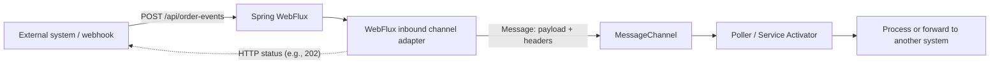
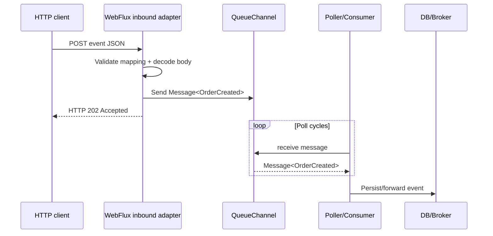

# WebFlux Inbound Channel Adapter in Spring Integration

## 1. Role of the Inbound Channel Adapter

In an integration system, an application can receive HTTP requests from partners, webhooks, or internal services and pass the data into a message processing flow. The **WebFlux inbound channel adapter** is the entry point that performs this: it receives HTTP requests through Spring WebFlux, converts the appropriate content into a Spring Integration `Message<?>`, and sends the message to a `MessageChannel`.

This is a component of the **SPRING_INTEGRATION_ADAPTERS** module, where inbound/outbound adapters, gateways, pollers, and `MessageChannel`s connect external systems to the integration flow. In this lesson, the external system is an HTTP client; the adapter's job is to bring data from HTTP into the flow, while routing, transformation, and business processing are delegated to downstream endpoints.

For example: a sales service sends an `order.created` event via HTTP POST. The adapter receives the event, creates a message, and forwards it to a channel; the channel's consumer persists, routes, or forwards the event to Kafka/JMS/AMQP.



**Key characteristic:** an inbound **channel adapter** is suited for one-way communication (receiving and forwarding messages). The HTTP client still receives an HTTP response per the HTTP contract, but this response does not carry a business result returned from the processing flow. If you need to process a request and return business data to the client within the same request, choose a **WebFlux inbound gateway**.

## 2. Distinguishing Adapters, Gateways, and WebFlux

| Component | Contract with client | Message flow | Use cases |
|---|---|---|---|
| WebFlux inbound **channel adapter** | Client receives an acknowledgment status code; does not wait for a business result payload | HTTP → `MessageChannel` | Webhooks, event ingestion, background commands |
| WebFlux inbound **gateway** | Client waits for a reply corresponding to the request | HTTP → request channel → reply → HTTP | Data lookups, APIs returning computed results |
| Spring MVC-based HTTP inbound adapter | Similar one-way contract, using Servlet/MVC web infrastructure | HTTP → `MessageChannel` | Applications using Spring MVC |
| WebFlux outbound gateway/adapter | Proactively calls HTTP **outbound** from the integration flow | `MessageChannel` → external HTTP server | Calling REST APIs of other systems |

WebFlux uses reactive APIs such as Reactor `Mono` and `Flux` to handle HTTP connections in a non-blocking model at the web layer when properly configured. However, **using WebFlux does not automatically make the entire Spring Integration flow non-blocking**. If you send messages into a `QueueChannel`, use a poller, or invoke blocking JDBC calls, those segments still exhibit the characteristics of their respective mechanisms.

Spring Integration has provided `WebFluxInboundEndpoint` since version 5.0; when using Java DSL, you typically configure it via the `WebFlux.inboundChannelAdapter(...)` factory rather than instantiating the endpoint directly. This serves as the bridge between HTTP request mapping, payload conversion, and a Spring Integration channel.

## 3. Project Setup and Data Ingestion Contract

The example uses Spring Boot, Spring WebFlux, and Spring Integration. When a project uses Spring Boot's BOM/dependency management, you should let the BOM manage compatible Spring Integration versions.

```groovy
// build.gradle (dependencies snippet)
dependencies {
    implementation 'org.springframework.boot:spring-boot-starter-webflux'
    implementation 'org.springframework.boot:spring-boot-starter-integration'
    implementation 'org.springframework.integration:spring-integration-webflux'
}
```

In a Spring Boot application using WebFlux auto-configuration, adding `@EnableWebFlux` is not required. For manually configured Spring Framework applications, you need to enable WebFlux infrastructure (e.g., `@EnableWebFlux`) and the appropriate Spring Integration infrastructure. Do not add `spring-boot-starter-web` just for this endpoint if your intention is to run a WebFlux application on a reactive server; if both MVC and WebFlux are present, verify which web application type is selected.

Suppose we expose the following endpoint:

| Element | Value |
|---|---|
| URI | `POST /api/order-events` |
| `Content-Type` | `application/json` |
| JSON body | `{"eventId":"evt-001","orderId":"ORD-1001"}` |
| Data in flow | `OrderCreated` (payload) and message headers |
| Success HTTP response | Explicitly configured `202 Accepted` |
| Business processing result | Handled later by the consumer; not returned as a response body |

In this learning example, `202 Accepted` means the valid request has been forwarded by the adapter to the channel for further processing. This status code **does not guarantee** that data has been durably persisted or that the business task has completed.

## 4. Configuring a WebFlux Inbound Channel Adapter

A complete configuration class example:

```java
package com.example.integration;

import org.springframework.context.annotation.Bean;
import org.springframework.context.annotation.Configuration;
import org.springframework.http.HttpMethod;
import org.springframework.http.HttpStatus;
import org.springframework.http.MediaType;
import org.springframework.integration.annotation.Poller;
import org.springframework.integration.annotation.ServiceActivator;
import org.springframework.integration.config.EnableIntegration;
import org.springframework.integration.dsl.IntegrationFlow;
import org.springframework.integration.webflux.dsl.WebFlux;

@Configuration
@EnableIntegration
public class WebFluxOrderEventConfiguration {

    // DTO used to map the JSON request body.
    public record OrderCreated(String eventId, String orderId) {}

    @Bean
    public IntegrationFlow receiveOrderEvents() {
        return IntegrationFlow
            .from(WebFlux.inboundChannelAdapter("/api/order-events")
                .requestMapping(mapping -> mapping
                    .methods(HttpMethod.POST)
                    .consumes(MediaType.APPLICATION_JSON_VALUE))
                .requestPayloadType(OrderCreated.class)
                .statusCodeFunction(message -> HttpStatus.ACCEPTED))
            .channel(channels -> channels.queue("orderEventsQueue"))
            .get();
    }

    @ServiceActivator(
        inputChannel = "orderEventsQueue",
        poller = @Poller(fixedDelay = "500")
    )
    public void consume(OrderCreated event) {
        // Demo: replace with a service call, persistence, or sending the message to a broker.
        System.out.printf("Order event: %s -> %s%n",
            event.eventId(), event.orderId());
    }
}
```

**Configuration explanation:**

1. `WebFlux.inboundChannelAdapter("/api/order-events")` creates the HTTP entry point for the flow.
2. `requestMapping(...)` restricts requests to `POST` with a request body having `Content-Type: application/json`. Additional constraints such as paths, headers, and media types can be configured at the request mapping layer.
3. `requestPayloadType(OrderCreated.class)` instructs the HTTP message reader/codec mechanism to map the request body to the `OrderCreated` type. For JSON, the project must have an appropriate Jackson codec (usually included with the WebFlux starter).
4. `statusCodeFunction(...)` selects `202 Accepted` for the adapter's successful response. It does not generate a reply from a business service.
5. `.channel(channels -> channels.queue("orderEventsQueue"))` connects the adapter to a `QueueChannel`. This queue illustrates how to decouple the HTTP reception time from the consumer execution time.
6. `@ServiceActivator` with `@Poller(fixedDelay = "500")` periodically retrieves messages from the queue and invokes the `consume` method. `fixedDelay` is the interval between polls, not a fixed latency or throughput guarantee.

In this example, `QueueChannel` is an **in-memory application queue**, not a durable queue. If the process stops, messages not yet transferred to persistent storage can be lost. When reliable webhook ingestion is required, design a durable write step to a database/broker before acknowledging according to the system contract.

### 4.1. Testing with a Request

Start the application, then use `curl` (on PowerShell, you can call `curl.exe`):

```bash
curl -i -X POST http://localhost:8080/api/order-events \
  -H 'Content-Type: application/json' \
  -d '{"eventId":"evt-001","orderId":"ORD-1001"}'
```

When the endpoint works normally, the HTTP response has status `202 Accepted`. A subsequent poll cycle may print:

```text
Order event: evt-001 -> ORD-1001
```

Do not infer from log and HTTP response ordering that the consumer necessarily runs before or after the response: they can execute at different times depending on channel configuration, scheduler, and execution speed.

### 4.2. What Is Inside the Spring Integration Message?

An HTTP request is typically represented in the flow as:

```text
Message<OrderCreated>
  payload: OrderCreated(eventId="evt-001", orderId="ORD-1001")
  headers:
    ... Spring Integration metadata ...
    ... HTTP information mapped by the header mapper ...
```

`payload` is the business data converted from the HTTP request. `headers` contains metadata for routing, message correlation, and mapped HTTP information per configuration. Do not assume every HTTP header automatically appears or is trustworthy: the `HeaderMapper` mechanism may restrict which headers are imported, and client-sent headers can be spoofed.

If the request body is empty or the payload expression evaluates to `null`, the inbound endpoint has a fallback mechanism that uses request parameters as a `MultiValueMap<String, String>` payload. Therefore, you should explicitly control request type/validation and not assume the payload is always the DTO.

## 5. Runtime Flow and Asynchronous Contract

For the webhook example, the lifecycle can be understood as follows:



The diagram illustrates **one sample scenario** with a queue and poller. A few distinctions to keep in mind:

- An HTTP request is only considered successfully accepted when receiving and sending the message into the channel succeed per the endpoint contract; errors during mapping, decoding, or sending the message can still cause the request to fail.
- The adapter does not return the result of `consume`. If `consume` fails after the request has been acknowledged, the HTTP client does not receive that business error via the initial response.
- `202 Accepted` means accepted for further processing; it does not prove `exactly-once`, database commit, or successful delivery to a broker. Each system must design its own guarantee boundaries.
- If routed directly to a synchronous channel like `DirectChannel`, downstream processing may execute right on the message handling chain, changing response times and affecting the reactive flow. The queue in the example illustrates a processing boundary; an internal queue still needs persistence, capacity limits, and monitoring in production.

### 5.1. Which Channel Type Should You Use?

| Channel | Consumption mechanism | Advantages | Considerations |
|---|---|---|---|
| `DirectChannel` | Subscriber processes synchronously on the sending thread | Simple, few intermediate layers | I/O-blocking handlers can prolong the request path |
| `ExecutorChannel` | Dispatches to a `TaskExecutor` | Offloads execution to another thread | Needs executor/queue bounds; still provides no persistence guarantee |
| `QueueChannel` | Polling consumer receives from queue | Decouples reception/consumption timing | Requires poller, capacity control, and backlog handling |
| External broker via outbound adapter | Sends to Kafka, AMQP, JMS, etc. | Can support decoupled services and durable storage | Must consider write acks, retries, duplicates, and transactions |

No single channel automatically solves all backpressure and reliability requirements. Under high load, you need to explicitly define capacity, behavior when full, timeouts, retries, and criteria for returning an HTTP response.

## 6. Reactive Payload, Threading, and Backpressure

WebFlux receives HTTP requests reactively, but the overall behavior also depends on the payload type and downstream flow:

- With `requestPayloadType(OrderCreated.class)`, the body is decoded into **a single object**. Suitable for single-event JSON APIs like the example.
- When receiving a stream of elements, the WebFlux inbound endpoint can be configured with a `ResolvableType` for a reactive payload, such as `Flux<Event>`. Downstream must then understand and actively consume the publisher; do not confuse `Message<Flux<Event>>` with multiple pre-split `Message<Event>` messages.
- The `Publisher` mechanism supports demand/backpressure signaling across properly connected reactive segments. A blocking JDBC handler, an unbounded queue, or uncontrolled thread switching can negate this benefit.
- For I/O-blocking business logic, offload work to an appropriate executor/scheduler or use genuinely asynchronous/reactive APIs. Avoid running long blocking operations on the Reactor Netty event loop.

Example of **declaring a stream data type** (configuration snippet only; requires a consumer capable of handling the publisher):

```java
.requestPayloadType(
    ResolvableType.forClassWithGenerics(Flux.class, String.class)
)
```

To use the snippet above, import `org.springframework.core.ResolvableType` and `reactor.core.publisher.Flux`. Choosing between a single DTO and a `Flux` payload should be based on the actual request protocol, configured codecs, and downstream consumption contract.

## 7. Mapping, Validation, Security, and Errors

### Request Mapping and Data Conversion

Key matching conditions for an endpoint include the **path**, **HTTP method**, `Content-Type` consumed by the server (`consumes`), and potentially `headers`/request parameters. If a request does not match the mapping, WebFlux handles it as an HTTP route/media type error before a message is sent to the channel. When the mapping matches but JSON fails to decode, the request fails during the binding/codec step.

For business data, validate required fields such as `eventId` and `orderId` before persisting. Spring Integration WebFlux supports configuring a `Validator` on `WebFluxInboundEndpoint`; for reactive payloads, pay attention to where validation occurs on the publisher's elements. You can also place validation in the downstream flow when checking final payload state or business rules.

### Error Classification by Stage

| Stage | Examples | Handling approach |
|---|---|---|
| Before message creation | Wrong path, HTTP method, media type | Check mapping; client fixes request |
| While reading request | Malformed JSON, invalid DTO | Return appropriate client error and log safe details |
| When sending to channel | Channel has no consumer, queue full, send failure | Configure timeout, capacity, error channel, and monitoring |
| After returning `202` | Poller DB call fails, broker rejects, handler throws | Bounded retries, dead-letter/error flow, alerts, and reconciliation |

Do not assume every downstream exception propagates back as an HTTP response: the difference lies in whether the error happens **before or after the request is acknowledged**, and whether the flow is synchronous. Configure an `errorChannel` or error-handling mechanism appropriate for the endpoint/channel in use.

### Essential Operational Measures

1. **Authenticate the sender:** protect the endpoint with Spring Security, API keys, HMAC signatures, or mTLS as required; restrict permissions and only accept client headers you actually need.
2. **Deduplication:** use `eventId` as an idempotency key because webhooks may retry and the same event may arrive multiple times.
3. **Persist before ACK if needed:** if `202` is only promised after a broker or database confirms receipt of the message, place the acknowledgment boundary accordingly rather than relying on an in-memory queue.
4. **Load limiting:** bound request size, connection count, element count, queue capacity, poll rate, and processing time; define overload behavior.
5. **Observability:** log correlation/event IDs, track 2xx/4xx/5xx request counts, enqueue/dequeue rates, backlog message age, and retry counts; avoid logging full sensitive payloads.

## 8. When to Choose the Inbound Channel Adapter?

**Choose it** when the HTTP contract requires receiving an event/command, acknowledging receipt, and letting the integration flow process it afterward. Common use cases include payment system webhooks, order status change signals, partner notifications, or event ingestion APIs.

**Consider an inbound gateway** if the client needs result data in the same request, such as querying order status or receiving immediate business success/failure feedback after processing. If you need to provide progress for a long-running job, you can use an adapter to accept the command and return `202` alongside a separate status lookup mechanism (if the API contract requires it).

### Common Misconceptions

- **Confusing an adapter with a gateway:** an adapter does not use a reply channel to produce a business response body.
- **Assuming `202` means "fully processed":** it is a configured acceptance status code, not a commit receipt.
- **Assuming WebFlux guarantees end-to-end non-blocking:** the channel, poller, and downstream handlers largely determine actual behavior.
- **Pushing large JSON into an in-memory queue without bounds:** you must account for memory limits and overload strategies.
- **Ignoring idempotency:** client retries after timeouts can send duplicate messages even when the previous attempt was received.
- **Assuming every error goes back to the client:** asynchronous errors after ACK must be handled by a dedicated operational flow.

## 9. Self-Check Exercises

1. Run the `POST /api/order-events` endpoint with valid JSON and verify the HTTP `202` response along with the consumer log.
2. Try sending a `GET` to the same URL, sending a different `Content-Type`, and sending malformed JSON to observe the difference between mapping errors and decoding errors.
3. Temporarily make the consumer slow; observe the messages accumulating in `QueueChannel` and when logs appear.
4. Replace the body of `consume` with a database write or broker send; simulate a failure and determine where logging/retries run, and check whether the client already received a response.
5. Send the same `eventId` twice; design a deduplication mechanism in the processing layer and describe what conditions permit returning `202`.

**Reflection question:** If the system requirement is "only return `202` after the message is durably written to the broker," does simply adding `QueueChannel` and a poller as in the example meet that requirement? Why must you re-examine the acknowledgment boundary and error path?

## 10. References

- [Spring Integration Reference — WebFlux Support](https://docs.spring.io/spring-integration/reference/webflux.html): Java DSL API, `WebFluxInboundEndpoint`, inbound adapter/gateway, and codec configuration.
- [Spring Integration Reference — HTTP Namespace Support](https://docs.spring.io/spring-integration/reference/http/namespace.html): adapter/gateway semantics, request mapping, and shared HTTP options.
- [Spring Framework Reference — Web on Reactive Stack](https://docs.spring.io/spring-framework/reference/web/webflux.html): reactive HTTP model, codecs, request handling, and the Reactor ecosystem.

> **Takeaway:** A WebFlux inbound channel adapter turns an HTTP request into a Spring Integration message for the flow to receive and process. Design the HTTP contract, channel, poller, durability, and error handling deliberately; those are the parts that determine whether the integration system behaves properly under errors or heavy load.
