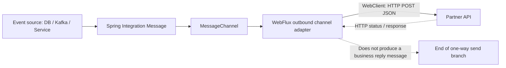
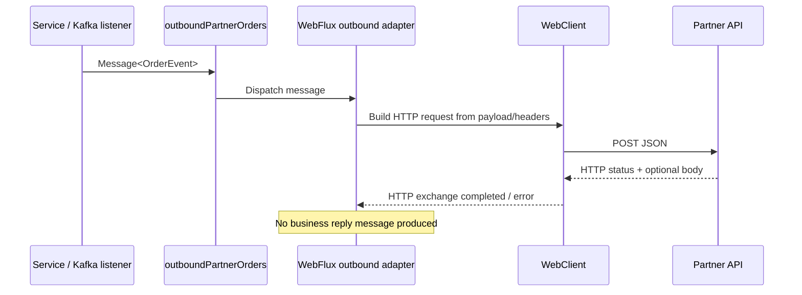

# WebFlux Outbound Channel Adapter in Spring Integration

## 1. What Problem Does the WebFlux Outbound Channel Adapter Solve?

The **WebFlux outbound channel adapter** is an endpoint that sends data **from a Spring Integration flow to an external HTTP server** using Spring WebFlux's `WebClient`. The adapter reads a `Message<?>` from a `MessageChannel`, selects the URL and HTTP method, maps the payload and necessary headers, and executes the HTTP request. This is a **one-way** integration component: the HTTP server's response does not become a business reply message in the flow.

In the **SPRING_INTEGRATION_ADAPTERS** module, we use inbound/outbound adapters, gateways, pollers, and `MessageChannel`s to connect external systems to the application. The WebFlux outbound adapter handles the **outbound** side of an HTTP contract; it can sit downstream of flows receiving data from files, SFTP, databases, JMS, AMQP, or Kafka, and forward notifications to a partner API.

**Scenario:** when the system records an order, the integration flow produces an `order.created` event. The shipping partner exposes an HTTP API `POST /api/events`. We need to forward the event to this API, while having no need to feed the partner's response body into subsequent business steps.



**Distinguishing the two dimensions of communication:** *outbound* describes the direction **from the application to an external system**; *channel adapter* describes the integration style that **does not produce a reply message**. HTTP still has a protocol-level response, so the adapter and operations still need to care about status codes, timeouts, and network errors. Do not interpret "one-way" as "no HTTP response" or "guaranteed delivery."

## 2. When to Use Outbound Adapter, Outbound Gateway, or Direct WebClient?

| Option | Input data | Data continuing in flow | Suitable use cases |
|---|---|---|---|
| **WebFlux outbound channel adapter** | Spring Integration `Message` | Does not create a reply message from the HTTP response | Pushing webhooks, sending events, notifying another API |
| **WebFlux outbound gateway** | Spring Integration `Message` | Reply message from the HTTP response | Calling an API whose status, body, or lookup data determines the next step |
| **WebFlux inbound adapter** | HTTP request sent **to** the application | Message pushed into an internal channel | Receiving webhooks or events from external systems |
| **Direct WebClient** | Call in Java code | `Mono`/`Flux` per application | No Spring Integration flow yet, only an HTTP client is needed |

Both outbound options are backed by `WebFluxRequestExecutingMessageHandler`, but **`WebFlux.outboundChannelAdapter(...)` is configured not to expect a reply** whereas **`WebFlux.outboundGateway(...)` is configured for request–reply**. If you need to inspect `response.statusCode()` to branch the next step, receive a returned DTO, or correlate the HTTP result into another message, use a gateway or place result handling inside a dedicated client component.

Worth noting: *reactive* reflects how the HTTP infrastructure uses Reactor/WebClient; it does **not** automatically make every channel, poller, JDBC operation, or handler in the entire flow non-blocking.

## 3. Preparing Dependencies and the HTTP Contract

The example uses Spring Boot with Spring Integration and WebFlux. Use the Spring Boot BOM to manage compatible dependency versions, avoiding mixing Spring Framework/Spring Integration versions across different generations.

```groovy
// build.gradle (dependencies section)
dependencies {
    implementation 'org.springframework.boot:spring-boot-starter-integration'
    implementation 'org.springframework.boot:spring-boot-starter-webflux'
    implementation 'org.springframework.integration:spring-integration-webflux'
}
```

`spring-integration-webflux` provides the endpoint and Java DSL. `spring-boot-starter-webflux` provides `WebClient` along with the codec/client ecosystem; an application that only performs outbound HTTP **does not need to expose a WebFlux inbound server endpoint**. For applications not using Spring Boot starters, you must manually configure `WebClient`, the HTTP client connector, and the required codecs.

Mock partner API contract:

| Property | Illustrative value | Meaning |
|---|---|---|
| HTTP destination | `http://localhost:9090/api/events` | Separate mock service running on port 9090 |
| HTTP method | `POST` | Sends the event |
| Request `Content-Type` | `application/json` | Body is serialized as JSON |
| Request header | `X-Event-Id: evt-001` | Event identifier for tracking/deduplication |
| Request body | `{"eventId":"evt-001","orderId":"ORD-1001","type":"order.created"}` | Business payload |
| Sample response | `202 Accepted` | Partner API accepted the request per its own contract |
| Reply message | None | Adapter does not convert the HTTP response into a flow payload |

`202 Accepted` is returned by the **partner server**, distinct from the status code of an **inbound adapter** exposed by our own application. Whether the server returns `200`, `201`, or `202`, the outbound adapter remains a one-way endpoint; what constitutes success must be based on the actual HTTP contract.

## 4. Configuring an Outbound Channel Adapter with Java DSL

### 4.1. Creating the Channel, WebClient, and IntegrationFlow

```java
package com.example.integration;

import org.springframework.beans.factory.annotation.Qualifier;
import org.springframework.context.annotation.Bean;
import org.springframework.context.annotation.Configuration;
import org.springframework.http.HttpHeaders;
import org.springframework.http.HttpMethod;
import org.springframework.integration.channel.DirectChannel;
import org.springframework.integration.config.EnableIntegration;
import org.springframework.integration.dsl.IntegrationFlow;
import org.springframework.integration.webflux.dsl.WebFlux;
import org.springframework.messaging.MessageChannel;
import org.springframework.web.reactive.function.client.WebClient;

@Configuration
@EnableIntegration
public class PartnerOutboundConfiguration {

    @Bean
    public MessageChannel outboundPartnerOrders() {
        return new DirectChannel();
    }

    @Bean
    public WebClient partnerWebClient(WebClient.Builder builder) {
        return builder.build();
    }

    @Bean
    public IntegrationFlow sendPartnerOrderEvents(
            @Qualifier("outboundPartnerOrders") MessageChannel channel,
            WebClient partnerWebClient) {

        return IntegrationFlow.from(channel)
            .handle(WebFlux.outboundChannelAdapter(
                    "http://localhost:9090/api/events", partnerWebClient)
                .httpMethod(HttpMethod.POST)
                .mappedRequestHeaders(
                    HttpHeaders.CONTENT_TYPE,
                    "X-Event-Id"))
            .get();
    }
}
```

Explanation of each component:

1. **`outboundPartnerOrders`** is the input channel of the HTTP send branch. `DirectChannel` is used here to make the message path clear; you can choose another channel depending on coordination, load, and processing boundary requirements.
2. **`partnerWebClient`** is the HTTP client passed into the adapter. TLS, proxy, authentication, timeouts, `ExchangeFilterFunction`, and connection pooling can be configured in one place.
3. **`IntegrationFlow.from(channel)`** receives messages sent to the channel.
4. **`WebFlux.outboundChannelAdapter(url, webClient)`** creates a one-way HTTP sending handler targeting a fixed URL. This is the central API of this lesson.
5. **`.httpMethod(HttpMethod.POST)`** selects the HTTP method. Rather than relying on implicit defaults, configure it explicitly to match the partner's contract.
6. **`.mappedRequestHeaders(...)`** restricts which message headers are mapped to the HTTP request; this example only needs `Content-Type` and `X-Event-Id`.

Depending on the Spring Integration version, the Java DSL also offers `outboundChannelAdapter(URI)`, `outboundChannelAdapter(String)`, and overloads accepting functions/expressions to compute the URI at runtime. A fixed URL is the easiest way to start learning.

### 4.2. Sending Messages to the Channel

Define a DTO and a publisher that sends a message with a JSON payload and headers:

```java
package com.example.integration;

public record OrderEvent(String eventId, String orderId, String type) { }
```

```java
package com.example.integration;

import org.springframework.beans.factory.annotation.Qualifier;
import org.springframework.http.HttpHeaders;
import org.springframework.http.MediaType;
import org.springframework.messaging.Message;
import org.springframework.messaging.MessageChannel;
import org.springframework.messaging.support.MessageBuilder;
import org.springframework.stereotype.Component;

@Component
public class PartnerEventPublisher {

    private final MessageChannel outboundPartnerOrders;

    public PartnerEventPublisher(
            @Qualifier("outboundPartnerOrders") MessageChannel channel) {
        this.outboundPartnerOrders = channel;
    }

    public boolean publish(OrderEvent event) {
        Message<OrderEvent> message = MessageBuilder.withPayload(event)
            .setHeader(HttpHeaders.CONTENT_TYPE, MediaType.APPLICATION_JSON)
            .setHeader("X-Event-Id", event.eventId())
            .build();

        return outboundPartnerOrders.send(message);
    }
}
```

An order processing service or Kafka/JMS listener can call:

```java
publisher.publish(new OrderEvent("evt-001", "ORD-1001", "order.created"));
```

`MessageChannel.send(...)` returns a `boolean` per the **channel** contract. A `true` return value is **not** proof that the partner system processed the event, committed to a database, or even that the asynchronous HTTP exchange has finished. Do not use this value as the sole basis for marking an event as "successfully delivered."

### 4.3. Shape of the HTTP Request

With a properly configured JSON codec, the request sent to the partner looks like:

```http
POST /api/events HTTP/1.1
Host: localhost:9090
Content-Type: application/json
X-Event-Id: evt-001

{"eventId":"evt-001","orderId":"ORD-1001","type":"order.created"}
```

This is a **contract illustration**, not an exact byte dump from WebClient: HTTP protocol version, `Content-Length`, `Transfer-Encoding`, and transport headers may vary by client/server. Spring Integration `MessageHeaders` are not passed verbatim as HTTP headers; they go through the header mapping layer.

## 5. Testing with a Mock HTTP Server

To observe the receiving side, you can run a **standalone Spring Boot WebFlux application** on port `9090` with this simple controller:

```java
import java.util.Map;
import org.springframework.http.MediaType;
import org.springframework.http.ResponseEntity;
import org.springframework.web.bind.annotation.PostMapping;
import org.springframework.web.bind.annotation.RequestBody;
import org.springframework.web.bind.annotation.RequestHeader;
import org.springframework.web.bind.annotation.RestController;
import reactor.core.publisher.Mono;

@RestController
public class PartnerMockController {

    @PostMapping(path = "/api/events",
                 consumes = MediaType.APPLICATION_JSON_VALUE)
    public Mono<ResponseEntity<Void>> receive(
            @RequestBody Mono<Map<String, Object>> payload,
            @RequestHeader("X-Event-Id") String eventId) {

        return payload
            .doOnNext(body -> System.out.println(
                "Received " + eventId + ": " + body))
            .thenReturn(ResponseEntity.accepted().build());
    }
}
```

Configure the receiving application separately:

```yaml
# application.yml of the mock application, for illustration only
server:
  port: 9090
```

Start the mock partner application and the event-publishing application in two separate processes. After calling `publisher.publish(...)` in the sender application, check the mock receiver logs to see `eventId` and the body. To test the mock receiver directly without going through Spring Integration, you can run:

```bash
curl -i -X POST http://localhost:9090/api/events \
  -H 'Content-Type: application/json' \
  -H 'X-Event-Id: evt-001' \
  -d '{"eventId":"evt-001","orderId":"ORD-1001","type":"order.created"}'
```

Receiving `202 Accepted` from the mock server confirms the endpoint received the request. It does **not** mean the outbound adapter produced a reply message for the flow; in the configuration above, the send branch ends at the HTTP handler.

## 6. Request Sending Lifecycle and the Meaning of Reactive Processing



WebClient is built on Reactive Streams, so sending requests, reading bodies, handling statuses, and emitting error signals are modeled through publishers. In some configurations using a **reactive output channel**, publisher execution depends on downstream **subscription**. For a normal one-way outbound branch, Spring Integration manages how the handler triggers/integrates asynchronous work according to the endpoint context; learners should not call `block()` themselves to "force WebFlux to run" inside the flow.

**Distinguishing four key milestones:**

| Milestone | What can be asserted | What remains uncertain |
|---|---|---|
| Message created | Payload and headers exist in the application | Not yet sent over the network |
| Channel accepts message | Message passed the channel's send contract | HTTP may not have completed yet |
| HTTP client receives success response | Remote server returned an appropriate status | Remote business logic may not have durably processed it |
| Remote confirms business commit | Per the partner's own protocol/receipt | Must be verified against the specific service contract |

If the channel is a `DirectChannel`, dispatching to the handler happens in the caller's send context, while HTTP I/O still uses `WebClient`'s mechanism. If the channel is an `ExecutorChannel` or has a queue/poller, the path through schedulers, queue limits, and request dispatch timing also changes. Do not equate *non-blocking at the WebClient layer* with *end-to-end backpressure and durability guarantees across the entire system*.

## 7. Payload, Headers, URI, and HTTP Method

### 7.1. How Is the Payload Sent?

By default, an outbound HTTP handler extracts the payload from the `Message` as the request body according to the `extractPayload` setting. For an `OrderEvent` record, WebClient and the JSON codec can serialize the object to JSON. For `GET`, a body is usually inappropriate; in that case, use the URL, query params, or URI variables, and consider `extractPayload(false)` if the protocol requires it.

Since Spring Integration 5.2, `WebFluxRequestExecutingMessageHandler` supports more request payload types: `Publisher`, `Resource`, `MultiValueMap`, etc. When the payload is a `Publisher<T>`, you may need `.publisherElementType(T.class)` so WebClient knows the element type to encode. For example:

```java
.handle(WebFlux.outboundChannelAdapter(
        "https://partner.example/api/stream")
    .httpMethod(HttpMethod.POST)
    .publisherElementType(OrderEvent.class))
```

This is a DSL snippet illustrating a **`Publisher<OrderEvent>` message payload**; it does not turn a regular DTO into an event stream, nor does it guarantee the target server supports streaming media types. Check codecs, content types, and how the server reads streams before applying it.

### 7.2. Header Mapping

Headers such as `Content-Type`, `Accept`, `Authorization`, `X-Correlation-Id`, and `X-Event-Id` serve different roles. Pass only the allowed set of headers, avoiding accidentally leaking `replyChannel`, internal authentication details, or data from other messages across system boundaries. For application-level static credentials, configuring them in `WebClient` or an `ExchangeFilterFunction` is usually easier to control than copying arbitrary headers from external sources.

Example of adding a token from deployment-provided security configuration:

```java
// Illustrated inside WebClient configuration; token obtained from secure secret/config.
WebClient client = builder
    .defaultHeaders(headers -> headers.setBearerAuth(accessToken))
    .build();
```

Do not hardcode tokens in source code or production examples. When tokens are short-lived, use OAuth2 clients/filters or an appropriate refresh mechanism instead of a static value.

### 7.3. Dynamic URI per Message

Overloads of `WebFlux.outboundChannelAdapter(...)` allow selecting the URI from the `Message` via a function or SpEL. This can be used when each partner has its own endpoint, but **never pass an arbitrary client-supplied URL into WebClient**. With dynamic URIs, validate host allowlists, HTTPS scheme, ports, redirects, and DNS to mitigate SSRF risk; even better, look up URLs from controlled configuration using a partner identifier.

## 8. Response Handling, Timeouts, and Errors

### 8.1. When Does HTTP Fail?

| Error type | Examples | How to observe and handle |
|---|---|---|
| Request creation / serialization | DTO unsupported by codec, invalid URI | Log safe message context, fix payload/config contract |
| Connection | DNS, TLS handshake, connection refused | Bound timeouts, conditional retries, network alerts |
| HTTP 4xx | `400`, `401`, `403`, `404`, `429` | Distinguish bad request, auth failure, and rate limits; do not retry all 4xx |
| HTTP 5xx | `500`, `502`, `503`, `504` | Bounded retries, circuit breaker, and dead-letter per policy |
| Error after server receipt | Client times out waiting for response | Request may already be processed; retries must be idempotent |
| Internal operational issues | Full executor, handler error, insufficient queue capacity | Monitor error channel, logs/metrics, and apply overload policies |

For a one-way adapter, **the HTTP response is not forwarded as a reply message**. This does not make errors disappear: an unsuccessful status or connection failure can raise error signals, exceptions, or error messages depending on synchronous/asynchronous paths and endpoint configuration. Do not assume every error will surface right at the `channel.send(...)` line, especially when running on a reactive publisher or executor.

In real applications, deliberately configure error handling in Spring Integration (`errorChannel`, error flows, retry advice, or other layers compatible with the endpoint), how success is determined from the HTTP status, and where unsent events are stored. Verify the behavior on your **specific Spring Integration version** by testing network failures/4xx/5xx.

### 8.2. Configuring Timeouts for WebClient

Example of configuring timeouts **at the HTTP client layer** with Reactor Netty:

```java
import java.time.Duration;
import org.springframework.http.client.reactive.ReactorClientHttpConnector;
import org.springframework.web.reactive.function.client.WebClient;
import reactor.netty.http.client.HttpClient;

HttpClient httpClient = HttpClient.create()
    .responseTimeout(Duration.ofSeconds(5));

WebClient client = WebClient.builder()
    .clientConnector(new ReactorClientHttpConnector(httpClient))
    .build();
```

`responseTimeout` controls Reactor Netty's response wait aspect; it does not represent the entire deadline of a business operation (such as pre-send queues, multiple retries, or downstream processing time). When using TLS, proxies, or connection pools, also configure connect timeouts, pool bounds, and policies appropriate for your environment.

### 8.3. Retries and Idempotency

A partner may receive a request and write to its DB successfully, yet the response is lost. The client sees a timeout and resends the same event; if the server does not deduplicate, the system may execute the business logic twice. Therefore, you should:

1. Attach a **stable `eventId`/idempotency key** on every event. Reuse the same key on retries.
2. Specify which error codes are retryable (e.g., connection loss, `429`, certain `5xx`) and which must stop so data or credentials can be fixed.
3. Use **exponential backoff + jitter**, cap the retry count and total duration, and avoid infinite retries that amplify load.
4. Persist delivery status, identify dead-letters, and reconcile. If delivery guarantees across application restarts are required, use a persistent outbox or durable broker.
5. Confirm with the partner the semantics of `2xx`: **accepted**, **processed**, or **committed**, to decide when to record success state.

Do not stack multiple retry mechanisms simultaneously across WebClient, IntegrationFlow, Kafka/JMS, and schedulers without calculating total duplicate deliveries during failures.

## 9. Designing the Message Contract and Protecting the System

For flows forwarding from Kafka/JMS/AMQP/file/SFTP/DB, in addition to the JSON body, define:

- **Schema/version:** event type, ID, timestamp, payload version, and compatibility across partners.
- **Correlation:** `X-Correlation-Id` or trace context to correlate HTTP requests with source messages and partner logs.
- **Security:** HTTPS, server authentication, token/HMAC as needed; secrets must come from configuration/secret stores and have a rotation process.
- **Resource limits:** timeouts, connection pools, send rate, queue length, payload size, concurrency, memory, and backpressure.
- **Connection lifecycle:** WebClient is normally reused; do not instantiate a new client/connection pool per message. Monitor connections, DNS/TLS, and application shutdown events.
- **Reliability:** clearly define *at-least-once*, message loss possibilities, deduplication, and criteria for marking as sent.

A flow with only an adapter does not inherently provide a durable queue or cross-system transactions. If starting from Kafka or JMS, separately analyze **when the source message is ACKed/committed** relative to HTTP request success. ACKing too early can lose events; ACKing late with retries can send duplicates. This is an architectural choice, not a property automatically guaranteed by the WebFlux outbound adapter.

## 10. Common Misconceptions

| Misconception | Correct understanding |
|---|---|
| "Outbound adapter means fire-and-forget, no need to care about responses" | HTTP still has responses and errors; the adapter simply does not emit a **business reply message** |
| "`MessageChannel.send()` returning `true` means the partner wrote successfully" | Returns per the channel contract; does not prove remote commit |
| "`WebClient` is always non-blocking so every handler is safe on the event loop" | Any blocking I/O before or after the adapter still needs proper schedulers/design |
| "Partner's `202` guarantees processing is complete" | Read the exact API contract; usually only confirms acceptance for processing |
| "Retrying `POST` on timeout is always safe" | A timeout does not tell whether the server received it; idempotency is required |
| "Having an outbound adapter gives guaranteed delivery" | Needs outbox, broker, retries, observability, and confirmation per business contract |
| "Empty response body is an error" | Many successful APIs return `204 No Content` or `202` with no body; a gateway is only needed when business logic requires processing a reply |

## 11. Exercises

1. Build the sender application with `PartnerOutboundConfiguration`, `OrderEvent`, and `PartnerEventPublisher`; create a separate mock receiver on port 9090. Send an event and verify the body + `X-Event-Id` at the mock receiver.
2. Change the mock receiver to return `204 No Content`; observe that the outbound adapter flow still has no reply message to process.
3. Intentionally stop the mock receiver, then send an event; inspect where exceptions/error messages are raised and distinguish the return value of `MessageChannel.send()` from HTTP delivery.
4. Have the mock receiver return `429` or `503`; design a bounded retry policy and check the actual number of requests received before/after retry.
5. Send the same `eventId` twice; implement an idempotency table or deduplication mechanism on the receiver side to prove the business logic runs only once.
6. Switch the trigger from a plain Java method call to a Kafka/JMS consumer or database poller; determine when source ACK occurs and analyze message loss/duplication scenarios.

**Check question:** If the business requirement states *update the order status only after reading `trackingId` from the partner's response body*, should you keep the outbound channel adapter? Explain why an outbound gateway is better suited for that request–reply contract.

## 12. References

- [Spring Integration Reference — WebFlux Support](https://docs.spring.io/spring-integration/reference/webflux.html): WebFlux outbound concepts, Java DSL, `WebFluxRequestExecutingMessageHandler`, `Publisher` payloads, and HTTP mapping.
- [Spring Integration API — WebFlux Java DSL](https://docs.spring.io/spring-integration/api/org/springframework/integration/webflux/dsl/WebFlux.html): `outboundChannelAdapter` and `outboundGateway` overloads.
- [Spring Integration API — WebFluxMessageHandlerSpec](https://docs.spring.io/spring-integration/api/org/springframework/integration/webflux/dsl/WebFluxMessageHandlerSpec.html): `publisherElementType`, `replyPayloadToFlux`, and shared HTTP handler options.
- [Spring Integration Reference — HTTP Support](https://docs.spring.io/spring-integration/reference/http.html): outbound channel adapter/gateway semantics, request/response, and header mapping.
- [Spring Framework Reference — WebClient](https://docs.spring.io/spring-framework/reference/web/webflux-webclient.html): WebClient configuration, HTTP client, request attributes, and response handling.

> **Takeaway:** A WebFlux outbound channel adapter connects a `MessageChannel` to an external HTTP API using WebClient without creating a business reply message. Separate channel send behavior, HTTP exchange results, and the partner's degree of business completion when designing retries, idempotency, timeouts, and error management.
