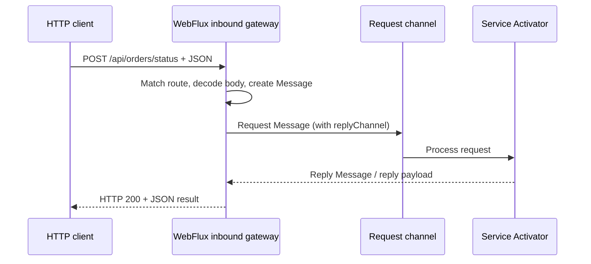
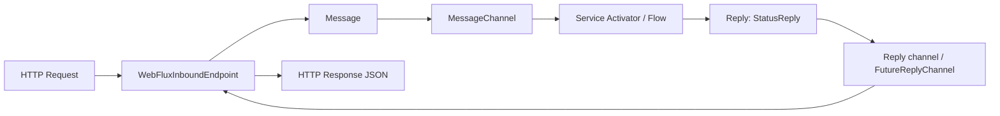

# WebFlux Inbound Gateway for Request-Reply in Spring Integration

## 1. Why Do We Need a WebFlux Inbound Gateway?

In an integration system, an HTTP client sometimes needs to **immediately receive a business result** after sending a request: checking order status, verifying a quota, calculating shipping fees, or querying data from a backend service. In those cases, simply pushing the request onto a queue and returning an acceptance code is not enough. You need a **request-reply** endpoint: accept an HTTP request, convert it into a Spring Integration `Message`, wait for a corresponding reply, and turn that reply into an HTTP response.

The **WebFlux inbound gateway** is the component that fulfills that contract in Spring Integration using Spring WebFlux infrastructure. It belongs to the adapter/gateway group of the **SPRING_INTEGRATION_ADAPTERS** module, where `MessageChannel`s, pollers, and endpoints connect to files, SFTP, HTTP, JMS, AMQP, Kafka, or databases. The gateway is the HTTP entry gate at the application boundary; downstream steps can be internal processing or calls to other external systems.

For example: an e-commerce app sends `POST /api/orders/status` with an `orderId`. The gateway converts the JSON body into `Message<StatusRequest>`; a handler looks up the status; the `StatusReply` is serialized to JSON and returned to the client within **the same HTTP request**.



The diagram shows the logical path. **WebFlux can await the reply asynchronously** (via publishers), so the "wait" arrow does not mean blocking a servlet thread for the entire processing duration. However, if a downstream handler uses synchronous JDBC, makes blocking API calls, or runs heavy CPU work on the event loop, those segments still incur real blocking/compute cost.

## 2. Distinguishing Inbound Gateway from Inbound Channel Adapter

| Criterion | WebFlux inbound **gateway** | WebFlux inbound **channel adapter** |
|---|---|---|
| Meaning | HTTP request **and** business HTTP response | Receives HTTP, forwards message one-way |
| Java DSL call | `WebFlux.inboundGateway(...)` | `WebFlux.inboundChannelAdapter(...)` |
| Flow | HTTP → request message → handler → reply message → HTTP | HTTP → message → channel/consumer |
| Result for client | Can be a DTO, JSON, text, stream, or empty body per contract | Usually returns an acknowledgment status code, no business reply |
| Suitability | Lookups, computations with immediate results, business-synchronous APIs | Webhooks, event ingestion, background jobs |
| Timeout possibilities | When no reply arrives within the configured deadline | Mainly tied to receiving, sending to channel, and HTTP handling |

**Further distinction:** "inbound" refers to the **connection direction** (HTTP client calls **into** the application), while "gateway" refers to the **request-reply contract**. A WebFlux **outbound gateway** does the reverse: a message in a Spring Integration flow triggers an HTTP request **outbound**, and the response from the external service becomes an internal reply message.

Avoid choosing a gateway if the business operation takes tens of minutes and the client does not need an immediate result. In that case, a `202 Accepted` + `jobId` + status polling API or callback pattern is usually easier to operate.

## 3. Components and Message Contract



Specific roles:

1. **Request mapping** matches path, HTTP method, and content negotiation (`consumes`, `produces`). Non-matching requests are handled by WebFlux infrastructure before entering the flow.
2. **HTTP message readers/codecs** decode the request body according to `Content-Type` and `requestPayloadType`, e.g., JSON into a Java record. Only HTTP headers permitted by the mapper are copied into the message.
3. **Request message** carries the `payload`, required headers, and reply routing information such as the framework-managed `replyChannel` header. Do not treat `replyChannel` as business data that clients are allowed to supply.
4. **MessageChannel and handler** route the request to a Service Activator, router, transformer, or multi-step flow. The handler produces a reply via its return value or by sending a message to the appropriate reply channel.
5. **Reply message** is converted by the gateway into an HTTP response using HTTP writers/codecs. The gateway can choose the status code, response headers, and how to extract the payload from the reply.

In WebFlux, `WebFluxInboundEndpoint` supports `sendAndReceive` with asynchronous replies. Internally it uses an equivalent of **`FutureReplyChannel` mapped to a `Mono`** to respond when the reply arrives. This allows the HTTP request to avoid holding a thread blocked waiting for a reply in the traditional manner; it does **not** mean all downstream processing automatically becomes reactive.

## 4. Setting Up the Spring Boot Project

The example uses Spring Boot, Spring Integration, and WebFlux. Let Spring Boot's BOM manage compatible versions with Spring Integration. Gradle dependencies:

```groovy
dependencies {
    implementation 'org.springframework.boot:spring-boot-starter-webflux'
    implementation 'org.springframework.boot:spring-boot-starter-integration'
    implementation 'org.springframework.integration:spring-integration-webflux'
}
```

`spring-integration-webflux` contains the endpoint and DSL; `spring-boot-starter-webflux` adds the reactive HTTP infrastructure and standard JSON codecs. In Spring Boot with WebFlux auto-configuration enabled, manually adding `@EnableWebFlux` is unnecessary. When configuring plain Spring Framework, you must enable the WebFlux and Spring Integration infrastructure appropriately.

If both `spring-boot-starter-web` and `spring-boot-starter-webflux` are present, check which web application mode (Web MVC vs WebFlux) is selected. Never assume the presence of `WebClient` proves the server is running on the reactive stack.

Sample API contract:

| Element | Value |
|---|---|
| HTTP | `POST /api/orders/status` |
| Request `Content-Type` | `application/json` |
| Client `Accept` | `application/json` |
| Request body | `{"orderId":"ORD-1001"}` |
| Payload received by flow | `StatusRequest(orderId)` |
| Reply payload | `StatusReply(orderId, status)` |
| Success response | `200 OK`, JSON body |

Here we intentionally keep the lookup problem simple to focus on the request-reply contract. In production, status is fetched from a service or database, with authorization and validation.

## 5. Configuring the Inbound Gateway with Java DSL

### 5.1. A Self-Contained IntegrationFlow

```java
package com.example.integration;

import org.springframework.context.annotation.Bean;
import org.springframework.context.annotation.Configuration;
import org.springframework.http.HttpMethod;
import org.springframework.http.MediaType;
import org.springframework.integration.config.EnableIntegration;
import org.springframework.integration.dsl.IntegrationFlow;
import org.springframework.integration.webflux.dsl.WebFlux;

@Configuration
@EnableIntegration
public class OrderStatusGatewayConfiguration {

    // HTTP JSON request -> Spring Integration message payload
    public record StatusRequest(String orderId) { }

    // Spring Integration reply payload -> HTTP JSON response
    public record StatusReply(String orderId, String status) { }

    @Bean
    public IntegrationFlow orderStatusGateway() {
        return IntegrationFlow
            .from(WebFlux.inboundGateway("/api/orders/status")
                .requestMapping(mapping -> mapping
                    .methods(HttpMethod.POST)
                    .consumes(MediaType.APPLICATION_JSON_VALUE)
                    .produces(MediaType.APPLICATION_JSON_VALUE))
                .requestPayloadType(StatusRequest.class)
                .replyTimeout(5_000))
            .handle((payload, headers) -> {
                StatusRequest request = (StatusRequest) payload;

                // Demo: return mock data, do not call blocking DB on the event loop.
                return new StatusReply(request.orderId(), "PROCESSING");
            })
            .get();
    }
}
```

**Step-by-step explanation:**

1. `WebFlux.inboundGateway("/api/orders/status")` registers an HTTP inbound endpoint with a request-reply contract.
2. `requestMapping(...)` requires `POST`, JSON request, and JSON-capable response production. Clients sending the wrong method/media type may be rejected before a message enters the flow.
3. `requestPayloadType(StatusRequest.class)` instructs the HTTP codec to decode the body into the `StatusRequest` record. This configuration **does not automatically guarantee** `orderId` is non-null, non-empty, or exists in the database; separate validation is needed.
4. `replyTimeout(5_000)` bounds how long the gateway waits for a reply under Spring Integration's reply timeout mechanism, in milliseconds; this is neither a TCP connect timeout nor an outbound `WebClient` response read timeout.
5. `.handle((payload, headers) -> ...)` is an inline service activator. The returned `StatusReply` is wrapped by Spring Integration into a reply message for the gateway to complete the HTTP response.
6. `.get()` completes the `IntegrationFlow` bean. Since this is an inbound endpoint, the application needs an appropriate web server running for clients to call into.

**Note on the example:** the handler returns in-memory mock data. With real DBs or APIs, do not make long blocking I/O calls directly on the WebFlux event loop. Use appropriate reactive clients or offload blocking work to a managed scheduler/executor, while also designing timeouts and concurrency limits.

### 5.2. Sending a Test Request and Inspecting the Response

When the application runs on `localhost:8080`, try:

```bash
curl -i -X POST http://localhost:8080/api/orders/status \
  -H 'Content-Type: application/json' \
  -H 'Accept: application/json' \
  -d '{"orderId":"ORD-1001"}'
```

Illustrative response:

```http
HTTP/1.1 200 OK
Content-Type: application/json

{"orderId":"ORD-1001","status":"PROCESSING"}
```

Status `200 OK` is an appropriate default for a successful query; actual codes and headers depend on HTTP/codec configuration. For `GET` without a body or `DELETE`, request mapping and payload extraction must be adjusted accordingly. Do not assume every HTTP method sends a JSON body.

## 6. Reply Channel, Correlation, and Multi-Step Flows

In the flow above, the handler returns a result directly, so no manual reply channel declaration is needed. Spring Integration carries reply context from the gateway to the handler via message headers and internal message exchange mechanics. A handler that receives a request, processes it, and returns an object or `Message<?>` establishes the return path for the result.

When splitting into multiple `IntegrationFlow`s, you can use a named request channel to decouple steps:

```java
@Bean
public IntegrationFlow orderLookupEntry() {
    return IntegrationFlow
        .from(WebFlux.inboundGateway("/api/orders/lookup")
            .requestMapping(m -> m.methods(HttpMethod.POST))
            .requestPayloadType(StatusRequest.class))
        .channel("orderLookupRequests")
        .get();
}

@Bean
public IntegrationFlow orderLookupWorker() {
    return IntegrationFlow.from("orderLookupRequests")
        .handle((payload, headers) -> {
            StatusRequest request = (StatusRequest) payload;
            return new StatusReply(request.orderId(), "DELIVERED");
        })
        .get();
}
```

The snippet above is an **alternative** to the Section 5 example: place them in an appropriate configuration to avoid duplicate URL registrations or unintended bean conflicts. The two flows connect via `orderLookupRequests`; the handler in the second flow still sends the reply back to the original request context as long as reply/correlation headers are properly preserved.

Some practical rules:

- **Preserve reply context:** do not construct a brand-new message from scratch and drop the `replyChannel` header or correlation info while still inside a request-reply branch. When recreating a `Message`, prefer transformations that preserve headers per Spring Integration's contract.
- **Do not treat `replyChannel` as a durable address:** it is typically tied to the pending request and short-lived. Do not serialize the entire message into Kafka, JMS, or a database and assume that header can still send back an HTTP response after an application restart.
- **Ensure one unambiguous reply:** if a router sends to a logging-only branch or a one-way handler that returns nothing, the gateway may wait until timeout. If a handler returns multiple replies inconsistent with the contract, define how replies are selected or aggregated.
- **When a flow exceeds HTTP deadlines:** switch to an asynchronous job-creation API or use callbacks/status polling rather than holding requests open indefinitely.

## 7. Reactive Replies and Server-Sent Events (SSE)

A WebFlux inbound gateway can return a publisher such as Reactor `Mono<T>` or `Flux<T>` when compatible codecs and `ReactiveAdapterRegistry` are present. This lets you stream data rather than waiting to assemble a large response before sending.

SSE example from Spring Integration Java DSL:

```java
package com.example.integration;

import java.time.Duration;
import org.springframework.context.annotation.Bean;
import org.springframework.context.annotation.Configuration;
import org.springframework.http.HttpMethod;
import org.springframework.http.MediaType;
import org.springframework.integration.dsl.IntegrationFlow;
import org.springframework.integration.webflux.dsl.WebFlux;
import reactor.core.publisher.Flux;

@Configuration
public class OrderUpdatesSseConfiguration {

    @Bean
    public IntegrationFlow orderUpdatesSse() {
        return IntegrationFlow
            .from(WebFlux.inboundGateway("/api/orders/updates")
                .requestMapping(mapping -> mapping
                    .methods(HttpMethod.GET)
                    .produces(MediaType.TEXT_EVENT_STREAM_VALUE)))
            .handle((payload, headers) -> Flux
                .just("QUEUED", "PROCESSING", "COMPLETED")
                .delayElements(Duration.ofSeconds(1)))
            .get();
    }
}
```

Testing the event stream:

```bash
curl -N -H 'Accept: text/event-stream' \
  http://localhost:8080/api/orders/updates
```

In the example, the handler returns a **`Flux<String>` as the reply payload**, and WebFlux handles it under the `text/event-stream` media type. Elements are delivered sequentially to the client as SSE events. Do not confuse a `Flux<String>` in **one reply** with multiple separate request messages.

SSE requires additional production decisions: handling client disconnects, limiting active subscriptions, resource protection, proxy/load balancer timeouts, heartbeats, authentication, and event recovery mechanisms. The example only emits three mock events and completes; it does not guarantee history retention or replay after disconnects.

### 7.1. When to Use Mono, Flux, and Plain DTOs?

| Reply | Usage | Things to watch out for |
|---|---|---|
| `StatusReply` | Single JSON result | Concise for standard lookup APIs |
| `Mono<StatusReply>` | Single result that may complete asynchronously | Do not call `block()` in the handler; ensure subscription and error handling along the flow |
| `Flux<StatusUpdate>` | Multi-element stream, e.g., SSE | Codecs/media type, backpressure, connection lifetime, and resource consumption |
| No reply | Usually unsuitable for request-reply | Client may time out; consider a channel adapter/job API |

## 8. Controlling HTTP Status, Response Body, and Headers

Spring Integration's HTTP components support configuring status codes, header mapping, and reply payload extraction. For a gateway:

- **Success:** typically `200 OK` with a body from the reply. You can use `statusCodeFunction(...)` or `statusCodeExpression(...)` on the inbound spec when the contract needs another status like `201 Created`, but verify the exact message context passed to the expression/function in your version.
- **Body:** by default, the HTTP response uses the **payload** of the reply message. The `extractReplyPayload` setting governs whether to use just the payload or the whole message when writing the response; make sure a codec can serialize the chosen type.
- **Headers:** `mappedResponseHeaders(...)` limits which reply headers are mapped to the HTTP response. Do not reflect all internal message headers externally.
- **Content negotiation:** client `Accept` and route `produces` must match a codec capable of writing the reply. For SSE, use `text/event-stream`; for standard JSON, `application/json`.
- **Not-found results:** `404 Not Found` is an API contract decision, not automatically generated just because a service returns a DTO with status `"NOT_FOUND"`. Design explicit error or status mapping.

Illustrative snippet showing a fixed status option for a resource-creation route:

```java
.from(WebFlux.inboundGateway("/api/orders")
    .requestMapping(m -> m.methods(HttpMethod.POST))
    .statusCodeFunction(message -> org.springframework.http.HttpStatus.CREATED))
```

This is a **DSL fragment**, not a complete flow; you should only return `201 Created` when the business operation actually creates a resource, optionally with a `Location` header per the HTTP contract. Avoid hardcoding `201` for every request if the operation might fail or not create data.

## 9. Timeouts, Validation, and Error Handling

### 9.1. Classifying Errors by Stage

| Stage | Scenario | Result / handling approach |
|---|---|---|
| HTTP mapping | Wrong path, method, `Content-Type`, `Accept` | WebFlux handles route/media type errors, typically 404/405/415/406 as applicable |
| Reading request | Invalid JSON, missing body fields | Codec/validation can reject; declare validation before business logic |
| Sending request message | Channel has no subscriber, overload, dispatch error | Configure `requestTimeout`, capacity/executor, and an appropriate error flow |
| Business processing | DB failure, service throws exception, no reply | Handle errors and map HTTP status per contract; do not default every error to `400` |
| Receiving reply | No reply before deadline | `replyTimeout`, handle timeout and inform the client |
| Client disconnects | Browser/network drops mid-flight | Monitor subscription cancellation and cleanup; background work may still continue |

**`requestTimeout`** limits sending the message to the request channel in situations where the channel can block; **`replyTimeout`** governs waiting for the reply. Neither is equivalent to the proxy/user's total HTTP deadline, nor to an outbound `WebClient` timeout calling an external API. When no reply arrives, defaults and version determine the HTTP status—many HTTP gateway configurations use `500` on reply timeout; configure explicit handling and verify in tests rather than assuming `504` by default.

`errorOnTimeout(true)` can produce an `ErrorMessage` with `MessageTimeoutException` sent to the configured error channel; this is a signal for observability and error-handling flows, and **does not automatically** guarantee a customized HTTP response is sent to the client. If you need to return `404`, `409`, `422`, or `503`, design exception/status mapping rules and verify HTTP output with integration tests.

### 9.2. Validation on WebFlux Inbound Endpoint

The WebFlux inbound endpoint has supported configuring a `Validator` since Spring Integration 5.2. Validation at this layer applies to elements of the publisher created by the HTTP message reader **before certain fallback/payload extraction steps**. For complex reactive payloads, if you need to validate the exact final data entering the flow, place validation downstream at the appropriate point.

Example conditions required for `StatusRequest`:

1. `orderId` is present, non-empty, and does not exceed maximum length.
2. The client is authorized to view that order's status.
3. If the order is not found, return the status/response matching the contract, never leaking a reply for another request.
4. Sensitive details in errors must be scrubbed before appearing in HTTP responses/logs.

`requestPayloadType(StatusRequest.class)` **only specifies the decode type**; it does not enforce those four conditions by itself. For validation failures detected by the endpoint, Spring Integration uses `IntegrationWebExchangeBindException` carrying `Errors` validation details; map only publishable details to avoid exposing internals.

## 10. Reactive Threading, Backpressure, and Request Lifecycle

WebFlux provides a reactive processing protocol, yet design across all components is still necessary:

- **Event loop:** avoid running blocking JDBC, `Thread.sleep`, or `.block()` on the Reactor Netty event loop. Use reactive R2DBC/WebClient or offload blocking work via `boundedElastic`/executors under an appropriate policy.
- **Channel:** `DirectChannel` invokes subscribers synchronously; `ExecutorChannel` dispatches through an executor; `QueueChannel` requires a poller. These choices determine latency, ingestion capacity, overload risk, and interaction with request timeouts.
- **Backpressure:** works meaningfully when both publisher and consumer honor demand. An unbounded queue or a blocking consumer becomes a bottleneck even when HTTP input uses `Mono`.
- **Cancellation:** when a client closes the connection, some reactive operations may cancel, while work already queued in thread pools, queues, or brokers can keep running. Do not equate "client disconnected" with "business operation definitely did not run."
- **Consistency:** do not use a gateway to wait on an unbounded distributed transaction. If the operation takes long or has an indeterminate duration, move to an accepted/job-status model with eventual results.

In request-reply APIs, higher throughput comes from avoiding unnecessary resource blocking and managing concurrency limits. Never rely solely on "using WebFlux" as proof that an application can sustain a specific request volume.

## 11. Security and Observability

**Security:** protect endpoints with Spring Security and appropriate authentication/authorization policies, use TLS in public environments, cap JSON size, validate input, and apply rate limiting. For cookie/session-based APIs, address CSRF according to the auth mechanism; stateless APIs need their own design. Never trust client-supplied `X-User-Id`, `replyChannel`, or correlation headers in place of authorization checks.

**Observability:** log request ID/correlation ID, route, per-stage latency, successful reply counts, 4xx/5xx rates, timeout counts, queue length, and external call durations. If placing a logging step at the end of a flow, preserve the reply path: a one-way logging/handler step can cause the request to lose its reply unless followed by `bridge()` or a returning endpoint. Avoid logging passwords, tokens, and full sensitive payloads.

**Connection lifecycle:** an HTTP client may leave while the gateway is still awaiting a service; timeouts at the gateway, HTTP server, and proxy should follow a consistent policy. During shutdown, consider stopping new requests, draining in-flight work, and bounding wait time before closing resources.

## 12. Self-Check Exercises

1. Run the `orderStatusGateway` example, send valid JSON, and verify `200 OK` with the `StatusReply` payload. Send a `GET` request to observe method rejection.
2. Send `Content-Type: text/plain` or malformed JSON; distinguish request mapping, codec, and business errors.
3. Replace the handler returning `StatusReply` with a logging-only handler that returns no reply; set a short `replyTimeout` in a test environment and observe the HTTP response and error flow.
4. Move the lookup handling to `orderLookupRequests` as in Section 6; confirm responses still return to the right client even under concurrent requests.
5. Add validation for `orderId`, testing `null`, empty string, overly long ID, and authorization; expose appropriate HTTP errors for each case.
6. Run the SSE example with `curl -N`, watch the three emitted items, and try disconnecting mid-stream. Explain why SSE requires cancellation/cleanup policies.
7. Make downstream processing slower than `replyTimeout`. Compare gateway logs, HTTP status, running work, and queued messages; propose when to switch to a job-creation API.

**Thought question:** A POST requires the system to write to a database and then send to JMS, returning `200 OK` only when both succeed. If JMS is slow or fails after the DB has committed, what should the inbound gateway return? Define the transaction boundary, idempotency, how to report incomplete state, and when to switch to an asynchronous design.

## 13. References

- [Spring Integration Reference — WebFlux Support](https://docs.spring.io/spring-integration/reference/webflux.html): `WebFluxInboundEndpoint`, Java DSL, `WebFlux.inboundGateway`, `FutureReplyChannel`, `Flux`, and validation.
- [Spring Integration API — WebFluxInboundEndpointSpec](https://docs.spring.io/spring-integration/api/org/springframework/integration/webflux/dsl/WebFluxInboundEndpointSpec.html): API for configuring gateways, request mapping, status, header mapper, and inherited options.
- [Spring Integration API — MessagingGatewaySpec](https://docs.spring.io/spring-integration/api/org/springframework/integration/dsl/MessagingGatewaySpec.html): `replyTimeout`, `requestTimeout`, `errorOnTimeout`, `replyChannel`, `errorChannel`.
- [Spring Integration Reference — HTTP Timeout Handling](https://docs.spring.io/spring-integration/reference/http/timeout.html): distinguishing timeouts across channels, inbound gateways, and outbound HTTP.
- [Spring Framework Reference — WebFlux](https://docs.spring.io/spring-framework/reference/web/webflux.html): reactive server, HTTP codecs, Reactor, and request/response processing.

> **Takeaway:** `WebFlux.inboundGateway(...)` receives an HTTP request, sends a message into a Spring Integration flow, and uses the reply to construct an HTTP response. The request-reply contract only works properly when downstream actually produces a reply, has an appropriate deadline, and explicitly handles errors, HTTP statuses, validation, and resource limits.
