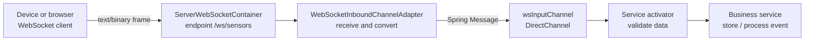
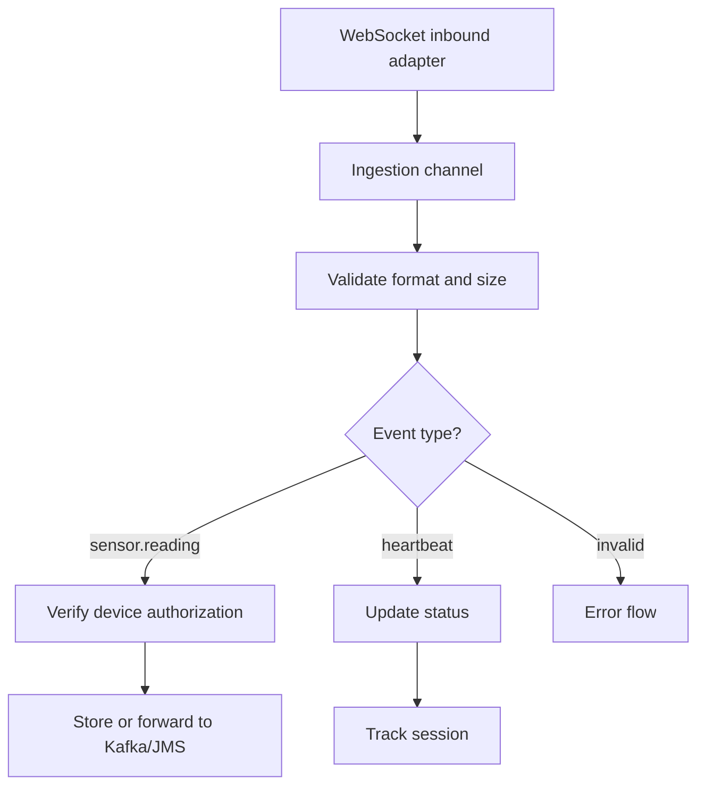

# WebSocket inbound channel adapter

## 1. Lesson objectives

In the **SPRING_INTEGRATION_ADAPTERS** module, we connect external systems to Spring Integration through **inbound/outbound adapters**, **gateways**, **MessageChannel**, and message flow orchestration mechanisms. This lesson belongs to the **Adapter WebSocket** chapter, focusing on the **WebSocket inbound channel adapter**: receiving messages from a WebSocket connection and bringing them into the internal processing flow.

After this lesson, you will be able to:

- Explain the roles of `WebSocketInboundChannelAdapter`, `IntegrationWebSocketContainer`, and `MessageChannel`.
- Configure a server-side WebSocket endpoint, receive text frames, and process JSON payloads using Spring Integration.
- Distinguish between inbound data, connection lifecycle events, and messages sent back to the client.
- Identify issues related to sub-protocols, error handling, high load, security, and connection management.
- Test the flow with a WebSocket client and determine what the adapter actually guarantees.

## 2. Why do we need an inbound adapter for WebSocket?

WebSocket creates a long-lived connection between client and server, allowing **both sides to proactively send data** after the HTTP Upgrade step. For example: monitoring devices sending real-time readings, operations dashboards sending action events, or a browser application pushing interactive updates.

If you write a `WebSocketHandler` directly, the application often has to receive frames, decode them, branch business logic, and call services manually. When using Spring Integration, the **inbound channel adapter** handles the entry boundary: turning incoming WebSocket data into `org.springframework.messaging.Message<?>`, then publishing it to `outputChannel`. Downstream components reuse Spring Integration's filter, transformer, router, service activator, and error channel mechanisms.

A concrete scenario: multiple devices send JSON like this:

```json
{
  "type": "sensor.reading",
  "deviceId": "sensor-01",
  "temperature": 26.5
}
```

The inbound adapter is responsible for receiving WebSocket data frames and forwarding messages into the channel. **Validating JSON, authenticating devices, persisting data, and alerting** are the responsibility of downstream flows/services. This separation lets the communication layer and business logic evolve independently.

### Flow diagram



**Note:** the name *inbound* refers to the data direction **from WebSocket into Spring Integration**. It does not mean that WebSocket only receives in one direction; a WebSocket session is inherently bidirectional. To send results back over WebSocket, you need to configure an outbound adapter/handler or an equivalent sending mechanism.

## 3. Components and message contract

| Component | Responsibility | Key points |
| --- | --- | --- |
| `ServerWebSocketContainer` | Registers the WebSocket URL on the server and manages the list of `WebSocketSession`s | For example `/ws/sensors`; used for server endpoints |
| `ClientWebSocketContainer` | Establishes a connection to a WebSocket server and manages the client session | An inbound adapter can also read data from the client side |
| `IntegrationWebSocketContainer` | Common abstraction for both container types | Can be shared for inbound/outbound on the same session |
| `WebSocketInboundChannelAdapter` | Listens for data from the container and emits `Message<?>` into the flow | It is a message producer, not a poller |
| `SubProtocolHandler` / registry | Interprets frames according to the sub-protocol and converts them into a Spring `Message` | Defaults to `PassThruSubProtocolHandler` |
| `MessageChannel` | Boundary between the adapter and the next processing step | For example `DirectChannel` or `ExecutorChannel` |
| `ServiceActivator` | Consumes messages to execute application processing | Should include input validation and error handling |

The data flow goes through the following steps:

1. The client sends an HTTP Upgrade and establishes a WebSocket session with the registered endpoint.
2. The container maintains the session and forwards received frames to the listener.
3. `WebSocketInboundChannelAdapter` registers as the container's `WebSocketListener`.
4. The sub-protocol handler converts `WebSocketMessage` into a Spring `Message`, including the payload and appropriate headers.
5. The adapter sends the message to `outputChannel`; the flow continues with transformation, validation, or business processing.

There are two constraints that are easy to overlook:

- **Each `IntegrationWebSocketContainer` can only register one `WebSocketListener`.** Do not create two inbound adapters trying to listen to the same container. You can split into multiple processing branches after the output channel using a router or publish-subscribe channel.
- The inbound adapter only sends messages into the flow that have `simpMessageType = MESSAGE` or no `simpMessageType` header. Messages of other types do not automatically become business events; with a sub-protocol like STOMP, they can be handled via `ApplicationEvent` and broker mechanisms.

### Payload and headers

For example, with a text frame containing a JSON string, the expected payload is a `String`. The adapter supports payload conversion via `payloadType` and `MessageConverter`; the default configuration of the inbound adapter uses `java.lang.String`. When the application needs a Java object, it can convert it in the next step of the Integration Flow or intentionally configure a converter and target type.

Messages also contain headers for infrastructure handling, such as the session identifier (commonly `simpSessionId`, depending on the sub-protocol/handler). **Do not use the session ID as proof of user authentication**: a session is connection metadata, whereas identity and access permissions must be verified separately.

## 4. Example: receiving sensor readings over WebSocket

The example assumes the project uses **Java 17+, Spring Boot 3.x, and Spring Integration 6.x**, running a servlet web application. Spring Boot manages compatible dependency versions; do not manually pin different versions for individual Spring libraries.

### 4.1. Dependencies

In `pom.xml`, add the following dependencies (skip if already present in the project):

```xml
<dependencies>
    <dependency>
        <groupId>org.springframework.boot</groupId>
        <artifactId>spring-boot-starter-web</artifactId>
    </dependency>
    <dependency>
        <groupId>org.springframework.boot</groupId>
        <artifactId>spring-boot-starter-integration</artifactId>
    </dependency>
    <dependency>
        <groupId>org.springframework.integration</groupId>
        <artifactId>spring-integration-websocket</artifactId>
    </dependency>
</dependencies>
```

`spring-boot-starter-web` provides Spring MVC and server-side web infrastructure; `spring-integration-websocket` provides the WebSocket adapters/containers. The example uses Jackson `ObjectMapper`, which is included in typical Spring Boot 3.x web configurations.

### 4.2. Declaring the container, adapter, channel, and handler

Create the configuration class below in a package scanned by Spring Boot. The example intentionally uses **raw WebSocket** with JSON text; **it does not use STOMP/SockJS**.

```java
package com.example.websocket;

import com.fasterxml.jackson.core.JsonProcessingException;
import com.fasterxml.jackson.databind.JsonNode;
import com.fasterxml.jackson.databind.ObjectMapper;
import org.springframework.beans.factory.annotation.Qualifier;
import org.springframework.context.annotation.Bean;
import org.springframework.context.annotation.Configuration;
import org.springframework.integration.annotation.ServiceActivator;
import org.springframework.integration.channel.DirectChannel;
import org.springframework.integration.config.EnableIntegration;
import org.springframework.integration.websocket.ServerWebSocketContainer;
import org.springframework.integration.websocket.inbound.WebSocketInboundChannelAdapter;
import org.springframework.messaging.MessageChannel;
import org.springframework.messaging.MessageHandler;
import org.springframework.messaging.MessagingException;

@Configuration
@EnableIntegration
public class WsInboundConfiguration {

    @Bean
    public ServerWebSocketContainer serverWebSocketContainer() {
        return new ServerWebSocketContainer("/ws/sensors");
    }

    @Bean
    public MessageChannel wsInputChannel() {
        return new DirectChannel();
    }

    @Bean
    public WebSocketInboundChannelAdapter wsInboundAdapter(
            ServerWebSocketContainer serverWebSocketContainer,
            @Qualifier("wsInputChannel") MessageChannel inputChannel) {

        WebSocketInboundChannelAdapter adapter =
                new WebSocketInboundChannelAdapter(serverWebSocketContainer);
        adapter.setOutputChannel(inputChannel);
        return adapter;
    }

    @Bean
    @ServiceActivator(inputChannel = "wsInputChannel")
    public MessageHandler sensorReadingHandler(ObjectMapper mapper) {
        return message -> {
            if (!(message.getPayload() instanceof String json)) {
                throw new MessagingException(message, "Only text payloads are accepted");
            }

            JsonNode data;
            try {
                data = mapper.readTree(json);
            } catch (JsonProcessingException exception) {
                throw new MessagingException(message, "Payload is not valid JSON",
                        exception);
            }

            String type = data.path("type").asText("");
            String deviceId = data.path("deviceId").asText("");
            JsonNode temperature = data.path("temperature");

            if (!"sensor.reading".equals(type)
                    || deviceId.isBlank()
                    || !temperature.isNumber()) {
                throw new MessagingException(message, "Missing or invalid data fields");
            }

            // Demo: replace with a business service / data persistence in a real project.
            System.out.printf("Received reading from %s: %.1f C%n",
                    deviceId, temperature.asDouble());
        };
    }
}
```

Meaning of the beans:

- `ServerWebSocketContainer("/ws/sensors")` creates the connection endpoint for WebSocket clients. When the Spring Integration configuration initializes, the built-in WebSocket infrastructure registers that endpoint with the servlet web application.
- `wsInputChannel()` is a `DirectChannel`. When the adapter sends a message, the downstream handler usually executes immediately on the calling thread. This example is suitable for understanding the basic flow.
- `wsInboundAdapter(...)` takes the container and assigns the **output channel**. Without properly assigning the destination channel for messages, data will not reach the intended business logic.
- `sensorReadingHandler` is the consumer. It checks the payload, parses JSON, validates the minimum required fields, and performs a demonstration action.

With Spring Integration, `@EnableIntegration` allows the infrastructure to detect and register WebSocket endpoints; in this example, you do not need to manually register an additional `WebSocketHandler` for the same path.

### 4.3. Testing from the browser

Run the Spring Boot application on port `8080`. In the browser's Developer Tools Console, execute:

```javascript
const socket = new WebSocket("ws://localhost:8080/ws/sensors");

socket.addEventListener("open", () => {
  console.log("WebSocket connected");
  socket.send(JSON.stringify({
    type: "sensor.reading",
    deviceId: "sensor-01",
    temperature: 26.5
  }));
});

socket.addEventListener("error", (event) => console.error("WebSocket error", event));
socket.addEventListener("close", (event) => console.log("Connection closed", event.code));
```

Expected result: the browser opens the connection successfully; the application log shows a line similar to `Received reading from sensor-01: 26.5 C`. This indicates that the message passed through the adapter, channel, and handler.

To test error cases, after connecting successfully, send:

```javascript
socket.send("{not-json}");
socket.send(JSON.stringify({
  type: "sensor.reading",
  deviceId: "",
  temperature: "too-hot"
}));
```

Both payloads violate the handler's contract. Depending on the error channel configuration and the application's exception handling mechanism, the error will be routed to the error channel or logged during processing. **Do not assume the client automatically receives an error message or that the connection is always closed.** The inbound adapter does not automatically generate a business response message.

## 5. Raw WebSocket, STOMP, and connection event handling

WebSocket is a **transport protocol**. STOMP is a **sub-protocol** with command semantics such as `CONNECT`, `SUBSCRIBE`, `SEND`, and send/receive destinations. The two models must be chosen intentionally.

| Scenario | Suitable configuration |
| --- | --- |
| Client sends text or binary frames in a custom format | Use the default `PassThruSubProtocolHandler` and process payloads in the flow |
| Client sends STOMP frames | Use `SubProtocolHandlerRegistry` and an appropriate `StompSubProtocolHandler` |
| Application needs topics, subscriptions, and a broker | Consider configuring a Spring WebSocket message broker or broker relay |
| Need to know when a session opens/closes | Handle session lifecycle events; do not expect corresponding business messages on the output channel |

When you want to receive STOMP, you can pass a `SubProtocolHandlerRegistry` as the second argument to the `WebSocketInboundChannelAdapter` constructor. The registry selects the handler based on the sub-protocol accepted by the session. The raw WebSocket example in the previous section is **not** a STOMP endpoint, and JavaScript's `WebSocket.send(JSON.stringify(...))` does not automatically create STOMP commands.

With `useBroker = false`, when receiving `SimpMessageType.CONNECT`, the adapter can send `CONNECT_ACK` directly back to the WebSocket session without emitting this message to the output channel. Setting `useBroker = true` is only suitable on the **server side** when a Spring WebSocket message broker and corresponding broker relay are configured; non-`MESSAGE` types and broker destinations are forwarded to the configured broker handler. Do not enable this flag just to "receive more message types".

## 6. Configuration properties to note

| Property / API | Purpose | When to care |
| --- | --- | --- |
| `container` / constructor | Specifies the required `IntegrationWebSocketContainer` | Every inbound adapter |
| `outputChannel` / `channel` | Destination receiving Spring `Message`s from the adapter | Every business processing flow |
| `errorChannel` / `error-channel` | Channel receiving `ErrorMessage`s in supported error scenarios | When you want systematic error observation and handling |
| `payloadType` / `payload-type` | Target Java type when converting payloads; defaults to `String` | When payloads are objects, strings, or binary |
| `messageConverters` | List of message converters | When JSON mapping or custom data formats are needed |
| `mergeWithDefaultConverters` | Whether to append default converters after custom-declared converters | To avoid unintentionally changing supported payload types |
| `sendTimeout` / `send-timeout` | Wait timeout when sending to a channel that may block | When using a bounded `QueueChannel` |
| `useBroker` / `use-broker` | Routes STOMP/broker messages according to broker configuration | Servers with a broker relay |
| `autoStartup`, `phase` | Manages endpoint startup/shutdown order and timing | Applications with multiple connections or ordered startup requirements |

In XML configuration, the corresponding element is `<int-websocket:inbound-channel-adapter>`. Attribute naming syntax follows Java/XML conventions, while the core responsibilities remain the same.

### Error channel vs. error messages sent back to WebSocket

An error channel belongs to the **internal message flow**. For example, when the handler fails to parse JSON, you can configure a channel and consumer for `ErrorMessage` to record metrics or forward error events to an observability system. If you want to return an error such as `{"error":"invalid_payload"}` to the client, you must design an additional **outbound** branch and a mechanism to correlate the exact target session. Do not treat error logs or `ErrorMessage`s as automatic WebSocket frames.

## 7. Designing a production processing flow

For a telemetry-receiving endpoint, it is usually good practice to separate the steps:



This flow connects naturally with other adapters in the module: data **enters via WebSocket**, and can then **exit via Kafka, JMS, AMQP, a database, or HTTP** depending on integration needs. Those adapters have their own delivery and retry contracts; inbound WebSocket does not turn them into an end-to-end transaction.

Some key principles:

1. **Define the input contract:** frame type, payload type, JSON schema, event version, size limits, and behavior on malformed data.
2. **Control load:** `DirectChannel` typically executes the handler on the calling thread; slow DB operations can prolong frame processing time. When load decoupling is needed, consider an `ExecutorChannel` with a bounded executor, bounded queue, and clear rejection policy.
3. **Define ordering:** asynchronous processing can alter completion order across messages. If per-device ordering matters, design a partition key or appropriate coordination mechanism.
4. **Define reliability:** WebSocket does not natively provide durable storage, business acknowledgment, deduplication, or replay on network loss. Application-level acknowledgment, event IDs, retries, and idempotency are needed if required.
5. **Manage lifecycle:** track session open/close events, idle timeouts, client-side reconnects, and resource cleanup on application shutdown.
6. **Security:** use `wss://` when deploying over a network, verify authentication and authorization at handshake and/or in business logic, enforce origin policies, and limit message size/rate. A client-reported `deviceId` alone is not sufficient to prove identity.
7. **Operational observability:** monitor active open sessions, error frame rates, handler latency, queue depth, and abnormal disconnects. Avoid logging full sensitive payloads.

### Is a poller needed?

**No.** The WebSocket inbound adapter is **event-driven**: when a frame arrives, the listener invokes the adapter. A poller only appears if you intentionally place a `QueueChannel` or a polling source between steps. This differs from file/FTP inbound adapters that periodically scan a source on a schedule.

### Does it automatically reply to requests?

**No.** The inbound channel adapter is a one-way ingestion point in the Integration Flow. To reply to a client over the same session, pair it with an appropriate outbound adapter and use session headers or business correlation consistently. If the problem involves request/reply with timeouts and a reply contract, consider a gateway or an explicit reply flow rather than expecting the inbound adapter to send results back automatically.

## 8. Common errors and root cause diagnosis

| Symptom | Causes to check | Approach |
| --- | --- | --- |
| WebSocket handshake fails (404/400) | URL, port, servlet mapping, endpoint registration, Upgrade proxy | Verify the `/ws/sensors` endpoint and WebSocket infrastructure configuration |
| Connects successfully but handler does not run | Wrong output channel assigned, wrong sub-protocol, missing consumer | Check channel names, adapter, and transformer/filter steps |
| JSON payload parsing fails | Client sends raw non-JSON text or a different schema | Inspect actual frames and the consumer validator |
| Attempting to create multiple inbound adapters on one container | A container only supports one WebSocket listener | Use one inbound adapter and route after the channel |
| Using a STOMP client with a raw WebSocket handler | Corresponding sub-protocol not configured | Configure STOMP registry/broker or switch client to raw |
| Client does not see processing results | No outbound flow configured | Design replies via an outbound adapter and session identifier |
| Latency increases with many clients | Synchronous handler or blocking downstream | Measure latency, decouple load with bounded resources, handle backpressure |
| Events lost when client reconnects | Connection drop; no durable storage or application ack | Design reconnect, event IDs, and replay/ack as required |

## 9. Practice exercises

**Exercise A — extend the message contract.** Extend the example to accept an additional `timestamp` field (ISO-8601), reject events with an invalid `timestamp` format, and forward valid data to a dedicated service. Explain why both `deviceId` and the connection's authenticated identity must be verified.

**Exercise B — event routing.** Keep a single inbound adapter but design a flow with two branches: `sensor.reading` and `device.heartbeat`. Describe the router/handlers to add and how to handle unknown event types.

**Exercise C — errors and reliability.** Answer: if the server successfully persists data but the client loses connection before receiving an ACK, how should the client retry without creating duplicate records? Propose a small contract with `eventId`, business acknowledgment, and an idempotency key.

**Self-check criteria:** connect and send valid JSON successfully; invalid data is prevented from entering business processing; able to pinpoint where errors occur, where sessions are managed, and where an outbound flow needs to be added.

## 10. Key takeaways

- `WebSocketInboundChannelAdapter` receives messages from an `IntegrationWebSocketContainer` and brings them into Spring Integration via a `MessageChannel`.
- `ServerWebSocketContainer` manages server endpoints; the same model includes `ClientWebSocketContainer` for receiving on the client side.
- By default, the adapter suits **raw WebSocket** via `PassThruSubProtocolHandler`. STOMP and brokers require separate sub-protocol configuration.
- Only one listener per container; business branches should be split after the channel.
- Inbound does not automatically generate ACKs, reply to clients, guarantee persistence, or poll.
- Error configuration, security, load limits, and connection lifecycle are essential parts of real-world integration design.

### References

- [Spring Integration Reference — WebSockets Support](https://docs.spring.io/spring-integration/reference/web-sockets.html)
- [Spring Integration API — WebSocketInboundChannelAdapter](https://docs.spring.io/spring-integration/api/org/springframework/integration/websocket/inbound/WebSocketInboundChannelAdapter.html)
- [Spring Integration API — IntegrationWebSocketContainer](https://docs.spring.io/spring-integration/api/org/springframework/integration/websocket/IntegrationWebSocketContainer.html)
- [Spring Framework Reference — WebSocket](https://docs.spring.io/spring-framework/reference/web/websocket.html)
