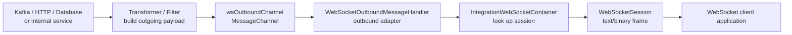
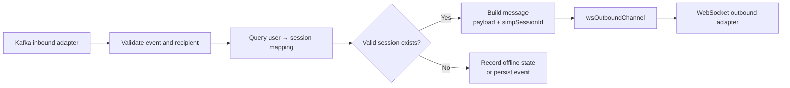
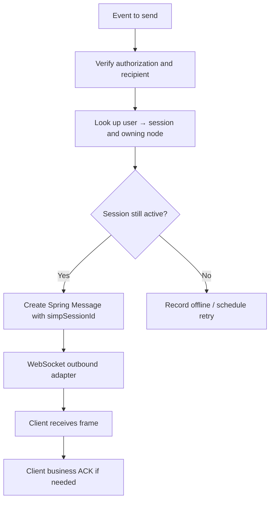

# WebSocket outbound channel adapter

## 1. Objectives and role in Spring Integration

In the **SPRING_INTEGRATION_ADAPTERS** module, adapters, gateways, pollers, and `MessageChannel` are used to connect external systems to the Spring Integration message flow. Data can arrive from files, SFTP, HTTP, JMS, AMQP, Kafka, or databases; it is then validated, transformed, routed, and sent to target systems. This lesson belongs to the **Adapter WebSocket** chapter and focuses on the **WebSocket outbound channel adapter**: sending a `Message<?>` from the application out to the appropriate WebSocket connection session.

After this lesson, you will be able to:

- Explain the difference between **inbound** (WebSocket → Spring Integration) and **outbound** (Spring Integration → WebSocket).
- Describe the roles of `WebSocketOutboundMessageHandler`, `MessageChannel`, `IntegrationWebSocketContainer`, `WebSocketSession`, and `SubProtocolHandler`.
- Configure a flow to send data from Spring Integration to the right WebSocket session on the server.
- Distinguish between **server-side** sending that requires a session ID and **client-side** sending that uses a single connection.
- Choose payload contracts, sub-protocols, and strategies for handling connection errors, high load, and security.
- Recognize the limitations of WebSocket: no built-in business ACK, durable storage, or automatic resend mechanism on disconnect.

> **Class name to remember:** the documentation refers to this component as the *WebSocket outbound channel adapter*, while the Java class handling outbound delivery is `org.springframework.integration.websocket.outbound.WebSocketOutboundMessageHandler`. Do not look for a Java class named `WebSocketOutboundChannelAdapter`.

## 2. What problem does the outbound adapter solve?

Suppose the system receives an order status event from Kafka, saves the result to a database, and then needs to **push the new status to the screen of the specific user currently online**. With raw WebSocket alone, business services easily become tightly coupled to the connection registry and frame-sending details. With Spring Integration, you can compose a flow like this:



The flow proceeds through these steps:

1. An internal component creates a Spring `Message` containing **payload** and **headers**.
2. The message is sent to `wsOutboundChannel`.
3. `WebSocketOutboundMessageHandler` reads headers to determine the target session (when needed).
4. The adapter looks up the session in `IntegrationWebSocketContainer`.
5. The appropriate `SubProtocolHandler` converts the message into a WebSocket frame and sends it over the session.
6. The client receives the frame via the WebSocket API or the client of the negotiated sub-protocol.

The adapter only handles **communication output**; it does not decide which clients are authorized to receive events, whether business content is valid, or which send requests require durable storage. Those decisions must be made before the message enters the outbound channel.

### Comparing inbound and outbound

| Aspect | Inbound channel adapter | Outbound channel adapter |
| --- | --- | --- |
| Data direction | WebSocket → `MessageChannel` | `MessageChannel` → WebSocket |
| Primary Java component | `WebSocketInboundChannelAdapter` | `WebSocketOutboundMessageHandler` |
| Core job | Receive frames and emit Spring `Message` | Receive Spring `Message` and send frames |
| Entry/exit in flow | Has `outputChannel` | Consumes from `inputChannel` |
| Session | Receives metadata from connected session | Must locate the target session |
| Poller | Not needed for the WebSocket adapter itself | Not needed for the WebSocket adapter itself |
| Request/reply | Does not automatically reply | Does not guarantee the client processed the message |

A WebSocket connection communicates **bidirectionally**, so inbound and outbound can share **the same** `IntegrationWebSocketContainer`. You do not need to open a separate port or WebSocket connection just to send replies.

## 3. Concepts and message-sending contract

### 3.1. Participating components

| Component | Role |
| --- | --- |
| `MessageChannel` | Receives messages that the application wants to send to WebSocket; e.g., `DirectChannel` |
| `WebSocketOutboundMessageHandler` | Channel consumer; converts messages into WebSocket send operations |
| `IntegrationWebSocketContainer` | Manages established WebSocket sessions and retrieves sessions by ID |
| `ServerWebSocketContainer` | Configures a server-side WebSocket endpoint, potentially holding many sessions from many clients |
| `ClientWebSocketContainer` | Maintains an outbound WebSocket connection from the application to a remote server |
| `SubProtocolHandlerRegistry` | Selects the handler according to the negotiated WebSocket sub-protocol |
| `PassThruSubProtocolHandler` | Default for raw WebSocket, converting messages/frames without requiring STOMP |
| `StompSubProtocolHandler` | Additional configuration when sending messages over STOMP |
| `MessageConverter` | Helps convert payloads before encoding into WebSocket frames |

### 3.2. Why is session ID important on the server?

Suppose three browsers A, B, and C are connected to `/ws/updates`. An event "A's order has been delivered" should only be sent to the session authorized to view that order. On the server side, the outbound adapter looks up the session from headers in the Spring `Message`. For raw WebSocket in Spring Integration, the commonly used header is:

```java
SimpMessageHeaderAccessor.SESSION_ID_HEADER
// Actual header name: "simpSessionId"
```

You can retrieve the session ID from an inbound message:

```java
String sessionId =
    SimpMessageHeaderAccessor.getSessionId(message.getHeaders());
```

And attach the session ID to an outbound message:

```java
Message<String> reply = MessageBuilder.withPayload("Request processed")
    .setHeader(SimpMessageHeaderAccessor.SESSION_ID_HEADER, sessionId)
    .build();
```

**Distinguish between two types of IDs:**

- `MessageHeaders.ID` is the ID of the **Spring Message**, and does not represent the WebSocket connection.
- `simpSessionId` is the WebSocket session ID used for routing; a session can close or change ID after reconnecting.

If a server-side message lacks a session ID, the adapter does not infer the "current client". Nor does it **automatically broadcast** to all connections. To broadcast, you must build a mechanism to select target sessions or use an appropriate broker/pub-sub model.

### 3.3. Is the client side different?

Yes. `ClientWebSocketContainer` manages **one** connection session to a remote server. Spring Integration documentation specifies that client-side outbound messages **do not need a session ID header** to select a session. Even so, the application must wait for the connection to actually be established; calling `send` while not yet connected is an error condition, not a request that is automatically queued for later delivery.

## 4. Hands-on example: sending an ACK to the right browser

This example uses **Spring Boot 3.x, Spring Integration 6.x, Java 17+** and the Servlet web stack. It runs a raw WebSocket endpoint at `/ws/updates`. The browser sends a test message; the inbound adapter only serves to supply the message and session ID; **the outbound adapter is the component that sends the ACK back to the exact session that sent the message**.

Once you understand this setup, you can replace the input source with Kafka, JMS, HTTP, or a business service, as long as the outbound message still carries a valid session ID.

### 4.1. Declare dependencies

Minimal Maven example:

```xml
<dependencies>
    <dependency>
        <groupId>org.springframework.boot</groupId>
        <artifactId>spring-boot-starter-web</artifactId>
    </dependency>
    <dependency>
        <groupId>org.springframework.boot</groupId>
        <artifactId>spring-boot-starter-integration</artifactId>
    </dependency>
    <dependency>
        <groupId>org.springframework.integration</groupId>
        <artifactId>spring-integration-websocket</artifactId>
    </dependency>
</dependencies>
```

The Spring Boot BOM manages compatible versions. `spring-boot-starter-web` provides Spring MVC/web server, while `spring-integration-websocket` provides the containers and adapters.

### 4.2. Configure WebSocket outbound

Create the following configuration class in a package scanned by Spring Boot:

```java
package com.example.websocket;

import org.springframework.beans.factory.annotation.Qualifier;
import org.springframework.context.annotation.Bean;
import org.springframework.context.annotation.Configuration;
import org.springframework.integration.annotation.ServiceActivator;
import org.springframework.integration.channel.DirectChannel;
import org.springframework.integration.config.EnableIntegration;
import org.springframework.integration.websocket.ServerWebSocketContainer;
import org.springframework.integration.websocket.inbound.WebSocketInboundChannelAdapter;
import org.springframework.integration.websocket.outbound.WebSocketOutboundMessageHandler;
import org.springframework.messaging.MessageChannel;
import org.springframework.messaging.MessageHandler;
import org.springframework.messaging.MessagingException;
import org.springframework.messaging.simp.SimpMessageHeaderAccessor;
import org.springframework.messaging.support.MessageBuilder;

@Configuration
@EnableIntegration
public class WebSocketOutboundConfiguration {

    // A single container is shared for receiving and sending.
    @Bean
    public ServerWebSocketContainer serverWebSocketContainer() {
        return new ServerWebSocketContainer("/ws/updates");
    }

    @Bean
    public MessageChannel wsInboundChannel() {
        return new DirectChannel();
    }

    @Bean
    public MessageChannel wsOutboundChannel() {
        return new DirectChannel();
    }

    // Only to generate demonstration input and capture the sender's session ID.
    @Bean
    public WebSocketInboundChannelAdapter wsInbound(
            ServerWebSocketContainer serverWebSocketContainer,
            @Qualifier("wsInboundChannel") MessageChannel inboundChannel) {

        WebSocketInboundChannelAdapter adapter =
                new WebSocketInboundChannelAdapter(serverWebSocketContainer);
        adapter.setOutputChannel(inboundChannel);
        return adapter;
    }

    // Processes inbound messages and builds an outbound message sent back to the same session.
    @Bean
    @ServiceActivator(inputChannel = "wsInboundChannel")
    public MessageHandler prepareReply(
            @Qualifier("wsOutboundChannel") MessageChannel outboundChannel) {

        return incoming -> {
            String sessionId = SimpMessageHeaderAccessor
                    .getSessionId(incoming.getHeaders());

            if (sessionId == null) {
                throw new MessagingException(
                        incoming, "WebSocket session ID not found");
            }

            String text = "ACK: " + incoming.getPayload();

            boolean accepted = outboundChannel.send(
                    MessageBuilder.withPayload(text)
                            .setHeader(
                                    SimpMessageHeaderAccessor.SESSION_ID_HEADER,
                                    sessionId)
                            .build());

            if (!accepted) {
                throw new MessagingException(
                        incoming, "Outbound channel did not accept the message");
            }
        };
    }

    // This is the actual outbound adapter:
    // receives a Spring Message and sends a WebSocket frame.
    @Bean
    @ServiceActivator(inputChannel = "wsOutboundChannel")
    public MessageHandler wsOutbound(
            ServerWebSocketContainer serverWebSocketContainer) {

        return new WebSocketOutboundMessageHandler(serverWebSocketContainer);
    }
}
```

Here:

- `serverWebSocketContainer` registers the `/ws/updates` endpoint and holds the `WebSocketSession`s.
- `wsInbound` listens for frames from the browser and sends messages into `wsInboundChannel`.
- `prepareReply` extracts `simpSessionId` from the inbound message and creates an ACK carrying that same header.
- `wsOutbound` is a `WebSocketOutboundMessageHandler` bound to `wsOutboundChannel`; it uses the same container to find the target session and send the frame.
- `@EnableIntegration` activates Spring Integration infrastructure, including the mechanism to register appropriate WebSocket endpoints.

**Design point:** `@ServiceActivator` can connect a `MessageChannel` to a `MessageHandler`. The outbound adapter does not need `setOutputChannel` because its role is a **consumer** at the end of the sending branch.

### 4.3. Test in the browser

Run the application at `localhost:8080`. Open Developer Tools → Console and enter:

```javascript
const ws = new WebSocket("ws://localhost:8080/ws/updates");

ws.addEventListener("open", () => {
  console.log("Connected");
  ws.send(JSON.stringify({
    eventId: "evt-101",
    type: "order.updated",
    orderId: "ORD-42"
  }));
});

ws.addEventListener("message", (event) => {
  console.log("Server sent:", event.data);
});

ws.addEventListener("error", (event) => console.error("WebSocket error:", event));
ws.addEventListener("close", (event) => console.log("Closed:", event.code));
```

When the connection works normally, the console receives text starting with:

```text
ACK: {"eventId":"evt-101","type":"order.updated","orderId":"ORD-42"}
```

Test further with **two independent browser tabs**. Tab A sends `A`, tab B sends `B`. Each tab only sees the ACK for the message that tab itself sent. This is an important check: the session ID header is extracted and preserved properly, without accidentally broadcasting to another session.

The example only illustrates the message path; in a real system, you must validate schema, access permissions, payload limits, and business outcomes before sending a success ACK.

## 5. Proactively sending messages from a service, Kafka, or HTTP

The application does not have to wait for a client to send an inbound message. An event from Kafka, AMQP, a database, or an HTTP controller can also be forwarded into `wsOutboundChannel`.

Example service sending a JSON string to **a known session**:

```java
package com.example.websocket;

import org.springframework.beans.factory.annotation.Qualifier;
import org.springframework.messaging.MessageChannel;
import org.springframework.messaging.simp.SimpMessageHeaderAccessor;
import org.springframework.messaging.support.MessageBuilder;
import org.springframework.stereotype.Service;

@Service
public class SessionNotificationService {

    private final MessageChannel outboundChannel;

    public SessionNotificationService(
            @Qualifier("wsOutboundChannel") MessageChannel outboundChannel) {
        this.outboundChannel = outboundChannel;
    }

    public boolean notifySession(String sessionId, String jsonPayload) {
        if (sessionId == null || sessionId.isBlank()) {
            throw new IllegalArgumentException("Invalid sessionId");
        }

        return outboundChannel.send(
                MessageBuilder.withPayload(jsonPayload)
                        .setHeader(
                                SimpMessageHeaderAccessor.SESSION_ID_HEADER,
                                sessionId)
                        .build());
    }
}
```

**The source of `sessionId` must be trustworthy.** The system can store a mapping `userId → set of sessionIds` after an authenticated handshake and remove a session when it closes. Do not allow users to supply arbitrary session IDs to send private data to another session.

When forwarding Kafka/DB events to WebSocket, a sensible flow pattern is:



A return value of `true` from `MessageChannel.send(...)` indicates that the channel **accepted the send call at the messaging layer**. With `DirectChannel`, the handler is invoked synchronously and may throw an exception. That value **is not confirmation that the browser received, displayed, or successfully processed it**. To obtain business confirmation, you must define a client ACK message, correlation ID, timeout, and retry/deduplication strategy.

### What if one user has multiple sessions?

A user may open multiple tabs or multiple devices; each tab has its own `WebSocketSession`. With raw WebSocket, the outbound adapter sends to a single identified session. If you want to send to all of the user's devices, the service must select and emit a separate message for each session, or use a broker with appropriate destinations/subscriptions. Define the policy clearly: send to one device, all devices, or only active devices.

## 6. When the application is a WebSocket client

Spring Integration does not only act as a WebSocket server. With `ClientWebSocketContainer`, your application can **proactively connect to a partner's WebSocket server**, then use the outbound adapter to send messages over that connection.

Standalone configuration bean example:

```java
import org.springframework.context.annotation.Bean;
import org.springframework.context.annotation.Configuration;
import org.springframework.integration.annotation.ServiceActivator;
import org.springframework.integration.channel.DirectChannel;
import org.springframework.integration.websocket.ClientWebSocketContainer;
import org.springframework.integration.websocket.outbound.WebSocketOutboundMessageHandler;
import org.springframework.messaging.MessageChannel;
import org.springframework.messaging.MessageHandler;
import org.springframework.web.socket.client.standard.StandardWebSocketClient;

@Configuration
public class PartnerWebSocketConfiguration {

    @Bean
    public ClientWebSocketContainer partnerContainer() {
        return new ClientWebSocketContainer(
                new StandardWebSocketClient(),
                "ws://localhost:8090/partner");
    }

    @Bean
    public MessageChannel partnerOutboundChannel() {
        return new DirectChannel();
    }

    @Bean
    @ServiceActivator(inputChannel = "partnerOutboundChannel")
    public MessageHandler partnerOutbound(ClientWebSocketContainer partnerContainer) {
        return new WebSocketOutboundMessageHandler(partnerContainer);
    }
}
```

After the container connects successfully (`partnerContainer.isConnected() == true`), a service can send a text Spring Message to `partnerOutboundChannel`, for example:

```java
partnerOutboundChannel.send(
    MessageBuilder.withPayload(
        "{\"type\":\"telemetry\",\"value\":42}"
    ).build()
);
```

Practical requirement: there must be a WebSocket server listening on `ws://localhost:8090/partner`; the Java environment needs a compatible Jakarta WebSocket client implementation. Do not send at startup before a connection session exists. On the client side, **`simpSessionId` is not needed**, because the container represents a single connection. When the connection drops, reconnection, queuing, and resending must be designed based on application requirements; do not assume the adapter automatically replays all data.

## 7. Payloads, converters, and sub-protocols

### 7.1. Choosing a payload contract

With raw WebSocket, the simplest approach is to create a `String` payload containing serialized text/JSON:

```java
Message<String> message = MessageBuilder
    .withPayload("{\"type\":\"price.changed\",\"productId\":\"P-7\"}")
    .setHeader(SimpMessageHeaderAccessor.SESSION_ID_HEADER, sessionId)
    .build();
```

When the payload is a POJO, you must decide whether to **serialize in a transformer before outbound** or configure a `MessageConverter`. Doing it explicitly with `ObjectMapper.writeValueAsString(...)` in a step before outbound is often easier for checking schema, versioning, and parsing errors; converters are suitable when multiple flows share conversion rules.

Default converters listed in the Spring Integration documentation include `StringMessageConverter`, `ByteArrayMessageConverter`, and `MappingJackson2MessageConverter` (when Jackson is present). Configuring `messageConverters` on the handler and `mergeWithDefaultConverters` affects how a converter is chosen. **Do not infer a binary frame type solely from the payload being `byte[]`**; the final behavior depends on `SubProtocolHandler` and the frame type that the handler creates. Always verify protocol requirements and test with a real client.

### 7.2. Raw WebSocket and STOMP are not interchangeable

| Raw WebSocket | STOMP over WebSocket |
| --- | --- |
| Application defines its own text/JSON/binary format | Frames carry commands such as `SEND`, `SUBSCRIBE`, `MESSAGE` |
| Defaults to `PassThruSubProtocolHandler` | Requires `StompSubProtocolHandler` |
| Server side typically targets by session ID | Can use STOMP broker destinations/subscriptions |
| Suited for simple applications and custom protocols | Suited for systems with topic/queue and broker concepts |
| No default business ACK | STOMP has configurable frame/ack mechanisms, still requires defining end-to-end guarantees |

If STOMP is needed, the outbound adapter can accept a `SubProtocolHandlerRegistry` in its constructor to select `StompSubProtocolHandler`. STOMP messages are created with `StompHeaderAccessor`, e.g., `StompHeaderAccessor.create(StompCommand.SEND)`, along with destination headers. In particular, **Spring Integration's STOMP client side** provides `ClientStompEncoder` to ensure `SEND` commands are encoded properly; the raw WebSocket configuration in the earlier example is not sufficient to exchange STOMP with a broker.

A common mistake is a client sending JSON text to an endpoint expecting STOMP frames, or conversely sending STOMP commands to a raw WebSocket endpoint. The handshake may still succeed, but the business logic will not receive the expected content.

### 7.3. Equivalent XML configuration

In a project using the Spring Integration XML namespace, the corresponding outbound element is:

```xml
<int-websocket:outbound-channel-adapter
    id="wsOutboundAdapter"
    channel="wsOutboundChannel"
    container="serverWebSocketContainer"/>
```

This is a snippet inside a configuration file that already declares the `int-websocket` namespace and related beans. Common attributes include `default-protocol-handler`, `protocol-handlers`, `message-converters`, `merge-with-default-converters`, `auto-startup`, and `phase`. Whether declared in Java or XML, the **channel → outbound handler → container → session** principle stays the same.

## 8. Error handling and connection lifecycle

WebSocket is a long-lived connection; a session can close in the window **after selecting the recipient but before sending**. Do not treat a stored session ID as permanently valid.

| Scenario | Symptom | Recommended handling |
| --- | --- | --- |
| Missing `simpSessionId` on the server side | Cannot find target session to send | Inspect the message source and header-building step |
| Stale session ID after reconnect | Send fails to reach client, error that session does not exist/is closed | Remove old session from mapping and update with the new session |
| Sending while `ClientWebSocketContainer` is not connected | Outbound raises connection/session error | Wait for `isConnected()` or an appropriate readiness signal |
| No sub-protocol handler found | Error selecting handler, even though handshake may succeed | Align client/server sub-protocols and the registry |
| Converter does not support payload | Cannot encode message into frame | Standardize payload/serializer and verify converters |
| Many messages sent to the same session | Growing buffer, slow sender, or overlapping send operations | Enforce limits and coordinate sends per session |
| Downstream handler throws exception | Sending flow reports error | Log/record metrics with correlation ID and handle errors via channel |

### 8.1. Error channel vs. ACK from the client

Errors in `WebSocketOutboundMessageHandler` can surface in the synchronous send flow or via Spring Integration error handling when the upstream flow is asynchronous. You can organize an error flow with `ErrorMessage`, `errorChannel`, and exception-handling services according to system design.

However:

- A successful send on the application/server only indicates that the **send step** completed according to library mechanics; it does not verify that the client processed the event.
- `errorChannel` is an **internal Spring Integration** error channel, not a frame automatically sent back over WebSocket.
- If the client must confirm receipt and processing, send an ACK message back through the inbound flow carrying `eventId`/`correlationId`.

### 8.2. Concurrency, buffering, and backpressure

A WebSocket session has finite resources. If a Kafka/JMS source emits thousands of messages per second while a client reads slowly, buffer saturation or slow sends can occur. On the server, consider WebSocket container timeout/buffer configurations and overflow handling strategies, including `sendTimeLimit`, `sendBufferSizeLimit`, and `ConcurrentWebSocketSessionDecorator.OverflowStrategy` depending on the API version and configuration style.

What matters is having an **application policy**: coalesce duplicate updates, drop stale data if only the latest state matters, bound queues, or offload events to durable storage if loss is unacceptable. Never push unbounded data into memory just because a WebSocket client is slow.

### 8.3. Delivery semantics

Do not conflate the following signals:

1. `channel.send(...) == true`: the receiving Spring Messaging component accepted the message.
2. Outbound handler executes without throwing: the sending layer completed according to the library and current session.
3. Client receives the frame: requires client-side confirmation support or independent observation.
4. Client succeeds in business processing: requires a business ACK carrying a correlation ID.

WebSocket **does not natively provide durable storage, retry/replay after reconnect, or exactly-once business delivery**. If reliability is required, the system can use event IDs, an outbox, Kafka/JMS, unacknowledged state tracking, client ACKs, and idempotent processing.

## 9. Security when sending over WebSocket

The outbound adapter helps transmit data over a connection, but it does not replace authorization:

1. **Handshake and session:** authenticate the user when opening the connection; bind the session to an identity and permissions that can be re-checked.
2. **Read authorization:** before sending a notification, verify that the recipient is allowed to see that specific data. A `sessionId` is not an access authorization token.
3. **Transport:** use `wss://` in production deployments; never transmit sensitive data over `ws://` on untrusted networks.
4. **Origin and CSRF-like risks:** configure allowed origins/handshake per web policy; the Origin header is not a standalone authentication mechanism.
5. **Load limits:** limit frame size, send rate, and session count; monitor slow clients.
6. **Content:** control personal/confidential data and avoid logging full sensitive payloads.
7. **Multi-node:** the container holds active sessions **in the process memory of a node**; if an event is processed on another node, you need routing to the node owning the session or broker support.

Diagram for sending notifications to the right recipient:



## 10. Frequently asked questions and pitfalls to avoid

**Does the outbound adapter broadcast automatically?** No. With server-side raw WebSocket, the adapter sends to the session selected via headers. Broadcasting is a separate business/routing decision.

**Is a poller needed?** No, because the outbound adapter is a consumer of messages pushed into the channel. If the source data is a file or DB table requiring periodic scanning, the poller belongs to the **source** or a step before the adapter, not the outbound WebSocket handler.

**Does using a `QueueChannel` provide durable persistence?** Not by default. An in-memory `QueueChannel` only decouples message arrival and consumption times. To survive restarts, you need a persistent message store or appropriate queuing system, plus a policy for handling cases where the target session no longer exists.

**Why preserve `simpSessionId` from inbound?** Because outbound must find the exact `WebSocketSession` in the server-side container. This header is usually present on messages received via `PassThruSubProtocolHandler`. If a transformer builds a new message and drops headers, you must re-attach the authorized target session ID.

**When using STOMP, can we use raw JavaScript `WebSocket.send(JSON.stringify(...))`?** They are not equivalent: STOMP requires protocol frames/commands. Use a proper STOMP client or configure a matching raw endpoint.

**What happens if the connection closes mid-send?** The send may fail or yield no business confirmation. Clean up the session, record state, and retry if the use case permits.

## 11. Practice exercises

### Exercise A — send to the right session

Run the example in section 4 and open two browser tabs. Have each tab send a different string; observe the ACKs and explain which header determines the destination. Try removing `setHeader(SimpMessageHeaderAccessor.SESSION_ID_HEADER, sessionId)` and note the difference.

**Success criteria:** understand that a Spring Message ID cannot replace a WebSocket session ID, and the server does not infer the recipient automatically.

### Exercise B — push from an external source

Suppose Kafka receives the event:

```json
{
  "eventId": "evt-205",
  "type": "order.status.changed",
  "orderId": "ORD-42",
  "userId": "u-17",
  "status": "SHIPPED"
}
```

Design a flow that reads the event, verifies `u-17`'s authorization for `ORD-42`, finds all sessions belonging to the user, and builds a message with `simpSessionId` for each session. Propose the behavior when no session is currently open.

**Success criteria:** clearly show where authorization is checked, where sessions are looked up, where JSON conversion occurs, and where the outbound adapter sends.

### Exercise C — distinguish send success from processing success

The client disconnects immediately after the server sends event `evt-205`. Describe a contract including `eventId`, a client → server ACK message, timeout, retry, and deduplication. Identify where unacknowledged data is stored and the condition for stopping retries.

**Success criteria:** do not treat the result of `MessageChannel.send()` as a business ACK or proof that the client processed the event.

### Exercise D — client sending to a partner WebSocket server

Use the `ClientWebSocketContainer` configuration in section 6 to send a JSON payload to a test server running on `localhost:8090`. Only send after `isConnected()` returns `true`; try stopping the server and design how the application reacts to disconnection events.

**Success criteria:** explain why the client side does not need a session ID header yet still requires connection management.

## 12. Summary to remember

- The **WebSocket outbound channel adapter** is a Spring Integration output endpoint, implemented by `WebSocketOutboundMessageHandler`, receiving messages from a `MessageChannel`.
- The adapter looks up the WebSocket session in `IntegrationWebSocketContainer`, then converts and sends the message via `SubProtocolHandler`.
- **Server-side** requires selecting the session with a header such as `simpSessionId`. **Client-side** has a single connection in `ClientWebSocketContainer`, so this header is not needed.
- Inbound and outbound adapters can share the same container for bidirectional communication.
- Raw WebSocket uses `PassThruSubProtocolHandler` by default; STOMP requires configuring the corresponding handler and STOMP contract.
- Sending a Spring Message does not mean the client received, processed, or business-acknowledged it. Design authorization, error flows, backpressure, ACKs, and retries according to actual requirements.
- WebSocket outbound can sit at the end of a flow starting from HTTP, Kafka, JMS, AMQP, databases, or files; this keeps business flows independent of WebSocket connection details.

## References

- [Spring Integration Reference — WebSockets Support](https://docs.spring.io/spring-integration/reference/web-sockets.html)
- [Spring Integration API — WebSocketOutboundMessageHandler](https://docs.spring.io/spring-integration/api/org/springframework/integration/websocket/outbound/WebSocketOutboundMessageHandler.html)
- [Spring Integration API — ClientWebSocketContainer](https://docs.spring.io/spring-integration/api/org/springframework/integration/websocket/ClientWebSocketContainer.html)
- [Spring Integration API — ServerWebSocketContainer](https://docs.spring.io/spring-integration/api/org/springframework/integration/websocket/ServerWebSocketContainer.html)
- [Spring Integration API — PassThruSubProtocolHandler](https://docs.spring.io/spring-integration/api/org/springframework/integration/websocket/support/PassThruSubProtocolHandler.html)
- [Spring Framework Reference — WebSocket](https://docs.spring.io/spring-framework/reference/web/websocket.html)
