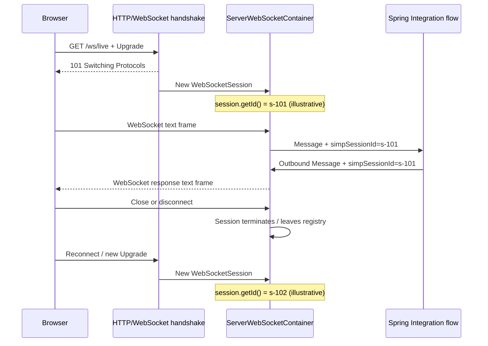
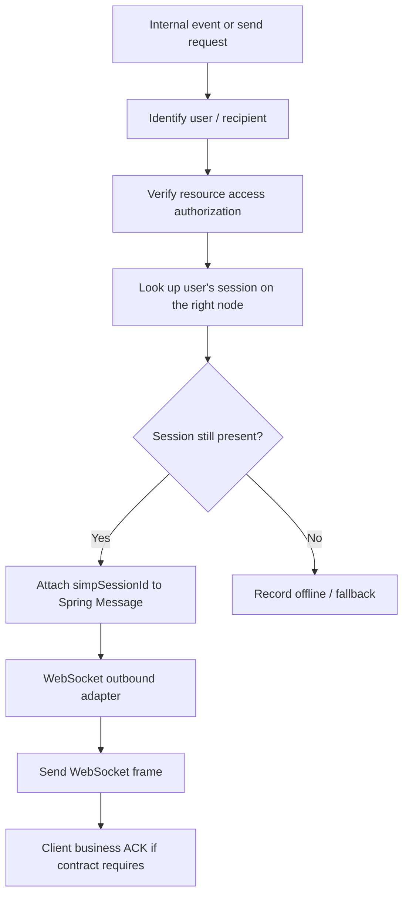

# WebSocket session and connection ID

## 1. Lesson objectives

In the **SPRING_INTEGRATION_ADAPTERS** module, Spring Integration connects external systems with the application using inbound/outbound adapters, gateways, pollers, and `MessageChannel`. When combining WebSocket with sources such as HTTP, JMS, AMQP, Kafka, files, or databases, the application often needs to return notifications to **the exact open connection**. Therefore, managing the **WebSocket session** and **connection ID** is an essential part of the message contract and connection lifecycle.

This lesson belongs to the **Adapter WebSocket** chapter and addresses these questions:

- What does `WebSocketSession` represent, and when is it created and terminated?
- How do `WebSocketSession.getId()`, the `simpSessionId` header, and an application-defined `connectionId` field differ?
- Why can't user ID, HTTP `JSESSIONID`, message ID, and correlation ID replace a WebSocket session ID?
- How does the inbound adapter carry the session ID through `MessageHeaders`, and how does the outbound adapter use it to select the recipient?
- When opening multiple tabs, reconnecting, or deploying across multiple nodes, how should mappings be managed and resources cleaned up?

After this lesson, you will be able to build a flow that checks sessions, sends replies to the right session, handles reconnects, and avoids routing errors or data leaks between clients.

## 2. Nature of a WebSocket session

WebSocket starts with an **HTTP Upgrade handshake**. When the handshake succeeds, a connection is opened so both sides can exchange text/binary frames over a long duration. Spring Framework represents this connection with the interface:

```java
org.springframework.web.socket.WebSocketSession
```

Commonly used methods:

| API | Information / operation |
| --- | --- |
| `session.getId()` | Unique ID of the WebSocket session according to the implementation's mechanism |
| `session.isOpen()` | Whether the session is still open at the time of inspection |
| `session.getPrincipal()` | Identity bound to the session, if established |
| `session.getAttributes()` | Attributes attached to the session; can be populated during the handshake |
| `session.getHandshakeHeaders()` | HTTP headers from the handshake request |
| `session.getUri()` | URI used to open the WebSocket |
| `session.getAcceptedProtocol()` | Negotiated sub-protocol, if any |
| `session.sendMessage(...)` | Sends a WebSocket frame directly |
| `session.close(...)` | Closes the WebSocket session |

**Core point:** a session is **one current connection**, not a user, a device, or a long-lived login session. If the client closes the tab, the network drops, the server restarts, or the connection is re-established, the old session is no longer usable. After reconnecting, a new `WebSocketSession` with a new ID typically appears.

When speaking of a "connection ID" in application architecture, clarify whether it refers to:

1. **Spring's WebSocket session ID**: `WebSocketSession.getId()`.
2. **An application-assigned connection ID**: a value such as `connectionId` or `clientConnectionId` stored in a registry.
3. **An ID assigned by an external library/gateway**: for example, a connection ID attribute name in a reverse proxy or a specific WebSocket service.

WebSocket **does not mandate** a standard JSON field named `connectionId`. If the application needs to send an ID to the browser, it must define the contract and corresponding message itself.

### Lifecycle diagram



The values `s-101` and `s-102` are **illustrative IDs**; real applications should not infer the format, length, or monotonically increasing order of IDs.

## 3. Distinguishing different types of IDs

| Value | Where is it created/held? | Lifecycle / purpose |
| --- | --- | --- |
| **WebSocket session ID** | `WebSocketSession.getId()` on the server | Identifies an existing WebSocket session; changes on reconnect |
| **`simpSessionId`** | Spring Messaging header, constant `SimpMessageHeaderAccessor.SESSION_ID_HEADER` | Carries the **WebSocket session ID** across messages in the flow; required for server-side outbound routing |
| **Application `connectionId`** | Generated and managed by the application | Public or observability ID; may map to the current session, not Spring's ID by default |
| **`userId` / principal** | Authentication system | Identity more stable than a connection; one user can have multiple sessions |
| **HTTP `JSESSIONID`** | HTTP session/cookie if the app uses servlet sessions | Does not guarantee a 1:1 mapping with a WebSocket session; multiple tabs may share an HTTP session |
| **`MessageHeaders.ID`** | Generated by Spring Messaging per message | Identifies a Spring Message; not used to look up a `WebSocketSession` |
| **`correlationId` / `eventId`** | Generated by the app for a request or event | Correlates request–reply, ACKs, retries, or deduplication across connections |
| **STOMP `session` header** | Issued by sub-protocol/broker in some implementations | Not automatically identical to `simpSessionId`; check the specific sub-protocol contract |
| **TCP socket / IP:port** | Network, reverse proxy, operating system | Unstable and not a user identifier; may change across proxies/reconnects |

Example: user `user-17` opens the same dashboard in two tabs:

```text
user-17
  ├── Tab A ── WebSocket sessionId = A31
  └── Tab B ── WebSocket sessionId = B72

Kafka event:
  eventId = evt-205
  recipient = user-17
```

If the notification policy requires **all tabs** of `user-17`, the application must route to both `A31` and `B72`. If only replying to a request from tab A, select only `A31`. Do not use `user-17` as `simpSessionId` and expect the adapter to find the recipient automatically.

**Browsers have no standard WebSocket API to read the server's `WebSocketSession.getId()`.** `new WebSocket(url)` creates a client-side object with `readyState`, `url`, and events; if the browser needs to know an application connection ID, the server must send a message according to the application protocol.

## 4. Session registry in Spring Integration

Spring Integration provides `IntegrationWebSocketContainer` to centralize WebSocket session management, with two main types:

- `ServerWebSocketContainer`: registers a server-side endpoint, accepting multiple connections from multiple clients.
- `ClientWebSocketContainer`: proactively connects from the application to a remote WebSocket server, maintaining one corresponding connection.

Container APIs useful when working with IDs:

```java
WebSocketSession session = container.getSession(sessionId);
Map<String, WebSocketSession> active = container.getSessions();
```

`getSession(sessionId)` retrieves the session object matching the ID **if the session is still present**; the result can be `null`. `getSessions()` is suitable for statistics/observability, but the internal registry should not be treated as a durable business data store.

Safe query example:

```java
import org.springframework.integration.websocket.ServerWebSocketContainer;
import org.springframework.web.socket.WebSocketSession;

public boolean isSessionCurrentlyOpen(
        ServerWebSocketContainer container, String sessionId) {

    if (sessionId == null || sessionId.isBlank()) {
        return false;
    }

    WebSocketSession session = container.getSession(sessionId);
    return session != null && session.isOpen();
}
```

This function only reflects **the moment of inspection**. The connection can close immediately after `isOpen()` returns `true`, so every send operation must still catch and handle errors. Do not treat a single check as a guarantee that sending will succeed.

One difference between the two container types: `ClientWebSocketContainer` holds a single outbound connection session and can locate the session without passing an ID; whereas `ServerWebSocketContainer` needs routing by session ID when multiple clients are connected.

## 5. How does the session ID travel through inbound/outbound adapters?

On the server side, messages received via the **WebSocket inbound channel adapter** are converted into Spring `Message<?>` objects to travel through the Integration Flow. The header:

```java
SimpMessageHeaderAccessor.SESSION_ID_HEADER
// Actual string value of the constant: "simpSessionId"
```

attaches the receiving session's ID to the message.

Retrieving the session ID from an inbound message:

```java
import org.springframework.messaging.Message;
import org.springframework.messaging.simp.SimpMessageHeaderAccessor;

String sessionId =
    SimpMessageHeaderAccessor.getSessionId(incoming.getHeaders());
```

Or reading the known header name directly (prefer constants/framework accessors):

```java
String sessionId = (String) incoming.getHeaders()
    .get(SimpMessageHeaderAccessor.SESSION_ID_HEADER);
```

To send back to the exact session, build an outbound Spring Message carrying that same session ID:

```java
import org.springframework.messaging.Message;
import org.springframework.messaging.simp.SimpMessageHeaderAccessor;
import org.springframework.messaging.support.MessageBuilder;

Message<String> reply = MessageBuilder.withPayload("ACK: accepted")
    .setHeader(SimpMessageHeaderAccessor.SESSION_ID_HEADER, sessionId)
    .build();
```

`WebSocketOutboundMessageHandler` reads the session ID from the header and looks up `WebSocketSession` in the container. This is what "**header routing**" means in raw WebSocket Spring Integration.

### When is the header lost?

If a transformer step constructs a **new message** from the payload without preserving headers, the session ID can disappear. For example:

```java
// Error example: building a new message while dropping the routing header.
Message<String> wrong = MessageBuilder.withPayload("ACK")
    .build();
```

The flow should preserve necessary headers, or re-attach the verified recipient's session ID:

```java
Message<String> correct = MessageBuilder.withPayload("ACK")
    .copyHeaders(incoming.getHeaders())
    .build();
```

`copyHeaders(...)` in the example preserves other headers too; in a real application you must **selectively filter which headers are allowed to propagate**, because there may be metadata that should not leak to another branch. If only routing is needed, `setHeader(SimpMessageHeaderAccessor.SESSION_ID_HEADER, sessionId)` is the easiest to control.

## 6. Hands-on example: replying to the exact WebSocket session

The example uses **Java 17+, Spring Boot 3.x, Spring Integration 6.x** and the Servlet web stack. Raw WebSocket endpoint: `/ws/live`. Goal: two tabs send messages concurrently, and **each tab receives only its own reply**.

### 6.1. Maven dependencies

```xml
<dependencies>
    <dependency>
        <groupId>org.springframework.boot</groupId>
        <artifactId>spring-boot-starter-web</artifactId>
    </dependency>
    <dependency>
        <groupId>org.springframework.boot</groupId>
        <artifactId>spring-boot-starter-integration</artifactId>
    </dependency>
    <dependency>
        <groupId>org.springframework.integration</groupId>
        <artifactId>spring-integration-websocket</artifactId>
    </dependency>
</dependencies>
```

Assumes the project uses the Spring Boot BOM to manage compatible dependency versions.

### 6.2. Java configuration

```java
package com.example.websocket;

import org.springframework.beans.factory.annotation.Qualifier;
import org.springframework.context.annotation.Bean;
import org.springframework.context.annotation.Configuration;
import org.springframework.integration.annotation.ServiceActivator;
import org.springframework.integration.channel.DirectChannel;
import org.springframework.integration.config.EnableIntegration;
import org.springframework.integration.websocket.ServerWebSocketContainer;
import org.springframework.integration.websocket.inbound.WebSocketInboundChannelAdapter;
import org.springframework.integration.websocket.outbound.WebSocketOutboundMessageHandler;
import org.springframework.messaging.MessageChannel;
import org.springframework.messaging.MessageHandler;
import org.springframework.messaging.MessagingException;
import org.springframework.messaging.simp.SimpMessageHeaderAccessor;
import org.springframework.messaging.support.MessageBuilder;
import org.springframework.web.socket.WebSocketSession;

@Configuration
@EnableIntegration
public class SessionIdDemoConfiguration {

    @Bean
    public ServerWebSocketContainer serverWebSocketContainer() {
        return new ServerWebSocketContainer("/ws/live");
    }

    @Bean
    public MessageChannel incomingWebSocketMessages() {
        return new DirectChannel();
    }

    @Bean
    public MessageChannel outgoingWebSocketMessages() {
        return new DirectChannel();
    }

    @Bean
    public WebSocketInboundChannelAdapter websocketInbound(
            ServerWebSocketContainer serverWebSocketContainer,
            @Qualifier("incomingWebSocketMessages") MessageChannel channel) {

        WebSocketInboundChannelAdapter adapter =
                new WebSocketInboundChannelAdapter(serverWebSocketContainer);
        adapter.setOutputChannel(channel);
        return adapter;
    }

    @Bean
    @ServiceActivator(inputChannel = "incomingWebSocketMessages")
    public MessageHandler receiveAndReply(
            ServerWebSocketContainer serverWebSocketContainer,
            @Qualifier("outgoingWebSocketMessages") MessageChannel replies) {

        return incoming -> {
            String sessionId = SimpMessageHeaderAccessor
                    .getSessionId(incoming.getHeaders());

            if (sessionId == null) {
                throw new MessagingException(
                        incoming, "Message does not contain simpSessionId");
            }

            WebSocketSession session =
                    serverWebSocketContainer.getSession(sessionId);

            // The session may have closed between receiving and replying.
            if (session == null || !session.isOpen()) {
                System.out.println("Session has ended: " + sessionId);
                return;
            }

            // Raw text demo; in a real system, validate schema
            // and recipient authorization before sending.
            String response = "ACK from session " + sessionId
                    + ": " + incoming.getPayload();

            replies.send(
                    MessageBuilder.withPayload(response)
                            .setHeader(
                                    SimpMessageHeaderAccessor.SESSION_ID_HEADER,
                                    sessionId)
                            .build()
            );
        };
    }

    @Bean
    @ServiceActivator(inputChannel = "outgoingWebSocketMessages")
    public MessageHandler websocketOutbound(
            ServerWebSocketContainer serverWebSocketContainer) {

        return new WebSocketOutboundMessageHandler(
                serverWebSocketContainer);
    }
}
```

Explanation:

1. `ServerWebSocketContainer` manages sessions for the `/ws/live` endpoint.
2. `WebSocketInboundChannelAdapter` receives frames, converts them into Spring Messages, and attaches session metadata in the appropriate headers.
3. `receiveAndReply` extracts `simpSessionId`, looks up the container, and builds a response message carrying that ID.
4. `WebSocketOutboundMessageHandler` sends the message to the specific session.
5. Both inbound and outbound **share the same container**. Avoid creating two independent containers with the same URL but different registries.

The example only replies with text, so it does not implement full JSON validation/authorization. In production, you should not expose internal session IDs in response payloads or public logs; the string `ACK from session ...` here is for observation in this lesson.

### 6.3. Testing with the browser

Run the application on `localhost:8080` and open Developer Tools Console:

```javascript
const ws = new WebSocket("ws://localhost:8080/ws/live");

ws.addEventListener("open", () => {
  console.log("Connected");
  ws.send("Hello from this tab");
});

ws.addEventListener("message", (event) => {
  console.log("Received:", event.data);
});

ws.addEventListener("close", (event) => {
  console.log("Closed:", event.code);
});
```

Open another tab and run the same script, changing the payload to `Hello from second tab`. Result:

- Two tabs create **two different sessions**.
- Each tab receives the ACK corresponding to the payload that tab sent.
- Closing tab A does not automatically terminate tab B's session.
- If tab A reconnects, the server creates a new session and should not continue sending to the old ID.

Test a controlled close and reconnect:

```javascript
ws.close(1000, "demo complete");

const ws2 = new WebSocket("ws://localhost:8080/ws/live");
ws2.addEventListener("open", () => ws2.send("after reconnect"));
ws2.addEventListener("message", (event) => console.log(event.data));
```

Compare the ID string the server returns in the ACK before and after reconnecting to observe the difference. A new ID does not mean the user's identity has changed.

## 7. When the application defines its own connection ID

Many products need an ID for displaying on dashboards, logging, debugging support, or associating multiple sessions with a user. You can create an **application connection ID** independent of Spring's ID:

```text
Browser/WebSocket                 Server application
----------------------------------------------------------------
connect -----------------------> WebSocketSession#getId() = "server-123"
                                 create connectionId = "conn-a8f..."
<----------- session.ready ------ { "connectionId": "conn-a8f..." }
```

A message contract could be:

```json
{
  "type": "session.ready",
  "connectionId": "conn-a8f1"
}
```

Then, the server maintains a mapping:

```text
connectionId -> { nodeId, webSocketSessionId, authenticatedUserId }
authenticatedUserId -> set of active connectionIds
```

`connectionId` **is not a WebSocket standard**; the application must decide whether reconnecting issues a new ID or rebinds to an existing client ID. If the ID is used to manage a *currently open* connection, issuing a new one on reconnect is usually cleanest.

### In-memory registry example

This is a simple application-level service pattern; the most important key is the **actual session ID**:

```java
package com.example.websocket;

import java.util.Map;
import java.util.UUID;
import java.util.concurrent.ConcurrentHashMap;
import java.util.concurrent.ConcurrentMap;
import org.springframework.stereotype.Component;
import org.springframework.web.socket.WebSocketSession;

@Component
public class ActiveConnections {

    public record ConnectionInfo(
            String connectionId, String userId, String sessionId) {}

    private final ConcurrentMap<String, ConnectionInfo> bySession =
            new ConcurrentHashMap<>();

    public void onConnected(WebSocketSession session) {
        // Identity must come from the server's authentication mechanism.
        if (session.getPrincipal() == null) {
            return; // Example only tracks authenticated sessions.
        }

        String sessionId = session.getId();
        String userId = session.getPrincipal().getName();
        String connectionId = UUID.randomUUID().toString();

        bySession.put(sessionId,
                new ConnectionInfo(connectionId, userId, sessionId));
    }

    public void onDisconnected(String sessionId) {
        bySession.remove(sessionId);
    }

    public Map<String, ConnectionInfo> snapshot() {
        return Map.copyOf(bySession);
    }
}
```

Here `ConcurrentHashMap` handles concurrent access from multiple connections. `UUID` is just an example for generating an application connection ID. The `snapshot()` method is for observability and does not guarantee that sessions remain open at the time of a subsequent action.

**How to hook the registry into the lifecycle:** you can use `ServerWebSocketContainer`'s `WebSocketHandlerDecoratorFactory` to decorate the internal handler and intercept `afterConnectionEstablished` and `afterConnectionClosed`. This mechanism keeps the inbound adapter intact without taking up the single `WebSocketListener` slot in the container. *Supplementary configuration* example replacing the container bean in section 6.2:

```java
@Bean
public ServerWebSocketContainer serverWebSocketContainer(
        ActiveConnections connections) {

    ServerWebSocketContainer container =
            new ServerWebSocketContainer("/ws/live");

    container.setDecoratorFactories(handler ->
            new WebSocketHandlerDecorator(handler) {

                @Override
                public void afterConnectionEstablished(
                        WebSocketSession session) throws Exception {
                    super.afterConnectionEstablished(session);
                    connections.onConnected(session);
                }

                @Override
                public void afterConnectionClosed(
                        WebSocketSession session,
                        CloseStatus closeStatus) throws Exception {
                    try {
                        super.afterConnectionClosed(session, closeStatus);
                    } finally {
                        connections.onDisconnected(session.getId());
                    }
                }
            });

    return container;
}
```

This snippet requires the imports:

```java
import org.springframework.web.socket.CloseStatus;
import org.springframework.web.socket.WebSocketSession;
import org.springframework.web.socket.handler.WebSocketHandlerDecorator;
```

This is a **replacement for the `serverWebSocketContainer` bean**—do not declare two beans with the same name side by side. When a real application requires authenticating every session, configure a dedicated mechanism to reject invalid handshakes; `ActiveConnections` skipping sessions without a principal is not an access control measure.

Other ways to observe lifecycle: Spring WebSocket handlers/decorators, appropriate STOMP/Spring Messaging events, or container metrics. Always check the actual event source: raw WebSocket does not automatically turn every open/close into a business message on `wsInputChannel`.

## 8. Reconnect, multiple tabs, and mapping management

### 8.1. What does reconnect do to session IDs?

When a client loses network and reconnects:

```text
T0: user-17 -> session S1 (OPEN)
T1: connection S1 drops
T2: user-17 -> session S2 (OPEN)
T3: system receives close event for S1
```

If the registry only stores `userId -> sessionId` and handles T3 by "removing user-17", it could accidentally delete the mapping for **S2**. The right way is to remove by **specific session** or compare against the stored value:

```java
// Illustration when designing user -> session mapping:
byUser.remove(userId, oldSessionId); // only removes if it is still oldSessionId
```

For multiple tabs, use a `userId -> Set<sessionId>` structure and remove only the closed session. Do not impose a "one session per user" limit if the business case requires multiple devices.

### 8.2. Deciding whether to send to one or multiple sessions

| Requirement | Target selection approach |
| --- | --- |
| Reply to an action from one tab | Keep `simpSessionId` from the inbound message |
| Notify all tabs of one user | Look up all currently open sessions and send one message per session |
| Notify exactly one device | Use a device ID → set of authorized sessions mapping |
| Notify all subscribers of a topic | Consider STOMP subscriptions/broker or a pub-sub solution |
| User offline | Store pending state as required; do not send to the old session ID |

If there are multiple server nodes, the mapping also needs the **node ID**. `IntegrationWebSocketContainer.getSession(id)` only queries the container's sessions within that process; it is not a registry shared across nodes. A flow receiving a Kafka event on node B cannot send directly to a `WebSocketSession` living on node A using just a session ID string. You must route the event to the node owning the connection or use appropriate broker infrastructure.

### 8.3. Do not use session ID as a persistent business key

If order `ORD-42` is sent to session `S1` and the user reconnects as `S2`, the business entity is still order `ORD-42` while **the WebSocket destination has changed**. Therefore, information that must survive across reconnects should be tied to `userId`, `deviceId`, `orderId`, or `eventId` depending on context. `sessionId` is used for the final delivery step, once the recipient has been identified.

## 9. Raw WebSocket, STOMP, and related headers

Raw WebSocket and STOMP share the same connection foundation but have different message contracts:

- **Raw WebSocket:** typically uses `PassThruSubProtocolHandler` in Spring Integration. The handler attaches session metadata so the inbound adapter emits messages and the outbound adapter sends back to the right session.
- **STOMP:** `StompSubProtocolHandler` works with commands `CONNECT`, `SEND`, `SUBSCRIBE`, `DISCONNECT`; Spring Messaging uses headers `simpSessionId`, `simpUser`, `simpDestination`, and `simpSubscriptionId`. Distinguish clearly between **session**, **user**, **destination**, and **subscription**.
- **Spring WebSocket broker:** can route by user destination and subscriptions; avoid building custom session mappings for features the broker already handles, unless there is a clear requirement.
- **HTTP handshake/SockJS:** HTTP sessions/cookies and SockJS transport sessions have their own semantics; never assume every ID in them matches the WebSocket session ID looked up by Spring Integration.

A common source of confusion:

```text
simpSessionId = "ws-52"
simpSubscriptionId = "sub-9"
simpDestination = "/topic/prices"
userId = "user-17"
```

`ws-52` identifies a WebSocket connection in the Spring Messaging flow; `sub-9` identifies a STOMP message subscription; `/topic/prices` is the destination; `user-17` is the user identity. They solve four different problems.

**Do not arbitrarily substitute `simpSessionId` with the STOMP `session` frame header** without verifying the contract of the broker and handler in use.

## 10. Security and reliability

### 10.1. Session ID is not proof of authentication

Knowing a `sessionId` or `connectionId` does not mean a client is authorized to view that session's data. Never trust a `simpSessionId` self-declared by a client in a JSON payload to select a target session. The server must obtain the session ID from authenticated connection infrastructure or a server-managed mapping.

The proper sending flow should be:



Use `wss://` for networked deployments; restrict origins/handshakes, session counts, send rates, and payload sizes; control logs to avoid leaking sensitive data. If active permissions need to be revoked, consider closing the session or re-checking permissions before each batch of messages.

### 10.2. OPEN state does not guarantee delivery

Even when `getSession(sessionId) != null` and `isOpen() == true`, the connection can close before the frame finishes sending. Distinguish between:

1. Message accepted by `MessageChannel`.
2. Outbound handler completes the send operation per the API.
3. Client receives the frame.
4. Client processes business logic and sends an ACK.

These steps do not automatically imply one another. For critical events, design `eventId`, ACK/correlation ID, timeouts, retries, idempotency, and persistence of unacknowledged state. On reconnect, use stable identities and event IDs to resend—never send to a closed session.

### 10.3. Avoiding resource leaks

An application-built registry needs to handle:

- Normal close, network loss, transport errors, server shutdown, and reconnects.
- Cleanup of mappings by **specific session ID**, even when close events arrive late.
- Timeout/heartbeat checks if the application needs to detect dead connections.
- Bounded send queues; a slow client can cause buffer growth.
- If storing user presence in Redis/DB, use TTL/leases and update state when a node dies unexpectedly.

Do not treat an in-memory `userId → sessionId` mapping as a distributed source of truth or durable storage. Even a registry that handles close events needs a strategy to reap stale entries if a process is killed before firing events.

## 11. Common errors and troubleshooting steps

| Symptom | Possible causes | Troubleshooting direction |
| --- | --- | --- |
| Sent via outbound but client receives nothing | Missing/wrong `simpSessionId`, closed session | Log session ID in a controlled way, check `getSession(id)` and send errors |
| Client reconnects but notifications go to old session | Mapping still holds `S1` after `S2` was created | Update mapping per session, clean up old session |
| Two tabs receive each other's data | Using user ID as session ID or accidentally sharing a global variable | Check per-user session sets and recipient authorization |
| HTTP `JSESSIONID` exists but `getSession(id)` returns `null` | Confusing HTTP ID with WebSocket ID | Read `WebSocketSession.getId()` or `simpSessionId` |
| `MessageHeaders.ID` changes on every message | That is a message ID, not a connection ID | Clearly separate `eventId`, `messageId`, and `sessionId` |
| Open/close events not seen on inbound channel | Session lifecycle differs from business data | Use lifecycle hooks/decorators or appropriate events |
| Sending from Kafka consumer on node B to session on node A fails | Registry is local per node | Route to the right node/broker |
| Client knows a connection ID but still cannot send to server | Application ID not mapped or wrong lifecycle state | Check connection registry, permissions, and state |
| `isOpen()` is true but send still fails | Connection closed after the check | Catch send errors and apply appropriate retry/fallback |

### Quick diagnostic checklist

1. Did the WebSocket handshake succeed and `afterConnectionEstablished` run?
2. Does the inbound message have `simpSessionId`, and did any transformer drop the header?
3. Is the container used by outbound **the exact same registry** managing that session?
4. Is the session still open on **the right node**, at **the time of sending**?
5. Does the system need to reply to one tab, all tabs of a user, or a STOMP subscription?
6. On reconnect or disconnect, is the mapping cleaned up for the exact session?
7. Does sending require a business ACK and replay?

## 12. Practice exercises

### Exercise A — distinguishing IDs

For a user opening three tabs, list the minimum count of `userId`, `HTTP session ID`, `WebSocket session ID`, and `eventId` when each tab sends two events. Explain what factors could cause the HTTP session ID to differ, and why a WebSocket session ID cannot be derived from a user ID.

### Exercise B — preserving the session header

Add a transformer to the example in section 6 to convert the payload to uppercase. Use `MessageBuilder.withPayload(...).setHeader(...)` or preserve valid headers appropriately, then verify that two tabs still receive only their own ACKs.

### Exercise C — handling reconnect

Suppose:

```text
09:00:00  user-17 opens S1
09:00:05  user-17 reconnects as S2
09:00:06  service receives event E7 for user-17
09:00:07  close callback for S1 runs
```

Design a mapping and deletion rule so that E7 is delivered to S2 and S1's close callback does not delete S2. State how to handle the case where the service is on a different node from where S2 resides.

### Exercise D — ACK and correlation ID

Design the event:

```json
{
  "eventId": "evt-205",
  "type": "order.status.changed",
  "orderId": "ORD-42",
  "status": "SHIPPED"
}
```

The client replies with an ACK carrying `eventId`. Explain why, if the client disconnects and reconnects, retrying must use `evt-205` instead of the old session ID; propose a way to deduplicate events.

### Self-assessment criteria

You meet the objective if you can clearly explain **where sessions are created, which header selects a session, when mappings are cleaned up, and why a connection ID is neither a user identity nor proof of business processing**.

## 13. Key takeaways

- `WebSocketSession` is bound to **one connection**, and `WebSocketSession.getId()` is that session's ID.
- `simpSessionId` is the Spring Messaging header carrying the session ID through the Integration Flow; server-side outbound uses it to look up the target session.
- `IntegrationWebSocketContainer.getSession(id)` and `getSessions()` provide access to the container's **local** registry, not durable storage.
- `ClientWebSocketContainer` manages only one session, so client-side outbound does not require passing a session ID.
- `connectionId` is an application/infrastructure-dependent term; it has no single standard meaning in WebSocket. Document the mapping if you design one yourself.
- `JSESSIONID`, `userId`, `MessageHeaders.ID`, and `eventId` serve distinct purposes and do not substitute for a session ID.
- Reconnects create new sessions; multiple tabs create multiple sessions; multi-node systems must route to the node owning the session.
- Security, read authorization, lifecycle cleanup, business acknowledgment, and retries must be designed at the appropriate layers.

## References

- [Spring Integration Reference — WebSockets Support](https://docs.spring.io/spring-integration/reference/web-sockets.html)
- [Spring Integration API — IntegrationWebSocketContainer](https://docs.spring.io/spring-integration/api/org/springframework/integration/websocket/IntegrationWebSocketContainer.html)
- [Spring Integration API — WebSocketListener](https://docs.spring.io/spring-integration/api/org/springframework/integration/websocket/WebSocketListener.html)
- [Spring Framework API — WebSocketSession](https://docs.spring.io/spring-framework/docs/current/javadoc-api/org/springframework/web/socket/WebSocketSession.html)
- [Spring Framework API — SimpMessageHeaderAccessor](https://docs.spring.io/spring-framework/docs/current/javadoc-api/org/springframework/messaging/simp/SimpMessageHeaderAccessor.html)
- [Spring Framework Reference — WebSocket](https://docs.spring.io/spring-framework/reference/web/websocket.html)
