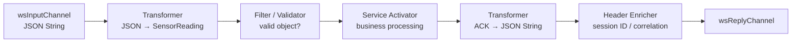
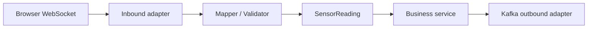
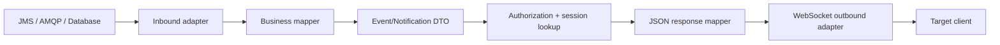

# WebSocket message mapper

## 1. Context and objectives

In the **SPRING_INTEGRATION_ADAPTERS** module, external systems are connected to Spring Integration via inbound/outbound adapters, gateways, pollers, and `MessageChannel`. When data from WebSocket enters an integration flow, the application must turn network protocol frames into processable messages. In the reverse direction, business data must be mapped into content that WebSocket clients can understand.

The **WebSocket message mapper** lesson, in the **Adapter WebSocket** chapter, explains those conversion steps. A typical example is a browser sending JSON containing sensor readings; Spring Integration receives the frame, parses the JSON into a business object, processes it, and sends a JSON ACK back to the exact WebSocket session.

After this lesson, you will be able to:

- Distinguish between **WebSocket frames**, Spring `Message<?>`, and **business objects**.
- Explain the roles of `SubProtocolHandler`, `PassThruSubProtocolHandler`, and Spring `MessageConverter` in the conversion process.
- Map valid JSON payloads, validate data types, and build response messages.
- Preserve meaningful headers such as `simpSessionId` when transforming across multiple steps of an Integration Flow.
- Distinguish raw WebSocket from STOMP, text frames from binary frames, and mapping errors from transport errors.
- Design testing, error handling, size limits, and version compatibility for the message contract.

**Scope:** Spring Integration does not mandate a fixed class named `WebSocketMessageMapper` to do all the work. In practice, "message mapper" is a **conversion responsibility** distributed across the sub-protocol handler, message converters, and business transformers/services you build.

## 2. Three data layers to distinguish

### 2.1. WebSocket frame at the communication layer

In Spring WebSocket, data traveling over the connection can be represented by:

- `TextMessage`: text content, typically a JSON string or protocol text.
- `BinaryMessage`: binary content; requires knowing the encoding/schema to interpret.
- `PingMessage` and `PongMessage`: connection control frames, not business event contracts.
- Close frame: connection termination signal; belongs to session lifecycle.

A client might send JSON like:

```json
{
  "type": "sensor.reading",
  "eventId": "evt-104",
  "deviceId": "sensor-07",
  "temperature": 27.4
}
```

At the WebSocket layer, this is just a **text frame**; Java/Spring does not automatically know what `type` means, whether `eventId` is required, or that `temperature` must be a number.

### 2.2. Spring Message at the integration layer

After the adapter receives the frame, the message enters Spring Messaging:

```java
org.springframework.messaging.Message<?>
```

A Spring Message consists of two parts:

| Part | Meaning | Example |
| --- | --- | --- |
| `payload` | Data carried by the message | JSON string, `byte[]`, or Java object |
| `headers` | Metadata for routing/processing | `simpSessionId`, `contentType`, sub-protocol headers |
| `MessageHeaders.ID` | ID of the **Spring Message** | Used for message tracking; not a WebSocket connection ID |
| Application headers | Metadata created by the flow | `eventId`, `schemaVersion`, `tenantId`, correlation ID |

Do not confuse the **WebSocket session ID** with the **Spring Message ID**. With server-side raw WebSocket, the `simpSessionId` header lets the outbound adapter find the exact `WebSocketSession` to receive the reply.

Not every header on a Spring Message goes onto the wire. For example, setting `contentType=application/json` on a Spring Message **does not mean** a raw WebSocket client will receive a new HTTP `Content-Type` header. After HTTP Upgrade, both sides exchange WebSocket frames per the agreed protocol.

### 2.3. Business object at the application layer

After parsing/validation, the application can use a strongly typed structure:

```java
public record SensorReading(
        String type,
        String eventId,
        String deviceId,
        double temperature) {
}
```

This is a **domain object**, not a network frame or a Spring message. It decouples DB persistence, alerting, HTTP gateway calls, or Kafka/JMS publishing from the initial JSON format.

### Bidirectional mapping diagram

```mermaid
flowchart LR
    A["WebSocket TextMessage<br/>JSON string"] --> B["SubProtocolHandler<br/>wrap into Spring Message"]
    B --> C["Inbound Channel Adapter<br/>MessageChannel"]
    C --> D["Payload mapper<br/>parse + validate JSON"]
    D --> E["SensorReading<br/>business object"]
    E --> F["Business service<br/>process / store / emit event"]
    F --> G["Response mapper<br/>build JSON"]
    G --> H["Spring Message<br/>payload + simpSessionId"]
    H --> I["Outbound Channel Adapter<br/>SubProtocolHandler"]
    I --> J["WebSocket TextMessage<br/>send back to client"]
```



Separation of responsibilities is crucial: **the adapter and sub-protocol handler** handle communication; **the business mapper/validator** enforces the data contract; **the service** decides business effects.

## 3. Who performs mapping in Spring Integration?

### 3.1. SubProtocolHandler: from frames to messages and back

`WebSocketInboundChannelAdapter` receives `WebSocketMessage<?>` via `WebSocketListener` and uses `SubProtocolHandlerRegistry` to pick the `SubProtocolHandler` matching the negotiated sub-protocol.

On the outbound side, `WebSocketOutboundMessageHandler` receives a Spring Message from the channel, determines the target WebSocket session, and likewise delegates to the appropriate `SubProtocolHandler`.

| Component | Responsibility |
| --- | --- |
| `WebSocketInboundChannelAdapter` | Receives frames and feeds Spring Messages into the flow |
| `WebSocketOutboundMessageHandler` | Consumes Spring Messages and sends them out over WebSocket |
| `SubProtocolHandlerRegistry` | Looks up/selects the sub-protocol handler for a session |
| `PassThruSubProtocolHandler` | Basic conversion between WebSocket Message and Spring Message when no custom sub-protocol is used |
| `StompSubProtocolHandler` | Interprets STOMP frames/commands and STOMP headers |
| `MessageConverter` | Assists payload conversion when handlers need a different Java type/format |
| `Transformer` / application service | Performs business mapping, validation, enrichment, and data processing |

For **raw WebSocket**, Spring Integration defaults to `PassThruSubProtocolHandler`. When working with **STOMP**, you must configure a STOMP handler; a JSON string sent via `WebSocket.send(...)` does not automatically become a STOMP `SEND` frame.

### 3.2. MessageConverter: converting payload types

Depending on the Spring Integration version and configuration, relevant default converters include:

| Converter | Data typically handled | Notes |
| --- | --- | --- |
| `StringMessageConverter` | Character strings | Suitable for text payloads |
| `ByteArrayMessageConverter` | Byte arrays | Does not automatically understand binary schemas |
| `MappingJackson2MessageConverter` | JSON ↔ Java objects | Works when Jackson is on the classpath and conversion conditions match |

Converter order can affect how data is handled. In WebSocket adapter configuration, you can use these APIs:

```java
adapter.setPayloadType(String.class); // Inbound example: target payload type
adapter.setMessageConverters(customConverters);
adapter.setMergeWithDefaultConverters(true);
```

These lines illustrate **configuration options**, not a standalone code snippet: `customConverters` must be a declared `List<MessageConverter>`. `setPayloadType(...)` belongs to the inbound adapter, whereas `setMessageConverters(...)` and `setMergeWithDefaultConverters(...)` are also supported by the outbound handler.

**Distinguishing the two flags:**

- `payloadType` specifies the target output payload type of the **inbound** conversion, defaulting to `String` in typical configurations.
- `mergeWithDefaultConverters` only matters when you register custom converters. If `false`, the custom list replaces the default list; if `true`, default converters are appended according to the adapter's rules.

Simply calling `setPayloadType(SensorReading.class)` is not enough to guarantee every text frame will be parsed into the record. The outcome also depends on the message converter, source payload type, content-type, and sub-protocol. Therefore, in the hands-on example below we **receive a `String` and parse it with Jackson inside an application-controlled mapper**; this approach is explicit and easy to test.

### 3.3. Mapping is not synonymous with serialization

- **Serialization:** turning an object into a string/bytes, e.g., `SensorReading → JSON`.
- **Deserialization:** turning a string/bytes into an object, e.g., `JSON → JsonNode`.
- **Validation:** determining whether data matches the contract, field types, bounds, and permissions.
- **Header mapping/enrichment:** preserving/adding `simpSessionId`, `eventId`, `contentType`, or correlation IDs as needed.
- **Routing:** delivering the message to the corresponding consumer/destination.

A well-designed mapper must define **which data is trustworthy, what structure the output has, and what metadata is allowed to flow downstream**.

## 4. Designing the JSON contract before writing code

Example input:

```json
{
  "type": "sensor.reading",
  "eventId": "evt-104",
  "deviceId": "sensor-07",
  "temperature": 27.4
}
```

Response output:

```json
{
  "type": "sensor.ack",
  "eventId": "evt-104",
  "status": "ACCEPTED"
}
```

Rules table:

| Field | Type | Rule |
| --- | --- | --- |
| `type` | String | Must be exactly `sensor.reading` |
| `eventId` | String | Non-blank; used to correlate ACKs and control duplicates |
| `deviceId` | String | Non-blank; purely client-reported metadata |
| `temperature` | JSON number | Must be numeric; domain-specific range bounds can be added |
| `schemaVersion` | String (optional) | Recommended when multiple clients use different contract versions |

**Do not treat `deviceId` as an authenticated identity.** A client can forge the JSON it sends. Checking which `deviceId` a sender is authorized to report must rely on the session's principal/token/authentication metadata.

You should also decide policies for extra fields, unknown `type` values, oversized payloads, Unicode characters, timestamps/timezones, units of measurement, and duplicate `eventId`s. Do not leave important rules implicit in code.

## 5. Complete example: text frame → record → JSON ACK

The example uses **Java 17+, Spring Boot 3.x, Spring Integration 6.x** on a Servlet WebSocket server. Ingestion uses raw WebSocket; no STOMP broker is needed.

### 5.1. Maven dependencies

```xml
<dependencies>
    <dependency>
        <groupId>org.springframework.boot</groupId>
        <artifactId>spring-boot-starter-web</artifactId>
    </dependency>
    <dependency>
        <groupId>org.springframework.boot</groupId>
        <artifactId>spring-boot-starter-integration</artifactId>
    </dependency>
    <dependency>
        <groupId>org.springframework.integration</groupId>
        <artifactId>spring-integration-websocket</artifactId>
    </dependency>
</dependencies>
```

Spring Boot manages dependency versions via its compatible BOM. `spring-boot-starter-web` provides the server-side Spring MVC/WebSocket foundation; `spring-integration-websocket` provides the adapters and containers.

### 5.2. Defining the DTO

File `SensorReading.java`:

```java
package com.example.websocket;

public record SensorReading(
        String type,
        String eventId,
        String deviceId,
        double temperature) {
}
```

The DTO does not depend on Spring Integration. This makes it easy to write unit tests for mapping logic and reuse the record in Kafka, JMS, or database persistence steps.

### 5.3. Writing an explicit mapper

File `TelemetryPayloadMapper.java`:

```java
package com.example.websocket;

import com.fasterxml.jackson.core.JsonProcessingException;
import com.fasterxml.jackson.databind.JsonNode;
import com.fasterxml.jackson.databind.ObjectMapper;
import com.fasterxml.jackson.databind.node.ObjectNode;
import org.springframework.stereotype.Component;

@Component
public class TelemetryPayloadMapper {

    private final ObjectMapper objectMapper;

    public TelemetryPayloadMapper(ObjectMapper objectMapper) {
        this.objectMapper = objectMapper;
    }

    public SensorReading fromText(String text) {
        final JsonNode root;
        try {
            root = objectMapper.readTree(text);
        } catch (JsonProcessingException exception) {
            throw new IllegalArgumentException(
                    "WebSocket payload is not valid JSON", exception);
        }

        if (root == null || !root.isObject()) {
            throw new IllegalArgumentException(
                    "Payload must be a JSON object");
        }

        String type = requiredText(root, "type");
        String eventId = requiredText(root, "eventId");
        String deviceId = requiredText(root, "deviceId");
        JsonNode temperature = root.get("temperature");

        if (!"sensor.reading".equals(type)) {
            throw new IllegalArgumentException("Unsupported event type");
        }

        if (temperature == null || !temperature.isNumber()) {
            throw new IllegalArgumentException(
                    "temperature must be a JSON number");
        }

        double numericValue = temperature.doubleValue();
        if (!Double.isFinite(numericValue)) {
            throw new IllegalArgumentException(
                    "temperature must not be infinite or NaN");
        }

        return new SensorReading(
                type, eventId, deviceId, numericValue);
    }

    public String toAcceptedAck(SensorReading event) {
        ObjectNode reply = objectMapper.createObjectNode();
        reply.put("type", "sensor.ack");
        reply.put("eventId", event.eventId());
        reply.put("status", "ACCEPTED");
        return reply.toString();
    }

    private static String requiredText(JsonNode root, String name) {
        JsonNode node = root.get(name);
        if (node == null || !node.isTextual()) {
            throw new IllegalArgumentException(
                    name + " must be a string");
        }

        String value = node.textValue();
        if (value.isBlank()) {
            throw new IllegalArgumentException(
                    name + " must not be blank");
        }

        return value;
    }
}
```

The mapper above intentionally uses `JsonNode` to **strictly verify JSON types** before constructing the record. If you call `ObjectMapper.readValue(text, SensorReading.class)` directly without strict configuration, Jackson may apply automatic type coercion rules. For a strict contract, you need control over coercion rules, missing fields, `null` values, and unknown fields.

The mapper should signal failures via meaningful exceptions or a structured result model; the business flow decides whether to log, route to an error channel, or send a valid error message to the client. **Do not return an `ACCEPTED` ACK when validation fails.**

### 5.4. Configuring the adapter and channels

File `WebSocketMappingConfiguration.java`:

```java
package com.example.websocket;

import org.springframework.beans.factory.annotation.Qualifier;
import org.springframework.context.annotation.Bean;
import org.springframework.context.annotation.Configuration;
import org.springframework.integration.annotation.ServiceActivator;
import org.springframework.integration.channel.DirectChannel;
import org.springframework.integration.config.EnableIntegration;
import org.springframework.integration.websocket.ServerWebSocketContainer;
import org.springframework.integration.websocket.inbound.WebSocketInboundChannelAdapter;
import org.springframework.integration.websocket.outbound.WebSocketOutboundMessageHandler;
import org.springframework.messaging.MessageChannel;
import org.springframework.messaging.MessageHandler;
import org.springframework.messaging.MessagingException;
import org.springframework.messaging.simp.SimpMessageHeaderAccessor;
import org.springframework.messaging.support.MessageBuilder;

@Configuration
@EnableIntegration
public class WebSocketMappingConfiguration {

    @Bean
    public ServerWebSocketContainer wsServerContainer() {
        return new ServerWebSocketContainer("/ws/telemetry");
    }

    @Bean
    public MessageChannel wsInputChannel() {
        return new DirectChannel();
    }

    @Bean
    public MessageChannel wsReplyChannel() {
        return new DirectChannel();
    }

    @Bean
    public WebSocketInboundChannelAdapter inboundWebSocket(
            ServerWebSocketContainer wsServerContainer,
            @Qualifier("wsInputChannel") MessageChannel channel) {

        WebSocketInboundChannelAdapter adapter =
                new WebSocketInboundChannelAdapter(wsServerContainer);

        adapter.setPayloadType(String.class);
        adapter.setOutputChannel(channel);
        return adapter;
    }

    @Bean
    @ServiceActivator(inputChannel = "wsInputChannel")
    public MessageHandler mapValidateAndReply(
            TelemetryPayloadMapper payloadMapper,
            @Qualifier("wsReplyChannel") MessageChannel replies) {

        return incoming -> {
            if (!(incoming.getPayload() instanceof String rawText)) {
                throw new MessagingException(
                        incoming, "Text frame required");
            }

            String sessionId = SimpMessageHeaderAccessor
                    .getSessionId(incoming.getHeaders());

            if (sessionId == null || sessionId.isBlank()) {
                throw new MessagingException(
                        incoming, "WebSocket session not found");
            }

            final SensorReading event;
            try {
                event = payloadMapper.fromText(rawText);
            } catch (IllegalArgumentException exception) {
                throw new MessagingException(
                        incoming, "Invalid telemetry data", exception);
            }

            // Demo: this is where you call a business service,
            // verify permissions, and/or persist data.
            System.out.printf(
                    "eventId=%s deviceId=%s temp=%.1f%n",
                    event.eventId(), event.deviceId(), event.temperature());

            String ackJson = payloadMapper.toAcceptedAck(event);

            boolean accepted = replies.send(
                    MessageBuilder.withPayload(ackJson)
                            .setHeader(
                                    SimpMessageHeaderAccessor.SESSION_ID_HEADER,
                                    sessionId)
                            .build());

            if (!accepted) {
                throw new MessagingException(
                        incoming, "Reply channel did not accept the ACK");
            }
        };
    }

    @Bean
    @ServiceActivator(inputChannel = "wsReplyChannel")
    public MessageHandler outboundWebSocket(
            ServerWebSocketContainer wsServerContainer) {

        return new WebSocketOutboundMessageHandler(wsServerContainer);
    }
}
```

**Flow explanation:**

1. `ServerWebSocketContainer("/ws/telemetry")` registers the WebSocket endpoint and manages sessions.
2. `WebSocketInboundChannelAdapter` receives frames; `PassThruSubProtocolHandler` is used by default for raw WebSocket.
3. The adapter sends a Spring Message into `wsInputChannel` with a `String` payload.
4. The handler calls `TelemetryPayloadMapper.fromText(...)` to parse/validate and create a `SensorReading`.
5. The handler builds a JSON ACK, **preserves `simpSessionId`**, and sends it to `wsReplyChannel`.
6. `WebSocketOutboundMessageHandler` uses the same container to send the frame back to the exact session.

The ACK in this example indicates **the message passed validation and the demonstration handler**. If `ACCEPTED` should mean "successfully saved to DB/pushed to Kafka", the corresponding business work must finish before creating the ACK, with clear transaction/error semantics defined.

**Why isn't a poller used?** WebSocket inbound receives frames in an event-driven manner; outbound consumes messages pushed into the channel. A poller only belongs to another source if the flow reads from a source that must be polled on a schedule, such as files or DB tables.

### 5.5. Testing with a WebSocket client in the browser

Run Spring Boot on port `8080`. Open a page on the same origin as the application (or an environment allowed by the server's WebSocket origin policy) and run this JavaScript:

```javascript
const socket = new WebSocket("ws://localhost:8080/ws/telemetry");

socket.addEventListener("open", () => {
  socket.send(JSON.stringify({
    type: "sensor.reading",
    eventId: "evt-104",
    deviceId: "sensor-07",
    temperature: 27.4
  }));
});

socket.addEventListener("message", (event) => {
  const response = JSON.parse(event.data);
  console.log("ACK:", response);
});

socket.addEventListener("error", (event) => {
  console.error("WebSocket error:", event);
});

socket.addEventListener("close", (event) => {
  console.log("Closed:", event.code);
});
```

Expected output on success:

```text
ACK: {type: 'sensor.ack', eventId: 'evt-104', status: 'ACCEPTED'}
```

Now send invalid data after the socket opens:

```javascript
socket.send("{invalid-json}");
socket.send(JSON.stringify({
  type: "sensor.reading",
  eventId: "evt-bad",
  deviceId: "sensor-07",
  temperature: "27.4"
}));
```

The first case has invalid JSON syntax; the second uses a **string** for `temperature` instead of a JSON number. The mapper must reject both. The error outcome depends on your Spring Integration error-handling configuration; **do not assume a JSON error frame is sent or that the connection will be closed** when a handler throws an exception.

### 5.6. Verifying session ID preservation

Open two browser tabs. Tab A sends `evt-A`, tab B sends `evt-B`. Each receives the ACK with its corresponding `eventId`. If you omit:

```java
.setHeader(SimpMessageHeaderAccessor.SESSION_ID_HEADER, sessionId)
```

when creating the outbound Spring Message, the server may fail to identify the target session, causing the reply to fail. This is a **header mapping/routing** error, distinct from a JSON parsing error.

When a transformer builds a new message, make sure to retain the necessary headers. `MessageBuilder.fromMessage(incoming)` can be a starting point to preserve headers; however, in security-sensitive flows you should **selectively pick** headers allowed to propagate outbound to avoid leaking unwanted metadata.

## 6. Message mapper across different configuration styles

### 6.1. Explicit mapping with transformers

Instead of putting the mapper inside a single `MessageHandler`, you can design explicit steps:



This approach works well when mapping logic needs to be reused across adapters: inbound JSON files, HTTP JSON payloads, JMS text messages, or Kafka events can all be converted to `SensorReading` and handled by the same service. Note that some Spring Integration transformers preserve headers, but **never assume every transformation or custom Message construction preserves all headers**; verify with tests.

### 6.2. Configuring MessageConverter directly

When most of a flow needs a fixed Java type and a converter works reliably with the chosen sub-protocol, you can consider configuring the inbound adapter like this:

```java
// Illustrative configuration snippet, placed inside an appropriate bean factory.
WebSocketInboundChannelAdapter adapter =
        new WebSocketInboundChannelAdapter(serverContainer);

adapter.setPayloadType(SensorReading.class);
adapter.setMessageConverters(
        java.util.List.of(
                new org.springframework.messaging.converter.MappingJackson2MessageConverter()
        ));
adapter.setMergeWithDefaultConverters(true);
adapter.setOutputChannel(inputChannel);
```

Ensure `serverContainer` and `inputChannel` already exist. This example is **an API option**, not a guarantee that every raw WebSocket app automatically converts JSON text into a record under all conditions. Verify content type, source payload, and converter support for the exact Spring version you are running. When detailed validation with coded error messages is the goal, an explicit mapper is usually easier to control.

In the XML namespace, you can declare `payload-type`, `message-converters`, and `merge-with-default-converters` attributes on the corresponding inbound adapter, along with the necessary sub-protocol and channel configurations. The outbound element also supports a list of converters, though it does not share the inbound's `payloadType` semantics.

### 6.3. STOMP: mapping with an extra command and destination layer

STOMP runs over WebSocket but has a different format:

```text
SEND
destination:/app/sensors
content-type:application/json

{"type":"sensor.reading","eventId":"evt-104","deviceId":"sensor-07","temperature":27.4}\0
```

*Note:* the `\0` notation in the example represents the NUL byte terminating a STOMP frame; it is not the two characters `\` and `0` sent as text.

With STOMP, `StompSubProtocolHandler` decodes STOMP commands/headers into Spring Messaging structures before reaching the business mapper. Headers such as `simpMessageType`, `simpDestination`, `simpSessionId`, and `simpSubscriptionId` carry STOMP/Spring Messaging semantics.

`WebSocketInboundChannelAdapter` only pushes Spring Messages into the integration flow when `simpMessageType = MESSAGE` or when that type header is absent. STOMP messages of other types can be handled via application events/broker depending on configuration. Merely adding a Jackson converter is not enough to turn a raw endpoint into a STOMP broker.

### 6.4. Text and binary are not equivalent

For text frames, the mapper must know the charset and schema. With JSON, both sides typically agree on UTF-8 per the JSON specification. For binary frames, the payload might be protobuf, Avro, or a custom binary format; in that case, a matching decoder is required.

For example, a binary contract might specify:

```text
Bytes 0..1  : schema version (uint16)
Bytes 2..5  : device ID (uint32)
Bytes 6..13 : timestamp (int64)
Bytes 14..  : schema-encoded payload
```

This is an **illustrative application contract**, not a standard structure provided by Spring WebSocket. Do not blindly read `byte[]` with `new String(bytes)` unless the actual protocol defines them as text.

## 7. Header mapping, session, correlation, and versioning

### 7.1. Session headers are more trustworthy communication metadata than JSON fields

When replying from a **WebSocket server**, outbound needs to know the target session. Raw WebSocket commonly uses:

```java
SimpMessageHeaderAccessor.SESSION_ID_HEADER // "simpSessionId"
```

A client itself could send JSON containing `"sessionId":"victim-session"`. Never use that field directly as a target for sending private information. Extract the ID from message headers attached by the WebSocket infrastructure/adapter, combined with authorization checks against the server's principal/session registry.

On the **client-side outbound adapter**, `ClientWebSocketContainer` holds only one connection, so the session ID header is not required for routing.

### 7.2. Correlation ID vs. session ID

| ID | Meaning |
| --- | --- |
| `simpSessionId` | Identifies a current WebSocket connection |
| `eventId` | Identifies a business event, which can outlive reconnects |
| `correlationId` | Links a request and a response/ACK |
| `MessageHeaders.ID` | Identifies each individual Spring Message |
| `userId` | Business/authenticated identity; one user can have multiple sessions |

In the example, `eventId` appears in both the input JSON and the ACK, telling the client which event the ACK belongs to. If **duplicate processing must be prevented**, the system must store or check `eventId`, rather than just trusting an ACK with the same value.

### 7.3. Versioning for the message mapper

When serving multiple clients, the schema must evolve under control. For example, a new version adds `unit`:

```json
{
  "schemaVersion": "2",
  "type": "sensor.reading",
  "eventId": "evt-200",
  "deviceId": "sensor-07",
  "temperature": 27.4,
  "unit": "C"
}
```

Some approaches:

1. Include `schemaVersion` in the payload and dispatch to a version-specific mapper.
2. Only add optional fields, preserving committed backward/forward compatibility.
3. For breaking changes, introduce a new version or a separate endpoint/sub-protocol.
4. Use contract tests between server and client to catch discrepancies before deployment.

Never silently change the meaning of a field in a Java DTO without updating the contract; for instance, changing `temperature=27.4` from Celsius to Fahrenheit is a **semantic breaking change** even though JSON still parses cleanly.

## 8. Handling mapping errors and transport errors

### 8.1. Error categories and where to handle them

| Error type | Example | Where handling should live |
| --- | --- | --- |
| Wrong frame/encoding | Binary sent when flow only accepts text | Communication layer / payload type check |
| Malformed JSON | `{invalid-json}` | Mapper, error channel, or error handler |
| Wrong type / missing field | `temperature: "27.4"`, missing `eventId` | Business validator/mapper |
| Unsupported event type | `type: "unknown.event"` | Router/filter/mapper per contract |
| Authorization violation | Client spoofs an unauthorized `deviceId` | Server-side authorization |
| Missing session header | Outbound message lacks `simpSessionId` | Header enricher/routing |
| Session already closed | Reconnect created a new session | Session lifecycle/retry/fallback |
| Cannot encode outbound | POJO lacks matching converter | Response mapper / converter |
| Downstream failure | DB/Kafka/JMS unavailable | Business flow, adapter-specific retry/DLQ |

**Two principles:**

- **Error channel** is an error-handling mechanism *internal to Spring Integration*; it does not automatically send JSON errors to the browser.
- If you want to reply with a business error to the client, explicitly design the **error code, correlation ID, target session ID, and outbound flow**, while avoiding returning sensitive exception details or stack traces.

### 8.2. Error JSON contract

An easy-to-use example:

```json
{
  "type": "sensor.error",
  "eventId": "evt-104",
  "code": "INVALID_PAYLOAD",
  "message": "temperature must be a number"
}
```

For syntax-invalid JSON, it may be **impossible to extract `eventId`**. A common choice is to return `eventId: null` or a server-generated request ID and record the corresponding trace, depending on the contract. Do not fabricate an `eventId` from the session ID.

If using retries, distinguish **data errors that cannot be fixed by retrying** from **transient downstream errors**. Retrying schema-invalid JSON indefinitely only increases load and spams logs.

### 8.3. Resource limits

A message mapper can be attacked with huge JSON payloads, deeply nested JSON, payloads with an abnormal number of fields, or inputs that allocate many Java objects. Therefore:

- Limit WebSocket frame/message size at the transport/container level.
- Limit parse depth and field sizes in the JSON parser where possible.
- Configure appropriate timeouts, connection counts, and send/receive rates.
- Monitor event counts and rates per principal/session.
- Avoid logging full payloads, tokens, or sensitive data.
- Monitor parse/validation errors, mapper latency, ACK rates, and failing sessions.

Mappers need bounded resources; for large payloads or heavy decoding, consider offloading processing from the frame-receiving thread and bounding concurrency to prevent overload.

## 9. Meaningful testing for message mappers

### 9.1. Unit tests: verify the contract first

`TelemetryPayloadMapper` is designed without depending on `WebSocketSession`, so it can be unit-tested directly:

```java
package com.example.websocket;

import com.fasterxml.jackson.databind.ObjectMapper;
import org.junit.jupiter.api.Test;

import static org.junit.jupiter.api.Assertions.*;

class TelemetryPayloadMapperTest {

    private final TelemetryPayloadMapper mapper =
            new TelemetryPayloadMapper(new ObjectMapper());

    @Test
    void shouldMapValidReading() {
        SensorReading event = mapper.fromText("""
                {
                  "type": "sensor.reading",
                  "eventId": "evt-104",
                  "deviceId": "sensor-07",
                  "temperature": 27.4
                }
                """);

        assertEquals("evt-104", event.eventId());
        assertEquals("sensor-07", event.deviceId());
        assertEquals(27.4, event.temperature(), 0.001);
    }

    @Test
    void shouldRejectWrongTemperatureType() {
        String json = """
                {
                  "type": "sensor.reading",
                  "eventId": "evt-105",
                  "deviceId": "sensor-07",
                  "temperature": "27.4"
                }
                """;

        assertThrows(IllegalArgumentException.class,
                () -> mapper.fromText(json));
    }

    @Test
    void shouldCreateCorrelatedAck() throws Exception {
        SensorReading event = new SensorReading(
                "sensor.reading", "evt-104", "sensor-07", 27.4);

        var ack = new ObjectMapper().readTree(
                mapper.toAcceptedAck(event));

        assertEquals("sensor.ack", ack.path("type").asText());
        assertEquals("evt-104", ack.path("eventId").asText());
        assertEquals("ACCEPTED", ack.path("status").asText());
    }
}
```

This test requires JUnit 5, typically included via `spring-boot-starter-test` in Boot projects. If not present, add the corresponding test dependency before running.

### 9.2. Integration tests: verify transport and headers

Unit-testing the mapper does not guarantee the adapter configuration is right. You must test the WebSocket flow from a real client:

1. Connect to `ws://localhost:8080/ws/telemetry`, send valid JSON, and receive an ACK with the matching `eventId`.
2. Send malformed JSON, missing fields, and wrong data types; verify they do **not** reach the business service.
3. Open two tabs/clients sending two different `eventId`s; each tab receives only its own ACK.
4. Close and reconnect a session; do not accidentally send to the old ID.
5. Send text/binary frames that violate the contract; observe converter/validation errors and connection-closing policy.
6. Test oversized payloads, unauthorized sessions, and a failing downstream.
7. Verify `contentType`/headers actually required by the active sub-protocol configuration.

Especially with custom `MessageConverter`s, run an end-to-end test from **real frame → inbound payload type → real outbound frame**. Compiling code only confirms API usage, not that the right converter gets selected at runtime.

## 10. Real-world integration scenarios

### 10.1. WebSocket → domain event → Kafka



The mapper's job is to turn JSON into a stable object. `simpSessionId` is only relevant if an ACK needs to return to the current connection; it should not be the Kafka key, DB primary key, or default business identity. Intentionally use `eventId`, `deviceId`, and appropriate partition keys.

### 10.2. JMS/AMQP/DB → domain event → WebSocket



In this direction, the message does not originate from WebSocket, so **it does not already have `simpSessionId`**. The application must identify the target user, verify access rights, and find active sessions, then construct an outbound Spring Message with the appropriate session header. In a multi-node system, route the notification to the node owning the WebSocket session or use a broker.

### 10.3. Delivery decisions

WebSocket **does not natively provide** business ACKs, retry/replay across reconnects, or exactly-once delivery. A server-generated JSON ACK only proves what the contract defines (e.g., "parsed", "accepted", "persisted"). If the client must confirm it **received and processed** a notification, an inbound ACK message with a correlation ID is needed; if the system requires replay, store unacknowledged event state outside the WebSocket session.

## 11. Practice exercises

**Exercise A — strict JSON ingestion.** Extend `TelemetryPayloadMapper` to validate `schemaVersion` and an ISO-8601 `timestamp`. Define how to reject unknown fields or wrong types, and write unit tests for each scenario.

**Exercise B — header mapping.** Insert a transformer that constructs a new message between `mapValidateAndReply` and `wsReplyChannel`. Test both preserving and dropping `simpSessionId`. Observe the results across two browser tabs and explain why the session header must not be taken from the client payload.

**Exercise C — error reply.** Design a `sensor.error` payload with `code`, `message`, and `eventId` when safely extractable. Decide which errors should be returned to the client, which should emit metrics/logs, and which should close the connection.

**Exercise D — binary protocol.** Suppose devices send `BinaryMessage` frames containing protobuf. Design where to plug in the decoder, the DTO type, schema versioning, and how to handle payloads of the wrong version. Explain why `MappingJackson2MessageConverter` cannot automatically handle protobuf.

**Exercise E — Kafka integration.** After successfully parsing `SensorReading`, publish the event to Kafka; once recorded per the chosen contract, send an ACK back to the original session. Identify concurrency, reconnect, retry, and idempotency risks.

**Completion criteria:** clearly distinguish **frame mapping**, **payload/domain mapping**, **header mapping**, **routing**, and **delivery semantics**, and demonstrate with tests that valid data flows through properly while invalid data does not pass validation.

## 12. Summary

- **WebSocket message mapper** is the conversion responsibility between WebSocket data, Spring `Message<?>`, and business objects. There is no mandatory single mapper class.
- `SubProtocolHandler` handles raw WebSocket or STOMP interactions; `MessageConverter` assists payload type conversion; business transformers/services enforce schemas and validation.
- For raw WebSocket, receiving `String` and parsing/validating JSON in a dedicated mapper is a clean, easily testable design.
- The `simpSessionId` header routes ACKs back to the exact server-side WebSocket session; `eventId`/`correlationId` support business correlation and retries.
- `contentType` on a Spring Message is not automatically wire-level metadata in raw WebSocket.
- STOMP, binary payloads, and custom converters require dedicated contracts and end-to-end testing.
- Proper mapping must be paired with authorization checks, resource limits, error management, and connection lifecycle handling.

## References

- [Spring Integration 6.2 Reference — WebSockets Support](https://docs.spring.io/spring-integration/reference/6.2/web-sockets.html)
- [Spring Integration Reference — WebSockets Support](https://docs.spring.io/spring-integration/reference/web-sockets.html)
- [Spring Integration API — WebSocketInboundChannelAdapter](https://docs.spring.io/spring-integration/docs/6.1.x/api/org/springframework/integration/websocket/inbound/WebSocketInboundChannelAdapter.html)
- [Spring Integration API — WebSocketOutboundMessageHandler](https://docs.spring.io/spring-integration/docs/6.5.0/api/org/springframework/integration/websocket/outbound/WebSocketOutboundMessageHandler.html)
- [Spring Integration API — PassThruSubProtocolHandler](https://docs.spring.io/spring-integration/docs/6.1.x/api/org/springframework/integration/websocket/support/PassThruSubProtocolHandler.html)
- [Spring Framework Reference — WebSocket](https://docs.spring.io/spring-framework/reference/web/websocket.html)
- [Spring Framework Reference — STOMP Message Flow](https://docs.spring.io/spring-framework/reference/web/websocket/stomp/message-flow.html)
