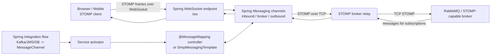
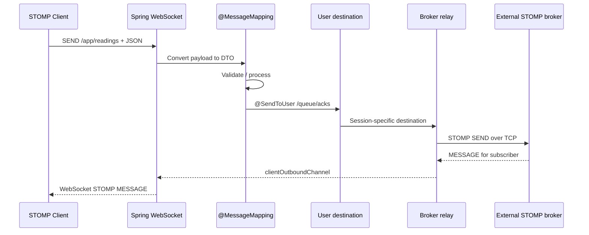
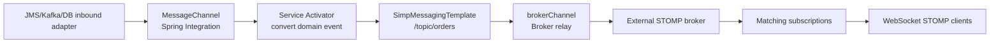
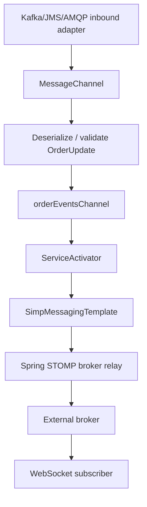
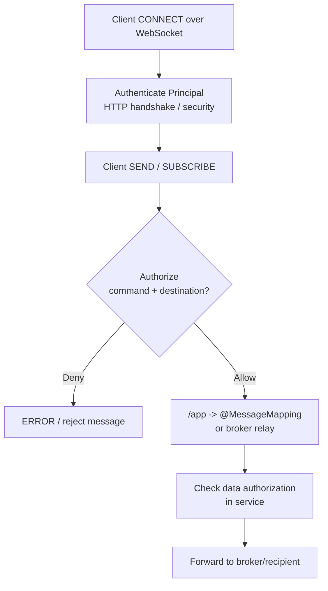

# STOMP over WebSocket and broker relay

## 1. Objectives and role in the module

In the **SPRING_INTEGRATION_ADAPTERS** module, we ingest data from external systems into Spring Integration using inbound adapters, gateways, pollers, and `MessageChannel`, then process and forward it via outbound adapters to HTTP, JMS, AMQP, Kafka, databases, or real-time channels. This lesson in the **Adapter WebSocket** chapter focuses on **STOMP over WebSocket and broker relay**: the mechanism that adds message commands, destinations, subscriptions, and a broker on top of a WebSocket connection.

You will be able to:

- Distinguish between **WebSocket transport**, the **STOMP protocol**, and a **message broker**.
- Read STOMP frames `CONNECT`, `SUBSCRIBE`, `SEND`, `MESSAGE`, `ACK`, `RECEIPT`, and understand destinations.
- Compare Spring's **simple broker** with **STOMP broker relay** to an external broker such as RabbitMQ.
- Configure `@EnableWebSocketMessageBroker`, `WebSocketMessageBrokerConfigurer`, and `enableStompBrokerRelay(...)`.
- Design the `/app` → `@MessageMapping` → `/user/queue` flow and publish events to `/topic`.
- Connect a Spring Integration `MessageChannel` with `SimpMessagingTemplate` to push notifications from Kafka/JMS/DB out to STOMP subscribers.
- Identify the boundary between **STOMP broker relay** and Spring Integration's **WebSocket inbound/outbound channel adapters**.
- Design authentication, destination authorization, ACKs, receipts, heartbeats, reconnects, and handling when the broker disconnects.

> **Scope of terminology:** STOMP stands for *Simple (or Streaming) Text Oriented Messaging Protocol*. WebSocket carries frames; STOMP defines message semantics inside the connection. Broker relay is a component of **Spring Framework WebSocket Messaging** that connects to an **external STOMP broker**, not a new type of Spring Integration inbound adapter.

## 2. Why is raw WebSocket alone not enough?

A raw WebSocket server can read JSON text and send frames to individual `WebSocketSession`s. This works well when a client talks directly to an application under a custom contract. However, if multiple screens need to follow topics such as `order.updated`, `inventory.changed`, or `sensor.alert`, the system has to build on its own:

- Subscription lists (which user is following which topic).
- Topic-based message routing and access control.
- Management of multiple connections, reconnects, and distribution across nodes.
- Acknowledgment rules, transport error handling, and downstream processing.

STOMP adds **commands and destinations**, allowing clients to declare interest in a receiving target. A message broker can handle distribution to subscriptions; the application focuses on business logic and authorization.

Let's distinguish:

| Layer | Provides | Does not provide by itself |
| --- | --- | --- |
| **WebSocket** | Long-lived bidirectional connection, transmitting text/binary frames | Topics, subscriptions, business queues |
| **STOMP** | Commands, headers, destinations, subscriptions, protocol-level receipt/ack | A running broker or durable persistence by default |
| **Spring WebSocket Messaging** | `@MessageMapping` controllers, message routing, and broker configuration | Business exactly-once guarantees |
| **Spring Simple Broker** | Lightweight in-memory broker, basic subscription delivery | Full features/durability/clustering of an external broker |
| **STOMP broker relay** | Forwards STOMP messages between Spring and an external broker | Automatically making every message persistent or guaranteeing client processing |
| **Spring Integration** | Adapter/channel/transformer/gateway flows to connect systems | Automatically creating STOMP destinations or a broker without configuration |

### Two parallel connection hops



Here there are **two protocols across two hops**: the client uses **WebSocket** to reach Spring; Spring uses **TCP STOMP** to reach the broker. The specific broker chosen determines how queues, durability, receipts, ACK modes, and clustering are supported.

## 3. STOMP frame structure

A typical STOMP frame looks like:

```text
COMMAND
header-name:header-value
another-header:another-value

body<NUL>
```

The first line holds the command; after the headers comes a blank line, the body, and then the **NUL (0x00)** byte terminating the frame. `<NUL>` in the example is an explanatory notation; STOMP clients send the actual control byte. STOMP specifies versioning, header escaping, `content-length`, and heartbeat rules; do not manually concatenate frame strings in real applications.

### 3.1. CONNECT and CONNECTED

The client opens the WebSocket first; then the STOMP client sends a connect frame:

```text
CONNECT
accept-version:1.2
host:example.org
heart-beat:10000,10000

<NUL>
```

The broker/relay responds with negotiated version, heartbeat, or protocol errors:

```text
CONNECTED
version:1.2
heart-beat:10000,10000

<NUL>
```

**HTTP 101 Switching Protocols** proves that the WebSocket handshake succeeded; it is **different** from completing STOMP `CONNECT`/`CONNECTED`. The WebSocket may be open while STOMP is not yet connected because the broker is unavailable or misconfigured.

### 3.2. SUBSCRIBE, SEND, and MESSAGE

Client subscribes to receive messages:

```text
SUBSCRIBE
id:sub-orders
destination:/topic/orders
ack:auto

<NUL>
```

Client sends a business message:

```text
SEND
destination:/app/readings
content-type:application/json

{"eventId":"evt-101","deviceId":"sensor-7","temperature":27.5}<NUL>
```

After the subscription is processed, the broker can deliver:

```text
MESSAGE
subscription:sub-orders
message-id:broker-msg-101
destination:/topic/orders
content-type:application/json

{"orderId":"ORD-42","status":"SHIPPED"}<NUL>
```

`id` in `SUBSCRIBE` is the **subscription ID**, not `WebSocketSession.getId()`. `message-id` is the message identifier at the broker/STOMP layer; `eventId` inside the JSON is the application's business identifier.

### 3.3. Other commands

| Command | What is it for? | Boundary to remember |
| --- | --- | --- |
| `CONNECT` / `STOMP` | Initiates a STOMP session over the transport | Does not replace the HTTP/WebSocket handshake |
| `CONNECTED` | Broker confirms STOMP session establishment | Does not mean topics are subscribed |
| `SEND` | Sends a body to a destination | Destination is dispatched by server/broker |
| `SUBSCRIBE` / `UNSUBSCRIBE` | Starts/stops a subscription | Subscriptions have their own IDs |
| `MESSAGE` | Broker delivers a message to a subscription | Does not imply the client completed business processing |
| `ACK` / `NACK` | Acknowledges/rejects a broker message per ACK mode | Broker-dependent; not an arbitrary domain ACK |
| `RECEIPT` | Confirms broker/server processed a frame carrying `receipt` | Does not prove the UI rendered it |
| `ERROR` | STOMP error notification | May be followed by closing the connection |
| `DISCONNECT` | Gracefully ends the STOMP session | Can include `receipt` to confirm server processing |

With `ack:auto`, the broker does not wait for the client to send an explicit `ACK` for each `MESSAGE`. With `ack:client` or `ack:client-individual`, the client must send `ACK` per the broker's semantics. **Broker ACK** and **business ACK** should be treated as two distinct contracts.

## 4. Destinations: /app, /topic, /queue, and /user

In Spring WebSocket Message Broker, destinations are typically divided by prefix:

| Destination | Example | Who handles it? |
| --- | --- | --- |
| `/app/...` | `/app/readings` | Spring invokes the matching `@MessageMapping` method after stripping the prefix |
| `/topic/...` | `/topic/orders` | Broker handles publish/subscribe via the broker relay |
| `/queue/...` | `/queue/notifications` | Broker handles according to the broker's own destination rules |
| `/user/...` | `/user/queue/acks` | Spring's user-destination resolver maps to a session/user-specific destination |
| `/ws` | `ws://localhost:8080/ws` | **WebSocket handshake** URL, not a STOMP message destination |

The names `/topic` and `/queue` are configuration conventions; **STOMP does not enforce the same semantics for these prefixes across all brokers**. RabbitMQ, ActiveMQ, and other brokers may define destination mapping, durability, or auto-delete differently. Check your broker documentation before committing delivery guarantees to production.

For example: a client `SUBSCRIBE`s to `/topic/orders` and later the server publishes an event to `/topic/orders`. The broker distributes the message to valid subscribers. If the message contains private data, publishing to a shared topic risks leaking information; use user destinations or authorized topics instead.

### What is a user destination?

A client typically subscribes to:

```text
/user/queue/acks
```

On the server, a controller can return a result using `@SendToUser("/queue/acks")`. Spring resolves this destination to a concrete address bound to the appropriate session/user and forwards it through the broker. Thus, the client **does not need to know the transformed internal queue name**.

With `@SendToUser(broadcast = false)`, the reply is restricted to **the session that originated the request**; by default in certain scenarios it may broadcast to multiple sessions of the same user. If the application needs all devices of a user, use explicit user routing, such as `SimpMessagingTemplate.convertAndSendToUser(...)`, combined with authorization rules.

## 5. Simple broker vs. STOMP broker relay

### 5.1. Simple broker: suited for learning and small systems

In Spring:

```java
@Override
public void configureMessageBroker(MessageBrokerRegistry registry) {
    registry.enableSimpleBroker("/topic", "/queue");
    registry.setApplicationDestinationPrefixes("/app");
}
```

The simple broker runs in-process inside the application, tracks subscriptions, and dispatches messages to connected WebSocket clients. It is suitable for:

- Learning how `@MessageMapping`, `@SendTo`, and `@SendToUser` work.
- Building demos or simple systems with few nodes.
- Dispatching messages that do not require durable queues or advanced broker features.

It is **not** a full-featured broker and does not provide all ACK/receipt mechanisms, durability, or clustering that an external broker can offer.

### 5.2. STOMP broker relay: connecting to an external broker

Configuration:

```java
registry.enableStompBrokerRelay("/topic", "/queue")
        .setRelayHost("localhost")
        .setRelayPort(61613);
```

Spring uses a relay handler to forward STOMP frames between WebSocket clients and **an external broker over TCP STOMP**. The broker can maintain subscriptions and apply its own queue/topic semantics. The relay lets multiple application instances share one broker, though **it does not automatically solve every issue around multi-node user registries, authentication, or exactly-once delivery**.

| Criterion | Simple broker | Broker relay |
| --- | --- | --- |
| External broker required | No | Yes |
| Network path to broker | In-process | TCP STOMP from each Spring instance |
| Subscriptions | Minimal in-memory | Managed by the external broker |
| Durable queue support | Very limited / not its goal | Depends on broker, destination, and policy |
| Multi-node | Needs custom design beyond simple broker | Can distribute via broker; user destinations still need care |
| Operations | Fewer moving parts | Requires health checks, credentials, reconnects, broker monitoring |
| Best suited for | Demos, simple apps | Systems needing an external broker and its messaging capabilities |

A common misconception: calling `enableStompBrokerRelay(...)` **does not mean the Spring app automatically starts RabbitMQ or ActiveMQ**. An actual broker must be running, have STOMP enabled, and accept connections from the Spring server.

## 6. Message flow inside Spring

Configuring `@EnableWebSocketMessageBroker` activates Spring Messaging infrastructure. Typical components:

- **`clientInboundChannel`**: receives Spring Messages converted from STOMP frames sent by WebSocket clients.
- **`clientOutboundChannel`**: delivers messages from the application/broker back to WebSocket clients.
- **`brokerChannel`**: receives server-emitted messages headed toward the broker.
- **`SimpAnnotationMethodMessageHandler`**: maps `/app/...` to `@MessageMapping`.
- **`UserDestinationMessageHandler`**: resolves the `/user` prefix.
- **`StompBrokerRelayMessageHandler`**: relays STOMP messages over TCP to the external broker.
- **`SimpMessagingTemplate`**: API for application services to proactively send messages to destinations.

### Two distinct journeys

**Journey A — client invokes business logic on the server**



**Journey B — server or external system emits events**



Journey B is especially important for this module: **Spring Integration manages sources and event processing**, while **Spring Messaging broker relay manages publishing events to STOMP subscribers**. A Kafka/JMS adapter does not automatically become a STOMP broker; an explicit contract-bridging step is required.

## 7. Example: Spring Boot + RabbitMQ STOMP broker relay

This example uses **Java 17+, Spring Boot 3.x, Spring Framework 6.x** and WebSocket messaging on the Servlet stack. RabbitMQ supports STOMP via a plugin. You need an external broker running, a reachable TCP STOMP endpoint, and an account with appropriate permissions.

### 7.1. Preparing dependencies

With Maven, the main dependencies:

```xml
<dependencies>
    <dependency>
        <groupId>org.springframework.boot</groupId>
        <artifactId>spring-boot-starter-websocket</artifactId>
    </dependency>
    <dependency>
        <groupId>org.springframework.boot</groupId>
        <artifactId>spring-boot-starter-integration</artifactId>
    </dependency>
    <dependency>
        <groupId>io.projectreactor.netty</groupId>
        <artifactId>reactor-netty</artifactId>
    </dependency>
</dependencies>
```

- `spring-boot-starter-websocket` provides Spring WebSocket and Spring Messaging.
- `spring-boot-starter-integration` supports the bridge from `MessageChannel` in section 9; it can be omitted if you only do STOMP messaging.
- `reactor-netty` provides the TCP client infrastructure used by the broker relay in Spring Framework. Depending on your project's dependencies, it may already be pulled in; check the dependency tree.
- If you want to use Spring Integration's `WebSocketInboundChannelAdapter` and `WebSocketOutboundMessageHandler` **directly**, add `spring-integration-websocket`. The current broker relay example uses Spring WebSocket Messaging and **does not need** that adapter.

The Spring Boot BOM manages compatible versions. Do not pin arbitrary versions of Spring Framework, Spring Integration, and Reactor Netty.

### 7.2. Configuring RabbitMQ for a test environment

The RabbitMQ broker needs the STOMP plugin enabled, for example once RabbitMQ is installed:

```bash
rabbitmq-plugins enable rabbitmq_stomp
```

The default TCP STOMP port is usually `61613`; make sure the broker is actually listening on this port. RabbitMQ's default `guest` account is typically restricted to loopback access only. The example below uses `localhost` and `guest` for local development illustration; production environments require **dedicated accounts, least-privilege permissions, TLS, secrets from secure configuration, and network access controls**.

A broker running and exposing AMQP port `5672` **does not mean** TCP STOMP `61613` is active. The relay uses the STOMP protocol, not AMQP.

### 7.3. Declaring the endpoint and broker relay

Create `StompWebSocketConfiguration.java`:

```java
package com.example.stomp;

import org.springframework.context.annotation.Configuration;
import org.springframework.messaging.simp.config.MessageBrokerRegistry;
import org.springframework.web.socket.config.annotation.EnableWebSocketMessageBroker;
import org.springframework.web.socket.config.annotation.StompEndpointRegistry;
import org.springframework.web.socket.config.annotation.WebSocketMessageBrokerConfigurer;

@Configuration
@EnableWebSocketMessageBroker
public class StompWebSocketConfiguration
        implements WebSocketMessageBrokerConfigurer {

    @Override
    public void registerStompEndpoints(StompEndpointRegistry registry) {
        registry.addEndpoint("/ws");
    }

    @Override
    public void configureMessageBroker(MessageBrokerRegistry registry) {
        registry.setApplicationDestinationPrefixes("/app");
        registry.setUserDestinationPrefix("/user");

        registry.enableStompBrokerRelay("/topic", "/queue")
                .setRelayHost("localhost")
                .setRelayPort(61613)
                .setClientLogin("guest")
                .setClientPasscode("guest")
                .setSystemLogin("guest")
                .setSystemPasscode("guest");
    }
}
```

Configuration elements to distinguish:

| Configuration | Meaning |
| --- | --- |
| `registry.addEndpoint("/ws")` | WebSocket handshake URL: `ws://localhost:8080/ws` |
| `setApplicationDestinationPrefixes("/app")` | Messages sent to `/app/...` go to `@MessageMapping` |
| `setUserDestinationPrefix("/user")` | Enables destination convention dedicated to users/sessions |
| `enableStompBrokerRelay("/topic", "/queue")` | Destinations handled by the external broker |
| `setRelayHost` / `setRelayPort` | Host/port of the **broker's TCP STOMP**, not Spring's WebSocket port |
| `setClientLogin` / `setClientPasscode` | Credentials the relay uses for broker connections on behalf of WebSocket clients |
| `setSystemLogin` / `setSystemPasscode` | Credentials used for the system connection from Spring to the broker |

The relay infrastructure maintains a dedicated STOMP connection for **system messages** sent by the application plus relayed STOMP connections on behalf of WebSocket clients. Therefore, credential management and connection limits on the broker are real operational concerns.

**Important on security:** Spring's relay uses the configured credentials for broker connections; do not treat `login` / `passcode` in a browser's STOMP `CONNECT` frame as user authentication for the application. Authentication is usually established via the HTTP handshake/Principal and Spring Security, followed by authorization checks on destinations and messages. The `guest` credentials are for local demos only.

### 7.4. DTOs and controller handling /app/readings

Create `SensorReading.java`:

```java
package com.example.stomp;

public record SensorReading(
        String eventId,
        String deviceId,
        Double temperature) {
}
```

Create `SensorAck.java`:

```java
package com.example.stomp;

public record SensorAck(
        String type,
        String eventId,
        String status) {
}
```

Create the controller:

```java
package com.example.stomp;

import org.springframework.messaging.handler.annotation.MessageMapping;
import org.springframework.messaging.simp.annotation.SendToUser;
import org.springframework.stereotype.Controller;

@Controller
public class SensorStompController {

    @MessageMapping("/readings")
    @SendToUser(value = "/queue/acks", broadcast = false)
    public SensorAck receive(SensorReading reading) {
        if (reading == null
                || reading.eventId() == null
                || reading.eventId().isBlank()
                || reading.deviceId() == null
                || reading.deviceId().isBlank()
                || reading.temperature() == null
                || !Double.isFinite(reading.temperature())) {
            throw new IllegalArgumentException("Invalid sensor reading");
        }

        // Demo: here you can verify device authorization,
        // persist data, and/or forward events to Kafka/JMS.
        System.out.printf("Reading %s from %s: %.1f%n",
                reading.eventId(),
                reading.deviceId(),
                reading.temperature());

        return new SensorAck(
                "sensor.ack", reading.eventId(), "ACCEPTED");
    }
}
```

How mapping works in the example:

1. The client sends STOMP `SEND` to `/app/readings`.
2. Spring strips the `/app` prefix and invokes `@MessageMapping("/readings")`.
3. The JSON body is converted into `SensorReading` if a matching converter is configured.
4. The controller performs minimal contract checks, processes the reading, and returns `SensorAck`.
5. `@SendToUser(value = "/queue/acks", broadcast = false)` limits the reply to the session that sent the message.
6. Spring converts the DTO into a message and sends it through the relay to the broker, then to the client's `/user/queue/acks` subscription.

The demo data check is intentionally simple: it does not yet verify the principal, correlate device ID with sender permissions, enforce temperature bounds, or return structured error codes. In production, move these checks into a dedicated service/validator and define how errors are returned to clients.

**Distinguishing ACKs:** `SensorAck` is an **application-defined business ACK**, distinct from the STOMP `ACK` frame used by the broker when a subscription requires manual acknowledgment.

### 7.5. Proactively publishing events to /topic

Create the DTO:

```java
package com.example.stomp;

public record OrderUpdate(
        String eventId, String orderId, String status) {
}
```

And the service:

```java
package com.example.stomp;

import org.springframework.messaging.simp.SimpMessagingTemplate;
import org.springframework.stereotype.Service;

@Service
public class OrderNotificationPublisher {

    private final SimpMessagingTemplate template;

    public OrderNotificationPublisher(SimpMessagingTemplate template) {
        this.template = template;
    }

    // Only publish data that all subscribers are allowed to see.
    public void publishPublicUpdate(OrderUpdate update) {
        template.convertAndSend("/topic/orders", update);
    }

    // Sends to valid sessions belonging to a username.
    public void publishPrivateUpdate(
            String username, OrderUpdate update) {

        template.convertAndSendToUser(
                username, "/queue/order-updates", update);
    }
}
```

`convertAndSend(...)` submits a Spring Message to the messaging/broker infrastructure; the method returning **does not mean** every client has received, stored, or rendered the notification. Publishing private data of a specific order to a shared `/topic/orders` can leak information; in practice, apply destination authorization, user notifications, or topics with proper ACLs.

### 7.6. STOMP client from JavaScript

Use the `@stomp/stompjs` library, e.g. in a frontend project with the package installed:

```bash
npm install @stomp/stompjs
```

JavaScript module example:

```javascript
import { Client } from "@stomp/stompjs";

const client = new Client({
  brokerURL: "ws://localhost:8080/ws",
  reconnectDelay: 5000,
  heartbeatIncoming: 10000,
  heartbeatOutgoing: 10000,

  onConnect: () => {
    console.log("STOMP connected");

    client.subscribe("/user/queue/acks", (message) => {
      console.log("ACK:", JSON.parse(message.body));
    });

    client.subscribe("/topic/orders", (message) => {
      console.log("Order update:", JSON.parse(message.body));
    });

    client.publish({
      destination: "/app/readings",
      headers: { "content-type": "application/json" },
      body: JSON.stringify({
        eventId: "evt-101",
        deviceId: "sensor-7",
        temperature: 27.5
      })
    });
  },

  onStompError: (frame) => {
    console.error("Broker STOMP ERROR:", frame.headers.message);
  },

  onWebSocketClose: (event) => {
    console.warn("WebSocket closed:", event.code);
  }
});

client.activate();

// When the component unmounts: await client.deactivate();
```

When the server, broker, and subscriptions are operating normally, the app receives a message body like:

```json
{
  "type": "sensor.ack",
  "eventId": "evt-101",
  "status": "ACCEPTED"
}
```

To test the topic, call `publishPublicUpdate(...)` from a service or a connected backend flow. Clients that `SUBSCRIBE`d to `/topic/orders` will receive the message if permitted by the broker.

**Note on timing:** in this short example, `SUBSCRIBE` and `SEND` happen back-to-back. In systems that must ensure a subscription is established on the broker before the server sends replies, use `receipt`/`RECEIPT` or an application-level "ready" handshake. Relying solely on the ordering of two JavaScript calls is not an end-to-end guarantee.

## 8. Connecting a Spring Integration MessageChannel to STOMP broker relay

This section connects directly to the **SPRING_INTEGRATION_ADAPTERS** module.

Suppose messages are ingested from Kafka via `KafkaMessageDrivenChannelAdapter` or from JMS/AMQP via the corresponding inbound adapter. Business processing converts the message into an `OrderUpdate`, then sends it to a shared `MessageChannel`. A `ServiceActivator` consumes the message and publishes it to a STOMP destination via `SimpMessagingTemplate`.

### 8.1. Configuring the bridge

```java
package com.example.stomp;

import org.springframework.context.annotation.Bean;
import org.springframework.context.annotation.Configuration;
import org.springframework.integration.annotation.ServiceActivator;
import org.springframework.integration.channel.DirectChannel;
import org.springframework.integration.config.EnableIntegration;
import org.springframework.messaging.MessageChannel;
import org.springframework.messaging.MessageHandler;
import org.springframework.messaging.MessagingException;
import org.springframework.messaging.simp.SimpMessagingTemplate;

@Configuration
@EnableIntegration
public class IntegrationToStompBridge {

    @Bean
    public MessageChannel orderEventsChannel() {
        return new DirectChannel();
    }

    @Bean
    @ServiceActivator(inputChannel = "orderEventsChannel")
    public MessageHandler publishOrdersToStomp(
            SimpMessagingTemplate template) {

        return message -> {
            if (!(message.getPayload() instanceof OrderUpdate update)) {
                throw new MessagingException(
                        message, "Payload must be OrderUpdate");
            }

            // If updates are sensitive, use a user destination
            // and check recipient permissions.
            template.convertAndSend("/topic/orders", update);
        };
    }
}
```

On the producer side you can send:

```java
boolean accepted = orderEventsChannel.send(
        MessageBuilder.withPayload(
                new OrderUpdate("evt-201", "ORD-42", "SHIPPED"))
            .build());
```

This snippet assumes `orderEventsChannel` has been injected into the service and `MessageBuilder` is imported from `org.springframework.messaging.support.MessageBuilder`.

When the source is Kafka/JMS:



There are three different delivery contracts: **Kafka/JMS source**, **Spring Messaging → broker relay**, and **broker → STOMP client**. Do not assume Kafka or JMS transactions/ACKs span across WebSocket. If you must avoid losing events between DB persistence and STOMP publishing, use an outbox/event log and retries with idempotency keys.

### 8.2. Should you use WebSocketOutboundMessageHandler instead of SimpMessagingTemplate?

Spring Integration offers `WebSocketInboundChannelAdapter` and `WebSocketOutboundMessageHandler` backed by `IntegrationWebSocketContainer`. Those adapters can be configured with sub-protocol handlers, including STOMP, to map frames to Spring Messages within an integration flow.

However, a **STOMP broker relay with `@EnableWebSocketMessageBroker`** goes through **Spring WebSocket Messaging**'s dispatcher, broker channels, and `SimpMessagingTemplate`. The two approaches are not drop-in replacements for each other:

| Goal | Typical choice |
| --- | --- |
| Client sends raw WebSocket frames into an Integration Flow | `WebSocketInboundChannelAdapter` + `ServerWebSocketContainer` |
| Flow sends raw frames back to a known WebSocket session | `WebSocketOutboundMessageHandler` + `simpSessionId` |
| STOMP clients `SUBSCRIBE` to topics/queues using an external broker | `@EnableWebSocketMessageBroker` + `enableStompBrokerRelay(...)` |
| Spring Integration service wants to publish to STOMP subscribers | `MessageChannel` → `ServiceActivator` → `SimpMessagingTemplate` |
| Spring Integration connects as a STOMP client to a remote STOMP server | Configure client container/STOMP sub-protocol per remote contract; check `StompSubProtocolHandler` and encoder capabilities |
| Need a broker using AMQP/JMS/Kafka instead of STOMP | Use protocol-specific adapters/binders; do not assume TCP STOMP broker relay speaks AMQP/JMS/Kafka |

**Do not register both Spring Integration's `ServerWebSocketContainer` and `StompEndpointRegistry` competing for the same `/ws` URL** in one application unless you deliberately design handler dispatching. The example in section 7 uses a STOMP broker messaging endpoint; it does not need an additional inbound WebSocket adapter on the same path.

## 9. Broker relay: system connection, credentials, and heartbeats

### 9.1. System connection and client connections

The relay maintains TCP STOMP connections to the broker:

- **System connection:** serves server-side messages, e.g., `SimpMessagingTemplate.convertAndSend(...)`; the application can monitor broker availability.
- **Client connections:** the broker relay manages connections to the broker on behalf of WebSocket clients using the configured `clientLogin`/`clientPasscode` credentials.

Client authentication into the **Spring application** should rely on the security context/Principal and WebSocket handshake policy. Never embed broker credentials in the frontend and treat them as permission to read any topic.

### 9.2. Heartbeats and handling broker outages

STOMP includes `heart-beat` so both sides negotiate connection signal intervals. In the JavaScript client, `heartbeatIncoming` and `heartbeatOutgoing` help detect silent connections and keep STOMP sessions alive; they do not replace application health checks or business timeouts.

The broker relay offers heartbeat options for the **system connection**, such as `setSystemHeartbeatSendInterval(...)` and `setSystemHeartbeatReceiveInterval(...)`. Concrete values must match your broker/network and library versions. Monitor broker state rather than assuming you can always send.

Spring can publish `BrokerAvailabilityEvent` when broker connectivity changes. A consumer can listen for it:

```java
package com.example.stomp;

import org.springframework.context.event.EventListener;
import org.springframework.messaging.simp.broker.BrokerAvailabilityEvent;
import org.springframework.stereotype.Component;

@Component
public class BrokerAvailabilityLogger {

    @EventListener
    public void onBrokerAvailability(BrokerAvailabilityEvent event) {
        System.out.println("STOMP broker available = "
                + event.isBrokerAvailable());
    }
}
```

This event is useful for readiness, metrics, and deferring non-essential sends while the broker is down. Still, an "available" state is only a point-in-time observation; the connection can drop immediately after checking.

### 9.3. Behavior when the broker goes down

If RabbitMQ stops while clients still hold WebSocket connections:

1. STOMP relay connections to the broker are interrupted.
2. `SEND`, `SUBSCRIBE`, or server-side message publishing may fail or not complete as expected.
3. Clients may receive `ERROR` or WebSocket close depending on the situation and configuration.
4. When the broker returns, clients must reconnect STOMP and **re-register subscriptions**.
5. Events occurring during the outage are only redelivered if the application/broker has appropriate storage and retry mechanisms.

STOMP.js's `reconnectDelay` helps the client retry the **transport/session**. It does not automatically rebuild full business state or replay events missed while offline. Subscriptions must be re-established in every `onConnect` callback.

## 10. ACK, RECEIPT, and delivery semantics

A common design mistake is equating STOMP `ACK` or `RECEIPT` with confirmation that "the user finished processing the event."

### 10.1. Layers of acknowledgment

| Signal | What actually happened | What it does NOT prove |
| --- | --- | --- |
| `MessageChannel.send(...)` returns `true` | Channel accepted the send at the Spring Messaging layer | Durable broker receipt or that the client read it |
| `SimpMessagingTemplate.convertAndSend(...)` completes | Send call into Spring messaging infrastructure completed | All subscribers received the data |
| STOMP `RECEIPT` | Broker/server confirmed processing the frame carrying `receipt` per protocol | Message was definitely displayed or business-processed |
| STOMP `ACK` in `client` mode | Client acknowledged to the broker per subscription semantics | Client-side business transaction succeeded |
| Application ACK carrying `eventId` | Client reported completing the contract-defined action | Exactly-once achieved if deduplication is missing |

For example, a broker message carries `ack`/`message-id` headers and a subscription uses manual ACK: the STOMP client sends a valid `ACK` per the version/broker spec. Yet if the requirement is "the user has read the notification," the application still needs a dedicated event, e.g.:

```json
{
  "type": "notification.read",
  "eventId": "evt-201",
  "readAt": "2026-11-23T01:00:00Z"
}
```

The server verifies permissions and persists the "read" state. Do not infer this state from a STOMP `ACK`.

### 10.2. What is needed when durable persistence is required?

Depending on the required guarantee level:

- **Latest state notifications:** you may tolerate losing some intermediate updates, and let the client reload current state via HTTP.
- **Events must be processed at least once:** store events in a DB/outbox/queue with event IDs and retries.
- **Avoid duplicate processing:** idempotency keys and a deduplication table/check in the receiving service.
- **Ordering required:** choose partition keys, per-aggregate ordering, and a strategy for late-arriving events.
- **Broker durability:** configure destinations, subscriptions, persistence, expiry, and ACKs according to your specific broker's documentation.

Do not label a system "exactly once" merely because it uses a STOMP broker relay or a persistent queue. Each communication hop has different failure points and commit boundaries.

## 11. Securing STOMP destinations

When using a broker relay, the server exposes an expanded authorization surface: a STOMP client might intentionally `SEND` or `SUBSCRIBE` to a destination the application did not intend.

### 11.1. Checkpoints to enforce

1. **Handshake authentication:** establish who the user is when the WebSocket connects; use session/cookie or securely supported token mechanisms.
2. **Message authorization:** restrict which destinations allow `SEND` and which allow `SUBSCRIBE`. For example, clients can `SEND /app/readings`, but must not directly `SEND /topic/admin-alerts`.
3. **User destinations:** use `/user/queue/...` for private data and enforce resource-level authorization in services.
4. **Principal vs. payload:** never trust `userId`, `deviceId`, or `tenantId` from JSON as a substitute for the authenticated identity.
5. **Broker credentials:** keep `clientLogin`/`systemLogin` in server configuration with least privilege; never expose passwords to the frontend or logs.
6. **Origin/CSRF and transport:** configure appropriate policies for the WebSocket handshake; use `wss://` and TLS for broker connections where required.
7. **Size and rate limits:** bound frame/message sizes, subscriptions, queue growth, and send rates to prevent resource exhaustion.

**Risk example:** if a client can `SUBSCRIBE /topic/all-orders` and that topic carries orders for multiple users, the relay does not automatically understand business ACLs. You must block unauthorized subscriptions or redesign around user destinations / authorized destinations.

### 11.2. Layered authorization



Do not skip service-level data authorization checks merely because the client logged in successfully.

## 12. Operations, performance, and multi-node deployments

### 12.1. WebSocket transport limits

Spring WebSocket Message Broker provides transport configuration options, for example:

```java
@Override
public void configureWebSocketTransport(
        WebSocketTransportRegistration registration) {

    registration.setMessageSizeLimit(64 * 1024);
    registration.setSendBufferSizeLimit(512 * 1024);
    registration.setSendTimeLimit(10_000);
}
```

This snippet belongs in a `WebSocketMessageBrokerConfigurer` class and requires importing `org.springframework.web.socket.config.annotation.WebSocketTransportRegistration`. The values are illustrative; measure actual message sizes and configure appropriately. These limits do not replace quotas at the broker, ingress, or JSON size validation in controllers.

### 12.2. Multiple Spring instances

When multiple Spring nodes connect to the same broker, normal topic subscriptions can distribute through the broker. However, the **user registry**, `/user` destination resolution, connection state, and users opening multiple tabs across different nodes must be designed carefully.

Spring supports user registry broadcasting or unresolved user destination handling in appropriate configurations; when deploying a cluster, verify how `userRegistryBroadcast` and `userDestinationBroadcast`, broker destinations/ACLs, and stale session cleanup are configured. Enabling broker relay alone does not guarantee every `convertAndSendToUser(...)` call will always locate a user on any node.

### 12.3. Metrics to monitor

| Metric | Operational value |
| --- | --- |
| Open WebSocket connections | Detects abnormal spikes or leaks |
| STOMP CONNECT/SUBSCRIBE successes and failures | Distinguishes client/protocol/broker errors |
| Broker availability and reconnect counts | Tracks outages and network flapping |
| Latency from event to `MESSAGE` receipt | Measures real-time user experience |
| Frame/message sizes and outbound buffers | Detects slow clients or abnormal payloads |
| Broker queue depth, consumer lag, unacked messages | Evaluates broker backlog/semantics |
| Duplicate rates and business ACK timeouts | Measures end-to-end delivery quality |
| Subscription counts per user/destination | Detects abuse and authorization issues |

When logging STOMP frames, avoid logging passwords, tokens, private messages, or sensitive headers. Use `eventId` and trace IDs to correlate logs across Kafka/JMS, Spring Integration, the broker, and clients.

## 13. Diagnosing common issues

| Symptom | Possible causes | How to check |
| --- | --- | --- |
| WebSocket handshake returns 404 | Wrong `/ws` URL, mapping, or Upgrade proxy | Verify the endpoint and actual path |
| WebSocket opens but no STOMP `CONNECTED` | Broker relay unavailable, wrong login/port, client never sent `CONNECT` | Check TCP STOMP `61613`, plugin, and relay logs |
| Broker AMQP works but STOMP fails | Only AMQP port `5672` is open, STOMP not enabled | Check STOMP listener/plugin separately |
| `@MessageMapping` does not execute | Client `SEND` uses wrong prefix or destination | `/app/readings` → `@MessageMapping("/readings")` |
| Controller runs but ACK does not return | Client did not subscribe to `/user/queue/acks`, broker unavailable, wrong user destination | Check subscriptions, session mapping, and relay |
| Client does not receive `/topic/orders` | Not subscribed, broker ACL/destination mismatch | Inspect STOMP frames, broker routes, and `convertAndSend` |
| User data leaked | Private data published to a shared topic | Restrict subscribe permissions or use user destinations |
| Reconnected but stops receiving messages | Client did not resubscribe | Re-register subscriptions in every `onConnect` |
| Messages lost when broker stops | No durable storage/replay contract | Design outbox and durable queues/acks per broker |
| Sending from Spring Integration fails | Bridge receives wrong DTO or broker unavailable | Check payload mapper, `MessageHandler`, and availability |
| Cluster delivers to wrong recipient | User registry/destinations out of sync across nodes | Verify user broadcast configuration and authorization |
| STOMP `RECEIPT` arrives but UI does not update | RECEIPT differs from business ACK/rendering | Add app ACK/tracing and check client handlers |

### Recommended debugging sequence

1. Verify the **WebSocket URL** and that HTTP Upgrade succeeds.
2. Verify the STOMP client sent `CONNECT` and received `CONNECTED`.
3. Check `SUBSCRIBE` destination, subscription ID, and (if needed) `RECEIPT`.
4. Check `SEND` destination, body, content-type, converter, and controller.
5. Check `BrokerAvailabilityEvent`, broker logs, and TCP STOMP reachability from Spring to the broker.
6. Verify whether messages route through `/app`, `/topic`, `/queue`, or `/user` as expected.
7. Verify authorization, user/session mapping, and reconnect timing.
8. Cross-check `eventId` to distinguish send, receive, business ACK, and retry.

## 14. Practice exercises

### Exercise A — reading and classifying STOMP frames

For the frames `CONNECT`, `SUBSCRIBE /topic/orders`, `SEND /app/readings`, and `MESSAGE /topic/orders`, identify **who sends it**, **destination/headers**, **who handles it**, and **when a broker is required**. Explain why WebSocket `readyState = OPEN` does not prove STOMP `CONNECTED`.

### Exercise B — switching from simple broker to broker relay

Start with:

```java
registry.enableSimpleBroker("/topic", "/queue");
```

Replace it with `enableStompBrokerRelay(...)` and configure a real STOMP broker. Document the changes to dependencies, credentials, networking, readiness, and error behavior when the broker stops. Confirm `/app/readings` still hits the controller and `/topic/orders` is delivered by the broker to subscribers.

### Exercise C — integrating Kafka/JMS with STOMP

Design the Integration Flow:

```text
Kafka/JMS inbound -> deserialize OrderUpdate -> validate/authorize
-> MessageChannel -> ServiceActivator -> SimpMessagingTemplate
-> broker relay -> /user/queue/order-updates
```

Add recipient resolution, retry behavior when the broker is offline, an outbox when durability is required, and deduplication via `eventId`. Explain why `MessageChannel.send()` is insufficient as a client ACK.

### Exercise D — testing broker disconnection

Open two STOMP clients, subscribe to `/topic/orders`, and publish several events. Temporarily stop the external broker; observe WebSocket close, STOMP errors, `BrokerAvailabilityEvent`, and error queues/flows. Restart the broker, verify clients auto-reconnect and resubscribe. Check which events were lost and why.

### Exercise E — destination authorization

Suppose users may only read orders belonging to their tenant. Propose how to block `SUBSCRIBE` to another tenant's topic, check permissions inside `@MessageMapping`, and send notifications to user destinations. Describe the risks of using a shared `/topic/orders` for private data.

### Exercise F — comparing three types of acknowledgment

Create a table comparing `channel.send == true`, STOMP `RECEIPT`, STOMP `ACK`, and an application sending `{"type":"event.processed","eventId":"..."}`. For each signal, explain **what the system now knows** and **what it still does not know**, then design retries without duplicate processing.

**Completion criteria:** accurately diagram the two hops WebSocket → Spring and Spring → TCP STOMP broker; identify which messages go to `@MessageMapping` and which go to the broker; configure topic/user destinations; operate through broker downtime; and never confuse broker acknowledgments with business confirmations.

## 15. Key takeaways

- **WebSocket** carries frames; **STOMP** adds commands/destinations/subscriptions; the **broker** handles distribution and specific delivery semantics.
- `@EnableWebSocketMessageBroker` with `enableStompBrokerRelay(...)` configures a **broker relay**, not an embedded external broker.
- `/ws` is the WebSocket handshake endpoint; `/app` typically targets `@MessageMapping`; `/topic` and `/queue` are relayed to the broker; `/user` is resolved by Spring per user/session.
- `SimpMessagingTemplate` is a straightforward bridge for a Spring Integration `MessageChannel` to push events to STOMP subscribers.
- `WebSocketInboundChannelAdapter` / `WebSocketOutboundMessageHandler` represent a different direct WebSocket integration path; do not equate them with Spring Messaging's broker relay.
- `RECEIPT`, STOMP `ACK`, and application ACKs have different meanings. There is no automatic exactly-once delivery.
- When the broker or client disconnects, plan for availability monitoring, reconnects, resubscribing, retries, and idempotency based on data requirements.
- Enforce authentication, authorization for both `SEND` and `SUBSCRIBE`, protection of user destinations, secrecy of broker credentials, and resource limits.

## References

- [Spring Framework Reference — STOMP](https://docs.spring.io/spring-framework/reference/web/websocket/stomp.html)
- [Spring Framework Reference — STOMP Broker Relay](https://docs.spring.io/spring-framework/reference/web/websocket/stomp/handle-broker-relay.html)
- [Spring Framework Reference — User Destinations](https://docs.spring.io/spring-framework/reference/web/websocket/stomp/user-destination.html)
- [Spring Framework Reference — Authentication](https://docs.spring.io/spring-framework/reference/web/websocket/stomp/authentication.html)
- [Spring Integration Reference — WebSockets Support](https://docs.spring.io/spring-integration/reference/web-sockets.html)
- [STOMP Protocol 1.2 Specification](https://stomp.github.io/stomp-specification-1.2.html)
- [RabbitMQ Documentation — STOMP Plugin](https://www.rabbitmq.com/docs/stomp)
- [STOMP.js Documentation](https://stomp-js.github.io/guide/stompjs/using-stompjs-v5.html)
