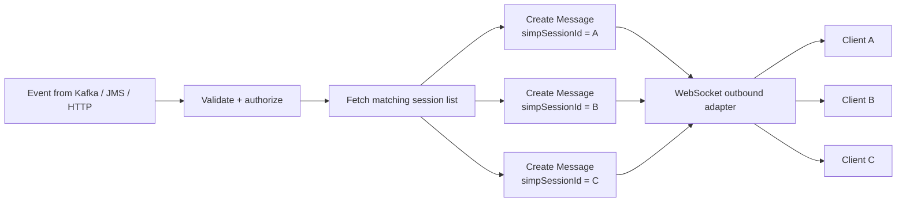
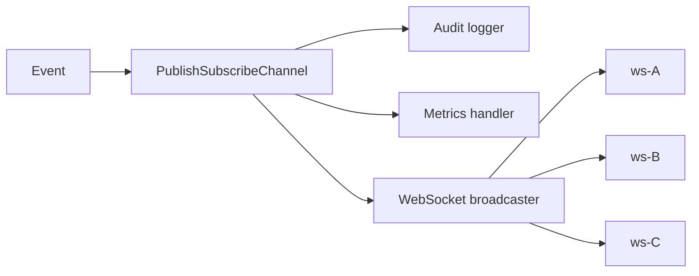
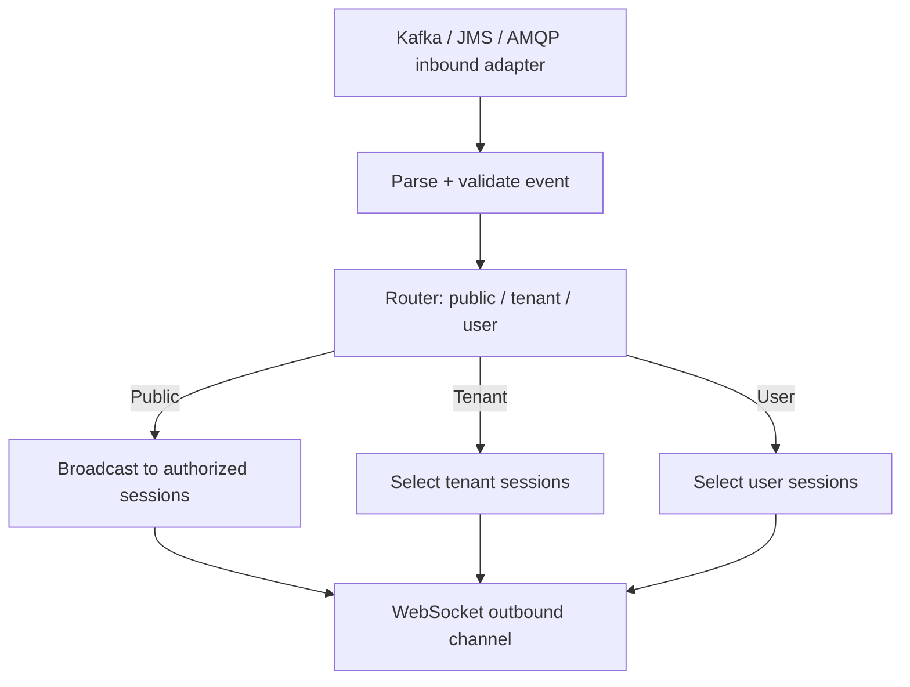
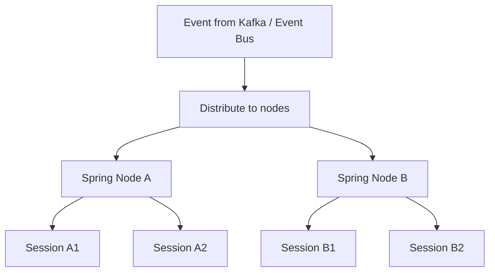

# Broadcast messages to multiple sessions

## 1. Lesson objectives

In the **SPRING_INTEGRATION_ADAPTERS** module, data from files, SFTP, HTTP, JMS, AMQP, Kafka, or databases can flow through adapters, gateways, pollers, and `MessageChannel` before being forwarded to target systems. For real-time interfaces, a single event often must be sent to **multiple open WebSocket connections**: every dashboard viewing operational status, every tab of a user, or every device authorized to monitor a zone.

The **Broadcast messages to multiple sessions** lesson, in the **Adapter WebSocket** chapter, focuses on distributing one event to multiple WebSocket sessions in accordance with the contract, security, and load capacity.

After studying, you will be able to:

- Distinguish between **broadcast to all sessions**, **multicast to a group of sessions**, **sending per user**, and **publishing to a topic**.
- Explain why a `WebSocketOutboundMessageHandler` with the `simpSessionId` header is suited for sending to **one selected session**.
- Build a fan-out service that creates **one separate Spring Message per session** on the same `ServerWebSocketContainer`.
- Understand the differences between raw WebSocket fan-out, `PublishSubscribeChannel`, and a STOMP `/topic/...` broker.
- Handle sessions disappearing mid-broadcast, slow clients, reconnects, and multi-node deployments.
- Design authorization, backpressure, observability, ACKs, and meaningful broadcast tests.

**Scope:** "broadcast" describes an **application policy for selecting multiple recipients**. WebSocket is a bidirectional protocol, but it does not natively specify a "send to all sessions" command. Spring Integration can deliver messages to each session via the outbound handler; when topic subscriptions or a distributed broker are required, Spring WebSocket Messaging/STOMP is usually a better fit.

## 2. How does broadcast differ from sending to a single session?

Suppose three browsers connect to the `/ws/dashboard` endpoint:

```text
Client A ── WebSocket session = ws-A
Client B ── WebSocket session = ws-B
Client C ── WebSocket session = ws-C

Event: dashboard.status.changed (eventId = evt-501)
```

When only A's action needs an ACK, the server builds an outbound message with header `simpSessionId = ws-A`. When broadcasting to all three sessions, the server must select `ws-A`, `ws-B`, `ws-C` and orchestrate the corresponding sends.

| Delivery pattern | Recipient set | Example |
| --- | --- | --- |
| **Unicast** | One specific session | ACK for the tab that just sent a command |
| **Global broadcast** | All sessions within a defined scope | Public maintenance announcement |
| **Group multicast** | Eligible sessions | Dashboards belonging to a tenant/zone |
| **Per-user fan-out** | Multiple sessions of the same principal | Notification to every tab/device |
| **Topic publish** | Clients subscribed to a topic and authorized | `/topic/telemetry` via a STOMP broker |

Do not equate **broadcasting to every connection** with **broadcasting to every user**. One user opening three tabs has three WebSocket sessions; the same event may appear three times across those tabs. If the application requires only one notification per user, you must define device-selection rules or deduplicate notifications at the application layer.

### Diagram: one event, many sessions



The branches in the diagram are **logical**. In the Java example below, a service iterates over the session list and calls `MessageChannel.send(...)` for each destination; each message carries only one `simpSessionId`.

## 3. Components to understand

| Component | Responsibility during broadcast |
| --- | --- |
| `ServerWebSocketContainer` | Manages `WebSocketSession`s belonging to the server endpoint in the current application |
| `WebSocketSession` | Represents one connection; provides `getId()` and `isOpen()` |
| `IntegrationWebSocketContainer.getSessions()` | Allows inspecting/looking up sessions managed by the container |
| `WebSocketOutboundMessageHandler` | Receives a Spring Message from the channel and sends it over the selected WebSocket session |
| `SimpMessageHeaderAccessor.SESSION_ID_HEADER` | Constant for header name `simpSessionId` to carry the session ID in Spring Messaging |
| `MessageChannel` | Accepts messages from business services toward the outbound handler |
| `WebSocketInboundChannelAdapter` | Receives frames from clients; useful if the same endpoint also needs an inbound flow |
| `SimpMessagingTemplate` | Publishes messages to destinations when using Spring WebSocket Messaging with STOMP |
| `SubProtocolHandler` | Interprets or creates frames per raw WebSocket/STOMP depending on configuration |

A common point of confusion is `PublishSubscribeChannel`. This channel dispatches one Spring Message to **multiple subscriber handlers inside the application**, not automatically across all WebSocket sessions. For example, a `PublishSubscribeChannel` might send the same event to an audit logger, a metrics consumer, and a broadcaster; only the **broadcaster** decides which WebSocket sessions to send to.

### Which header selects the destination?

With server-side raw WebSocket, the standard pattern is:

```java
Message<String> outbound = MessageBuilder
        .withPayload("{\"type\":\"dashboard.update\"}")
        .setHeader(
                SimpMessageHeaderAccessor.SESSION_ID_HEADER,
                sessionId)
        .build();
```

`sessionId` here must be the ID of a `WebSocketSession` currently managed by the container. Other values have distinct purposes:

- `userId` / `Principal`: identifies the authenticated user, who may hold multiple sessions.
- `eventId` / `correlationId`: tracks the event, ACK, or retries across reconnects.
- `MessageHeaders.ID`: ID of the Spring Message, not used to select a WebSocket session.
- HTTP `JSESSIONID`: ID of the HTTP session (if any), does not substitute for a WebSocket session ID.
- Application-generated `connectionId`: only usable after reliably mapping to the real WebSocket session.

## 4. Choosing a fan-out strategy

There are two common approaches, each with trade-offs:

| Criterion | Raw WebSocket, per-session send | STOMP, publish to topic |
| --- | --- | --- |
| Recipient selection | Application iterates sessions and sets `simpSessionId` | Clients `SUBSCRIBE` to destination; broker selects subscribers |
| Sending component | `WebSocketOutboundMessageHandler` | `SimpMessagingTemplate.convertAndSend(...)` |
| Default scope | Sessions of the current container/node | Simple broker: in-process scope; relay: broker scope per config |
| Grouping | Application session-filtering logic | Topic/queue/user destinations + subscription authorization |
| Number of app operations | Usually one send per session | One publish to destination, broker distributes |
| Subscription state | Application manages if needed | Broker tracks subscriptions |
| Multiple instances | Needs routing events to the node holding sessions | Can use an external broker relay to distribute |
| Durability/ACK | Self-designed if needed | Depends on broker, destination, ACK mode, and business contract |

**Rule of thumb:** if an event only needs to reach a few clearly identified sessions, raw WebSocket fan-out is easy to control. If many clients continuously subscribe/unsubscribe to topics and the application runs across multiple nodes, evaluate a STOMP broker and appropriate distribution features.

Neither strategy by itself guarantees that clients received, displayed, or successfully processed every event.

## 5. Example: broadcasting JSON over raw WebSocket

The example uses **Java 17+, Spring Boot 3.x, Spring Integration 6.x** on the Servlet web stack. Assume the server runs at `localhost:8080`. The `/ws/dashboard` endpoint accepts multiple clients; a demo HTTP endpoint triggers sending JSON to open sessions.

### 5.1. Maven dependencies

```xml
<dependencies>
    <dependency>
        <groupId>org.springframework.boot</groupId>
        <artifactId>spring-boot-starter-web</artifactId>
    </dependency>
    <dependency>
        <groupId>org.springframework.boot</groupId>
        <artifactId>spring-boot-starter-integration</artifactId>
    </dependency>
    <dependency>
        <groupId>org.springframework.integration</groupId>
        <artifactId>spring-integration-websocket</artifactId>
    </dependency>
</dependencies>
```

The Spring Boot BOM manages compatible dependency versions. In this example, no STOMP broker or poller is needed to broadcast events to raw WebSocket connections.

### 5.2. Configuring server container, inbound, and outbound

Create `BroadcastWebSocketConfiguration.java`:

```java
package com.example.broadcast;

import org.springframework.beans.factory.annotation.Qualifier;
import org.springframework.context.annotation.Bean;
import org.springframework.context.annotation.Configuration;
import org.springframework.integration.annotation.ServiceActivator;
import org.springframework.integration.channel.DirectChannel;
import org.springframework.integration.config.EnableIntegration;
import org.springframework.integration.websocket.ServerWebSocketContainer;
import org.springframework.integration.websocket.inbound.WebSocketInboundChannelAdapter;
import org.springframework.integration.websocket.outbound.WebSocketOutboundMessageHandler;
import org.springframework.messaging.MessageChannel;
import org.springframework.messaging.MessageHandler;

@Configuration
@EnableIntegration
public class BroadcastWebSocketConfiguration {

    @Bean
    public ServerWebSocketContainer dashboardContainer() {
        return new ServerWebSocketContainer("/ws/dashboard");
    }

    @Bean
    public MessageChannel dashboardInboundChannel() {
        return new DirectChannel();
    }

    @Bean
    public MessageChannel dashboardOutboundChannel() {
        return new DirectChannel();
    }

    // An inbound listener to receive frames if clients send data.
    @Bean
    public WebSocketInboundChannelAdapter dashboardInbound(
            ServerWebSocketContainer dashboardContainer,
            @Qualifier("dashboardInboundChannel") MessageChannel inbound) {

        WebSocketInboundChannelAdapter adapter =
                new WebSocketInboundChannelAdapter(dashboardContainer);
        adapter.setOutputChannel(inbound);
        return adapter;
    }

    // Demo consumer: does not process business requests from clients.
    @Bean
    @ServiceActivator(inputChannel = "dashboardInboundChannel")
    public MessageHandler ignoreDemoClientMessages() {
        return message -> {
            // Replace with a validator/handler if clients are allowed to send.
        };
    }

    @Bean
    @ServiceActivator(inputChannel = "dashboardOutboundChannel")
    public MessageHandler dashboardOutbound(
            ServerWebSocketContainer dashboardContainer) {

        return new WebSocketOutboundMessageHandler(dashboardContainer);
    }
}
```

**Why use one container?** `dashboardContainer` manages the session registry for `/ws/dashboard`. Inbound and outbound adapters share **the same container**. If you accidentally create a second independent container, outbound may fail to locate sessions living in the receiving container.

In this lesson, `dashboardInboundChannel` simply completes the receiving side of the example. Broadcasts are triggered from the server side; clients only need to connect and listen for frames. In production, reject or validate any inbound messages not part of the contract.

### 5.3. Fan-out service to multiple sessions

Create `DashboardBroadcaster.java`:

```java
package com.example.broadcast;

import java.util.ArrayList;
import java.util.List;
import org.springframework.beans.factory.annotation.Qualifier;
import org.springframework.integration.websocket.ServerWebSocketContainer;
import org.springframework.messaging.MessageChannel;
import org.springframework.messaging.simp.SimpMessageHeaderAccessor;
import org.springframework.messaging.support.MessageBuilder;
import org.springframework.stereotype.Service;
import org.springframework.web.socket.WebSocketSession;

@Service
public class DashboardBroadcaster {

    public record BroadcastAttempt(
            int selected,
            int acceptedByChannel,
            int skippedClosed,
            int sendFailures) {
    }

    private final ServerWebSocketContainer container;
    private final MessageChannel outboundChannel;

    public DashboardBroadcaster(
            ServerWebSocketContainer dashboardContainer,
            @Qualifier("dashboardOutboundChannel") MessageChannel channel) {
        this.container = dashboardContainer;
        this.outboundChannel = channel;
    }

    public BroadcastAttempt publishJson(String json) {

        // Snapshot at the start of iteration; sessions can still close.
        List<WebSocketSession> sessions =
                new ArrayList<>(container.getSessions().values());

        int selected = 0;
        int accepted = 0;
        int skippedClosed = 0;
        int failed = 0;

        for (WebSocketSession session : sessions) {
            if (!session.isOpen()) {
                skippedClosed++;
                continue;
            }

            selected++;

            try {
                boolean ok = outboundChannel.send(
                        MessageBuilder.withPayload(json)
                                .setHeader(
                                        SimpMessageHeaderAccessor
                                                .SESSION_ID_HEADER,
                                        session.getId())
                                .build());

                if (ok) {
                    accepted++;
                } else {
                    failed++;
                }
            } catch (RuntimeException exception) {
                // One failing session does not abort the entire fan-out loop.
                failed++;
                // Production: controlled logging/metrics; handle retries per SLA.
            }
        }

        return new BroadcastAttempt(
                selected, accepted, skippedClosed, failed);
    }
}
```

Notable steps:

1. `container.getSessions()` supplies sessions managed in the container **of the current process**. Creating a snapshot list keeps the list stable during one fan-out pass as connections change.
2. `session.isOpen()` helps skip sessions already known to be closed; this is only a **check at the moment of reading**, not a guarantee the session remains open when sending.
3. Each iteration creates **a separate Spring Message** with the target session's `simpSessionId`.
4. `dashboardOutboundChannel` forwards the message to `WebSocketOutboundMessageHandler`, which looks up the session in the container and sends the frame.
5. `acceptedByChannel` only indicates how many `send` calls were accepted by the channel per Spring Messaging semantics. It is **not the count of clients that received or successfully processed the message**.

The example catches `RuntimeException` per session so it continues sending to other sessions. In a real system, classify mapping/session/transport errors, record metrics by error code, and determine whether to retry or evict the session. Never swallow errors without monitoring.

Because `DirectChannel` typically triggers handlers synchronously, a slow client or blocking send can stall **the entire loop**. Section 8 discusses how to bound load and decouple work.

### 5.4. Demo HTTP endpoint to trigger broadcast

Create `BroadcastDemoController.java`:

```java
package com.example.broadcast;

import com.fasterxml.jackson.databind.JsonNode;
import org.springframework.http.MediaType;
import org.springframework.web.bind.annotation.PostMapping;
import org.springframework.web.bind.annotation.RequestBody;
import org.springframework.web.bind.annotation.RestController;

@RestController
public class BroadcastDemoController {

    private final DashboardBroadcaster broadcaster;

    public BroadcastDemoController(DashboardBroadcaster broadcaster) {
        this.broadcaster = broadcaster;
    }

    @PostMapping(
            path = "/demo/broadcast",
            consumes = MediaType.APPLICATION_JSON_VALUE)
    public DashboardBroadcaster.BroadcastAttempt broadcast(
            @RequestBody JsonNode payload) {

        return broadcaster.publishJson(payload.toString());
    }
}
```

This is a **demonstration endpoint for learning**. In a real application, any broadcast trigger route needs authentication, authorization, and rate limiting; never let arbitrary users push arbitrary content to all connections. `JsonNode` here only ensures valid JSON syntax per Spring MVC's converter, without validating a business schema.

### 5.5. Testing with multiple browsers

Start the application, open a page on the same origin as the server (or a client whose origin is allowed by the server). In the Console of **three independent tabs**, run:

```javascript
const ws = new WebSocket("ws://localhost:8080/ws/dashboard");

ws.addEventListener("open", () => {
  console.log("WebSocket connected");
});

ws.addEventListener("message", (event) => {
  console.log("Broadcast received:", JSON.parse(event.data));
});

ws.addEventListener("close", (event) => {
  console.log("Session closed:", event.code);
});
```

Once the tabs are connected, trigger a broadcast from a same-origin page:

```javascript
fetch("/demo/broadcast", {
  method: "POST",
  headers: { "Content-Type": "application/json" },
  body: JSON.stringify({
    type: "dashboard.status.changed",
    eventId: "evt-501",
    status: "HEALTHY"
  })
}).then(response => response.json())
  .then(result => console.log("Server send result:", result));
```

Expected result: all three tabs receive JSON with `eventId = evt-501`, **one frame per tab**. The HTTP response includes counters such as `selected` and `acceptedByChannel`; those counters only reflect session selection and server-side sends.

Close tab B and broadcast `evt-502`; tabs A and C still receive the message, while B no longer has an active session. If you broadcast right as a tab closes, `skippedClosed` or `sendFailures` may appear due to a race condition; that is normal behavior to handle.

### 5.6. What happens when no clients are connected?

When `container.getSessions()` has no valid sessions, the loop sends zero messages and returns counters of 0. **Broadcast does not automatically store events to wait for users who connect later.** If offline catch-up is required, build a storage and replay mechanism based on `eventId`, subscriber state, or a business data store.

## 6. Broadcasting by authorization, tenant, user, and group

Sending to every connection is usually only appropriate for public information. If an event contains tenant- or user-specific data, you must **filter recipients on the server before sending**.

### 6.1. Filtering by authenticated principal

Illustrative snippet:

```java
List<WebSocketSession> selectedSessions = container.getSessions()
        .values()
        .stream()
        .filter(WebSocketSession::isOpen)
        .filter(session -> session.getPrincipal() != null)
        .filter(session -> authorizedRecipients.contains(
                session.getPrincipal().getName()))
        .toList();
```

This snippet assumes `authorizedRecipients` is a set of usernames **already determined by a business service** and `container` is a `ServerWebSocketContainer` holding authenticated sessions. It only illustrates the **recipient selection** step; to send, the service still builds a Spring Message with `simpSessionId` per session as in section 5.3.

**Never trust** `userId`, `tenantId`, or `sessionId` values self-declared by the client in JSON or query parameters to decide read authorization. Permissions must be established from the principal, handshake/security results, and server-controlled authorization data.

### 6.2. One user with multiple sessions

Suppose user `u-17` opens:

```text
u-17
 ├── Dashboard tab 1 → session ws-101
 ├── Dashboard tab 2 → session ws-102
 └── Mobile phone    → session ws-103
```

If the business rule is **send to all devices of u-17**, select all three sessions. If you only want to notify the most recently active device, define a dedicated selection policy; a WebSocket session ID does not inherently carry a "preferred device" flag.

An application registry can maintain:

```text
userId → Set<sessionId>
tenantId → Set<sessionId>
sessionId → { nodeId, principal, tenantId, subscriptions }
```

Mappings must be updated when connections open/close and when access permissions change. On reconnect, the old session ID is not reused. When a close callback arrives late, delete **the exact closed session ID**, avoiding wiping the user's entire mapping if the user already has a new session.

### 6.3. Choosing a snapshot or a dynamic recipient set?

At time `T0`, the service fetches a list of 100 sessions. Mid-send, one session closes and a new session connects. Define a policy:

- **Snapshot broadcast:** send to the sessions selected at `T0`, accepting that the new session is excluded from this batch.
- **Current-state notification:** new clients fetch the latest state over HTTP or receive an initial snapshot after handshake.
- **Durable event delivery:** events have IDs and states, using ACKs/replay for eligible recipients.

Trying to "loop until no new sessions appear" can make the broadcast loop never terminate under high churn. It is usually better to clearly bound a broadcast pass and have a state-sync mechanism for newly connected clients.

## 7. Distinguishing PublishSubscribeChannel and WebSocket broadcast

Suppose Spring Integration has:



`PublishSubscribeChannel` provides **internal fan-out to handlers**. One handler can write an audit log, one can record metrics, and one can broadcast to multiple WebSocket sessions. The number of channel subscriber handlers and the number of WebSocket sessions are **two independent numbers**.

If you attach a `WebSocketOutboundMessageHandler` as a subscriber to a `PublishSubscribeChannel`, a Spring Message lacking a specific session destination still will not automatically send to all connections. You must ensure the message already has a session header or use a broadcaster that emits messages per session.

### Forwarding events from Kafka/JMS/AMQP to WebSocket

A sensible flow in this module:



If the source is database/file polling, **the poller belongs to the data source**, not the WebSocket outbound adapter. WebSocket sends frames event-driven whenever the `MessageChannel` receives a message to emit.

Example event to transmit:

```json
{
  "eventId": "evt-501",
  "type": "dashboard.status.changed",
  "tenantId": "tenant-7",
  "status": "HEALTHY"
}
```

This contract should clarify that `tenantId` is used for **server-side recipient filtering**, `eventId` is used for idempotency/ACK, and which payload fields may be shown to clients. Do not broadcast full records containing private info or tokens just because multiple tabs need a status update.

## 8. Concurrency, ordering, and backpressure

Broadcasting places heavier load than unicast: one event can trigger **N sends** for N sessions. As N grows or slow clients appear, CPU, memory, buffers, and network operations scale up accordingly.

### 8.1. Fan-out complexity

If an event has a payload size of `P` bytes and the application selects `N` sessions, the minimum outbound data volume pushed across connections is on the order of `O(N × P)`, excluding frame/TLS overhead. For example, 1,000 clients receiving a 2 KiB notification generate nearly 2 MiB of application-layer payload for **a single broadcast**. Actual wire traffic is higher due to protocol headers and metadata.

`DirectChannel` executes sends sequentially on the calling thread. With slow-reading clients, one broadcast pass can stall significantly even when most sessions are healthy.

### 8.2. Choosing an execution model based on requirements

| Approach | Best suited for | Risks to control |
| --- | --- | --- |
| Sequential send via `DirectChannel` | Few sessions, low frequency, demos | A slow client stalls the entire loop |
| Bounded executor dispatch | Moderate load needing thread decoupling | Thread pool/queue saturation; ordering may shift |
| Per-session bounded queue | Isolating slow clients | Memory usage, overflow, and session cleanup |
| Coalescing updates / latest state | Dashboards, rapidly changing metrics | Intermediate events may be dropped |
| STOMP broker relay | Many subscribers/topics, multiple nodes | Broker capacity, connection and subscription overhead |

Never use an unbounded executor or spawn a new thread per session per event. If **per-session** ordering must be preserved, build a per-connection queue/serial executor, or choose a send configuration that guarantees ordering per contract. Parallelizing fan-out can cause events to arrive out of their original order.

### 8.3. Does one failed send break the entire broadcast?

The policy in the `DashboardBroadcaster` example is **best effort per session**: each session is attempted once; a failure on session A does not block trying sessions B and C. Still, the result only reflects server-side attempts, not confirmation that every client received it.

If the event is critical data (such as requiring transaction confirmation), a dedicated model is needed:

1. Attach a unique `eventId` to the business event.
2. Determine the recipient set or delivery policy.
3. Persist the event and pending state if required.
4. Client sends an application ACK containing `eventId` after finishing processing.
5. Retry per policy and deduplicate using `eventId`.
6. Upon reconnect, resolve the new session from the authenticated identity; never retry into the old session.

You cannot infer **exactly-once delivery** solely from `MessageChannel.send()` or an open WebSocket connection.

## 9. STOMP: broadcasting once to a topic

When many clients subscribe by topic, `SimpMessagingTemplate` and a STOMP broker allow a single logical publish to a destination. The broker takes care of distributing to clients with valid `SUBSCRIBE` registrations.

### 9.1. Configuring Spring WebSocket Messaging

Illustrative example **separate from the raw WebSocket endpoint** in section 5:

```java
package com.example.stomp;

import org.springframework.context.annotation.Configuration;
import org.springframework.messaging.simp.config.MessageBrokerRegistry;
import org.springframework.web.socket.config.annotation.EnableWebSocketMessageBroker;
import org.springframework.web.socket.config.annotation.StompEndpointRegistry;
import org.springframework.web.socket.config.annotation.WebSocketMessageBrokerConfigurer;

@Configuration
@EnableWebSocketMessageBroker
public class StompBroadcastConfiguration
        implements WebSocketMessageBrokerConfigurer {

    @Override
    public void registerStompEndpoints(StompEndpointRegistry registry) {
        registry.addEndpoint("/ws-stomp");
    }

    @Override
    public void configureMessageBroker(MessageBrokerRegistry registry) {
        registry.enableSimpleBroker("/topic");
        registry.setApplicationDestinationPrefixes("/app");
    }
}
```

Here `/ws-stomp` is the WebSocket handshake URL, while `/topic/dashboard` is a **STOMP destination**. `enableSimpleBroker(...)` creates a lightweight in-memory broker inside the application; it is not a distributed broker or durable queue.

### 9.2. Service publishing to the topic

```java
package com.example.stomp;

import org.springframework.messaging.simp.SimpMessagingTemplate;
import org.springframework.stereotype.Service;

@Service
public class DashboardTopicPublisher {

    private final SimpMessagingTemplate template;

    public DashboardTopicPublisher(SimpMessagingTemplate template) {
        this.template = template;
    }

    public void publish(DashboardUpdate event) {
        template.convertAndSend("/topic/dashboard", event);
    }

    public record DashboardUpdate(
            String eventId, String status) {
    }
}
```

On the Spring Integration side, a `@ServiceActivator` can take events from a Kafka/JMS/HTTP `MessageChannel` and call `DashboardTopicPublisher.publish(...)`. The service does not iterate over individual `WebSocketSession`s; Spring Messaging and the broker handle that by subscription.

### 9.3. STOMP client subscribing

Example using the `@stomp/stompjs` package:

```javascript
import { Client } from "@stomp/stompjs";

const client = new Client({
  brokerURL: "ws://localhost:8080/ws-stomp",
  reconnectDelay: 3000,

  onConnect: () => {
    client.subscribe("/topic/dashboard", message => {
      console.log("Topic update:", JSON.parse(message.body));
    });
  },

  onStompError: frame => console.error(frame.headers.message)
});

client.activate();

// When no longer needed: await client.deactivate();
```

Only clients subscribed to `/topic/dashboard` (and authorized to access it) should receive topic messages. **Publishing to a topic does not mean sending to every WebSocket connection**. A client may be STOMP-connected without having subscribed; that client will not automatically receive topic messages.

### 9.4. When to use a broker relay?

If you have multiple Spring nodes, many topics, need an external broker, or need broker-provided delivery semantics, replace the simple broker with a STOMP broker relay:

```java
registry.enableStompBrokerRelay("/topic", "/queue")
        .setRelayHost("broker.internal")
        .setRelayPort(61613);
```

This snippet illustrates the idea and requires an actual broker with TCP STOMP, credentials/TLS configuration, and health monitoring. `enableStompBrokerRelay(...)` **does not launch a broker**, nor does it automatically guarantee persistent delivery, cross-node user destinations, or exactly-once semantics. The broker could be RabbitMQ with the STOMP plugin or another STOMP-capable system.

**Avoid endpoint conflicts:** do not declare both a raw `ServerWebSocketContainer` and `StompEndpointRegistry` competing for the same `/ws-stomp` or `/ws/dashboard` URL unless you deliberately design handler dispatching.

## 10. Clustering: broadcasting across multiple nodes

A `ServerWebSocketContainer` only knows about **sessions managed by its own process**. In a load-balanced system:



If an event is only delivered to node A, `DashboardBroadcaster` on node A only sees A1/A2. Node B will not automatically receive the event even though B1/B2 are connected. Options include:

- Broadcast **the same event** to every node via pub/sub, and have each node fan out to its local authorized sessions.
- Use `sessionId → nodeId` routing when targeting a specific session.
- Use an external STOMP broker distributing by subscription/destination, and configure multi-node user registry/user destination broadcasting when using `/user`.
- Use a dedicated real-time messaging service instead of having every application node hold connections directly.

### Avoiding duplicate broadcasts across nodes

When using Kafka, understand the difference between a **competing consumer group** and **pub/sub to every node**: consumers in the same group split partitions, so **an event goes to only one consumer in the group**, not automatically to every node holding WebSocket sessions. If both node A and node B need to fan out the event, design pub/sub fan-out at the event bus or broker layer.

If an event can arrive again due to retries/rebalances, include `eventId` to distinguish duplicates. If the UI only shows the latest state, the client can check version/timestamp; if every event must be processed completely, a stricter ACK/replay contract is required.

## 11. Broadcast security

Broadcasting amplifies the blast radius of an authorization bug. Sending to one wrong session can leak data across users/tenants even when the transport uses TLS.

Mandatory principles:

1. **Authenticate the handshake:** establish the right principal when the client opens the WebSocket, and use `wss://` in networked deployments.
2. **Authorize the event:** decide who is allowed to view `eventId` or the related resource **before** gathering the session set.
3. **Filter using server-trusted metadata:** use the principal, permissions from DB/cache, or server-attached session attributes; never trust a client-supplied `tenantId`.
4. **Restrict broadcast trigger endpoints:** routes like `/demo/broadcast` are for testing only; production must enforce publish permissions and clear quotas.
5. **Origin policy:** restrict origins to your application and configure matching auth/CSRF protections; Origin does not replace authentication.
6. **Sanitize content:** never broadcast tokens, credentials, personal data, or sensitive raw payloads.
7. **STOMP SUBSCRIBE permissions:** if using topics, block destinations users are not allowed to subscribe to; carefully configure broker credentials, permissions, and routing.
8. **Revoking permissions:** if permissions change while a session is open, update eligible recipients, drop subscriptions, or close the session per policy.

For example, event `tenant-7.invoice.updated` must not be sent to every session connected to `/ws/dashboard`. Select only principals authorized on that invoice, or use a properly protected topic/user destination.

## 12. Monitoring and error handling during broadcast

### 12.1. Metrics to collect

| Metric | Helps answer |
| --- | --- |
| Open sessions per node | How many potential recipients exist? |
| Sessions selected per broadcast | Is the recipient filter working properly? |
| `MessageChannel.send(...)` successes/failures | Did the handler accept the sends? |
| Failing or mid-broadcast closed sessions | Is connection churn affecting delivery? |
| Latency from event to finishing send attempts | Are slow clients stalling the fan-out loop? |
| Payload size, buffers, and queue depths | Is there a risk of RAM/bandwidth exhaustion? |
| Application ACK timeouts | How many recipients have not confirmed processing? |
| Retried/duplicate event counts | Are delivery semantics creating duplicates? |

Tag metrics using bounded-cardinality dimensions (event type, node, status). Never use every `sessionId` or `eventId` as a metric tag because label cardinality can grow unbounded; those IDs belong in controlled logs/traces.

### 12.2. Common troubleshooting table

| Symptom | Causes to check | Resolution |
| --- | --- | --- |
| Only one tab receives the message | Outbound flow carries only one `simpSessionId` | Iterate over the right session set or use a STOMP topic |
| `PublishSubscribeChannel` has multiple handlers but clients receive nothing | Internal pub/sub is not session broadcast | Add a fan-out service or broker destination |
| Session disappears right as sending occurs | Client closed/reconnected; race after `isOpen()` | Catch errors per session and clean up mappings |
| All clients receive another tenant's data | Selected all sessions without filtering permissions | Enforce authorization before fan-out and test tenant isolation |
| One slow client delays all clients | `DirectChannel` with synchronous sends | Bound buffering, decouple load, and handle slow clients |
| Broadcast reaches only some clients in a cluster | Session registry is local per node | Route events to all nodes or use a broker |
| Same `eventId` received multiple times | Retries or duplicate bus delivery | Implement idempotency/deduplication per contract |
| STOMP client connects but sees no topic messages | Missing `SUBSCRIBE` or subscribed to wrong destination | Check STOMP `SUBSCRIBE` and broker |
| `MessageChannel.send() == true` but UI does not update | Server-side acceptance does not prove client processed it | Add app ACKs, trace by event ID, inspect client |
| No clients connected during broadcast | Empty session set | Skip sending or persist event/offline state as required |

### 12.3. Limits of the "sent" status

Use accurate field names in metrics/responses: `attempted`, `acceptedByChannel`, `failed`, `acknowledgedByClient` instead of an ambiguous `delivered` field. Even if `MessageChannel.send(...)` returns `true`, data can still be lost before the client processes it. If the business SLA requires "notification seen," explicitly define client ACKs and persisted read status.

## 13. Testing broadcast

### 13.1. Multi-session testing

Scenarios to cover:

1. Open three independent WebSocket clients; verify three connections are established.
2. Broadcast an event with `eventId = evt-501`; verify all three clients receive properly formatted bodies.
3. Close client B; broadcast `evt-502`, verify A and C still receive it.
4. Reconnect client B as a new session; broadcast `evt-503`, verify the new connection receives it and the old connection does not.
5. Send two consecutive events and verify ordering when required by the contract.
6. Simulate a slow-reading client; measure total latency and verify how the application handles overflow.

If testing raw WebSocket, use the WebSocket API or an equivalent test client. If testing STOMP, perform full STOMP `CONNECT` and `SUBSCRIBE` before asserting topic messages.

### 13.2. Authorization testing

Create two users `user-A` and `user-B` belonging to two different tenants; each has two tabs open. Broadcast an event meant only for tenant A. Expected result: both tabs of user-A receive it **if the policy is all tabs**, and neither tab of user-B receives it. Try adding a spoofed `tenantId` field in a client payload; it must not alter recipient authorization.

### 13.3. Single-session failure testing

During a broadcast, simulate/observe one session closing before sending. Verify:

- The service still attempts sending to other eligible sessions.
- The result clearly reports skipped sessions or send failures.
- It does not mark "client received" without client confirmation.
- Stale session mappings are cleaned up per lifecycle.
- Sensitive data is not replayed to a new session without re-verifying authorization.

### 13.4. Cluster testing

Run two Spring nodes A and B behind a load balancer; connect at least one WebSocket client to each node. Emit an event from Kafka or a business service. Verify the chosen distribution mechanism: if using local fan-out, **both nodes** must receive the event; if using a STOMP broker relay, topic delivery and subscriptions must work across nodes. Never test against only one node and conclude the clustered broadcast works.

## 14. Practice exercises

### Exercise A — raw WebSocket broadcast

Extend `DashboardBroadcaster` to also return `eventId` in `BroadcastAttempt`, measure the duration of one broadcast pass, and log a summary. Broadcast 10 consecutive events to three tabs. Explain why `acceptedByChannel` is not equivalent to the number of clients that processed the events.

### Exercise B — tenant-scoped broadcast

Suppose an event carries `tenantId` and each WebSocket session has an authenticated tenant attached at handshake. Add a session-filtering condition by tenant. Design a test proving that users of another tenant do not receive the event even if they pass a spoofed `tenantId` query parameter.

### Exercise C — switching to a STOMP topic

Replace the raw WebSocket configuration with `@EnableWebSocketMessageBroker` and `enableSimpleBroker("/topic")`. Have three STOMP clients subscribe to `/topic/dashboard` and one client not subscribe. Publish an event with `SimpMessagingTemplate.convertAndSend(...)` and explain why the unsubscribed client does not receive the message.

### Exercise D — Kafka events in a cluster

There are two nodes, each holding 500 sessions. A Kafka topic has one consumer group with two consumers, one consumer running on each node. Explain why an event is processed by only one consumer in the group, and design a way for a public event to reach all 1,000 sessions (pub/sub on the bus, a STOMP broker, or a dedicated architecture). Include `eventId` in the flow to handle duplicates.

### Exercise E — slow clients and backpressure

Suppose there are 3,000 sessions, of which 50 clients have very slow connections. Propose per-session queue bounds, send timeouts, a "keep latest value" coalescing mechanism, and an overflow policy. Distinguish dashboard data where intermediate updates may be dropped from business events that must be persisted/replayed.

### Exercise F — ACK and reconnect

The server broadcasts `evt-501`; the client receives the frame but loses network before ACKing. Design an ACK contract containing `eventId`, pending delivery storage, client/server idempotency, and a mechanism to resume with the new session without relying on the old session ID.

**Completion criteria:** identify the recipient set for each delivery pattern; configure a raw WebSocket fan-out branch or STOMP topic; recognize that send count scales with session count; and explain session lifecycle, access control, backpressure, and the difference between server-side sending and client ACKs.

## 15. Key takeaways

- Broadcast is a **multi-recipient selection** decision; raw WebSocket does not natively provide a send-to-all-sessions command.
- With Spring Integration raw WebSocket, the explicit fan-out pattern is fetching the session set, building **one Spring Message with `simpSessionId` per session**, and sending through `WebSocketOutboundMessageHandler`.
- `PublishSubscribeChannel` dispatches to internal handlers; it does not automatically turn one message into multiple frames sent over connections.
- One user can have multiple sessions, and any session can close/reconnect at any time.
- `IntegrationWebSocketContainer` manages sessions **locally per node**. Multi-node systems require an event bus/broker or routing to the node owning the session.
- With STOMP, `SimpMessagingTemplate.convertAndSend("/topic/...")` delivers logical messages to **authorized subscribers**, not every WebSocket connection.
- Growing client counts increase send costs; bound concurrency, buffers, backpressure, and isolate slow clients.
- A successful `MessageChannel.send()` does not prove client receipt or processing; use `eventId`, ACKs, and retry/idempotency if the contract requires them.
- Recipient filtering and authorization are mandatory for private, tenant/user-scoped, or sensitive event sources.

## References

- [Spring Integration Reference — WebSockets Support](https://docs.spring.io/spring-integration/reference/web-sockets.html)
- [Spring Integration API — WebSocketOutboundMessageHandler](https://docs.spring.io/spring-integration/api/org/springframework/integration/websocket/outbound/WebSocketOutboundMessageHandler.html)
- [Spring Integration API — IntegrationWebSocketContainer](https://docs.spring.io/spring-integration/api/org/springframework/integration/websocket/IntegrationWebSocketContainer.html)
- [Spring Framework API — WebSocketSession](https://docs.spring.io/spring-framework/docs/current/javadoc-api/org/springframework/web/socket/WebSocketSession.html)
- [Spring Framework Reference — STOMP Message Broker](https://docs.spring.io/spring-framework/reference/web/websocket/stomp.html)
- [Spring Framework Reference — STOMP Broker Relay](https://docs.spring.io/spring-framework/reference/web/websocket/stomp/handle-broker-relay.html)
- [Spring Framework Reference — User Destinations](https://docs.spring.io/spring-framework/reference/web/websocket/stomp/user-destination.html)
