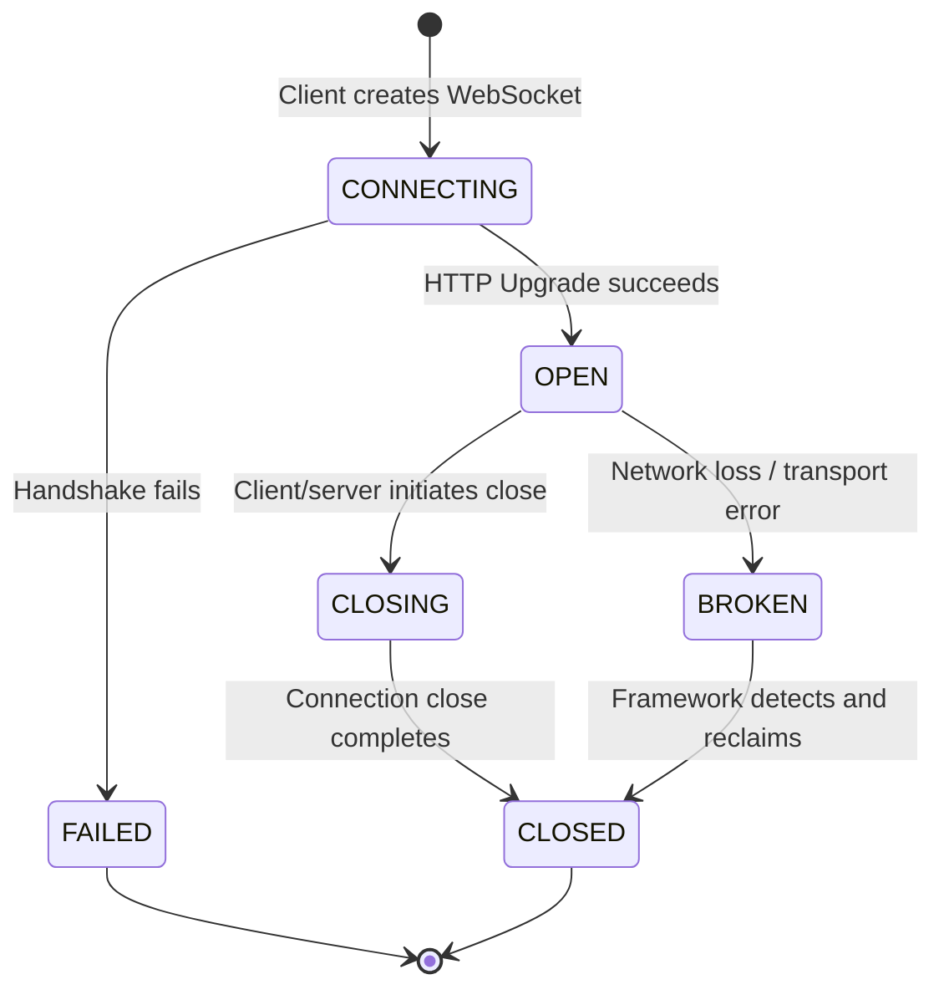
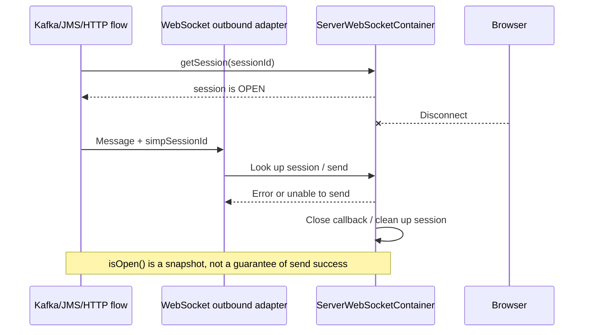

# Closing sessions and handling disconnect

## 1. Context and objectives

In the **SPRING_INTEGRATION_ADAPTERS** module, applications connect external systems using inbound/outbound adapters, gateways, pollers, and `MessageChannel`; data can pass through files, SFTP, HTTP, JMS, AMQP, Kafka, and databases. With **WebSocket**, an essential part of the integration contract is the **connection lifecycle**: which sessions are still active, which sessions have closed, and what work must run when a client disappears.

The **Closing sessions and handling disconnect** lesson, in the **Adapter WebSocket** chapter, helps you:

- Understand the `WebSocketSession` lifecycle from handshake and data exchange to closing/closed.
- Distinguish client-initiated close, server-initiated close, transport errors, network loss, and timeouts.
- Read `CloseStatus`/close codes and know which codes can be sent versus which are purely observational signals.
- Use `ServerWebSocketContainer`, `WebSocketHandlerDecorator`, and the `afterConnectionClosed` callback to clean up the session registry.
- Properly handle **late disconnects**, **duplicate close callbacks**, **reconnects creating new sessions**, multiple tabs, and multiple nodes.
- Understand the difference between raw WebSocket lifecycle and STOMP's `SessionDisconnectEvent`.
- Design message sending, error handling, ACKs, retries, and testing without confusing "closed" with "business processing completed."

**Running example:** a dashboard connects to `/ws/lifecycle`; the application tracks open sessions. A client can send `bye` to request a normal close. Upon closing, the server cleans up the mapping and stops treating that session as a notification target. The primary goal of this example is **lifecycle and cleanup**, not production access control.

## 2. How does a WebSocket session end?

WebSocket starts with an HTTP Upgrade; after a successful handshake, a bidirectional connection persists until one side closes it or the transport becomes unusable.



This diagram is an **explanatory state model**, not a single shared enum provided by Spring Integration. In the browser, `WebSocket.readyState` has `CONNECTING`, `OPEN`, `CLOSING`, and `CLOSED`; on the Java side, `WebSocketSession.isOpen()` inspects the state at check time.

### Three common ways connections end

| Scenario | Observable behavior | What the application must handle |
| --- | --- | --- |
| **Client-initiated close** | Browser calls `socket.close(1000, "...")`; server receives close handshake | Reclaim mapping, stop sending to session, update presence |
| **Server-initiated close** | Server calls `session.close(CloseStatus.NORMAL)` or an appropriate status | Reclaim mapping, report state via callback, decide if reconnect is needed |
| **Network loss / crash / timeout** | Close frame may never arrive; server detects only after I/O error or heartbeat/timeout | Do not wait forever for a close frame; clean up when callback arrives, use leases/TTLs for distributed state |

Once the server sees a session is closed, **it should not send further messages** to that session. A close callback may arrive after a transport error callback; the detection order is not uniform across all containers/networks.

## 3. Normal close vs. abnormal close

### 3.1. Close handshake

Normally, one side sends a **WebSocket Close control frame**, the other side replies with a close frame, and the transport terminates. `CloseStatus` in Spring Framework holds the status code and reason. With Spring WebSocket:

```java
import org.springframework.web.socket.CloseStatus;
import org.springframework.web.socket.WebSocketSession;

session.close(CloseStatus.NORMAL);
```

`WebSocketSession.close(CloseStatus)` can throw `IOException`. Calling close **initiates the closing procedure**; it is not an application ACK for previously sent messages. On an already broken connection, calling close may fail or never deliver a close frame to the client.

### 3.2. Meaning of common close codes

| Code | Common name/meaning | Interpretation |
| --- | --- | --- |
| **1000** | Normal Closure | Both sides ended the session as expected |
| **1001** | Going Away | One side is leaving, e.g., page closed or server shutting down |
| **1002** | Protocol Error | Protocol violation detected |
| **1003** | Unsupported Data | Endpoint cannot accept the received data type |
| **1006** | Abnormal Closure | **Reserved reporting code** when no Close frame was received; never send this code on the wire |
| **1008** | Policy Violation | Policy breach; can be used when the server refuses to continue the session |
| **1009** | Message Too Big | Message exceeds the allowed size limit |
| **1011** | Internal Error | Server encountered an unexpected error |
| **1012** | Service Restart | Service is restarting, if supported by protocol/container |
| **4000–4999** | Private-use | Parties may agree on custom application codes |

`CloseStatus.NORMAL`, `CloseStatus.POLICY_VIOLATION`, `CloseStatus.TOO_BIG_TO_PROCESS`, and `CloseStatus.SERVER_ERROR` are convenient constants in Spring. Do not pick a code merely because its name sounds right; identify the **root cause** and reconnect contract.

**Special note:** `1005`, `1006`, and `1015` are reserved observational values; never send them in a Close frame. Seeing `1006` in a JavaScript `CloseEvent` usually means the browser did not receive a normal close handshake—**it does not prove the server actively sent status 1006**.

### 3.3. How much information fits in a close reason?

A Close frame has a size limit; the UTF-8 reason after the close code is also bounded (typically at most 123 bytes). The reason is not the place to pass stack traces, tokens, user data, or long business payloads. Use short, safe strings like `"session expired"` or `"server restart"`, and record details in controlled logs.

If the application needs the client to know *why* before disconnecting, you can send a structured **business message** prior to closing; however, sending a message and immediately calling close **does not guarantee** the client received and processed that message. Certainty requires an ACK and a dedicated workflow.

## 4. Roles of container, inbound, and outbound adapters

Spring Integration uses `IntegrationWebSocketContainer` to manage `WebSocketSession`s:

- `ServerWebSocketContainer` registers a server endpoint and holds multiple sessions connected to that endpoint.
- `ClientWebSocketContainer` represents a single connection from the application to an external server.
- `WebSocketInboundChannelAdapter` receives data from the container and sends Spring `Message<?>`s into the flow.
- `WebSocketOutboundMessageHandler` uses the matching session in the container to send frames.

Important APIs:

```java
WebSocketSession session = serverContainer.getSession(sessionId);
Map<String, WebSocketSession> active = serverContainer.getSessions();

if (session != null && session.isOpen()) {
    // This is only an instantaneous check; the session may still close before sending.
}
```

`getSession(sessionId)` may return `null`. `getSessions()` is the set of sessions **local to the container on the running node**, not a data source that survives restarts.

With raw WebSocket, outbound messages returning to the exact session typically carry the header:

```java
SimpMessageHeaderAccessor.SESSION_ID_HEADER // "simpSessionId"
```

If you store `sessionId` and the client reconnects, a header carrying the old ID will not automatically route to the new session. You must look up the current registry and re-resolve the destination using the authenticated identity.

### Lifecycle callbacks are not business messages

Spring Integration's `WebSocketListener` has callbacks for receiving messages and tracking sessions, including `afterSessionEnded(WebSocketSession, CloseStatus)`. However, **each `IntegrationWebSocketContainer` only supports registering one `WebSocketListener`**; normally the inbound adapter already occupies that slot.

To observe lifecycle events while keeping the inbound adapter, the server container can configure a `WebSocketHandlerDecoratorFactory` and a `WebSocketHandlerDecorator`. This is Spring WebSocket infrastructure's extension point to observe `afterConnectionEstablished`, `handleTransportError`, and `afterConnectionClosed`.

**Do not assume** closing a session produces a JSON message on `wsInputChannel`. Close frames, transport errors, and STOMP disconnects have their own callback/event mechanisms.

## 5. Java example: tracking sessions and cleaning up mappings on disconnect

The example uses **Java 17+, Spring Boot 3.x, Spring Integration 6.x**, with a Servlet-stack WebSocket server. Clients connect to `/ws/lifecycle` and send simple text frames. The goal is to observe lifecycle clearly, so no STOMP broker is required.

### 5.1. Dependencies

```xml
<dependencies>
    <dependency>
        <groupId>org.springframework.boot</groupId>
        <artifactId>spring-boot-starter-web</artifactId>
    </dependency>
    <dependency>
        <groupId>org.springframework.boot</groupId>
        <artifactId>spring-boot-starter-integration</artifactId>
    </dependency>
    <dependency>
        <groupId>org.springframework.integration</groupId>
        <artifactId>spring-integration-websocket</artifactId>
    </dependency>
</dependencies>
```

Assumes the Spring Boot BOM manages compatible versions. `spring-integration-websocket` contains the containers and inbound/outbound adapters; `spring-boot-starter-web` provides the standard servlet/WebSocket infrastructure.

### 5.2. Registry keyed by session ID

Create `ActiveSessionRegistry.java`:

```java
package com.example.websocket;

import java.time.Instant;
import java.util.Map;
import java.util.concurrent.ConcurrentHashMap;
import java.util.concurrent.ConcurrentMap;
import org.springframework.stereotype.Component;
import org.springframework.web.socket.CloseStatus;
import org.springframework.web.socket.WebSocketSession;

@Component
public class ActiveSessionRegistry {

    public record SessionInfo(
            String sessionId, String username, Instant openedAt) {
    }

    private final ConcurrentMap<String, SessionInfo> active =
            new ConcurrentHashMap<>();

    public void connected(WebSocketSession session) {
        String username = session.getPrincipal() == null
                ? "anonymous" : session.getPrincipal().getName();

        active.put(session.getId(),
                new SessionInfo(session.getId(), username, Instant.now()));
    }

    public void disconnected(String sessionId, CloseStatus status) {
        SessionInfo removed = active.remove(sessionId);
        if (removed != null) {
            System.out.printf(
                    "Session ended: %s, code=%d, active=%d%n",
                    sessionId, status.getCode(), active.size());
        }
    }

    public Map<String, SessionInfo> snapshot() {
        return Map.copyOf(active);
    }

    public int count() {
        return active.size();
    }
}
```

Choices in the example:

- The registry uses `ConcurrentHashMap` because callbacks for multiple WebSocket sessions can be invoked concurrently.
- The primary key is **session ID**, so a user opening multiple tabs does not overwrite another tab's session.
- `remove(sessionId)` is **idempotent**: if a close callback runs more than once, the second invocation causes no error and does not delete a new session.
- The `"anonymous"` value is purely for observation in this demo. **This registry does not authenticate users**; production must authenticate during the handshake and never send private data based on a username string self-reported by an arbitrary client.

`snapshot()` can be used for statistics/debugging, though it is only a point-in-time snapshot of application state. Never use it as proof that a session is guaranteed to remain open when sending a frame.

### 5.3. Configuring the lifecycle decorator

Create `WebSocketLifecycleConfiguration.java`:

```java
package com.example.websocket;

import org.springframework.beans.factory.annotation.Qualifier;
import org.springframework.context.annotation.Bean;
import org.springframework.context.annotation.Configuration;
import org.springframework.integration.annotation.ServiceActivator;
import org.springframework.integration.channel.DirectChannel;
import org.springframework.integration.config.EnableIntegration;
import org.springframework.integration.websocket.ServerWebSocketContainer;
import org.springframework.integration.websocket.inbound.WebSocketInboundChannelAdapter;
import org.springframework.messaging.MessageChannel;
import org.springframework.messaging.MessageHandler;
import org.springframework.messaging.MessagingException;
import org.springframework.messaging.simp.SimpMessageHeaderAccessor;
import org.springframework.web.socket.CloseStatus;
import org.springframework.web.socket.WebSocketSession;
import org.springframework.web.socket.handler.WebSocketHandlerDecorator;

@Configuration
@EnableIntegration
public class WebSocketLifecycleConfiguration {

    @Bean
    public ServerWebSocketContainer lifecycleContainer(
            ActiveSessionRegistry registry) {

        ServerWebSocketContainer container =
                new ServerWebSocketContainer("/ws/lifecycle");

        container.setDecoratorFactories(delegate ->
                new WebSocketHandlerDecorator(delegate) {

                    @Override
                    public void afterConnectionEstablished(
                            WebSocketSession session) throws Exception {

                        super.afterConnectionEstablished(session);
                        registry.connected(session);
                    }

                    @Override
                    public void handleTransportError(
                            WebSocketSession session,
                            Throwable exception) throws Exception {

                        // This is an error signal; the session may not have ended yet.
                        System.out.printf(
                                "Transport error, session=%s, error=%s%n",
                                session.getId(),
                                exception.getClass().getSimpleName());

                        super.handleTransportError(session, exception);
                    }

                    @Override
                    public void afterConnectionClosed(
                            WebSocketSession session,
                            CloseStatus closeStatus) throws Exception {

                        try {
                            super.afterConnectionClosed(session, closeStatus);
                        } finally {
                            // Clean up the exact session even if the delegate throws.
                            registry.disconnected(session.getId(), closeStatus);
                        }
                    }
                });

        return container;
    }

    @Bean
    public MessageChannel wsInputChannel() {
        return new DirectChannel();
    }

    @Bean
    public WebSocketInboundChannelAdapter lifecycleInbound(
            ServerWebSocketContainer lifecycleContainer,
            @Qualifier("wsInputChannel") MessageChannel channel) {

        WebSocketInboundChannelAdapter adapter =
                new WebSocketInboundChannelAdapter(lifecycleContainer);
        adapter.setOutputChannel(channel);
        return adapter;
    }

    @Bean
    @ServiceActivator(inputChannel = "wsInputChannel")
    public MessageHandler handleClientText(
            ServerWebSocketContainer lifecycleContainer) {

        return incoming -> {
            String sessionId = SimpMessageHeaderAccessor
                    .getSessionId(incoming.getHeaders());

            if (sessionId == null) {
                throw new MessagingException(
                        incoming, "Missing simpSessionId");
            }

            if (!(incoming.getPayload() instanceof String text)) {
                throw new MessagingException(
                        incoming, "Only text payload is supported");
            }

            if ("bye".equalsIgnoreCase(text.strip())) {
                WebSocketSession session =
                        lifecycleContainer.getSession(sessionId);

                if (session == null || !session.isOpen()) {
                    return;
                }

                try {
                    session.close(CloseStatus.NORMAL);
                } catch (java.io.IOException exception) {
                    throw new MessagingException(
                            incoming, "Cannot close WebSocket session",
                            exception);
                }
            }
        };
    }
}
```

Meaning:

1. `ServerWebSocketContainer` holds the sessions at `/ws/lifecycle`.
2. `setDecoratorFactories(...)` wraps the internal `WebSocketHandler` while still calling `super`, preserving framework connection acceptance and closing behavior.
3. `afterConnectionEstablished` registers the session once the connection opens successfully.
4. `handleTransportError` records the error; **do not assume this callback means the session has already closed**.
5. `afterConnectionClosed` always calls `registry.disconnected(sessionId, status)` inside `finally`.
6. `WebSocketInboundChannelAdapter` remains the container's single data-frame listener.
7. When the flow receives the text `bye`, the service attempts to close the incoming message's own session.

The `bye` example lets a client ask the server to close the connection so you can observe the callback; it is **not a logout or session revocation mechanism**. In real applications, closing a session for security requires authorization checks and distinguishing client exit requests from server-enforced disconnects.

> **Operational boundary:** in practice, a session can close immediately after `isOpen()` returns `true`; exception handling around `close(...)` is essential. Never use `afterConnectionClosed` to send additional WebSocket frames to an already ended session.

### 5.4. Proactively closing a session from a service

When a user logs out, loses access permissions, or the system needs to limit sessions, a service can accept a **server-resolved** session ID:

```java
package com.example.websocket;

import java.io.IOException;
import org.springframework.integration.websocket.ServerWebSocketContainer;
import org.springframework.stereotype.Service;
import org.springframework.web.socket.CloseStatus;
import org.springframework.web.socket.WebSocketSession;

@Service
public class SessionTerminationService {

    private final ServerWebSocketContainer container;

    public SessionTerminationService(
            ServerWebSocketContainer lifecycleContainer) {
        this.container = lifecycleContainer;
    }

    public boolean close(String sessionId, CloseStatus status)
            throws IOException {

        WebSocketSession session = container.getSession(sessionId);

        if (session == null || !session.isOpen()) {
            return false;
        }

        session.close(status);
        return true;
    }

    public boolean closeForPolicy(String sessionId) throws IOException {
        return close(sessionId, CloseStatus.POLICY_VIOLATION);
    }
}
```

`close(...)` returns `true` only when the close call executed without throwing an error; it **does not prove the client received the Close frame**. Final cleanup still relies on lifecycle callbacks or an appropriate reclamation mechanism. When permissions must be revoked immediately, the service should block further business actions and outbound sends **before or alongside** closing the session, rather than staking correctness entirely on a network close handshake.

Never expose a public HTTP endpoint accepting an arbitrary session ID and calling `closeForPolicy(...)`. Only an authenticated/authorized administrative service or logout flow may select sessions to close.

## 6. Testing with the browser

### 6.1. Client-initiated close

Run Spring Boot on port `8080`. From the Console of a page allowed by the corresponding origin:

```javascript
const ws = new WebSocket("ws://localhost:8080/ws/lifecycle");

ws.addEventListener("open", () => {
  console.log("open");
});

ws.addEventListener("close", event => {
  console.log({
    type: "close",
    code: event.code,
    reason: event.reason,
    wasClean: event.wasClean
  });
});

ws.addEventListener("error", () => {
  console.log("transport error");
});

// After the open event has fired:
ws.close(1000, "user finished");
```

Expected result: the browser receives `close`, and the server runs `afterConnectionClosed` and removes the entry with the matching session ID. `event.wasClean` can reflect the close handshake; do not treat it as proof that the server finished business processing prior to closing.

### 6.2. Server-initiated close on message

New connection:

```javascript
const ws2 = new WebSocket("ws://localhost:8080/ws/lifecycle");

ws2.addEventListener("open", () => {
  ws2.send("bye");
});

ws2.addEventListener("close", event => {
  console.log("Server closed:", event.code, event.reason);
});
```

The flow receives `bye`, looks up the message's `simpSessionId`, and calls `session.close(CloseStatus.NORMAL)`. The close callback removes the session from the registry. Under normal network conditions, the observed close code is typically `1000`.

### 6.3. Testing two tabs and reconnect

1. Open two tabs A and B to the same URL; the registry holds two distinct sessions.
2. Close A; only A's entry is removed, B remains.
3. Reconnect A; the framework creates a new session with an ID different from the old one.
4. Close the tabs one by one; the registry returns to empty once all callbacks have run.

Do not store user → single session if the application allows multiple tabs. When a user has two sessions, closing A must not delete B's mapping.

### 6.4. Simulating connection loss

Network loss, killing the browser, or dropping a proxy can prevent the server from **receiving a Close frame immediately**. Depending on transport and timeouts:

- The client may see `CloseEvent.code == 1006`.
- The server may invoke `handleTransportError` before `afterConnectionClosed`.
- There is a delay before the server realizes the session is gone.
- If the server process is killed, in-process cleanup callbacks **cannot run**.

Therefore, combine callbacks with **timeouts/heartbeats**, and use **TTLs/leases** for distributed presence data. Never write tests requiring the server to always detect power loss or Wi-Fi drops instantaneously.

## 7. Handling disconnects idempotently

Close callbacks can arrive more than once across some layers/sub-protocols, or both transport error and close signals may trigger cleanup. Design reclamation tasks to be safe under repeated execution.

### 7.1. Clean up by session ID, never blindly delete by user ID

Suppose:

```text
T0: user-17 has session S1.
T1: connection S1 is interrupted.
T2: user-17 reconnects and receives session S2.
T3: the close callback for S1 finally runs.
```

This is a very common race condition. If T3 calls `byUser.remove("user-17")`, the system can accidentally delete S2.

If the business only allows **one latest session**, use a compare-and-remove operation:

```java
// Only remove if the mapping still points to the old session.
byUser.remove(userId, oldSessionId);
```

If **multiple concurrent sessions** are allowed, a better model is `userId -> Set<sessionId>` removing only `oldSessionId`.

Idempotent example with a session-centric map:

```java
SessionInfo removed = active.remove(oldSessionId);
if (removed != null) {
    // Release resources tied to the old session.
}
```

Track resources to reclaim by session ID: private subscriptions, per-session queues, timers, "currently online" flags, client-specific rate limiters, and pending tasks that only make sense while the session is open.

### 7.2. Cleanup should not cause cascading failures

If cleaning up a subscription in an external system fails, do not let it break the rest of the callback or prevent other callbacks from running. You can:

1. Remove local mappings quickly and safely.
2. Record a `SessionEnded(sessionId, userId, occurredAt)` event with a correlation ID if needed.
3. Offload slow operations (DB updates, external unsubscribe calls) to a consumer with timeouts and retries.
4. Ensure repeated cleanup does not lose new data or delete another session's mapping.
5. Monitor backlog, retry counts, stale mappings, and cleanup lag.

Never place slow HTTP calls, heavy queries, or unbounded retries directly inside a close callback, because that can tie up I/O-related threads and degrade service for other connections.

### 7.3. Only mark offline when all of a user's sessions have closed

If a user opens two tabs, closing one tab **does not mean the user is offline**. Presence should be derived from the user's set of authenticated sessions:

```text
user-17 -> {S1, S2}

close(S1) -> user-17 is still online because S2 remains
close(S2) -> user-17 may be offline, if no sessions remain on other nodes
```

In a cluster, account for sessions on every node and data synchronization lag. Never use a local `ConcurrentHashMap` to conclude a user's global presence when running multiple instances.

## 8. Concurrent disconnect and message sending

Real-world scenario:



A `MessageChannel.send(...)` returning `true` only means the message was accepted by the channel per Spring Messaging semantics. It does not prove the client received or processed it; with `DirectChannel`, the handler runs synchronously yet still races with transport closure.

### Choosing a strategy by data category

| Data type | What to do when the session closes? |
| --- | --- |
| **Latest dashboard state** | Drop updates for the closed session; reconnecting client loads the latest snapshot |
| **Important user notifications** | Store events by user/event ID; deliver to the new session upon reconnect |
| **Requests requiring an ACK** | Record pending state, timeouts, retries, and deduplication |
| **Real-time control commands** | Reject when session is lost; ask client to initiate a new action if needed |
| **Downstream File/Kafka/JMS** | Separate source ACKs from WebSocket ACKs; do not infer transactions across adapters |

When delivery guarantees are required, durable identifiers should be `eventId`/`correlationId` and the authenticated user/device. `sessionId` is only for routing a single send to the **current** connection.

## 9. Heartbeats, idle timeouts, and dead connection detection

### 9.1. WebSocket Ping/Pong vs. application heartbeat

WebSocket has Ping/Pong control frames. STOMP has its own heartbeat mechanism at the STOMP layer; a JSON string such as `{"type":"ping"}` sent by the application is an **application heartbeat**, not equivalent to a WebSocket Ping frame.

| Mechanism | Purpose | Notes |
| --- | --- | --- |
| WebSocket Ping/Pong | Checks transport liveness | Supported by infrastructure/framework depending on stack |
| STOMP heartbeat | Detects unresponsive STOMP sessions | Requires mutual negotiation/configuration |
| Application heartbeat | Supports application business/presence logic | Self-defined timeout, schema, and response |
| TCP keepalive | Detects transport failures at OS layer | Can be slow to detect without tuning |
| Idle timeout | Closes sessions inactive past a threshold | Container/proxy-dependent; no universal default |

Do not rely solely on close callbacks for real-time online/offline state. Networks can enter a *half-open* state unnoticed by one side.

### 9.2. Configuration and operational tips

- Configure idle timeouts/heartbeats consistently across the WebSocket container, clients, and reverse proxies.
- Verify proxies/load balancers support HTTP Upgrade and timeouts suitable for long-lived connections.
- Set limits on connection count, frame size, send time, and buffers to prevent slow clients from exhausting resources.
- Track metrics for `openConnections`, `closeCodes`, `transportErrors`, `abnormalCloses`, and `cleanupLag`.
- For session registries on Redis/DB, use TTLs or leases to reap leftover sessions after a node is killed.
- Client reconnects should use backoff and jitter to avoid thundering herds when a server recovers.

**Trade-off:** timeouts that are too short cause false disconnects on mobile connections; timeouts that are too long keep stale mappings and delay notifying users of connection loss. Measure real network conditions before picking values rather than trusting a single default for all apps.

## 10. STOMP disconnect vs. raw WebSocket close

STOMP runs **on top of** WebSocket and has its own `DISCONNECT` command. A STOMP client normally sends `DISCONNECT` before ending the connection, though WebSocket can also close abnormally without sending that command.

Spring WebSocket Messaging provides:

- `SessionConnectEvent`: STOMP `CONNECT` request received.
- `SessionConnectedEvent`: broker sent `CONNECTED` and the STOMP session is established.
- `SessionSubscribeEvent` / `SessionUnsubscribeEvent`: client changes subscriptions.
- `SessionDisconnectEvent`: STOMP session ended; may originate from a `DISCONNECT` command or WebSocket closure.

**Important:** `SessionDisconnectEvent` may be published **multiple times for the same session**, so listeners must be idempotent. This event belongs to STOMP/Spring WebSocket Messaging configuration; **it does not automatically fire for raw WebSocket endpoints**.

Example using the STOMP event:

```java
package com.example.stomp;

import org.springframework.context.event.EventListener;
import org.springframework.stereotype.Component;
import org.springframework.web.socket.messaging.SessionDisconnectEvent;

@Component
public class StompDisconnectListener {

    @EventListener
    public void onDisconnect(SessionDisconnectEvent event) {
        String sessionId = event.getSessionId();

        // Removing by session ID must tolerate repeated invocations.
        System.out.println("STOMP disconnected: " + sessionId
                + ", code=" + event.getCloseStatus().getCode());
    }
}
```

In production, replace `System.out` with controlled metrics/logs and call a cleanup service for the exact **session ID**. A STOMP listener does not replace raw WebSocket infrastructure callbacks if the same application uses both models.

### Broker relay and reconnect

When using `enableStompBrokerRelay(...)`, the broker relay can re-establish the **system connection** after a broker outage, but **STOMP client connections** do not fully recover automatically just because the system connection is back. Clients usually must reconnect and resubscribe. The application also needs to re-verify permissions, sync state, and handle unacknowledged events if required by the contract.

## 11. Server shutdown and graceful disconnect

An application may close thousands of connections when deploying a new version. To minimize disruption:

1. **Stop accepting new connections** or drain the node from the load balancer/readiness probe.
2. **Stop generating new notifications for exiting sessions**, or route events to a retryable source.
3. If needed, send a short application message such as `server.restarting` to open clients and wait for ACKs within a bounded window; do not assume all clients receive it.
4. Close sessions with an appropriate status, e.g., `CloseStatus.SERVICE_RESTARTED` if supported by the stack and application.
5. Clean up queues, timers, registries, and resources tied to sessions.
6. Allow clients to reconnect with backoff to healthy nodes.

`ServerWebSocketContainer` implements `SmartLifecycle`; `phase`/startup/shutdown ordering can matter when a downstream service or broker must stay alive while connections are drained.

**There is no guarantee** all close callbacks run if a process receives `kill -9`, loses power, or its container is forcefully terminated. Therefore, when user presence is stored out-of-process, an independent reclamation mechanism like TTL, leases, or reconciliation jobs is essential.

### What should survive a restart?

| Data | Should it survive a restart? |
| --- | --- |
| `WebSocketSession` Java object | No; tied to the current connection and process |
| Old `sessionId` for sending frames | No; no longer represents an active connection |
| User/tenant identity | Yes, per authentication mechanism and business data |
| `eventId`, pending notifications | Yes, if retry/replay is required |
| Historical connection metrics | Can be stored in the monitoring system |
| Custom raw WebSocket subscriptions | Needs a resubscribe/recovery workflow per contract |

## 12. Security when proactively closing connections

The ability to **close a session** is also an administrative privilege:

- Authenticate users at handshake; never trust client-supplied `userId`/`sessionId` to decide to close someone else's session.
- If the server supports `logout all devices`, look up sessions belonging to the authenticated user and close **each authorized session**.
- When revoking a token/permission, reject subsequent business actions **even if the close handshake is slow**.
- Never expose an HTTP endpoint like `/sessions/{id}/close` publicly to arbitrary clients.
- Never put access tokens, stack traces, or personal data in `CloseStatus.reason`.
- Use `wss://` for networked connections and configure origin/CSRF policies per application rules.
- Repeated close requests or already-closed sessions must be handled safely without cascading into system errors.

Closing a connection only stops the transport; to log out, the application must also revoke or invalidate **authentication credentials/tokens/sessions** per policy. Simply closing the WebSocket while leaving a token valid allows the client to open a new WebSocket.

## 13. Common errors and root cause lookup

| Symptom | Possible causes | Verification / resolution |
| --- | --- | --- |
| Client closes tab but registry still shows session | Callback delayed, cleanup failed, or stale state persisted | Check `afterConnectionClosed`, add TTL/reconciliation |
| Client sees `1006` | Missing Close frame, proxy/network error, browser lost transport | Inspect WebSocket CloseEvent, proxy, I/O errors; do not treat 1006 as server-sent |
| `getSession(id)` returns `null` when trying to close | Stale ID, session on another node, or already reclaimed | Check current node/session; handle as already closed |
| Closing one tab wipes online status for entire user | Registry maps user → single session and blindly removes | Switch to a session set and remove by ID |
| Reconnect succeeds but notifications stop arriving | Service still uses old session ID | Re-authenticate, update mappings and subscriptions |
| `isOpen()` is true yet send/close fails | Session closed between check and operation | Catch exceptions, update metrics, retry/fallback per contract |
| No `SessionDisconnectEvent` on raw WebSocket | Event belongs to STOMP messaging lifecycle | Use WebSocket handler decorator/callbacks |
| Disconnect event fires twice | Repeated STOMP event or callback | Make cleanup idempotent; verify exact ID |
| Whole system slows down when many sessions leave | Cleanup executes slow synchronous DB/HTTP calls | Offload heavy work to a bounded queue |
| Node crash leaves users permanently "online" | Close callbacks never run in a dead process | Use leases/TTLs + reconciliation in distributed store |
| Client receives notification right before close without processing it | No business ACK | Design correlation IDs, ACKs, storage, and replay |
| Server returns inappropriate close status | Used reserved code, reason too long, or missing error classification | Follow WebSocket RFC and use valid `CloseStatus` |

### Ordered debugging steps

1. Did the handshake finish and `afterConnectionEstablished` get called?
2. Does the ID the application intends to close match `WebSocketSession.getId()`/`simpSessionId`?
3. Are `handleTransportError` and `afterConnectionClosed` observed separately?
4. Are close code/reason on browser and server aligned? Is `1006` due to transport loss?
5. Does the registry delete **only the exact session ID**, without dropping new or sibling sessions for the same user?
6. Are new messages still being sent to the closed session? If so, where is the old ID cached?
7. In multi-node setups, does the session live on the current node or another node?
8. Are there events needing ACK/replay/state sync upon reconnect?

## 14. Practical testing

### 14.1. Lifecycle test matrix

| Scenario | What to observe |
| --- | --- |
| Client opens then closes normally with `close(1000)` | Close callback fires, registry shrinks by exactly one entry |
| Client sends `bye`, server calls `close(NORMAL)` | Browser receives close if transport is healthy; server cleans up |
| Open two tabs then close one | Remaining tab is unaffected |
| Reconnect after close | New session ID issued, old mapping is not used |
| Close the same session multiple times | Cleanup is safe, does not remove other sessions |
| Abnormal network/proxy drop | Detection may lag; logs/metrics distinguish from normal close |
| Session closes mid-send on server | Send error handled, not counted as delivered |
| Restart server | Old sessions gone; clients reconnect/sync state |
| STOMP client disconnect | `SessionDisconnectEvent` may repeat, listener is idempotent |
| Kill node holding sessions | Stale distributed entries reclaimed via lease/TTL |

### 14.2. Verifying mappings are not deleted wrongly on reconnect

With a `userId -> sessionId` structure allowing only one session, you can test with a scenario:

```java
// Pseudocode for a user -> single active session registry.
byUser.put("user-17", "S1");
byUser.put("user-17", "S2");  // reconnect

byUser.remove("user-17", "S1"); // late close for old session

assert "S2".equals(byUser.get("user-17"));
```

In systems allowing multiple tabs, test with `Set<String>` instead of a single session value. This verifies mapping correctness without needing real WebSocket connections to catch cleanup race bugs.

### 14.3. Error observation and testing limits

When testing transport errors, outcomes depend on the OS, browser, WebSocket container, reverse proxy, and timeouts. Do not write brittle assertions demanding that every Wi-Fi drop emit code `1006` or fire a close callback within a fixed millisecond threshold.

Add metrics:

- `websocket_sessions_open` per node/endpoint;
- close callback counts classified by close code;
- transport error count;
- time from first error to cleanup;
- stale sessions detected by lease/reconciliation;
- sends attempted to already-closed sessions;
- reconnect attempts and reconnect success rate.

Keep metric label cardinality bounded: endpoint, node, and close code are suitable labels; keep `sessionId`/`eventId` in controlled logs/traces rather than high-cardinality metric tags.

## 15. Practice exercises

### Exercise A — distinguishing close codes

Explain the meanings of `1000`, `1001`, `1008`, `1009`, `1011`, and `1006`. Identify which code is a state **not to be sent** in a Close frame. Design a safe, sufficiently short close reason for session expiration.

### Exercise B — multi-tab cleanup

Open three tabs for the same user, letting the registry manage all three sessions. Close tab A and reopen A as a new session while the close callback for old A is delayed. Prove that processing the old callback does not delete new A's session or the other two tabs.

### Exercise C — timeouts and stale presence

A client loses network connectivity without the server receiving a Close frame. Propose heartbeat/timeout settings, a TTL for a Redis registry, and a reconciliation mechanism. Explain the trade-offs when timeouts are too short or too long.

### Exercise D — coordinating with the outbound adapter

Suppose event `evt-701` from Kafka is being sent via `WebSocketOutboundMessageHandler` to `simpSessionId=S1` right when S1 closes. Design policies for two event types: a dashboard that can fetch a fresh snapshot, and a business notification requiring a client ACK. When the client reconnects as S2, specify which event needs resending and by what key.

### Exercise E — STOMP SessionDisconnectEvent

Write a STOMP listener that cleans up subscriptions and mappings by `event.getSessionId()`; ensure invoking the handler twice stays correct. Contrast this event with raw WebSocket's `afterConnectionClosed` callback and with `BrokerAvailabilityEvent` when a broker relay disconnects.

### Exercise F — graceful shutdown

Design a rolling upgrade procedure for a node holding 2,000 connections: stop accepting new connections, allow bounded in-flight work, close sessions with the right status, persist pending events, and allow clients to reconnect. Explain what changes when a node is killed abruptly.

**Self-assessment criteria:** you know **who closes the connection, which callbacks fire, what data must be deleted, which IDs must survive reconnects, and when ACKs/replay are required**, while never using a session ID to replace user identity or business transactions.

## 16. Key takeaways

- `WebSocketSession` is **one active connection**; reconnects create a new session, usually with a new ID.
- `WebSocketSession.close(CloseStatus)` initiates connection closure; network loss can happen without a Close frame.
- `CloseStatus` helps distinguish causes; code **1006** is for abnormal closure observation and **is not sent** on the wire.
- `ServerWebSocketContainer` manages sessions locally. `getSession(id)` may return `null`, and `isOpen()` does not guarantee the next send will succeed.
- With Spring Integration, `WebSocketInboundChannelAdapter` uses the container's single `WebSocketListener`; use `WebSocketHandlerDecorator` to observe additional lifecycle hooks without competing for a second listener slot.
- `afterConnectionClosed` is the proper cleanup point; `handleTransportError` is an error signal to observe, not proof the session has already closed.
- Cleanup must be **idempotent and session-centric** so it never deletes new connections or other tabs by mistake.
- STOMP provides `SessionDisconnectEvent`; it may fire repeatedly and must not be treated as a business message.
- With clusters or server crashes, TTLs/leases/reconciliation are mandatory because local callbacks do not always run.
- Closing a connection does not guarantee prior events were processed by the client; critical data requires `eventId`, ACKs, retries, and contract-defined idempotency.

## References

- [Spring Integration Reference — WebSockets Support](https://docs.spring.io/spring-integration/reference/web-sockets.html)
- [Spring Integration API — IntegrationWebSocketContainer](https://docs.spring.io/spring-integration/docs/6.1.x/api/org/springframework/integration/websocket/IntegrationWebSocketContainer.html)
- [Spring Integration API — ServerWebSocketContainer](https://docs.spring.io/spring-integration/docs/6.1.x/api/org/springframework/integration/websocket/ServerWebSocketContainer.html)
- [Spring Integration API — WebSocketListener](https://docs.spring.io/spring-integration/docs/6.1.x/api/org/springframework/integration/websocket/WebSocketListener.html)
- [Spring Framework API — WebSocketSession](https://docs.spring.io/spring-framework/docs/6.1.x/javadoc-api/org/springframework/web/socket/WebSocketSession.html)
- [Spring Framework API — CloseStatus](https://docs.spring.io/spring-framework/docs/6.1.x/javadoc-api/org/springframework/web/socket/CloseStatus.html)
- [Spring Framework Reference — STOMP Events](https://docs.spring.io/spring-framework/reference/web/websocket/stomp/application-context-events.html)
- [RFC 6455 — The WebSocket Protocol, Section 7](https://www.rfc-editor.org/rfc/rfc6455#section-7)
