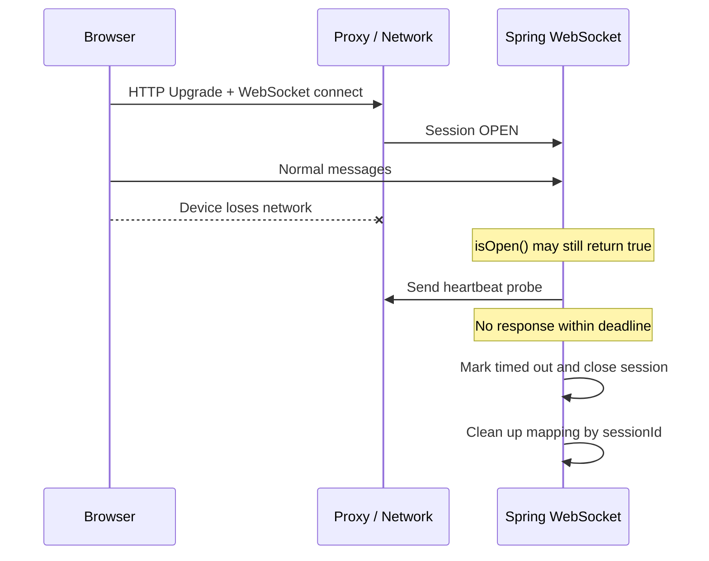
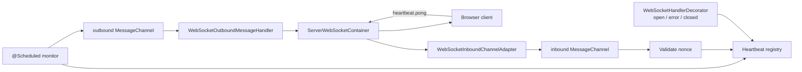
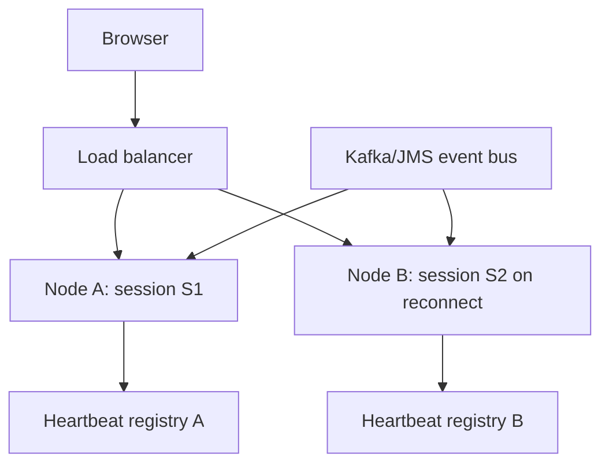
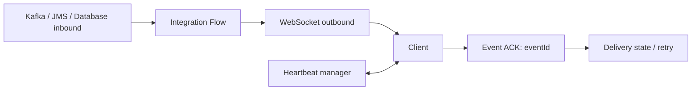

# Heartbeat and dead connection detection

## 1. Objectives and context

In the **SPRING_INTEGRATION_ADAPTERS** module, applications use inbound/outbound adapters, gateways, pollers, and `MessageChannel` to integrate external systems over files, SFTP, HTTP, JMS, AMQP, Kafka, and databases. When the output is WebSocket, the application must manage connections that may stay open for hours yet suddenly lose the ability to exchange data.

The **Heartbeat and dead connection detection** lesson, in the **Adapter WebSocket** chapter, addresses the question: *how do you know whether a WebSocket session is still responsive, detect broken connections when no Close frame arrives, and reclaim resources properly?*

After this lesson, you will be able to:

- Distinguish **WebSocket Ping/Pong**, **STOMP heartbeat**, **application heartbeat**, and **TCP keepalive**.
- Explain why `WebSocketSession.isOpen()` does not guarantee the client is truly connected.
- Design ping intervals, timeouts, nonces, state tracking, and ways to minimize false positives.
- Implement a Spring Integration example with `ServerWebSocketContainer`, inbound/outbound adapters, `MessageChannel`, and a dedicated scheduler.
- Handle pongs for the right session, close unresponsive sessions, and clean up state on disconnect.
- Distinguish heartbeats from business ACKs, delivery guarantees, and broker relay availability.
- Test scenarios including frozen clients, network drops, reconnects, multiple tabs, and multi-node deployments.

A heartbeat is a **liveness signal**, not proof that a business message was saved to a database or read by the user.

## 2. Why does WebSocket appear OPEN even when the link is broken?

A WebSocket connection starts with an HTTP Upgrade and continues exchanging frames over TCP. When a client closes normally, both sides complete the close handshake. However, if a device powers off abruptly, Wi-Fi drops, NAT evicts a mapping, a proxy cuts an idle connection, or a browser freezes, the server may **never receive a Close frame**.



`session.isOpen()` only reflects what **the WebSocket implementation knows at that moment**. Without I/O activity, pings, heartbeats, or timeouts, a *half-open* connection can linger much longer than expected.

Even when a heartbeat times out, the server only knows the client **did not respond within the configured policy**. You cannot conclude solely that the user closed the tab: the cause could be a slow network, browser throttling, CPU overload, or power loss.

## 3. Four liveness-checking mechanisms

| Mechanism | Operating layer | How responses work | Notes |
| --- | --- | --- | --- |
| **WebSocket Ping/Pong** | WebSocket control frames, RFC 6455 | Recipient of Ping replies with Pong | Browser JavaScript has no direct API to manually send/read control Ping/Pong |
| **STOMP heartbeat** | STOMP 1.1/1.2 over WebSocket or TCP | Both sides negotiate send/receive intervals, sending newlines when idle | STOMP client libraries usually manage this automatically |
| **Application heartbeat** | Application data, e.g., JSON | Server sends `heartbeat.ping`, client returns `heartbeat.pong` | Also verifies the client's JavaScript message-handling loop |
| **TCP keepalive** | OS / TCP stack | Socket-layer probes | Detection can be slow depending on OS/proxy settings |

### 3.1. WebSocket Ping/Pong control frames

Spring Framework provides `PingMessage` and `PongMessage`. The server can send a control Ping frame:

```java
import java.io.IOException;
import org.springframework.web.socket.PingMessage;
import org.springframework.web.socket.WebSocketSession;

public void sendPing(WebSocketSession session) throws IOException {
    session.sendMessage(new PingMessage());
}
```

A Pong frame is a WebSocket-layer signal. If you need to measure Ping/Pong, the application must use appropriate Spring WebSocket callbacks or decorators. When multiple threads send data over the same session, coordinate concurrent sends; do not let multiple tasks call `session.sendMessage(...)` unsynchronized.

Browsers handle control Ping/Pong automatically at the WebSocket layer, but **expose no JavaScript event to read a control Ping**. Calling `socket.send("ping")` only sends a **text frame**; that is an application convention, not a Ping control frame.

### 3.2. STOMP heartbeat

STOMP supports headers during connection setup:

```text
CONNECT
accept-version:1.2
heart-beat:10000,10000

<NUL>
```

The two values in `heart-beat` express send capability and desired receive interval in **milliseconds**. When both sides negotiate heartbeats, libraries can send newline bytes when no other STOMP frames are flowing. Actual timing depends on both sides; you cannot infer the full schedule by reading only one header.

A STOMP heartbeat is not a business `MESSAGE` command, nor is it a JSON event that a Spring Integration inbound adapter should forward to domain services. When using a STOMP broker relay, there is also a **system heartbeat** on the Spring → external STOMP broker connection.

### 3.3. Application heartbeat using JSON

An application can define its own contract:

```json
{
  "type": "heartbeat.ping",
  "nonce": "c9ef1ad2-8ecb-4bc2-aee9-e1159d42b330"
}
```

Client responds with:

```json
{
  "type": "heartbeat.pong",
  "nonce": "c9ef1ad2-8ecb-4bc2-aee9-e1159d42b330"
}
```

`nonce` ties the pong to **the pending probe of that exact WebSocket session**. The server must obtain the session ID from WebSocket infrastructure, such as the `simpSessionId` header, and compare the nonce. Never let a client designate another session to pong on its behalf.

JSON heartbeats pass through the client's event loop and handlers, so they partially verify application responsiveness. Trade-off: backgrounded or overloaded clients may reply slowly even though TCP is intact.

### 3.4. TCP keepalive and proxy idle timeouts

TCP keepalive operates below the application and can detect broken connections. However, default OS timings may be longer than real-time expectations. Proxies/load balancers may enforce a separate **idle timeout** and drop connections before Spring notices an error.

Therefore, verify in practice: proxy timeouts, WebSocket container idle counters, network keepalive requirements, and whether heartbeats actually generate traffic across the relevant network hop.

## 4. Designing a heartbeat policy

| Element | Meaning | Learning example |
| --- | --- | --- |
| `interval` | Wait time between scheduled probes | 15 seconds |
| `timeout` | Maximum wait for a pong after sending a ping | 45 seconds |
| `scanInterval` | Cycle for checking pending probes | 5 seconds |
| `nonce` | Random ID linking ping and pong | UUID |
| `sentAtNanos` | Send timestamp | `System.nanoTime()` |
| `pending` | Active pending probe, at most one per session | `AtomicReference` |
| `closing` | Prevents closing the same session multiple times | `AtomicBoolean` |
| `sessionId` | Current connection identifier | `WebSocketSession.getId()` |

Illustrative timeline:

```text
t=00s: session created
t=15s: send heartbeat.ping #1
t=16s: receive heartbeat.pong #1, clear pending #1
t=30s: send heartbeat.ping #2
t=45s: still no pong #2
t=75s: probe #2 exceeded 45s timeout
       scheduler marks timeout on the next scan
```

In practice there is jitter from the scheduler, thread pool, network, and GC. Never make hard deadline guarantees based solely on `@Scheduled`.

**Clock for measuring elapsed time:** `System.nanoTime()` is the proper monotonic source within a single process, whereas `Instant.now()` is suitable for logging and wall-clock correlation. Browser clocks can drift; never use client timestamps for server timeout decisions.

### Why only one pending probe?

If you scan every 5 seconds and keep sending pings without waiting for a pong, the server accumulates multiple unanswered probes. When a late pong arrives, it becomes difficult to distinguish which probes remain valid unless the contract tracks all of them.

Simple pattern in this lesson:

1. Keep at most **one** pending probe per session.
2. When the interval elapses, generate a nonce, store pending first, then send.
3. On receiving a pong matching the nonce, clear pending.
4. If pending exceeds timeout, mark closing and close the session.
5. If send fails, record the error and allow retrying per policy.
6. When the session closes, delete state for **that session ID**, not all sessions of the user.

## 5. Spring Integration architecture for raw WebSocket heartbeats



- `ServerWebSocketContainer` manages sessions for the endpoint and is shared by inbound and outbound.
- `WebSocketInboundChannelAdapter` receives text frames and feeds them into the channel.
- `WebSocketOutboundMessageHandler` consumes Spring Messages carrying `simpSessionId` to send to the specific session.
- `WebSocketHandlerDecorator` tracks connection open/close events; this avoids registering a second `WebSocketListener` on the same container.
- `HeartbeatRegistry` holds the pending nonce and closing state per session.
- `HeartbeatScheduler` is an application scheduler; **WebSocket adapters themselves are event-driven** and do not require periodic pollers.

The example below uses raw WebSocket to expose the heartbeat logic clearly. With STOMP, much of the heartbeat work can already be handled by the STOMP library and broker.

## 6. Example in Java 17+, Spring Boot 3.x, and Spring Integration 6.x

This example runs on the Servlet web stack with endpoint `/ws/health` and a browser JavaScript client. Java classes live in package `com.example.heartbeat`.

### 6.1. Maven dependencies

```xml
<dependencies>
    <dependency>
        <groupId>org.springframework.boot</groupId>
        <artifactId>spring-boot-starter-web</artifactId>
    </dependency>
    <dependency>
        <groupId>org.springframework.boot</groupId>
        <artifactId>spring-boot-starter-integration</artifactId>
    </dependency>
    <dependency>
        <groupId>org.springframework.integration</groupId>
        <artifactId>spring-integration-websocket</artifactId>
    </dependency>
</dependencies>
```

The Spring Boot BOM should manage compatible versions. `ObjectMapper` comes from Jackson in standard Spring Boot web configurations. The app enables scheduling via `@EnableScheduling` in the configuration below.

### 6.2. Registry keyed by session ID

File `HeartbeatRegistry.java`:

```java
package com.example.heartbeat;

import java.util.concurrent.ConcurrentHashMap;
import java.util.concurrent.ConcurrentMap;
import java.util.concurrent.atomic.AtomicBoolean;
import java.util.concurrent.atomic.AtomicLong;
import java.util.concurrent.atomic.AtomicReference;
import org.springframework.stereotype.Component;

@Component
public class HeartbeatRegistry {

    public record PendingProbe(String nonce, long sentAtNanos) {
    }

    public static final class SessionState {
        final AtomicReference<PendingProbe> pending =
                new AtomicReference<>();
        final AtomicLong lastProbeNanos =
                new AtomicLong(System.nanoTime());
        final AtomicBoolean closing =
                new AtomicBoolean(false);
    }

    private final ConcurrentMap<String, SessionState> states =
            new ConcurrentHashMap<>();

    public void opened(String sessionId) {
        states.put(sessionId, new SessionState());
    }

    public void closed(String sessionId) {
        states.remove(sessionId);
    }

    public SessionState get(String sessionId) {
        return states.get(sessionId);
    }

    public boolean acknowledge(String sessionId, String nonce) {
        SessionState state = states.get(sessionId);
        if (state == null || state.closing.get()) {
            return false;
        }

        PendingProbe pending = state.pending.get();
        if (pending == null || !pending.nonce().equals(nonce)) {
            return false;
        }

        return state.pending.compareAndSet(pending, null);
    }

    public int sessionCount() {
        return states.size();
    }
}
```

This registry uses `ConcurrentHashMap` and atomic variables because receiving pongs and scanning for timeouts occur on different threads. `opened` creates fresh state for the session, `closed` removes only the closed session's state, and `acknowledge` rejects mismatched nonces or pongs arriving while the session is closing.

This is a **node-local in-memory** registry: it is not a store for subscriptions or pending business events, nor does it replace user authentication.

### 6.3. Container, inbound, and outbound adapters

File `HeartbeatWebSocketConfiguration.java`:

```java
package com.example.heartbeat;

import com.fasterxml.jackson.core.JsonProcessingException;
import com.fasterxml.jackson.databind.JsonNode;
import com.fasterxml.jackson.databind.ObjectMapper;
import org.springframework.beans.factory.annotation.Qualifier;
import org.springframework.context.annotation.Bean;
import org.springframework.context.annotation.Configuration;
import org.springframework.integration.annotation.ServiceActivator;
import org.springframework.integration.channel.DirectChannel;
import org.springframework.integration.config.EnableIntegration;
import org.springframework.integration.websocket.ServerWebSocketContainer;
import org.springframework.integration.websocket.inbound.WebSocketInboundChannelAdapter;
import org.springframework.integration.websocket.outbound.WebSocketOutboundMessageHandler;
import org.springframework.messaging.MessageChannel;
import org.springframework.messaging.MessageHandler;
import org.springframework.messaging.MessagingException;
import org.springframework.messaging.simp.SimpMessageHeaderAccessor;
import org.springframework.scheduling.annotation.EnableScheduling;
import org.springframework.web.socket.CloseStatus;
import org.springframework.web.socket.WebSocketSession;
import org.springframework.web.socket.handler.WebSocketHandlerDecorator;

@Configuration
@EnableIntegration
@EnableScheduling
public class HeartbeatWebSocketConfiguration {

    @Bean
    public ServerWebSocketContainer heartbeatContainer(
            HeartbeatRegistry registry) {
        ServerWebSocketContainer container =
                new ServerWebSocketContainer("/ws/health");

        container.setDecoratorFactories(delegate ->
                new WebSocketHandlerDecorator(delegate) {
                    @Override
                    public void afterConnectionEstablished(
                            WebSocketSession session) throws Exception {
                        super.afterConnectionEstablished(session);
                        registry.opened(session.getId());
                    }

                    @Override
                    public void handleTransportError(
                            WebSocketSession session,
                            Throwable exception) throws Exception {
                        System.out.println(
                                "Transport error: " + session.getId());
                        super.handleTransportError(session, exception);
                    }

                    @Override
                    public void afterConnectionClosed(
                            WebSocketSession session,
                            CloseStatus status) throws Exception {
                        try {
                            super.afterConnectionClosed(session, status);
                        } finally {
                            registry.closed(session.getId());
                        }
                    }
                });

        return container;
    }

    @Bean
    public MessageChannel heartbeatInboundChannel() {
        return new DirectChannel();
    }

    @Bean
    public MessageChannel heartbeatOutboundChannel() {
        return new DirectChannel();
    }

    @Bean
    public WebSocketInboundChannelAdapter heartbeatInbound(
            ServerWebSocketContainer heartbeatContainer,
            @Qualifier("heartbeatInboundChannel") MessageChannel channel) {
        WebSocketInboundChannelAdapter adapter =
                new WebSocketInboundChannelAdapter(heartbeatContainer);
        adapter.setOutputChannel(channel);
        return adapter;
    }

    @Bean
    @ServiceActivator(inputChannel = "heartbeatInboundChannel")
    public MessageHandler heartbeatPongHandler(
            HeartbeatRegistry registry,
            ObjectMapper mapper) {

        return incoming -> {
            String sessionId = SimpMessageHeaderAccessor
                    .getSessionId(incoming.getHeaders());

            if (sessionId == null) {
                throw new MessagingException(
                        incoming, "Missing WebSocket session ID");
            }

            if (!(incoming.getPayload() instanceof String json)) {
                throw new MessagingException(
                        incoming, "Only raw text JSON is accepted");
            }

            final JsonNode data;
            try {
                data = mapper.readTree(json);
            } catch (JsonProcessingException exception) {
                throw new MessagingException(
                        incoming, "Invalid JSON", exception);
            }

            if (data == null || !data.isObject()) {
                throw new MessagingException(
                        incoming, "Heartbeat must be a JSON object");
            }

            if ("heartbeat.pong".equals(data.path("type").asText())) {
                String nonce = data.path("nonce").asText("");
                boolean acknowledged =
                        registry.acknowledge(sessionId, nonce);
                if (!acknowledged) {
                    System.out.println(
                            "Duplicate or invalid nonce pong: " + sessionId);
                }
                return;
            }

            // Demo only handles heartbeats.
            // Production: route other message types to business logic.
        };
    }

    @Bean
    @ServiceActivator(inputChannel = "heartbeatOutboundChannel")
    public MessageHandler heartbeatOutbound(
            ServerWebSocketContainer heartbeatContainer) {
        return new WebSocketOutboundMessageHandler(heartbeatContainer);
    }
}
```

**Why only one container?** Outbound must share the exact session registry of the inbound endpoint. Each `IntegrationWebSocketContainer` only registers one `WebSocketListener`; the decorator observes lifecycle events while the inbound adapter keeps the data-listener role.

When the application also handles business messages, add a router/filter after the inbound channel. This example intentionally processes only `heartbeat.pong` JSON; it does not forward other message types to business services.

### 6.4. Scheduler sending pings and closing unresponsive connections

File `HeartbeatScheduler.java`:

```java
package com.example.heartbeat;

import com.fasterxml.jackson.databind.ObjectMapper;
import java.io.IOException;
import java.util.UUID;
import java.util.concurrent.TimeUnit;
import org.springframework.beans.factory.annotation.Qualifier;
import org.springframework.integration.websocket.ServerWebSocketContainer;
import org.springframework.messaging.MessageChannel;
import org.springframework.messaging.simp.SimpMessageHeaderAccessor;
import org.springframework.messaging.support.MessageBuilder;
import org.springframework.scheduling.annotation.Scheduled;
import org.springframework.stereotype.Component;
import org.springframework.web.socket.CloseStatus;
import org.springframework.web.socket.WebSocketSession;

@Component
public class HeartbeatScheduler {

    private static final long INTERVAL_NANOS =
            TimeUnit.SECONDS.toNanos(15);
    private static final long TIMEOUT_NANOS =
            TimeUnit.SECONDS.toNanos(45);

    private final ServerWebSocketContainer container;
    private final HeartbeatRegistry registry;
    private final MessageChannel outbound;
    private final ObjectMapper mapper;

    public HeartbeatScheduler(
            ServerWebSocketContainer heartbeatContainer,
            HeartbeatRegistry registry,
            @Qualifier("heartbeatOutboundChannel") MessageChannel outbound,
            ObjectMapper mapper) {
        this.container = heartbeatContainer;
        this.registry = registry;
        this.outbound = outbound;
        this.mapper = mapper;
    }

    @Scheduled(fixedDelay = 5000)
    public void scan() {
        long now = System.nanoTime();

        for (WebSocketSession session : container.getSessions().values()) {
            if (!session.isOpen()) {
                continue;
            }

            HeartbeatRegistry.SessionState state =
                    registry.get(session.getId());
            if (state == null || state.closing.get()) {
                continue;
            }

            HeartbeatRegistry.PendingProbe pending =
                    state.pending.get();

            if (pending != null) {
                if (now - pending.sentAtNanos() >= TIMEOUT_NANOS
                        && state.closing.compareAndSet(false, true)) {
                    closeTimedOut(session);
                }
                continue;
            }

            if (now - state.lastProbeNanos.get() >= INTERVAL_NANOS) {
                sendPing(session, state);
            }
        }
    }

    private void sendPing(
            WebSocketSession session,
            HeartbeatRegistry.SessionState state) {

        var probe = new HeartbeatRegistry.PendingProbe(
                UUID.randomUUID().toString(), System.nanoTime());

        // Record pending before sending to avoid missing a very fast pong.
        if (!state.pending.compareAndSet(null, probe)) {
            return;
        }

        state.lastProbeNanos.set(probe.sentAtNanos());

        String payload = mapper.createObjectNode()
                .put("type", "heartbeat.ping")
                .put("nonce", probe.nonce())
                .toString();

        try {
            boolean accepted = outbound.send(
                    MessageBuilder.withPayload(payload)
                            .setHeader(
                                    SimpMessageHeaderAccessor
                                            .SESSION_ID_HEADER,
                                    session.getId())
                            .build());

            if (!accepted) {
                state.pending.compareAndSet(probe, null);
                System.out.println(
                        "Ping not accepted by channel: " + session.getId());
            }
        } catch (RuntimeException exception) {
            state.pending.compareAndSet(probe, null);
            System.out.println(
                    "Ping send error: " + session.getId());
        }
    }

    private void closeTimedOut(WebSocketSession session) {
        try {
            // 4001: private-use close code defined by this application.
            session.close(new CloseStatus(4001, "heartbeat timeout"));
        } catch (IOException exception) {
            System.out.println(
                    "Cannot close session: " + session.getId());
        }
        // afterConnectionClosed will delete the state.
        // Production needs TTL/reconciliation when callbacks do not arrive.
    }
}
```

Flow analysis:

1. `@Scheduled` scans every 5 seconds; the ping interval is 15 seconds.
2. Each session is tracked by its own registry entry, so an unresponsive client only affects **its own session**.
3. `PendingProbe` is stored in state **before `outbound.send(...)`** to avoid a very fast pong arriving before the server records pending.
4. Upon receiving a pong with the matching nonce, `pending` resets to `null`, clearing the way for the next probe.
5. If the probe goes unacknowledged for 45 seconds, `closing.compareAndSet(false, true)` prevents duplicate close handling.
6. Close code `4001` lies in RFC 6455's **private-use** range; this is an illustrative convention, not a built-in Spring "heartbeat timeout" status.
7. `afterConnectionClosed` removes state by session ID. If the process dies or the callback never runs, an independent reclamation mechanism is needed.

**Do not misread `outbound.send(...) == true`:** this signals message acceptance inside Spring Messaging, not confirmation that the browser received it. In this example, only a `heartbeat.pong` with a valid nonce marks the probe complete.

**Performance caveat:** `DirectChannel` runs handlers synchronously. One slow-sending client can delay the scheduler; production needs bounded executors/queues, buffer limits, and serialized per-session sending. This code is a learning model for small connection counts, not a heartbeat service tuned for tens of thousands of clients.

### 6.5. JavaScript client replying with pong

In the browser, from a page allowed to connect to the server:

```javascript
const ws = new WebSocket("ws://localhost:8080/ws/health");
let respondToHeartbeat = true;

ws.addEventListener("open", () => {
  console.log("WebSocket OPEN");
});

ws.addEventListener("message", event => {
  const message = JSON.parse(event.data);

  if (message.type === "heartbeat.ping") {
    console.log("Ping received:", message.nonce);

    if (respondToHeartbeat && ws.readyState === WebSocket.OPEN) {
      ws.send(JSON.stringify({
        type: "heartbeat.pong",
        nonce: message.nonce
      }));
    }
  }
});

ws.addEventListener("close", event => {
  console.log("Closed:", {
    code: event.code,
    reason: event.reason,
    wasClean: event.wasClean
  });
});

ws.addEventListener("error", () => {
  console.log("Transport error");
});
```

When `respondToHeartbeat` is `true`, the browser sends JSON text pongs for server probes. To simulate unresponsiveness:

```javascript
respondToHeartbeat = false;
```

After the next ping, state stays pending. Upon timeout, the server attempts to close the session with close code `4001`. If the close frame reaches the browser normally, the handler can display that code. If the network truly drops, the browser may display `1006` or not fire the callback right away.

Do not confuse JavaScript handling JSON pongs with WebSocket control Pongs. Testing control frames requires inspecting at the WebSocket layer using a server/client library that exposes that API.

### 6.6. Testing two tabs and reconnect

Open two tabs A and B running the script above. Let both respond to heartbeats; then in tab A set `respondToHeartbeat = false`, while keeping `true` in tab B. When the server times out A, B must continue operating. Reconnecting A creates a new `WebSocketSession` with fresh state and a new nonce.

When the frontend needs to reconnect:

- Only reconnect after `close` or detecting session loss per policy.
- Use exponential backoff and jitter to prevent clients from reconnecting simultaneously.
- Recreate listeners, subscriptions, and state for the new WebSocket.
- Do not reuse the old connection's session ID or nonce.
- Reload the latest business state or replay unacknowledged `eventId`s if required by the application.

## 7. Liveness, transport errors, and closing sessions

Signals provided by Spring infrastructure are not fully equivalent:

| Signal | Meaning |
| --- | --- |
| `afterConnectionEstablished` | Session opened; create state keyed by session ID |
| `isOpen()` | Session is considered open at call time |
| `handleTransportError` | A transport error was detected; the close callback may not have run yet |
| `afterConnectionClosed` | Close callback arrived; reclaim registry/resources |
| Application pong with valid nonce | Client processed and answered the pending probe |
| Heartbeat timeout | Probe went unanswered beyond the policy wait window |
| `CloseEvent.code == 1006` | Browser observed abnormal closure; code 1006 **is never sent in a Close frame** |

A timeout can occur right as the client sends a pong. This is a race condition: once the scheduler sets `closing`, a late pong is rejected and the client can reconnect. Systems should size timeouts from real measurements to avoid false positives rather than trying to eliminate every network race.

### Idempotent cleanup

One user can hold multiple WebSocket sessions:

```text
user-17
  ├─ Tab A: session S1
  └─ Tab B: session S2
Tab A reconnects: session S3
Late close callback for S1 arrives
```

The callback for S1 must delete only S1's state, never S2 or S3. With a `userId → Set<sessionId>` registry, remove only that exact `sessionId`. If only one active session is permitted, use compare-and-remove such as `byUser.remove(userId, oldSessionId)`.

Never put slow DB/HTTP operations or unbounded retries directly inside close callbacks. Quickly remove local state and offload remote cleanup to another flow with timeouts, retries, and idempotency.

## 8. STOMP heartbeats and broker relay

If the application uses STOMP over WebSocket, STOMP libraries can manage protocol-layer heartbeats without requiring application JSON ping/pong.

### 8.1. Simple broker with a scheduler

Example configuration inside `WebSocketMessageBrokerConfigurer`:

```java
@Override
public void configureMessageBroker(MessageBrokerRegistry registry) {
    registry.setApplicationDestinationPrefixes("/app");
    registry.enableSimpleBroker("/topic", "/queue")
            .setHeartbeatValue(new long[] {10_000, 20_000})
            .setTaskScheduler(messageBrokerTaskScheduler);
}
```

`messageBrokerTaskScheduler` represents an injected/configured `TaskScheduler`. In Spring WebSocket configurations, you can reuse a built-in scheduler (watch out for `@Lazy` to avoid dependency cycles) or declare a dedicated scheduler. The snippet above belongs **inside a class annotated with `@EnableWebSocketMessageBroker`**, not as a standalone Java file.

On the server side, one value represents the send heartbeat interval and the other represents the receive interval; effective timings are negotiated by the STOMP client and broker. When normal message traffic is flowing, separate newline heartbeats do not necessarily appear at every interval.

### 8.2. Broker relay with its own system heartbeat

Example configuration to an external broker:

```java
@Override
public void configureMessageBroker(MessageBrokerRegistry registry) {
    registry.setApplicationDestinationPrefixes("/app");

    registry.enableStompBrokerRelay("/topic", "/queue")
            .setRelayHost("broker.internal")
            .setRelayPort(61613)
            .setSystemHeartbeatSendInterval(10_000)
            .setSystemHeartbeatReceiveInterval(10_000);
}
```

This illustrative snippet requires a real external STOMP broker, credentials/TLS, and appropriate networking when deployed. The system heartbeat properties monitor **the Spring → broker system connection**. A healthy broker does not prove every browser session is alive.

Spring publishes `BrokerAvailabilityEvent` to observe the broker relay:

```java
import org.springframework.context.event.EventListener;
import org.springframework.messaging.simp.broker.BrokerAvailabilityEvent;
import org.springframework.stereotype.Component;

@Component
public class BrokerHealthListener {

    @EventListener
    public void brokerChanged(BrokerAvailabilityEvent event) {
        System.out.println("Broker available = "
                + event.isBrokerAvailable());
    }
}
```

`BrokerAvailabilityEvent` does not replace `SessionDisconnectEvent` or individual WebSocket client states. In a cluster, monitor **both the broker and frontend connections**.

### 8.3. STOMP.js client

Example with the `@stomp/stompjs` package:

```javascript
import { Client } from "@stomp/stompjs";

const client = new Client({
  brokerURL: "ws://localhost:8080/ws-stomp",
  heartbeatIncoming: 10000,
  heartbeatOutgoing: 10000,
  reconnectDelay: 5000,

  onConnect: () => {
    // Re-register subscriptions on every connection.
    client.subscribe("/topic/updates", message => {
      console.log("Update:", JSON.parse(message.body));
    });
  },
  onWebSocketClose: event => {
    console.log("Closed:", event.code);
  },
  onStompError: frame => {
    console.error("STOMP error:", frame.headers.message);
  }
});

client.activate();
```

Assumes the `/ws-stomp` endpoint is registered by Spring WebSocket Message Broker. Reconnecting creates a new connection; it does not automatically replay business events missed while offline.

## 9. Heartbeats in multi-node and proxied systems



`ServerWebSocketContainer.getSessions()` only lists sessions known to the container **on the current node**. If node A dies, A's close callbacks have no chance to update an out-of-process store. If the client reconnects to B, session S2 must be registered afresh, and critical pending notifications must be looked up by **user/device and event ID**, never relying on S1.

Operational principles:

- Track `nodeId` alongside `sessionId` when routing messages across a cluster.
- Use TTLs/leases and reconciliation for out-of-process presence registries to reclaim S1 if node A is killed.
- Never let a late close callback for S1 delete S2's mapping.
- Re-authenticate the client when a new connection opens, even if the previous session was valid.
- Align WebSocket/server/proxy timeouts; measure in real browsers, mobile networks, and corporate proxies.
- Add jitter to heartbeat schedules; thousands of sessions pinging simultaneously can cause load spikes.

In large systems, a scheduler scanning every session has `O(N)` complexity in the number of connections. You may need batching, capping probes per cycle, and a bounded executor. You must also coordinate concurrent sends over the same `WebSocketSession`; in Spring WebSocket, `ConcurrentWebSocketSessionDecorator` or a per-session serial sender are options to consider alongside buffer limits.

## 10. A heartbeat is not a business ACK

Suppose an event is read from Kafka, JMS, or a database and pushed to WebSocket:



Different signals:

| Signal | What is known | What is NOT proven |
| --- | --- | --- |
| `session.isOpen()` | Server considers the session open | Network/client is actually responsive |
| Valid-nonce pong | Client processed the heartbeat probe | Client processed another business event |
| `MessageChannel.send(...) == true` | Channel accepted the message | Client received, rendered, or confirmed it |
| `BrokerAvailabilityEvent` available | Broker system connection is ready | Every individual WebSocket client is online |
| Application ACK with `eventId` | Client confirmed the contract-defined action | Exactly-once if idempotency is missing |

If you must guarantee a notification was processed by the client, generate an `eventId`, application ACK, timeout, retry, and duplicate handling. After reconnect, look up the recipient's active session and resend required events; never reuse an expired `simpSessionId`.

Nor does a heartbeat timeout automatically imply rolling back a DB or Kafka transaction. Transport failures and business failures need separate compensation or state-recovery contracts.

## 11. Security and resource limits

Heartbeats must also obey security boundaries:

1. Authenticate clients during the WebSocket handshake; use `wss://` when deployed over a network.
2. Obtain session IDs from Spring infrastructure; never allow client JSON to pick which session receives or which session gets closed.
3. Accept pongs only with matching nonces, and limit nonce length, frame size, and abnormal message rates.
4. Limit WebSocket sessions per principal/IP according to application and network capacity.
5. Avoid logging tokens, credentials, and sensitive payloads in heartbeat errors.
6. Bound outbound buffers, send timeouts, scheduler queues, and concurrent probes.
7. When user permissions are revoked, block business actions immediately; a session answering heartbeats does not mean it still holds access rights.
8. With STOMP broker relay, protect broker credentials on the server; never put system login/passcodes in JavaScript.

**The example heartbeat app is for learning only.** Production needs authentication, authorization, session limits, metrics, bounded execution, and realistic testing under proxies and adverse network conditions.

## 12. Testing and diagnostics

### 12.1. Test matrix

| Scenario | Expected outcome |
| --- | --- |
| Client returns matching nonce | Pending probe is cleared, session stays alive |
| Pong with wrong nonce | Not treated as an ACK for the pending probe |
| Duplicate pong | Only the first valid one completes the probe |
| Client fails to send pong | After timeout, server attempts to close that exact session |
| Client closes normally | Close callback removes registry state |
| Two tabs, only A stops responding | A times out, B is not closed by mistake |
| A reconnects as a new session | Fresh registry entry/nonce, old state unused |
| Wi-Fi drop or proxy cut | Close frame may be absent; timeout serves as fallback signal |
| Scheduler delayed by load | Measure scan lag; avoid overly tight timeouts |
| Broker relay disconnects | Broker availability and STOMP reconnect handled separately |
| Node crashes | TTL/lease reclaims stale mappings |
| Unacknowledged business event | Never clear pending events just because a pong arrived |

### 12.2. Ordered diagnostic checklist

1. Did the handshake and `afterConnectionEstablished` occur?
2. Do the server and outbound adapter share the same `ServerWebSocketContainer`?
3. Is `@EnableScheduling` enabled, and is the scheduler running at the expected interval?
4. Does the outbound Spring Message carry the `simpSessionId` of an open session?
5. Did the ping pass through the outbound channel, and did the client receive properly formatted JSON?
6. Did the client send back `heartbeat.pong` with the exact nonce?
7. Did the inbound adapter deliver the message to `heartbeatInboundChannel`?
8. Are there JSON parsing exceptions, missing session headers, or late pings?
9. Is there a race between `isOpen()` and `send`/`close`?
10. If using STOMP, did the client receive `CONNECTED`, and does the broker have matching heartbeat/scheduler settings?
11. Are proxy, NAT, or browser background-throttling timeouts cutting connections early?
12. Is the registry cleaned up by session ID on disconnect, reconnect, or node crash?

### 12.3. Common errors

| Symptom | Possible causes | Resolution |
| --- | --- | --- |
| `isOpen()` stays true after client loses network | Half-open transport not yet detected | Heartbeats, timeouts, cleanup |
| JavaScript never gets WebSocket control Pong events | Browsers do not expose control frames | Use application heartbeats to test JS callbacks |
| Client sends `"pong"` but it is ignored | Server expects JSON + nonce | Align payload contract |
| False timeouts on background tabs | Event loop throttled | Tune timeouts and pick an appropriate heartbeat mechanism |
| Overlapping probes accumulate | Pending state not managed | Allow at most one pending probe per session |
| Reconnected yet sends still target old session | Stale mapping | Route by new session and trusted user ID |
| Entire user marked offline when one tab closes | Cleanup deletes by user | Delete only the closed session ID |
| STOMP heartbeats do not appear on Integration Flow | Not a business `MESSAGE` | Monitor at the STOMP layer |
| Broker available yet client misses events | Broker health differs from session health | Monitor both |
| Too many clients slow down the scheduler | Unbounded fan-out and synchronized sends | Jitter, bounded queues/executors |
| Pongs succeed yet events are lost | Heartbeat is not a delivery ACK | Add event IDs, ACKs, and retries |

### 12.4. Operational metrics

Useful metrics include `websocket_sessions_open`, `heartbeat_probes_sent_total`, `heartbeat_pongs_accepted_total`, `heartbeat_timeouts_total`, `heartbeat_pending_probes`, `heartbeat_round_trip_seconds`, `websocket_transport_errors_total`, `websocket_close_codes_total`, `heartbeat_scan_delay_seconds`, and STOMP broker availability.

Only use bounded-cardinality tags such as endpoint, node, close code, or connection type. `sessionId`, `nonce`, and `eventId` have high cardinality and belong in controlled logs/traces rather than metric tags.

## 13. Practice exercises

### Exercise A — comparing heartbeat mechanisms

Compare WebSocket Ping/Pong, STOMP heartbeats, application heartbeats, and TCP keepalive by operating layer, sender/receiver actors, visibility in JavaScript, and detectable failure modes.

### Exercise B — testing nonces

Run the Java/JavaScript example. Send a matching nonce, a wrong nonce, a duplicate pong, and disable `respondToHeartbeat`. Explain why a wrong nonce or stale pong must not extend the deadline.

### Exercise C — timing design

Externalize interval/timeout into environment configuration, adding validation and per-session jitter. Propose test timings for proxy idle timeouts, mobile networks, and backgrounded browser tabs. Explain the risks of overly short timeouts.

### Exercise D — Kafka/JMS source

An event `evt-901` flows from a Kafka/JMS inbound adapter via `MessageChannel` to WebSocket outbound. The client misses heartbeats and reconnects. Design handling for both dashboard updates that can fetch a fresh snapshot and mandatory-ACK events. Why does Kafka offset/JMS ack not mean the browser processed the frame?

### Exercise E — STOMP and broker relay

Configure STOMP heartbeats for the simple broker and system heartbeats for the broker relay. Stop the external broker and observe `BrokerAvailabilityEvent` plus client reconnect/resubscribe. Distinguish a broker outage from a single WebSocket session failure.

### Exercise F — multiple nodes

A user opens tab A on node 1 and tab B on node 2. Node 1 is killed; tab A reconnects to node 2. Design TTL/lease and per-session cleanup so neither tab B nor the new session is deleted. Propose how to prevent 10,000 sessions from firing heartbeats at the exact same instant.

**Completion criteria:** identify which heartbeat type is used, who sends/receives it, how timeouts are anchored, how to clean up state safely, and why a pong cannot substitute for a business ACK.

## 14. Key takeaways

- A WebSocket session can become *half-open*; `isOpen()` does not guarantee the network/client is still responsive.
- WebSocket control Ping/Pong, STOMP heartbeats, application heartbeats, and TCP keepalive have distinct mechanisms and scopes.
- Browsers do not expose WebSocket Ping/Pong control frames to JavaScript; to check the JavaScript event loop, use JSON ping/pong.
- Application heartbeats should include nonces, one pending probe per session, intervals, timeouts, a scheduler, and idempotent cleanup.
- In Spring Integration, the inbound adapter receives pongs, the outbound handler sends pings, and `simpSessionId` routes to the exact session.
- STOMP heartbeats and broker relay system heartbeats are not equivalent to business messages or individual browser health.
- Timeouts must balance detection speed against false positives, especially with backgrounded browsers or mobile networks.
- Clusters require TTLs/leases and routing to the node owning the connection; old session IDs cannot be used after reconnect.
- Critical business data still requires its own `eventId`, ACKs, retries, and idempotency.

## References

- [Spring Integration Reference — WebSockets Support](https://docs.spring.io/spring-integration/reference/web-sockets.html)
- [Spring Integration API — ServerWebSocketContainer](https://docs.spring.io/spring-integration/docs/6.1.x/api/org/springframework/integration/websocket/ServerWebSocketContainer.html)
- [Spring Integration API — WebSocketInboundChannelAdapter](https://docs.spring.io/spring-integration/docs/6.1.x/api/org/springframework/integration/websocket/inbound/WebSocketInboundChannelAdapter.html)
- [Spring Integration API — WebSocketOutboundMessageHandler](https://docs.spring.io/spring-integration/docs/6.1.x/api/org/springframework/integration/websocket/outbound/WebSocketOutboundMessageHandler.html)
- [Spring Framework Reference — WebSocket](https://docs.spring.io/spring-framework/reference/web/websocket.html)
- [Spring Framework Reference — Simple Broker](https://docs.spring.io/spring-framework/reference/web/websocket/stomp/handle-simple-broker.html)
- [Spring Framework Reference — STOMP Broker Relay](https://docs.spring.io/spring-framework/reference/web/websocket/stomp/handle-broker-relay.html)
- [Spring Framework API — PingMessage](https://docs.spring.io/spring-framework/docs/current/javadoc-api/org/springframework/web/socket/PingMessage.html)
- [Spring Framework API — PongMessage](https://docs.spring.io/spring-framework/docs/current/javadoc-api/org/springframework/web/socket/PongMessage.html)
- [RFC 6455 — WebSocket Control Frames](https://www.rfc-editor.org/rfc/rfc6455#section-5.5)
- [STOMP Protocol 1.2 — Heart-beating](https://stomp.github.io/stomp-specification-1.2.html#Heart-beating)
