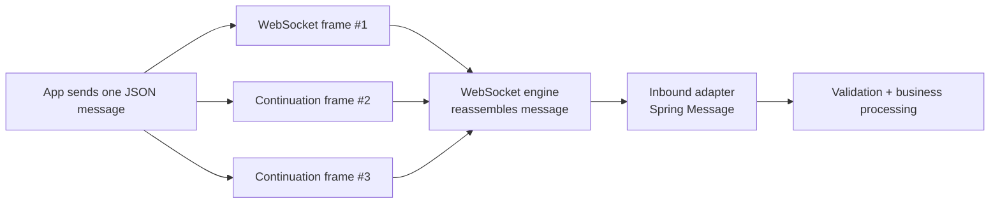
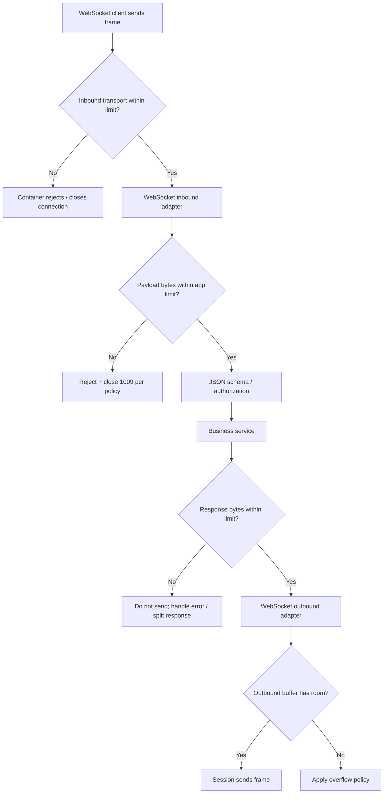
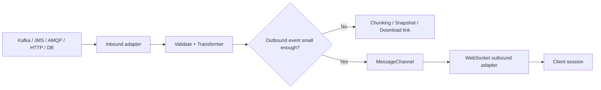

# Controlling payload size

## 1. Context and objectives

In the **SPRING_INTEGRATION_ADAPTERS** module, inbound/outbound adapters, gateways, pollers, and `MessageChannel` allow Spring Integration flows to exchange data with files, SFTP, HTTP, JMS, AMQP, Kafka, databases, and WebSocket. When data is pushed onto a long-lived WebSocket connection, the application must protect both **inbound** and **outbound** paths against oversized payloads.

The **Controlling payload size** lesson belongs to the **Adapter WebSocket** chapter. The topic is not just "how many characters to allow in JSON", but how to place limits at the right layers to avoid memory exhaustion, CPU overload, outbound buffer congestion, and service degradation for other sessions.

After this lesson, you will be able to:

- Distinguish the sizes of a **frame**, **WebSocket message**, **STOMP message**, **business payload**, and **outbound send buffer**.
- Measure size in **UTF-8 bytes** instead of relying on Java/JavaScript string length.
- Configure text/binary inbound limits at the WebSocket engine via `ServletServerContainerFactoryBean`.
- Enforce business size limits in the Spring Integration inbound flow before expensive parse/transform steps.
- Configure `setSendBufferSizeLimit`, `setSendTimeLimit`, and `OverflowStrategy` for outbound sessions.
- Distinguish STOMP's `setMessageSizeLimit` from raw WebSocket limits.
- Handle oversized payloads using appropriate error responses or connection closure, typically involving WebSocket close code **1009**.
- Test Unicode, fragmentation, binary payloads, slow clients, concurrent load, and network failures.

> **Scope:** a size limit at one layer does not automatically apply to every other layer. To protect the system, combine multiple control layers with distinct purposes.

## 2. Which size is "payload size" really?

### 2.1. Frame vs. message

A WebSocket **message** can fit in a single frame or be split across multiple frames. The receiver must handle fragmentation per RFC 6455, while application APIs typically deliver a reassembled message object.



Per-frame limits **do not replace** a reassembled message size limit: a sender can split an enormous message into many frames smaller than the per-frame limit. Conversely, the transport/container can reject a message before it ever reaches `WebSocketInboundChannelAdapter`.

### 2.2. Text and binary are measured differently

| Data kind | Representation | Size to measure and check |
| --- | --- | --- |
| Text JSON | `String` or `TextMessage` | Byte count when the actual text is UTF-8 encoded |
| Binary | `byte[]`, `ByteBuffer`, or `BinaryMessage` | Remaining/transmitted byte count of the buffer |
| STOMP frame | Command + headers + body | Message size at the STOMP layer, including parser-counted overhead |
| Java object | POJO/record | Size of the serialized payload, not the object's heap footprint |
| Outbound queue | Multiple queued messages | Total buffered bytes **per session**, distinct from a single message size |

In Java:

```java
import java.nio.charset.StandardCharsets;

String text = "{\"message\":\"Hello 🌏\"}";
int characters = text.length(); // number of UTF-16 code units
int utf8Bytes = text.getBytes(StandardCharsets.UTF_8).length;

System.out.println("String.length(): " + characters);
System.out.println("UTF-8 bytes: " + utf8Bytes);
```

`String.length()` is not a byte count. Accented characters can occupy multiple UTF-8 bytes; emojis can take multiple UTF-16 code units in Java and multiple bytes on the wire.

Short example:

```text
"A"       → 1 UTF-8 byte
"é"       → 2 UTF-8 bytes
"🌏"      → 4 UTF-8 bytes

100 visible characters are not necessarily 100 bytes.
```

In the browser, use `TextEncoder` to measure text sent via `WebSocket.send(...)`:

```javascript
const json = JSON.stringify({
  type: "note",
  content: "Hello 🌏"
});

const bytes = new TextEncoder().encode(json).byteLength;
console.log("Payload bytes:", bytes);
```

Note that WebSocket frame overhead, client masking, and TLS are not included in `TextEncoder`. This measurement controls **application content**, not exact wire bytes.

### 2.3. Compression and decompressed payloads

When using a WebSocket extension such as `permessage-deflate`, wire data may be small while the decompressed payload is huge. Never base protection solely on compressed size or the HTTP handshake's `Content-Length`.

Even a small JSON structure can consume excessive CPU/memory if deeply nested, packed with many fields, or holding huge strings. Thus, byte size is **a necessary condition**, not the entire validation policy. Also consider parse depth, element counts, field lengths, connection counts, and send rates.

## 3. Four limit layers to put in place

An illustrative policy for an application ingesting sensor JSON:

| Layer | Goal | Example value |
| --- | --- | --- |
| **Transport inbound** | Prevent the WebSocket engine from buffering/assembling huge messages | Text/Binary buffer: 64 KiB |
| **Application inbound** | Accept only small, contract-compliant payloads | JSON text: max 16 KiB UTF-8 |
| **Application outbound** | Avoid serializing/pushing huge events to browsers | JSON response: max 16 KiB UTF-8 |
| **Outbound send buffer** | Cap queued data when a client reads slowly | 256 KiB/session, send time 10 seconds |

Values in the table are **for practice**, not universal defaults or fixed recommendations.

These are distinct concerns:

- `maxTextMessageBufferSize` and `maxBinaryMessageBufferSize` protect ingestion inside the WebSocket engine.
- `MAX_APP_PAYLOAD_BYTES` checks payloads after the inbound adapter emits a message; it should be less than or equal to the transport limit if the business flow wants to handle received oversized payloads itself.
- `maxOutboundPayloadBytes` caps the size of a single response/event sent by the server.
- `sendBufferSizeLimit` caps data **accumulated while sending**, not an individual inbound JSON message.
- `sendTimeLimit` caps slow-send duration, not payload size.

### Multi-layer protection flow



**Important rule:** validation inside a service **does not replace** transport limits. If transport allows 100 MiB while the mapper rejects at 16 KiB, the server may still have to receive and assemble substantial data before the mapper ever runs.

## 4. Handling oversized payloads: close connection or return an error?

### 4.1. WebSocket close code 1009

RFC 6455 defines code **1009 — Message Too Big**, indicating an endpoint is closing the connection because a received message is too large to process. Spring Framework provides the constant:

```java
org.springframework.web.socket.CloseStatus.TOO_BIG_TO_PROCESS
```

Example when the application detects an oversized text message:

```java
WebSocketSession session = container.getSession(sessionId);
if (session != null && session.isOpen()) {
    session.close(CloseStatus.TOO_BIG_TO_PROCESS);
}
```

This illustrative snippet needs `IOException` handling and awareness of session race conditions. A WebSocket container can also reject/close a connection **before the message enters Spring Integration**. In that case, service validation code is never invoked.

**Do not assume** the browser always receives `CloseEvent.code == 1009`. When a connection resets, a proxy intervenes, or the close handshake does not complete, the browser may see another code, even 1006 (an abnormal closure reporting code **never sent on the wire**).

### 4.2. Can we send a JSON error instead of closing?

For payloads valid at transport level that violate a minor **business** limit, the application can keep the connection open and send an error message:

```json
{
  "type": "error",
  "code": "PAYLOAD_TOO_LARGE",
  "maxBytes": 16384
}
```

However, if a payload exceeds the **WebSocket engine** limit, the server may never have created a Spring Message to reply to. Moreover, sending an error and immediately calling close does not guarantee the client received the error. Therefore:

- **Transport overload/risk:** reject/close, prioritizing resource protection.
- **Schema error or minor, safe business limit:** can return a contract error.
- **Need certainty that the client received the reason:** design a dedicated acknowledgment/retry flow rather than relying on an error frame sent right before closing.
- **Repeated violations or signs of abuse:** rate-limit or close the session per security policy.

Unlike HTTP, once a connection has Upgraded, you cannot arbitrarily return `HTTP 413 Payload Too Large` for a normal WebSocket data frame. HTTP 413 applies to HTTP requests; WebSocket handles size violations at the transport/protocol layer or via the message contract.

## 5. Hands-on example: Spring Boot + Spring Integration raw WebSocket

Goal: the `/ws/limited` endpoint receives a sensor event JSON. The WebSocket engine allows at most **64 KiB** text/binary; business logic accepts only **16 KiB UTF-8**. Valid payloads are parsed and an ACK is returned to the exact session; text payloads exceeding the business limit cause the server to attempt closing the session with code 1009.

The example uses **Java 17+, Spring Boot 3.x, Spring Integration 6.x**, Servlet web stack on a container supporting Jakarta WebSocket (e.g., Tomcat). For Jetty or other containers, check the equivalent configuration API.

### 5.1. Maven dependencies

```xml
<dependencies>
    <dependency>
        <groupId>org.springframework.boot</groupId>
        <artifactId>spring-boot-starter-web</artifactId>
    </dependency>
    <dependency>
        <groupId>org.springframework.boot</groupId>
        <artifactId>spring-boot-starter-integration</artifactId>
    </dependency>
    <dependency>
        <groupId>org.springframework.integration</groupId>
        <artifactId>spring-integration-websocket</artifactId>
    </dependency>
</dependencies>
```

The Spring Boot BOM manages compatible dependency versions. `spring-integration-websocket` contains the WebSocket adapter/container classes. `spring-boot-starter-web` typically provides Spring MVC and Jackson.

### 5.2. Complete configuration

Create `LimitedWebSocketConfiguration.java`:

```java
package com.example.limited;

import java.io.IOException;
import java.nio.charset.StandardCharsets;

import com.fasterxml.jackson.core.JsonProcessingException;
import com.fasterxml.jackson.databind.JsonNode;
import com.fasterxml.jackson.databind.ObjectMapper;

import org.springframework.beans.factory.annotation.Qualifier;
import org.springframework.context.annotation.Bean;
import org.springframework.context.annotation.Configuration;
import org.springframework.integration.annotation.ServiceActivator;
import org.springframework.integration.channel.DirectChannel;
import org.springframework.integration.config.EnableIntegration;
import org.springframework.integration.websocket.ServerWebSocketContainer;
import org.springframework.integration.websocket.inbound.WebSocketInboundChannelAdapter;
import org.springframework.integration.websocket.outbound.WebSocketOutboundMessageHandler;
import org.springframework.messaging.MessageChannel;
import org.springframework.messaging.MessageHandler;
import org.springframework.messaging.MessagingException;
import org.springframework.messaging.simp.SimpMessageHeaderAccessor;
import org.springframework.messaging.support.MessageBuilder;
import org.springframework.web.socket.CloseStatus;
import org.springframework.web.socket.WebSocketSession;
import org.springframework.web.socket.handler.ConcurrentWebSocketSessionDecorator;
import org.springframework.web.socket.server.standard.ServletServerContainerFactoryBean;

@Configuration
@EnableIntegration
public class LimitedWebSocketConfiguration {

    // Transport and business limits are intentionally different.
    private static final int TRANSPORT_MAX_BYTES = 64 * 1024;
    private static final int APP_MAX_TEXT_BYTES = 16 * 1024;
    private static final int OUTBOUND_MAX_TEXT_BYTES = 16 * 1024;

    // Configures the WebSocket engine for Servlet/Jakarta WebSocket.
    @Bean
    public ServletServerContainerFactoryBean websocketEngineLimits() {
        var factory = new ServletServerContainerFactoryBean();
        factory.setMaxTextMessageBufferSize(TRANSPORT_MAX_BYTES);
        factory.setMaxBinaryMessageBufferSize(TRANSPORT_MAX_BYTES);
        return factory;
    }

    @Bean
    public ServerWebSocketContainer limitedWsContainer() {
        var container = new ServerWebSocketContainer("/ws/limited");

        // This is the SEND BUFFER limit, not an inbound size limit.
        container.setSendBufferSizeLimit(256 * 1024);
        container.setSendTimeLimit(10_000);
        container.setSendBufferOverflowStrategy(
                ConcurrentWebSocketSessionDecorator
                        .OverflowStrategy.TERMINATE);
        return container;
    }

    @Bean
    public MessageChannel wsInputChannel() {
        return new DirectChannel();
    }

    @Bean
    public MessageChannel wsOutputChannel() {
        return new DirectChannel();
    }

    @Bean
    public WebSocketInboundChannelAdapter wsInbound(
            ServerWebSocketContainer limitedWsContainer,
            @Qualifier("wsInputChannel") MessageChannel input) {

        var inbound = new WebSocketInboundChannelAdapter(
                limitedWsContainer);
        inbound.setPayloadType(String.class);
        inbound.setOutputChannel(input);
        return inbound;
    }

    @Bean
    @ServiceActivator(inputChannel = "wsInputChannel")
    public MessageHandler validateAndReply(
            ServerWebSocketContainer limitedWsContainer,
            ObjectMapper mapper,
            @Qualifier("wsOutputChannel") MessageChannel output) {

        return incoming -> {
            String sessionId = SimpMessageHeaderAccessor
                    .getSessionId(incoming.getHeaders());

            if (sessionId == null || sessionId.isBlank()) {
                throw new MessagingException(
                        incoming, "Missing WebSocket session ID");
            }

            if (!(incoming.getPayload() instanceof String text)) {
                throw new MessagingException(
                        incoming, "Example only accepts JSON text");
            }

            // Count UTF-8 bytes, do not use String.length().
            int bytes = text.getBytes(StandardCharsets.UTF_8).length;

            if (bytes > APP_MAX_TEXT_BYTES) {
                closeTooLarge(limitedWsContainer, sessionId);
                return; // Do not parse or forward to business services.
            }

            final JsonNode root;
            try {
                root = mapper.readTree(text);
            } catch (JsonProcessingException exception) {
                throw new MessagingException(
                        incoming, "Invalid JSON", exception);
            }

            if (root == null || !root.isObject()) {
                throw new MessagingException(
                        incoming, "Payload must be a JSON object");
            }

            String type = root.path("type").asText("");
            String eventId = root.path("eventId").asText("");
            JsonNode value = root.path("value");

            if (!"sensor.reading".equals(type)
                    || eventId.isBlank()
                    || eventId.length() > 64
                    || !value.isNumber()) {
                throw new MessagingException(
                        incoming, "Invalid sensor.reading contract");
            }

            // Demo: call authenticated/authorized business service
            // and persist data before replying ACCEPTED if required.
            String ack = mapper.createObjectNode()
                    .put("type", "sensor.ack")
                    .put("eventId", eventId)
                    .put("status", "ACCEPTED")
                    .toString();

            int responseBytes =
                    ack.getBytes(StandardCharsets.UTF_8).length;
            if (responseBytes > OUTBOUND_MAX_TEXT_BYTES) {
                throw new MessagingException(
                        incoming, "ACK exceeds outbound size policy");
            }

            boolean accepted = output.send(
                    MessageBuilder.withPayload(ack)
                            .setHeader(
                                    SimpMessageHeaderAccessor
                                            .SESSION_ID_HEADER,
                                    sessionId)
                            .build());

            if (!accepted) {
                throw new MessagingException(
                        incoming, "Outbound channel did not accept ACK");
            }
        };
    }

    @Bean
    @ServiceActivator(inputChannel = "wsOutputChannel")
    public MessageHandler wsOutbound(
            ServerWebSocketContainer limitedWsContainer) {
        return new WebSocketOutboundMessageHandler(limitedWsContainer);
    }

    private static void closeTooLarge(
            ServerWebSocketContainer container,
            String sessionId) {

        WebSocketSession session = container.getSession(sessionId);
        if (session == null || !session.isOpen()) {
            return;
        }

        try {
            session.close(CloseStatus.TOO_BIG_TO_PROCESS); // 1009
        } catch (IOException exception) {
            // Production: record controlled metrics/logs,
            // do not assume the close handshake completed.
            System.out.println(
                    "Unable to close session: " + sessionId);
        }
    }
}
```

### 5.3. Key points in the configuration

1. `ServletServerContainerFactoryBean` configures the Servlet-side **Jakarta WebSocket server container**. `setMaxTextMessageBufferSize` and `setMaxBinaryMessageBufferSize` tune the engine's receive buffers/limits; exact behavior depends on the container. Do not confuse these two properties with the outbound send buffer.
2. `ServerWebSocketContainer("/ws/limited")` manages Spring Integration's sessions; inbound and outbound **share the same container** to locate the right session.
3. `WebSocketInboundChannelAdapter` sends Spring Messages into `wsInputChannel`. Oversized data can be rejected by the engine before this step.
4. `validateAndReply` checks the **UTF-8 byte count** before invoking Jackson. Here it also validates `type`, `eventId`, and `value` before proceeding to business logic.
5. If JSON exceeds `16 KiB` yet passes the transport limit, the service calls `closeTooLarge` with `CloseStatus.TOO_BIG_TO_PROCESS`.
6. The ACK JSON is size-checked **after serialization**, then sent to `wsOutputChannel` with header `simpSessionId`.
7. `WebSocketOutboundMessageHandler` looks up the matching session to send the frame. `setSendBufferSizeLimit` only controls **accumulated send buffering** during slow sends.
8. The demo code does not implement real transactions/authorization. If `ACCEPTED` means "saved to DB/Kafka", complete that business work before constructing the ACK.

This is a clean example for **raw WebSocket**. When using a STOMP broker, dispatch, message limits, and acknowledgment mechanics differ; see section 7.

### 5.4. Testing with JavaScript

Open a same-origin page or an origin permitted by the server and run:

```javascript
const ws = new WebSocket("ws://localhost:8080/ws/limited");
const encoder = new TextEncoder();

function sendJson(value) {
  const json = JSON.stringify(value);
  console.log("UTF-8 bytes:", encoder.encode(json).byteLength);
  ws.send(json);
}

ws.addEventListener("open", () => {
  sendJson({
    type: "sensor.reading",
    eventId: "evt-100",
    value: 27.5
  });
});

ws.addEventListener("message", event => {
  console.log("Response:", JSON.parse(event.data));
});

ws.addEventListener("close", event => {
  console.log("Closed:", event.code, event.reason);
});

ws.addEventListener("error", event => {
  console.log("Transport error:", event);
});
```

When valid, the client typically receives:

```json
{
  "type": "sensor.ack",
  "eventId": "evt-100",
  "status": "ACCEPTED"
}
```

To test a payload exceeding the **16 KiB application threshold but under 64 KiB**, open a new connection and send:

```javascript
const wsTooLarge = new WebSocket("ws://localhost:8080/ws/limited");

wsTooLarge.addEventListener("open", () => {
  const payload = JSON.stringify({
    type: "sensor.reading",
    eventId: "evt-over",
    value: 10,
    note: "🌏".repeat(5000)
  });

  console.log("Size:", new TextEncoder().encode(payload).byteLength);
  wsTooLarge.send(payload);
});

wsTooLarge.addEventListener("close", event => {
  console.log("Oversized close:", event.code);
});
```

This emoji string produces roughly **20 KiB** for the `note` field alone, enough to exceed the 16 KiB limit. Under ideal conditions, the server attempts to close with `1009`. If the container or a proxy enforces another limit, you may observe closure before the handler or a different close code.

To test the transport limit, use a payload larger than `64 KiB`, such as adding `"x".repeat(80000)` to `note`. In that case, expect the message **not to appear in the flow** because the WebSocket engine rejects it first; exact behavior must be verified against the server/container in use.

### 5.5. Limitations of the example

- Checking `text.getBytes(UTF_8).length` allocates a byte array matching the payload; fine for small payloads already capped by transport, but for very large inputs, enforce low-level limits and bounded counting/parsing to avoid excess allocations.
- Parsing with Jackson into `JsonNode` also consumes memory. For deeply nested or many-field JSON, add parser constraints and schema validation.
- A binary frame is outside this example's JSON contract. Do not attempt to coerce it into a `String` unchecked.
- Server close status is best-effort; the browser is not guaranteed to observe `1009` if the network is failing.
- `MessageChannel.send(...)` returning `true` does not mean the client displayed the ACK.
- `ServletServerContainerFactoryBean` targets Servlet/Jakarta WebSocket engines; if using WebFlux/Reactor Netty or another engine, use its corresponding configuration API.

## 6. Binary payloads and streaming flows

If a client sends a `BinaryMessage`, measure size using actual bytes:

```java
import java.nio.ByteBuffer;

ByteBuffer payload = /* buffer holding received data */;
int bytesAvailable = payload.remaining();

if (bytesAvailable > 64 * 1024) {
    // Reject or close session per contract.
}
```

This snippet illustrates measuring a received `ByteBuffer`, **not** configuring a transport limit. A serializer may produce `byte[]`, `ByteBuffer`, or a custom binary format; never call `new String(bytes)` without an explicit encoding contract.

### 6.1. Do not miscalculate frame lengths

If a message is split across multiple continuation frames, total message size **is not the size of only the first frame**. WebSocket engine settings and assemblers must apply limits to the reassembled data.

Additionally, if compression is enabled, check the **decompressed** size. If an endpoint receives chunked/partial messages, track total accumulated bytes across the message's lifetime, not only `chunk.length` on each callback.

### 6.2. When truly large data is needed

WebSocket excels at small events, status updates, and real-time notifications. When an application needs to download a 200 MiB file or a large export, it is usually better to:

1. Generate the file or object in an appropriate storage system.
2. Emit a small WebSocket notification containing `jobId`, controlled metadata, and completion status.
3. Have the client download the file over an authenticated HTTP/URL endpoint that supports streaming, resume/range requests, and load control.
4. Use a checksum or ID to verify integrity if required by the business logic.

Example small WebSocket notification:

```json
{
  "type": "report.ready",
  "jobId": "job-842",
  "downloadPath": "/api/reports/job-842"
}
```

`downloadPath` must be protected by server authentication/authorization. Never treat an unguessable path or random job ID as permission to download the file.

## 7. STOMP over WebSocket: distinct message and transport limits

STOMP adds commands, headers, and destinations, and can assemble a STOMP message from multiple WebSocket messages. In Spring WebSocket Messaging, `WebSocketTransportRegistration.setMessageSizeLimit(...)` limits the **inbound sub-protocol message**, which is not equivalent to an engine-level WebSocket frame/message limit.

### 7.1. STOMP configuration example

Example **separate** from the raw WebSocket endpoint `/ws/limited`:

```java
package com.example.stomp;

import org.springframework.context.annotation.Configuration;
import org.springframework.messaging.simp.config.MessageBrokerRegistry;
import org.springframework.web.socket.config.annotation.EnableWebSocketMessageBroker;
import org.springframework.web.socket.config.annotation.StompEndpointRegistry;
import org.springframework.web.socket.config.annotation.WebSocketMessageBrokerConfigurer;
import org.springframework.web.socket.config.annotation.WebSocketTransportRegistration;

@Configuration
@EnableWebSocketMessageBroker
public class StompSizeConfiguration
        implements WebSocketMessageBrokerConfigurer {

    @Override
    public void registerStompEndpoints(StompEndpointRegistry registry) {
        registry.addEndpoint("/ws-stomp-limited");
    }

    @Override
    public void configureMessageBroker(MessageBrokerRegistry registry) {
        registry.setApplicationDestinationPrefixes("/app");
        registry.enableSimpleBroker("/topic", "/queue");
    }

    @Override
    public void configureWebSocketTransport(
            WebSocketTransportRegistration registration) {

        // Inbound STOMP message, potentially assembled from multiple WS frames.
        registration.setMessageSizeLimit(32 * 1024);

        // Outbound send buffer/time, not an inbound STOMP limit.
        registration.setSendBufferSizeLimit(256 * 1024);
        registration.setSendTimeLimit(10_000);
    }
}
```

These limits sit at the **Spring WebSocket Messaging** layer. If the application also uses `ServletServerContainerFactoryBean`, engine limits still apply underneath. To know exact behavior when STOMP frames are fragmented, test with your actual WebSocket container and STOMP client library.

### 7.2. Common mistakes with STOMP

- Lowering `setMessageSizeLimit` to 32 KiB and assuming raw WebSocket messages on another endpoint are blocked: **false**.
- Raising only the engine limit while forgetting the STOMP aggregator: STOMP messages may still be rejected.
- Changing `setSendBufferSizeLimit` thinking the broker will accept larger inputs: **wrong direction**.
- Using `/topic/...` without restricting authorization, subscriptions, or serialized payload size: increases overload and data leak risks.
- Assuming a STOMP broker relay durably keeps all messages long-term: durability depends on the broker, queue/topic, ACKs, and configuration.

Simple broker and external STOMP brokers have their own size policies. With a broker relay, examine **client → Spring**, **Spring → broker**, **broker → Spring**, and **Spring → WebSocket client**. Passing the first hop does not prove a message will clear later hops.

## 8. Outbound buffer: capping total bytes for slow clients

This is especially critical when integrating WebSocket with high-throughput producers like Kafka, JMS, or AMQP.

Suppose Kafka emits 1,000 events/second, each with a 4 KiB payload. If one browser reads slowly, data destined for that browser can pile up in buffers; raising inbound max size **does not solve** this issue.

### 8.1. Configuration in Spring Integration

`ServerWebSocketContainer` inherits properties from `IntegrationWebSocketContainer`:

```java
ServerWebSocketContainer container =
        new ServerWebSocketContainer("/ws/live");

container.setSendTimeLimit(10_000);         // milliseconds
container.setSendBufferSizeLimit(256 * 1024); // bytes
container.setSendBufferOverflowStrategy(
        ConcurrentWebSocketSessionDecorator
                .OverflowStrategy.TERMINATE);
```

These settings govern the **outbound send path**. Data is buffered when sending to a session stalls; if limits are exceeded, the framework applies the configured overflow strategy.

### 8.2. TERMINATE and DROP have different semantics

| Strategy | Behavior | Appropriate when |
| --- | --- | --- |
| `OverflowStrategy.TERMINATE` | Exceeding threshold raises an error / moves the session into termination | Silent message drops without handling are unacceptable |
| `OverflowStrategy.DROP` | Drops older buffered messages per implementation | Dashboards only need the latest state; **unsuitable for mandatory events** |

If reliable delivery is needed, **TERMINATE also does not persist or replay events**. It bounds resources and surfaces the failure for the application flow to handle. With `DROP`, design the UI/event contract to tolerate missing intermediate updates, such as sending periodic snapshots and using `version` so clients discard stale events.

For example, with 2,000 clients each allowed up to 256 KiB of send buffer, the **potential buffer footprint** alone can reach hundreds of MiB, excluding Java objects, TLS, OS, and the rest of the application. Do not multiply client count by one limit and treat it as exact heap usage, though it helps estimate risk.

### 8.3. Backpressure and isolation

One slow client must not stall an entire Kafka consumer or thousands of healthy clients. Techniques:

- Bounded executors/queues; never create unbounded send tasks.
- Isolate send load per session or small session groups.
- Coalesce: for latest-state data, replace multiple older events with one fresh snapshot.
- Rate-limit update frequency per user/session.
- Pause sending to overly slow sessions or close them per policy.
- Persist critical events outside WebSocket (outbox/event store) for retry after reconnect.
- Monitor send buffers, send durations, and terminated/dropped session counts.

Spring WebSocket's `ConcurrentWebSocketSessionDecorator` helps coordinate concurrent sends and buffering, but does not replace end-to-end backpressure architecture across the pipeline.

## 9. Combining with Kafka, JMS, AMQP, HTTP, SFTP, and databases

Systems typically enforce different limits across stages:



### 9.1. Do not forward large source payloads verbatim to WebSocket

For example, a Kafka consumer receives an object with binary images, metadata, and logs. Do not serialize the entire object to JSON and push it to every tab. Pick only the information truly needed for display:

```json
{
  "eventId": "evt-901",
  "type": "asset.processed",
  "assetId": "asset-17",
  "status": "READY"
}
```

If the user needs a file, send a reference and let the client download it via a dedicated HTTP file endpoint. This keeps throughput and resources manageable.

### 9.2. If data must be split into multiple messages

Application-layer chunking is only viable when both sides clearly define the protocol:

- `transferId` and `chunkIndex`/`chunkCount`.
- Maximum size **per chunk**.
- Caps on total bytes, total chunk count, and assembly timeout.
- Checksum/integrity, timeout, cleanup, and retry policy.
- Read authorization and data binding across sessions/reconnects.
- Client buffer limits and duplicate prevention.

Never split a 5 MiB message into 100 chunks of 50 KiB while forgetting to cap total data; an attacker could force the receiver to assemble millions of chunks.

### 9.3. MessageChannel.send() is not a client ACK

When a Kafka event is sent to `wsOutputChannel` and `MessageChannel.send(...)` returns `true`, that reflects **hand-off to Spring Messaging**. It does not prove the WebSocket client received or processed it. If an event requires at-least-once delivery, use `eventId`, client ACKs, timeouts, retries, and deduplication. Upon reconnect, look up the **active session** rather than resending to a closed `simpSessionId`.

## 10. Testing limits by byte count and fragmentation

### 10.1. Test matrix

| Test case | Input | What to verify |
| --- | --- | --- |
| Small payload | JSON of a few hundred bytes | Clears transport, validation, and returns ACK |
| Exact app boundary | Payload **exactly 16 KiB** UTF-8 per contract | `<=` policy applied consistently |
| 1 byte over app limit | 16 KiB + 1 byte | Business flow does not run; close/error per policy |
| Unicode text | String with many diacritics/emojis | Counts UTF-8 bytes, not character count |
| Exceeds transport | Message larger than 64 KiB | Container layer rejects before or at message delivery |
| Fragmented message | One large message split into multiple frames | Limit applies to total message, not individual frames |
| Binary | Large binary payload | Checked by byte count and encoding contract |
| Deeply nested JSON | Small byte size but deep nesting | Parser/schema enforces depth limits |
| Large outbound response | Service builds a huge JSON | Blocked before sending or replaced with a download reference |
| Slow-reading client | Many small events, buffer builds up | Overflow policy triggers and is observable |
| Multiple sessions | One group overloaded, another group normal | Does not stall the entire flow |
| Assembled STOMP frame | STOMP SEND exceeding `setMessageSizeLimit` | Blocked at STOMP layer even if single WebSocket frames are small |

### 10.2. Unit-testing UTF-8 byte limits

Extract byte-counting logic from the handler to test independently:

```java
import java.nio.charset.StandardCharsets;

public final class PayloadSizePolicy {

    private PayloadSizePolicy() {
    }

    public static boolean isAllowedUtf8(
            String payload, int maxBytes) {
        return payload != null
                && payload.getBytes(StandardCharsets.UTF_8).length
                        <= maxBytes;
    }
}
```

Illustrative JUnit 5 test:

```java
import static org.junit.jupiter.api.Assertions.*;
import org.junit.jupiter.api.Test;

class PayloadSizePolicyTest {

    @Test
    void asciiBoundary() {
        assertTrue(PayloadSizePolicy.isAllowedUtf8(
                "a".repeat(16), 16));

        assertFalse(PayloadSizePolicy.isAllowedUtf8(
                "a".repeat(17), 16));
    }

    @Test
    void emojiIsNotOneByte() {
        assertTrue(PayloadSizePolicy.isAllowedUtf8("🌏", 4));
        assertFalse(PayloadSizePolicy.isAllowedUtf8("🌏", 3));
    }

    @Test
    void nullIsRejected() {
        assertFalse(PayloadSizePolicy.isAllowedUtf8(null, 1024));
    }
}
```

If the project does not yet include JUnit 5, add `spring-boot-starter-test` in test scope. For productionization, avoid unnecessary byte-array allocations on huge payloads; this test demonstrates the difference between **UTF-8 bytes** and `String.length()`.

### 10.3. Integration tests with a real client

Unit-testing the policy does not verify actual transport configuration. Run integration tests:

1. Start the real Servlet WebSocket server.
2. Send small valid JSON and receive the ACK.
3. Send JSON >16 KiB but <64 KiB; check whether the handler closes with 1009.
4. Send JSON >64 KiB; verify it never passes transport into the business handler.
5. Test message fragmentation using client library capabilities.
6. Switch content from ASCII to Unicode while keeping character count nearly constant.
7. Send non-contract binary payloads and deeply nested JSON.
8. Test multiple sessions with one slow client to observe send buffering.
9. Verify cleanup after close, reconnects, and events awaiting replay.
10. If using STOMP, test `CONNECT`, `SEND`, and `SUBSCRIBE` alongside STOMP transport limits.

**Never hard-code a single close code** across all network conditions and containers. When Spring/the container closes due to a transport limit, the client may see `1009` or another code if the close frame never arrives. Verify that the payload **was not processed**, sessions/resources were reclaimed, and metrics recorded the true reason.

## 11. Security, operations, and observability

### 11.1. Defending against payload abuse

An abusive sender may not just send one large frame, but open many sessions, flood messages near the limit, send expensive-to-parse JSON, or trigger amplified server broadcasts.

Enforce multiple defensive layers:

1. **Connection and send rate limits** per principal/session/IP at appropriate layers.
2. **WebSocket engine limits** for text/binary.
3. **JSON parser limits**: depth, string/number lengths, element counts, and processing time.
4. **Schema validation**: required fields, types, ranges, event type allowlists.
5. **Authorization**: verify user/device/tenant before writing to DB or emitting events.
6. **Outbound cap**: check serialized payload sizes.
7. **Send buffer cap and timeout**: protect against slow clients.
8. **Compression control**: evaluate decompression bomb risks.
9. **Monitoring and quotas**: track rejected messages, reconnects, and buffer overflows.
10. **Store large payloads properly**: use HTTP upload/download/streaming rather than pushing unbounded data over WebSocket.

Never log full oversized or sensitive payloads solely for debugging, as logs themselves can become an overload and data-leak vector.

### 11.2. Metrics to collect

| Metric | Meaning |
| --- | --- |
| `websocket_inbound_payload_bytes` | Distribution of application-received message sizes |
| `websocket_payload_rejected_total` | Rejections by reason: app limit, schema, transport |
| `websocket_close_codes_total` | Close code counts by endpoint/node |
| `websocket_outbound_payload_bytes` | Distribution of serialized response/event sizes |
| `websocket_send_buffer_overflows_total` | Count of sessions hitting buffer overflow |
| `websocket_send_duration_seconds` | Duration of send operations |
| `websocket_sessions_open` | Open session count |
| `ws_event_ack_timeout_total` | Business events unacknowledged by clients |

Do not use `sessionId`, `eventId`, or raw payloads as metric tags due to high cardinality. Those belong in protected traces/logs with appropriate retention policies.

### 11.3. Common troubleshooting table

| Symptom | Causes to inspect | Remediation |
| --- | --- | --- |
| JSON of only a few thousand chars gets rejected | Many multi-byte UTF-8 characters | Count bytes, not `String.length()` |
| App validation exists yet server runs out of RAM | Transport permits receiving/assembling huge payloads | Lower WebSocket engine limits |
| Small STOMP frames accepted yet large messages rejected | `setMessageSizeLimit` applies to assembled STOMP messages | Check STOMP and WebSocket layers separately |
| `setSendBufferSizeLimit` fails to block large inbound JSON | That is an outbound send buffer limit | Use inbound transport + app validation |
| Browser sees close 1009 | Message too large per policy/container | Shrink payload or change data transfer design |
| Browser sees 1006 | Close handshake lost or transport broke | Check logs, proxy, container; 1006 is not sent on wire |
| Continuous Kafka events back up one session | Slow client, fan-out lacks backpressure | Bound buffers/concurrency; coalesce/retry |
| Splitting into small frames still gets rejected | Total message exceeds limit | Reduce total payload or use a streaming protocol |
| Compressed data is small yet server consumes lots of RAM | Expanded payload is huge | Limit post-decompression size, review extensions |
| WebSocket closes yet client sees no JSON error | Transport closed before error frame arrived | Rely on code 1009/metrics; do not depend on error frames |
| New session misses old events | Events sent to the closed session ID | Route by active user/session, replay by eventId |
| Large file uploads over WebSocket fail often | Unsuitable protocol/limits | Use HTTP/object storage and small notifications |

## 12. Practice exercises

### Exercise A — calculating UTF-8 bytes

Explain why `"🌏".repeat(5000)` exceeds 16 KiB even though `String.length()` does not equal UTF-8 byte count. Write unit tests for a payload right at the threshold, one byte over, Vietnamese diacritic strings, and emojis.

### Exercise B — changing limits across three layers

Run the example with a 16 KiB app limit, 64 KiB engine limit, and 256 KiB send buffer. Adjust one value at a time, observe behavior, and explain why changing `setSendBufferSizeLimit` does not allow receiving larger JSON text.

### Exercise C — testing fragmented STOMP messages

Configure `setMessageSizeLimit(32 * 1024)` and a 64 KiB WebSocket engine limit. Use a STOMP client to send a message exceeding 32 KiB without exceeding the engine limit. Verify the STOMP layer rejects it; explain the differences among WebSocket frames, STOMP frames, and application payloads.

### Exercise D — slow clients and overflow

Suppose 2,000 clients are online and 50 clients read very slowly. Design backpressure with `TERMINATE` or `DROP`, buffer caps, send timeouts, and monitoring metrics. Distinguish dashboards that may drop stale updates from financial events requiring persistence/replay.

### Exercise E — Kafka/JMS integration

An event from Kafka carries a 10 MiB attachment. Propose a pipeline that sends only metadata and `downloadPath` over WebSocket while storing the file in an appropriate store. Add `eventId`, access authorization, client ACKs, and retries on session reconnect.

### Exercise F — defending against payload abuse

Design a test sending 1,000 messages/s near 16 KiB across multiple connections, deeply nested JSON, very long strings, and compressed payloads with large expanded sizes. List the limits required at the proxy, engine, parser, business service, and outbound channel.

**Completion criteria:** pinpoint which layer enforces each limit, distinguish byte size from character length, understand **1009** close behavior, and protect both inbound payloads and outbound send buffers.

## 13. Key takeaways

- **Frame**, **WebSocket message**, **STOMP message**, **business payload**, and **outbound send buffer** are distinct concepts.
- Measure text payloads in **UTF-8 bytes**, never `String.length()`.
- `ServletServerContainerFactoryBean` configures WebSocket engine buffers/limits on the Servlet/Jakarta stack; other engines/stacks have different APIs.
- With Spring Integration, raw WebSocket inbound via `WebSocketInboundChannelAdapter` should validate payloads before parsers/services, while **transport limits must block earlier**.
- With STOMP, `WebSocketTransportRegistration.setMessageSizeLimit` caps inbound sub-protocol messages, distinct from raw WebSocket engine limits.
- `setSendBufferSizeLimit`, `setSendTimeLimit`, and `OverflowStrategy` protect **outbound delivery when clients are slow**, not inbound limits.
- WebSocket close code **1009** signals messages too large; browsers do not always see the exact code during network errors or incomplete close handshakes.
- Large data fits HTTP streaming/object storage better; WebSocket should carry small notifications.
- Enforce authentication, authorization, rate limiting, parser constraints, metrics, and error handling at each layer.
- `MessageChannel.send(...)` succeeding does not prove client processing; critical events still need their own ACKs, retries, and idempotency.

## References

- [Spring Integration Reference — WebSockets Support](https://docs.spring.io/spring-integration/reference/web-sockets.html)
- [Spring Integration API — IntegrationWebSocketContainer](https://docs.spring.io/spring-integration/docs/6.2.2/api/org/springframework/integration/websocket/IntegrationWebSocketContainer.html)
- [Spring Integration API — ServerWebSocketContainer](https://docs.spring.io/spring-integration/docs/6.2.0-M2/api/org/springframework/integration/websocket/ServerWebSocketContainer.html)
- [Spring Framework Reference — WebSocket Server Configuration](https://docs.spring.io/spring-framework/reference/web/websocket/server.html)
- [Spring Framework API — ServletServerContainerFactoryBean](https://docs.spring.io/spring-framework/docs/6.2.15/javadoc-api/org/springframework/web/socket/server/standard/ServletServerContainerFactoryBean.html)
- [Spring Framework API — WebSocketSession](https://docs.spring.io/spring-framework/docs/6.2.15/javadoc-api/org/springframework/web/socket/WebSocketSession.html)
- [Spring Framework Reference — STOMP WebSocket Transport](https://docs.spring.io/spring-framework/reference/web/websocket/stomp/server-config.html)
- [Spring Framework API — WebSocketTransportRegistration](https://docs.spring.io/spring-framework/docs/6.2.15/javadoc-api/org/springframework/web/socket/config/annotation/WebSocketTransportRegistration.html)
- [Spring Framework API — ConcurrentWebSocketSessionDecorator](https://docs.spring.io/spring-framework/docs/6.2.15/javadoc-api/org/springframework/web/socket/handler/ConcurrentWebSocketSessionDecorator.html)
- [RFC 6455 — The WebSocket Protocol](https://www.rfc-editor.org/rfc/rfc6455.html)
