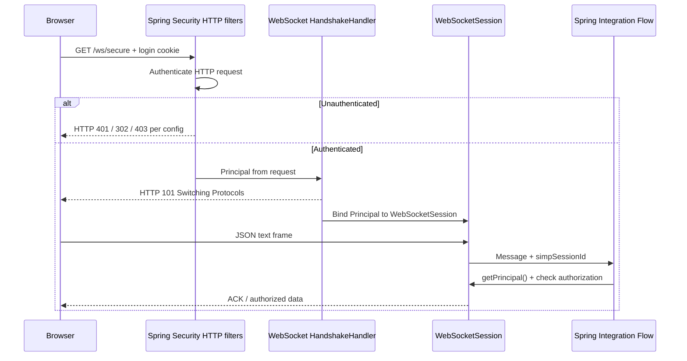
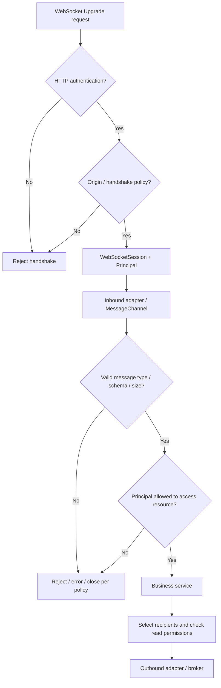
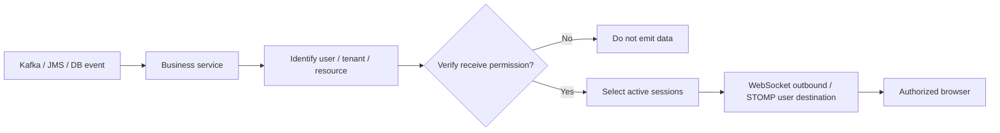

# User authentication over WebSocket

## 1. Objectives and context

In the **SPRING_INTEGRATION_ADAPTERS** module, external systems are connected to Spring Integration using inbound/outbound adapters, gateways, pollers, and `MessageChannel`. Data flows can come from files, SFTP, HTTP, JMS, AMQP, Kafka, or databases and then be delivered to browsers via WebSocket. When data involves users, orders, tenants, or devices, the key question is not merely *whether a message reaches the right session*, but **who owns that session and whether they are authorized to receive/process the message**.

The **User authentication over WebSocket** lesson belongs to the **Adapter WebSocket** chapter. You will learn how to establish identity when opening a connection, preserve security context while exchanging frames, enforce authorization per business operation, and revoke connections when login state or access permissions change.

After studying, you will be able to:

- Distinguish **authentication**, **authorization**, `Origin` checks, and verifying whether a WebSocket session is still active.
- Explain how Spring Security authenticates the **HTTP Upgrade handshake** and propagates `Principal` to `WebSocketSession`.
- Configure a `SecurityFilterChain` protecting WebSocket endpoints, restrict allowed origins, and preserve appropriate CSRF protection.
- Write a **Spring Integration raw WebSocket** flow using `WebSocketInboundChannelAdapter`, `MessageChannel`, and `WebSocketOutboundMessageHandler` to reply to the exact authenticated session.
- Read `Principal` from the **server-side session**, never trusting client-reported `userId`/`sessionId` in JSON.
- Understand limitations of the browser WebSocket API with HTTP Authorization headers and weigh cookie/session, STOMP `CONNECT`, JWT, or short-lived tickets.
- Use `@EnableWebSocketSecurity` and `AuthorizationManager<Message<?>>` to control STOMP `SEND`/`SUBSCRIBE`.
- Design handling for logout, expired tokens, reconnects, multiple tabs, multiple nodes, preventing Cross-Site WebSocket Hijacking, and security testing.

**Core point:** authentication answers "**who is connecting?**"; authorization answers "**what may they do, and on which resources?**". An authenticated WebSocket session is not automatically allowed to send every command or subscribe to every destination.

## 2. How does WebSocket use the HTTP handshake?

WebSocket begins as an HTTP request asking to upgrade the connection:

```http
GET /ws/secure HTTP/1.1
Host: localhost:8080
Upgrade: websocket
Connection: Upgrade
Sec-WebSocket-Key: ...
Sec-WebSocket-Version: 13
Origin: http://localhost:8080
Cookie: JSESSIONID=...
```

The `...` placeholders merely illustrate browser-generated values. If the handshake is accepted, the server returns HTTP `101 Switching Protocols` and both sides exchange WebSocket frames instead of ordinary HTTP requests/responses.

In **Spring WebSocket on the Servlet stack**, authentication established on the HTTP handshake request can be inherited by the WebSocket. When Spring Security processes the HTTP request:

1. The HTTP security filter chain authenticates cookies/sessions or credentials per configuration.
2. Spring Security supplies a trusted `Principal` on the authenticated request.
3. The Spring WebSocket handshake uses the request's `Principal` and binds it to `WebSocketSession`.
4. While receiving frames, services can access `session.getPrincipal()`.



**Do not misinterpret HTTP 101:** a successful handshake only proves the connection upgraded; **authorizing each individual request** inside the WebSocket flow remains the responsibility of the application/service.

## 3. Identifiers that must not be conflated

| Value | Source | What is it used for? |
| --- | --- | --- |
| `Principal` / `Authentication` | Server authentication system | Authenticated identity, optionally carrying authorities/roles |
| `WebSocketSession.getId()` | Server-side WebSocket session | Identifies **one current connection** |
| `simpSessionId` | Spring Messaging header attached by WebSocket/sub-protocol handler | Routes a Spring Message back to the exact session |
| HTTP `JSESSIONID` | HTTP session/cookie if used by the app | Supports HTTP login state; **not a WebSocket session ID** |
| `userId` in JSON | Client-sent, untrusted | Business field to verify against Principal |
| `tenantId` / `resourceId` | Payload or business context | Target object requiring access control |
| `eventId` / `correlationId` | Business contract | Correlates request–reply, ACKs, retries, deduplication |
| `MessageHeaders.ID` | Spring Messaging | Identifies a Spring Message, does not authenticate a user |

Example: user `alice` logs in and opens two tabs:

```text
Principal = alice
  ├── Tab A -> WebSocket session S1
  └── Tab B -> WebSocket session S2

Client sends JSON: {"userId":"admin","action":"read-private-order"}
```

The system **must not** treat the sender as `admin` simply because a JSON field says so. The sender remains `alice` per `WebSocketSession.getPrincipal()`; resources and actions must be authorized against that identity.

A client might also spoof `simpSessionId` inside JSON or custom headers. Reply routing must rely on the **session ID injected by server infrastructure**, never on strings taken from payloads.

## 4. Multiple security layers must work together



Each layer has its own responsibility:

- **HTTP authentication:** blocks unauthenticated clients before HTTP Upgrade.
- **Origin policy:** restricts which web pages may open WebSocket connections from browsers; does not replace authentication.
- **Message validation:** bounds event types, sizes, schemas, and send rates.
- **Message authorization:** verifies permissions on `resourceId`, tenant, subscriptions, and actions.
- **Outbound recipient authorization:** emits data only to authorized users/tenants/sessions.
- **Lifecycle/revocation:** terminates or restricts sessions when permissions are revoked, tokens expire, or users log out.

Never lock only the handshake and trust every subsequent message. A WebSocket can outlive an HTTP session or the permissions valid at connection time.

## 5. Choosing an appropriate authentication mechanism

| Approach | How identity enters the connection | When appropriate? | Security notes |
| --- | --- | --- | --- |
| **HTTP session/cookie** | Browser sends the app cookie on HTTP Upgrade | Web apps already logged in via Spring Security | Configure SameSite, Secure, Origin, and CSRF properly; does not automatically close WebSocket when HTTP session expires |
| **HTTP Bearer Authorization** | Non-browser client sends Authorization header on handshake | Java clients, mobile/native clients able to set headers | Validate JWT/token in HTTP security filter; use TLS |
| **STOMP CONNECT token** | WebSocket opens, client sends token in STOMP `CONNECT` native header | Frontends needing token-based STOMP without HTTP cookies | Must validate token in an inbound `ChannelInterceptor` and set authenticated user before message authorization |
| **Short-lived handshake ticket** | Authenticated HTTP endpoint issues a one-time ticket, client passes it on handshake | Browser raw WebSocket without cookies or needing scoped connection delegation | Short TTL, single-use, context-bound, unlogged, not a substitute for long-lived access tokens |
| **Long-lived token in URL query** | `ws://.../?token=...` | Generally **avoid** | Query strings can be logged, copied, or stored in browser/proxy histories |
| **Trusting `Origin` or JSON `userId`** | Relies on client-controlled data | **Not an authentication method** | Non-browser clients can spoof Origin; payloads do not prove identity |

**Browser limitation:** the standard `new WebSocket(url)` constructor has no parameter to set an arbitrary HTTP `Authorization: Bearer ...` header. Browsers can attach valid cookies for the URL according to browser rules. With STOMP, `connectHeaders` are **headers of the STOMP CONNECT frame**, not HTTP handshake headers.

In the main hands-on section, we choose **Spring Security form login + session cookie** for a complete flow on Spring Boot Servlet. Token/STOMP alternatives are presented later.

## 6. Hands-on: authenticating HTTP Upgrade with Spring Security

Example goals:

1. An unauthenticated client **cannot open** `/ws/secure`.
2. A logged-in client has a `Principal` on `WebSocketSession`.
3. The Integration Flow reads `status.query` messages and checks authorization on `resourceId`.
4. The flow sends replies only to **the session that sent the request**, never by self-declared user ID.
5. Attempting to access an unauthorized resource is rejected by the application without returning private data.

The example uses **Java 17+, Spring Boot 3.x, Spring Integration 6.x, Spring Security 6.x**, and Servlet WebSocket. Use compatible versions from the Spring Boot BOM.

### 6.1. Maven dependencies

```xml
<dependencies>
    <dependency>
        <groupId>org.springframework.boot</groupId>
        <artifactId>spring-boot-starter-web</artifactId>
    </dependency>
    <dependency>
        <groupId>org.springframework.boot</groupId>
        <artifactId>spring-boot-starter-security</artifactId>
    </dependency>
    <dependency>
        <groupId>org.springframework.boot</groupId>
        <artifactId>spring-boot-starter-integration</artifactId>
    </dependency>
    <dependency>
        <groupId>org.springframework.integration</groupId>
        <artifactId>spring-integration-websocket</artifactId>
    </dependency>
</dependencies>
```

In a sample app without a custom `UserDetailsService`, Spring Boot may create an **auto-generated development user** if no other authentication system exists; log in with username `user` and the password printed to the startup log. In real applications, replace this with an identity provider/user store and secure password policies. Never hardcode a demo password in production source code.

### 6.2. SecurityFilterChain protecting the endpoint

Create `HttpWebSocketSecurityConfiguration.java`:

```java
package com.example.securews;

import org.springframework.context.annotation.Bean;
import org.springframework.context.annotation.Configuration;
import org.springframework.security.config.Customizer;
import org.springframework.security.config.annotation.web.builders.HttpSecurity;
import org.springframework.security.config.annotation.web.configuration.EnableWebSecurity;
import org.springframework.security.web.SecurityFilterChain;

@Configuration
@EnableWebSecurity
public class HttpWebSocketSecurityConfiguration {

    @Bean
    SecurityFilterChain securityFilterChain(
            HttpSecurity http) throws Exception {

        http
            .authorizeHttpRequests(auth -> auth
                .requestMatchers("/login", "/error").permitAll()
                .requestMatchers("/ws/secure").authenticated()
                .anyRequest().authenticated())
            .formLogin(Customizer.withDefaults());

        // Do not disable CSRF globally. Spring Security protects
        // state-changing HTTP methods by default.
        return http.build();
    }
}
```

Meaning:

- `/ws/secure` is protected by the **HTTP filter chain** before upgrading the connection.
- `/login` is public so users can log in.
- `anyRequest().authenticated()` avoids accidentally exposing unlisted HTTP APIs; real applications should define tighter matchers.
- `formLogin` provides cookie/session login in this example.
- CSRF for HTTP requests remains enabled by default; you should not call `csrf.disable()` just because WebSocket is used.

An unauthenticated client may receive an HTTP `302` redirect to the login page or another rejection response depending on configuration. **The browser WebSocket API does not reliably expose HTTP status codes via `onerror`**; inspect server/security logs or the browser network tab when diagnosing.

### 6.3. Resource read authorization rule

The simple example has one readable resource category: public resources prefixed with `public-`. Even when logged in, clients cannot read other resources.

Create `ReadAccessPolicy.java`:

```java
package com.example.securews;

import java.security.Principal;
import org.springframework.stereotype.Component;

@Component
public class ReadAccessPolicy {

    public boolean canRead(
            Principal principal, String resourceId) {

        // DEMO policy only: authenticated users may read
        // public-*; all other resources are denied.
        return principal != null
                && resourceId != null
                && resourceId.startsWith("public-");
    }
}
```

This is an **illustrative rule**, not a tenant/order authorization system. In production, `canRead(...)` must rely on the **server-authenticated identity** and permissions from DB/ACL/tenant membership, reflecting up-to-date revocation state where required.

### 6.4. Configuring the Spring Integration WebSocket adapter

Create `SecureWebSocketIntegrationConfiguration.java`:

```java
package com.example.securews;

import java.security.Principal;
import com.fasterxml.jackson.core.JsonProcessingException;
import com.fasterxml.jackson.databind.JsonNode;
import com.fasterxml.jackson.databind.ObjectMapper;
import org.springframework.beans.factory.annotation.Qualifier;
import org.springframework.context.annotation.Bean;
import org.springframework.context.annotation.Configuration;
import org.springframework.integration.annotation.ServiceActivator;
import org.springframework.integration.channel.DirectChannel;
import org.springframework.integration.config.EnableIntegration;
import org.springframework.integration.websocket.ServerWebSocketContainer;
import org.springframework.integration.websocket.inbound.WebSocketInboundChannelAdapter;
import org.springframework.integration.websocket.outbound.WebSocketOutboundMessageHandler;
import org.springframework.messaging.MessageChannel;
import org.springframework.messaging.MessageHandler;
import org.springframework.messaging.MessagingException;
import org.springframework.messaging.simp.SimpMessageHeaderAccessor;
import org.springframework.messaging.support.MessageBuilder;
import org.springframework.web.socket.WebSocketSession;

@Configuration
@EnableIntegration
public class SecureWebSocketIntegrationConfiguration {

    @Bean
    public ServerWebSocketContainer secureWebSocketContainer() {
        ServerWebSocketContainer container =
                new ServerWebSocketContainer("/ws/secure");

        // Only allow browsers from the demo app's origin.
        // Production: replace with exact permitted HTTPS origins.
        container.setAllowedOrigins("http://localhost:8080");
        return container;
    }

    @Bean
    public MessageChannel secureInboundChannel() {
        return new DirectChannel();
    }

    @Bean
    public MessageChannel secureOutboundChannel() {
        return new DirectChannel();
    }

    @Bean
    public WebSocketInboundChannelAdapter secureInbound(
            ServerWebSocketContainer secureWebSocketContainer,
            @Qualifier("secureInboundChannel") MessageChannel input) {

        WebSocketInboundChannelAdapter inbound =
                new WebSocketInboundChannelAdapter(
                        secureWebSocketContainer);

        inbound.setPayloadType(String.class);
        inbound.setOutputChannel(input);
        return inbound;
    }

    @Bean
    @ServiceActivator(inputChannel = "secureInboundChannel")
    public MessageHandler authenticatedQueryHandler(
            ServerWebSocketContainer secureWebSocketContainer,
            @Qualifier("secureOutboundChannel") MessageChannel replies,
            ReadAccessPolicy accessPolicy,
            ObjectMapper mapper) {

        return incoming -> {

            // Retrieve the session ID attached by Spring infrastructure.
            String sessionId = SimpMessageHeaderAccessor
                    .getSessionId(incoming.getHeaders());

            if (sessionId == null) {
                throw new MessagingException(
                        incoming, "Missing WebSocket session ID");
            }

            WebSocketSession session =
                    secureWebSocketContainer.getSession(sessionId);

            if (session == null || !session.isOpen()) {
                throw new MessagingException(
                        incoming, "WebSocket session is no longer open");
            }

            // Principal originates from the authenticated HTTP handshake.
            // Do not read userId from JSON to decide identity.
            Principal principal = session.getPrincipal();

            if (principal == null) {
                throw new MessagingException(
                        incoming, "Unauthenticated WebSocket session");
            }

            if (!(incoming.getPayload() instanceof String json)) {
                throw new MessagingException(
                        incoming, "Only raw text JSON is supported");
            }

            final JsonNode request;
            try {
                request = mapper.readTree(json);
            } catch (JsonProcessingException ex) {
                throw new MessagingException(
                        incoming, "Invalid JSON", ex);
            }

            if (request == null || !request.isObject()) {
                throw new MessagingException(
                        incoming, "Payload must be a JSON object");
            }

            String type = request.path("type").asText("");
            String requestId = request.path("requestId").asText("");
            String resourceId = request.path("resourceId").asText("");

            if (!"status.query".equals(type)
                    || requestId.isBlank()
                    || requestId.length() > 80
                    || resourceId.isBlank()
                    || resourceId.length() > 100) {
                throw new MessagingException(
                        incoming, "Invalid request contract");
            }

            if (!accessPolicy.canRead(principal, resourceId)) {
                // Reject before reading sensitive resources.
                throw new MessagingException(
                        incoming, "Not authorized to read resource");
            }

            // Demo assumes public-* resources have status READY.
            // Production: read from an authorized business service.
            String replyJson = mapper.createObjectNode()
                    .put("type", "status.reply")
                    .put("requestId", requestId)
                    .put("resourceId", resourceId)
                    .put("status", "READY")
                    .toString();

            boolean accepted = replies.send(
                    MessageBuilder.withPayload(replyJson)
                            .setHeader(
                                    SimpMessageHeaderAccessor
                                            .SESSION_ID_HEADER,
                                    sessionId)
                            .build());

            if (!accepted) {
                throw new MessagingException(
                        incoming, "Reply channel did not accept message");
            }
        };
    }

    @Bean
    @ServiceActivator(inputChannel = "secureOutboundChannel")
    public MessageHandler secureOutbound(
            ServerWebSocketContainer secureWebSocketContainer) {
        return new WebSocketOutboundMessageHandler(
                secureWebSocketContainer);
    }
}
```

### 6.5. Explaining the flow's security contract

**Point 1 — single registry:** inbound and outbound share **the same** `ServerWebSocketContainer`. Creating another container can prevent outbound from finding an existing `sessionId`.

**Point 2 — identity source:** `Principal` comes from `session.getPrincipal()` after the HTTP handshake. Never use client-declared `{"userId":"admin"}`.

**Point 3 — routing header:** `SimpMessageHeaderAccessor.SESSION_ID_HEADER` (commonly `simpSessionId`) selects the request's session. It is **not an access permission**; a message with a valid session ID still requires authentication/data authorization.

**Point 4 — resource authorization:** `ReadAccessPolicy.canRead(...)` runs **before** reading data to return. Never check only that a user is logged in and then allow querying any `resourceId`.

**Point 5 — error semantics:** exceptions in `ServiceActivator` are handled by Spring Integration's message flow/error channel mechanism; they do **not automatically** turn into client-side JSON error frames. A real application must design safe error responses, timeouts, and separate transport error handling.

**Point 6 — concurrency:** a session can close right after `isOpen()` returns `true`; catch and monitor outbound errors. `MessageChannel.send(...)` succeeding does not guarantee the browser received and processed it.

**Point 7 — hardening:** add rate limiting, JSON payload limits, strict schema validation, monitoring, and a policy to close sessions if clients send repeated unauthorized requests.

### 6.6. Testing from an authenticated browser

Start the application on `localhost:8080`. Visit `http://localhost:8080/login` and sign in using the development account generated by Spring Boot (if no identity provider is configured). After logging in, on a **same-origin** page run:

```javascript
const scheme = location.protocol === "https:" ? "wss:" : "ws:";
const socket = new WebSocket(
  scheme + "//" + location.host + "/ws/secure"
);

socket.addEventListener("open", () => {
  socket.send(JSON.stringify({
    type: "status.query",
    requestId: "rq-101",
    resourceId: "public-42",
    userId: "admin" // Spoofed field: server does not use this for auth!
  }));
});

socket.addEventListener("message", (event) => {
  console.log("Server reply:", JSON.parse(event.data));
});

socket.addEventListener("close", (event) => {
  console.log("Closed:", event.code, event.reason);
});

socket.addEventListener("error", () => {
  console.log("Handshake or transport error");
});
```

With an authenticated session, sample response:

```json
{
  "type": "status.reply",
  "requestId": "rq-101",
  "resourceId": "public-42",
  "status": "READY"
}
```

The `userId:"admin"` field tests anti-spoofing: the service **ignores** it and continues using the logged-in session's `Principal`.

To test authorization failure, send while the socket is open:

```javascript
socket.send(JSON.stringify({
  type: "status.query",
  requestId: "rq-102",
  resourceId: "private-42"
}));
```

`ReadAccessPolicy` rejects the request. Do not assume the client always receives a JSON error or that the connection closes automatically when code throws `MessagingException`; the outcome depends on Integration Flow error handling. In testing, inspect logs/metrics and confirm no `status.reply` leaks private information.

To test an **unauthenticated handshake**, open an unauthenticated private/incognito window on the same origin. Connecting to `/ws/secure` must fail at the HTTP security layer. To test **Origin**, open a page from a different origin and initiate a WebSocket to the server; the container's allowlist must reject browser origins outside the configuration.

## 7. Cookies, Origin, and Cross-Site WebSocket Hijacking

### 7.1. Browser WebSockets differ from fetch/XHR

Browsers normally enforce the Same-Origin Policy on `fetch`/XHR, but **do not automatically block all cross-origin WebSocket connections**. When a login session cookie is present, an attacker-controlled page can attempt to open a WebSocket to another application. If the server does not verify Origin and enforce authentication/CSRF properly, the application faces **Cross-Site WebSocket Hijacking (CSWSH)**.

Therefore:

- Use `ServerWebSocketContainer.setAllowedOrigins(...)` with **exact origins**, or retain the default same-origin policy where appropriate.
- Never configure `setAllowedOrigins("*")` on cookie-authenticated endpoints holding private data unless a thoroughly reviewed alternative protection is in place.
- Configure `Secure`, `HttpOnly`, and `SameSite` cookie attributes to match your login and cross-site architecture.
- Enforce TLS `wss://` in environments outside localhost.
- Enforce authentication and authorization on both handshake and messages, not Origin alone.

**Origin is not proof of identity:** non-browser clients can set any `Origin` header manually. Allowlists block unauthorized requests from **browsers**, while identity must still come from Spring Security / valid credentials.

### 7.2. CSRF with raw WebSocket and STOMP

For raw WebSocket:

- HTTP Upgrade is typically a `GET` request; standard CSRF filters for unsafe HTTP methods are not the sole protection for WebSocket.
- Origin allowlists and cookie policies play a crucial role.
- **Do not disable CSRF globally** just to let handshakes pass.
- Individual commands inside WebSocket still need server-side authorization, rate limits, and payload limits.

For STOMP over WebSocket:

- Spring Security messaging can require a **CSRF token in STOMP `CONNECT`** for same-origin protection.
- The token travels in **STOMP native headers**, rather than turning into an HTTP Authorization header.
- Only configure HTTP-layer CSRF exceptions for specific SockJS transports when genuinely required and compensated by proper protections; never blanket-disable.

### 7.3. CORS is not message protection

CORS for HTTP, allowed origins for WebSocket handshakes, and message authorization are distinct layers. A valid CORS configuration does not stop an already-connected client from sending a `delete-account` command; services must still verify commands/actions and resource permissions.

## 8. STOMP over WebSocket: authorizing SEND and SUBSCRIBE

Spring Integration can use raw WebSocket adapters. When an application uses **STOMP over WebSocket** with `@EnableWebSocketMessageBroker`, security must also cover the **Spring Messaging inbound channel**.

| Stage | Checks needed |
| --- | --- |
| HTTP handshake | Is the client allowed to open `/ws-stomp`? |
| STOMP `CONNECT` | Valid CSRF? If using token-based CONNECT, is the token verified? |
| `SEND /app/...` | Does the user have the required role and business permission? |
| `SUBSCRIBE /user/...` | Is the user allowed to subscribe to the user-specific destination? |
| `SUBSCRIBE /topic/...` | Is the user allowed to view that topic's data for the right tenant/resource? |
| Server outbound `MESSAGE` | Emit only data subscribers are allowed to see; Spring Security primarily guards the inbound channel |

**Note:** `@EnableWebSocketSecurity` protects **Spring Messaging/STOMP inbound**, not as a direct substitute for authorization inside a raw `WebSocketInboundChannelAdapter`. Do not add that annotation and assume raw WebSocket payloads automatically inherit `/app`/`/topic` rules.

### 8.1. Configuring STOMP endpoint and broker

This is **an alternative** to the `/ws/secure` raw endpoint in section 6:

```java
package com.example.securestomp;

import org.springframework.context.annotation.Configuration;
import org.springframework.messaging.simp.config.MessageBrokerRegistry;
import org.springframework.web.socket.config.annotation.EnableWebSocketMessageBroker;
import org.springframework.web.socket.config.annotation.StompEndpointRegistry;
import org.springframework.web.socket.config.annotation.WebSocketMessageBrokerConfigurer;

@Configuration
@EnableWebSocketMessageBroker
public class StompEndpointConfiguration
        implements WebSocketMessageBrokerConfigurer {

    @Override
    public void registerStompEndpoints(StompEndpointRegistry registry) {
        registry.addEndpoint("/ws-stomp");
    }

    @Override
    public void configureMessageBroker(MessageBrokerRegistry registry) {
        registry.setApplicationDestinationPrefixes("/app");
        registry.enableSimpleBroker("/topic", "/queue");
        registry.setUserDestinationPrefix("/user");
    }
}
```

`/ws-stomp` is the **handshake URL**; `/app/...` and `/topic/...` are STOMP destinations. When using an external STOMP broker, you can configure `enableStompBrokerRelay(...)`; a broker relay does not eliminate the application's authentication/authorization responsibilities.

### 8.2. Spring Security rules for inbound STOMP

This part requires the `spring-security-messaging` dependency (version managed by the Spring Boot BOM), alongside `spring-boot-starter-security`:

```xml
<dependency>
    <groupId>org.springframework.security</groupId>
    <artifactId>spring-security-messaging</artifactId>
</dependency>
```

Create `StompAuthorizationConfiguration.java`:

```java
package com.example.securestomp;

import static org.springframework.messaging.simp.SimpMessageType.MESSAGE;
import static org.springframework.messaging.simp.SimpMessageType.SUBSCRIBE;

import org.springframework.context.annotation.Bean;
import org.springframework.context.annotation.Configuration;
import org.springframework.messaging.Message;
import org.springframework.security.authorization.AuthorizationManager;
import org.springframework.security.config.annotation.web.socket.EnableWebSocketSecurity;
import org.springframework.security.messaging.access.intercept.MessageMatcherDelegatingAuthorizationManager;

@Configuration
@EnableWebSocketSecurity
public class StompAuthorizationConfiguration {

    @Bean
    AuthorizationManager<Message<?>> messageAuthorizationManager(
            MessageMatcherDelegatingAuthorizationManager.Builder messages) {

        messages
            .nullDestMatcher().authenticated()
            .simpDestMatchers("/app/**").hasRole("USER")
            .simpSubscribeDestMatchers("/user/queue/**").hasRole("USER")
            .simpSubscribeDestMatchers("/topic/public/**").hasRole("USER")
            .simpTypeMatchers(MESSAGE, SUBSCRIBE).denyAll()
            .anyMessage().denyAll();

        return messages.build();
    }
}
```

Meaning:

1. Inbound messages without a destination (e.g., `CONNECT`) require an authenticated principal.
2. Only users with role `USER` may send to `/app/**`.
3. Only the listed user/public destinations may be subscribed to.
4. Remaining `MESSAGE` or `SUBSCRIBE` frames are rejected under **deny by default**.
5. Spring Security WebSocket message configuration also enforces a CSRF policy on STOMP `CONNECT`; clients must supply the appropriate token when using this configuration.

**Do not treat roles as per-resource authorization:** `hasRole("USER")` does not know whether a specific `orderId` or `tenantId` belongs to that user. Controllers/services handling `@MessageMapping` must still check data ownership. For tenant-specific topics, enforce finer authorization rules before `SUBSCRIBE` or design user destinations to avoid cross-tenant leaks.

### 8.3. STOMP client sending CSRF token in CONNECT

If the app uses HTTP sessions and Spring Security WebSocket message security, you can expose a same-origin REST endpoint to retrieve the CSRF token. Illustrative example:

```java
import org.springframework.security.web.csrf.CsrfToken;
import org.springframework.web.bind.annotation.GetMapping;
import org.springframework.web.bind.annotation.RestController;

@RestController
public class CsrfTokenController {

    @GetMapping("/csrf")
    public CsrfToken csrf(CsrfToken token) {
        return token;
    }
}
```

The `/csrf` endpoint must be restricted per security policy; with `anyRequest().authenticated()` in the earlier example, only logged-in users can access it. Never open CORS arbitrarily on this endpoint.

Frontend STOMP.js can send the token via `connectHeaders`:

```javascript
import { Client } from "@stomp/stompjs";

const response = await fetch("/csrf", {
  credentials: "same-origin"
});
if (!response.ok) {
  throw new Error("Cannot obtain CSRF token");
}

const csrf = await response.json();

const client = new Client({
  brokerURL: "ws://localhost:8080/ws-stomp",
  connectHeaders: {
    [csrf.headerName]: csrf.token
  },
  reconnectDelay: 3000,

  onConnect: () => {
    client.subscribe("/user/queue/acks", msg => {
      console.log("ACK:", JSON.parse(msg.body));
    });
  }
});

client.activate();
```

Here the CSRF header is sent inside the **STOMP CONNECT frame**. If the system needs to refresh the CSRF token after login/logout/reconnect, design token retrieval accordingly and never assume a token stays valid forever.

## 9. Token/JWT when browsers cannot send arbitrary HTTP Authorization headers

Spring Framework does not mandate one single authentication method during the WebSocket handshake. With **native Java/mobile clients**, you can usually send a Bearer header in the HTTP handshake and let Spring Security Resource Server validate it just like an HTTP API.

With **native browser WebSocket**, there are several options:

### 9.1. Cookie/session via HTTP handshake

This is usually convenient when frontend and backend share the same site and already authenticate through Spring Security. Cookies are sent by the browser per its rules; `Principal` attaches to the WebSocket session. Protect against CSWSH using proper Origin and cookie policies.

### 9.2. STOMP CONNECT carrying a Bearer token

STOMP.js can place a token in native headers:

```javascript
const client = new Client({
  brokerURL: "wss://app.example.com/ws-stomp",
  connectHeaders: {
    Authorization: "Bearer " + accessToken
  }
});
```

**This header does not authenticate the user by itself.** The server must register a `ChannelInterceptor` on `clientInboundChannel` that reads the token on `CONNECT`, verifies signature/issuer/audience/expiration/permissions, and calls `StompHeaderAccessor.setUser(authenticatedAuthentication)`. Spring Messaging binds that user to the session for subsequent STOMP messages. When combined with Spring Security message authorization, the authentication interceptor must be registered **before** the security interceptor; Spring Framework documents using a separate `WebSocketMessageBrokerConfigurer` annotated with `@Order(Ordered.HIGHEST_PRECEDENCE + 99)` when needed.

A sketch for `CONNECT` handling, **not a complete JWT verifier**:

```java
StompHeaderAccessor accessor =
        MessageHeaderAccessor.getAccessor(
                message, StompHeaderAccessor.class);

if (accessor != null
        && StompCommand.CONNECT.equals(accessor.getCommand())) {

    String header = accessor.getFirstNativeHeader("Authorization");

    // tokenVerifier is an application service that must fully verify the JWT.
    // If the header is invalid: reject CONNECT, do not set an anonymous user.
    Authentication authenticated =
            tokenVerifier.authenticateBearer(header);

    accessor.setUser(authenticated);
}
```

This illustrative snippet assumes Spring Messaging/Spring Security imports and `tokenVerifier` are declared. Only the pattern is shown because **a mock JWT validator or skipped signature check** creates a critical vulnerability. Never extract username/roles by decoding a JWT payload without verifying the token.

Make explicit decisions if a system simultaneously uses cookie-based authentication and STOMP token authentication: how principals combine, CSRF, precedence, token rotation, and permission checks must be consistent so one mechanism never silently overrides another.

### 9.3. Short-lived one-time handshake ticket

When raw browser WebSocket cannot use cookies, you can design:

1. Frontend sends an authenticated HTTPS request to an endpoint issuing a **single-use, short-lived ticket**.
2. Server binds the ticket to the user, intended endpoint, expiration time, and nonce; stores state to prevent reuse.
3. Browser opens the WebSocket with the ticket, e.g., as a query parameter.
4. `HandshakeInterceptor` verifies the ticket **before accepting the Upgrade**, enforcing single-use consumption.
5. `HandshakeHandler` or an appropriate identity mechanism sets a trusted `Principal` on the session; an interceptor setting session attributes alone **does not automatically become `Principal`**.
6. Application avoids logging the ticket in URLs and invalidates tickets immediately upon use or timeout.

**Never pass long-lived access tokens in query strings**. Even a ticket in a URL carries logging risk; systems must minimize exposure via short TTLs, single use, no caching, and log redaction.

## 10. Maintaining and revoking permissions in a long-lived connection

### 10.1. Handshake Principal does not auto-refresh

Suppose user `alice` opens a WebSocket at 10:00. At 10:10 her account is locked or access to an order is revoked, yet the connection remains open. `session.getPrincipal()` may still reflect the initial handshake identity. Therefore:

- For sensitive data, **check permissions when processing each command** or using an appropriately versioned/invalidated cache.
- If roles/tokens can change, define a strategy to refresh/revalidate or close the session upon revocation.
- Never treat `isOpen() == true` or valid heartbeat pongs as proof the user still holds access rights.
- When a user logs out, invalidate both login credentials/sessions **and** WebSocket sessions that must be terminated.

### 10.2. HTTP logout does not always close WebSockets

HTTP session expiration or logout does not automatically guarantee all WebSocket sessions associated with that user close immediately across all configurations. You may need to:

- Register appropriate session binding/lifecycle integration between HTTP sessions and WebSocket handshakes.
- Maintain a server-side mapping `authenticatedUserId → Set<webSocketSessionId>`.
- On logout/revocation, close WebSocket sessions within policy scope.
- Update the authorization backend to reject new messages **even before the close handshake completes**.
- In a cluster, broadcast revocation events to nodes owning sessions or use a reliable distributed mechanism.

Example service closing a session chosen by trusted server logic:

```java
import java.io.IOException;
import org.springframework.integration.websocket.ServerWebSocketContainer;
import org.springframework.web.socket.CloseStatus;
import org.springframework.web.socket.WebSocketSession;

public void revokeSession(
        ServerWebSocketContainer container, String sessionId)
        throws IOException {

    WebSocketSession session = container.getSession(sessionId);
    if (session != null && session.isOpen()) {
        session.close(CloseStatus.POLICY_VIOLATION);
    }
}
```

`CloseStatus.POLICY_VIOLATION` (1008) can be used when the server closes a connection for policy breaches, but **a close code is not an authorization control**. Before or alongside closing, services must stop permitting unauthorized reads/sends.

### 10.3. Reconnect and multiple tabs

One user can hold multiple sessions:

```text
alice
  ├── Chrome tab A: session A1
  ├── Chrome tab B: session B1
  └── Mobile app:   session M1
```

Closing only A1 may leave B1/M1 open per policy. When logging out of **all devices**, identify and revoke all associated sessions/tokens, not just one WebSocket ID.

On reconnect, WebSocket creates a **new session ID**. Never reuse the old session ID, never restore identity from client payloads, and never forward pending user messages before re-verifying permissions.

## 11. Handling user destinations, subscriptions, and multi-tenant data

When publishing events from Kafka/JMS/AMQP/DB to WebSocket, incoming events usually lack `simpSessionId` because they **did not originate from a WebSocket client**. The server must identify **valid recipients** and route to open sessions.



For example, order data `ORD-42` may belong to tenant `T-7`. Never publish the raw payload to a shared `/topic/all-orders` topic if users outside T-7 can subscribe.

Two common approaches:

- **Raw WebSocket:** the application maintains a user → authenticated-Principal sessions mapping, filters permissions, and sends individual messages with `simpSessionId`.
- **STOMP:** use `/user/queue/...` or permission-restricted destinations, enforcing `SUBSCRIBE` and resource authorization.

**Spring Security WebSocket message authorization mainly inspects `clientInboundChannel`; it does not automatically filter every outbound message.** Therefore, publisher/service authorization and subscription authorization are essential parts of the design.

## 12. Considerations for multi-node deployments and proxies

| Issue | Risk | Mitigation principle |
| --- | --- | --- |
| TLS termination at reverse proxy | Wrong scheme/Origin, non-`Secure` cookies sent | Configure trusted proxy headers, HTTPS/WSS, and exact allowed origins |
| Load balancer routes reconnect to another node | New session absent from old node's registry | Register new Principal/session, route to the owning node |
| Distributed HTTP session store | Login is shared yet WebSocket sessions remain node-local | Separate identity store from WebSocket session registry |
| Token/role revocation across multiple nodes | Another node still holds sessions and keeps sending | Broadcast revoke events, check permissions in services, close matching sessions |
| One user with multiple tabs | Deleting entire user when one tab disconnects | Remove by exact session ID, use `Set<sessionId>` |
| STOMP broker relay | Broad broker subscriptions, sensitive topic exposed | Block unauthorized `SUBSCRIBE`/`SEND`; do not expect broker to enforce tenant ACLs automatically |
| Cross-origin | Foreign browser page tries opening WebSocket with cookies | Origin allowlist + auth/CSRF/cookie policies |

**Do not assume cluster-wide sessions:** `ServerWebSocketContainer.getSession(sessionId)` only looks up sessions local to that container. A user authenticated on node B does not cause messages to reach a WebSocket session living on node A without appropriate routing or a broker.

## 13. Testing authentication and authorization

### 13.1. Test matrix

| Scenario | Expected result |
| --- | --- |
| Unauthenticated browser opens `/ws/secure` | HTTP handshake rejected/redirected per config |
| Authenticated browser opens `/ws/secure` | Connection upgrades, session carries a trusted Principal |
| Browser from disallowed origin | Rejected by Origin/handshake policy |
| Request contains spoofed `userId:"admin"` | Does not alter identity used by server |
| Logged-in user reads `public-42` | Passes demo policy, receives `status.reply` |
| Logged-in user reads `private-42` | Rejected, no private data leaked |
| Two tabs for one user | Two distinct WebSocket sessions; reply goes only to requesting session |
| Message sent after session closed | Not counted as delivered; cleanup handled |
| HTTP logout/revoke while WebSocket open | Unauthorized access blocked immediately; session closed per policy |
| Token expires while connection open | Handled per revalidation/close strategy; not assumed still authorized |
| STOMP CONNECT missing CSRF | Rejected when Spring Security WebSocket message security is active |
| STOMP subscribe to unauthorized topic | Rejected; receives no messages from that topic |
| STOMP client spoofs username in payload | Principal/authorization unchanged |
| Node crashes and client reconnects elsewhere | New session re-authenticated; stale mapping reclaimed |

### 13.2. Unit testing business rules

`ReadAccessPolicy` is decoupled from WebSocket and can be unit-tested directly:

```java
import static org.junit.jupiter.api.Assertions.*;
import org.junit.jupiter.api.Test;

class ReadAccessPolicyTest {

    private final ReadAccessPolicy policy = new ReadAccessPolicy();

    @Test
    void loggedInUserCanReadPublicResource() {
        assertTrue(policy.canRead(
                () -> "alice", "public-42"));
    }

    @Test
    void cannotReadPrivateResource() {
        assertFalse(policy.canRead(
                () -> "alice", "private-42"));
    }

    @Test
    void noPrincipalCannotRead() {
        assertFalse(policy.canRead(null, "public-42"));
    }
}
```

This unit test covers the **demo policy**; it does not prove the real system authenticates handshakes properly. With Spring Security, add integration tests covering the HTTP handshake, principal propagation, per-message authorization, session revocation, and Spring Messaging/STOMP rules.

### 13.3. Integration tests to run

1. Use a real WebSocket client with and without login HTTP cookies.
2. Verify the HTTP security filter chain rejects handshakes from anonymous users.
3. Verify server-side `WebSocketSession.getPrincipal()` is non-null for logged-in users.
4. Send spoofed JSON `userId`, `tenantId`, and `sessionId`; confirm server authorization cannot be bypassed.
5. Open two sessions; verify replies go only to the session that issued the request.
6. Send invalid commands, oversized payloads, and high-frequency requests.
7. Test a different Origin; verify browser policy and a non-browser client setting a custom Origin.
8. If using STOMP, test `CONNECT` without CSRF and `SUBSCRIBE` to forbidden destinations.
9. Log out or revoke permissions mid-stream; confirm no further data leaks.
10. Test multiple nodes, reconnects, and stale mapping cleanup.

**Important:** a successful `MessageChannel.send(...)` call does not prove the client received or processed a message. Delivery guarantees still require `eventId`, ACKs, retries, and idempotency if required by the business; do not confuse this with authentication.

## 14. Common issues and remediation

| Symptom | Causes to inspect | Remediation |
| --- | --- | --- |
| WebSocket handshake rejected even after login | Cookie not sent, wrong path/domain/SameSite | Inspect request cookies, HTTP session, and security filters |
| Handshake returns redirect to `/login` | Anonymous user blocked | Log in first, verify auth configuration |
| Browser fails when opened from another domain | Origin not in allowlist | Add only trusted origins; never enable `*` unconditionally |
| Browser hits error without seeing HTTP 401/403 | WebSocket JS does not expose HTTP handshake details | Check Network tab/security logs instead of relying on `onerror` |
| `session.getPrincipal() == null` | Unauthenticated handshake or principal not bound | Check HTTP security and handshake handler |
| Spoofed `userId` in JSON grants permissions | Service trusted payload instead of Principal | Use server Principal + per-resource authorization |
| User reads another tenant's orders | Checked only `authenticated()`, missing ACL checks | Add order/tenant authorization rules |
| STOMP `CONNECT` rejected | Missing CSRF, invalid token, or wrong interceptor order | Check CSRF connect headers, token validation, and precedence |
| STOMP subscriber misses events | Wrong `SUBSCRIBE` rule, user destination, or broker route | Check authorization and subscription path |
| STOMP bearer header has no effect | Header is in STOMP CONNECT, not HTTP handshake | Validate in `ChannelInterceptor` and bind Principal |
| WebSocket stays OPEN after logout | HTTP logout does not auto-close all WebSocket sessions | Revoke permissions and close sessions deliberately |
| User receives ACK in wrong tab | Wrong `simpSessionId` or used user ID as session ID | Use infrastructure ID and proper local registry |
| Cluster keeps sending to old session | Reconnected on another node, stale mapping | Route by new node/session; use TTL/reconciliation |
| Exploited even with CORS configured | CORS/Origin does not replace auth and message ACLs | Enforce layered authentication, authorization, and rate limits |

### Diagnostic checklist

1. Does HTTP Upgrade pass through the `SecurityFilterChain` with the right matcher?
2. Which cookies/credentials does the browser send, and does HTTP security consider the user authenticated?
3. Is `Origin` in the allowlist, and does any proxy alter scheme/host?
4. What is `WebSocketSession.getPrincipal()`, and which trusted source populated it?
5. Does the Spring Message carry the infrastructure-assigned `simpSessionId` rather than one taken from JSON?
6. Does the application check `resourceId`/`tenantId`/action against the Principal?
7. If using STOMP, does `CONNECT` carry a valid CSRF token or properly verified token auth?
8. Are `SEND`/`SUBSCRIBE` gated by explicit rules with a `denyAll` fallback?
9. On logout/revocation/reconnect, are sessions and permission caches updated?
10. Does the outbound publisher check **recipient permissions** before emitting data?

## 15. Practice exercises

### Exercise A — principal never comes from payload

Open a WebSocket logged in as `alice` and send JSON with `userId:"admin"` or `role:"ADMIN"`. Prove the backend still uses `session.getPrincipal()` and never grants privileges beyond its ACL.

### Exercise B — testing HTTP handshake and origin

Configure `SecurityFilterChain` allowing anonymous access only to `/login`. Test WebSocket from an unauthenticated browser, an authenticated browser, and a cross-origin page. Explain the differences among `401`, `302`, `403`, Origin, and CSRF.

### Exercise C — per-resource authorization

Replace the demo `ReadAccessPolicy` with one accepting `Principal` and `resourceId` backed by a DB/ACL service; allow `alice` to read `ORD-42` but not `ORD-43`. Write unit and integration tests proving unauthorized users never receive order details.

### Exercise D — STOMP SEND/SUBSCRIBE

Create a STOMP endpoint with `@EnableWebSocketSecurity`. Allow `SEND /app/orders/**` only for the required role, and `SUBSCRIBE /user/queue/**` for authenticated users. Block `SUBSCRIBE /topic/admin/**`. Demonstrate that Spring Security message rules do not replace service-layer authorization.

### Exercise E — JWT and browser WebSockets

Compare cookie handshakes, STOMP `CONNECT` Bearer headers, and one-time handshake tickets. Point out which option allows browser native `WebSocket` to set custom HTTP headers (none), which requires a `ChannelInterceptor`, and measures to reduce risk when tokens appear in URLs.

### Exercise F — logout, reconnect, and clustering

A user opens two tabs on node A and one device on node B. When permissions are revoked, design a workflow to block new requests, broadcast a revoke event, close selected sessions, clean up mappings, and re-authenticate on reconnect. Explain how to avoid accidentally deleting a new session if an old close callback arrives late.

**Completion criteria:** distinguish handshake authentication, per-message authorization, origin/CSRF, and outbound emission permissions; prove client payloads are never trusted as identity; and handle permission changes while a WebSocket remains open.

## 16. Key takeaways

- WebSocket begins with an **HTTP Upgrade**, so HTTP authentication can supply `Principal` to the WebSocket session on the Spring Servlet stack.
- `Principal`/`Authentication` establishes identity; `simpSessionId` identifies **the current connection**, not access rights.
- Browser native WebSocket does not permit setting arbitrary HTTP Authorization headers. Cookies/sessions, STOMP token CONNECT, and one-time tickets are options with distinct trade-offs.
- **Never trust** client-supplied `userId`, `role`, `tenantId`, or `sessionId` to grant permissions.
- Spring Integration raw WebSocket needs authorization inside services/flows; `@EnableWebSocketSecurity` primarily serves **Spring Messaging/STOMP inbound**.
- STOMP `SEND` and `SUBSCRIBE` must both be protected; role-only rules do not replace per-resource checks.
- **Origin allowlists, SameSite/cookie policies, and CSRF** protect different surfaces; they complement rather than replace authentication/authorization.
- Logout or token expiration does not guarantee WebSockets close immediately; design revalidation, revocation, and session cleanup strategies.
- Multi-node servers must separate the identity store, local WebSocket session registries, and recipient routing.
- Successfully sending a Spring Message is not a business ACK; `eventId` and separate delivery contracts are still required where needed.

## References

- [Spring Security Reference — WebSocket Security](https://docs.spring.io/spring-security/reference/6.5/servlet/integrations/websocket.html)
- [Spring Framework Reference — WebSocket Token Authentication](https://docs.spring.io/spring-framework/reference/web/websocket/stomp/authentication-token-based.html)
- [Spring Framework Reference — STOMP Authentication](https://docs.spring.io/spring-framework/reference/web/websocket/stomp/authentication.html)
- [Spring Framework Reference — WebSocket Allowed Origins](https://docs.spring.io/spring-framework/reference/web/websocket/server.html)
- [Spring Integration Reference — WebSockets Support](https://docs.spring.io/spring-integration/reference/6.2/web-sockets.html)
- [Spring Integration API — ServerWebSocketContainer](https://docs.spring.io/spring-integration/docs/6.2.2/api/org/springframework/integration/websocket/ServerWebSocketContainer.html)
- [Spring Framework API — WebSocketSession](https://docs.spring.io/spring-framework/docs/current/javadoc-api/org/springframework/web/socket/WebSocketSession.html)
- [Spring Security Reference — Authorization Architecture](https://docs.spring.io/spring-security/reference/6.5/servlet/authorization/authorize-http-requests.html)
- [OWASP WebSocket Security Cheat Sheet](https://cheatsheetseries.owasp.org/cheatsheets/WebSocket_Security_Cheat_Sheet.html)
