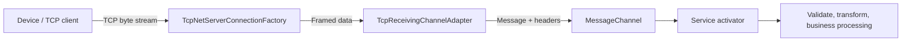

# TCP inbound channel adapter

> **Chapter:** TCP Adapter  
> **Module:** SPRING_INTEGRATION_ADAPTERS — Connect external systems to Spring Integration using inbound/outbound adapters, gateways, pollers, and MessageChannel. Practice message exchange flows over files, SFTP, HTTP, JMS, AMQP, Kafka, and databases; handle message contracts, errors, and connection lifecycles.

## 1. Learning objectives

After this lesson, you will be able to:

- Explain the role of a **TCP inbound channel adapter** in a Spring Integration flow.
- Distinguish data flowing **into the application** via an inbound adapter from data flowing out via an outbound adapter and request–reply communication via a gateway.
- Configure a TCP server to receive messages, convert them into Spring `Message` instances, and push them into a `MessageChannel`.
- Choose a **message framing** strategy because TCP only provides a byte stream and does not preserve boundaries between sends.
- Trace the message path, identify root causes of errors, and operate TCP connections safely.

## 2. What is a TCP inbound channel adapter?

In Spring Integration, an **inbound channel adapter** is the starting point of a processing flow: it receives data from an external system and **emits a Spring Message into an internal channel**.

For the TCP protocol, this component is implemented by `TcpReceivingChannelAdapter`. The adapter receives data that has been read and decoded from a TCP connection through a **connection factory**, creates a message, and sends the message to `outputChannel`. Downstream handlers only need to care about the payload and headers, instead of opening sockets manually and looping to read bytes.

For example: an IoT device sends temperature readings to the application's TCP port. The adapter receives the frame `TEMP|sensor-01|23.5`, places it into a `MessageChannel`, and then a service validates the format and persists the data.



**Important characteristic:** `TcpReceivingChannelAdapter` is a **unidirectional, receive-only adapter**. Completing message processing in a handler **does not automatically produce a reply on the socket**. If each TCP request requires a TCP response within the same exchange, you should usually use a **TCP inbound gateway** (`TcpInboundGateway`). If you only need to ingest telemetry, events, or logs from devices, an inbound adapter is appropriate.

A TCP inbound adapter also **does not use a poller to wait on a read schedule** like polled file or database sources. Data reception occurs when the connection factory detects a message on the socket.

## 3. Components in the flow

| Component | Role |
| --- | --- |
| `TcpNetServerConnectionFactory` | Opens the application's TCP port, accepts client connections, and manages those connections. |
| `TcpNioServerConnectionFactory` | An NIO-based connection factory option when appropriate for connection and threading requirements. |
| `TcpReceivingChannelAdapter` | Receives messages from the connection factory, wraps them into Spring `Message<?>` instances, and sends them to the output channel. |
| `MessageChannel` | The boundary separating network connectivity from business processing. |
| `ServiceActivator` or handler in `IntegrationFlow` | Reads the payload, validates structure, transforms, and processes the information. |
| `Deserializer` | Determines where a TCP message ends and returns the decoded data. |

In the example below, the application acts as a **TCP server**. This is the typical choice when external devices actively connect to the application. Spring Integration also supports client-side connection factories, because **inbound/outbound** describes the direction of Spring Message movement, not directly which socket is the client or server.

### 3.1. Why must message boundaries be defined?

TCP is a **continuous byte stream**. Two `write()` calls from the client do not guarantee two corresponding `read()` calls on the server:

- A single message may arrive in multiple byte chunks.
- Multiple messages may appear together in a single read.
- Closing the connection is not a suitable delimiter if you want to keep long-lived connections open.

Therefore, both sides must agree on a **framing contract**. Some options include:

| Framing method | Example | When to use |
| --- | --- | --- |
| CRLF delimiter | `TEMP|01|23.5\r\n` | Text protocols specifying that each line ends with CRLF. |
| LF delimiter | `TEMP|01|23.5\n` | Text protocols separated by LF. |
| Length prefix | `[length][payload]` | Binary protocols or payloads that may contain newline characters. |
| Read until connection close | `[payload][EOF]` | Protocols that genuinely use one connection per message. |

Spring Integration provides serializers/deserializers such as `ByteArrayCrLfSerializer`, `ByteArrayLfSerializer`, and `ByteArrayLengthHeaderSerializer`. You must **choose the same convention as the sender**. This lesson uses CRLF: each message ends with the two bytes `0D 0A`; the CRLF characters serve as the delimiter and are not included in the business content after decoding.

## 4. Hands-on example: TCP server receiving sensor events

### 4.1. Context and message contract

Suppose each sensor sends a UTF-8 line in the form:

```text
TEMP|sensor-01|23.5\r\n
TEMP|sensor-02|27.1\r\n
```

Agreed contract:

1. The client connects to the application's TCP port `9000`.
2. Each message consists of UTF-8 bytes terminated by `\r\n`.
3. The content follows `event_type|device_id|value`; length and values must be validated by the business system.
4. The server **only receives** and does not send an ACK over the TCP connection in this example.
5. Each valid frame at the framing layer produces **one Spring Message** for the processing layer.

For a Spring Boot application managing dependency versions through a BOM, include the corresponding modules (for example, Maven):

```xml
<dependencies>
    <dependency>
        <groupId>org.springframework.boot</groupId>
        <artifactId>spring-boot-starter-integration</artifactId>
    </dependency>
    <dependency>
        <groupId>org.springframework.integration</groupId>
        <artifactId>spring-integration-ip</artifactId>
    </dependency>
</dependencies>
```

`spring-integration-ip` provides the TCP/IP adapters, gateways, connection factories, and related serializers. The following example uses a configuration style familiar with Spring Integration 6 and Java 17 or later.

### 4.2. Complete Java DSL configuration

```java
import java.nio.charset.StandardCharsets;

import org.springframework.beans.factory.annotation.Qualifier;
import org.springframework.context.annotation.Bean;
import org.springframework.context.annotation.Configuration;
import org.springframework.integration.annotation.ServiceActivator;
import org.springframework.integration.channel.DirectChannel;
import org.springframework.integration.config.EnableIntegration;
import org.springframework.integration.dsl.IntegrationFlow;
import org.springframework.integration.ip.IpHeaders;
import org.springframework.integration.ip.dsl.Tcp;
import org.springframework.integration.ip.tcp.connection.TcpNetServerConnectionFactory;
import org.springframework.integration.ip.tcp.serializer.ByteArrayCrLfSerializer;
import org.springframework.messaging.MessageChannel;
import org.springframework.messaging.MessageHandler;

@Configuration
@EnableIntegration
public class TcpInboundConfiguration {

    @Bean
    TcpNetServerConnectionFactory tcpServerConnectionFactory() {
        var connectionFactory = new TcpNetServerConnectionFactory(9000);

        // Client terminates each message with CRLF.
        connectionFactory.setDeserializer(new ByteArrayCrLfSerializer());

        // Keep the same contract if the factory is later used to send data.
        connectionFactory.setSerializer(new ByteArrayCrLfSerializer());

        return connectionFactory;
    }

    @Bean
    MessageChannel tcpInboundMessages() {
        return new DirectChannel();
    }

    @Bean
    IntegrationFlow tcpInboundFlow(
            TcpNetServerConnectionFactory tcpServerConnectionFactory,
            @Qualifier("tcpInboundMessages") MessageChannel tcpInboundMessages) {

        return IntegrationFlow
                .from(Tcp.inboundAdapter(tcpServerConnectionFactory))
                .channel(tcpInboundMessages)
                .get();
    }

    @Bean
    @ServiceActivator(inputChannel = "tcpInboundMessages")
    MessageHandler tcpMessageHandler() {
        return message -> {
            // ByteArrayCrLfSerializer decodes into byte[].
            byte[] bytes = (byte[]) message.getPayload();
            String record = new String(bytes, StandardCharsets.UTF_8);

            // This ID identifies the TCP connection, not the device identity.
            Object connectionId =
                    message.getHeaders().get(IpHeaders.CONNECTION_ID);

            System.out.printf(
                    "TCP connection=%s, record=%s%n",
                    connectionId, record
            );

            // In production: pass record to parser/validator/business service.
        };
    }
}
```

**How to read the configuration:**

1. `tcpServerConnectionFactory()` manages the socket listening on port `9000`. When a TCP client sends a complete CRLF frame, the deserializer extracts the message into a byte array.
2. `Tcp.inboundAdapter(...)` builds the TCP inbound adapter and registers it as the starting point of the `IntegrationFlow`.
3. `.channel(tcpInboundMessages)` sends the message to the `DirectChannel`. The handler attached via `@ServiceActivator` receives that message.
4. `message.getPayload()` holds the data produced by the deserializer; in this example it is `byte[]`. The `IpHeaders.CONNECTION_ID` header helps correlate logs per connection. This is not an authenticated sender identity.
5. The handler converts the bytes to UTF-8 and passes the data to the business layer. The adapter does not need to know whether the record is a temperature reading, an order, or a control command.

`DirectChannel` invokes the subscriber on the thread that sends the message, so the handler **should not execute long-running business logic or wait on slow services** directly here. Under high load, you can forward to an `ExecutorChannel` configured with an appropriate queue and resource limits, and process asynchronously. This changes error handling and backpressure behavior; test according to actual requirements.

### 4.3. Testing two messages over a single connection

After starting the application with port `9000` free, run the following Java snippet in a standalone test program:

```java
import java.net.Socket;
import java.nio.charset.StandardCharsets;

public class TcpClientDemo {
    public static void main(String[] args) throws Exception {
        try (Socket socket = new Socket("127.0.0.1", 9000)) {
            String frames =
                    "TEMP|sensor-01|23.5\r\n"
                  + "TEMP|sensor-01|23.6\r\n";

            socket.getOutputStream().write(
                    frames.getBytes(StandardCharsets.UTF_8)
            );
            socket.getOutputStream().flush();
        }
    }
}
```

Expected result: the handler processes **two separate messages**, even though the client performed only **one `write()` call**. Each message has the corresponding content:

```text
TCP connection=<connection-id>, record=TEMP|sensor-01|23.5
TCP connection=<connection-id>, record=TEMP|sensor-01|23.6
```

`<connection-id>` is just a placeholder for the actual ID assigned to the connection by Spring Integration. Both messages are sent over the same socket, so they belong to the same connection; frame order on that connection is preserved by TCP. If the server does not receive the full `\r\n` delimiter, the deserializer may continue waiting for the remaining bytes until more data arrives, a timeout expires, or the connection closes.

### 4.4. Handling the message contract at the business layer

Framing only ensures that the adapter separates **message boundaries**; it does not ensure business-valid content. For instance, a record `TEMP|sensor-01|abc` has a valid CRLF frame, but the temperature value is invalid.

You can extract the parser into a separate component:

```java
public record TemperatureEvent(String sensorId, double value) {}

public static TemperatureEvent parseTemperature(String record) {
    String[] parts = record.split("\\|", -1);

    if (parts.length != 3 || !"TEMP".equals(parts[0])) {
        throw new IllegalArgumentException("Invalid TEMP message");
    }

    if (parts[1].isBlank()) {
        throw new IllegalArgumentException("Missing sensor ID");
    }

    return new TemperatureEvent(parts[1], Double.parseDouble(parts[2]));
}
```

In a real application, you should add range validation, message size checks, ID format checks, sender authentication, and duplicate handling policies. The parser should not depend directly on sockets or connection factories so that it can be unit-tested independently.

## 5. TCP inbound adapter vs. gateway and outbound adapter

| Component | Primary data flow | When to use? |
| --- | --- | --- |
| **TCP inbound channel adapter** | TCP → Spring `MessageChannel` | Unidirectional event/telemetry ingestion without needing a reply for each message. |
| **TCP outbound channel adapter** | Spring `MessageChannel` → TCP | The application sends messages out over a TCP connection without waiting for a synchronous reply under a gateway contract. |
| **TCP inbound gateway** | TCP request → flow → TCP response | A client calls in and expects a response for each request per protocol. |
| **TCP outbound gateway** | Flow → TCP request → TCP reply | The application actively sends a request and waits for the corresponding reply. |

**Component selection example:** if a device continuously streams measurements, an inbound adapter is the natural choice. If a POS terminal sends a `CHECK_BALANCE` command and must receive the result within the same request/reply exchange, consider an inbound gateway.

A system can combine an inbound adapter and an outbound adapter if the protocol uses **asynchronous bidirectional** exchange, but when replying over an existing connection you must preserve the connection routing information (such as the `IpHeaders.CONNECTION_ID` header). Do not assume that an inbound adapter automatically sends a handler's return value back to the client.

## 6. Connection factory, connection lifecycle, and channels

### Connection factory

The connection factory is responsible for sockets and connection state; the adapter is responsible for **passing messages into the flow**. Separating these concerns lets you configure framing, TLS, timeouts, and connection events in the right place. When the application starts or stops, Spring Integration components manage the lifecycle of the adapter and connection factory; shut down the application gracefully to release ports and connections.

A TCP server can accept multiple clients, yet each client still sends a byte stream that must be framed independently. Do not use an IP address or `connectionId` as a substitute for an authenticated device identity: a device may reconnect and receive a different ID.

### Choosing a MessageChannel

- **`DirectChannel`:** simple, synchronous, and easy to observe; suitable for examples or fast processing. If the handler is slow, the receiving thread is also affected.
- **`ExecutorChannel`:** decouples the receiving thread from heavy work; requires configuring queue capacity, task rejection policies, and load monitoring.
- **`QueueChannel`:** buffers messages in a queue for consumers to read via a poller. When choosing this model, **the poller belongs to the `QueueChannel` consumer side**, not to how the adapter reads the TCP socket.

Channel choice determines where errors are observed and how the system reacts under overload. Do not introduce async solely because TCP is a network protocol; base the decision on processing cost and ordering requirements.

### Headers and observability

Besides the payload, the adapter can attach connection metadata to message headers; `IpHeaders.CONNECTION_ID` is commonly used to correlate logs with a TCP session. In production logging, record the connection ID, timestamp, byte count, parse result, and error code, while avoiding logging raw payloads that contain sensitive data.

## 7. Common errors and troubleshooting

| Symptom | Causes to check | Resolution |
| --- | --- | --- |
| Client sends data but handler never runs | Missing CRLF terminator or client/server use different framing. | Agree on the framing contract and send complete `\r\n`; check connection logs. |
| Payloads appear merged or split | Reading TCP as individual packets instead of using a protocol-matching deserializer. | Use a delimiter-based or length-header serializer/deserializer. |
| Server fails to start | Port already in use, insufficient bind permissions, or wrong network configuration. | Check port `9000`, bind address, and firewall. |
| `ClassCastException` when casting payload to `byte[]` | The deserializer was replaced with one returning a different type. | Ensure the payload type matches the contract; convert with a transformer if needed. |
| Client waits forever for a response | Inbound adapter only pushes data into the application; it does not write TCP replies. | Use an inbound gateway for request/reply, or design a separate outbound flow for asynchronous bidirectional communication. |
| Application slows down with many clients | Synchronous handler performs I/O or heavy work, or processing queues back up. | Measure processing time, cap concurrency, and offload heavy work to an appropriate processing flow. |
| Malformed data breaks the flow | Missing validation step and error classification policy. | Separate framing errors, parse errors, and business errors; route/record them per system error policy. |
| Lost or duplicate events after reconnect | TCP guarantees byte order within **one connection**, not exactly-once business delivery. | Attach message IDs, design ACK/retry where needed, and handle idempotency at the application layer. |

### Error categories to distinguish

1. **Connection errors:** inability to bind port, broken socket, timeout, or network failure. Observe logs and connection lifecycle events emitted by Spring Integration.
2. **Framing errors:** deserializer cannot find the delimiter or a message exceeds size limits. This happens before content becomes a valid message.
3. **Message processing errors:** payload fails schema validation, parser throws an exception, or downstream systems are unavailable. Error propagation differs depending on whether the channel is synchronous or asynchronous.

Do not treat `errorChannel` as an automatic mechanism to send errors back to the TCP client. With a unidirectional adapter, error responses on the socket must be **explicitly designed in the protocol** if the sender needs feedback.

## 8. Production operation notes

- **Frame size limits:** configure appropriate maximum sizes on serializers/deserializers and set resource bounds to prevent oversized messages from exhausting memory.
- **Connection and timeout limits:** configure timeouts, connection limits, and backpressure policies suited to your devices/application; test scenarios where a client connects and sends incomplete frames.
- **Security:** plain TCP does not encrypt payloads. Use TLS when transport security is needed, apply network controls, and authenticate senders at an appropriate layer.
- **Resilience:** TCP only guarantees byte delivery over an active connection. If delivery guarantees across disconnects are needed, define event IDs, processing acknowledgments, retries, and deduplication at the application layer.
- **Observability:** track active connections, message rate, parse error count, processing latency, queue backlog, and recovery time after reconnect.
- **Protocol testing:** test a single frame split across multiple `write()` calls, multiple frames in one `write()`, incomplete frames, oversized frames, multi-byte UTF-8 characters, and abrupt client disconnects.

## 9. Knowledge self-check

1. Why can you not rely on the number of `Socket.read()` calls to determine the number of TCP messages?
2. In the example, which component accepts the socket and which component pushes the Spring Message into `MessageChannel`?
3. If the system requires the server to return one response per TCP request, which component should you switch to?
4. If you replace `DirectChannel` with `ExecutorChannel`, what aspects of slow processing and consumer-side errors need to be revisited?
5. Is a frame with valid CRLF containing `TEMP|sensor-01|abc` a framing error or a business contract error?

**Answer hints:** (1) TCP is a byte stream; framing is required. (2) The connection factory accepts connections and decodes frames; the inbound adapter emits messages. (3) TCP inbound gateway. (4) Asynchrony, queues, backpressure, and where errors are caught. (5) Parse/validation error at the business layer.

**Key takeaway:** A TCP inbound channel adapter bridges framed TCP messages into Spring Integration's `MessageChannel` system. Good design starts with the framing and payload contracts, then selects the channel, error handling, security, and connection lifecycle.
