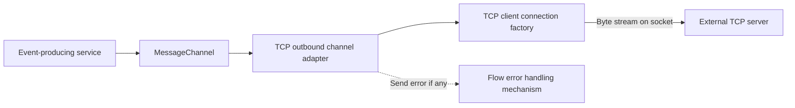
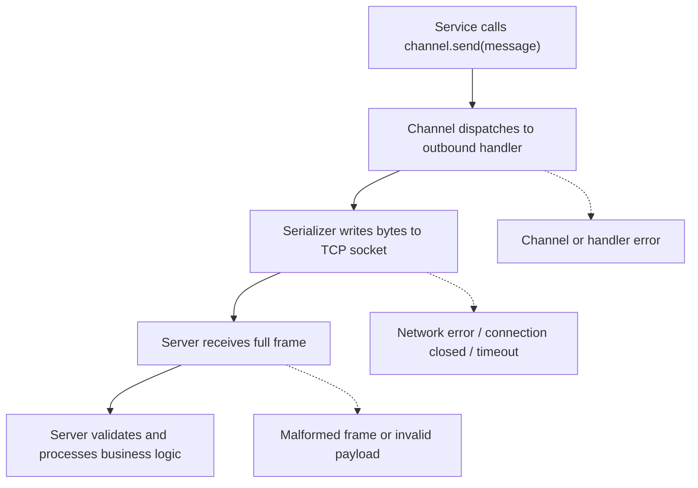

# TCP outbound channel adapter

> **Chapter:** TCP Adapter  
> **Module:** SPRING_INTEGRATION_ADAPTERS  
> **Scope:** Connect external systems to Spring Integration using inbound/outbound adapters, gateways, pollers, and MessageChannel. Practice message exchange flows over files, SFTP, HTTP, JMS, AMQP, Kafka, and databases; handle message contracts, errors, and connection lifecycles.

## 1. Learning objectives

After completing this lesson, you will be able to:

- Explain what a **TCP outbound channel adapter** does and where it fits in a Spring Integration flow.
- Configure an application to send data from a `MessageChannel` to a TCP server using `TcpNetClientConnectionFactory`.
- Define payload contracts and **serializers/framing** so the receiver can separate individual messages from the TCP byte stream.
- Distinguish a unidirectional outbound adapter from a request–reply TCP outbound gateway.
- Recognize the difference between **successfully sending to a channel**, **writing data to the socket**, and **being processed by the target system**.
- Design connection handling, timeouts, error handling, retries, security, and monitoring for production operation.

## 2. What is a TCP outbound channel adapter?

A **TCP outbound channel adapter** takes a Spring `Message<?>` from a `MessageChannel`, converts the payload into bytes according to the transport contract, and sends it over a TCP connection. In Spring Integration, the core component responsible for this is `TcpSendingMessageHandler`, typically configured via the Java DSL `Tcp.outboundAdapter(...)`.

Imagine a service receiving measurement results from internal processing. After validating and normalizing them, the application needs to forward each measurement to a legacy collector system that only supports TCP. The business layer simply emits Spring Messages; the outbound adapter handles writing data to the network connection.



**Key point:** inbound/outbound here refers to the **direction of Spring Message movement**. Outbound means the Spring Message leaves the application through an integration endpoint; it does not necessarily mean the TCP socket acts as a client. The main example in this lesson uses a **client connection factory** because the application actively connects to a TCP server. For asynchronous bidirectional protocols, an outbound adapter can also write data to a server-side connection previously accepted by an inbound component, given the proper configuration and routing headers.

An outbound adapter is a **unidirectional endpoint**. It does not wait for a correlated reply for each message. If the application needs to send a request and wait for a response under a TCP contract, consider a **TCP outbound gateway**.

## 3. Components and data transfer contract

| Component | Responsibility |
| --- | --- |
| `MessageChannel` | Receives Spring Messages from the business flow and delivers them to the sending endpoint. |
| `TcpSendingMessageHandler` | Extracts the message payload and sends it using the connection factory. |
| `TcpNetClientConnectionFactory` | Manages the TCP client socket to the target host and port. |
| `TcpNioClientConnectionFactory` | An NIO-based connection factory implementation when operational requirements call for it. |
| `Serializer` | Represents the payload as bytes and writes the delimiter/frame length according to the protocol. |
| Target TCP server | Reads bytes, reconstructs each frame, and performs receiver-side processing. |

### 3.1. TCP has no message boundaries

TCP transports an **ordered byte stream within a single connection**, not Spring Message objects. One `write()` call by the sender does not reliably correspond to one `read()` call by the receiver. Therefore, **both sides must agree on how frames are separated**.

Common framing contracts include:

| Framing | Wire format | Suitable for |
| --- | --- | --- |
| CRLF | `TEMP|sensor-01|23.5\r\n` | Text messages, each line terminated by CRLF (`0D 0A`). |
| LF | `TEMP|sensor-01|23.5\n` | Systems using the LF newline character as terminator. |
| Length header | `[length][payload]` | Binary messages, payloads that may contain CR/LF, or when explicit size is needed. |
| Connection close | `[payload][socket close]` | Protocols specifying exactly one message per connection. |

In this example, we use `ByteArrayCrLfSerializer`. The serializer **automatically appends CRLF** to the end of the byte array being sent. Therefore, business code only builds the content `TEMP|sensor-01|23.5` and **does not append** `\r\n` to the payload itself; if both add it, the receiver may observe an unintended empty frame.

Spring Integration provides matching serializers such as `ByteArrayCrLfSerializer`, `ByteArrayLfSerializer`, and `ByteArrayLengthHeaderSerializer`. Your choice must be based on the actual protocol of the target system, not habit.

### 3.2. Payload contract and message headers

The example defines each message as a **UTF-8** string:

```text
TEMP|sensor-01|23.5
```

This is the **logical content before the serializer frames it**. In this flow, the business layer produces `byte[]` from the UTF-8 string and sends it as a Spring `Message<byte[]>`. When serializing, the adapter appends CRLF to the message on the wire.

Rules both sides must agree on:

1. Server TCP address and port, e.g., `127.0.0.1:9000` for a local environment.
2. UTF-8 encoding, `TYPE|DEVICE_ID|VALUE` format, and escaping rules for `|`, CR, and LF.
3. Framing uses CRLF; each frame must have a size limit.
4. Whether the server requires sending an ACK. The current example **has no business ACK**.
5. Authentication, duplicate event handling, replay protection, and receiver-side parse error handling if applicable.

A Spring Message can carry headers for internal processing or routing. **Do not assume all headers are transmitted over TCP**: with this example's CRLF serializer, the data on the wire is strictly the encoded payload plus the delimiter. If the target system needs a transaction ID, timestamp, or schema version, include them in the **payload contract**.

## 4. Hands-on example: sending temperature events to a TCP server

A Spring Boot application actively connects to a TCP server at `127.0.0.1:9000`, sends a temperature event, and does not wait for a server reply. The example uses Spring Integration 6.x and Java 17 or later.

### 4.1. Dependency declaration

If using Spring Boot dependency management via BOM, add the corresponding dependencies to `pom.xml`:

```xml
<dependencies>
    <dependency>
        <groupId>org.springframework.boot</groupId>
        <artifactId>spring-boot-starter-integration</artifactId>
    </dependency>

    <dependency>
        <groupId>org.springframework.integration</groupId>
        <artifactId>spring-integration-ip</artifactId>
    </dependency>
</dependencies>
```

`spring-integration-ip` provides TCP adapters, gateways, connection factories, and serializers. No additional socket library is needed to implement this flow.

### 4.2. Configuring the TCP outbound flow with Java DSL

```java
import org.springframework.context.annotation.Bean;
import org.springframework.context.annotation.Configuration;
import org.springframework.integration.channel.DirectChannel;
import org.springframework.integration.config.EnableIntegration;
import org.springframework.integration.dsl.IntegrationFlow;
import org.springframework.integration.ip.dsl.Tcp;
import org.springframework.integration.ip.tcp.connection.TcpNetClientConnectionFactory;
import org.springframework.integration.ip.tcp.serializer.ByteArrayCrLfSerializer;
import org.springframework.messaging.MessageChannel;

@Configuration
@EnableIntegration
public class TcpOutboundConfiguration {

    @Bean
    TcpNetClientConnectionFactory tcpClientConnectionFactory() {
        var factory = new TcpNetClientConnectionFactory("127.0.0.1", 9000);

        // Keep the connection open to send multiple messages within the same session.
        factory.setSingleUse(false);

        // Sends byte[] and automatically appends the two CRLF bytes at the end of the frame.
        factory.setSerializer(new ByteArrayCrLfSerializer());

        return factory;
    }

    @Bean
    MessageChannel tcpOutboundRequests() {
        return new DirectChannel();
    }

    @Bean
    IntegrationFlow tcpOutboundFlow(
            TcpNetClientConnectionFactory tcpClientConnectionFactory) {

        return IntegrationFlow
                .from("tcpOutboundRequests")
                .handle(Tcp.outboundAdapter(tcpClientConnectionFactory))
                .get();
    }
}
```

**Processing order explained:**

1. `tcpOutboundRequests` is the input channel of the outbound adapter: business services send Spring Messages here.
2. `IntegrationFlow.from("tcpOutboundRequests")` registers a consumer that receives messages from the channel.
3. `Tcp.outboundAdapter(tcpClientConnectionFactory)` creates a handler that sends payloads over TCP.
4. `TcpNetClientConnectionFactory` defines the host/port and connection lifecycle; with `singleUse=false`, the connection factory can reuse the connection for subsequent sends while it remains valid.
5. `ByteArrayCrLfSerializer` turns each byte payload into a CRLF-delimited frame.

`DirectChannel` delivers messages synchronously to the handler. If the server is not running, the connection fails, or the adapter cannot send, the caller typically sees an error on the sending thread rather than a false success result. Establishing a connection and completing a send call **does not confirm successful processing at the receiving application**.

### 4.3. Service creating and sending messages

```java
import java.math.BigDecimal;
import java.nio.charset.StandardCharsets;

import org.springframework.beans.factory.annotation.Qualifier;
import org.springframework.messaging.MessageChannel;
import org.springframework.messaging.support.MessageBuilder;
import org.springframework.stereotype.Service;

@Service
public class TemperaturePublisher {

    private final MessageChannel tcpOutboundRequests;

    public TemperaturePublisher(
            @Qualifier("tcpOutboundRequests")
            MessageChannel tcpOutboundRequests) {
        this.tcpOutboundRequests = tcpOutboundRequests;
    }

    public void publish(String sensorId, double celsius) {
        // Avoid characters that could break the record/framing structure.
        if (sensorId == null
                || !sensorId.matches("[A-Za-z0-9_-]{1,32}")
                || !Double.isFinite(celsius)) {
            throw new IllegalArgumentException("Invalid temperature event");
        }

        String record = "TEMP|" + sensorId + "|"
                + BigDecimal.valueOf(celsius).toPlainString();

        byte[] payload = record.getBytes(StandardCharsets.UTF_8);

        boolean accepted = tcpOutboundRequests.send(
                MessageBuilder.withPayload(payload).build()
        );

        if (!accepted) {
            throw new IllegalStateException(
                    "TCP outbound channel did not accept message"
            );
        }
    }
}
```

The service only knows the `TEMP|...` contract and a `MessageChannel`. It does not open sockets, loop writing bytes, or depend on a specific TCP server. With this design, if the system later needs to send the same event to Kafka/JMS/HTTP in another flow, the event-producing layer can still use the Spring Integration message model.

**Note on `send(...)`:** a return value of `true` means the channel accepted the message according to its semantics. With a `DirectChannel` and synchronous handler, send failures can throw an exception directly during the call. Neither signal **proves** that the TCP server parsed, persisted to a database, or committed the message. To know the business outcome, you must design a dedicated reply/ACK, typically via a gateway or an asynchronous protocol with a correlation ID.

### 4.4. Minimal TCP server to observe frames

Before running the application, you can start a test TCP server with the following Java program. The server simply prints the lines it receives:

```java
import java.io.BufferedReader;
import java.io.InputStreamReader;
import java.net.ServerSocket;
import java.net.Socket;
import java.nio.charset.StandardCharsets;

public class TcpProbeServer {
    public static void main(String[] args) throws Exception {
        try (ServerSocket listener = new ServerSocket(9000)) {
            System.out.println("Listening on port 9000");

            try (Socket client = listener.accept();
                 BufferedReader reader = new BufferedReader(
                         new InputStreamReader(
                                 client.getInputStream(),
                                 StandardCharsets.UTF_8))) {

                String line;
                while ((line = reader.readLine()) != null) {
                    System.out.println("Received: " + line);
                }
            }
        }
    }
}
```

`BufferedReader.readLine()` strips the line terminator. Because the sending application uses CRLF, each frame becomes a line and the server can receive multiple consecutive messages on the same connection.

To test sending a message after Spring Boot starts up, you can add a **demo-only** configuration:

```java
import org.springframework.boot.ApplicationRunner;
import org.springframework.context.annotation.Bean;
import org.springframework.context.annotation.Configuration;

@Configuration
class DemoTemperatureSender {

    @Bean
    ApplicationRunner sendDemo(TemperaturePublisher publisher) {
        return args -> publisher.publish("sensor-01", 23.5);
    }
}
```

Execution sequence:

1. Run `TcpProbeServer` first, making sure port `9000` is free.
2. Start the Spring Boot application containing `TcpOutboundConfiguration`, `TemperaturePublisher`, and `DemoTemperatureSender`.
3. Observe the TCP server print a line `Received: TEMP|sensor-01|23.5`.
4. Call `publish(...)` again from the business flow to see that multiple frames can travel over the same active connection.

Do not include `DemoTemperatureSender` in production configuration: sending at startup is only to simplify the hands-on exercise. If the server is not ready yet, the test send may fail; start the server before running the application.

### 4.5. View from bytes on the wire

Payload pushed into `MessageChannel`:

```text
54 45 4D 50 7C 73 65 6E 73 6F 72 2D 30 31 7C 32 33 2E 35
 T  E  M  P  |  s  e  n  s  o  r  -  0  1  |  2  3  .  5
```

Serializer writes to the socket:

```text
54 45 4D 50 7C 73 65 6E 73 6F 72 2D 30 31 7C 32 33 2E 35 0D 0A
                                                               CR LF
```

The example uses ASCII within UTF-8, so one character corresponds to one byte. With multi-byte Unicode data, do not limit frame size by Java character count; check the **encoded byte length**.

## 5. Outbound adapter vs. outbound gateway and bidirectional flows

| Endpoint | Primary direction | Reply per request? | Use case |
| --- | --- | --- | --- |
| **TCP outbound channel adapter** | Spring Message → TCP | Does not wait for reply | Pushing telemetry, events, or one-way notifications. |
| **TCP outbound gateway** | Spring request → TCP → Spring reply | Yes | Lookups or commands requiring a result within the same request/reply exchange. |
| **TCP inbound channel adapter** | TCP → Spring Message | Does not reply automatically | Receiving events from external clients. |
| **TCP inbound gateway** | TCP request → flow → TCP response | Yes | Application acts as a server processing requests and replying to clients. |

For example, when the application only emits `TEMP|...` to an event collector, an outbound adapter fits well. When the application sends `GET_BALANCE|account-01` and must receive the balance before continuing business logic, an outbound gateway is a better fit.

For **asynchronous bidirectional** protocols, inbound and outbound adapters can be combined. When sending back over a **TCP connection opened by an external client to the server**, the outbound message must be routed to the right connection, typically via `IpHeaders.CONNECTION_ID` and **the appropriate shared connection factory**. The connection ID is session routing information, not a user authentication token; protect the flow that issues and retains this header. The one-way sending example above actively opens a TCP client connection and does not need to route to an inbound session.

Do not turn every reply into a second outbound adapter if the system has a strict request/reply contract; a gateway provides a better exchange model and reduces manual correlation effort.

## 6. Connection lifecycle and MessageChannel choices

### 6.1. Single-use vs. reused connections

In a TCP client connection factory, the `singleUse` option affects socket lifecycle:

- `singleUse=false`: consecutive sends can reuse an active connection. This reduces reconnection overhead and suits flows with many consecutive events and protocols that allow long-lived sockets.
- `singleUse=true`: each send uses a separate connection and then closes it per connection factory policy. Suitable when the target system specifies one message per connection, at the cost of more handshakes.

**Do not confuse `singleUse=false` with a guarantee that the connection is always ready.** The network can drop, the server may actively close the socket, or the connection factory may have to reconnect. For high throughput or many concurrent connections, evaluate the connection factory, connection limits, load-distribution model, and message ordering according to the concrete contract.

### 6.2. Impact of channel choice on sending

| Channel | Impact on message producer | Considerations |
| --- | --- | --- |
| `DirectChannel` | The TCP sending handler usually runs synchronously on the `send()` call path. | Caller is affected by network/connection latency; exceptions are directly observable. |
| `ExecutorChannel` | Sending work is handed off to an executor. | Must bound queue and thread count; errors may occur on another thread; requires clear error-handling policy. |
| `QueueChannel` | Messages wait for a consumer triggered by a poller. | Requires a consumer-side poller, bounded queue size, and backlog policy; the TCP outbound adapter itself is not a polled source. |

Do not add a queue merely to hide network errors. In-memory queues can be lost on application shutdown; unbounded queues can exhaust memory. If events must be retained while the target server is unavailable, consider durable storage or a broker with acknowledgments and a clear retry policy.

### 6.3. Headers and ordering

In the example, only the payload passes through the serializer to the network. Internal headers such as message IDs or trace metadata do not automatically become bytes on the server side. To let the server trace each message, add a message ID and version to the **payload schema**.

TCP guarantees **byte order within one connection**, but does not guarantee global order across multiple connections, multiple producers, or asynchronous sending branches. If business order matters, define sequence numbers and late-arrival handling rules.

## 7. Error handling, retries, and reliability

There are three distinct outcome levels:



A `send()` call is no substitute for confirmations at steps D and E. With TCP, successful transmission does not equal **exactly-once** delivery at the application level.

### 7.1. Typical errors

| Symptom | Possible causes | Inspection and resolution |
| --- | --- | --- |
| `Connection refused` | TCP server is not running or wrong host/port. | Check target port, network route, address, and firewall; test with a local server. |
| Connection succeeds but server does not see full message | Client and server use different framing or missing delimiter. | Compare client serializer against server deserializer/parser. |
| Server receives an extra empty frame | Code manually appended `\r\n` and serializer also appends CRLF. | Let only the serializer handle the delimiter. |
| `ClassCastException` or serialization error | Payload type is incompatible with the serializer. | Normalize payload to `byte[]` per contract before sending. |
| `Broken pipe`, `Connection reset` | Server closed the connection, network dropped, or stale socket is invalid. | Monitor connection events, log errors, reinitialize, and retry per policy. |
| Duplicate events sent after timeout | Unknown whether server already received/processed before client timed out. | Attach event IDs, implement idempotent processing, or add application-level ACK/correlation. |
| Caller becomes unusually slow | `DirectChannel` processes synchronously and waits on TCP I/O/connection. | Measure latency; configure appropriate timeouts and offload sending thread if needed. |
| Memory growth when server is down | Producer outpaces sending capacity with an unbounded queue. | Set queue bounds, rejection policy, and backlog monitoring. |

### 7.2. Retries must go hand in hand with deduplication

Suppose the outbound adapter writes the full frame to the socket, but the connection drops before the sender learns the outcome. Resending may cause the server to process the event **twice**. This state cannot be resolved by TCP alone.

For systems requiring high reliability, specify key elements in the contract upfront:

1. **Unique Event ID** and where the ID is issued.
2. **Business ACK** indicating which processing step the receiver completed.
3. Rules for **timeouts, retries, max attempts, and backoff**.
4. **Idempotency** so the receiver skips duplicate processing for the same event ID.
5. **Durable persistence** for pending outbound messages if data loss is unacceptable.

If the receiving protocol has no ACK, the sender only knows the transmission state it observed; it cannot reliably infer the business outcome. When synchronous feedback is needed, consider a TCP outbound gateway. When one-way sending is still required with a delayed ACK, design an additional inbound flow and correlation ID.

### 7.3. Error channel does not automatically generate a TCP response

Where errors are thrown depends on the channel model. On a `DirectChannel`, synchronous send errors can surface back to the caller as exceptions. With an executor or poller, errors usually must be monitored and handled in the corresponding endpoint/flow error mechanism. Configuring an `errorChannel` can support asynchronous error flows, but **it does not automatically send an ACK/NAK to the TCP server**. Sender and receiver must agree on that protocol separately.

## 8. Safe operation and monitoring

### 8.1. Security

Plain TCP transmits unencrypted data. In production environments, use **TLS** when connection protection is needed, combined with network controls and application authentication suited to the system's trust level. Never treat opening a socket or knowing a `connectionId` as proof of target authentication. Do not write payloads containing sensitive data into operational logs.

### 8.2. Resources and limits

- Configure connection and I/O timeouts appropriate for the environment so producers do not hang indefinitely.
- Define maximum frame sizes and check **byte length**, especially with multi-byte UTF-8 strings.
- When sending multiple messages over a single socket, test the scenario where the server closes the connection between sends.
- Set limits on connections, queues, threads, and retry rates; apply backpressure or controlled rejection under overload.
- Close connections gracefully on application shutdown; remember unacknowledged data may require recovery per business policy.

### 8.3. Observability

Useful metrics and log fields include send count, serializer error count, connection and reconnect counts, write latency, payload size, queue backlog, event ID, and target system code. Do not equate "sent successfully" with "processed successfully by the server" if the protocol lacks a business ACK.

### 8.4. Recommended test scenarios

1. Send one message, then multiple consecutive messages over the same connection.
2. Send payloads containing `|`, CR, LF, or Unicode characters to verify validation and framing.
3. Start the server after the client: verify errors and retry policy.
4. Stop the server right after the first send, and observe behavior on the next send.
5. Trigger a non-`byte[]` payload error to verify serialization error handling.
6. Generate high load to check channel limits and latency, especially with executors/queues.

## 9. Extension exercises

**Exercise 1 — Switch to length header.** Suppose the server receives frames with a header representing length, and payloads may contain CRLF. Update the sender's serializer and the server's parser to share the same contract. Explain why you cannot change only one side.

**Exercise 2 — Retries and duplicate events.** Add an event ID to the payload, simulate the server finishing processing while the client times out, and then resend. Design how the server detects an already-processed ID and skips duplicate writes.

**Exercise 3 — Request/reply protocol.** Change the requirement from "fire temperature events" to "send command and receive `OK/ERROR`". Choose a TCP outbound gateway, design the response contract, and define timeouts; compare with an outbound adapter.

## 10. Knowledge self-check

1. Why is `TCP outbound channel adapter` a unidirectional endpoint, even though TCP itself is a bidirectional connection?
2. What are the distinct roles of `TcpSendingMessageHandler` and `TcpNetClientConnectionFactory`?
3. With `ByteArrayCrLfSerializer`, should you manually append `\r\n` to the `byte[]` payload? Why or why not?
4. Does `channel.send(...)` returning `true` guarantee that the server persisted the event to the database?
5. If the application needs to receive a reply for each TCP request, which component is more suitable?
6. Why does `singleUse=false` not eliminate the need for reconnect and retry handling?
7. Why can retrying after a network error produce duplicate events?

**Hints:** (1) Outbound adapter has no contract for waiting/matching replies. (2) Handler is the endpoint writing messages; factory manages connections. (3) No, the serializer appends CRLF automatically. (4) No, a business ACK is needed. (5) Outbound gateway. (6) Sockets can still drop or be closed by the server. (7) The server may have already processed the message even though the sender did not receive the outcome.

**Summary:** A TCP outbound channel adapter delivers Spring Messages from a `MessageChannel` to an external TCP system. During implementation, the three core decisions are **framing/payload**, **connection lifecycle**, and **the actual delivery guarantee required**. If the business needs replies, processing acknowledgments, or deduplication, express them as explicit contracts rather than expecting TCP to provide them automatically.
