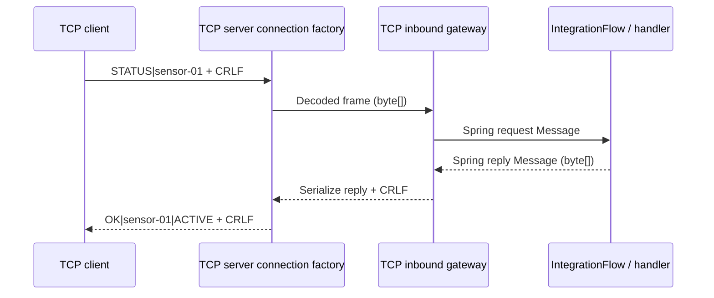
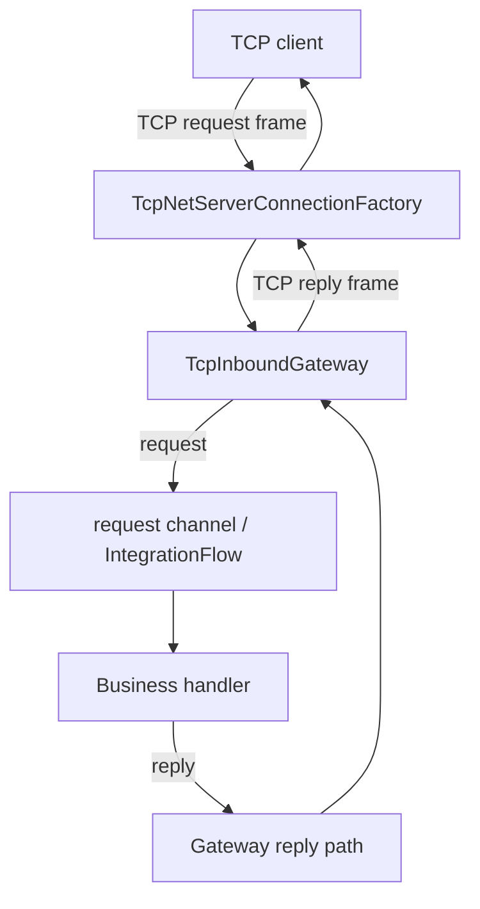
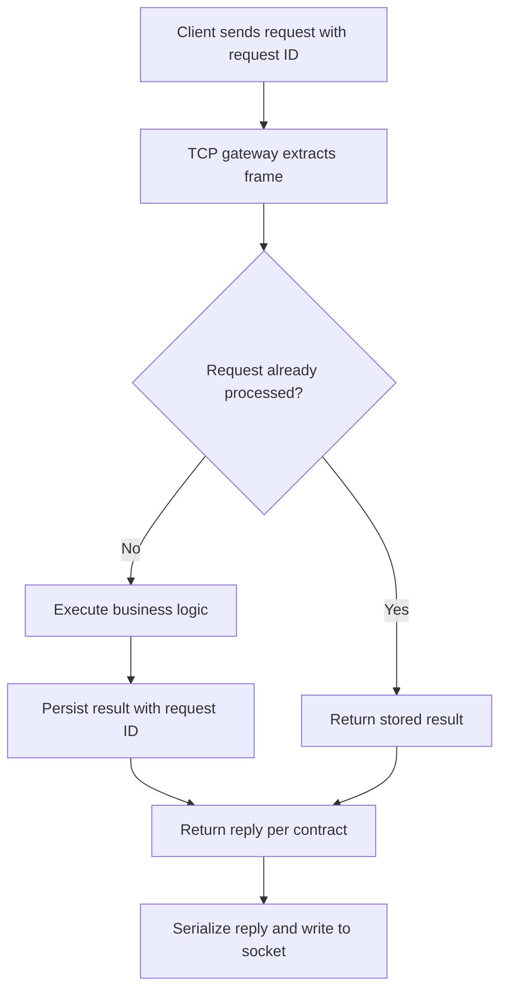

# TCP inbound gateway request-reply

> **Chapter:** TCP Adapter  
> **Module:** SPRING_INTEGRATION_ADAPTERS  
> **Scope:** Connect external systems to Spring Integration using inbound/outbound adapters, gateways, pollers, and MessageChannel. Practice message exchange flows over files, SFTP, HTTP, JMS, AMQP, Kafka, and databases; handle message contracts, errors, and connection lifecycles.

## 1. Learning objectives

After this lesson, you will be able to:

- Explain why a **TCP inbound gateway** implements a **request-reply** model even though the endpoint is named *inbound*.
- Describe the full path from bytes on a TCP socket to a Spring `Message`, through a `MessageChannel`, and back to the socket as a reply.
- Configure `TcpInboundGateway` using Spring Integration Java DSL and `TcpNetServerConnectionFactory`.
- Design a **framing contract**, request/response format, timeouts, and error behavior.
- Build a TCP client that sends requests, waits for responses, and reuses a connection sequentially.
- Distinguish **TCP inbound gateway** from **TCP inbound channel adapter**, **TCP outbound gateway**, and **TCP outbound channel adapter**.
- Evaluate concurrency, idempotency, connection drops, security, and observability in production systems.

## 2. What is a TCP inbound gateway?

`TcpInboundGateway` is a Spring Integration endpoint that receives **a request from an external system over TCP**, passes it into an internal message flow, and **sends a response back over the corresponding TCP connection**. From a TCP client's perspective, this is a server that accepts commands and returns results. From Spring Integration's perspective, it is the entry point of a flow with a **reply contract**.

For example: a monitoring device sends `STATUS|sensor-01` to the system. Spring Integration forwards this content to a service that checks device status. The service returns `OK|sensor-01|ACTIVE`, and the gateway writes the result back to the exact socket the client used to send the request.



Key point: **inbound** identifies the direction of *the initial request entering Spring Integration*. The gateway handles **both request and reply**. When the handler returns a result, the gateway is responsible for sending the reply over TCP; business code does not need to write directly to `Socket`.

### 2.1. Why not use a TCP inbound channel adapter?

`TcpReceivingChannelAdapter` receives unidirectional events and places them onto a `MessageChannel`. It **does not automatically send a response** when the handler finishes processing. When a client follows a "send command and wait for result" pattern, using an inbound adapter alone causes the sender to wait forever.

`TcpInboundGateway` is a better fit because each request is bound to a reply path. Inside the flow, a service can return a payload or a reply message; the gateway converts that result into a TCP response.

### 2.2. A request-reply exchange needs a clear contract

TCP is only an **ordered byte stream** and does not preserve the boundaries of individual writes. Therefore, a **TCP gateway cannot guess** where a request ends or how long a reply is.

In this lesson, both sides agree on:

| Property | Example value |
| --- | --- |
| Server | `127.0.0.1:9001` |
| Encoding | UTF-8 |
| Request | `STATUS|<device-id>` |
| Success reply | `OK|<device-id>|ACTIVE` |
| Invalid request reply | `ERR|BAD_REQUEST` |
| Framing | Every request and reply ends with CRLF (`\r\n`, hex `0D 0A`) |
| Exchange mode | Client sends one request, **finishes reading the reply**, then sends the next request |
| Client timeouts | 3 seconds to connect; 5 seconds to read a reply in the demo |
| Business ACK | An `OK` reply means the handler produced an answer; actual business guarantees must be defined by the application |

Fetching device status is a read operation. If replaced with a command that has side effects such as `CHARGE|order-42` or `OPEN_DOOR|device-01`, you must add a **request ID, access control, idempotency**, and verify the exact outcome before replying.

## 3. Components in an inbound gateway flow

| Component | Role |
| --- | --- |
| `TcpNetServerConnectionFactory` | Opens the TCP server port, accepts connections, manages socket lifecycle, and reads/writes data using serializer/deserializer. |
| `TcpNioServerConnectionFactory` | An NIO-based connection factory option when connection counts and I/O models warrant it. |
| `ByteArrayCrLfSerializer` | Reads up to CRLF to extract one request; writes reply payloads with CRLF. |
| `TcpInboundGateway` | Converts TCP requests into Spring Messages, awaits replies, and writes replies out to the matching connection. |
| `IntegrationFlow` | Composes transformation, validation, routing, and request-handling steps. |
| `MessageChannel` | Where endpoints send/receive messages in the internal flow. |
| `Service activator` or `GenericHandler` | Processes request content and produces the reply payload. |

On the server side, the **connection factory** manages physical connections; the **gateway** manages the request/reply exchange pattern; the **handler** handles only business logic. Separating these three responsibilities makes it easy to change framing or processing logic without managing sockets in service code.

### 3.1. Request channel and reply channel

When a request enters the gateway, Spring Integration creates a message containing a **payload** and **headers**. The gateway sends that message to the flow's request channel. After processing, the gateway receives the reply via the corresponding reply mechanism and writes it to the socket.



In the Java DSL example below, Spring Integration automatically configures the reply path required for the request-reply flow. You do not need to create a second `TcpSendingMessageHandler` to send per-request replies. The `IpHeaders.CONNECTION_ID` header can assist with session logging/tracing; do not use it as an authenticated device identity.

### 3.2. Framing: the easiest place to get wrong

Suppose the TCP client calls `write()` twice to send:

```text
STATUS|sensor-01\r\n
STATUS|sensor-02\r\n
```

TCP may deliver the two messages in multiple segments or combine them into a single read. The **deserializer** must recognize CRLF as the boundary:

```text
Bytes on connection
    ├── STATUS|sensor-01 0D 0A  → request 1
    └── STATUS|sensor-02 0D 0A  → request 2
```

With `ByteArrayCrLfSerializer`:

- When **receiving**, the deserializer reads up to CRLF and returns a `byte[]` for one frame, excluding the trailing CRLF bytes.
- When **sending**, the serializer writes the reply payload and **automatically appends CRLF**.
- A handler returning `OK|sensor-01|ACTIVE` **must not append** `\r\n` itself, avoiding duplicate delimiters.

If the target protocol specifies a length header, a single LF character, or a binary format, you must change the serializer/deserializer **consistently on both sides**. Do not use CRLF for payloads that may contain unescaped CRLF; in those cases, a length header is usually easier to control.

## 4. Example: creating a TCP inbound gateway with Java DSL

The Spring Boot application acts as a server on port `9001`. The client sends `STATUS|sensor-01`. The handler validates the request structure and returns the illustrative status `ACTIVE`. This is a learning example and does not query a real device store.

### 4.1. Maven dependencies

With Spring Boot managing library versions via BOM, add Spring Integration and the TCP/IP module:

```xml
<dependencies>
    <dependency>
        <groupId>org.springframework.boot</groupId>
        <artifactId>spring-boot-starter-integration</artifactId>
    </dependency>
    <dependency>
        <groupId>org.springframework.integration</groupId>
        <artifactId>spring-integration-ip</artifactId>
    </dependency>
</dependencies>
```

The Java DSL examples below target **Spring Integration 6.x and Java 17+**.

### 4.2. Gateway configuration

```java
import java.nio.charset.StandardCharsets;

import org.springframework.context.annotation.Bean;
import org.springframework.context.annotation.Configuration;
import org.springframework.integration.config.EnableIntegration;
import org.springframework.integration.dsl.IntegrationFlow;
import org.springframework.integration.ip.IpHeaders;
import org.springframework.integration.ip.dsl.Tcp;
import org.springframework.integration.ip.tcp.connection.TcpNetServerConnectionFactory;
import org.springframework.integration.ip.tcp.serializer.ByteArrayCrLfSerializer;

@Configuration
@EnableIntegration
public class TcpInboundGatewayConfiguration {

    @Bean
    TcpNetServerConnectionFactory tcpGatewayServerFactory() {
        var factory = new TcpNetServerConnectionFactory(9001);

        // Reads each request terminated by CRLF.
        factory.setDeserializer(new ByteArrayCrLfSerializer());

        // Each reply is also terminated by CRLF.
        factory.setSerializer(new ByteArrayCrLfSerializer());

        return factory;
    }

    @Bean
    IntegrationFlow tcpRequestReplyFlow(
            TcpNetServerConnectionFactory tcpGatewayServerFactory) {

        return IntegrationFlow
                .from(Tcp.inboundGateway(tcpGatewayServerFactory))
                .handle((payload, headers) -> {
                    Object connectionId =
                            headers.get(IpHeaders.CONNECTION_ID);

                    byte[] requestBytes = (byte[]) payload;
                    String request = new String(
                            requestBytes, StandardCharsets.UTF_8
                    );

                    System.out.printf(
                            "Request from connection=%s: %s%n",
                            connectionId, request
                    );

                    String response = processRequest(request);

                    // Return byte[] so the TCP serializer frames the reply.
                    return response.getBytes(StandardCharsets.UTF_8);
                })
                .get();
    }

    private static String processRequest(String request) {
        String[] parts = request.split("\\|", -1);

        if (parts.length != 2
                || !"STATUS".equals(parts[0])
                || !parts[1].matches("[A-Za-z0-9_-]{1,32}")) {
            return "ERR|BAD_REQUEST";
        }

        // Fixed example; in a real system, invoke the business service here.
        return "OK|" + parts[1] + "|ACTIVE";
    }
}
```

**Meaning of each step:**

1. `TcpNetServerConnectionFactory(9001)` creates a TCP server on port `9001`.
2. `setDeserializer(...)` extracts request frames; `setSerializer(...)` frames replies. Both sides use CRLF.
3. `Tcp.inboundGateway(...)` creates the endpoint that receives requests and manages responses on the connection.
4. `.handle((payload, headers) -> ...)` receives the unframed data, decodes UTF-8, and invokes business logic.
5. The handler **returns `byte[]`**, creating a reply message for the gateway. The gateway sends the corresponding reply over TCP.
6. `processRequest(...)` returns `ERR|BAD_REQUEST` for syntactically invalid requests, turning business errors into **valid protocol-level responses**.

Note that `IpHeaders.CONNECTION_ID` is only for correlating session logs. Do not use it as an authentication mechanism, and do not trust arbitrary client-supplied header information for access control decisions.

### 4.3. Why return `byte[]` instead of writing directly to the socket?

The handler works with Spring Messages rather than `Socket`, so it does not depend on I/O threads and can be tested independently. Returning `byte[]` also keeps two layers clear:

- **Business content:** `OK|sensor-01|ACTIVE`, produced by the service.
- **Transport layer:** the TCP serializer appends CRLF when writing the reply.

This configuration follows the same message-flow model as file or HTTP gateways, but TCP requires managing framing, long-lived connections, and the case where the client disconnects while the handler is still processing.

## 5. Writing a TCP client to test request-reply

The client below uses a standard TCP socket and sends two requests **sequentially over the same connection**. Each time it sends a request, the client waits for the reply before sending the next request.

```java
import java.io.BufferedReader;
import java.io.InputStreamReader;
import java.net.InetSocketAddress;
import java.net.Socket;
import java.nio.charset.StandardCharsets;

public class TcpGatewayClientDemo {

    public static void main(String[] args) throws Exception {
        try (Socket socket = new Socket()) {
            // Maximum time to wait for establishing the TCP connection.
            socket.connect(new InetSocketAddress("127.0.0.1", 9001), 3000);

            // Maximum time to wait when reading a reply.
            socket.setSoTimeout(5000);

            var input = new BufferedReader(new InputStreamReader(
                    socket.getInputStream(), StandardCharsets.UTF_8
            ));

            exchange(socket, input, "STATUS|sensor-01");
            exchange(socket, input, "UNKNOWN|sensor-01");
        }
    }

    private static void exchange(
            Socket socket, BufferedReader input, String request
    ) throws Exception {
        byte[] wire = (request + "\r\n")
                .getBytes(StandardCharsets.UTF_8);

        socket.getOutputStream().write(wire);
        socket.getOutputStream().flush();

        // readLine() strips CRLF; null means the socket has closed.
        String response = input.readLine();

        if (response == null) {
            throw new IllegalStateException("Server closed before reply");
        }

        System.out.println("request=" + request);
        System.out.println("reply  =" + response);
    }
}
```

Start the Spring Boot application with the gateway configuration first, then run `TcpGatewayClientDemo`. Expected client output:

```text
request=STATUS|sensor-01
reply  =OK|sensor-01|ACTIVE
request=UNKNOWN|sensor-01
reply  =ERR|BAD_REQUEST
```

`UNKNOWN|sensor-01` still has valid CRLF framing at the TCP layer, but is invalid under the business contract. The handler produces an explicit error response so the client does not have to guess via socket closure.

If the client sends a request **without `\r\n`**, the deserializer cannot determine the end of the frame; the client will wait for a reply and likely hit `setSoTimeout(5000)`. This is a **framing error**, not a valid request that can return `ERR|BAD_REQUEST`.

### 5.1. Why must the client send and then wait?

Request-reply over a single socket requires a correlation strategy. With CRLF-only framing, responses carry no metadata to match against multiple concurrently pending requests. The simplest and clearest approach is **at most one in-flight request awaiting a reply per connection**. Only after reading the reply does the client send the next request.

If the system requires **pipelining** or multiple concurrent requests on one connection, carefully evaluate gateway capabilities and correlation protocols. This usually requires a **request ID** in the payload, response matching, per-request timeouts, and rules for out-of-order responses. Do not assume the gateway automatically provides custom protocol-level correlation guarantees.

## 6. Comparing TCP endpoints in Spring Integration

| Endpoint | Primary Spring Message direction | Request-reply? | Example |
| --- | --- | --- | --- |
| **TCP inbound channel adapter** | Socket → flow | Does not reply automatically | Devices pushing telemetry, logs. |
| **TCP outbound channel adapter** | Flow → socket | Does not wait for reply | Application actively sends events. |
| **TCP inbound gateway** | Socket request → flow → socket reply | **Yes** | External client calls in to check status. |
| **TCP outbound gateway** | Flow request → socket → flow reply | **Yes** | Application calls another TCP server and waits for the result. |

**Quick selection guide:**

- External party **actively calls into the application** and needs an answer: inbound gateway.
- Application **actively calls out to another server** and waits for an answer: outbound gateway.
- Only receiving or only emitting events, with no per-request reply: inbound/outbound adapter.

A business request can be long-running or asynchronous. If the client does not need to wait for the final result and only needs to push events, an inbound adapter may be a better fit. If the client must receive an acknowledgment to decide on retries, design a clear acknowledgment response type; the gateway can return a response, but whether it means `ACCEPTED` or `COMPLETED` must be defined by the business logic.

## 7. Timeouts, errors, and connection lifecycle

### 7.1. Distinguishing timeout types

| Type | Location | Symptom | Resolution |
| --- | --- | --- | --- |
| **Connect timeout** | TCP client | Unable to open socket to server within deadline. | Check address, firewall, availability, and use bounded retries. |
| **Read timeout** | TCP client | Request sent, but full reply not read within deadline. | Log request ID, mark outcome unknown, retry per policy with deduplication. |
| **Framing / socket timeout** | Connection factory | Waiting for incomplete frame or stalled I/O for too long. | Lock down framing, set time and size limits. |
| **Reply timeout** | Gateway | Flow fails to return a reply within the wait window. | Identify slow handlers, configure timeouts and no-reply behavior. |
| **Business timeout** | Downstream service | DB/API/device call takes too long. | Set timeouts at dependency layer; return contract errors when possible. |

A timeout on the TCP client **does not mean** the server did not process the request. The client might lose the reply after the server already committed the operation. For automatic retries on commands with side effects, request IDs and idempotency are mandatory.

### 7.2. Common errors

| Symptom | Cause | Resolution |
| --- | --- | --- |
| Client fails to connect | Server not running, wrong port, firewall, or bind configuration. | Check port `9001`, IP, startup logs, and network. |
| Client sends data and hangs | Missing CRLF, mismatched serializer and deserializer. | Inspect `0D 0A` bytes on request and response; do not add CRLF twice. |
| Request appears in logs but no reply | Handler returned `null`, threw an exception, timed out, or failed writing to socket. | Ensure every valid branch returns a response; monitor exceptions and timeouts. |
| Client receives malformed reply | Reply is not a `byte[]` matching the serializer, or receiver uses different framing. | Normalize replies and align schema/framing on both sides. |
| Connection `reset` or `broken pipe` | Client closed socket before server replied, or network interruption. | Distinguish reply write errors from business errors; decide retry policy. |
| Extra blank line after reply | Handler appended `\r\n` and serializer also appended CRLF. | Build pure payload only; let the serializer frame it. |
| Slow replies under concurrent clients | Handler blocked on slow DB/API, threads or resources saturated. | Measure latency, bound concurrency, offload work carefully, and set timeouts. |

### 7.3. Return a protocol error or throw an exception?

For **malformed yet readable requests** (e.g., `STATUS` missing an ID), the handler can immediately return `ERR|BAD_REQUEST`. This is a valid protocol response telling the client why it failed.

For **system errors** (DB unavailable, downstream service timeout), establish a clear policy:

- If the system can still produce a reply within the deadline, return a meaningful error code such as `ERR|TEMPORARY_FAILURE`; avoid leaking stack traces or infrastructure details.
- If the handler throws an exception or fails to produce a reply, the client may hit a timeout or experience a connection close. Do not assume Spring Integration automatically converts every exception into a valid TCP `ERR` string.
- If handling errors via `errorChannel`, you must design how error results become a **request-correlated reply**. Simply configuring an error channel without defining a response payload/path does not guarantee the TCP client receives notification.

In a synchronous flow, handler errors typically surface immediately on the gateway's processing branch. When using an executor or queue, differences in execution threads and response timing complicate error handling; re-verify the request-reply contract after every channel change.

### 7.4. Connection closing and sending multiple requests

Long-lived TCP connections reduce reconnection overhead. However, the following cases should be tested:

1. Client connects, sends one request, receives reply, sends the next request.
2. Client closes the connection **immediately after sending** while the server is still processing.
3. Client stops halfway after sending only part of a frame.
4. Server restarts while the client is waiting for a reply.
5. Handler returns a large or slow reply, and the client times out or closes the socket.
6. Two clients send requests concurrently; verify they never mix up each other's replies.

The gateway routes replies back to the request's connection, but it **does not replace designing concurrency and resource limits**. TCP preserves byte order within each connection; it does not guarantee global ordering across multiple sockets.

## 8. Reliability: deduplication and the meaning of a reply

### 8.1. A reply does not always equal a durable commitment

Suppose the client sends:

```text
CREATE_ORDER|request-971|order-42
```

The server saves the order and replies:

```text
OK|request-971|CREATED
```

If the reply is lost on the network, the client may retry the request. TCP has no built-in knowledge that the server already created the order; without business deduplication, the result could be **two orders**.

The protocol should define:

- **Request ID:** unique identifier for a business action.
- **Correlation:** the response echoes the request ID so the client knows which request it belongs to.
- **Idempotency:** the server records processed requests and returns the stored result or an appropriate status on duplicate request IDs.
- **Reply commitment:** does `ACCEPTED` mean queued, `COMPLETED` mean finished, or something else?
- **Retry:** which conditions allow retries, maximum attempts, and backoff strategy.

No reply before timeout **does not prove** the server failed to complete the action. For commands with side effects, blind retries can have severe consequences.

### 8.2. Drawing the processing boundary



This is a **recommended business pattern** for critical commands, not a built-in "exactly-once" feature of the TCP gateway. Persisting request IDs and results must use a consistency mechanism suited to your storage and concurrency model.

## 9. Security and production observability

### 9.1. Security

- **Plain TCP is unencrypted:** use TLS when confidentiality and data integrity on the wire are required; configure SSL/TLS at the connection factory or network layer according to your environment.
- **Client authentication:** knowing an IP address or `IpHeaders.CONNECTION_ID` does not prove device identity. Use protocol-appropriate authentication, private networks, mTLS, or validated tokens as needed.
- **Input bounds:** limit frame sizes, validate UTF-8 strings, delimiter characters, ID lengths, and full schemas before invoking business logic.
- **Authorization:** status-read commands and side-effecting control commands carry different risk levels; check permissions before executing.
- **Prevent data leakage:** return only necessary error codes and fields; avoid printing credentials, sensitive payloads, or stack traces into replies or logs.

### 9.2. Observability

Useful metrics:

| Metric | Meaning |
| --- | --- |
| Open connection count | Detect resource exhaustion or abnormal client behavior. |
| Requests/sec and replies/sec | Track throughput in both directions of the gateway. |
| Request → reply latency | Measure actual processing time and detect slow dependencies. |
| Schema error and framing error counts | Distinguish malformed client inputs from network issues. |
| Timeouts, reconnects, and socket resets | Assess stability of the TCP environment. |
| Duplicate request ID count | Observe retries and idempotency mechanism activity. |

Logs should include **connection ID**, **request ID**, command type, timestamp, outcome, and error code. Do not use connection ID as an idempotency key: a socket can drop and reopen with a new ID.

### 9.3. Testing tricky edge cases

Beyond the happy path, verify:

- A single request split into multiple byte writes; the gateway still emits **one** Spring Message once CRLF arrives.
- Two consecutive requests on one connection, each receiving replies in order per the demo protocol.
- Unescaped `\r\n` inside a payload: define a rejection policy or switch framing.
- Oversized requests, invalid UTF-8 bytes, and IDs containing delimiter characters.
- Handler returning `null` or throwing an exception; client timeouts and error states must be observable.
- Client timing out right as the server finishes business processing: retries must be handled idempotently.
- Server saturated with connections or slow handlers: check thread counts, queues, and resource limits.

## 10. Hands-on exercises

**Exercise 1 — Return real status results.** Replace `processRequest(...)` with a mock service returning `ACTIVE` or `INACTIVE` by device ID. Add an `ERR|NOT_FOUND` response. Write standalone unit tests for the parser and service without opening sockets to verify business logic.

**Exercise 2 — Add a request ID.** Change the request to `STATUS|req-1001|sensor-01` and the response to `OK|req-1001|sensor-01|ACTIVE`. Explain the benefits of a request ID when a client retries or multiple requests are traced in logs.

**Exercise 3 — Simulate a timeout.** Intentionally make the handler sleep longer than `socket.setSoTimeout(5000)` and observe the client throwing `SocketTimeoutException`. Explain why this exception does not prove the server canceled the work and why idempotency is required when retrying side-effecting commands.

**Exercise 4 — Change framing.** If payloads may contain newlines, choose a length header instead of CRLF. List the mandatory changes to serializers/deserializers on both client and server and the tests that must be added.

## 11. Knowledge self-check

1. Why can a `TCP inbound gateway` return a reply even though it is named *inbound*?
2. How do `TcpNetServerConnectionFactory` and `TcpInboundGateway` differ in responsibility?
3. When using `ByteArrayCrLfSerializer`, should the handler manually append `\r\n` to the reply?
4. Why can `UNKNOWN|sensor-01` receive `ERR|BAD_REQUEST` while a request missing CRLF times out?
5. Why does the client example send one request and read the reply before sending the next request?
6. If a client times out waiting to read a response, can it conclude the server did not execute the command?
7. When a client requires a reply over the same TCP connection, why is a standalone inbound adapter not the right choice?
8. What data needs to be added to a protocol to safely retry commands that have side effects?

**Answer hints:** (1) Inbound describes the direction of requests entering the flow; the gateway manages replies as well. (2) The factory manages sockets/framing; the gateway orchestrates request-reply. (3) No, the serializer adds CRLF automatically. (4) The first request is a valid frame with a business error; the second never forms a complete frame. (5) To maintain a clear sequential correlation contract. (6) No; the server may have processed it while the reply was lost or delayed. (7) An inbound adapter only emits messages into the flow and does not send replies. (8) Request ID, correlation, idempotency, ACK rules, and retry rules.

**Key takeaway:** A TCP inbound gateway bridges **request-reply over TCP** with Spring Integration's `MessageChannel` and handler model. For reliable operation, clearly define **frame boundaries**, **request/response contracts**, **timeouts**, **business acknowledgment semantics**, **idempotency**, and **connection lifecycle**.
