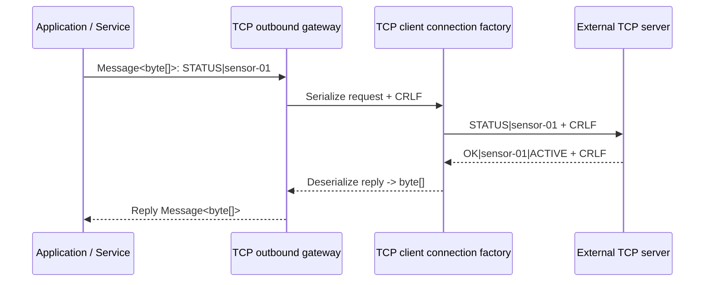
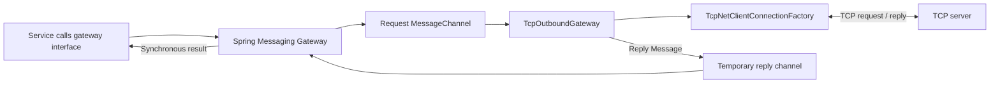
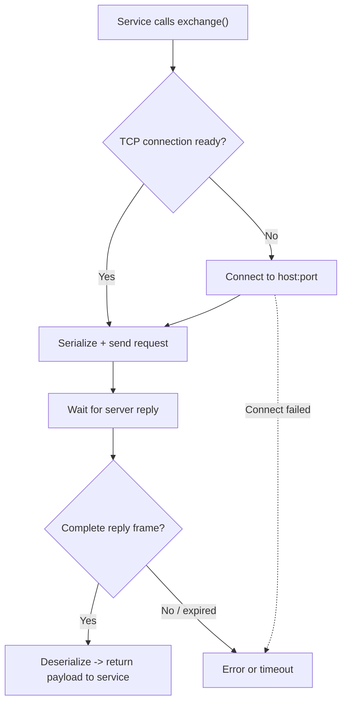

# TCP outbound gateway request-reply

> **Chapter:** TCP Adapter  
> **Module:** SPRING_INTEGRATION_ADAPTERS  
> **Scope:** Connect external systems to Spring Integration using inbound/outbound adapters, gateways, pollers, and MessageChannel. Practice message exchange flows over files, SFTP, HTTP, JMS, AMQP, Kafka, and databases; handle message contracts, errors, and connection lifecycles.

## 1. Learning objectives

After this lesson, you will be able to:

- Describe **TCP outbound gateway** and why this endpoint implements a **request-reply** exchange.
- Configure `TcpOutboundGateway` together with `TcpNetClientConnectionFactory` using Spring Integration Java DSL.
- Send a request from a service through a `MessageChannel` and receive a reply back in the service without manipulating `Socket` directly.
- Choose serializers/deserializers and **framing** conventions so both sides extract requests and replies cleanly from the TCP byte stream.
- Distinguish connection timeouts, reply wait timeouts, protocol errors, and business errors.
- Explain the effects of **connection reuse**, concurrent requests, and reply correlation.
- Design retries, request IDs, idempotency, security, and monitoring for a real TCP system.

## 2. What is a TCP outbound gateway?

`TcpOutboundGateway` is a Spring Integration endpoint that takes a **Spring Message from the application**, sends its content to an external system over **TCP**, then **waits for a response on the TCP connection** and brings that response back into the Spring Integration flow.

For example: a device management application needs to ask a dedicated TCP server whether sensor `sensor-01` is active:

1. The service builds the request `STATUS|sensor-01`.
2. The TCP outbound gateway writes the request to the socket per protocol.
3. The TCP server reads the request, checks status, and sends `OK|sensor-01|ACTIVE`.
4. The gateway reads the full reply frame and returns the result to the calling service.



The name **outbound** describes the **direction of the request originating from Spring Integration outward**. The gateway still handles receiving the reply. TCP is inherently bidirectional at the transport level, while the gateway establishes a **one request → one reply exchange contract** at the Spring Message level.

Unlike `TcpSendingMessageHandler` in a TCP outbound channel adapter, an outbound gateway **does not finish immediately after sending**. It must receive a reply or terminate with an error/timeout according to configuration and connection state.

### 2.1. When should you use an outbound gateway?

Use it when the application **actively calls another TCP server** and needs an answer before continuing:

- Querying device status or inventory from a TCP-only system.
- Sending commands to a dedicated processing server and waiting for `OK` or an error code.
- Interacting with legacy systems using a one-request-one-response convention.
- Exchanging binary messages with length framing, status codes, and request IDs.

If the application only pushes logs, telemetry, or events without **waiting for a per-message response**, a TCP outbound **channel adapter** is a better fit. If an external party connects into the application to send requests and await responses, see **TCP inbound gateway**.

## 3. Architecture and component roles



| Component | Responsibility |
| --- | --- |
| `@MessagingGateway` | Lets Java code invoke methods like a normal API, creating Spring Messages and awaiting replies automatically. |
| `MessageChannel` | Delivers requests from the service to the outbound endpoint; decouples business logic from transport. |
| `TcpOutboundGateway` | Manages request-reply in Spring Integration: writes requests, receives replies, and returns results to the calling flow. |
| `TcpNetClientConnectionFactory` | Creates and manages TCP connections to the target host/port; provides serializer/deserializer. |
| `TcpNioClientConnectionFactory` | NIO-based variant when load and I/O models call for it. |
| `Serializer` | Converts request payloads into bytes with format and framing. |
| `Deserializer` | Reads bytes from the socket until a full reply frame arrives, then returns the payload to the gateway. |

A common point of confusion: **Messaging Gateway** (`@MessagingGateway`) and **TCP outbound gateway** are two distinct layers. `@MessagingGateway` only provides a Java call interface into the message flow. `TcpOutboundGateway` is what executes request-reply against the TCP server.

The application can also send messages via `MessageChannel` without a `@MessagingGateway` interface, though when a synchronous return value is needed, a gateway interface is usually cleaner and clearer.

### 3.1. Message contract at both boundaries

At the **Spring Integration boundary**, requests and replies are Spring `Message` objects with payloads and headers. At the **TCP boundary**, the server sees only the bytes written to the socket.

In the example:

| Item | Data |
| --- | --- |
| Request payload before serialization | `STATUS|sensor-01` as UTF-8 `byte[]` |
| Actual bytes on the socket | `STATUS|sensor-01\r\n` |
| Actual reply on the socket | `OK|sensor-01|ACTIVE\r\n` |
| Reply payload after deserialization | `OK|sensor-01|ACTIVE` as UTF-8 `byte[]` |

Spring Message headers such as `replyChannel`, `errorChannel`, or internal correlation IDs **do not automatically appear in TCP wire data**. If the TCP server requires a request ID, contract version, or credentials, that information must be explicitly represented in the **protocol payload** or handled via a dedicated negotiation/authentication mechanism.

## 4. Framing: TCP does not transmit discrete messages

TCP is a **byte stream**. A single `Socket.write()` call does not guarantee the receiver will read the whole message in one `read()`; multiple writes may also be coalesced into a single read.

Therefore, a request-reply system must define how to separate **both requests and replies**.

| Framing type | Example | When appropriate |
| --- | --- | --- |
| CRLF | `STATUS|sensor-01\r\n` | Text protocols delimited by the two bytes `0D 0A`. |
| LF | `STATUS|sensor-01\n` | Protocols using a single LF byte at the end of a frame. |
| Length header | `[payload length][payload]` | Binary protocols, or payloads with newlines or arbitrary bytes. |
| Connection close | `[payload][EOF]` | Systems specifying one message per connection. |

This lesson uses `ByteArrayCrLfSerializer` for **both serializer and deserializer**:

- When sending a request, the serializer writes the request `byte[]` and **automatically appends** `\r\n`.
- When reading a reply, the deserializer reads up to CRLF and returns `byte[]` **excluding** CRLF.
- Business code **must not pre-append** CRLF to the payload. Doing so can cause the peer to see an extra empty frame.

If the server uses a length header, you must configure the matching serializer/deserializer on the client; changing only one side will cause the protocol to stall, lose synchronization, or decode garbage.

A complete contract should specify **byte order**, character encoding, maximum frame length, escaping rules, error codes, processing time limits, and the semantics of each reply. For binary payloads, prefer framing that does not depend on text characters.

## 5. Hands-on example: querying device status over TCP

A Spring Boot application calls a TCP server running at `127.0.0.1:9002`. The client sends `STATUS|sensor-01` and waits for the server to return `OK|sensor-01|ACTIVE`. The following sections illustrate a complete setup across configuration, service, and test server.

### 5.1. Maven dependencies

Assuming dependency versions are managed by the Spring Boot BOM:

```xml
<dependencies>
    <dependency>
        <groupId>org.springframework.boot</groupId>
        <artifactId>spring-boot-starter-integration</artifactId>
    </dependency>
    <dependency>
        <groupId>org.springframework.integration</groupId>
        <artifactId>spring-integration-ip</artifactId>
    </dependency>
</dependencies>
```

`spring-integration-ip` provides TCP gateways, adapters, connection factories, and serializers. The example uses **Java 17+** and the Java DSL style common in **Spring Integration 6.x**.

### 5.2. Configuring the TCP connection factory and outbound gateway

Create `TcpOutboundGatewayConfiguration.java`:

```java
import org.springframework.context.annotation.Bean;
import org.springframework.context.annotation.Configuration;
import org.springframework.integration.annotation.IntegrationComponentScan;
import org.springframework.integration.config.EnableIntegration;
import org.springframework.integration.dsl.IntegrationFlow;
import org.springframework.integration.ip.dsl.Tcp;
import org.springframework.integration.ip.tcp.connection.TcpNetClientConnectionFactory;
import org.springframework.integration.ip.tcp.serializer.ByteArrayCrLfSerializer;

@Configuration
@EnableIntegration
@IntegrationComponentScan
public class TcpOutboundGatewayConfiguration {

    @Bean
    TcpNetClientConnectionFactory tcpStatusClientFactory() {
        var factory =
                new TcpNetClientConnectionFactory("127.0.0.1", 9002);

        // Example keeps a live TCP connection for multiple sequential requests.
        factory.setSingleUse(false);

        // Both outgoing requests and incoming replies end with CRLF.
        factory.setSerializer(new ByteArrayCrLfSerializer());
        factory.setDeserializer(new ByteArrayCrLfSerializer());

        return factory;
    }

    @Bean
    IntegrationFlow statusRequestReplyFlow(
            TcpNetClientConnectionFactory tcpStatusClientFactory) {

        return IntegrationFlow
                .from("tcpStatusRequests")
                .handle(Tcp.outboundGateway(tcpStatusClientFactory))
                .get();
    }
}
```

**Flow path in the configuration:**

1. The service sends a request into `tcpStatusRequests`.
2. The flow passes the message to `Tcp.outboundGateway(...)`, the TCP outbound gateway endpoint.
3. The gateway uses `tcpStatusClientFactory` to connect over TCP to `127.0.0.1:9002` and write the CRLF-delimited request.
4. The gateway waits for the response; the deserializer reads the complete reply frame and produces a Spring reply Message.
5. The reply is routed back through the request flow's reply mechanism so the caller receives the result.

In this example, `singleUse=false` lets the connection factory reuse the socket while active. **This does not mean one socket supports unlimited concurrent in-flight requests.** The TCP outbound gateway must preserve request/reply correlation; the concurrency section explains this in detail.

**Do not carry demo hard-coded host/port values into production.** Read them from environment configuration, with appropriate connection limits, timeouts, and TLS policies.

### 5.3. Creating a gateway interface for the business layer

Create the `RemoteStatusGateway.java` interface in a package scanned by `@IntegrationComponentScan`:

```java
import org.springframework.integration.annotation.MessagingGateway;

@MessagingGateway(defaultRequestChannel = "tcpStatusRequests")
public interface RemoteStatusGateway {

    byte[] exchange(byte[] request);
}
```

When `exchange(...)` is called, Spring Integration builds a Spring request Message from `byte[]` and sends it to `tcpStatusRequests`. The call waits for the reply from the outbound gateway and returns the `byte[]` payload.

In a production system, configure bounded timeouts on both the gateway and socket layers to avoid hanging callers indefinitely when the server stops responding. Exact property configuration depends on your Spring Integration version and application timeout policy.

### 5.4. Business service sending requests and checking replies

Create `RemoteDeviceStatusClient.java`:

```java
import java.nio.charset.StandardCharsets;

import org.springframework.stereotype.Service;

@Service
public class RemoteDeviceStatusClient {

    private final RemoteStatusGateway remoteStatusGateway;

    public RemoteDeviceStatusClient(RemoteStatusGateway remoteStatusGateway) {
        this.remoteStatusGateway = remoteStatusGateway;
    }

    public String getStatus(String deviceId) {
        if (deviceId == null
                || !deviceId.matches("[A-Za-z0-9_-]{1,32}")) {
            throw new IllegalArgumentException("Invalid device ID");
        }

        String request = "STATUS|" + deviceId;
        byte[] requestBytes = request.getBytes(StandardCharsets.UTF_8);

        // Synchronous: waits for the reply from the TCP outbound gateway.
        byte[] replyBytes = remoteStatusGateway.exchange(requestBytes);

        if (replyBytes == null) {
            throw new IllegalStateException("Missing TCP reply");
        }

        String response = new String(
                replyBytes, StandardCharsets.UTF_8
        );

        if (response.startsWith("ERR|")) {
            throw new IllegalStateException(
                    "Remote server rejected request: " + response
            );
        }

        String[] parts = response.split("\\|", -1);

        if (parts.length != 3
                || !"OK".equals(parts[0])
                || !deviceId.equals(parts[1])) {
            throw new IllegalStateException(
                    "Unexpected TCP reply: " + response
            );
        }

        return parts[2]; // ACTIVE or INACTIVE in this example.
    }
}
```

This code shows that **the service does not depend on Socket APIs**. It only knows the request/reply contract and the gateway interface. If the server returns `ERR|...`, that is a **business reply** and must be processed as data rather than assumed to be a network error.

The parser currently illustrates three fixed fields. When designing a real protocol, add a version code, request ID, number format, escaping rules, max size, and accepted error code set.

### 5.5. Test TCP server

Create a standalone Java program `StatusTcpServerDemo.java`. This is a mock server and does not use Spring Integration:

```java
import java.io.BufferedReader;
import java.io.BufferedWriter;
import java.io.InputStreamReader;
import java.io.OutputStreamWriter;
import java.net.ServerSocket;
import java.net.Socket;
import java.nio.charset.StandardCharsets;

public class StatusTcpServerDemo {

    public static void main(String[] args) throws Exception {
        try (ServerSocket listener = new ServerSocket(9002)) {
            System.out.println("TCP status server listening on port 9002");

            while (true) {
                // Simple demo serving one connection at a time.
                try (Socket client = listener.accept();
                     BufferedReader reader = new BufferedReader(
                             new InputStreamReader(
                                     client.getInputStream(),
                                     StandardCharsets.UTF_8));
                     BufferedWriter writer = new BufferedWriter(
                             new OutputStreamWriter(
                                     client.getOutputStream(),
                                     StandardCharsets.UTF_8))) {

                    String request;
                    while ((request = reader.readLine()) != null) {
                        System.out.println("Received: " + request);

                        String reply = switch (request) {
                            case "STATUS|sensor-01" ->
                                    "OK|sensor-01|ACTIVE";
                            case "STATUS|sensor-02" ->
                                    "OK|sensor-02|INACTIVE";
                            default -> "ERR|BAD_REQUEST";
                        };

                        writer.write(reply);
                        writer.write("\r\n");
                        writer.flush();
                    }
                }
            }
        }
    }
}
```

`BufferedReader.readLine()` separates requests by line; `BufferedWriter` sends replies with CRLF. Each valid request produces **one reply**. This server handles **one connection at a time** for easy observation and is not a pattern for high-load servers. Thanks to the inner `while` loop, a client keeping its connection open can send multiple requests **sequentially**.

### 5.6. End-to-end test run

You can add an `ApplicationRunner` to test calling it after Spring Boot starts:

```java
import org.springframework.boot.ApplicationRunner;
import org.springframework.context.annotation.Bean;
import org.springframework.context.annotation.Configuration;

@Configuration
public class TcpStatusDemoRunner {

    @Bean
    ApplicationRunner callTcpServer(RemoteDeviceStatusClient client) {
        return args -> {
            System.out.println(
                    "sensor-01 status = " + client.getStatus("sensor-01"));
            System.out.println(
                    "sensor-02 status = " + client.getStatus("sensor-02"));
        };
    }
}
```

Execution sequence:

1. Start `StatusTcpServerDemo` to listen on port `9002`.
2. Start the Spring Boot application with `TcpOutboundGatewayConfiguration`, `RemoteStatusGateway`, `RemoteDeviceStatusClient`, and `TcpStatusDemoRunner`.
3. Observe the service printing both statuses and the server printing the two corresponding requests.
4. Stop the server and call `getStatus(...)` again to observe how connection errors or timeouts surface.
5. Remove `TcpStatusDemoRunner` when finished testing; in production, requests originate from real business flows.

Expected output from the application:

```text
sensor-01 status = ACTIVE
sensor-02 status = INACTIVE
```

Expected output from the server:

```text
Received: STATUS|sensor-01
Received: STATUS|sensor-02
```

This is the **expected output based on the illustrative program**, not an actual captured test run in this article. Both sends and both responses share the same CRLF contract.

## 6. Request-reply mechanism and message correlation

### 6.1. Why wait for a reply?

In an outbound adapter, the endpoint is only responsible for sending. An outbound gateway must return **the reply matching a request** back to the right caller. If multiple concurrent requests share one connection without a request ID in the protocol, the client can struggle to tell which reply belongs to which request.

With a TCP outbound gateway and a **shared connection**, request-reply exchange typically **serializes requests per connection** to preserve a one-request → one-reply relationship. This can cause callers to block behind each other when the server is slow.

Example sequence on a single connection:

```text
Client -> Server: STATUS|sensor-01\r\n
Client <- Server: OK|sensor-01|ACTIVE\r\n

Client -> Server: STATUS|sensor-02\r\n
Client <- Server: OK|sensor-02|INACTIVE\r\n
```

Do not confuse TCP byte ordering with a complete **correlation protocol**. If the application needs to send multiple independent requests in parallel, evaluate connection factory design, dedicated connection pools, and business-level correlation rules.

### 6.2. Reused connections vs. single-use connections

| Configuration | Typical behavior | Trade-offs |
| --- | --- | --- |
| `singleUse=false` | Reuses an active connection across multiple request/reply rounds. | Reduces socket open overhead, but requests on the same connection may block each other. |
| `singleUse=true` | Each exchange uses a separate connection and closes it per factory policy. | Better isolation per request, but higher socket open/close overhead and requires connection count control. |
| Connection factory with suitable cache/pool | Distributes requests across multiple connections within configured limits. | Must manage max connections, queuing, timeouts, and server load shedding. |

**Do not assume `singleUse=false` keeps a socket open forever.** The server can close the connection, the network can drop, and the next call may have to reconnect. If the server is processing a request when the network drops, the client also cannot be certain whether the operation succeeded.

### 6.3. One reply required per request

The gateway expects **one properly framed reply**. If the TCP server writes only a partial response, omits CRLF, returns multiple replies, or returns nothing, the caller may time out, hit a protocol error, or corrupt subsequent exchanges on that connection.

Subtle bugs that are hard to spot with long-lived connections:

- A reply to an earlier request arrives after the client has already timed out.
- The server writes two frames for one request, leaving stray data on the connection.
- The server pushes an unsolicited event onto a socket used for request-reply.
- A reply contains an unescaped CRLF inside its content when both sides lack escaping.

To reduce the risk of mismatched replies, strictly enforce **one request → one response**, design sensible timeouts/connection resets, and add a request ID in the protocol when correlation must be verified beyond the connection layer.

## 7. Timeouts: connect, reply wait, and business processing

A request can stall at several points:



| Timeout | Impact | Design suggestion |
| --- | --- | --- |
| **Connect timeout** | Unable to open TCP socket to server in time. | Bound connect time; check host, port, firewall, DNS, and server health. |
| **Request timeout** | Unable to acquire send turn/connection within limit, depending on gateway config. | Bound resource wait time; avoid blocking callers indefinitely behind one slow request. |
| **Remote/reply timeout** | Request sent, but complete reply not received in time. | Define server SLA and post-timeout behavior. |
| **Read/socket timeout** | Socket read operation expires. | Test interaction with framing and connection close/reset policy. |
| **Business timeout** | Server takes too long on DB or downstream API. | Apply per-dependency timeouts; return an error response when possible. |

Property names and timeout behaviors vary across versions and gateway/connection factory configurations. When implementing, verify options such as **request timeout**, **remote timeout**, and **socket timeout** in your exact Spring Integration version, then test with a hanging mock server to confirm the expected maximum latency.

### 7.1. Does a timeout mean the server failed?

**No.** Suppose the client sends:

```text
CHARGE|req-9042|order-17|1500
```

The server commits the transaction, but the connection drops before the client reads `OK|req-9042|COMPLETED`. The caller sees a timeout and might retry. If the server does not check `req-9042`, the transaction could be executed twice.

This is the difference between:

- **Socket write succeeded:** the sender handed bytes off to the transport layer from its perspective.
- **Server received complete frame:** the TCP server reader detected a complete request.
- **Server business processing succeeded:** business logic completed as committed.
- **Client received ACK/response:** the caller observed the outcome, though the exact meaning of the ACK must also be defined.

The gateway facilitates request/reply exchange; it **does not provide exactly-once delivery or exactly-once processing** for business state changes.

## 8. Error handling and reliability

### 8.1. Distinguishing three error groups

| Group | Examples | How to handle |
| --- | --- | --- |
| **Transport errors** | `Connection refused`, `Connection reset`, `Broken pipe`, reconnect failures. | Log host/port/correlation ID; retry with bounds depending on request nature. |
| **Framing/protocol errors** | Reply missing CRLF, oversized payload, invalid schema, extra responses. | Check serializer/deserializer; reject malformed data and handle potentially desynchronized connections. |
| **Business error replies** | `ERR|NOT_FOUND` or `ERR|BAD_REQUEST`. | Parser receives the valid reply and maps it to a business result or exception. |

In a synchronous flow, gateway errors can surface as exceptions to the caller through `@MessagingGateway`. With asynchronous channels, where errors are caught and when callers receive results change. Do not introduce `ExecutorChannel` or `QueueChannel` into a request-reply flow without designing the accompanying reply, timeout, and error-handling mechanisms.

**`errorChannel` does not turn every error into a TCP response.** For an outbound gateway, send failures or timeouts must be handled on the calling side, whereas an `ERR|...` code sent by the server is a **normal reply at the protocol level** and is interpreted by the business parser.

### 8.2. Conditional retries

| Request | Safe to auto-retry? | Reason |
| --- | --- | --- |
| `STATUS|sensor-01` | Usually yes if the query is a pure read. | Calling again may return newer status without mutating data. |
| `SET_LEVEL|req-1|sensor-01|5` | Only if idempotency is explicitly confirmed. | Depends on whether the command means "set to 5" or "increment by 5". |
| `CHARGE|req-2|order-17|1500` | Never retry blindly. | If the server already processed it before timeout, resending can duplicate the transaction. |

For critical state-changing commands, include:

1. **Unique Request ID** generated before the first send attempt.
2. Server **stores request ID and result** consistently and returns the same result for duplicate requests.
3. **Correlation ID in the response** so the client knows which command the reply belongs to.
4. Timeout rules and retries with **backoff and max attempts**.
5. Reconciliation policy when a connection drops while the server may already have committed.
6. Well-defined response codes: `ACCEPTED`, `COMPLETED`, `REJECTED`, and unknown state handling.

If a legacy system does not support request IDs, restrict retries appropriately and consider result reconciliation rather than claiming resends are safe.

### 8.3. Example contract with request ID

The protocol can be extended as:

```text
Request: STATUS|req-20261123-001|sensor-01
Reply:   OK|req-20261123-001|sensor-01|ACTIVE
Error:   ERR|req-20261123-001|NOT_FOUND
```

The client-side parser should check the **request ID in the reply**, rather than relying solely on timing or socket order. For operations with side effects, storing results by request ID on the server is the primary mechanism to prevent duplicate execution.

## 9. Comparing all four TCP endpoints in Spring Integration

| Component | Data direction | Request-reply? | When to use |
| --- | --- | --- | --- |
| **TCP inbound channel adapter** | TCP → Spring Message | Does not reply automatically | Devices sending telemetry or events into the application. |
| **TCP outbound channel adapter** | Spring Message → TCP | Does not wait for response | Application pushing events to a TCP server. |
| **TCP inbound gateway** | TCP request → flow → TCP reply | Yes | External client connects into the application and awaits a result. |
| **TCP outbound gateway** | Flow request → TCP → flow reply | **Yes** | Application actively calls a TCP server and awaits a result. |

A simple mental model: if **another system calls your application** and needs a result, use an **inbound gateway**. If **your application calls another system** and needs a result, use an **outbound gateway**.

Avoid pairing an outbound channel adapter with an inbound adapter and manually waiting for replies on every ordinary request, unless the protocol is genuinely asynchronous bidirectional with its own correlation ID. For synchronous request-reply contracts, the outbound gateway handles the reply path directly.

## 10. Security, resources, and operations

### 10.1. Transport security

Plain TCP **does not encrypt** data. In real systems, consider:

- TLS for client-server connections, configured at the connection factory or appropriate network layer.
- Certificate/server identity verification to avoid connecting to the wrong target system.
- Business-level authentication and authorization for control commands.
- Never writing raw payloads or credentials into logs, metrics, or error responses.
- Restricting allowed target hosts/ports and managing secrets/certificates via deployment workflows.

A successful socket connection does not mean the server is trustworthy, and an `OK` reply is only meaningful when both the source and response contract are verified.

### 10.2. Resource management

- **Connection limits:** avoid opening too many sockets when the target server slows down.
- **Pending request limits:** protect thread pools and callers from being held indefinitely.
- **Frame limits:** check byte size before serialization and enforce limits in the deserializer.
- **Retry limits:** apply backoff, jitter, and circuit-breaking/stop policies when the server is unavailable.
- **Queue management:** if placing a queue before the gateway, handle routing replies back to the right caller and backlog overflow.
- **Shutdown:** close connections gracefully; requests already sent without a reply must be treated as **outcome unknown** unless the protocol provides durable confirmation.

### 10.3. Operational observability

| Metric / log | Benefit |
| --- | --- |
| Request rate, success replies, and `ERR` replies | Separate normal traffic from business errors. |
| Request latency (p50, p95, p99) | Identify slow servers or dependencies. |
| Connect failures, resets, timeouts, reconnects | Track TCP layer stability. |
| Wait time to acquire a connection or turn behind prior request | Detect bottlenecks from limited connections. |
| Request/reply sizes, malformed frame counts | Spot abnormal payloads and framing mismatches. |
| Request ID and command type | Trace individual exchanges without logging full sensitive content. |

Distinguish **latency with reply**, **timeout with unknown outcome**, and **business error reply**. Do not lump these three into a single `TCP failed` metric.

## 11. Critical test scenarios

Beyond the happy path, intentionally test:

1. **One request → one reply:** returns exactly one CRLF frame and the parser interprets it correctly.
2. **Byte fragmentation:** server sends a reply across two `write()` calls; the gateway must still wait for the full CRLF.
3. **Reply missing CRLF:** caller hits timeout or policy-appropriate error instead of treating partial data as a valid reply.
4. **Extra reply:** server sends two frames for one request; verify connection handling after the stray reply.
5. **Connection closed before reply:** verify whether retry is safe and how unknown outcomes are classified.
6. **Slow server processing:** measure how callers block behind each other when sharing one connection.
7. **Payload containing CR/LF:** must escape per protocol or switch framing to length header.
8. **Response with wrong request ID:** client must never accept a result belonging to another request.
9. **Very large payloads and Unicode:** verify byte length checks and deserializer memory limits.
10. **Server recovery:** client detects a dead pooled connection and recovers per configuration without automatically declaring the previous request a business failure.

## 12. Extension exercises

**Exercise 1 — Business error responses.** Update `StatusTcpServerDemo` to return `ERR|NOT_FOUND` for valid IDs without data and `ERR|BAD_REQUEST` for schema-invalid requests. Update `RemoteDeviceStatusClient` to distinguish the two cases.

**Exercise 2 — Timeout testing.** Make the TCP server accept a request and withhold the response for a long period. Configure client timeouts for your version, observe the exception, and determine whether the server could already have processed the request.

**Exercise 3 — Concurrency testing.** Spawn 20 concurrent callers invoking `getStatus(...)` while the mock server takes 500 ms per request. Compare against a setup with multiple connections bounded by an appropriate connection factory/pool. Measure p95 latency, connection count, and response order.

**Exercise 4 — Duplicate prevention.** Extend the protocol with `requestId` and a side-effecting command; store results by request ID on the server. Simulate the server finishing processing and closing the socket before the reply reaches the client, then verify a resend does not execute the command a second time.

**Exercise 5 — Switch framing.** Change to a length header for payloads containing CR/LF. Identify the coordinated changes required in the request serializer, reply deserializer, and server implementation.

## 13. Knowledge self-check

1. Why does a TCP outbound gateway still receive data from TCP even though it is named *outbound*?
2. How do `TcpNetClientConnectionFactory` and `TcpOutboundGateway` differ in responsibility?
3. What is the role of `@MessagingGateway` in the example?
4. If the client uses `ByteArrayCrLfSerializer`, should you manually append `\r\n` to the request payload?
5. Why can requests from multiple callers block behind each other when sharing one TCP connection?
6. When a gateway times out, can you conclude the server has not executed the command?
7. Why is an `ERR|NOT_FOUND` reply different from a `Connection reset` socket error?
8. Why are Spring `MessageHeaders` insufficient for an external TCP server to understand a request ID?
9. When should you use an outbound channel adapter instead of an outbound gateway?
10. What must be added to safely retry state-changing commands?

**Hints:** (1) Outbound describes the direction of the originating request; the gateway exchanges replies too. (2) The factory manages connections/framing; the gateway manages request-reply. (3) Creates a Java interface to call the message flow and receive the reply. (4) No, the serializer appends CRLF automatically. (5) The gateway must maintain per-request reply correlation on a shared socket. (6) No, the reply may be lost after server processing. (7) The former is a validly framed business reply; the latter is a transport error. (8) Headers are not automatically serialized onto TCP. (9) When only emitting events without needing a corresponding response. (10) Request ID, correlation, idempotency, bounded retries, and business confirmation.

**Key takeaway:** A TCP outbound gateway bridges **Spring Message → TCP request → TCP reply → Spring Message**. Transport-level success does not equal business-level success; a reliable solution must explicitly define **framing, payload, request-reply correlation, timeouts, errors, connections, retries, and idempotency**.
