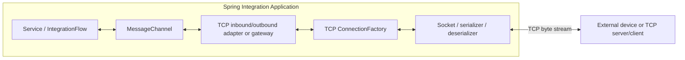
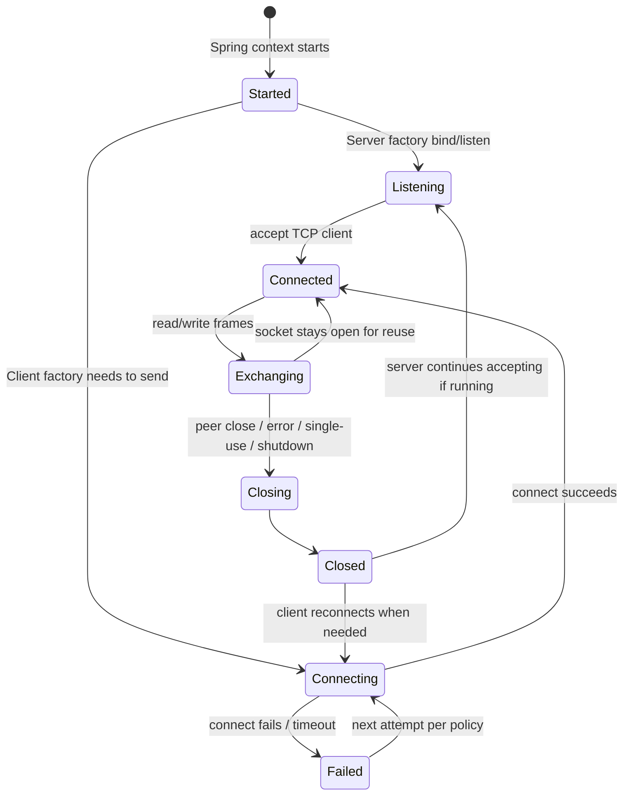
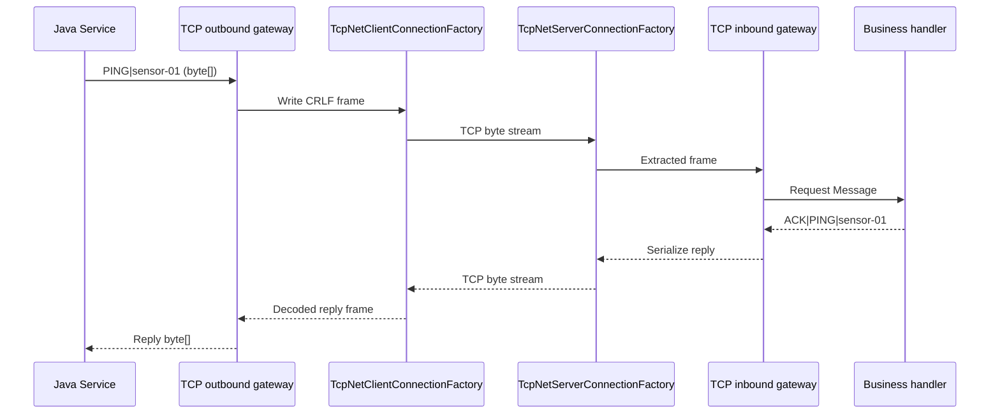

# ConnectionFactory and socket management

> **Chapter:** TCP Adapter  
> **Module:** SPRING_INTEGRATION_ADAPTERS  
> **Module scope:** Connect external systems to Spring Integration using inbound/outbound adapters, gateways, pollers, and MessageChannel. Practice message exchange flows over files, SFTP, HTTP, JMS, AMQP, Kafka, and databases; handle message contracts, errors, and connection lifecycles.

## 1. Learning objectives

After this lesson, you will be able to:

- Explain the responsibilities of a **TCP ConnectionFactory** compared to adapters, gateways, and `MessageChannel` in Spring Integration.
- Choose the appropriate connection factory between **server/client** and **Java IO/NIO**.
- Configure serializers/deserializers to define message boundaries on the TCP byte stream.
- Understand the socket lifecycle: **listen/accept or connect → exchange bytes → reuse or close → reconnect**.
- Distinguish shared connections, single-use connections, and connections in a **pool/cache**.
- Recognize the role of socket timeouts, resource limits, keepalive, connection events, and TLS.
- Test scenarios such as missing frame delimiters, mid-stream server disconnects, and timed-out requests where the receiver may still have processed the message.

## 2. Where does ConnectionFactory sit in the architecture?

Spring Integration lets you program around **messages** instead of writing socket creation, byte-reading loops, thread coordination, and connection management manually. In this model, the **TCP connection factory** is the component that creates and manages transport connections, while the **TCP adapter or gateway** is the endpoint bridging the TCP network with `MessageChannel`.



| Component | Responsible for | Not responsible for |
| --- | --- | --- |
| `MessageChannel` | Passing `Message<?>` between internal endpoints. | Opening TCP sockets or decoding frames. |
| TCP inbound/outbound **adapter** | Moving data into or out of the application unidirectionally. | Automatically guaranteeing a business reply for every request. |
| TCP inbound/outbound **gateway** | Coordinating correlated request/reply in the message flow. | Defining business semantics of `OK`, `ACK`, or retries. |
| **ConnectionFactory** | Creating or accepting connections, configuring byte framing, managing lifecycle. | Parsing `STATUS`, `ORDER` commands or persisting business data. |
| **Serializer/Deserializer** | Framing outbound bytes and detecting a complete inbound frame. | Schema validation, authorization, and guaranteeing exactly-once processing. |

A single TCP socket can carry **many messages**; a single message can be split across **multiple reads**. The connection factory works with the serializer/deserializer and endpoint so handlers see each complete payload. This capability underpins both inbound/outbound adapters and gateways.

**Distinguishing two easily confused terms:** *inbound/outbound* describes Spring Message direction, whereas *client/server* describes TCP socket establishment role. A system can have an inbound adapter using a **server factory** to receive external data, or an outbound gateway using a **client factory** to call out actively. These two dimensions are independent.

## 3. Four primary ConnectionFactory choices

| Connection factory | Socket role | IO model | Common use case |
| --- | --- | --- | --- |
| `TcpNetServerConnectionFactory` | TCP **server** listening on a port, accepting clients. | Classic Java IO (blocking IO). | External devices actively connect to send events or make request/reply calls. |
| `TcpNetClientConnectionFactory` | TCP **client** actively connecting to a server host/port. | Classic Java IO. | Application pushes data or calls legacy TCP services. |
| `TcpNioServerConnectionFactory` | TCP **server** listening on a port. | Java NIO. | Consider when handling many connections and optimizing I/O threading. |
| `TcpNioClientConnectionFactory` | TCP **client** actively opening connections. | Java NIO. | Consider based on load profile, socket count, and I/O overhead. |

### 3.1. Server factory vs. client factory

A **server connection factory** listens on a local port. When a client connects, it receives an accepted socket, reads incoming bytes, and manages that session. For example, a telemetry collector opens port `9100` for hundreds of devices to connect to.

A **client connection factory** knows the target host/port and opens a connection when the application needs to send a request/message. For example, a service sends control commands to `192.0.2.10:9100` over TCP. It must handle connection failures, server-closed sockets, timeouts, and reconnects.

Either a server or client factory can serve an **adapter** or a **gateway** depending on the integration pattern. Choose the factory role first based on **which side actively initiates the TCP connection**.

### 3.2. Java IO vs. NIO

- **Net factories** use the traditional socket IO model; they are usually simpler to set up and suit most exercises or moderate connection counts.
- **NIO factories** use non-blocking I/O at the socket layer; they can reduce thread overhead for large numbers of connections, but require testing actual protocol and processing behavior.
- **NIO does not automatically make business handlers asynchronous.** If a handler still calls a slow database or API, the bottleneck remains.
- Neither factory is universally faster. Measure concurrent connections, request/reply latency, CPU, memory, and behavior under load before choosing.

In the main examples, we use `TcpNetServerConnectionFactory` and `TcpNetClientConnectionFactory` so socket behavior is easy to observe.

## 4. Lifecycle of a TCP socket through ConnectionFactory

The basic lifecycle can be pictured as follows:



The diagram shows both client and server roles together; `Listening` applies only to server factories, and `Connecting` applies to client factories. Starting a server factory **binds the port** to await connections. A client factory does not necessarily open a socket immediately when Spring creates the bean; connections may be opened on demand when an exchange occurs.

Key lifecycle stages to understand:

1. **Bean initialization and management:** Spring owns the factories and endpoints when declared as `@Bean`. The container manages start/stop cleanly; you never create `ServerSocket` manually inside services.
2. **Establishment:** Server binds the port and calls `accept`; client resolves host/port and calls `connect`. Failures here include port in use, firewalls, DNS, or timeouts.
3. **Receiving frames:** The connection reads bytes via the deserializer. If the delimiter/length header is incomplete, the bytes have not yet formed a complete Spring Message.
4. **Sending frames:** The serializer writes the payload along with the agreed framing metadata.
5. **Reuse or close:** A connection may serve multiple exchanges, or close after a single send/exchange depending on `singleUse` and protocol rules.
6. **Recovery:** When a socket breaks, the next exchange may need a new connection. Never treat reconnect as an automatic guarantee that previous messages are resent.
7. **Shutdown:** When the application stops, endpoints/factories must shut down gracefully; you still need a business policy for requests that have not received an ACK.

### 4.1. Connection ID is not a device identity

Spring Integration can populate connection info in message headers, notably `IpHeaders.CONNECTION_ID`. This header is useful for logging and **routing replies back to the right socket** in flows that require it.

However, `connectionId` can change after a reconnect, multiple messages share one connection ID, and one device can open multiple connections. **Never use connection ID or source IP as an authenticated identity, request ID, or idempotency key.**

## 5. Serializer and deserializer as the two-sided contract

TCP guarantees **byte** ordering on an active connection, not `Message` boundaries. One `write()` on the sender can become multiple `read()` calls on the receiver; multiple `write()` calls can also arrive in a single read.

Both ends of the protocol must agree on **framing**:

| Type | Example bytes on wire | Notes |
| --- | --- | --- |
| CRLF | `PING\r\n` | Uses terminator `0D 0A`; unescaped CRLF must not appear in payload. |
| LF | `PING\n` | Uses only one `0A` byte as delimiter. |
| Length header | `[byte count][payload]` | Suitable for binary payloads, but length format and frame limits must match. |
| Connection close | `[payload] + close` | Valid only if the protocol terminates every message by closing the socket. |

Spring Integration includes serializers/deserializers such as `ByteArrayCrLfSerializer`, `ByteArrayLfSerializer`, and `ByteArrayLengthHeaderSerializer`. The same class can often serve both directions, as long as **it is configured on both**:

```java
var factory = new TcpNetClientConnectionFactory("127.0.0.1", 9100);

factory.setSerializer(new ByteArrayCrLfSerializer());   // When writing.
factory.setDeserializer(new ByteArrayCrLfSerializer()); // When reading.
```

If the business payload is `PING`, `ByteArrayCrLfSerializer` will **append CRLF automatically when writing to the socket**. Sending code must not add `\r\n` to the payload beforehand. The receiver reads up to CRLF and returns the frame content. For multi-byte UTF-8, check size by **encoded byte count**, not character count.

Receiving a complete frame does not mean the payload is **business-valid**. For instance, `TEMP|sensor-01|abc\r\n` is a valid CRLF frame, yet the temperature cannot be parsed as a number. A validation step is required after deserialization.

### 5.1. Frame size limits

In production systems, a client might send a stream that never terminates with CRLF. If the deserializer keeps accumulating bytes indefinitely, memory can be exhausted. Configure an **appropriate max message size on the serializer** and bound frame wait times. When an oversized or malformed frame occurs, classify it as a **framing error** rather than passing it to the business parser as a normal message.

## 6. Self-contained example: both server factory and client factory

To see both roles clearly, run **one Spring Boot application containing both a TCP server and a TCP client** locally:

- **Server factory** listens on port `9100` locally; the example leaves bind address unrestricted while the client connects via `127.0.0.1`.
- **Client factory** actively connects to `127.0.0.1:9100`.
- **Inbound gateway** on the server reads requests and creates `ACK|...` replies.
- **Outbound gateway** on the client sends requests and awaits replies.
- Both use CRLF framing and keep a socket open while active.

In real deployments, client and server usually live in **two separate applications**; placing them in one app here is purely to demonstrate how ConnectionFactory works.



### 6.1. Dependencies

With Spring Boot managing versions via BOM:

```xml
<dependencies>
    <dependency>
        <groupId>org.springframework.boot</groupId>
        <artifactId>spring-boot-starter-integration</artifactId>
    </dependency>
    <dependency>
        <groupId>org.springframework.integration</groupId>
        <artifactId>spring-integration-ip</artifactId>
    </dependency>
</dependencies>
```

The code snippets target Spring Integration 6.x and Java 17+. You need a standard Spring Boot application whose component scan covers the package containing the classes below.

### 6.2. Declaring two connection factories and two gateways

Create `TcpConnectionsDemoConfiguration.java`:

```java
import java.nio.charset.StandardCharsets;

import org.springframework.context.annotation.Bean;
import org.springframework.context.annotation.Configuration;
import org.springframework.integration.annotation.IntegrationComponentScan;
import org.springframework.integration.config.EnableIntegration;
import org.springframework.integration.dsl.IntegrationFlow;
import org.springframework.integration.ip.dsl.Tcp;
import org.springframework.integration.ip.tcp.connection.TcpNetClientConnectionFactory;
import org.springframework.integration.ip.tcp.connection.TcpNetServerConnectionFactory;
import org.springframework.integration.ip.tcp.serializer.ByteArrayCrLfSerializer;

@Configuration
@EnableIntegration
@IntegrationComponentScan
public class TcpConnectionsDemoConfiguration {

    @Bean
    TcpNetServerConnectionFactory localTcpServerFactory() {
        var factory = new TcpNetServerConnectionFactory(9100);
        factory.setSerializer(new ByteArrayCrLfSerializer());
        factory.setDeserializer(new ByteArrayCrLfSerializer());

        // Allows multiple sequential requests on one socket.
        factory.setSingleUse(false);

        return factory;
    }

    @Bean
    TcpNetClientConnectionFactory localTcpClientFactory() {
        var factory =
                new TcpNetClientConnectionFactory("127.0.0.1", 9100);
        factory.setSerializer(new ByteArrayCrLfSerializer());
        factory.setDeserializer(new ByteArrayCrLfSerializer());
        factory.setSingleUse(false);

        return factory;
    }

    // Server: receives TCP requests and replies on the same connection.
    @Bean
    IntegrationFlow localTcpServerFlow(
            TcpNetServerConnectionFactory localTcpServerFactory) {

        return IntegrationFlow
                .from(Tcp.inboundGateway(localTcpServerFactory))
                .handle((payload, headers) -> {
                    String request = new String(
                            (byte[]) payload, StandardCharsets.UTF_8);

                    String reply = "ACK|" + request;
                    return reply.getBytes(StandardCharsets.UTF_8);
                })
                .get();
    }

    // Client: sends Spring Messages over TCP and waits for replies.
    @Bean
    IntegrationFlow localTcpClientFlow(
            TcpNetClientConnectionFactory localTcpClientFactory) {

        return IntegrationFlow
                .from("localTcpRequests")
                .handle(Tcp.outboundGateway(localTcpClientFactory))
                .get();
    }
}
```

**Explanation:**

1. `localTcpServerFactory()` listens on TCP port `9100` and provides send/receive sockets for the **inbound gateway**.
2. `localTcpClientFactory()` creates client sockets connecting to the server at `127.0.0.1:9100`, used by the **outbound gateway**.
3. Both factories configure CRLF serializer/deserializer so each side can decode data from the other.
4. `singleUse=false` allows an active socket to handle multiple request-reply rounds; if the server closes the socket, the next exchange still needs error/reconnect handling.
5. `IntegrationFlow.from(Tcp.inboundGateway(...))` creates the TCP server side and handler returning the reply payload.
6. `IntegrationFlow.from("localTcpRequests").handle(Tcp.outboundGateway(...))` connects a message channel to the TCP client request-reply side.

Here the client and server factories **do not share the same socket object**: each side owns its own endpoint socket of a TCP connection. They communicate only over the TCP host/port.

### 6.3. Creating a Java interface to call via MessageChannel

Create `LocalTcpEchoClient.java`:

```java
import org.springframework.integration.annotation.MessagingGateway;

@MessagingGateway(defaultRequestChannel = "localTcpRequests")
public interface LocalTcpEchoClient {
    byte[] exchange(byte[] request);
}
```

`@MessagingGateway` here is an **internal Messaging Gateway** that turns a Java method call into a Spring Message and returns the reply to the caller. It is not a connection factory and does not write directly to a TCP socket.

### 6.4. Sending two test requests

Create `LocalTcpDemoRunner.java`:

```java
import java.nio.charset.StandardCharsets;

import org.springframework.boot.ApplicationRunner;
import org.springframework.context.annotation.Bean;
import org.springframework.context.annotation.Configuration;

@Configuration
public class LocalTcpDemoRunner {

    @Bean
    ApplicationRunner runTcpDemo(LocalTcpEchoClient client) {
        return args -> {
            sendAndPrint(client, "PING|sensor-01");
            sendAndPrint(client, "PING|sensor-02");
        };
    }

    private static void sendAndPrint(
            LocalTcpEchoClient client, String text) {

        byte[] request = text.getBytes(StandardCharsets.UTF_8);
        byte[] reply = client.exchange(request);

        System.out.printf(
                "request=%s, reply=%s%n",
                text, new String(reply, StandardCharsets.UTF_8)
        );
    }
}
```

When running the application with port `9100` available, expected output:

```text
request=PING|sensor-01, reply=ACK|PING|sensor-01
request=PING|sensor-02, reply=ACK|PING|sensor-02
```

Each request and reply automatically gets CRLF appended on the socket by the serializer, while the payloads seen by the service do not contain CRLF. With `singleUse=false`, sequential exchanges **can** reuse the same TCP connection. The output above is **expected from the example**, not a live test capture inside this document.

**Remember:** Running the demo in one JVM makes both sides easy to inspect. Do not treat calling localhost like this as a production architecture. When deploying two applications, the server opens a port matching its network setup; the client uses the real host/port and configures TLS/timeouts/access controls.

### 6.5. When only one-way send/receive is needed

Using a gateway is not mandatory. With these same connection factories, you can use:

```java
// From TCP server into message flow, without automatically sending a response:
IntegrationFlow inboundEvents(
        TcpNetServerConnectionFactory serverFactory) {
    return IntegrationFlow.from(Tcp.inboundAdapter(serverFactory))
            .channel("receivedEvents")
            .get();
}

// From message flow out to TCP, without automatically waiting for a response:
IntegrationFlow outboundEvents(
        TcpNetClientConnectionFactory clientFactory) {
    return IntegrationFlow.from("eventsToSend")
            .handle(Tcp.outboundAdapter(clientFactory))
            .get();
}
```

These two methods only **illustrate endpoint choices**; to use them in a real app, add `@Bean`, handlers/consumers for `receivedEvents`, and configure the channel sending to `eventsToSend`. Do not reuse a factory already owned by a gateway to build an arbitrary flow with conflicting exchange rules.

## 7. singleUse, shared connections, and caching/pooling

`singleUse` is a key decision in connection lifecycle management.

### 7.1. singleUse=false: prefer connection reuse

When configured as:

```java
factory.setSingleUse(false);
```

The connection factory allows an active socket to be reused across multiple messages or request-reply rounds. On a shared client factory, this avoids reconnection overhead between small calls.

However, reusing a single connection introduces constraints:

- A gateway may need to **serialize** requests on one connection so each reply matches the right request.
- The server may close an idle socket, or network drops/restarts may occur. The next send may fail or require reconnecting.
- Late replies or extra frames can throw the connection out of sync with the request-reply protocol.
- Byte order is guaranteed within **one** TCP connection, not across multiple connections.

### 7.2. singleUse=true: one exchange, one connection

When configured as:

```java
factory.setSingleUse(true);
```

A dedicated connection is created per exchange and closed per endpoint/factory policy. This suits protocols requiring "one request per TCP connection", at the cost of connection setup overhead and potentially many short-lived sockets under load.

**Do not conclude that `singleUse=true` is safer at the business level.** If the client times out after the server already processed the request, a retry can still trigger duplicate side effects.

### 7.3. CachingClientConnectionFactory and connection pooling

When an outbound gateway has multiple concurrent callers, a single shared connection can force requests to wait on each other. In supported Spring Integration versions, `CachingClientConnectionFactory` can manage a **cache/pool of client connections** wrapping an underlying client connection factory.

Configuration concept:

```text
Multiple requests from the application
                  |
                  v
CachingClientConnectionFactory (bounded cache)
         /        |         \
  connection1 connection2 connection3
         \        |         /
               TCP server
```

Design considerations when using caching:

1. The underlying factory should be configured as **single-use** to match how the cache borrows and returns connections; check the exact constraints of your Spring Integration version.
2. **Bound the cache/pool size** and borrow wait timeout so socket counts do not grow unchecked.
3. Ensure one connection is never used concurrently by **uncorrelated requests** in a way that breaks the protocol.
4. Handle broken/server-closed connections; never return a failed socket to the pool as healthy.
5. Measure throughput and latency under real load. Opening more connections can overload the server even if the client becomes faster.

**Distinction:** a TCP connection cache is not a **business result cache**; it does not eliminate duplicate processing and does not durably persist unsent messages.

## 8. Socket timeouts, keepalive, and dropped connections

### 8.1. Different timeout stages

| Timeout | Where it happens | When expired |
| --- | --- | --- |
| **Connect timeout** | Client opening socket to host/port. | Cannot establish the TCP connection. |
| **Read/socket timeout** | Reading bytes from socket within wait window. | Frame may be incomplete per deserializer; raises I/O/timeout error depending on implementation. |
| **Gateway reply timeout** | Request-reply endpoint waiting for matching reply. | Caller gets no valid response in time; unknown whether the server processed it. |
| **Channel send timeout** | Producer blocked by a bounded channel. | Message may not even have reached the TCP endpoint. |
| **Business timeout** | Handler calling database/API/hardware. | May need to return a business error code or cancel work per policy. |

An example configuring **socket read timeout** on a client factory:

```java
TcpNetClientConnectionFactory factory =
        new TcpNetClientConnectionFactory("127.0.0.1", 9100);

factory.setSoTimeout(10_000);
```

This example only illustrates the socket-level timeout. For a request-reply gateway, also inspect timeout properties on the **gateway**, **channels**, and **business layer** in your version. Do not assume `setSoTimeout(10_000)` means every Java call finishes in exactly 10 seconds, since connect waits, queuing, and external work also contribute.

### 8.2. Keepalive does not replace business heartbeats

TCP keepalive (when supported and enabled) helps detect some long-dead connections at the OS level, but:

- Detection times can be long and are controlled by the OS.
- It says nothing about whether the server application is still **processing commands**.
- It does not prove a request committed successfully.
- It does not replace protocol-level **business heartbeats/pings** and timeouts when fast health detection is needed.

For long-lived connections, consider protocol-valid heartbeats or pings, idle timeouts, reconnects, and health checks.

### 8.3. Server closes socket between two requests

Scenario:

1. Client sends `PING|sensor-01`; server receives it and replies `ACK|PING|sensor-01`.
2. Server closes the socket due to idle timeout or restart.
3. Client sends `PING|sensor-02` on the previously active connection.
4. The TCP layer may detect the closed socket and fail the send/read; the factory must recover a connection for the next exchange.

The application must not **silently drop failed messages**. Classify states into "not sent", "written to socket without reply", "reply received", and "business-confirmed" to decide between retrying and reconciling.

## 9. Connection events and system observability

Spring Integration TCP emits **connection lifecycle events**, such as connection open, connection close, or exception events, which can be observed via application events. Exact listener registration and event classes must match your library version.

### 9.1. What to log

| Field | Benefit |
| --- | --- |
| Connection ID | Correlate open/close events and messages within one socket session. |
| Remote address/port | Assist connection diagnostics; never use as proof of identity. |
| Open/close timestamps and duration | Spot frequent reconnects or sockets closing too quickly. |
| Frame size and read/write duration | Analyze load and performance issues. |
| Deserializer/serializer errors | Identify framing mismatches or oversized frames. |
| Connection count, pending reply count | Detect overload or contention on shared connections. |
| Request ID, business error code | Separate TCP errors from server-side request processing errors. |

Do not log full raw payloads containing sensitive data. In high-connection environments, bound log levels and trace volume so logging itself does not become a bottleneck.

### 9.2. Recommended metrics

- Open, newly created, and closed sockets per minute.
- Connect failure, reset, and read timeout rates.
- Throughput in messages/sec, bytes/sec, and frame size percentiles.
- P50/P95/P99 request-reply latency.
- Requests waiting to borrow a connection, wait times, and pool exhaustion rate.
- Retry counts and duplicate request IDs.

Monitor the **target system** as well whenever possible. High latency can stem from external business processing even when the connection factory opens sockets cleanly.

## 10. Connections, reliability, and security

### 10.1. TCP does not guarantee exactly-once processing

Suppose the outbound gateway sends:

```text
CHARGE|request-172|order-42|1000\r\n
```

The server completes the transaction, but the socket drops before the reply reaches the client. The connection factory detects a connection error, yet **cannot know whether the business action finished**. Retrying may execute the transaction twice.

To manage state at the business layer:

1. Assign a **request ID** that remains stable across retries.
2. Server persists request ID and processing outcome; duplicate commands must be handled idempotently.
3. Replies include the request ID and unambiguous status semantics (`ACCEPTED`, `COMPLETED`, `REJECTED`).
4. Configure timeouts, retries with backoff, and maximum attempts.
5. When outcomes are unknown, reconcile with the target system if the protocol allows.

The connection factory manages sockets; it **does not provide exactly-once guarantees** for the database or payment system on the other side.

### 10.2. TLS and authentication

Plain TCP does not encrypt bytes on the wire. When data requires protection:

- Enable TLS at the connection layer appropriate for your Spring Integration model or network infrastructure.
- Verify certificates/server identity on the client side; consider mTLS when mutual authentication is required.
- Never use `IpHeaders.CONNECTION_ID` or source IP for business authentication.
- Authenticate and authorize commands before executing them.
- Manage certificates/secrets separately from source code with rotation and update policies.

**A successfully opened TCP connection only confirms a transport channel exists**; it does not prove the server is a trusted target without authentication.

### 10.3. Resource limits

Set limits appropriate for your environment:

- Concurrent connections on the server and cached/pooled connections on the client.
- Maximum frame size and bytes buffered while waiting for delimiter/length.
- Read timeouts, reply timeouts, and connection-borrow timeouts.
- Processing threads, queue capacities, and retry rates.
- Idle connection closure policies and graceful shutdown handling.

Do not use `ExecutorChannel` or `QueueChannel` merely to hide network latency: they change how exceptions and replies flow back to callers and can cause unbounded backlogs without explicit backpressure.

## 11. Troubleshooting: looking at errors at the right layer

| Symptom | Layer to inspect | Diagnostic approach |
| --- | --- | --- |
| `BindException: Address already in use` | Server factory / socket bind | Check if port `9100` is in use; allow only one process per port and check bind address config. |
| `Connection refused` | Client factory / TCP connect | Confirm server is running, check host/port, firewall, and network route. |
| Connected, but handler never receives messages | Framing / deserializer | Verify client sends complete CRLF or length header per contract. |
| Two messages stick together or empty frame appears | Serializer/deserializer | Check delimiters; avoid adding CRLF manually when the serializer already adds it. |
| Second send fails after idle period | Socket lifecycle | Server may have closed the connection; check reconnect and retry policy. |
| Gateway waits too long | Reply timeout / handler | Verify server sends **exactly one complete reply** per request. |
| Throughput drops with many callers | Shared connection / pool | Measure queued requests, socket count, borrow wait times, and server throughput. |
| Payload type cast error | Message contract / serializer | Ensure payload is `byte[]` for the example serializer; add a transformer if needed. |
| Garbled encoding | Parser / serializer | Both sides must use UTF-8 and agree on delimiters and escaping. |
| Duplicate data after timeout | Business logic / retry | Check request ID and idempotency; a new socket does not undo an already-executed command. |

**An ordered investigation checklist:** check (1) did bind/connect succeed? (2) is the frame complete? (3) was the Spring Message emitted? (4) did the handler return a reply? (5) did the serializer write the reply? (6) did the client receive the full reply and confirm the business outcome? Each step belongs to a distinct layer.

## 12. Hands-on exercises

**Exercise 1 — Test connection reuse.** Run the two-request demo. Observe connection open/close events or Spring Integration logs to see which socket each round uses. Toggle `singleUse` for a test run and compare how many connections are opened. Explain the impact on latency.

**Exercise 2 — Change framing.** Replace CRLF with a length header on both factories in the demo. Propose how to enforce frame limits and test payloads containing `\r\n`. Explain why you cannot update only the client serializer while keeping the old server deserializer.

**Exercise 3 — Simulate timeout.** Make the server handler sleep longer than the configured reply timeout. Observe how the caller handles the error. Why does a timeout not prove the handler stopped? What information is needed to retry a side-effecting command?

**Exercise 4 — Connection drop.** Have the server close the socket after the first reply. Verify the next call and how the client reconnects. List the cases where you know for sure the request was not sent vs. cases where the business outcome is unknown.

**Exercise 5 — Shared connection vs. pool.** Create 20 concurrent callers hitting a slow mock server, and measure p95 latency with a single connection vs. a bounded cache/pool supported by your version. Observe socket count and server load. Explain the trade-offs.

**Exercise 6 — Event classification.** Design logging for connection open, close, exception, framing failure, and business error. Record event ID/request ID separately from connection ID; ensure sensitive payloads are never logged.

## 13. Self-check questions

1. Why is ConnectionFactory separate from TCP inbound/outbound adapters and gateways?
2. If an external device actively opens a socket into the application, should you choose a client or server connection factory?
3. How do Java IO and NIO differ at the connection layer? Does NIO automatically make business handlers asynchronous?
4. Why do two client `write()` calls not correspond to two Spring Messages without framing?
5. When using `ByteArrayCrLfSerializer`, why should you not manually append `\r\n` to the payload?
6. Does `singleUse=false` guarantee a socket will never drop?
7. When should you use a shared connection vs. considering a cache/pool?
8. How do socket timeout and business timeout differ?
9. Why is `IpHeaders.CONNECTION_ID` unsuitable as a device ID or idempotency key?
10. When the server already processed a command but the reply is lost, can ConnectionFactory decide that a retry is safe?

**Answer hints:** (1) Factory manages sockets/framing; endpoints manage message flows and request/reply. (2) Server factory. (3) NIO changes socket-level I/O handling without changing handler semantics. (4) TCP is a byte stream; delimiter/length framing is required. (5) The serializer appends CRLF automatically. (6) No, the server or network can close the socket. (7) Shared connection is simple; a pool suits high concurrency when the server can handle multiple connections. (8) Socket timeout reflects I/O wait; business timeout relates to logic execution. (9) Connection ID changes per session and is unauthenticated. (10) No; you need request IDs, idempotency, and an acknowledgment protocol.

**Key takeaway:** A TCP ConnectionFactory manages **physical connections, the byte stream, and socket lifecycle** for Spring Integration adapters and gateways. Correct message handling also depends on **framing**, **request-reply contracts**, **`MessageChannel` choices**, **timeout/retry** policies, security, and resource limits. A well-designed ConnectionFactory lets business code focus purely on Spring Messages while keeping network errors clearly separated from business outcomes.
