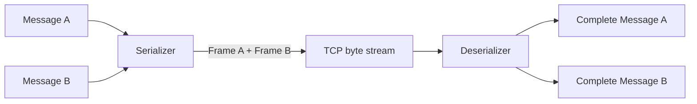
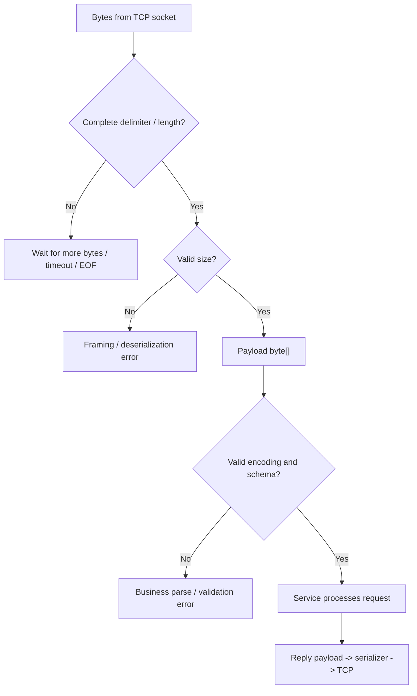

# Frame serializers and deserializers

> **Chapter:** TCP Adapter  
> **Module:** SPRING_INTEGRATION_ADAPTERS  
> **Scope:** Connect external systems to Spring Integration using inbound/outbound adapters, gateways, pollers, and MessageChannel. Practice message exchange flows over files, SFTP, HTTP, JMS, AMQP, Kafka, and databases; handle message contracts, errors, and connection lifecycles.

## 1. Learning objectives

After this lesson, you will be able to:

- Explain why TCP needs **framing**, even when the socket delivers bytes reliably.
- Distinguish a **serializer** (writing one message to a byte stream) from a **deserializer** (reading enough bytes to reconstruct one message).
- Choose an appropriate framing contract: CRLF, LF, length prefix (*length header*), or connection close.
- Configure serializers/deserializers on a Spring Integration TCP `ConnectionFactory`.
- Build a TCP inbound gateway example that receives `byte[]` and returns consistently framed responses.
- Write a test client using Java `Socket`, observing two frames on a single connection and missing-delimiter scenarios.
- Design size limits, encoding, validation, timeouts, error observability, and boundary tests.

## 2. From byte stream to Spring Message

TCP provides an **ordered byte stream per connection**. The protocol has no concept of "one `write()` equals one message" or "one `read()` returns exactly one message."

Suppose a client wants to send two commands:

```text
PING|sensor-01
PING|sensor-02
```

Without defined framing, the receiver cannot be certain where the first command ends. Reads might deliver chunks like:

```text
read #1:  PING|sen
read #2:  sor-01PING|sensor-
read #3:  02
```

Or all bytes might arrive in a single read. This is normal TCP behavior, not the socket "corrupting" messages.

**Framing** is an application-layer rule for identifying *the boundaries of a message*:



In Spring Integration, serializers/deserializers are typically configured on the **TCP connection factory**. The connection factory handles sockets, the adapter/gateway bridges to `MessageChannel`, and the business handler processes content already separated into messages.

### 2.1. Difference between serializer and deserializer

| Component | Input | Output | Responsibility |
| --- | --- | --- | --- |
| **Serializer** | Payload, e.g., `byte[]` containing `PING|sensor-01` | Bytes written to `OutputStream` | Writes payload and framing structure according to the contract. |
| **Deserializer** | Consecutive bytes read from `InputStream` | One payload, e.g., `byte[]` | Reads until **one** complete frame arrives and strips framing per contract. |
| **Business parser/validator** | Deserialized payload | Valid object/command or error | Validates command code, field count, format, permissions, and input data. |
| **TCP adapter/gateway** | Spring Message or frame from connection factory | Spring Message or TCP data | Coordinates message direction, request/reply, and pushes results into the flow. |

For example, `ByteArrayCrLfSerializer` can both **serialize** requests/replies and **deserialize** requests/replies using `\r\n`. However, separating a frame **does not mean** the frame is a schema-valid command; the business parser still has to validate it.

### 2.2. Framing is not encoding or schema

These three layers should be decided separately:

1. **Framing:** defines where a frame ends; e.g., CRLF or a 4-byte length prefix.
2. **Encoding:** turns strings into bytes and back; e.g., UTF-8.
3. **Schema:** defines what the payload means; e.g., `TEMP|sensor-01|23.5` consists of event type, ID, and value.

TCP knows nothing about UTF-8, JSON, CRLF, protobuf, or `|`. If client and server do not agree on all three layers, they may connect successfully yet still fail to exchange valid data.

## 3. Four common framing approaches

| Framing | Wire data (illustrative) | Pros | Main limitations |
| --- | --- | --- | --- |
| **CRLF** | `PING\r\n` | Easy to inspect over terminal and line-based text protocols. | Payloads containing CRLF must be escaped or forbidden. |
| **LF** | `PING\n` | Simple for text protocols. | Payloads containing LF break boundaries. |
| **Length header** | `[length=4][PING]` | Suits binary payloads and bytes containing newlines. | Requires defining header size, byte order, length unit, and limits. |
| **Connection close / EOF** | `PING` then close sender side | Simple for one-message-per-connection protocols. | Unsuitable for long-lived multi-frame connections; EOF is a socket lifecycle event. |

Common Spring Integration TCP serializers include:

- `ByteArrayCrLfSerializer`: uses CRLF as the terminator.
- `ByteArrayLfSerializer`: uses LF as the terminator.
- `ByteArrayLengthHeaderSerializer`: uses a leading header containing payload length.
- `ByteArrayRawSerializer`: reads until end of stream/connection; suitable only when the contract genuinely relies on EOF.

Simply picking a matching class name is **not enough**: both sides must agree precisely on how frames are written and read. For instance, one side using CRLF while the other uses LF leaves stray CR in the payload; one side using a length header while the other waits for CRLF hangs indefinitely or parses garbage.

### 3.1. CRLF: good for text, but newline characters must be controlled

A logical message:

```text
TEMP|sensor-01|23.5
```

Written to the wire by a CRLF serializer as:

```text
TEMP|sensor-01|23.5\r\n
```

The `\r\n` shown above represents **two terminating bytes**: carriage return `0D` and line feed `0A`. The deserializer uses them to return a single `byte[]` containing `TEMP|sensor-01|23.5`.

If the application appends `\r\n` to the payload itself **and** the serializer also appends `\r\n`, the receiver may see:

```text
TEMP|sensor-01|23.5\r\n\r\n
```

This is equivalent to one data frame followed by an empty frame. A safe rule is: **payloads must not carry trailing frame delimiters; the serializer is responsible for adding the delimiter**.

If valid data can contain CR or LF characters, define an escaping/quoting scheme understood by both sides, or choose a length header instead of a delimiter.

### 3.2. LF: cannot substitute for CRLF if the protocol differs

LF is one byte `0A`, while CRLF is two bytes `0D 0A`. Changing the serializer without updating the parser/server can lead to:

- The server waits for CRLF while the client only sends LF, leaving requests incomplete.
- A receiver-side parser retains a trailing CR character if it handles LF in its own way.
- Intermittent frame errors that are hard to reproduce when one branch uses CRLF and another uses LF.

Therefore, do not switch between CRLF and LF by preference. Derive the choice from the **external system's protocol**.

### 3.3. Length header: specifying payload byte count

A custom length-header protocol might specify:

```text
First 4 bytes: payload length, unsigned integer, big-endian
Next N bytes:  payload content, N taken from header
```

Example sending the 4-byte ASCII string `PING`:

```text
Hex: 00 00 00 04 50 49 4E 47
     | length=4 | P  I  N  G |
```

With UTF-8, **length must be calculated in encoded bytes**, not `String.length()`. The string `Hà Nội` contains multi-byte characters: using character count as length causes the deserializer to under-read or split inside a UTF-8 character.

A length header does not automatically mean every protocol uses 4-byte big-endian. A system may use 1/2/4 bytes, little-endian, varint, inclusive or exclusive of header size. **You must read and implement the exact agreed protocol**; the 4-byte big-endian example above is one illustrative contract.

Spring Integration provides `ByteArrayLengthHeaderSerializer` for length-prefixed framing. When integrating with an external system, verify the header size configuration and length encoding in your exact library version.

### 3.4. EOF/raw: separating message boundaries from socket lifecycle

A protocol may specify: "send one message and close the sending direction to signal end of content." Reading until EOF then tells where the frame ends. However, this is a **protocol constraint**, not a default TCP feature.

For long-lived connections sending multiple messages, raw/EOF framing is usually unsuitable: if the client never closes the connection, the deserializer has no defined boundary to emit a message. Likewise, closing the socket completely can break the response path.

**Do not use a raw serializer as a quick fix for a missing delimiter** if the actual protocol permits multiple messages on the same connection.

## 4. Configuring serializer/deserializer on ConnectionFactory

In Spring Integration, `TcpNetServerConnectionFactory` listens on a TCP server socket, while `TcpNetClientConnectionFactory` actively connects to an external host/port. Both accept serializer and deserializer configuration.

TCP server example:

```java
import org.springframework.integration.ip.tcp.connection.TcpNetServerConnectionFactory;
import org.springframework.integration.ip.tcp.serializer.ByteArrayCrLfSerializer;

TcpNetServerConnectionFactory factory =
        new TcpNetServerConnectionFactory(9200);

ByteArrayCrLfSerializer deserializer = new ByteArrayCrLfSerializer();
deserializer.setMaxMessageSize(4096); // Limit received frame size.

ByteArrayCrLfSerializer serializer = new ByteArrayCrLfSerializer();

factory.setDeserializer(deserializer); // TCP bytes -> byte[] payload
factory.setSerializer(serializer);     // byte[] payload -> TCP bytes + CRLF
```

TCP client example:

```java
import org.springframework.integration.ip.tcp.connection.TcpNetClientConnectionFactory;
import org.springframework.integration.ip.tcp.serializer.ByteArrayCrLfSerializer;

TcpNetClientConnectionFactory factory =
        new TcpNetClientConnectionFactory("127.0.0.1", 9200);

factory.setSerializer(new ByteArrayCrLfSerializer());
factory.setDeserializer(new ByteArrayCrLfSerializer());
```

Choose serializer vs. deserializer based on **byte travel direction**, not directly from the endpoint name inbound/outbound:

| Endpoint | Read from socket via deserializer | Write to socket via serializer |
| --- | --- | --- |
| **TCP inbound channel adapter** | Receives frames from outside. | Usually no direct reply. |
| **TCP outbound channel adapter** | Usually no reply needed. | Sends frames to external system. |
| **TCP inbound gateway** | Reads **request**. | Writes **reply**. |
| **TCP outbound gateway** | Reads **reply**. | Writes **request**. |

For request-reply gateways, configuring **both directions consistently** is critical: a server may receive requests flawlessly while the client still times out because the reply uses different framing.

## 5. Java DSL example: TCP server splitting CRLF and returning responses

Suppose a Spring Boot application acts as a TCP server on port `9200`. The client sends a line:

```text
STATUS|sensor-01\r\n
```

The handler returns:

```text
OK|sensor-01|ACTIVE\r\n
```

At the Java layer, the handler receives `byte[]` without CRLF and returns `byte[]` without CRLF. The connection factory handles bidirectional framing.

### 5.1. Dependencies

With Spring Boot managing versions via BOM, add:

```xml
<dependencies>
    <dependency>
        <groupId>org.springframework.boot</groupId>
        <artifactId>spring-boot-starter-integration</artifactId>
    </dependency>
    <dependency>
        <groupId>org.springframework.integration</groupId>
        <artifactId>spring-integration-ip</artifactId>
    </dependency>
</dependencies>
```

The example targets Java 17+ and the Java DSL style in Spring Integration 6.x.

### 5.2. Complete configuration

```java
import java.nio.charset.StandardCharsets;

import org.springframework.context.annotation.Bean;
import org.springframework.context.annotation.Configuration;
import org.springframework.integration.config.EnableIntegration;
import org.springframework.integration.dsl.IntegrationFlow;
import org.springframework.integration.ip.dsl.Tcp;
import org.springframework.integration.ip.tcp.connection.TcpNetServerConnectionFactory;
import org.springframework.integration.ip.tcp.serializer.ByteArrayCrLfSerializer;

@Configuration
@EnableIntegration
public class TcpFramingConfiguration {

    @Bean
    TcpNetServerConnectionFactory tcpFramingServer() {
        var factory = new TcpNetServerConnectionFactory(9200);

        // Limit incoming data to prevent clients from sending unbounded frames.
        var inputFraming = new ByteArrayCrLfSerializer();
        inputFraming.setMaxMessageSize(4096);
        factory.setDeserializer(inputFraming);

        // Write replies to TCP; the serializer automatically appends CRLF.
        factory.setSerializer(new ByteArrayCrLfSerializer());

        return factory;
    }

    @Bean
    IntegrationFlow tcpFramingFlow(
            TcpNetServerConnectionFactory tcpFramingServer) {

        return IntegrationFlow
                .from(Tcp.inboundGateway(tcpFramingServer))
                .handle((payload, headers) -> {
                    byte[] input = (byte[]) payload;
                    String request = new String(
                            input, StandardCharsets.UTF_8
                    );

                    String reply = handleCommand(request);

                    return reply.getBytes(StandardCharsets.UTF_8);
                })
                .get();
    }

    private static String handleCommand(String request) {
        String[] fields = request.split("\\|", -1);

        if (fields.length != 2
                || !"STATUS".equals(fields[0])
                || !fields[1].matches("[A-Za-z0-9_-]{1,32}")) {
            return "ERR|BAD_REQUEST";
        }

        // Simulates a business result.
        return "OK|" + fields[1] + "|ACTIVE";
    }
}
```

**Processing flow:**

1. `TcpNetServerConnectionFactory` binds port `9200` and accepts TCP client connections.
2. `ByteArrayCrLfSerializer` as **deserializer**: waits for CRLF, extracts one frame, and returns the byte array containing the request.
3. `Tcp.inboundGateway(...)` passes the request into Spring Integration and awaits the handler's reply.
4. The handler decodes UTF-8, checks the `STATUS|<id>` schema, and builds the response string.
5. The handler returns `byte[]` **without CRLF**. The serializer on the connection factory adds CRLF when sending the reply.
6. The client reads one response frame; the Spring gateway correlates the reply with the request's connection.

`setMaxMessageSize(4096)` is a framing-layer limit for **incoming** data in this example. Combine it with business length and structure validation; if a frame exceeds the limit, the receiving path may raise a deserialization error rather than producing a valid request for the handler to return `ERR|BAD_REQUEST`.

### 5.3. Java client testing two requests on one socket

Create a standalone Java program. Start Spring Boot first, then run the client:

```java
import java.io.BufferedReader;
import java.io.BufferedWriter;
import java.io.InputStreamReader;
import java.io.OutputStreamWriter;
import java.net.InetSocketAddress;
import java.net.Socket;
import java.nio.charset.StandardCharsets;

public class TcpFramingClientDemo {

    public static void main(String[] args) throws Exception {
        try (Socket socket = new Socket()) {
            socket.connect(
                    new InetSocketAddress("127.0.0.1", 9200),
                    3000
            );
            socket.setSoTimeout(5000);

            BufferedWriter writer = new BufferedWriter(
                    new OutputStreamWriter(
                            socket.getOutputStream(),
                            StandardCharsets.UTF_8
                    )
            );
            BufferedReader reader = new BufferedReader(
                    new InputStreamReader(
                            socket.getInputStream(),
                            StandardCharsets.UTF_8
                    )
            );

            exchange(writer, reader, "STATUS|sensor-01");
            exchange(writer, reader, "UNKNOWN|sensor-01");
        }
    }

    private static void exchange(
            BufferedWriter writer,
            BufferedReader reader,
            String request
    ) throws Exception {

        // Java client frames manually with CRLF.
        // No Spring serializer is running here.
        writer.write(request);
        writer.write("\r\n");
        writer.flush();

        // readLine() returns content stripping the trailing frame newline.
        String reply = reader.readLine();
        if (reply == null) {
            throw new IllegalStateException("TCP peer closed before reply");
        }

        System.out.println("request=" + request);
        System.out.println("reply=" + reply);
    }
}
```

**Expected** output:

```text
request=STATUS|sensor-01
reply=OK|sensor-01|ACTIVE
request=UNKNOWN|sensor-01
reply=ERR|BAD_REQUEST
```

This client does not use Spring Integration, so `BufferedWriter` adds CRLF manually. This **differs** from code using `ByteArrayCrLfSerializer`: when the serializer is already configured, never add the delimiter again inside the payload.

`BufferedReader.readLine()` works well for testing this **line protocol**. For binary protocols or when you need to verify exact unmodified bytes, use `InputStream` and a matching byte-frame parser to avoid text processing altering data.

### 5.4. Testing data split across multiple writes

Over TCP, a single request can be split across three writes (still on the same socket):

```java
var output = socket.getOutputStream();

output.write("STATUS|".getBytes(StandardCharsets.UTF_8));
output.flush();

output.write("sensor-01\r".getBytes(StandardCharsets.UTF_8));
output.flush();

output.write("\n".getBytes(StandardCharsets.UTF_8));
output.flush();
```

This test snippet goes **inside a scope where `socket` exists**. The deserializer must not emit a message upon receiving `STATUS|` or `\r` alone. Only once `\r\n` has arrived in full does it deliver a complete request to the gateway.

If the final `\n` byte is never sent, the client will time out waiting for a reply. In that case, the error is an **incomplete frame**, not a request that was received and rejected by the handler.

## 6. Another example: length header for binary payloads

CRLF is unsuitable when a payload may contain arbitrary bytes, including `0D 0A`. With a length header, a frame can contain any byte values because the number of bytes to read is dictated by the header.

Suppose the agreed contract between two systems is:

- **4-byte** header, big-endian, containing the payload byte count.
- The header is **excluded** from the payload length.
- Payload is arbitrary bytes, up to **64 KiB** in this example.
- A single TCP connection can carry multiple consecutive frames.
- The server returns a frame with the same header format in request-reply mode.

### 6.1. Enabling the length-header serializer on ConnectionFactory

```java
import org.springframework.integration.ip.tcp.serializer.ByteArrayLengthHeaderSerializer;
import org.springframework.integration.ip.tcp.connection.TcpNetClientConnectionFactory;

TcpNetClientConnectionFactory factory =
        new TcpNetClientConnectionFactory("127.0.0.1", 9201);

// Both directions must use the same framing in a request-reply protocol.
factory.setSerializer(new ByteArrayLengthHeaderSerializer());
factory.setDeserializer(new ByteArrayLengthHeaderSerializer());
```

`ByteArrayLengthHeaderSerializer` can be configured to match the header size used by the protocol; the no-arg constructor demonstrates default length-prefixed framing in the library. **Do not use this snippet to connect to a server with a different format** without first verifying the target protocol's header size, byte order, and limits.

If a production system needs specific bounds, configure frame limits on the serializer/deserializer and enforce strict checks on the receiving side. Never allocate a byte array solely from an unvalidated length value.

### 6.2. Manually reading a 4-byte big-endian frame in Java

To picture length-header framing concretely, plain Java socket code could read it as follows:

```java
import java.io.DataInputStream;
import java.io.IOException;
import java.io.InputStream;

public final class FourByteFrameReader {

    private static final int MAX_FRAME_BYTES = 64 * 1024;

    public static byte[] readFrame(InputStream stream)
            throws IOException {

        DataInputStream input = new DataInputStream(stream);

        // DataInputStream.readInt() reads a 4-byte big-endian integer.
        int length = input.readInt();

        if (length < 0 || length > MAX_FRAME_BYTES) {
            throw new IOException("Invalid frame length: " + length);
        }

        byte[] payload = new byte[length];
        input.readFully(payload);  // Reads all bytes, possibly across multiple TCP reads.
        return payload;
    }
}
```

This snippet is meant for **reading a frame once the sender has started transmitting it**; if the socket closes mid-header or mid-payload, `readInt()/readFully()` throws `EOFException`. In a long-running parser, distinguish clean EOF between frames from mid-frame EOF and enforce limits/timeouts.

### 6.3. Manually writing a corresponding frame

```java
import java.io.DataOutputStream;
import java.io.IOException;
import java.io.OutputStream;

public final class FourByteFrameWriter {

    private static final int MAX_FRAME_BYTES = 64 * 1024;

    public static void writeFrame(
            OutputStream stream, byte[] payload) throws IOException {

        if (payload.length > MAX_FRAME_BYTES) {
            throw new IOException("Frame too large");
        }

        DataOutputStream output = new DataOutputStream(stream);
        output.writeInt(payload.length); // 4-byte big-endian.
        output.write(payload);
        output.flush();
    }
}
```

This illustrates our **self-defined 4-byte big-endian contract**. When using a Spring serializer on the opposite side, both sides must verify that the header representation matches exactly. In particular, if the protocol includes checksums, magic bytes, or a version field before the length, you must implement that entire format; writing only the length is not enough.

### 6.4. Why not use String.length() as the length?

```java
String value = "Hà Nội";

int characters = value.length();
int bytes = value.getBytes(StandardCharsets.UTF_8).length;

System.out.println("chars=" + characters);
System.out.println("bytes=" + bytes);
```

The two numbers can differ because UTF-8 uses multiple bytes for some characters. With length-prefixed framing, the header must state the **actual serialized byte count**; otherwise, the receiver may under-read or over-read and subsequent frames will lose synchronization.

## 7. Framing errors vs. business content errors

A frame must pass through several layers:



| Symptom | Error type | How to handle |
| --- | --- | --- |
| Data sent, but server never invokes handler. | Missing delimiter, wrong length header, or incomplete frame bytes. | Inspect framing, check socket logs, test splitting/merging frames. |
| One request becomes two messages. | Delimiter appears in payload or was added twice. | Escape properly or switch to length header. |
| Oversized frame rejected before handler. | Size error in deserializer. | Choose reasonable limit, record event, and handle connection per policy. |
| Full frame bytes received, but UTF-8 fails. | Encoding/schema error. | Use a UTF-8 decoder with error-reporting policy and reject payload. |
| `TEMP|sensor-01|abc` with valid CRLF framing. | Business error (value is not numeric). | Return a business error code via gateway if the contract permits. |
| TCP client hangs even though handler created a reply. | Reply serializer uses framing different from what the client expects. | Check reply writer configuration and client parser. |
| Server closes socket while client awaits a frame. | Connection error or incomplete frame termination. | Check EOF/timeout, reconnect, and ensure idempotency on resends. |

### 7.1. Strict UTF-8 decoding when required

`new String(bytes, StandardCharsets.UTF_8)` is convenient for demos, but Java can **replace invalid UTF-8 bytes with replacement characters** instead of raising a clear error. If the protocol requires strict byte checking, use a decoder with `CodingErrorAction.REPORT`:

```java
import java.nio.ByteBuffer;
import java.nio.charset.CodingErrorAction;
import java.nio.charset.StandardCharsets;

String decodeStrictUtf8(byte[] bytes) throws Exception {
    var decoder = StandardCharsets.UTF_8.newDecoder()
            .onMalformedInput(CodingErrorAction.REPORT)
            .onUnmappableCharacter(CodingErrorAction.REPORT);

    return decoder.decode(ByteBuffer.wrap(bytes)).toString();
}
```

The **framing** layer still operates on bytes; this decoder belongs in the bytes-to-text conversion layer. Never use UTF-8 decoding to hunt for delimiters in a binary protocol before extracting the complete frame.

### 7.2. Error channel does not fix malformed frames automatically

An **incomplete** frame may never become a Spring Message. Deserializer errors happen at the connection layer, unlike exceptions thrown while a handler processes a message. Therefore, do not assume that merely configuring an `errorChannel` routes every wire-level error through the same business error branch.

You must observe **connection events/errors**, timeouts, deserialization exceptions, and message flow errors using the mechanisms of your Spring Integration version. If the TCP client needs an error response for a fully received request, the handler or gateway must produce a valid response. For frames so corrupted that no request can be read, the policy may be to log and close/reset the connection.

## 8. Size limits, timeouts, and resource safety

### 8.1. Why unbounded frames are dangerous

A malicious or buggy client can:

- Stream tens of MB continuously without ever sending CRLF.
- Send a length header claiming an enormous payload, forcing the server to attempt excessive array allocations.
- Send just a few header bytes and stall, holding the socket open in a waiting state.
- Send frames continuously faster than handlers can process them.

Defense layers should work together:

1. **Frame limits** in serializers/deserializers and before allocating memory.
2. **Read timeouts**/frame completion deadlines aligned with real client behavior.
3. **Connection limits** and processing thread/queue bounds, especially with many clients.
4. **Schema validation**: command type, field count, ID length, numeric ranges, and access rights.
5. **Backpressure**/rate limiting where appropriate when upstream outpaces downstream.
6. **Controlled metrics and logging** for rejected frames or incomplete sockets.

A byte limit alone does not guarantee every request is valid. A small frame can still carry an unauthorized command or data causing business errors.

### 8.2. Timeout is a symptom, not proof of business failure

With an inbound/outbound **gateway**, a request may have reached the server and been processed, only for the reply to be lost when the connection drops. If the caller times out and retries, the server can receive the request again.

For side-effecting commands (such as creating orders, charging payments, or actuating devices), you must use:

- A Request ID stable across retries.
- Correlation in the reply if required by the protocol.
- Server-side idempotency storing already-processed results.
- Bounded retry/backoff rules and reconciliation for unknown-outcome cases.

**Correct framing does not provide exactly-once processing.** Serializers enforce byte structure per contract; whether business effects happen once or multiple times must be designed at a higher layer.

### 8.3. TLS and framing

TLS encrypts and protects the TCP byte stream, but **it does not replace application framing**. After TLS decryption, the application still needs CRLF/length headers or an equivalent rule to recognize requests and replies.

Therefore, for connections requiring security: configure TLS/authentication at the connection layer while keeping the proper serializer/deserializer and schema validation at the message layer.

## 9. Serializer/deserializer testing checklist

A thorough framing test suite must verify **byte boundaries**, not just one tidy request:

| Case | What must be proven |
| --- | --- |
| One valid frame | Deserializer emits exactly one message with the exact payload. |
| Two frames in **one** client write | Two separate messages are extracted; payloads do not bleed together. |
| One frame split across multiple client writes | Message is emitted only after full delimiter or full length arrives. |
| Split CRLF delimiter (`\r` and `\n` arrive separately) | Boundary is still detected accurately. |
| CRLF inside payload | Protocol escapes explicitly or rejects; never accidentally splits the message. |
| Multi-byte UTF-8 payload | Never splits mid-character bytes; length counts bytes. |
| Length = 0, negative, or above max | Explicit, resource-safe accept/reject rules. |
| Incomplete frame followed by client close | EOF/timeout error is observed and never treated as a valid request. |
| Gateway reply missing delimiter | Client handles timeout or protocol error per contract. |
| Client reconnects after corrupt frame | New connection starts in a clean state without mixing old bytes. |

Test further under realistic conditions: many concurrent clients, high server load, flaky connections, idle timeouts, large payloads, and rapid bursts of consecutive frames.

### 9.1. How to self-inspect wire format

When diagnosing a frame, record **byte length**, hex prefixes/suffixes, and send/receive timestamps. For example, a `PING` request with CRLF must end with:

```text
50 49 4E 47 0D 0A
P  I  N  G  CR LF
```

Never print full sensitive payloads to logs; record only enough markers to spot a missing delimiter, wrong encoding, or wrong length. If the server uses a length header, inspect the exact header bytes and compare them against payload byte count.

## 10. Common design mistakes

| Mistake | Consequence | Fix |
| --- | --- | --- |
| Assuming one `write()` equals one message. | Messages merged, truncated, or split. | Define and use explicit framing. |
| Mixing CRLF and LF across endpoints. | Reply timeouts, stray CR in payloads. | Use the exact same contract on both sides. |
| Manually adding CRLF when using `ByteArrayCrLfSerializer`. | Empty frames or extra delimiters. | Serialize logical content only. |
| Choosing length header but using `String.length()`. | Wrong boundaries with multi-byte UTF-8. | Count `byte[].length` after encoding. |
| Trusting header length without bounds. | OOM or sockets pinned by giant frames. | Validate length before allocating/reading. |
| Using raw/EOF on long-lived multi-message connections. | Deserializer cannot tell when one frame ends. | Use a delimiter or length header. |
| Feeding incomplete frame bytes to business parser. | Corrupted data and socket-coupled logic. | Separate framing from validation. |
| Configuring only request serializer, forgetting reply deserializer. | Gateway sends fine but fails to receive valid replies. | Configure and test both directions. |
| Treating timeouts as unprocessed requests. | Retries cause duplicate business actions. | Request ID, idempotency, ACK, and reconciliation. |
| Sharing one factory across flows with conflicting framing. | Bytes from flows violate connection contract. | Split connection factories or unify the protocol. |

## 11. Hands-on exercises

**Exercise 1 — Test TCP segmentation.** Use a client to send `STATUS|sensor-01\r\n` across three writes. Record when the handler runs. Vary split points, including right between `\r` and `\n`.

**Exercise 2 — Send two requests in one write.** Use `OutputStream.write()` to send `STATUS|sensor-01\r\nSTATUS|sensor-02\r\n` on one connection. Verify the gateway generates one corresponding reply per request. With a request-reply gateway, align the client to sequential handling or manage response correlation.

**Exercise 3 — Frame error vs. business error.** Compare `STATUS|sensor-01` **without CRLF** against `STATUS||\r\n` and `UNKNOWN|sensor-01\r\n`. Predict which request the deserializer emits as a message, which is rejected by the handler, and why.

**Exercise 4 — Switch to length header.** Design a 4-byte big-endian protocol where payloads may contain `\r\n` and Unicode. Write a matching Java client, and test a frame containing `0D 0A` in the payload as well as a frame exceeding 64 KiB. State clearly whether length includes the header.

**Exercise 5 — Reject invalid UTF-8.** Build a payload containing an invalid UTF-8 byte sequence. Compare the difference between `new String(...)` and `CharsetDecoder` using `CodingErrorAction.REPORT`.

**Exercise 6 — Reply failure.** Use a mock TCP server that sends only half a reply frame and holds the socket open. Set a timeout and observe the client exception. Explain why you cannot infer that the server definitely did not process the command.

## 12. Knowledge self-check

1. Why does TCP need framing even though it guarantees bytes are not reordered within a connection?
2. How do a serializer and deserializer differ in data direction and responsibility?
3. Can `ByteArrayCrLfSerializer` be used for payloads containing arbitrary `\r\n`? What condition would be required?
4. With a TCP inbound gateway, which component splits requests and which component frames replies?
5. Why does code using a Spring serializer not append `\r\n`, while the Java `BufferedWriter` in the example must append it?
6. Should a length header store Java character count or encoded byte count?
7. When a length header declares an unusually large size, why must it be validated before allocating an array?
8. Is a complete frame `TEMP|sensor-01|abc\r\n` a deserializer error or a business validation error?
9. When a client receives no reply, can it conclude the server has not processed the request?
10. Does TLS automatically create message boundaries for Spring Integration TCP?

**Hints:** (1) TCP is a byte stream with no message boundaries. (2) Serializer writes payload and framing; deserializer reads a full frame to return payload. (3) No, unless both sides agree on escaping/encoding or switch to another framing. (4) The deserializer on the connection factory reads requests; the serializer writes replies. (5) The Spring serializer adds CRLF automatically; a raw Java client must implement the contract itself. (6) Byte count. (7) To prevent memory exhaustion and reject invalid frames. (8) Business validation error. (9) No; the reply may have been lost after the server processed it. (10) No, TLS protects the byte stream and does not replace application framing.

**Key takeaway:** In Spring Integration TCP, **serializers and deserializers form the two ends of the framing contract**, turning a socket's byte stream into cleanly bounded Spring Messages. Design **framing, encoding, schema, maximum size, timeouts, and error handling** together. Adapters and gateways operate reliably only when all sides adhere strictly to the wire byte contract.
