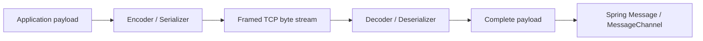
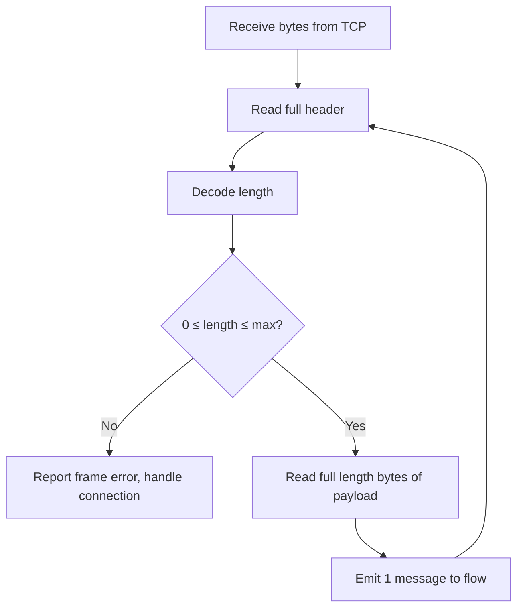

# Length header and delimiter codecs

> **Chapter:** TCP Adapter  
> **Module:** SPRING_INTEGRATION_ADAPTERS  
> **Scope:** Connect external systems to Spring Integration using inbound/outbound adapters, gateways, pollers, and MessageChannel. Practice message exchange flows over files, SFTP, HTTP, JMS, AMQP, Kafka, and databases; handle message contracts, errors, and connection lifecycles.

## 1. Learning objectives

After this lesson, you will be able to:

- Explain why a **TCP byte stream** needs message separation conventions and the role of a **codec** in Spring Integration.
- Describe 1-, 2-, and 4-byte **length header** formats accurately; compute **length in bytes**, and distinguish header-inclusive vs. header-exclusive lengths.
- Describe **delimiter framing** approaches: CRLF, LF, custom terminators, and STX/ETX pairs.
- Choose between length header and delimiter framing based on the **wire format contract**, support for binary bytes, read cost, and external system compatibility.
- Configure `ByteArrayLengthHeaderSerializer`, `ByteArrayCrLfSerializer`, or `TcpCodecs` on `TcpNetServerConnectionFactory` and `TcpNetClientConnectionFactory`.
- Run a **request-reply** test with a binary frame containing CRLF bytes and verify that the payload is not truncated.
- Design frame size limits, timeouts, EOF handling, protocol validation, and segmented-data test cases.

## 2. Core problem: TCP has no concept of "one message"

TCP transmits an ordered sequence of bytes per connection. Two client `write()` calls do **not** reliably correspond to two server `read()` calls. One message can be split into multiple chunks; multiple messages can also arrive together in a single read.

Suppose the application wants to send two payloads:

```text
PAYLOAD A: PING
PAYLOAD B: PONG
```

If placed back-to-back on the socket, the byte stream is:

```text
50 49 4E 47 50 4F 4E 47
 P  I  N  G  P  O  N  G
```

Nothing in those bytes lets the server determine the boundary between `PING` and `PONG` on its own. We must add a **framing rule**.

Two common rule families:

1. **Length header / length prefix:** send the payload byte count at the start of the frame; the receiver reads the header first, then reads that exact number of bytes.
2. **Delimiter / terminator:** place a byte or byte sequence marking the end (sometimes also the start) of a frame; the receiver scans for the delimiter and extracts the content.



In Spring Integration TCP, **serializers** and **deserializers** are configured on the connection factory. The adapter or gateway uses the connection factory to send/receive bytes; handlers process the business payload once a valid frame has been extracted.

> **Scope of the term "codec":** In this lesson, a codec is the rule set and code that **encodes/decodes frames**. Spring Integration provides serializer/deserializer classes alongside the `TcpCodecs` utility. The term codec also appears in other networking libraries, though class names and configuration differ; do not use another framework's codec APIs as a direct drop-in for Spring Integration TCP.

## 3. Frame structure: header vs. delimiter

### 3.1. Comparing the same payload

The payload `PING` is four ASCII bytes:

```text
50 49 4E 47
```

With a **4-byte length header**, the header holds length 4 in network byte order:

```text
00 00 00 04 | 50 49 4E 47
  length=4  |  P  I  N  G
```

With a **CRLF delimiter**, the frame is:

```text
50 49 4E 47 | 0D 0A
 P  I  N  G | CR LF
```

Both approaches allow multiple consecutive frames on the same connection:

```text
Length header:
[00 00 00 04][PING][00 00 00 04][PONG]

CRLF delimiter:
[PING][0D 0A][PONG][0D 0A]
```

**Frame boundaries live in the bytes on the wire**, not in how TCP splits packets. No matter how many chunks the kernel splits a frame into during transmission, the decoder must still reconstruct each payload accurately.

### 3.2. Three layers to keep separate

| Layer | Question | Example |
| --- | --- | --- |
| **Framing** | Where does a frame start and end? | Header `00 00 00 04` or CRLF `0D 0A`. |
| **Encoding** | How are objects/strings converted to bytes? | UTF-8, arbitrary binary. |
| **Schema** | What does the payload mean and is it valid? | `STATUS|sensor-01` or JSON/Protobuf. |

A frame with a valid length can still contain broken JSON, an unsupported command code, or an unauthorized user. **A deserializer does not replace a business parser/validator.**

## 4. Length header: reading the exact number of bytes

### 4.1. Algorithm

A length-header protocol consists of:

```text
+-----------------------+-----------------------------+
| Header holding length | Payload of length bytes     |
+-----------------------+-----------------------------+
       1 / 2 / 4 B               N bytes
```

The writer (*serializer*) executes:

1. Convert content to `byte[]`.
2. Verify payload size is valid.
3. Write the header containing the byte count per contract.
4. Write the exact payload.

The reader (*deserializer*) executes:

1. Read the **full** header bytes; if incomplete, keep waiting without guessing length.
2. Decode length according to byte order and header size.
3. Reject invalid or out-of-bounds lengths.
4. Read the **full** `length` payload bytes, even across multiple socket reads.
5. Return a single `byte[]` to the adapter/gateway; repeat for the next frame.



In a protocol permitting empty frames, a length of 0 can be valid. If disallowed, the application must reject it at the protocol layer. The `max` limit is a business/operational bound set well below the header type's maximum representable capacity.

### 4.2. 1-, 2-, and 4-byte headers

Spring Integration supports `ByteArrayLengthHeaderSerializer` with three header sizes:

| Size | Interpretation | Max range of length field* | Suitable for |
| --- | --- | --- | --- |
| **1 byte** | Unsigned integer, `0x00` to `0xFF` | `0..255` | Very small messages, legacy protocols. |
| **2 bytes** | Unsigned integer, big-endian | `0..65,535` | Frames up to tens of KiB. |
| **4 bytes (default)** | Signed `int`, big-endian | `0..2,147,483,647` | Large frames and general-purpose TCP integration. |

\* This is the **representable range of the header**, not a safe memory allocation limit. Always set `maxMessageSize` much lower based on real requirements. With **inclusive** length (including the header), the payload limit is further reduced by the header byte count.

**Big-endian / network byte order** means the most significant byte comes first. For example, length `258` (hex `0x0102`):

```text
2-byte header: 01 02
4-byte header: 00 00 01 02
```

If the sender writes little-endian while the receiver reads big-endian, the decoded length will be wrong; the decoder may wait for an enormous number of bytes or reject an abnormally large frame.

### 4.3. Byte length and UTF-8

A common mistake is using `String.length()` to write a length header. Java counts UTF-16 code units; the TCP serializer requires the **actual byte count**.

```java
import java.nio.charset.StandardCharsets;

String text = "cà phê";

int javaUnits = text.length();  // 6 UTF-16 units.
byte[] bytes = text.getBytes(StandardCharsets.UTF_8);
int wireLength = bytes.length;   // 8 UTF-8 bytes.

System.out.println("units=" + javaUnits);
System.out.println("bytes=" + wireLength);
```

With a length header, always write `bytes.length`. Writing `javaUnits` can cause the decoder to split mid-UTF-8 character and misread subsequent frames.

For binary payloads, keep them as `byte[]`; do not round-trip through `String` unless the protocol defines a text encoding.

### 4.4. Inclusive or exclusive length?

By default, `ByteArrayLengthHeaderSerializer` writes length equal to the **payload byte count**, **excluding** the header. Spring Integration also supports configuring `inclusive` so the length includes the header bytes.

Payload `PING` has 4 bytes; header has 4 bytes:

| Rule | Header value | Wire frame |
| --- | --- | --- |
| **Exclusive** (default) | `4` | `00 00 00 04 50 49 4E 47` |
| **Inclusive** | `8 = 4 + 4` | `00 00 00 08 50 49 4E 47` |

Example configuring inclusive length:

```java
import org.springframework.integration.ip.tcp.serializer.ByteArrayLengthHeaderSerializer;

var encoder = new ByteArrayLengthHeaderSerializer();
encoder.setInclusive(true);

var decoder = new ByteArrayLengthHeaderSerializer();
decoder.setInclusive(true);

// Attach corresponding encoder/decoder to the connection factory.
```

**Sender and receiver must agree on inclusive/exclusive.** Otherwise, the decoder may under-read, read into the next frame, or hang indefinitely. Never assume a protocol mentioning "length" automatically uses the same convention.

### 4.5. Two binary frames back-to-back

First payload: `41 0D 0A 42` (`A`, CR, LF, `B`). Second payload: `00 FF`.

```text
00 00 00 04 | 41 0D 0A 42 | 00 00 00 02 | 00 FF
  length=4   |  payload 1  |   length=2   | payload 2
```

The deserializer reads the first 4 bytes, returns `41 0D 0A 42`, then reads header `00 00 00 02` and returns `00 FF`. The `0D 0A` bytes inside the payload are **not treated as frame termination**, because the protocol uses length framing.

This is a major advantage when transferring binary, compressed, encrypted data, or text containing arbitrary newlines.

## 5. Delimiter codecs: finding the end marker

### 5.1. Delimiters supported in Spring Integration

| Serializer/codec | Delimiter | When to use |
| --- | --- | --- |
| `ByteArrayCrLfSerializer` / `TcpCodecs.crlf()` | `0D 0A` at end of frame | Text protocols using CRLF. |
| `ByteArrayLfSerializer` / `TcpCodecs.lf()` | `0A` at end of frame | Line-based text protocols using LF. |
| `ByteArraySingleTerminatorSerializer` / `TcpCodecs.singleTerminator(byte)` | Custom single byte (class default is `0x00`) | Protocols using NUL or a single-byte terminator. |
| `ByteArrayStxEtxSerializer` / `TcpCodecs.stxetx()` | `STX=0x02` at start, `ETX=0x03` at end | Text protocols with start/end frame markers. |

When configuring a delimiter, the encoder writes the payload plus terminator; the decoder reads up to the terminator and returns the content **without the delimiter bytes**. With STX/ETX, the protocol also has a start-of-frame marker. These variants serve **specific wire protocols** and cannot be swapped arbitrarily.

Note: `TcpCodecs` is a **convenience factory for creating serializers/deserializers**, not a standalone TCP endpoint. The resulting codec still must be attached to `TcpNetServerConnectionFactory` or `TcpNetClientConnectionFactory`.

### 5.2. CRLF vs. LF at the byte level

`PING` under both contracts:

```text
CRLF: 50 49 4E 47 0D 0A
LF:   50 49 4E 47 0A
```

When the client sends only LF while the server expects CRLF, the server may never complete a frame. Conversely, an LF-style decoder may leave a trailing CR byte in the payload depending on the codec/receiver.

**Conventions must match down to the exact byte**, including delimiter byte count and order. Inspecting strings printed to a terminal is insufficient because many terminals normalize line endings automatically.

### 5.3. Risk of delimiters appearing inside the payload

Suppose CRLF is used, but a payload contains:

```text
NOTE|line1\r\nline2
```

The encoder appends CRLF at the end. The decoder splits this into **two frames**, even though the application thought it was sending a single multi-line note.

Solutions:

- **Forbid** CRLF in payloads and validate before sending.
- **Escape/quote** delimiters according to a strict rule (and unescape after decoding).
- **Switch to a length header** if payloads are allowed to contain arbitrary bytes.

Do not assume delimiter serializers perform application-level data escaping; they must match the peer's exact contract.

### 5.4. Trade-offs with text/binary content

A delimiter codec must inspect every byte until it encounters the terminator. For large frames, scanning for the terminator inspects the entire incoming data; a length header reads the size upfront and knows exactly how many bytes to read.

On the other hand, delimiters can be **very convenient** when integrating line-oriented text protocols or using simple tools. The right choice depends on payload characteristics and existing systems, not performance alone.

## 6. Spring Integration configuration: length header

The following example builds a **binary TCP echo server** on port `9301`:

- Client sends a frame with a **4-byte big-endian, exclusive header**.
- Payload may contain `00`, `0D 0A`, or non-UTF-8 bytes.
- Server returns the **exact received payload** in a frame with the same format.
- Maximum incoming payload limit is **64 KiB**.
- Each TCP gateway turn handles request and reply; business code never reads sockets directly.

### 6.1. Maven dependencies

Use the Spring Boot BOM to manage versions and add:

```xml
<dependencies>
    <dependency>
        <groupId>org.springframework.boot</groupId>
        <artifactId>spring-boot-starter-integration</artifactId>
    </dependency>
    <dependency>
        <groupId>org.springframework.integration</groupId>
        <artifactId>spring-integration-ip</artifactId>
    </dependency>
</dependencies>
```

The example targets **Spring Integration 6.x and Java 17+**.

### 6.2. TCP server using `TcpCodecs.lengthHeader4`

```java
import org.springframework.context.annotation.Bean;
import org.springframework.context.annotation.Configuration;
import org.springframework.integration.config.EnableIntegration;
import org.springframework.integration.dsl.IntegrationFlow;
import org.springframework.integration.ip.dsl.Tcp;
import org.springframework.integration.ip.tcp.connection.TcpNetServerConnectionFactory;
import org.springframework.integration.ip.tcp.serializer.TcpCodecs;

@Configuration
@EnableIntegration
public class BinaryTcpFramingConfiguration {

    private static final int MAX_FRAME_BYTES = 64 * 1024;

    @Bean
    TcpNetServerConnectionFactory binaryTcpServerFactory() {
        var factory = new TcpNetServerConnectionFactory(9301);

        // Decoder: 4-byte big-endian length, up to 64 KiB payload.
        factory.setDeserializer(TcpCodecs.lengthHeader4(MAX_FRAME_BYTES));

        // Encoder: writes length + payload, exclusive by default.
        factory.setSerializer(TcpCodecs.lengthHeader4());

        return factory;
    }

    @Bean
    IntegrationFlow binaryEchoFlow(
            TcpNetServerConnectionFactory binaryTcpServerFactory) {

        return IntegrationFlow
                .from(Tcp.inboundGateway(binaryTcpServerFactory))
                .handle((payload, headers) -> {
                    // ByteArrayLengthHeaderSerializer returns raw byte[].
                    byte[] bytes = (byte[]) payload;

                    // Echo exact bytes without converting through String.
                    return bytes;
                })
                .get();
    }
}
```

**Explanation:**

1. `TcpNetServerConnectionFactory` listens on port `9301`, accepts connections, and manages sockets.
2. `TcpCodecs.lengthHeader4(MAX_FRAME_BYTES)` creates a deserializer for 4-byte length-prefixed frames with a size cap.
3. `TcpCodecs.lengthHeader4()` creates a serializer writing a 4-byte header; by default it does **not** include header size in the length field.
4. `Tcp.inboundGateway(...)` pushes decoded requests into `IntegrationFlow` and sends the corresponding reply back to the TCP client.
5. The handler only receives/returns `byte[]`. It does not split frames, compute lengths, or append CRLF.

In this example, the TCP server **does not restrict its bind address to loopback** simply because the client connects to `127.0.0.1`. In production, bind ports/addresses using proper infrastructure configuration and security policies.

### 6.3. Plain Java TCP client testing binary data

No extra libraries are needed to test outside Spring Integration. Start the Spring Boot server first, then run the following Java class:

```java
import java.io.DataInputStream;
import java.io.DataOutputStream;
import java.io.IOException;
import java.net.InetSocketAddress;
import java.net.Socket;
import java.util.Arrays;

public class LengthHeaderClientDemo {

    private static final int MAX_FRAME_BYTES = 64 * 1024;

    public static void main(String[] args) throws Exception {
        // Payload intentionally contains CRLF, NUL, and byte FF.
        byte[] request = {
                0x41, 0x0D, 0x0A, 0x00, (byte) 0xFF
        };

        try (Socket socket = new Socket()) {
            socket.connect(new InetSocketAddress("127.0.0.1", 9301), 3000);
            socket.setSoTimeout(5000);

            DataOutputStream output =
                    new DataOutputStream(socket.getOutputStream());
            DataInputStream input =
                    new DataInputStream(socket.getInputStream());

            // writeInt: 4-byte big-endian; length excludes header.
            output.writeInt(request.length);
            output.write(request);
            output.flush();

            // Read full reply header without relying on a single read().
            int length = input.readInt();
            if (length < 0 || length > MAX_FRAME_BYTES) {
                throw new IOException("Invalid reply frame length: " + length);
            }

            byte[] reply = new byte[length];
            input.readFully(reply);

            System.out.println("Equal bytes: " +
                    Arrays.equals(request, reply));
            System.out.println("Reply length: " + reply.length);
        }
    }
}
```

**Expected** output:

```text
Equal bytes: true
Reply length: 5
```

The actual request frame on the wire looks like:

```text
00 00 00 05 | 41 0D 0A 00 FF
 length = 5 |    payload
```

If CRLF delimiters were used for this payload without escaping, the inner `0D 0A` bytes would be misinterpreted as the end of the frame. With a length header, the payload is preserved intact **including CRLF, NUL, and 0xFF**.

`DataInputStream.readFully()` reads until all requested bytes arrive or EOF/error occurs. This is essential because TCP data can arrive across multiple reads. If the server closes the socket mid-frame, treat it as an incomplete frame and never emit a message shorter than the declared length.

### 6.4. Configuring a client factory to send outbound

If the **Spring Integration application is the TCP client** and the external system is a server expecting length headers, configure the codec on the client factory:

```java
import org.springframework.integration.ip.tcp.connection.TcpNetClientConnectionFactory;
import org.springframework.integration.ip.tcp.serializer.TcpCodecs;

TcpNetClientConnectionFactory clientFactory =
        new TcpNetClientConnectionFactory("127.0.0.1", 9301);

clientFactory.setSerializer(TcpCodecs.lengthHeader4());
clientFactory.setDeserializer(TcpCodecs.lengthHeader4(64 * 1024));
```

This factory can be passed to `Tcp.outboundGateway(clientFactory)` for request-reply protocols, or an appropriate adapter for one-way traffic. **The external peer must use the exact same wire format.** You cannot change only the client codec when the server expects CRLF.

## 7. Spring Integration configuration: CRLF delimiter

Suppose another system requires text commands `PING|sensor-01\r\n` and replies `PONG|sensor-01\r\n`. Use a delimiter codec:

```java
import java.nio.charset.StandardCharsets;

import org.springframework.context.annotation.Bean;
import org.springframework.context.annotation.Configuration;
import org.springframework.integration.config.EnableIntegration;
import org.springframework.integration.dsl.IntegrationFlow;
import org.springframework.integration.ip.dsl.Tcp;
import org.springframework.integration.ip.tcp.connection.TcpNetServerConnectionFactory;
import org.springframework.integration.ip.tcp.serializer.TcpCodecs;

@Configuration
@EnableIntegration
public class LineTcpFramingConfiguration {

    @Bean
    TcpNetServerConnectionFactory lineTcpServerFactory() {
        var factory = new TcpNetServerConnectionFactory(9302);

        // Maximum 4096 payload bytes when receiving.
        factory.setDeserializer(TcpCodecs.crlf(4096));
        factory.setSerializer(TcpCodecs.crlf());

        return factory;
    }

    @Bean
    IntegrationFlow lineTcpFlow(
            TcpNetServerConnectionFactory lineTcpServerFactory) {

        return IntegrationFlow
                .from(Tcp.inboundGateway(lineTcpServerFactory))
                .handle((payload, headers) -> {
                    String request = new String(
                            (byte[]) payload, StandardCharsets.UTF_8
                    );

                    String reply;
                    if (request.matches("PING\\|[A-Za-z0-9_-]{1,32}")) {
                        reply = "PONG|" + request.substring("PING|".length());
                    } else {
                        reply = "ERR|BAD_REQUEST";
                    }

                    // Do not manually append CRLF to the reply payload.
                    return reply.getBytes(StandardCharsets.UTF_8);
                })
                .get();
    }
}
```

This example uses a **different port** from the length-header server (`9302` vs. `9301`) because each endpoint applies a different wire protocol.

A plain socket client can test it with:

```java
import java.io.BufferedReader;
import java.io.InputStreamReader;
import java.net.Socket;
import java.nio.charset.StandardCharsets;

try (Socket socket = new Socket("127.0.0.1", 9302)) {
    socket.getOutputStream().write(
            "PING|sensor-01\r\n".getBytes(StandardCharsets.UTF_8)
    );
    socket.getOutputStream().flush();

    BufferedReader input = new BufferedReader(
            new InputStreamReader(
                    socket.getInputStream(), StandardCharsets.UTF_8
            )
    );

    System.out.println(input.readLine()); // PONG|sensor-01
}
```

**Difference in where the delimiter is added:**

- The plain `Socket` client appends `\r\n` manually to satisfy the contract.
- The Spring Integration side uses `TcpCodecs.crlf()`, so the **serializer adds** `\r\n` automatically. The handler returns only the logical reply content.

Do not pass payloads containing unescaped `\r\n` to a CRLF codec if you want the payload kept as a single frame.

## 8. Choosing a codec per data type

| Scenario | Recommendation | Why |
| --- | --- | --- |
| Legacy system specifies CRLF-terminated lines | **CRLF delimiter** | Matches existing protocol; easy manual inspection. |
| Line protocol using LF only | **LF delimiter** | Preserves exact byte standard expected by target server. |
| Small text messages with no newlines in payload | **Delimiter** | Simple structure and easy to observe. |
| Binary, compressed, or arbitrary-byte payloads | **Length header** | Never confuses data bytes with terminators. |
| JSON over TCP that may be multi-line formatted | **Length header** or defined escape/line protocol | A JSON parser alone does not define TCP message boundaries. |
| Large payloads with wide size variance | **Length header with max limit** | Knows exact byte count upfront; avoids scanning for delimiters. |
| Protocol using STX and ETX | **STX/ETX codec if contract matches** | Matches start/end frame bytes; still check escaping if content contains markers. |
| Protocol with magic, version, CRC, multiple header fields | **Custom serializer/deserializer** | Standard codecs may not match the wire format. |

The overriding rule is **the protocol both systems agreed upon**. You cannot replace a delimiter with a length header for optimization without rolling out synchronized changes to both producer and consumer.

### 8.1. When is a custom codec needed?

A real-world wire protocol might look like:

```text
[magic 2B][version 1B][flags 1B][length 4B][payload N B][CRC32 4B]
```

If you simply plug in `ByteArrayLengthHeaderSerializer`, the decoder will read the first two `magic` bytes as part of the length and corrupt the entire frame. In this case:

1. Define the concrete byte contract: magic, version, endianness, inclusive/exclusive length, checksum, and max size.
2. Implement a contract-compliant serializer/deserializer using Spring interfaces or customize the length-header class at the appropriate hooks.
3. Validate **magic, version, and length before allocating** the payload buffer.
4. Read the exact payload bytes and checksum; verify the checksum before emitting the message.
5. Distinguish clean EOF between two frames from EOF occurring mid-header or mid-payload.

Spring Integration lets you implement `org.springframework.core.serializer.Serializer` and `Deserializer`; in some cases you can customize `readHeader(...)` / `writeHeader(...)` on `ByteArrayLengthHeaderSerializer`. When writing a custom deserializer, follow the framework's **end-of-stream between frames** contract, including `SoftEndOfStreamException` where appropriate.

## 9. Resource limits and frame-reading errors

### 9.1. Why must `maxMessageSize` be set?

A 4-byte length header can represent lengths up to roughly 2 GiB, which **does not mean** the server has enough memory to receive a frame that large. With delimiters, a client can stream data forever without ever sending a terminator.

Attack/bug examples:

- Header `7F FF FF FF` requests a nearly 2 GiB payload.
- Client sends the full header, then sends only one byte and holds the connection open.
- Client streams megabytes of data without ever sending CRLF.
- Many clients simultaneously send large frames, spiking memory pressure and open sockets.

Recommended configuration:

- `maxMessageSize` on the **deserializer**, e.g., `TcpCodecs.lengthHeader4(64 * 1024)` or `TcpCodecs.crlf(4096)`.
- Payload size checks **before serialization** per contract.
- Connection timeouts, frame read timeouts, and gateway reply timeouts.
- Caps on connections, threads, queues, and processing rates.
- Policy to reject protocol errors and close desynchronized connections.

Standard serializers have **default limits** (Spring Integration 6.2 documentation notes a default of 2,048 bytes when deserializing). For production applications, always configure an explicit value for business payloads rather than relying on defaults. An oversized frame is typically rejected at the **deserializer** layer before any handler receives a Spring Message.

### 9.2. Classifying errors properly

| Symptom | Error layer | How to handle |
| --- | --- | --- |
| Incomplete header or incomplete delimiter | **Incomplete framing** | Keep waiting up to timeout; if EOF mid-frame, treat as malformed frame. |
| Negative, oversized, or wrong-endian header | **Length header** | Reject early before allocating payload; log error code and close/recover connection per policy. |
| Payload longer than `maxMessageSize` | **Decoder limit** | Record deserialization error; do not pass frame to handler. |
| Payload contains CRLF while protocol uses CRLF | **Incompatible delimiter contract** | Escape or use length header; do not try to reassemble by TCP packets. |
| Valid frame, but `TEMP|sensor-01|abc` has invalid number | **Business validation** | Return business error response via gateway if protocol allows. |
| TCP gateway receives no properly framed reply | **Reply framing/timeout** | Check server serializer, client deserializer, and timeouts. |
| Server finished processing, but socket dropped before reply | **Unknown business outcome** | Request ID, reconciliation, controlled retries, and idempotency. |

Do not treat `errorChannel` as an automatic mechanism to fix corrupt bytes. A frame that fails to decode may **never become a Spring Message**. Monitor connection/deserializer errors through logs and lifecycle events; handle business parser errors in the flow after a payload has been created.

### 9.3. Timeouts do not produce complete frames

If a client omits the last two bytes of a length-prefixed payload, the deserializer keeps waiting for the missing bytes until timeout/EOF per configuration. **Never return a payload shorter than the declared length** as a valid message.

Similarly, with CRLF, receiving `\r` without `\n` is not yet a terminator. Disconnecting after an incomplete frame is a protocol error. For side-effecting requests, a caller timeout **does not prove** the server failed to process the request at earlier stages; an idempotency policy is required.

## 10. Systematic wire-format testing

Ideally, inspect both **bytes on the socket** and decoder output; do not rely solely on logged strings.

| Case | With length header | With delimiter |
| --- | --- | --- |
| One valid frame | Reads exact length and returns payload. | Waits for exact delimiter and returns payload. |
| Two frames in one write | Emits **two** payloads per headers. | Emits **two** payloads per delimiters. |
| One frame split across multiple writes | Waits for complete header and payload. | Waits for complete terminator. |
| 4-byte header split 2+2 | Still decodes length accurately. | N/A; test split delimiter instead. |
| Payload containing `0D 0A` | Preserves bytes intact. | Splits erroneously unless escaped or forbidden. |
| Multi-byte UTF-8 payload | Length counts encoded bytes. | Preserves bytes intact; decode text downstream. |
| Wrong-endian header | Detects abnormal length or times out. | N/A. |
| Inclusive/exclusive mismatch | Under-reads/over-reads bytes or stalls. | N/A. |
| Exceeds `maxMessageSize` | Rejects oversized frame. | Rejects once accumulated bytes exceed limit. |
| Connection closes mid-frame | Reports EOF/fragment error. | Reports EOF/missing terminator. |
| Server sends two replies for one request | Risks desynchronizing next request-reply turn. | Same; must maintain request-reply contract. |

### 10.1. Length-header segmentation test

A frame with header `00 00 00 05` and payload `41 0D 0A 00 FF` can arrive in separate chunks:

```text
TCP read #1: 00 00
TCP read #2: 00 05 41
TCP read #3: 0D 0A 00
TCP read #4: FF
```

The deserializer must **emit only one message** once both the header and all 5 payload bytes have arrived. Any implementation assuming "one read equals one frame" risks returning truncated data.

### 10.2. Split-CRLF test across two writes

```text
TCP write #1: PING\r
TCP write #2: \n
```

The CRLF decoder must wait for `\n` to mark the end of the frame; it must not emit a message upon seeing `\r` alone.

### 10.3. Verifying actual length on the wire

In a Java client using `DataOutputStream`:

```java
byte[] payload = "PING".getBytes(StandardCharsets.UTF_8);

// 4-byte big-endian, exclusive contract.
output.writeInt(payload.length);
output.write(payload);
output.flush();
```

When using `ByteArrayLengthHeaderSerializer` in Spring, pass **only the `byte[]` payload**; the serializer prepends the header automatically. If preceding code already called `writeInt()` and included the header inside the Spring Message payload, the wire will carry **two headers** and the peer decoder will misread it.

## 11. Hands-on exercises

**Exercise 1 — Comparing frames:** Write the hex bytes of `HELLO` with 1-byte, 2-byte, and 4-byte big-endian length headers; compare with CRLF. Compute the byte overhead of each approach.

**Exercise 2 — Inclusive header:** With a 12-byte payload and a 2-byte header, calculate the exclusive and inclusive length values. Show what happens when the producer writes inclusive length while the consumer expects exclusive length.

**Exercise 3 — Containing delimiter:** Create payload `byte[]{0x41, 0x0D, 0x0A, 0x42}` and send it through a length-header echo server. Explain why the result preserves all 4 bytes and what would happen with an unescaped CRLF codec.

**Exercise 4 — Limit:** Lower server-side `maxMessageSize` to 3 bytes and send the 4-byte payload `PING`; describe where the error occurs and why the handler never receives a valid frame.

**Exercise 5 — Wrong-endian header:** Client writes length 258 as `02 01` while server expects 2-byte big-endian. Explain what length the server reads and the consequence.

**Exercise 6 — Real-world protocol:** Design a frame consisting of `magic 2B`, `version 1B`, `length 4B`, `payload`, and `CRC32 4B`. Specify when length is checked, when CRC is checked, and why a custom codec is needed.

**Exercise 7 — Timeout:** Have the server receive a request with a valid header but missing payload bytes, keeping the socket open. Inspect timeouts, decoder logs/events, and how the client decides whether retrying the command is safe.

## 12. Knowledge self-check

1. Why does one TCP `read()` not correspond to one complete frame?
2. If a payload contains CRLF as normal data, what advantage does a length header offer?
3. In `ByteArrayLengthHeaderSerializer`, what is the default header size in bytes and byte order?
4. What is the maximum length a 1-byte header can represent?
5. Why does a large header field not mean the application should permit huge frames?
6. What is the difference between exclusive and inclusive length?
7. When sending a UTF-8 string, should you write `String.length()` or `byte[].length` in the header?
8. Why should you not manually append CRLF to the payload when already using `TcpCodecs.crlf()`?
9. Can you decode JSON before extracting a complete TCP frame?
10. Is a properly decoded frame containing an invalid command code a framing error or a business validation error?
11. When receiving a frame with a bad length or delimiter, will `errorChannel` always receive a Spring Message business error?
12. Does a timeout while waiting for a reply prove the server never executed the command?

**Answer hints:** (1) TCP is a byte stream. (2) Data bytes are never confused with terminators. (3) 4 bytes, big-endian/network byte order. (4) 255. (5) Risk of memory exhaustion; limits must be enforced. (6) Inclusive counts the header too; exclusive counts only payload. (7) `byte[].length`. (8) The serializer adds it automatically. (9) No, frames must be separated first. (10) Business schema/validation error. (11) No; errors can happen at the connection/deserializer layer before a message is created. (12) No, the reply may be lost after the server processed it.

## 13. References

- [Spring Integration Reference — TCP Connection Factories, Message Demarcation](https://docs.spring.io/spring-integration/reference/6.2/ip/tcp-connection-factories.html).
- [Spring Integration API — ByteArrayLengthHeaderSerializer](https://docs.spring.io/spring-integration/docs/6.1.x/api/org/springframework/integration/ip/tcp/serializer/ByteArrayLengthHeaderSerializer.html).
- [Spring Integration API — TcpCodecs](https://docs.spring.io/spring-integration/docs/latest-ga/api/org/springframework/integration/ip/tcp/serializer/TcpCodecs.html).

**Key takeaway:** Length headers and delimiter codecs both solve **message boundary detection on a TCP byte stream**. Length headers declare the byte count upfront and suit binary payloads; delimiters are convenient for text protocols but require controlling terminator bytes inside payloads. With Spring Integration, choose serializers/deserializers from the **wire format contract**, configure them on the connection factory with size and timeout bounds, and only then process content through adapters/gateways and `MessageChannel`.
