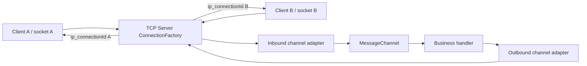
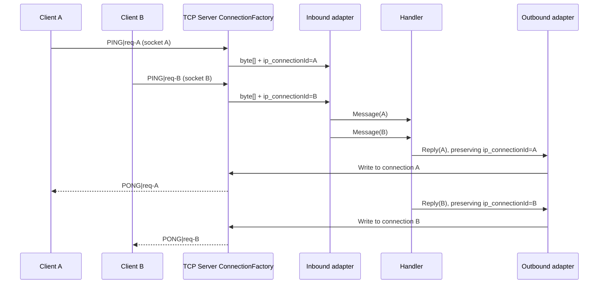
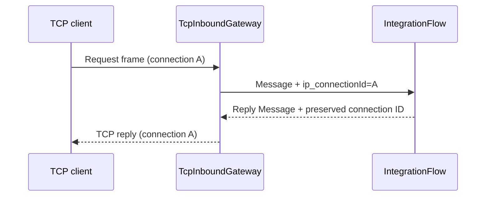
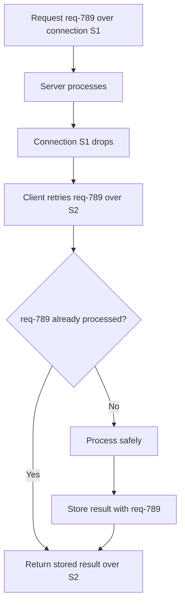

# Connection ID and correlation headers

> **Chapter:** TCP Adapter  
> **Module:** SPRING_INTEGRATION_ADAPTERS  
> **Scope:** Connect external systems to Spring Integration using inbound/outbound adapters, gateways, pollers, and MessageChannel. Practice message exchange flows over files, SFTP, HTTP, JMS, AMQP, Kafka, and databases; handle message contracts, errors, and connection lifecycles.

## 1. Learning objectives

After this lesson, you will be able to:

- Explain the meaning of **`ip_connectionId`** and access the header using `IpHeaders.CONNECTION_ID`.
- Distinguish **TCP connection ID**, **Spring Message ID**, **correlation ID**, and **business request ID**.
- Describe how Spring Integration routes a reply message back to **the exact TCP client socket**.
- Configure a **TCP inbound/outbound channel adapter pair sharing a server ConnectionFactory**, preserving the connection ID on the reply path.
- Understand how gateways manage request-reply and when manual correlation is needed for asynchronous models.
- Handle missing headers, reconnects, timeouts, late replies, multiple requests on one socket, and multiple concurrent clients.
- Design clear correlation contracts, sensible logging/tracing, and security policies for production environments.

## 2. Why does TCP integration need multiple IDs?

An application receives `PING|req-101` and `PING|req-102` over two different sockets. Both messages may pass through the same `MessageChannel` and the same handler. When the handler produces `PONG|...`, the system needs to know **which socket to send to**. At the same time, the business logic wants to know **which request** the reply corresponds to.

These are two different questions:

1. **Connection routing:** Which TCP connection should the bytes be written to?
2. **Business correlation:** Which request, transaction, or workflow does this response belong to?

Spring Integration uses the `ip_connectionId` header for routing to a TCP connection. Correlation ID or business request ID is used to link related messages together. These two kinds of IDs must not be used interchangeably.



**Main point:** With a server-side inbound/outbound adapter pair, `ip_connectionId` selects the socket to write the reply to. If the business workflow crosses queues, multiple services, or reopened connections, you will usually also need an **independent request ID** to restore context.

## 3. Four IDs not to confuse

| Field/ID | Who issues or manages it? | Scope of use | Survives reconnect? |
| --- | --- | --- | --- |
| **`ip_connectionId`** (`IpHeaders.CONNECTION_ID`) | Spring Integration TCP connection layer | Selecting and tracking a specific TCP connection | **No**; a new socket is a different session. |
| **Spring `MessageHeaders.ID`** | Framework-generated per Spring Message | Identifying one message inside internal flows | **No**; cannot serve as a durable business ID. |
| **`correlationId`** | Flow/application or certain EIP components | Grouping/linking internal messages in a workflow | Depends on the flow and how you store/propagate headers. |
| **Business `requestId`** | Defined by protocol/application, e.g. `req-20261123-01` | Matching request ↔ response, retries, idempotency | **Should do**, when business logic requires it. |

### 3.1. `IpHeaders.CONNECTION_ID`

Spring Integration names the header `ip_connectionId`. In code, use the constant to avoid typos:

```java
import org.springframework.integration.ip.IpHeaders;
import org.springframework.messaging.Message;

void inspect(Message<?> message) {
    String connectionId =
            (String) message.getHeaders().get(IpHeaders.CONNECTION_ID);

    System.out.println("TCP connection: " + connectionId);
}
```

`ip_connectionId` is added by the framework to **messages received from TCP**. When using a **server ConnectionFactory** with a TCP outbound channel adapter to reply to a connected client, this header must be present and point to an active connection. This is the adapter's routing mechanism.

One TCP connection can carry **multiple** messages. Two consecutive messages on the same socket typically share the **same connection ID** but have different request IDs. If the peer disconnects and reconnects, the request ID may stay the same during a retry, whereas the connection ID changes.

A connection ID is also **not authentication proof**: a client must not dictate target connection IDs, and the server must not grant permissions based on socket ID without protocol-level identity/permission verification.

### 3.2. Spring Message ID

Every Spring `Message` has a framework-managed `id` header, usually a UUID. This ID helps trace individual messages across processing steps:

```java
import org.springframework.messaging.Message;

void inspectMessage(Message<?> message) {
    System.out.println("messageId=" + message.getHeaders().getId());
}
```

When a flow constructs a new message, the new message's ID may differ from the source message. Therefore, **do not use `message.getHeaders().getId()` as a cross-application transaction ID** without an explicit transmission/persistence contract.

### 3.3. Correlation ID in Spring Integration

The `correlationId` header is used by many **Enterprise Integration Patterns** components such as aggregators or splitters to link messages in the same group. Depending on the endpoint and flow, this header may be set automatically or attached explicitly by the application.

```java
import org.springframework.messaging.Message;
import org.springframework.messaging.support.MessageBuilder;

Message<byte[]> message = MessageBuilder
        .withPayload("PING|req-101".getBytes(
                java.nio.charset.StandardCharsets.UTF_8))
        .setHeader("correlationId", "req-101")
        .build();
```

In this example, `correlationId` is only a **Spring Message header inside the application**. It **does not automatically turn into bytes on the socket** when using `ByteArrayCrLfSerializer`. If the receiver is external software and needs to read the correlation ID, you must **put the ID inside the payload/protocol**, or configure a wire header-transfer mechanism understood by both sides.

Do not assume that setting any header named `correlationId` gives a TCP outbound gateway the ability to multiplex concurrent requests on a single socket. The gateway has its own request-reply mechanics, and the external system's transaction protocol must be modeled independently.

### 3.4. Business Request ID

Suppose the text protocol is:

```text
Request: PING|req-101
Reply:   PONG|req-101
```

`req-101` lives **inside the TCP payload**, so both sides can see it after decoding the frame. Upon timeout and retry, the application can resend the **same request ID** so the server recognizes it as the same task; if the command mutates state, the server must store processed state to avoid executing twice.

A business request ID can also provide correlation across HTTP, JMS, Kafka, or databases. However, it **does not replace** `ip_connectionId` when an outbound adapter must pick a server-side socket for sending a reply.

## 4. Related IP headers

| Header | Constant | Meaning |
| --- | --- | --- |
| `ip_connectionId` | `IpHeaders.CONNECTION_ID` | Logical ID of the TCP connection; used when routing a reply back to the connection. |
| `ip_actualConnectionId` | `IpHeaders.ACTUAL_CONNECTION_ID` | Underlying physical connection ID when using caching/failover client connection factories; primarily for observability. |
| `ip_address` | `IpHeaders.IP_ADDRESS` | Source IP address of the received message. |
| `ip_hostname` | `IpHeaders.HOSTNAME` | Hostname or IP, depending on host lookup configuration. |
| `ip_tcp_remotePort` | `IpHeaders.REMOTE_PORT` | Remote peer TCP port of the receiving connection. |

Logging example:

```java
import org.springframework.integration.ip.IpHeaders;
import org.springframework.messaging.MessageHeaders;

void logNetworkContext(MessageHeaders h) {
    System.out.printf(
            "connection=%s remoteIp=%s remotePort=%s%n",
            h.get(IpHeaders.CONNECTION_ID),
            h.get(IpHeaders.IP_ADDRESS),
            h.get(IpHeaders.REMOTE_PORT)
    );
}
```

**`ACTUAL_CONNECTION_ID` and `CONNECTION_ID` are not interchangeable** when a factory uses wrapping, caching, or failover. When sending through a server outbound adapter, always follow the `IpHeaders.CONNECTION_ID` routing contract required by the endpoint. IP and port can also change across reconnects, NAT, or proxies.

## 5. How the TCP router selects the right socket

A TCP server can serve many clients. When an inbound adapter receives a frame on socket S1, the factory attaches `ip_connectionId=S1` to the Spring Message. If a handler builds a reply from that message and passes it to a TCP outbound adapter sharing the **same server factory**, the outbound adapter reads the header to select socket S1.



**Mandatory rule:** If you construct a new message to send back over the socket, you must preserve or set the original request's `ip_connectionId`. If the header is dropped, overwritten with a wrong value, or the connection has already closed, the outbound adapter cannot locate the target connection and will fail to send the reply.

When using a **TCP inbound gateway**, the gateway manages the request/reply lifecycle. Still, if the flow constructs a brand-new reply message and loses the connection ID, it risks failing to route back to the right connection. Preserve critical headers along the reply path.

### 5.1. Comparing Gateways vs. adapter pairs

| Topology | Who handles TCP correlation? | When appropriate |
| --- | --- | --- |
| **TCP inbound gateway** | Gateway executes request-reply; reply must remain associated with the request's connection. | Client sends a request and expects a reply per contract. |
| **TCP outbound gateway** | Gateway correlates requests with replies from the target TCP server; manages wait timeouts. | Application actively calls a TCP server and waits for the result. |
| **Inbound + outbound adapters sharing a server factory** | Outbound adapter uses `ip_connectionId` to write to the right socket; business correlation is managed by the flow. | Asynchronous bidirectional TCP communication; events/ACKs/replies handled independently. |
| **Adapter pair using a client factory** | Application must design business correlation if replies must be matched to requests. | Application connects to an external server and receives asynchronous messages. |

With an outbound gateway using a **single shared connection**, request/reply exchanges are typically **serialized on that connection** rather than running concurrently on the same socket by default. Using a connection pool only addresses transport-level concurrency; idempotency, payload correlation IDs, and retry policies still must be defined explicitly.

## 6. Hands-on example: preserving connection ID with Java DSL

### 6.1. Problem statement

Build a Spring Integration TCP server on port `9400`:

- Two TCP clients can connect to the server concurrently.
- Each client sends a UTF-8 line: `PING|<request-id>\r\n`.
- Each request produces a reply `PONG|<request-id>\r\n` on the **exact socket** from which the request arrived.
- The flow uses **inbound channel adapter** + **service activator** + **outbound channel adapter**.
- Both adapters share the **same server ConnectionFactory**, and the reply preserves `IpHeaders.CONNECTION_ID`.
- The `correlationId` header is recorded at the Spring layer; the request ID is also carried in the payload because plain TCP clients need to read it.

This illustrates cooperation between two adapters, distinct from a TCP inbound gateway with built-in request-reply. The code demonstrates how to send replies while keeping the flow extensible for asynchronous processing.

### 6.2. Dependencies

The example uses Spring Boot dependency management via BOM, Java 17+, and Spring Integration 6.x:

```xml
<dependencies>
    <dependency>
        <groupId>org.springframework.boot</groupId>
        <artifactId>spring-boot-starter-integration</artifactId>
    </dependency>
    <dependency>
        <groupId>org.springframework.integration</groupId>
        <artifactId>spring-integration-ip</artifactId>
    </dependency>
</dependencies>
```

### 6.3. Configuring factory and flow

```java
import java.nio.charset.StandardCharsets;

import org.springframework.context.annotation.Bean;
import org.springframework.context.annotation.Configuration;
import org.springframework.integration.config.EnableIntegration;
import org.springframework.integration.dsl.IntegrationFlow;
import org.springframework.integration.ip.IpHeaders;
import org.springframework.integration.ip.dsl.Tcp;
import org.springframework.integration.ip.tcp.connection.TcpNetServerConnectionFactory;
import org.springframework.integration.ip.tcp.serializer.ByteArrayCrLfSerializer;
import org.springframework.messaging.Message;
import org.springframework.messaging.support.MessageBuilder;

@Configuration
@EnableIntegration
public class TcpConnectionCorrelationConfiguration {

    @Bean
    TcpNetServerConnectionFactory sessionServerFactory() {
        var factory = new TcpNetServerConnectionFactory(9400);

        // Client and server agree that each frame ends with CRLF.
        var decoder = new ByteArrayCrLfSerializer();
        decoder.setMaxMessageSize(1024);
        factory.setDeserializer(decoder);
        factory.setSerializer(new ByteArrayCrLfSerializer());

        // Allow multiple frames on a single TCP connection.
        factory.setSingleUse(false);
        return factory;
    }

    @Bean
    IntegrationFlow tcpSessionFlow(
            TcpNetServerConnectionFactory sessionServerFactory) {

        return IntegrationFlow
                .from(Tcp.inboundAdapter(sessionServerFactory))
                .handle((payload, headers) -> {
                    String connectionId =
                            (String) headers.get(IpHeaders.CONNECTION_ID);

                    if (connectionId == null) {
                        throw new IllegalStateException(
                                "Missing TCP connection ID");
                    }

                    String request = new String(
                            (byte[]) payload, StandardCharsets.UTF_8
                    );
                    String[] parts = request.split("\\|", -1);

                    String requestId;
                    String reply;

                    if (parts.length == 2
                            && "PING".equals(parts[0])
                            && parts[1].matches("[A-Za-z0-9_-]{1,40}")) {
                        requestId = parts[1];
                        reply = "PONG|" + requestId;
                    } else {
                        requestId = "unknown";
                        reply = "ERR|BAD_REQUEST";
                    }

                    System.out.printf(
                            "connection=%s requestId=%s%n",
                            connectionId, requestId
                    );

                    // Explicitly create a new reply keeping the request's connection ID.
                    // correlationId serves internal flow/logging.
                    Message<byte[]> response = MessageBuilder
                            .withPayload(reply.getBytes(
                                    StandardCharsets.UTF_8))
                            .setHeader(IpHeaders.CONNECTION_ID, connectionId)
                            .setHeader("correlationId", requestId)
                            .build();

                    return response;
                })
                .handle(Tcp.outboundAdapter(sessionServerFactory))
                .get();
    }
}
```

**Reading the flow:**

1. `sessionServerFactory` listens on port `9400` and provides context for each TCP socket.
2. `Tcp.inboundAdapter(...)` reads frames from the connection factory and emits `Message<byte[]>` into the flow; the message carries `ip_connectionId`.
3. The handler reads the connection ID from `headers`, parses the request, and creates a new reply message.
4. `MessageBuilder.setHeader(IpHeaders.CONNECTION_ID, connectionId)` retains the routing info needed for the TCP outbound adapter to select the **exact connection**.
5. `setHeader("correlationId", requestId)` retains grouping/business info inside the **Spring Message**. With the CRLF serializer, this header **does not go out over TCP**.
6. `Tcp.outboundAdapter(sessionServerFactory)` writes the reply payload to the socket identified by `ip_connectionId`.
7. `ByteArrayCrLfSerializer` appends `\r\n` to the reply on the wire; the handler does not add the delimiter itself.

**Limitation of the example:** The handler builds the reply immediately in the same flow for easy verification. When offloading work to a queue or another service, `connectionId` and `requestId` must be carried all the way through; the connection might also close before the reply is produced. Preserving the header alone **does not guarantee the connection is still alive**.

### 6.4. Why must replies not be built without the header?

The following snippet is **insufficient** when replying via a server outbound adapter:

```java
// Wrong for socket-based reply routing:
Message<byte[]> response = MessageBuilder
        .withPayload("PONG|req-101".getBytes(StandardCharsets.UTF_8))
        .build();
```

The new message has a payload, but **lacks** `ip_connectionId`. If the outbound adapter uses a server connection factory, it cannot know whether to write to socket A or socket B.

Preserve the header in one of two ways:

- Construct a new message and **explicitly attach** `IpHeaders.CONNECTION_ID` from the original message.
- With transformer/service activator steps that copy headers automatically, verify that the actual configuration **preserves** `ip_connectionId`; test on the channel right before outbound sending.

Do not rely on a blanket assumption that "Spring automatically keeps all headers in every situation." When filtering, splitting, aggregating, persisting messages, or building new DTOs, headers can be altered, dropped during serialization, or omitted.

### 6.5. Running two concurrent TCP clients

The Java snippet below runs independently of Spring Integration. Two clients open **two sockets** and send requests with different IDs:

```java
import java.io.BufferedReader;
import java.io.InputStreamReader;
import java.net.InetSocketAddress;
import java.net.Socket;
import java.nio.charset.StandardCharsets;
import java.util.concurrent.Executors;

public class TwoTcpClientsDemo {

    private static String exchange(String request) throws Exception {
        try (Socket socket = new Socket()) {
            socket.connect(new InetSocketAddress("127.0.0.1", 9400), 3000);
            socket.setSoTimeout(5000);

            // This is a plain TCP client, manually adding CRLF to the wire.
            socket.getOutputStream().write(
                    (request + "\r\n").getBytes(StandardCharsets.UTF_8));
            socket.getOutputStream().flush();

            var reader = new BufferedReader(new InputStreamReader(
                    socket.getInputStream(), StandardCharsets.UTF_8));

            String reply = reader.readLine();
            if (reply == null) {
                throw new IllegalStateException("Closed before reply");
            }

            return reply;
        }
    }

    public static void main(String[] args) throws Exception {
        var pool = Executors.newFixedThreadPool(2);
        try {
            var first = pool.submit(
                    () -> exchange("PING|req-A"));
            var second = pool.submit(
                    () -> exchange("PING|req-B"));

            System.out.println("A: " + first.get());
            System.out.println("B: " + second.get());
        } finally {
            pool.shutdown();
        }
    }
}
```

Once Spring Boot with `TcpConnectionCorrelationConfiguration` is running, the **expected** output is:

```text
A: PONG|req-A
B: PONG|req-B
```

The connection ID in server logs will differ between client A and client B. The `ip_connectionId` header enables the outbound adapter to return each reply to its corresponding socket. The order of the two log lines on the server is **not guaranteed**, since both clients run concurrently.

If one client keeps its socket open and sends `PING|req-C`, that request will share the **same connection ID** as the prior request on that socket, while carrying a different request ID. Thus, connection ID alone is insufficient to pair a response with a request when multiple tasks share one connection.

## 7. Request-reply gateways and automatic correlation

### 7.1. TCP inbound gateway

`TcpInboundGateway` receives a request from a client, dispatches it into the flow, awaits a reply, and sends the payload back to the matching connection. The incoming message carries `ip_connectionId`. When constructing a new reply, preserve required headers on the reply path, especially if replacing the entire message.



In a simple synchronous flow, the handler returns a reply payload and the framework maintains required headers through reply message creation. When steps build messages manually or process asynchronously, verify the actual headers on the **reply message**.

### 7.2. TCP outbound gateway

`TcpOutboundGateway` receives a Spring Message from the application, sends the request to a TCP server, and awaits a response. The gateway handles correlating replies to requests according to the endpoint's exchange model.

With a **single shared client connection** (`singleUse=false`), the gateway typically processes **one request/reply at a time on that connection**. Subsequent calls wait so replies never get mixed up. When higher throughput is needed, consider `CachingClientConnectionFactory` with multiple connections or an asynchronous adapter pair with explicit correlation.

The gateway **does not automatically provide** idempotency or exactly-once processing for business logic. If a client times out after the server already executed a command, retrying can run the command a second time without a request ID and server-side deduplication.

### 7.3. Asynchronous adapters

When client A sends a request on connection A, the server may receive it and hand it off for asynchronous processing. The reply might be produced after an unpredictable delay, by which time connection A may have closed or reopened under a new ID.

Here you must manage **two distinct mapping tables**:

```text
TCP session routing:
  connectionId -> active connection

Business correlation:
  requestId -> original request / processing state / stored result
```

The first table is managed by the connection factory; the second is the application's design responsibility. Never embed `Socket` references or Spring `replyChannel` objects inside network payloads to simulate the second table.

## 8. Are Spring Integration headers sent over TCP?

**By default, `ByteArray*Serializer` TCP codecs transmit the payload only and do not automatically send all Spring Message headers.** The TCP receiver sees the payload and gets IP headers generated **on the receiving side** from the actual connection.

For example:

```java
Message<byte[]> outbound = MessageBuilder
        .withPayload("PING|req-101".getBytes(StandardCharsets.UTF_8))
        .setHeader("correlationId", "req-101")
        .setHeader("tenantId", "tenant-12")
        .build();
```

With a CRLF serializer, the wire data is:

```text
PING|req-101\r\n
```

Neither `correlationId` nor `tenantId` appears on the wire merely because they are Spring headers.

### 8.1. How to pass correlation IDs to external systems

There are three strategies:

| Approach | When suitable | Notes |
| --- | --- | --- |
| **Put request ID in payload** (`PING|req-101`) | Custom/legacy protocols where payload format can include fields | Simple and easy to test; requires schema, validation, and versioning. |
| **Define a metadata envelope** (`JSON`/`protobuf`/binary envelope) | Many metadata fields must cross application boundaries | Requires framing outside the envelope and size control. |
| **Send selected Spring headers via message mapper** | Both sides support a Spring Integration configured format | Needs matching mapper, converter, and serializer/deserializer; never send live headers. |

Spring Integration supports `MessageConvertingTcpMessageMapper`, `MapMessageConverter`, and serializers like `MapJsonSerializer` to transfer **selected headers** alongside the payload. This is a specialized configuration requiring wire-format agreement on both sides.

**Never serialize headers holding live objects** such as framework `replyChannel` or `errorChannel` to external systems. They have no meaning as durable network addresses and may not be serializable. For protocols requiring cross-service tracing and correlation, placing IDs explicitly in the schema is much easier to interoperate with.

### 8.2. Comparing internal headers and wire fields

Suppose a flow receives a message with:

```text
Spring headers:
  ip_connectionId = server:client:some-session
  correlationId   = req-101
  id              = (Spring Message UUID)

Wire payload:
  PONG|req-101\r\n
```

This is an **illustrative representation**, not an actual connection ID string generated by the framework. The TCP peer receives only the framed payload. If the peer needs to know the correlation ID, include it in the wire payload per contract.

## 9. Reconnects, timeouts, and late replies

### 9.1. A new connection does not replace an old one

A typical session:

1. Client connects and sends `CHARGE|req-789|order-42`.
2. Server processes the command and prepares the reply for `req-789`.
3. The old TCP connection drops.
4. Client opens a new socket and retries **the same request ID `req-789`**.
5. The server cannot send the old reply using the old connection ID if that socket is gone; it must decide how to return the result using the new request received on the new socket.



`ip_connectionId` helps reply to **the right active socket**, but it does not remember that a request was committed on an earlier socket. That is the role of **request ID, durable results, and idempotency**.

### 9.2. A timeout does not prove the request never ran

If a client waits 5 seconds for a reply and times out, the server may still be processing, may have already succeeded, or the reply may have been lost on the network. Retrying without idempotency can execute the action twice.

Depending on requirements, the protocol should specify:

- A request ID stable across retries.
- ACK codes distinguishing `ACCEPTED` from `COMPLETED`.
- Replies carrying the request ID so callers can verify correlation.
- Result/idempotency store and retention period.
- Retry/backoff rules, timeouts, and states requiring reconciliation.

### 9.3. Handling stale or invalid connection IDs

An outbound adapter sending with a nonexistent or stale connection ID can fail because the connection factory cannot find the socket. Spring Integration provides TCP correlation error events, such as `TcpConnectionFailedCorrelationEvent`, for routing failures.

Never "fix" this by writing to **some arbitrary open socket**. Doing so risks leaking business data to the wrong client. The system must mark the send as failed, record the request ID, and rely on a retry/reconciliation flow over a new request if the protocol allows.

## 10. Common ways headers get lost and how to prevent them

| Situation | Risk | Resolution |
| --- | --- | --- |
| Handler creates a new `MessageBuilder.withPayload(...)` | `ip_connectionId` is missing from the reply. | Explicitly copy/set the header from the inbound message. |
| Transformer changes payload and header filtering drops headers | Connection ID or correlation ID is lost. | Inspect headers before the outbound adapter; adjust header mapping. |
| Pushing message through JMS/Kafka/DB and reading it back | New system's message may not preserve all original headers. | Explicitly persist connection ID and request ID; verify connection is still alive when replying. |
| Splitting/Aggregating messages | Correlation ID is generated/changed per group; connection ID is hard to keep when mixing sources. | Define group key, provenance, and per-connection routing key separately. |
| Client reconnects | Old connection ID is no longer valid. | Protocol retries using request ID and new socket. |
| Multiple requests on one connection | Same connection ID cannot distinguish requests. | Put request ID/correlation ID in payload or protocol envelope. |
| Assigning connection ID from client-supplied data | Risk of picking wrong socket or unauthorized routing. | Use only the ID created by the actual receiving TCP layer; enforce routing permissions. |
| Writing internal headers straight to the wire | Peer does not recognize format, breaking framing. | Choose an explicit wire schema and message mapper. |

### 10.1. Protecting headers during asynchronous processing

Suppose an inbound adapter receives data and passes it to a worker queue. At minimum, store:

```text
TaskEnvelope {
    connectionId:  "Connection ID assigned by Spring on receipt"
    requestId:     "Business ID inside request payload"
    receivedAt:    "Receipt timestamp"
    payload:       "Content to process"
}
```

When the worker produces a result, the application must:

1. Verify `requestId` and processing status.
2. Check that the old connection ID is still authorized and active.
3. Send the reply through the right outbound adapter with `IpHeaders.CONNECTION_ID` attached.
4. If the socket is closed, never route to another client; execute retry/reconciliation per application protocol.

If processing latency can exceed connection lifetime, consider an **early ACK + status query by request ID** model or a durable broker instead of relying on the socket staying open forever.

## 11. Security and operations

### 11.1. Never treat IP connection ID as identity

A connection ID is strictly a **transport session identifier**. It does not verify:

- Which device the client is.
- Whether the client is authorized to run the command or receive that response.
- Whether a socket belongs to the same user after reconnect.
- Whether an incoming request belongs to a valid transaction.

For sensitive data, require authentication (such as mTLS, tokens, or protocol-level auth), enforce authorization after authentication, and map **authenticated principal ↔ connection** within the appropriate lifecycle scope. Never use a previous session's connection ID to authorize a new session.

### 11.2. Cross-system tracing

Record independent log fields:

| Log field | Purpose |
| --- | --- |
| `connectionId` | Correlate socket open/close events and messages on a TCP session. |
| `requestId` / `correlationId` | Correlate logs for one request across steps or services. |
| `messageId` | Inspect individual Spring Messages. |
| `direction` (inbound/outbound) | Tell whether a message is entering or leaving. |
| `remoteAddress` | Assist network diagnostics; never use as identity. |
| `resultCode` and `latency` | Distinguish business outcomes, framing errors, and timeouts. |

Do not log sensitive payloads, tokens, or full personal data solely for correlation. Avoid embedding predictable transaction details in request IDs if logs are broadly accessible, and restrict log query access appropriately.

### 11.3. Metrics and events

Useful metrics:

- Active connection count, open/close rates, and reconnect counts.
- Inbound/outbound message counts per endpoint.
- Replies failing to route due to invalid connection IDs.
- Request-reply wait time and timeout counts.
- Repeated request IDs, deduplicated requests, or requests needing reconciliation.
- Processing latency from frame receipt to reply send.

Track **socket errors** and **business processing errors** separately rather than lumping everything under "TCP failed."

## 12. Essential test scenarios

| Scenario | What to verify |
| --- | --- |
| Two clients send concurrently | Replies go to **each client's exact socket**. |
| Same connection sends two sequential requests | Same connection ID, different request IDs. |
| Two connections send the same request ID | Never rely solely on request ID to pick a socket; define uniqueness scope for business IDs. |
| Build reply without `ip_connectionId` | Sending via server outbound adapter must fail cleanly and never deliver to the wrong socket. |
| Preserve header across transformer | `IpHeaders.CONNECTION_ID` still exists before the TCP outbound adapter. |
| Drop header in an async branch | Observe how the routing failure is reported and handled. |
| Client closes socket before reply | Reply is never sent to a new connection or another socket. |
| Client reconnects and retries same request ID | New connection ID, unchanged request ID; idempotency handles it properly. |
| Using CRLF serializer | Internal `correlationId` does not appear automatically in wire bytes. |
| Late reply arrives after timeout | Define policy for late replies and update business state accurately. |
| Internal correlation ID changes at splitter/aggregator | Message still stays tied to the right transaction and result. |
| Malformed frame or missing CRLF | Do not confuse framing errors with missing connection ID. |

### 12.1. Checking the header right before the outbound adapter

In a flow, you can insert a logging/assertion step right before `Tcp.outboundAdapter(...)`:

```java
.handle((payload, headers) -> {
    Object connectionId = headers.get(IpHeaders.CONNECTION_ID);
    Object correlationId = headers.get("correlationId");

    if (connectionId == null) {
        throw new IllegalStateException("Missing ip_connectionId");
    }

    System.out.printf(
            "reply routing connection=%s correlation=%s%n",
            connectionId, correlationId
    );

    // Preserve original headers by not creating a message missing connectionId.
    return payload;
})
```

This snippet is **part of an `IntegrationFlow`** that already has the incoming request message and the outbound adapter downstream. When a service activator returns a plain payload, verify the flow's header-copying behavior; when constructing a new message manually, explicitly set the required headers as shown in the main example.

## 13. Hands-on exercises

**Exercise 1 — Distinguish IDs.** For two requests `PING|req-1` and `PING|req-2` on the same TCP socket, tabulate `connectionId`, Spring message ID, and request ID. Explain which fields match and which differ.

**Exercise 2 — Trigger missing-header error.** In the Section 6 configuration, remove `.setHeader(IpHeaders.CONNECTION_ID, connectionId)` from the response. Observe the routing error and confirm the server **never sends the reply to another socket**.

**Exercise 3 — Split asynchronous processing.** Move business logic to an executor/queue with variable processing time. Design the state stored between receipt and reply, and define how to handle the case where the connection has already closed.

**Exercise 4 — Deduplication.** Replace `PING` with `CREATE_ORDER` carrying a request ID. Simulate the server completing the order while the reply is lost; the client reconnects and retries. Design an idempotency store and response carrying the same request ID.

**Exercise 5 — Send correlation ID over the wire.** Keep `ByteArrayCrLfSerializer` while adding the ID to the payload, or design a properly framed JSON envelope. Explain why merely adding a `correlationId` header on the Spring Message is not enough.

**Exercise 6 — Observability.** Add logging for connection open/close, inbound requests, outbound replies, timeouts, and failed correlations. Design a query that finds all logs for `req-1001` even across two different sockets.

## 14. Knowledge self-check

1. Which actual header name does `IpHeaders.CONNECTION_ID` correspond to?
2. Why can two messages on the same TCP socket share a connection ID while having different request IDs?
3. Can a Spring Message's ID be used by default as a cross-application idempotency key?
4. If a server uses inbound/outbound channel adapters sharing a connection factory, which header must be present on outbound messages to target the right socket?
5. Why does an internal `correlationId` header not automatically appear on the wire when using `ByteArrayCrLfSerializer`?
6. When using an inbound gateway, why must request context be preserved when constructing a reply?
7. What does a TCP outbound gateway do to match requests and replies, and how does a shared connection affect concurrency?
8. A request times out and the client reconnects: which of request ID and connection ID should be preserved?
9. If an old connection ID no longer exists, is it acceptable to send the reply to another open socket?
10. When should `MapMessageConverter` / `MessageConvertingTcpMessageMapper` be used?
11. Why can `ip_actualConnectionId` differ from `ip_connectionId` with a caching or failover factory?
12. What information is needed both to trace a request across services and to route TCP replies to the right connection?

**Hints:** (1) `ip_connectionId`. (2) Connection ID identifies the session; request ID identifies the request. (3) No, new messages get new IDs and headers are not sent over TCP by default. (4) `ip_connectionId`. (5) The CRLF serializer transmits only payload and delimiter. (6) The gateway needs to route the reply back to the right request/connection. (7) The gateway manages request-reply exchange; a shared connection typically serializes turns. (8) Retry keeps the request ID while getting a new connection ID. (9) No. (10) When both sides need to transfer selected headers over the wire in an agreed format. (11) The actual header describes the underlying physical connection, while the primary header is the logical routing ID. (12) Connection ID, request/correlation ID, timestamps, status, and reply contract.

## 15. References

- [Spring Integration Reference — IP Message Headers](https://docs.spring.io/spring-integration/reference/ip/msg-headers.html).
- [Spring Integration Reference — TCP Connection Factories](https://docs.spring.io/spring-integration/reference/ip/tcp-connection-factories.html).
- [Spring Integration Reference — TCP Message Correlation](https://docs.spring.io/spring-integration/reference/6.2/ip/correlation.html).
- [Spring Integration Reference — TCP Gateways](https://docs.spring.io/spring-integration/reference/ip/tcp-gateways.html).

**Key takeaway:** `ip_connectionId` binds a Spring Message to a **specific TCP connection** so adapters and gateways can route data back to the right socket. `correlationId` and `requestId` link **messages belonging to the same transaction or request**, especially with asynchronous processing, multiple systems, or reconnects. Preserve the routing header in the flow, transmit business IDs explicitly on the wire, and design timeouts, retries, idempotency, authentication, and logging cleanly for each responsibility.
