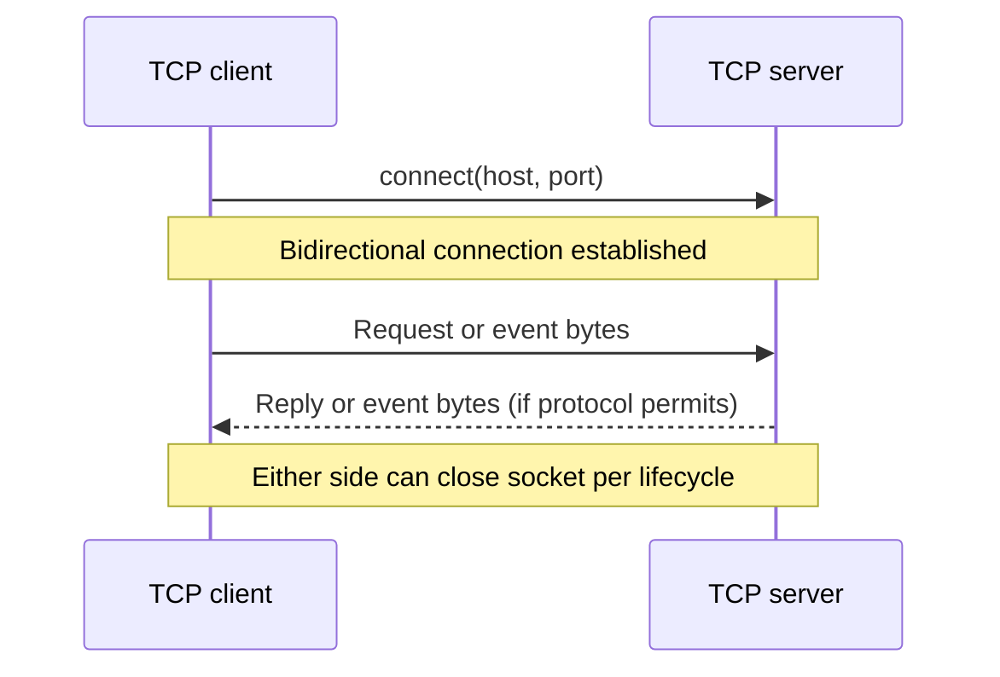
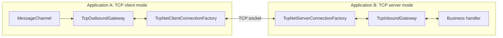
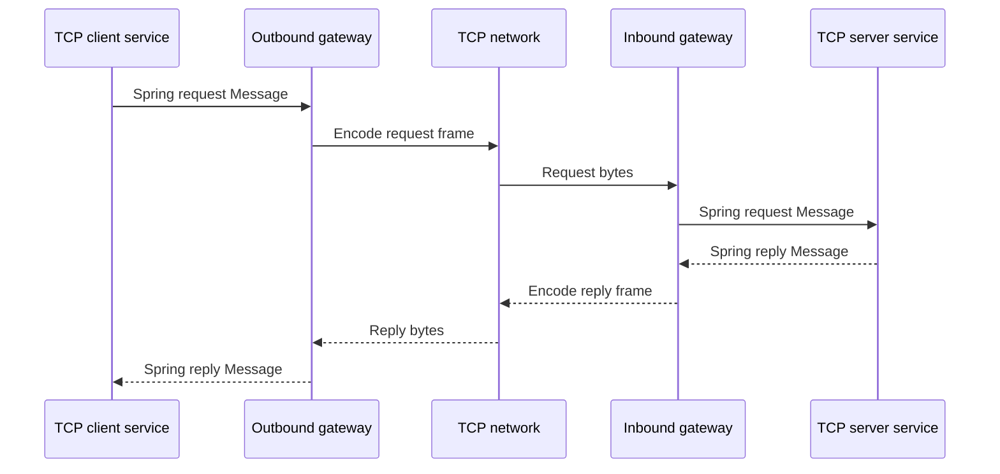
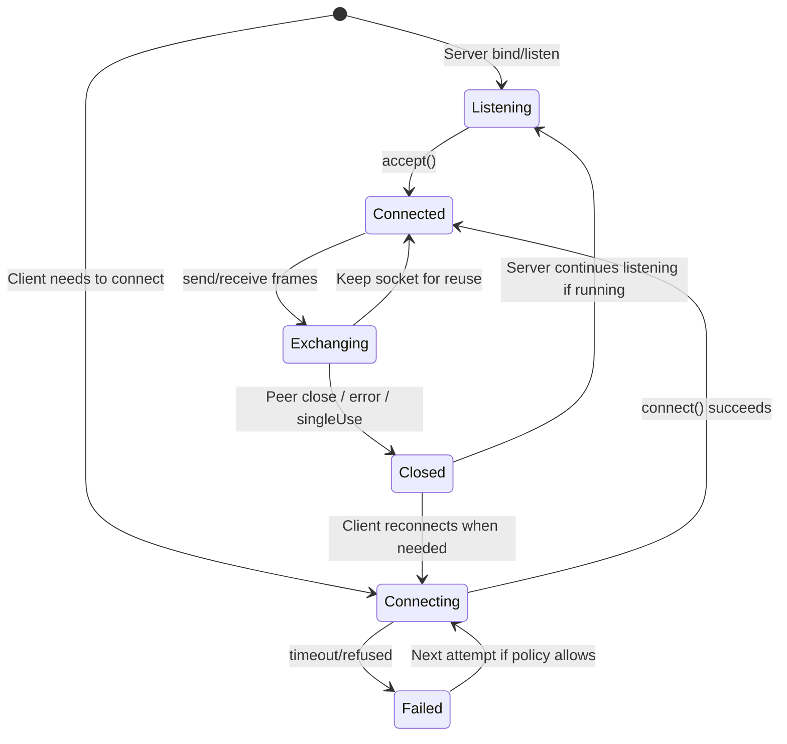

# Client mode and server mode

> **Chapter:** TCP Adapter  
> **Module:** SPRING_INTEGRATION_ADAPTERS  
> **Module scope:** Connect external systems to Spring Integration using inbound/outbound adapters, gateways, pollers, and MessageChannel. Practice message exchange flows over files, SFTP, HTTP, JMS, AMQP, Kafka, and databases; handle message contracts, errors, and connection lifecycles.

## 1. Learning objectives

After completing this lesson, you will be able to:

- Distinguish **TCP client mode** from **TCP server mode** by which side **actively opens the connection** vs. **listens for connections**, without confusing them with Spring Message inbound/outbound direction.
- Choose `TcpNetClientConnectionFactory` or `TcpNetServerConnectionFactory` for the right network role.
- Understand the difference between `TcpNet*ConnectionFactory` (Java IO) and `TcpNio*ConnectionFactory` (Java NIO).
- Combine TCP connection factories with **inbound/outbound channel adapters** or **inbound/outbound gateways** according to unidirectional or request-reply contracts.
- Build **two Spring Boot applications**: a server receiving requests via a TCP inbound gateway and a client sending requests via a TCP outbound gateway.
- Design framing contracts, connection IDs, timeouts, reconnects, and error-handling policies for each side's role.
- Identify operational concerns including bind addresses, firewalls/NAT, shared connections, TLS, shutdown, and concurrent load.

## 2. What do client mode and server mode mean?

In TCP, the **client** is the side that **actively calls connect** to a host/port; the **server** is the side that **binds, listens, and accepts** incoming connections. This role describes **only how the socket is created**.

- **TCP client mode:** the application knows the peer's host and port and actively establishes a connection to the TCP server.
- **TCP server mode:** the application opens a listening port and accepts connections from one or more external TCP clients.



**Important:** Once TCP connects successfully, **both sides can read and write bytes**. There is no TCP rule forcing clients to only send and servers to only receive. Whether communication is **unidirectional**, **request-reply**, or **asynchronous bidirectional** is determined by the *application protocol* and Spring Integration endpoints.

### 2.1. Do not equate socket mode with adapter direction

In Spring Integration:

- **Inbound**: Spring Messages move **into** the application/flow from an external system.
- **Outbound**: Spring Messages move **out** from the application/flow to an external system.
- **Client/server**: whether the application **actively connects** or **listens and accepts** sockets.

Therefore, an **inbound channel adapter** can receive messages over a connection actively opened by a **client factory** to an external server; similarly, a server that accepted a client connection can use an **outbound channel adapter** to send data back to that exact socket.

| Application socket role | Spring inbound | Spring outbound |
| --- | --- | --- |
| **Client mode**: app calls `connect` | Receives frames pushed by the target TCP server over the opened client connection. | Actively pushes frames or sends requests to the target TCP server. |
| **Server mode**: app calls `listen/accept` | Receives frames from TCP clients connecting into the app. | Sends frames to a connected TCP client; usually needs routing via `ip_connectionId`. |

In request-reply, a **gateway** handles both sending and receiving in one exchange. The names `inbound gateway` and `outbound gateway` are still based on **the direction of the originating request**, not the direction of individual bytes.

### 2.2. Real-world examples

**System A — Application providing a TCP service:** industrial devices actively connect to the application on port `9500` and send `STATUS|sensor-01`. The application runs as a **TCP server** and uses an **inbound gateway** to receive requests and return `OK|sensor-01|ACTIVE`.

**System B — Application calling a legacy TCP service:** the application opens a connection to an external server and sends the same command. The application runs as a **TCP client** and uses an **outbound gateway** to wait for the result.

**System C — Notification receiver:** the application runs as a TCP client, connecting to a server that streams periodic events. Once connected, the server pushes events; the application uses an **inbound channel adapter** to receive messages. This shows that *inbound* does not have to mean *server*.

## 3. ConnectionFactory determines the socket role

In Spring Integration TCP, the **connection factory** manages socket creation/connection, serializers/deserializers, and connection lifecycle. Adapters or gateways use that connection factory to convert between the TCP byte stream and Spring Messages.

| Class | Mode | I/O technology | Purpose |
| --- | --- | --- | --- |
| `TcpNetClientConnectionFactory` | Client | Java socket I/O | Connects outbound to a known host/port. |
| `TcpNetServerConnectionFactory` | Server | Java socket I/O | Binds a port and accepts client connections. |
| `TcpNioClientConnectionFactory` | Client | Java NIO | Connects outbound using an NIO-based I/O model. |
| `TcpNioServerConnectionFactory` | Server | Java NIO | Listens and manages many connections via NIO. |



### 3.1. Client factory: target host and port

Minimal configuration:

```java
import org.springframework.integration.ip.tcp.connection.TcpNetClientConnectionFactory;

var clientFactory =
        new TcpNetClientConnectionFactory("127.0.0.1", 9500);
```

In client mode, `127.0.0.1:9500` is **the TCP server address the application wants to connect to**. If the two applications run on separate machines or containers, `127.0.0.1` points only to the **machine/container running the client**, not the server. In real deployments, supply a host routable to the server, such as a service DNS name or internal network address.

A client factory may open connections on demand when communicating; do not assume Spring bean creation proves the server is up. Connections can encounter `Connection refused`, timeouts, DNS failures, or peer closure after an idle period.

### 3.2. Server factory: listening port

Minimal configuration:

```java
import org.springframework.integration.ip.tcp.connection.TcpNetServerConnectionFactory;

var serverFactory = new TcpNetServerConnectionFactory(9500);
```

In server mode, `9500` is **the port the application opens to listen on**. Client connections succeed only when all of the following hold:

1. The server has started and bound the port successfully.
2. The bind address matches the network interface clients reach.
3. Firewalls, container port mappings, security groups, and network policies permit the connection.
4. The client targets the right host/port and both sides speak compatible protocols.

The constructor above sets only the **port**, without automatically restricting binding to `127.0.0.1`. If your environment requires listening only on loopback or a specific interface, configure the bind address per your Spring Integration version's API and deployment policy.

### 3.3. Net IO and NIO do not replace business logic

**Net** is a straightforward choice for moderate connection counts or learning exercises. **NIO** can suit large socket counts and reduce thread wait costs for I/O, yet it will not automatically boost throughput if handlers are blocked on slow databases or APIs.

When choosing, measure:

- Concurrent connections and idle connections.
- Socket open/close frequency.
- Requests/sec, p95/p99 latency.
- CPU, memory, thread count, and open file descriptors.
- Non-I/O business processing time.

**Do not choose NIO simply because "non-blocking" is in the name.** Suitability also depends on request-reply patterns, framing, payload sizes, and downstream dependencies.

## 4. Which endpoint matches client/server mode?

### 4.1. Fundamental topologies

| Problem | Application ConnectionFactory | Endpoint to consider |
| --- | --- | --- |
| Devices send events to listening application | **Server** | TCP **inbound channel adapter**. |
| External clients send commands and need replies | **Server** | TCP **inbound gateway**. |
| App sends notifications to external TCP server without reply | **Client** | TCP **outbound channel adapter**. |
| App calls external TCP service and awaits a reply | **Client** | TCP **outbound gateway**. |
| App actively connects and receives event stream pushed by server | **Client** | Inbound adapter with client connection factory and server → client protocol. |
| Listening app needs to push an event back to a connected client | **Server** | Outbound adapter with server connection factory and the target socket's `ip_connectionId`. |

A topology can pair adapters for **asynchronous send and receive**, provided channels, routing headers, and late-reply handling are clearly specified. For a "one reply per request" contract, a **gateway** usually eliminates much of the correlation plumbing you would otherwise build manually.

### 4.2. Do not infer direction from port number

There is no rule making "port 9500" inbound or outbound. An application can:

- Listen on `9500` to serve client requests: **TCP server + inbound gateway**.
- Connect outbound to a server on `9500` to send requests: **TCP client + outbound gateway**.

The identical port number in both descriptions does not give both applications the same role. **The side calling connect** is the client; **the side calling accept** is the server.

### 4.3. Gateways handle both byte directions

Flow across gateways:



On the **client side**, the gateway is outbound because requests leave the app. On the **server side**, the gateway is inbound because requests enter the app. Both sides must configure **matching framing** and compatible payload schemas.

## 5. Message contract: both sides must agree

For our hands-on example, we choose a simple protocol:

| Property | Contract |
| --- | --- |
| Transport | TCP |
| Server endpoint | `127.0.0.1:9500` when running locally |
| Encoding | UTF-8 |
| Request | `PING|<request-id>` |
| Valid reply | `PONG|<request-id>` |
| Invalid request reply | `ERR|BAD_REQUEST` |
| Frame boundary | **CRLF**: two bytes `0D 0A` |
| Requests per connection | Multiple rounds allowed; demo **sends one request and awaits reply** before sending the next |
| Client timeouts | Configure both connect and reply timeouts per SLA in production |
| ID scope | `request-id` generated by caller for response matching, independent of connection ID |

Example wire exchange:

```text
Client -> Server: PING|req-101\r\n
Server -> Client: PONG|req-101\r\n
```

Because TCP does not preserve message boundaries, Spring Integration uses `ByteArrayCrLfSerializer` to:

- **Serialize:** write payload bytes and **automatically append** CRLF.
- **Deserialize:** read up to CRLF and return payload bytes **excluding** CRLF.
- Allow multiple consecutive frames on the same connection when the protocol permits.

In the Java code below, the payload is simply `PING|req-101`. **Never manually append `\r\n` to the payload** before passing it to a CRLF serializer; doing so can make the peer read an extra empty frame.

For binary payloads or data that may contain CRLF inside the content, choose a mechanism like a **length header** or well-defined escaping instead of forcing CRLF out of habit.

## 6. End-to-end example: two Spring Boot apps in opposite modes

We create **two separate Spring Boot applications** so client and server roles are unmistakable:

- **tcp-server-app**: listens on port `9500`, accepts requests with `TcpNetServerConnectionFactory` and `Tcp.inboundGateway(...)`.
- **tcp-client-app**: actively connects to `127.0.0.1:9500` with `TcpNetClientConnectionFactory`, sends requests via `Tcp.outboundGateway(...)`, and awaits replies.

Both apps use the same Spring Integration Java DSL style, yet **do not need to live in the same source project**. If placing them in one Spring Boot module for quick testing, manage `@Configuration` and `@Bean` carefully so you never accidentally enable both server and client in the same process in production.

### 6.1. Common dependencies

Each application uses Spring Boot with Java 17+ and Spring Integration 6.x, with versions managed by the Spring Boot BOM:

```xml
<dependencies>
    <dependency>
        <groupId>org.springframework.boot</groupId>
        <artifactId>spring-boot-starter-integration</artifactId>
    </dependency>

    <dependency>
        <groupId>org.springframework.integration</groupId>
        <artifactId>spring-integration-ip</artifactId>
    </dependency>
</dependencies>
```

Each app has a `@SpringBootApplication` class whose component scan covers **only that application's** configurations.

### 6.2. Server application: creating a TCP server ConnectionFactory

File `TcpServerModeConfiguration.java` **placed only in tcp-server-app**:

```java
import java.nio.charset.StandardCharsets;

import org.springframework.context.annotation.Bean;
import org.springframework.context.annotation.Configuration;
import org.springframework.integration.config.EnableIntegration;
import org.springframework.integration.dsl.IntegrationFlow;
import org.springframework.integration.ip.IpHeaders;
import org.springframework.integration.ip.dsl.Tcp;
import org.springframework.integration.ip.tcp.connection.TcpNetServerConnectionFactory;
import org.springframework.integration.ip.tcp.serializer.ByteArrayCrLfSerializer;

@Configuration
@EnableIntegration
public class TcpServerModeConfiguration {

    @Bean
    TcpNetServerConnectionFactory serverConnectionFactory() {
        var factory = new TcpNetServerConnectionFactory(9500);

        // Both client requests and server replies end with CRLF.
        var decoder = new ByteArrayCrLfSerializer();
        decoder.setMaxMessageSize(1024);
        factory.setDeserializer(decoder);
        factory.setSerializer(new ByteArrayCrLfSerializer());

        // Demo allows multiple request/reply rounds on one socket.
        factory.setSingleUse(false);
        return factory;
    }

    @Bean
    IntegrationFlow serverRequestReplyFlow(
            TcpNetServerConnectionFactory serverConnectionFactory) {

        return IntegrationFlow
                .from(Tcp.inboundGateway(serverConnectionFactory))
                .handle((payload, headers) -> {
                    String connectionId =
                            (String) headers.get(IpHeaders.CONNECTION_ID);

                    String request = new String(
                            (byte[]) payload, StandardCharsets.UTF_8
                    );
                    String reply = buildReply(request);

                    System.out.printf(
                            "server connection=%s request=%s%n",
                            connectionId, request
                    );

                    return reply.getBytes(StandardCharsets.UTF_8);
                })
                .get();
    }

    private static String buildReply(String request) {
        String[] fields = request.split("\\|", -1);

        if (fields.length != 2
                || !"PING".equals(fields[0])
                || !fields[1].matches("[A-Za-z0-9_-]{1,40}")) {
            return "ERR|BAD_REQUEST";
        }

        return "PONG|" + fields[1];
    }
}
```

**Server mode explained:**

1. `TcpNetServerConnectionFactory(9500)` opens the TCP server port and accepts incoming connections.
2. The deserializer waits for CRLF before producing the request `byte[]` payload.
3. `Tcp.inboundGateway(...)` passes the request into `IntegrationFlow` and manages the reply.
4. The handler parses the request and returns the reply `byte[]`; the serializer writes the reply with CRLF.
5. `IpHeaders.CONNECTION_ID` identifies the connection associated with the request, useful for logging/tracing. The example handler **does not write to sockets directly** or pick connections manually, since the gateway handles the reply path.

**Demo limitation:** The server accepts any TCP client that can reach the port. A real application needs bind address restrictions, firewalls, TLS, and authentication/authorization before executing sensitive commands. The `request-id` in this demo has no idempotency persistence yet.

### 6.3. Client application: creating a TCP client ConnectionFactory

File `TcpClientModeConfiguration.java` **placed only in tcp-client-app**:

```java
import org.springframework.context.annotation.Bean;
import org.springframework.context.annotation.Configuration;
import org.springframework.integration.annotation.IntegrationComponentScan;
import org.springframework.integration.config.EnableIntegration;
import org.springframework.integration.dsl.IntegrationFlow;
import org.springframework.integration.ip.dsl.Tcp;
import org.springframework.integration.ip.tcp.connection.TcpNetClientConnectionFactory;
import org.springframework.integration.ip.tcp.serializer.ByteArrayCrLfSerializer;

@Configuration
@EnableIntegration
@IntegrationComponentScan
public class TcpClientModeConfiguration {

    @Bean
    TcpNetClientConnectionFactory clientConnectionFactory() {
        var factory =
                new TcpNetClientConnectionFactory("127.0.0.1", 9500);

        // Same CRLF contract as the server.
        factory.setSerializer(new ByteArrayCrLfSerializer());
        factory.setDeserializer(new ByteArrayCrLfSerializer());

        // Allow socket reuse for multiple sequential requests.
        factory.setSingleUse(false);

        return factory;
    }

    @Bean
    IntegrationFlow clientRequestReplyFlow(
            TcpNetClientConnectionFactory clientConnectionFactory) {

        return IntegrationFlow
                .from("tcpRequests")
                .handle(Tcp.outboundGateway(clientConnectionFactory))
                .get();
    }
}
```

**Client mode explained:**

1. `TcpNetClientConnectionFactory("127.0.0.1", 9500)` knows the target TCP server and **actively connects** when an exchange occurs.
2. `Tcp.outboundGateway(...)` takes Spring request Messages from `tcpRequests`, sends TCP frames, and waits for replies.
3. The CRLF deserializer reads the complete reply; the gateway returns the payload along the Spring Message reply path.
4. `singleUse=false` reuses an active connection; if the socket closes, subsequent turns require proper detection and recovery.

**Note:** Sharing one `TcpNetClientConnectionFactory` across multiple callers does not mean one socket can handle unlimited concurrent in-flight requests. Requests/replies on a shared connection must be coordinated so responses never get mixed up.

### 6.4. Request-reply gateway interface on the client

Create `RemotePingGateway.java` in a package scanned by `@IntegrationComponentScan`:

```java
import org.springframework.integration.annotation.MessagingGateway;

@MessagingGateway(defaultRequestChannel = "tcpRequests")
public interface RemotePingGateway {

    byte[] exchange(byte[] request);
}
```

`@MessagingGateway` creates an **internal Java API** to invoke the message flow and receive a synchronous reply. It is not the same as the TCP outbound gateway: this interface places a Spring Message onto the channel, while the downstream `Tcp.outboundGateway(...)` endpoint talks to the socket.

### 6.5. Client-side business service

File `RemotePingService.java`:

```java
import java.nio.charset.StandardCharsets;

import org.springframework.stereotype.Service;

@Service
public class RemotePingService {

    private final RemotePingGateway gateway;

    public RemotePingService(RemotePingGateway gateway) {
        this.gateway = gateway;
    }

    public boolean ping(String requestId) {
        if (requestId == null
                || !requestId.matches("[A-Za-z0-9_-]{1,40}")) {
            throw new IllegalArgumentException("Invalid request ID");
        }

        byte[] request = ("PING|" + requestId)
                .getBytes(StandardCharsets.UTF_8);

        byte[] replyBytes = gateway.exchange(request);
        if (replyBytes == null) {
            throw new IllegalStateException("Missing TCP reply");
        }

        String reply = new String(
                replyBytes, StandardCharsets.UTF_8
        );

        if (reply.startsWith("ERR|")) {
            throw new IllegalStateException(
                    "Remote application error: " + reply
            );
        }

        // Verify that the response carries the matching request ID.
        if (!("PONG|" + requestId).equals(reply)) {
            throw new IllegalStateException(
                    "Unexpected reply: " + reply
            );
        }

        return true;
    }
}
```

The service deals strictly with the **request/reply contract**—never opening a `Socket`, scanning for delimiters, or performing Java I/O. As a result, business logic can be unit-tested easily by mocking `RemotePingGateway`.

This is minimal request-reply logic; in production, classify error codes, bound wait times, and protect logs containing sensitive IDs.

### 6.6. Test invocation after the client application starts

File `TcpClientDemoRunner.java`:

```java
import org.springframework.boot.ApplicationRunner;
import org.springframework.context.annotation.Bean;
import org.springframework.context.annotation.Configuration;

@Configuration
public class TcpClientDemoRunner {

    @Bean
    ApplicationRunner pingServer(RemotePingService service) {
        return args -> {
            System.out.println("req-101: " + service.ping("req-101"));
            System.out.println("req-102: " + service.ping("req-102"));
        };
    }
}
```

Run in exact order:

1. Start **tcp-server-app** so it begins listening on port `9500`.
2. Start **tcp-client-app**; `ApplicationRunner` sends two sequential requests.
3. Watch the client console; both calls are expected to return `true`.
4. Watch the server logs: the same active client connection can serve both requests.
5. Stop the server and call `ping(...)` again to observe connection errors or timeouts; do **not** expect an `ERR` reply when the socket is closed.

**Expected** output (not an actual run captured in this article):

```text
req-101: true
req-102: true
```

Server logs might show:

```text
server connection=<connection-id> request=PING|req-101
server connection=<connection-id> request=PING|req-102
```

`<connection-id>` is generated by Spring Integration; do not assume a fixed value. Use connection ID for diagnostics, **not** as a request ID or authenticated client identity.

### 6.7. What happens at the TCP byte level

Logical request payload:

```text
PING|req-101
```

Bytes on the wire with CRLF:

```text
50 49 4E 47 7C 72 65 71 2D 31 30 31 0D 0A
 P  I  N  G  |  r  e  q  -  1  0  1 CR LF
```

The server deserializer produces a Spring Message **only after receiving `0D 0A`**. The handler receives `PING|req-101` without CRLF; the server serializer emits `PONG|req-101\r\n`. The client deserializer likewise waits for the reply's CRLF.

If client and server pick different framing, both applications can still establish a TCP connection yet **never complete a single request/reply**.

## 7. Client mode: variants beyond outbound gateway

### 7.1. Client sending one-way events

When the application only needs to push telemetry to an external server without **waiting for replies**, use an outbound channel adapter with a client factory:

```java
// Snippet placed inside @Configuration, with an existing clientFactory bean.
@Bean
IntegrationFlow sendTelemetry(
        TcpNetClientConnectionFactory clientFactory) {

    return IntegrationFlow
            .from("telemetryToSend")
            .handle(Tcp.outboundAdapter(clientFactory))
            .get();
}
```

In this flow, `telemetryToSend` is the internal channel. The outbound adapter writes the payload to the socket with no contract to await a TCP response per message.

Do not treat `channel.send(...)` returning `true` as proof the server finished business processing. If an ACK is required, design a gateway or an explicit asynchronous ACK protocol.

### 7.2. Client receiving events from an external server

An application **can still be the TCP client** while **Spring Messages flow inbound**:

```text
App A: opens client connection to TCP server B
TCP server B: actively emits EVENT|... frames
App A: inbound channel adapter receives frames as Spring Messages
```

Here you need a client connection factory for the socket, paired with an **inbound adapter** because Spring Messages enter the application from the network. The server must implement a protocol that actively pushes events after a client connects.

With a continuous event-receiving model, verify how the endpoint and connection factory **start up, recover connections, and receive events while idle**—do not use a request-reply outbound gateway expecting it to catch all unsolicited events. Those two models have different exchange contracts.

### 7.3. Asynchronous client send and receive

An application may need to both send commands and receive delayed events or ACKs. One option is an **inbound/outbound adapter pair** using a suitable client connection factory, with:

- **Request ID/correlation ID** carried in the protocol.
- Logic matching replies/events to the application's requests.
- Per-request timeouts.
- Policies for late ACKs, duplicates, and reconnects.
- Agreement on whether the protocol allows multiple unacknowledged requests on one connection.

Do not try to run a synchronous gateway and an asynchronous inbound adapter concurrently on the same connection factory without clearly designing the receive path, as they can compete to read socket data and violate correlation assumptions.

## 8. Server mode: variants beyond inbound gateway

### 8.1. Receive-only server

A TCP server may only ingest telemetry from devices without returning responses:

```java
// Snippet placed inside @Configuration, with an existing serverFactory bean.
@Bean
IntegrationFlow receiveTelemetry(
        TcpNetServerConnectionFactory serverFactory) {

    return IntegrationFlow
            .from(Tcp.inboundAdapter(serverFactory))
            .handle(message -> {
                // Forward to business flow, log safely, etc.
            })
            .get();
}
```

Here **server mode** means the application listens on a TCP socket; **inbound** means frames enter the Spring Message flow. This fits devices that actively push notifications.

### 8.2. Server pushing events back to a connected client

With an **outbound channel adapter** using a **server connection factory**, the application must specify the **target socket**. Spring Integration supports routing via `IpHeaders.CONNECTION_ID`, typically named `ip_connectionId` in Spring Messages.

```java
import org.springframework.integration.ip.IpHeaders;
import org.springframework.messaging.Message;
import org.springframework.messaging.support.MessageBuilder;

Message<byte[]> reply = MessageBuilder
        .withPayload("NOTICE|maintenance".getBytes(
                java.nio.charset.StandardCharsets.UTF_8))
        .setHeader(IpHeaders.CONNECTION_ID, connectionIdFromIncomingMessage)
        .build();
```

When sent through the matching server outbound adapter, the header selects the **accepted server connection**. `connectionIdFromIncomingMessage` in the example must be a real, framework-issued ID of a **still-open** socket, not an arbitrary string from the client.

**Never use a request ID alone to pick a socket**, as a client can reconnect and obtain a new connection ID. If the socket has closed, never forward the message to another client just to "work around" the error.

### 8.3. Multiple concurrent clients

A server connection factory can accept multiple connections, for example:

```text
Client A ─┐
Client B ─┼──> Server:9500 ──> Inbound endpoint ──> MessageChannel
Client C ─┘
```

Three TCP clients are three separate connections. Within each connection, TCP preserves byte order; across the three sockets, **there is no global order**. When processing across multiple threads, ensure every reply routes back to the right socket and request ID.

For servers using an inbound gateway, the framework retains the request-reply context. When code manually creates reply messages, or crosses queues/DBs, verify how headers and the reply path are preserved to avoid losing routing.

## 9. Connection lifecycle and `singleUse` configuration

### 9.1. When are connections opened, reused, and closed?



This is a conceptual diagram combining both sides; **server** has listen/accept states, while **client** has connect. Sockets open/close per connection factory and endpoint policy, whereas **messages** must be demarcated using framing such as CRLF or a length header.

### 9.2. `singleUse=false`

When configured as:

```java
factory.setSingleUse(false);
```

An active connection **can be reused** for multiple messages or request/reply rounds:

- Reduces repeated connection setup overhead.
- Requires server and client to agree on framing consecutive messages.
- On a shared connection for a gateway, requests typically must be serialized in order.
- After the peer closes the socket or the network drops, the connection factory must clean up the broken connection; tasks with unknown outcomes need a business policy.

**Do not mistake reuse for a guarantee that the socket stays alive forever.**

### 9.3. `singleUse=true`

```java
factory.setSingleUse(true);
```

A connection can be opened specifically for one exchange and then closed. This works well when a protocol specifies **one request per connection**, at the cost of handshake overhead and more sockets under high load.

Do not arbitrarily flip `singleUse` on the client while the server protocol expects a long-lived connection, or vice versa. Changing lifecycle affects frame recovery, ordering, and reply correlation.

### 9.4. Client connection caching/pooling

With many concurrent callers, a single shared client connection can become a bottleneck because a request-reply gateway must preserve correlation. In supported Spring Integration versions, `CachingClientConnectionFactory` provides **caching/borrowing of multiple connections** backed by a client factory.

Things to specify:

1. Maximum pool/cache size and borrow wait timeout.
2. Policy for broken or server-closed connections.
3. How the underlying factory configures `singleUse` to match the caching wrapper.
4. Concurrency limits the target TCP server can actually sustain.
5. Metrics for latency and active connections.

Adding connections does not automatically give unlimited throughput. If the server is slow or limits sessions, opening more sockets can make matters worse.

## 10. Real networks: bind address, NAT, firewalls, and containers

### 10.1. Host:port means different things in client vs. server mode

| Property | Client mode | Server mode |
| --- | --- | --- |
| `host` | **Target** to connect to (server IP/DNS). | **Local address** to bind if explicitly configured. |
| `port` | **Target port** of the TCP server. | **Local port** to listen on. |
| Connection initiated by | Client application. | TCP peer calls connect; server accepts. |
| Socket peer address | Target TCP server. | Connecting TCP client (possibly behind NAT/proxy). |
| Firewall rules | Allow outbound to target and related replies. | Allow inbound on listening port and replies over the connection. |

`127.0.0.1` means "this current host/network namespace." Inside Docker/Kubernetes, `127.0.0.1` in a client container usually **does not** reach a separate server container. Use service DNS/container networking and configure published/Service ports properly.

### 10.2. "Server is running" yet client still cannot connect

Check in order:

1. Did the server actually bind the port? Check for `BindException` or another process holding the port.
2. Which address did the server bind: loopback or a network-reachable interface?
3. Is the client targeting the **right host and port** or accidentally calling its own localhost?
4. Do firewalls, NAT, proxies, load balancers, and container port mappings permit the connection?
5. Does the server require TLS or authentication during handshake or protocol startup?
6. Once connected, do both sides use the **same framing** serializer/deserializer?

**A successful connect only verifies TCP transport**; it does not prove payloads or schemas are valid. If a client sends a request without the contract's CRLF, the server can wait forever without ever delivering a message to the handler.

### 10.3. Client address is not an authenticated identity

A server can inspect the remote IP and port of an accepted socket. However, NAT, proxies, multiple devices sharing a network, or reconnects make those fields insufficient to identify a physical device reliably.

When business logic requires authentication, use TLS/mTLS or protocol-layer authentication, enforce authorization per command type, and never treat `IpHeaders.CONNECTION_ID` as an access credential.

## 11. Timeouts, errors, and retries by mode

### 11.1. Classifying timeouts

| Location | Common timeout | Meaning |
| --- | --- | --- |
| TCP client | **Connect timeout** | Cannot establish a socket to host/port within deadline. |
| TCP client/server | **Read/socket timeout** | Failed to read data or a complete frame within wait period. |
| TCP gateway | **Reply timeout** | A request did not receive a complete matching reply within deadline. |
| Channel/queue | **Send/queue timeout** | Message not delivered to consumer within deadline. |
| Business handler | **Downstream timeout** | DB/API/business system took longer than allowed. |

To keep the demo easy to follow, the example omits fixed timeout overrides. In production, configure **connect**, **read/response**, and **business timeouts** on the corresponding endpoints/connection factories for your Spring Integration version, then test against a slow or unresponsive mock peer.

### 11.2. Errors observed differently on client and server

| Symptom | Usually observed on | Possible causes |
| --- | --- | --- |
| `Connection refused` | Client | Server not listening, wrong port, or network rejected connection. |
| `BindException: Address already in use` | Server | Listening port already held by another process. |
| No Spring Message received despite open socket | Both | Missing delimiter or mismatched length header. |
| `Broken pipe`/`Connection reset` | Both | Peer closed socket or network dropped mid-write/read. |
| Client waits forever for reply | Client/gateway | Server sent no reply, reply lacked framing, or processing stalled. |
| Server sends reply to wrong client | Server/async adapter pair | `ip_connectionId` header lost or routed to wrong socket. |
| Duplicate messages after timeout | Business layer | Retry triggered when server had already processed before socket dropped. |

Do not convert every socket error into an `ERR|...` reply by default. Framing errors can happen before Spring Integration ever constructs a request message for a handler; network errors can leave no usable socket to send a reply on.

### 11.3. Retries require idempotency

Suppose a client sends `CREATE_ORDER|req-9001|order-42`. The server receives and saves the order, then the socket drops before the client reads the reply. If the client retries and the server does not recognize `req-9001`, the order can be created **twice**.

At the business layer, include:

- A request ID preserved across retries.
- Responses echoing the request ID and unambiguous status (`ACCEPTED` or `COMPLETED`).
- Server-side storage of outcomes by request ID or an equivalent idempotency mechanism.
- Bounded retries with backoff, separating retryable from non-retryable errors.
- Outcome reconciliation when a client times out without knowing whether the server committed.

**ConnectionFactory only manages sockets**; it does not provide exactly-once delivery or processing for the application.

## 12. Security and observability

### 12.1. Security

Plain TCP is unencrypted. If payloads are sensitive, consider **TLS** for sockets, certificate verification on clients, mTLS when mutual authentication is required, and business-layer authorization.

- Bind servers only to needed interfaces and restrict allowed source IPs/networks.
- Connect clients only to trusted endpoints and verify server identity.
- Cap frame sizes to mitigate memory exhaustion risks.
- Bound connection counts, request rates, and pending tasks.
- Never log full payloads or secrets; connection ID is not proof of identity.
- Configure idle connection lifetimes and graceful shutdown.

### 12.2. Recommended metrics and logs

| Field | Purpose |
| --- | --- |
| `mode=client/server` | Identifies the application's role at the socket layer. |
| Endpoint inbound/outbound/gateway | Distinguishes message direction and request-reply contract. |
| Connection ID | Correlates open/close events and messages on a single socket. |
| Request/correlation ID | Links business logs across reconnects or multiple services. |
| Remote host/port | Aids network troubleshooting; never substitutes for identity. |
| Connect duration, reply latency | Spots slow connection establishment and processing delays. |
| Connection open/reconnect/reset counts | Monitors transport health. |
| Error type: framing/network/business | Avoids lumping everything into a generic "TCP error". |

A single logical request can span multiple connections if the client reconnects. Therefore, business request IDs must be **independent** of connection IDs.

## 13. Client/server mode test matrix

| Test | Expected outcome |
| --- | --- |
| Server starts before client | Client connects, sends request, receives exact reply. |
| Client starts before server listens | Connect/refused/timeout error logged; never reports business success. |
| Two clients connect concurrently | Server serves separate sockets without mixing up replies. |
| One client sends two sequential requests | Receives two replies; socket can be reused with `singleUse=false`. |
| Client sends partial frame and stops | Server waits for delimiter/length; never emits an incomplete message. |
| Payload contains unescaped CRLF | CRLF protocol rejects/escapes or switches to length header. |
| Server closes connection after first reply | Client handles stale connection and recovers per policy. |
| Client closes socket before reply | Server handles reply write failure and unknown business outcome. |
| Client reconnects and resends old request ID | Connection ID changes while request ID stays same; idempotency handles it. |
| Server binds loopback, client on another host | Client cannot reach loopback; requires proper interface/network setup. |
| Server runs in Docker/Kubernetes | Client uses service DNS/port mapping instead of assuming `localhost`. |
| Gateway reply lacks CRLF | Client hits timeout; compare serializers on both sides. |
| Server slow and client times out | Do not infer server skipped work; rely on retry/idempotency. |
| Connection pool under heavy load | Measure connection count, throughput, p95 latency, resource limits. |

### 13.1. Hands-on test with a plain Java Socket

To test server mode before running the Spring Boot client, you can use a small Java client:

```java
import java.io.BufferedReader;
import java.io.InputStreamReader;
import java.net.Socket;
import java.nio.charset.StandardCharsets;

public class PlainTcpClientProbe {

    public static void main(String[] args) throws Exception {
        try (Socket socket = new Socket("127.0.0.1", 9500)) {
            socket.setSoTimeout(5000);

            // Plain client must manually append CRLF per contract.
            socket.getOutputStream().write(
                    "PING|req-probe\r\n".getBytes(StandardCharsets.UTF_8)
            );
            socket.getOutputStream().flush();

            BufferedReader reader = new BufferedReader(
                    new InputStreamReader(
                            socket.getInputStream(), StandardCharsets.UTF_8)
            );

            System.out.println(reader.readLine());
        }
    }
}
```

Expected output:

```text
PONG|req-probe
```

Here, `BufferedReader.readLine()` works because the protocol is line-based CRLF; do not use this reading method for length-headed binary frames. The plain client appends CRLF manually, whereas Spring's `ByteArrayCrLfSerializer` does that automatically when using the gateway.

## 14. Extension exercises

**Exercise 1 — Reversing connection direction.** For a device fleet currently calling a server on port `9500`, describe what changes if the application instead actively connects to devices: which component shifts from server factory to client factory, what devices must do to listen, and how firewalls/NAT change?

**Exercise 2 — One-way instead of gateway.** Replace the request-reply system with an application that only ingests telemetry from external clients. Choose mode and endpoint, explain how to verify full frame receipt, and explain why an inbound adapter does not send ACKs automatically.

**Exercise 3 — Client mode with inbound messages.** A remote TCP server continuously streams market data after a client connects. Choose the right connection factory and adapter, and outline event ingestion, reconnects, heartbeats, and backpressure.

**Exercise 4 — Server push.** When the server receives `SUBSCRIBE|client-1`, it emits `EVENT|...` asynchronously over the open client socket. Explain why a request-reply gateway should not be used by default for unsolicited events, and which header routes events through a server outbound adapter.

**Exercise 5 — Shared socket vs. pool.** Create 20 concurrent callers hitting a TCP server that takes 300 ms per request. Measure latency with one shared client connection vs. a bounded pool. Explain why both the connection pool and server concurrency capacity must be bounded.

**Exercise 6 — Reconnect and duplicates.** Simulate the server processing `CREATE_ORDER|req-001` and closing the socket before replying. The client reconnects and resends the same request ID. Design how the server detects duplicates to prevent creating two orders.

**Exercise 7 — Changing framing.** Switch both applications to a 4-byte length header. Verify that payloads containing `\r\n` no longer split frames; identify which code changes in the connection factories and plain client.

## 15. Knowledge self-check

1. How do a TCP client and a TCP server differ in establishing connections?
2. Why is an inbound adapter not synonymous with server mode by default?
3. What distinguishes `TcpNetClientConnectionFactory` from `TcpNetServerConnectionFactory`?
4. Can a TCP client receive events actively pushed by a server after connecting?
5. Which endpoint fits when Spring Boot actively calls a TCP server and must wait for a reply?
6. Which endpoint fits when an external client connects into Spring Boot and needs a reply?
7. Why are serializers/deserializers needed in both client and server modes?
8. Does `singleUse=false` guarantee a socket stays alive forever?
9. Why can a shared connection limit concurrent request-reply exchanges?
10. When using a server outbound adapter to send to a connected client, which header selects the socket?
11. Why might `127.0.0.1` inside a client container fail to reach a server container?
12. Can a timeout waiting for a reply serve as proof that the server has not executed the command?
13. Does NIO automatically make a database-querying handler asynchronous?
14. Which log fields help separate network errors from business errors and stitch logs across reconnects?

**Answer hints:** (1) Client calls connect; server binds/listens/accepts. (2) Inbound is Spring Message direction, not who opens the socket. (3) Client factory connects outbound to host/port; server factory listens on a port and accepts. (4) Yes, if the protocol allows and an inbound endpoint is used. (5) TCP outbound gateway. (6) TCP inbound gateway. (7) TCP is a byte stream with no message boundaries. (8) No, sockets can drop or be closed. (9) Replies must match requests, usually requiring serialization per connection. (10) `IpHeaders.CONNECTION_ID`. (11) Loopback refers only to the client's own network namespace. (12) No; the reply may be lost after server processing. (13) No. (14) Mode, endpoint, connection ID, request ID, timestamps, error code, latency.

## 16. References

- [Spring Integration Reference — TCP Connection Factories](https://docs.spring.io/spring-integration/reference/ip/tcp-connection-factories.html).
- [Spring Integration Reference — TCP Adapters](https://docs.spring.io/spring-integration/reference/ip/tcp-adapters.html).
- [Spring Integration Reference — TCP Gateways](https://docs.spring.io/spring-integration/reference/ip/tcp-gateways.html).
- [Spring Integration Reference — IP Message Headers](https://docs.spring.io/spring-integration/reference/ip/msg-headers.html).

**Summary:** **Client mode/server mode** answers *"which side opens the socket?"*, while **inbound/outbound adapter/gateway** answers *"which way do Spring Messages flow and is there a request-reply contract?"*. Choose the connection factory from the network role, the endpoint from the message contract, serializers/deserializers from the **wire protocol**, and timeout/connection limits from operational needs. Good design keeps connection errors, framing errors, and business outcomes distinct while handling retries and idempotency when TCP drops mid-transaction.
