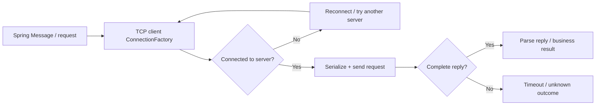
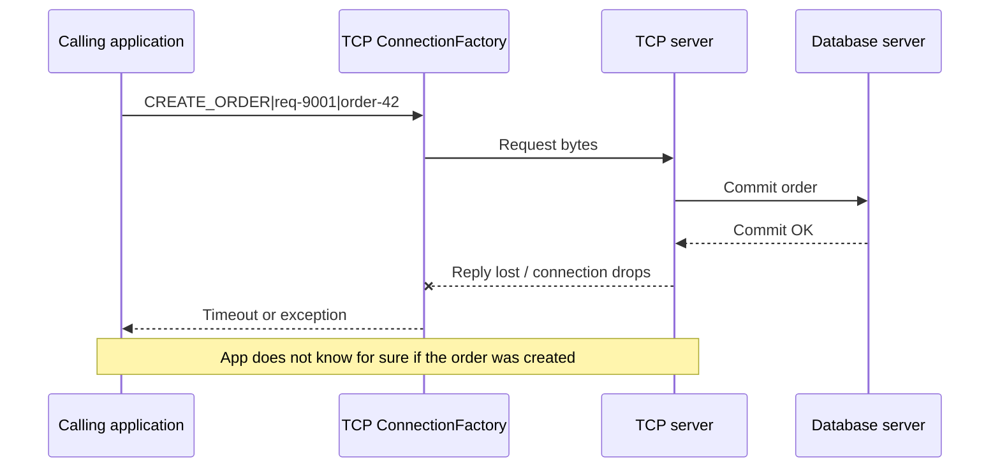
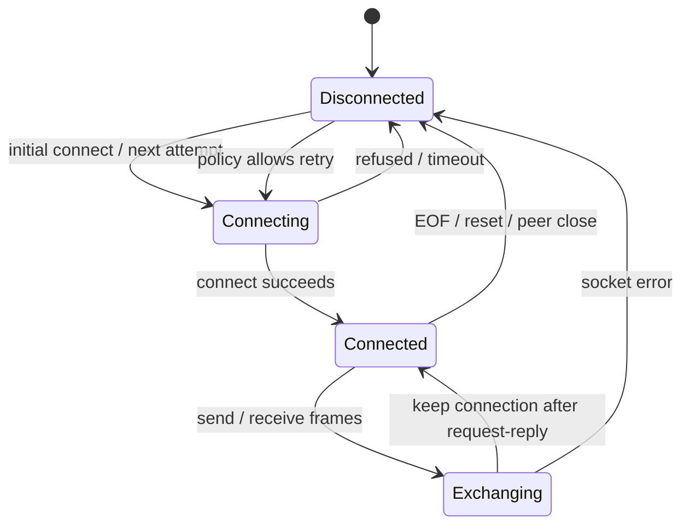
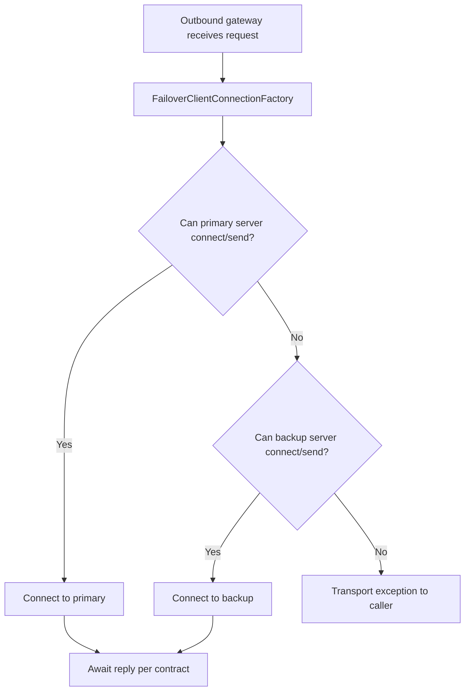
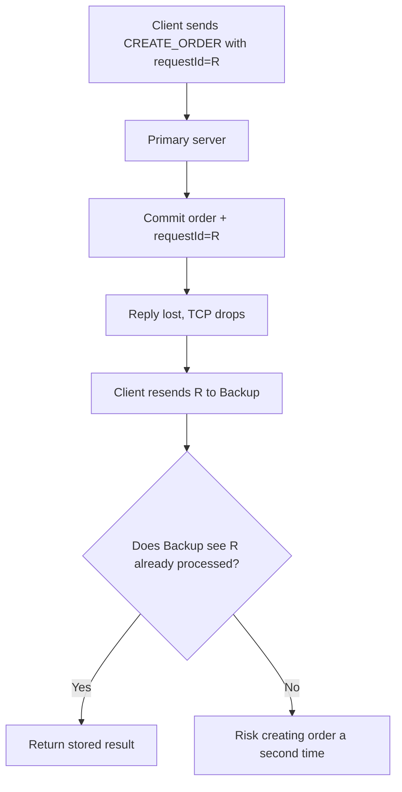

# Retries, reconnect, and failover

> **Chapter:** TCP Adapter  
> **Module:** SPRING_INTEGRATION_ADAPTERS  
> **Scope:** Connect external systems to Spring Integration using inbound/outbound adapters, gateways, pollers, and MessageChannel. Practice message exchange flows over files, SFTP, HTTP, JMS, AMQP, Kafka, and databases; handle message contracts, errors, and connection lifecycles.

## 1. Learning objectives

After this lesson, you will be able to:

- Clearly distinguish **TCP socket reconnect**, **request retry**, and **failover to another TCP server**, and understand why these three operations are not synonymous.
- Describe possible failure points along `MessageChannel → TCP outbound gateway → ConnectionFactory → TCP server → reply`.
- Use `TcpNetClientConnectionFactory` and `FailoverClientConnectionFactory` to configure primary/backup servers with Spring Integration Java DSL.
- Explain `singleUse`, `refreshSharedInterval`, and `closeOnRefresh` when managing shared connections.
- Design conditional retries, exponential backoff, jitter, timeouts, circuit breakers/rate limits, and server health checks.
- Prevent duplicate business operations using **request IDs**, **idempotency**, and post-timeout outcome reconciliation.
- Build a test that actively stops/starts the primary server, fails over to the backup server, and observes the results.
- Monitor connection states, failover/failback events, and requests sent with **unknown outcomes**.

## 2. Three concepts to distinguish from the start

A TCP request can pass through multiple states:



Three recovery mechanisms are frequently conflated:

| Mechanism | Unit recovered | Example | What it does **not** guarantee automatically |
| --- | --- | --- | --- |
| **Reconnect** | One **TCP connection** | Old socket breaks; open a new socket to the same host/port. | Does not guarantee the old request is automatically resent or was not processed by the server. |
| **Retry** | One **operation / request send** | Resend `STATUS|req-12|sensor-01` after an error classified as transient. | Does not prevent duplicate processing if an earlier reply was lost. |
| **Failover** | One **target endpoint / server** | Switch from `primary:9601` to `backup:9602` when primary cannot connect/send. | Does not automatically transfer in-flight transactions or business state to the new node. |

**Reconnect recovers transport; retry decides whether to repeat an operation; failover selects another transport/server.** A system may employ all three, yet each has its own timing, success criteria, and risk profile.

In Spring Integration TCP:

- **ConnectionFactory** manages socket creation/acceptance and byte transport.
- **TCP adapter** sends or receives messages unidirectionally.
- **TCP gateway** executes request-reply and waits for the matching response.
- **`MessageChannel`** connects endpoints without guaranteeing TCP delivery to the target.
- **Business service** decides whether a command is safe to resend.

There is no single `retry=true` switch that makes every TCP command **exactly once**.

## 3. Classifying failure timing: what actually happened?

Consider a `CREATE_ORDER|req-9001|order-42` request:



| Detection point | Safe to infer | Must not infer |
| --- | --- | --- |
| **Wrong DNS/route before connect** | Could not open a socket to the intended server. | Cannot assume another server does not hold an earlier attempt's request. |
| **`Connection refused` on connect** | New connection was not established on that attempt. | Cannot infer the state of requests already sent on an earlier socket. |
| **Socket write error** | Data transmission did not complete from sender's perspective. | Cannot assert the peer received **zero** bytes. |
| **Read/reply timeout** | Complete reply did not arrive within the deadline. | Cannot conclude the server never processed or committed it. |
| **Socket reset after sending** | Connection broke and needs closing/recovery. | Cannot conclude the business transaction failed. |
| **Valid `ERR|INVALID_REQUEST` reply** | Server sent a protocol-level rejection. | Should not retry as a network error if it is a deterministic data error. |
| **`OK|req-9001|COMPLETED` reply** | Server **reported** completion per contract. | Does not prove durability unless the protocol/server explicitly defines it. |

That is why **retries** must be governed by a **business-safe** policy rather than catching every exception and blindly calling the gateway again.

### 3.1. Unsent request vs. sent request with no reply

On the client, a connect failure before writing a frame is usually a relatively safe situation to retry that attempt. Conversely, once bytes are handed to the transport layer, the outcome may be **indeterminate** without an ACK/reply.

Even when `OutputStream.write(...)` returns cleanly, that does not mean the target system **committed the business operation**. Bytes have merely moved partway down the path as observed by the caller.

### 3.2. TCP and "exactly once"

TCP preserves byte order within **an active connection**, yet **does not** guarantee an application that "side-effecting commands execute exactly once" across disconnects or retries. Achieving an effectively exactly-once business outcome generally requires:

1. A request ID stable across attempts.
2. Server persists processed outcomes keyed by request ID with uniqueness constraints.
3. Persisting the ID and updating business state **atomically/consistently** in an appropriate database transaction.
4. On a duplicate ID, the server returns the stored result instead of re-running the command.
5. Responses carry the request ID and clear commitment levels, such as `ACCEPTED`, `COMPLETED`, or `REJECTED`.

This is the responsibility of the **protocol and application**, not an inherent property of `TcpNetClientConnectionFactory` or `FailoverClientConnectionFactory`.

## 4. Reconnect in client mode

### 4.1. Socket lifecycle

With a client factory, the application knows the target host/port and must open a socket to communicate. When a connection closes due to server restart, network failure, or idle timeout, the old socket **cannot be revived**; a new socket must be opened.



**Reconnect is not resend**: a new connection does not carry over frames or responses from the old connection. If the prior request had an unclear outcome, the application must decide whether to resend or reconcile rather than assuming a new socket will "resume" the old request.

### 4.2. Shared client factory

Example:

```java
import org.springframework.integration.ip.tcp.connection.TcpNetClientConnectionFactory;
import org.springframework.integration.ip.tcp.serializer.ByteArrayCrLfSerializer;

TcpNetClientConnectionFactory factory =
        new TcpNetClientConnectionFactory("127.0.0.1", 9601);

factory.setSingleUse(false);
factory.setSerializer(new ByteArrayCrLfSerializer());
factory.setDeserializer(new ByteArrayCrLfSerializer());
```

`singleUse=false` allows reusing a live connection. If the server closes the connection, the next interaction cleans up the old connection and, depending on the endpoint/factory, can establish a new connection. **Do not treat this configuration as a continuously running background reconnect loop**: in many outbound/gateway flows, connection creation happens when a request is sent.

### 4.3. TCP channel adapter `client-mode` vs. TCP client factory

Spring Integration TCP **inbound/outbound channel adapters** also support a **`client-mode`** option. This lets an endpoint proactively establish or maintain a connection to a TCP server via a scheduler even when no outbound message is present yet.

- With a regular **outbound adapter**, a connection opens when the first message is sent; `client-mode=true` tries connecting on endpoint startup.
- With an **inbound adapter** acting as a client to receive events from an external server, this mode helps keep the receive path open and attempt reconnects.
- You can configure **`retry-interval`** and **`scheduler`** for the endpoint's proactive connection retry loop.
- In this mode, the connection factory must be a **client factory** with `singleUse=false` per endpoint contract.

**Do not confuse an adapter's `client-mode` `retry-interval` with retrying a business request.** A scheduler-triggered reconnect task does not automatically replay an already-sent state-changing command.

Example of what the settings mean:

```text
TCP inbound adapter, client-mode=true, retry-interval=5s:
  - endpoint tries to maintain a connection to the event-emitting TCP server
  - if disconnected: scheduler attempts to reconnect
  - DOES NOT mean: all events during the outage are replayed

TCP outbound gateway:
  - each call requires request/reply
  - may open socket when needed to send
  - business timeouts/retries must be designed separately
```

To guarantee zero missed events during offline intervals, the source server must offer a **replay/cursor/offset** or a durable intermediary layer; reconnecting merely restores the byte pipe from the new point in time.

## 5. Failover: switching to a backup server

### 5.1. `FailoverClientConnectionFactory`

Spring Integration provides `FailoverClientConnectionFactory` taking a **prioritized list of client connection factories**. When sending, the factory can try delegates in order until it obtains a connection and sends successfully, or all options fail.



**Key behaviors:**

- The factory prioritizes the first element in the list.
- When the current choice fails to connect/send, it can try subsequent factories.
- It supports **failback** to the preferred server per configuration, which is not equivalent to continuous health polling in every setup.
- **Does not guarantee a request already sent without a reply will automatically replay to another server.**
- **Does not replicate data/transactions** between primary and backup.

If the backup server lacks primary's data or speaks a different protocol, socket-level failover may succeed while producing **wrong business results**.

### 5.2. Distinguishing failover and failback

- **Failover:** switching from primary to backup because primary is unusable.
- **Failback:** after primary recovers, shifting traffic back to primary.
- **Premature failback:** can cause frequent reconnects and disrupt active traffic if primary is *flapping*.
- **Delayed failback:** can leave the backup carrying load for too long.

Control failback using wait intervals, health checks, and policies for draining/closing old connections. This is an operational choice and does not replace data consistency between the two servers.

## 6. Java DSL configuration: primary and backup

Example: a Spring Boot application calling a **TCP status service**. Primary server is at `127.0.0.1:9601`; backup server is at `127.0.0.1:9602`.

Contract:

| Field | Value |
| --- | --- |
| TCP framing | CRLF: bytes `0D 0A` terminate each request/reply. |
| Encoding | UTF-8. |
| Request | `STATUS|<request-id>|<device-id>` |
| Reply from primary | `OK|<request-id>|PRIMARY` |
| Reply from backup | `OK|<request-id>|BACKUP` |
| Schema error reply | `ERR|BAD_REQUEST` |
| Example nature | **Read** query; safer for illustrating retry/failover. |
| Connection | Shared connection, `singleUse=false` on wrapper and all delegates. |

### 6.1. Maven dependencies

Spring Boot manages versions via BOM:

```xml
<dependencies>
    <dependency>
        <groupId>org.springframework.boot</groupId>
        <artifactId>spring-boot-starter-integration</artifactId>
    </dependency>
    <dependency>
        <groupId>org.springframework.integration</groupId>
        <artifactId>spring-integration-ip</artifactId>
    </dependency>
</dependencies>
```

The Java snippets below target Java 17+ and Spring Integration 6.x. The mock TCP server runs as standalone Java SE.

### 6.2. Declaring two client factories and a failover wrapper

Create `TcpFailoverConfiguration.java`:

```java
import java.util.List;

import org.springframework.beans.factory.annotation.Qualifier;
import org.springframework.context.annotation.Bean;
import org.springframework.context.annotation.Configuration;
import org.springframework.integration.annotation.IntegrationComponentScan;
import org.springframework.integration.config.EnableIntegration;
import org.springframework.integration.dsl.IntegrationFlow;
import org.springframework.integration.ip.dsl.Tcp;
import org.springframework.integration.ip.tcp.connection.FailoverClientConnectionFactory;
import org.springframework.integration.ip.tcp.connection.TcpNetClientConnectionFactory;
import org.springframework.integration.ip.tcp.serializer.ByteArrayCrLfSerializer;

@Configuration
@EnableIntegration
@IntegrationComponentScan
public class TcpFailoverConfiguration {

    @Bean("primaryTcp")
    TcpNetClientConnectionFactory primaryTcp() {
        var factory =
                new TcpNetClientConnectionFactory("127.0.0.1", 9601);

        factory.setSingleUse(false);
        factory.setSerializer(new ByteArrayCrLfSerializer());
        factory.setDeserializer(new ByteArrayCrLfSerializer());
        return factory;
    }

    @Bean("backupTcp")
    TcpNetClientConnectionFactory backupTcp() {
        var factory =
                new TcpNetClientConnectionFactory("127.0.0.1", 9602);

        factory.setSingleUse(false);
        factory.setSerializer(new ByteArrayCrLfSerializer());
        factory.setDeserializer(new ByteArrayCrLfSerializer());
        return factory;
    }

    @Bean
    FailoverClientConnectionFactory failoverTcp(
            @Qualifier("primaryTcp")
            TcpNetClientConnectionFactory primary,
            @Qualifier("backupTcp")
            TcpNetClientConnectionFactory backup) {

        // List order defines priority order.
        var factory = new FailoverClientConnectionFactory(
                List.of(primary, backup));

        // singleUse must stay aligned between wrapper and delegates.
        factory.setSingleUse(false);

        // Refresh/failback mechanism applies only to shared connections.
        factory.setRefreshSharedInterval(30_000L);
        factory.setCloseOnRefresh(true);
        return factory;
    }

    @Bean
    IntegrationFlow statusRequestFlow(
            FailoverClientConnectionFactory failoverTcp) {

        return IntegrationFlow
                .from("statusTcpRequests")
                .handle(Tcp.outboundGateway(failoverTcp))
                .get();
    }
}
```

**Reading the configuration:**

1. `primaryTcp` points to the primary server; `backupTcp` points to the backup server.
2. Both delegates share the same CRLF serializer/deserializer and `singleUse=false`.
3. `FailoverClientConnectionFactory` receives **[primary, backup]**, starting with primary.
4. The wrapper also sets `singleUse=false`, avoiding lifecycle mismatches with the delegates.
5. `Tcp.outboundGateway(failoverTcp)` builds a request-reply endpoint; the handler uses the **failover factory** instead of hardcoding one server.
6. `refreshSharedInterval` and `closeOnRefresh` govern attempts to return to the preferred server and closing the prior connection after a successful refresh.

**Warning:** This configuration demonstrates **TCP endpoint selection mechanics**, not rollback or data synchronization across servers. In production, read host/port from environment config, set timeout limits, secure with TLS, and verify idempotency policies.

### 6.3. What do `refreshSharedInterval` and `closeOnRefresh` do?

Under `singleUse=false`, a shared connection may keep using the backup server even after primary has recovered.

- `refreshSharedInterval`: wait period before the factory is permitted to **try returning to the first entry in the list** when a connection is requested. This is **not** a guarantee that a background timer polls primary on an exact schedule.
- `closeOnRefresh=true`: when a refresh actually switches to a new connection, close the old shared connection, avoiding holding unnecessary sockets open.
- If left unconfigured, modern versions default to being less aggressive about failback: `refreshSharedInterval=Long.MAX_VALUE`, `closeOnRefresh=true` (verify against your deployed version).
- These properties **do not behave identically** when a delegate is `CachingClientConnectionFactory`, since the cache manages borrowing connections itself. Test your exact wrapper combination.

Avoid setting the interval too short to "auto-heal every error" if primary is flapping: constant failback increases connection churn and makes latency unpredictable.

### 6.4. Client-side Java API

Create `RemoteStatusGateway.java`:

```java
import org.springframework.integration.annotation.MessagingGateway;

@MessagingGateway(defaultRequestChannel = "statusTcpRequests")
public interface RemoteStatusGateway {

    byte[] exchange(byte[] request);
}
```

This is a **Spring Messaging Gateway**: it turns Java calls into Spring Messages and waits for replies from the TCP outbound gateway. It is distinct from `FailoverClientConnectionFactory`, which selects the target socket/server.

Create `StatusClient.java`:

```java
import java.nio.charset.StandardCharsets;
import org.springframework.stereotype.Service;

@Service
public class StatusClient {

    private final RemoteStatusGateway gateway;

    public StatusClient(RemoteStatusGateway gateway) {
        this.gateway = gateway;
    }

    public String query(String requestId, String deviceId) {
        if (!validId(requestId) || !validId(deviceId)) {
            throw new IllegalArgumentException("Invalid request/device ID");
        }

        String request = "STATUS|" + requestId + "|" + deviceId;

        byte[] reply = gateway.exchange(
                request.getBytes(StandardCharsets.UTF_8)
        );

        if (reply == null) {
            throw new IllegalStateException("Missing TCP reply");
        }

        String text = new String(reply, StandardCharsets.UTF_8);

        if (text.startsWith("ERR|")) {
            // This is a business reply, not a connect error.
            throw new IllegalArgumentException(
                    "Remote rejected request: " + text
            );
        }

        String[] parts = text.split("\\|", -1);
        if (parts.length != 3
                || !"OK".equals(parts[0])
                || !requestId.equals(parts[1])) {
            throw new IllegalStateException(
                    "Unexpected response: " + text
            );
        }

        return parts[2]; // PRIMARY or BACKUP in this demo.
    }

    private static boolean validId(String value) {
        return value != null
                && value.matches("[A-Za-z0-9_-]{1,40}");
    }
}
```

The service verifies the request ID in the reply, preventing mismatched responses. For a read-only `STATUS` query, caller-driven retries carry lower risk than state-changing commands. However, the current service **does not retry automatically yet**; it makes a single call through the failover factory, keeping the two concepts cleanly separated.

### 6.5. Client startup demo

```java
import org.springframework.boot.ApplicationRunner;
import org.springframework.context.annotation.Bean;
import org.springframework.context.annotation.Configuration;

@Configuration
public class FailoverDemoRunner {

    @Bean
    ApplicationRunner queryStatus(StatusClient statusClient) {
        return args -> {
            String node = statusClient.query(
                    "req-101", "sensor-01");
            System.out.println("Response from: " + node);
        };
    }
}
```

When primary is reachable, expected output is `Response from: PRIMARY`. When primary **cannot be connected** and backup is running, expected output is `Response from: BACKUP`, depending on failover behavior under the test conditions. This is **expected output**, not an actual run captured here.

## 7. Mock primary/backup TCP servers

You can test with a standalone Java SE program launched as **two processes** with different ports and node names.

Create `StatusTcpTestServer.java`:

```java
import java.io.BufferedReader;
import java.io.BufferedWriter;
import java.io.InputStreamReader;
import java.io.OutputStreamWriter;
import java.net.ServerSocket;
import java.net.Socket;
import java.nio.charset.StandardCharsets;

public class StatusTcpTestServer {

    public static void main(String[] args) throws Exception {
        if (args.length != 2) {
            throw new IllegalArgumentException(
                    "Usage: StatusTcpTestServer <port> <PRIMARY|BACKUP>");
        }

        int port = Integer.parseInt(args[0]);
        String nodeName = args[1];

        try (ServerSocket listener = new ServerSocket(port)) {
            System.out.printf(
                    "%s listening on port %d%n", nodeName, port);

            while (true) {
                try (Socket socket = listener.accept();
                     BufferedReader in = new BufferedReader(
                             new InputStreamReader(
                                     socket.getInputStream(),
                                     StandardCharsets.UTF_8));
                     BufferedWriter out = new BufferedWriter(
                             new OutputStreamWriter(
                                     socket.getOutputStream(),
                                     StandardCharsets.UTF_8))) {

                    String line;
                    while ((line = in.readLine()) != null) {
                        String[] fields = line.split("\\|", -1);

                        String reply;
                        if (fields.length == 3
                                && "STATUS".equals(fields[0])
                                && fields[1].matches(
                                        "[A-Za-z0-9_-]{1,40}")
                                && fields[2].matches(
                                        "[A-Za-z0-9_-]{1,40}")) {
                            reply = "OK|" + fields[1] + "|" + nodeName;
                        } else {
                            reply = "ERR|BAD_REQUEST";
                        }

                        // CRLF text protocol, not a Spring serializer.
                        out.write(reply);
                        out.write("\r\n");
                        out.flush();
                    }
                }
                catch (java.io.IOException e) {
                    // Demo: socket closed or network error, continue accepting.
                    System.err.println(
                            "Client connection ended: " + e);
                }
            }
        }
    }
}
```

Run two processes in two separate terminals:

```text
# Terminal 1: primary
java StatusTcpTestServer 9601 PRIMARY

# Terminal 2: backup
java StatusTcpTestServer 9602 BACKUP
```

This is a learning server handling **one connection at a time per process**, without TLS, health checks, or real business state. It uses `BufferedReader.readLine()` because the protocol uses plain-text CRLF frames; do not use this for length headers or arbitrary binary payloads.

### 7.1. Three mandatory test cases

| Test | How to run | Expected outcome |
| --- | --- | --- |
| **Healthy primary** | Start primary and backup, then start client. | Request picks primary, returns `PRIMARY`. |
| **Primary down before connect** | Stop primary, keep backup running; start a new client. | Factory picks backup when primary fails to connect/send. |
| **Failback** | While client uses backup, restart primary; after `refreshSharedInterval`, issue a new request. | Factory can try returning to primary; observe actual connections/events. |

Never assume every call **already mid-request-reply** will fail over seamlessly to backup if primary dies. In practice, an in-flight request awaiting a reply may time out; **do not automatically resend side-effecting commands** without idempotency design.

### 7.2. Distinguishing errors during testing

- **Primary port closed:** fails at connect step; failover factory gets a chance to try backup.
- **Primary accepts TCP but returns no reply:** the TCP connection may still appear active; **failover will not necessarily occur immediately** just because the gateway waits too long for a reply.
- **Primary returns `ERR|BAD_REQUEST`:** this is a **valid response**, not a reason to try backup.
- **Primary finishes processing then socket resets:** client cannot know the outcome for sure; retrying requires an explicit policy.

## 8. Health checks: successful connect does not mean the server is ready

A host can **accept a TCP connection** while the application behind it cannot serve requests—for instance, its DB is down, backup data is out of sync, or handlers are deadlocked.

Therefore, distinguish:

| Check | Detects | Does not guarantee |
| --- | --- | --- |
| TCP connect | Target port accepts connections. | Handler and DB are ready. |
| TCP keepalive | Some long-dead connections per OS rules. | Fast detection or healthy service. |
| Application heartbeat `PING/PONG` | Server responds to probe command. | All business operations succeed. |
| Controlled test query | One key business path works. | Other paths are error-free. |
| Control-plane readiness/health | Server passes configured readiness criteria. | In-flight requests are uninterrupted during failover. |

Spring Integration client factories can configure a **connection test** via `setConnectionTest(...)` in supported versions. The factory can reject a new connection if the check fails; with a failover wrapper, that failure can trigger trying the next server.

A connection test must:

1. Have an **explicit timeout** so it never pins a socket forever.
2. Use a side-effect-free protocol message.
3. Read the response using the **same serializer/deserializer** as the real protocol.
4. Never let **health-check replies** mix with business request replies.
5. Avoid probing so frequently that it adds load to the server.

In particular, `setConnectionTest(...)` tests **new connections**; do not treat it as continuous monitoring of every already-leased socket. If you need to detect an active server turning unhealthy, build appropriate readiness or heartbeat checks.

## 9. Request-level retries: a policy, not a default reflex

### 9.1. Retry only with good reason

| Request type | Retry after transport failure? | Notes |
| --- | --- | --- |
| `STATUS|req-101|sensor-01` | **Yes, likely safe**, as a pure read if server truly only reads. | Result may change between attempts. |
| `GET_BALANCE|req-102|account-1` | Possible if read-only and caller permits. | Watch consistency across primary/backup. |
| `SET_LEVEL|req-103|sensor-01|5` | Only when idempotent semantics are explicit. | "Set to 5" differs from "add 5". |
| `INCREMENT|req-104|sensor-01|1` | Never retry blindly. | May increment multiple times. |
| `CREATE_ORDER|req-105|order-42` | Requires request ID and durable deduplication. | Reply may be lost after order creation. |
| `CHARGE|req-106|order-42|1000` | Never retry blindly; requires strict rules. | Risk of duplicate charges. |

A **minimal retry policy** must decide:

- Which errors are **transient transport failures** vs. business rejections or protocol errors that must stop immediately.
- Whether the request is **safe to retry** semantically.
- Maximum attempts and overall **total deadline**.
- Delay between attempts, **exponential backoff**, and **jitter**.
- Who keeps the request ID stable and records outcomes.
- Whether the final state is `FAILED` or **`UNKNOWN/PENDING_RECONCILIATION`**.

### 9.2. Bounded retry algorithm

Pseudocode—**not compilable Java**—for a pure read query:

```text
requestId = createOnce()
deadline = now + 8 seconds

for attempt in 1..3:
    try:
        response = tcpGateway.exchange(requestWithSameId)
        return validateBusinessReply(response, requestId)

    catch classifiedTransportFailure:
        if attempt == 3 or now >= deadline:
            return UNKNOWN_OR_UNAVAILABLE

        delay = min(200ms * 2^(attempt - 1), 1000ms)
        sleep(delay + randomJitter)

    catch ProtocolOrBusinessReject:
        doNotRetry()
        return REJECTED
```

Here, **the request ID is created once before the loop**. If each retry generated a new ID, the server could not tell it is the same task. In production, `classifiedTransportFailure` must be an application-specific exception classifier; never catch every `RuntimeException` and retry by default, as that includes parser errors, authorization failures, and business bugs.

### 9.3. Backoff, jitter, and retry storms

If thousands of clients detect a dead server simultaneously and retry immediately, a recovering primary can be overwhelmed immediately (*thundering herd*). Therefore:

- Increase delay per attempt with a **maximum cap**.
- Add **random jitter** so clients do not retry in lockstep.
- Enforce a total deadline and system-wide retry budget.
- Bound concurrent in-flight requests, queue depth, and rate to the backup server.
- Use a **circuit breaker** to stop hammering a clearly failing server and allow controlled recovery probes.

A circuit breaker governs **whether to call** an endpoint; it does not magically make a non-idempotent command safe to replay.

### 9.4. `RequestHandlerRetryAdvice` is an option — scope it carefully

Spring Integration supports `RequestHandlerRetryAdvice` and endpoint advice mechanisms. Applied around an outbound gateway, retry can re-execute the **TCP-sending handler** when an exception occurs.

Think carefully:

1. Retrying around the **gateway** re-sends the request to the server; business rules must permit replay.
2. Never wrap a long flow in broad retry if earlier side-effecting steps succeeded before TCP failed.
3. Scope retry policies by **exception type**, duration, and backoff.
4. With asynchronous channels, exception/reply propagation differs from synchronous flows; test separately.
5. Spring Retry requires version-appropriate dependency/configuration and is not enabled automatically on TCP gateways.

In this lesson, the primary Java DSL **disables automatic request retry** to clearly isolate failover connection factory behavior and avoid accidental command duplication.

## 10. Failover also depends on server consistency

Suppose an order-creation command can hit:

```text
Primary TCP server -> Database A
Backup TCP server  -> Database B
```

If A and B are out of sync, switching sockets from primary to backup can yield contradictory results: backup has no record of the order just created on primary.

**The transport layer cannot solve this.** Define your data architecture:

- Do both nodes share a database or use reliable replication?
- If primary committed and backup has not caught up yet, what state does the system return?
- Is there **fencing/leader election** to prevent split-brain writes on both nodes?
- Is the idempotency store **shared** and consistent across nodes?
- If consistency is eventual, is backup allowed to serve stale reads?
- During failback, how are session state and in-flight transactions handled?

### 10.1. One request ID across multiple nodes



If idempotency records are **not properly shared or synchronized**, backup cannot prevent duplicate processing. Hence, a `FailoverClientConnectionFactory` setup that works perfectly at the TCP layer can still violate business correctness.

### 10.2. Minimal state table

For side-effecting commands:

| Request ID | Persisted state | Action on duplicate request |
| --- | --- | --- |
| Does not exist | Not started | Attempt execution inside the defined transaction. |
| `IN_PROGRESS` | Task currently running | Do not re-run; return in-progress status or wait per contract. |
| `COMPLETED` | Result committed | Return stored result, **without repeating side effects**. |
| `REJECTED` | Rejected by deterministic rule | Return the stored rejection code if contract specifies. |
| `UNKNOWN` | Needs reconciliation after failure | Do not assume failure; check authoritative system. |

This is a conceptual data model, not something Spring Integration creates automatically. Under concurrency, enforce database uniqueness/transactions so two nodes never execute the same request ID simultaneously.

## 11. Preserving correlation and handling late replies

### 11.1. Connection ID and request ID are different

- `IpHeaders.CONNECTION_ID` identifies which **TCP socket** carries a message.
- `requestId`/`correlationId` identifies which **business request** is being processed.
- After reconnect or failover, **connection ID changes**; the retry's request ID **must stay the same**.

A late reply on an old socket must never be matched arbitrarily to a new request if framing/protocol lacks correlation checks. In particular, a CRLF-only protocol without request IDs in the payload risks correlation mismatches on a shared connection after a timeout.

### 11.2. Request-reply gateways vs. asynchronous adapters

| Topology | Correlation responsibility |
| --- | --- |
| **TCP outbound gateway** | Gateway manages one request-reply exchange per connection turn; shared connections limit concurrency. |
| **TCP inbound gateway** | Receives requests and sends replies back to the matching connection. |
| **Async inbound/outbound adapter pair** | Application must match request IDs to responses, handle late ACKs, and handle unsolicited events. |
| **Multi-node failover** | Application must also ensure request IDs have consistent meaning across nodes. |

When an outbound gateway times out, never assume an old reply will cleanly rejoin over a new connection. **Close or discard desynchronized connections** per endpoint policy and send new requests only when protocol state is clean.

## 12. Operations: observability and health

### 12.1. Metrics to track

| Metric | Purpose |
| --- | --- |
| Connect attempts / successful connections | Track connect failures, refusals, and timeouts. |
| Open/close/reset connection counts | Detect socket churn and unexpected peer closes. |
| Primary → backup failover rate | Measure reliance on the backup server. |
| Backup → primary failback rate | Spot unstable primary or overly aggressive refresh intervals. |
| Connect latency per node | Diagnose network issues and recovery speed. |
| Request success / business rejection / timeout | Keep business errors separate from transport errors. |
| Retry attempts, backoff, exhausted budgets | Spot retry storms and compounded latency. |
| `UNKNOWN` request outcome counts | Gauge reconciliation need and idempotency pressure. |
| P50/P95/P99 request-reply latency | Measure caller experience including retry time. |
| Deduplicated request ID counts | Observe lost-reply/retry frequency. |

### 12.2. Logs should separate network and business concerns

Suggested log fields:

```text
time=... requestId=req-101 attempt=1 node=primary
event=tcp_connect_failed error=ConnectionRefused

time=... requestId=req-101 attempt=1 node=backup
event=tcp_reply_received status=OK

time=... requestId=req-105 attempt=1 node=primary
event=tcp_reply_timeout businessOutcome=UNKNOWN
```

These lines **illustrate a log schema**, not Spring Integration's default log output. For production observability, combine connection factory events/logs, endpoint metrics, request IDs, and trace context.

Never log secrets, tokens, sensitive raw payloads, or unnecessary user PII. **Connection ID is not an authenticated identity** and not an idempotency key.

### 12.3. TCP keepalive and heartbeats

TCP keepalive can help detect some dead sockets at the OS layer, yet it does not mean the TCP server is successfully **processing business requests**. A server can keep sockets open while business threads are hung.

Consider:

- Socket and reply timeouts aligned with SLAs.
- Application heartbeats/connection tests with bounded timeouts.
- Readiness checks in load balancers/service discovery if used.
- Closing unhealthy connections and applying circuit breakers/rate limits.
- Dedicated testing for nodes that **accept connections but never reply**.

## 13. Test matrix for retry, reconnect, and failover

| Scenario | What to verify |
| --- | --- |
| Primary and backup healthy | Factory prefers primary. |
| Primary not listening, backup healthy | Selects backup when primary connect/send fails. |
| Neither listening | Caller receives error; never reports business success. |
| Active primary socket closed | Detects broken connection; subsequent requests recover per policy. |
| Primary accepts request without replying | Gateway times out; does not blindly fail over **that command** to backup as if safe. |
| Primary returns business `ERR` | Does not retry/fail over for deterministic schema errors. |
| Primary recovers while using backup | Fails back per `refreshSharedInterval` and connection acquisition. |
| Primary flaps continuously | Does not trigger reconnect/failback storms or infinite command loops. |
| Mismatched `singleUse` between wrapper and delegates | Config is rejected or lifecycle breaks; keep aligned. |
| CRLF payload missing delimiter | Times out due to framing; not misclassified as primary outage triggering failover. |
| Reply arrives past deadline | Classified as late reply, correlation preserved, connection handled safely. |
| Duplicate request ID hits backup | Server deduplicates via shared/consistent idempotency store. |
| Command committed but reply lost | Client keeps `UNKNOWN` state until confirmed/reconciled. |
| 50 clients retry together after outage | Backoff/jitter and load limits protect nodes. |
| Failover with unsynchronized server state | Stale data/conflicts detected rather than assuming TCP success equals business validity. |
| Graceful shutdown | Stop accepting new requests, close connections, handle in-flight unknown outcomes. |

### 13.1. Controlled fault injection tests

During the hands-on exercise, step through:

1. Start backup without primary; launch client and verify `BACKUP`.
2. Start primary; launch a fresh client and verify `PRIMARY`.
3. With a client holding an active primary connection, stop primary **between two requests**; observe the error and backup usage on the next turn.
4. Make primary **accept TCP but delay replies**, confirming behavior differs completely from `Connection refused`.
5. Stop both servers, confirm errors are reported, and verify recovery once servers restart.
6. When testing failback, adjust `refreshSharedInterval` and count opened/closed connections rather than judging by a single connection.

**Never run fault injection in production without strict controls and clearly bounded blast radius.**

## 14. Symptom-based troubleshooting

| Symptom | Likely causes | Diagnostic approach |
| --- | --- | --- |
| Cannot reach primary and fails to switch to backup | Wrong factory list/config, delegate not started, or error outside failover scope. | Check order, `singleUse`, connect logs, and exceptions. |
| Sticks to backup even after primary recovers | Active shared connection, long `refreshSharedInterval`, or no new connection acquisition yet. | Inspect failback config and issue a new call. |
| Fails back too frequently | Short interval, primary flapping. | Lengthen interval, add health checks, cap reconnects. |
| Primary accepts connections but all requests time out | Hung handler/DB, missing reply framing, socket read timeout. | Check application-level readiness and end-to-end timeouts. |
| Retries create duplicate orders | Missing request ID/idempotency or nodes lack a shared dedup store. | Fix business contract, not just socket config. |
| Requests take longer than expected | Per-attempt connect/reply timeouts multiplied by retries/backoff. | Enforce a **total deadline** and per-layer timeouts. |
| Failover works but returns stale state | Backup lag, replication inconsistency. | Check consistency guarantees and read/write policies. |
| Events lost during reconnect | Sockets do not durably buffer missed events. | Use replay/cursor/broker when zero event loss is mandatory. |
| `Broken pipe` or `Connection reset` | Peer closed socket or network interruption. | Determine how far the request progressed before retrying. |
| Logs do not show which nodes a request tried | Missing `requestId`, attempt/node tags, and connection events. | Design structured correlation/observability. |

**Quick triage:** first pinpoint whether the failure occurred in **connect**, **serialize/send**, **read reply**, **framing**, or **business handler**; only then choose reconnect, failover, retry, or reconciliation.

## 15. Hands-on exercises

**Exercise 1 — Basic failover.** Using `TcpFailoverConfiguration`, start backup on `9602` without starting primary. Explain how the factory chooses backup, expected output, and where primary connect failure appears.

**Exercise 2 — Failback.** Restart primary while the client is using backup. Test short vs. long `refreshSharedInterval` values and observe subsequent connections. Explain why this interval does not mean a cron job pings primary regularly.

**Exercise 3 — Slow reply vs. refused connection.** Write a mock TCP server that accepts a request and sleeps 10 seconds before replying, while the client times out earlier. Explain why the failover factory may not automatically switch that exact request to backup.

**Exercise 4 — Retrying an idempotent query.** Add up to three retries for `STATUS` with exponential backoff and jitter. Separate transport exceptions from `ERR|BAD_REQUEST`, preserve request ID across attempts, and enforce a total deadline.

**Exercise 5 — Avoiding duplicate commands.** Design `CREATE_ORDER|req-9001|order-42`. Primary commits and loses the reply; client fails over to backup. Describe the idempotency store, transactions, shared state, and backup's response rules.

**Exercise 6 — Inbound client-mode adapter reconnect.** A TCP server continuously pushes events. The application uses an inbound adapter in `client-mode` with `retry-interval` across server restarts. Explain why reconnecting does not recover events missed during downtime; add event sequence/cursor and replay.

**Exercise 7 — Failover under load.** Spawn 30 concurrent callers invoking `STATUS` while primary is down. Measure sockets, latency, retry attempts, and CPU on backup. Add concurrency limits and backoff/jitter if backup saturates.

**Exercise 8 — Meaningful health checks.** Build a side-effect-free `HEALTH` command returning `READY|node` with a timeout. Identify the case where the socket accepts connections while the database is down; explain how `connectionTest` can supplement readiness checks.

## 16. Knowledge self-check

1. How do reconnect, retry, and failover differ in the **unit being recovered**?
2. How does `FailoverClientConnectionFactory` use the order of its delegate list?
3. Why does TCP-level failover success not guarantee the backup server has identical data?
4. Why must `singleUse` match between the failover wrapper and its delegates?
5. Does `refreshSharedInterval` mean the application definitely pings primary at that interval?
6. How does `closeOnRefresh=true` affect the old shared connection?
7. If a TCP client sends a request and hits a reply timeout, does it know for sure the server did not process it?
8. With `CREATE_ORDER`, what enables safe retries across multiple nodes?
9. When is a TCP adapter's `client-mode=true` useful, and does its `retry-interval` automatically resend business requests?
10. Why are exponential backoff and jitter important when many clients retry together?
11. If a server returns a valid `ERR|BAD_REQUEST`, should the client retry against backup?
12. What can a connection test catch beyond TCP connect succeeding?
13. Why should the business request ID stay unchanged across failover while the connection ID usually changes?
14. How do a shared connection and a connection pool affect request-reply throughput?
15. Does a continuous event-streaming server need a replay protocol if the application must not lose data during reconnects?
16. Which metrics distinguish transport-level failover success from business consistency errors?

**Answer hints:** (1) Reconnect recovers the socket; retry repeats the request; failover picks another server. (2) Prioritizes primary and tries subsequent factories on connect/write failure. (3) Connection factories do not synchronize databases/transactions. (4) Prevents connection lifecycle conflicts. (5) No, it governs when connection acquisition may try failing back. (6) Closes the old connection after a successful refresh. (7) No; the server may have committed. (8) Request ID, atomic/consistent dedup store, ACK/retry policy. (9) Maintains client-adapter connections; does not replay business commands. (10) Prevents retry storms. (11) No, that is a business rejection. (12) Whether the server can actually serve a health request. (13) Request ID identifies business work; connection ID identifies the socket. (14) One shared socket typically serializes turns; a pool increases concurrency but must be bounded. (15) Yes, reconnect does not recover past events automatically. (16) Connect/failover counts, latency, error replies, duplicate request IDs, stale data, and unknown-outcome counts.

## 17. References

- [Spring Integration Reference — TCP Connection Factories (Failover)](https://docs.spring.io/spring-integration/reference/ip/tcp-connection-factories.html).
- [Spring Integration API — FailoverClientConnectionFactory](https://docs.spring.io/spring-integration/docs/6.4.5/api/org/springframework/integration/ip/tcp/connection/FailoverClientConnectionFactory.html).
- [Spring Integration Reference — TCP Adapters (client mode/retry interval)](https://docs.spring.io/spring-integration/reference/ip/tcp-adapters.html).
- [Spring Integration Reference — Testing Connections](https://docs.spring.io/spring-integration/reference/ip/testing-connections.html).
- [Spring Integration Reference — Adding Behavior to Endpoints](https://docs.spring.io/spring-integration/reference/handler-advice.html).

**Summary:** **Reconnect** rebuilds a socket, **failover** switches TCP endpoints, and **retry** decides whether to resend an operation. Spring Integration provides connection factories and endpoints to manage transport, yet **business outcomes cannot be inferred from TCP state alone**. Reliable design requires proper framing, bounded timeouts and retries, consistent backup server state, request IDs and idempotency for side-effecting commands, plus observability and reconciliation when replies are lost.
