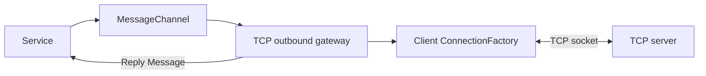
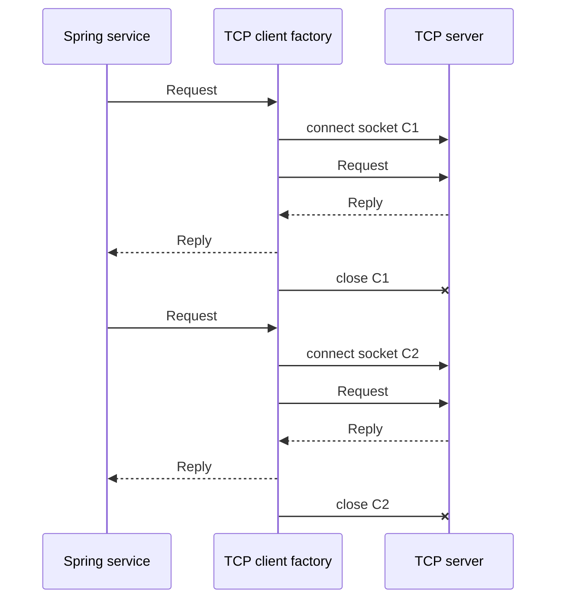
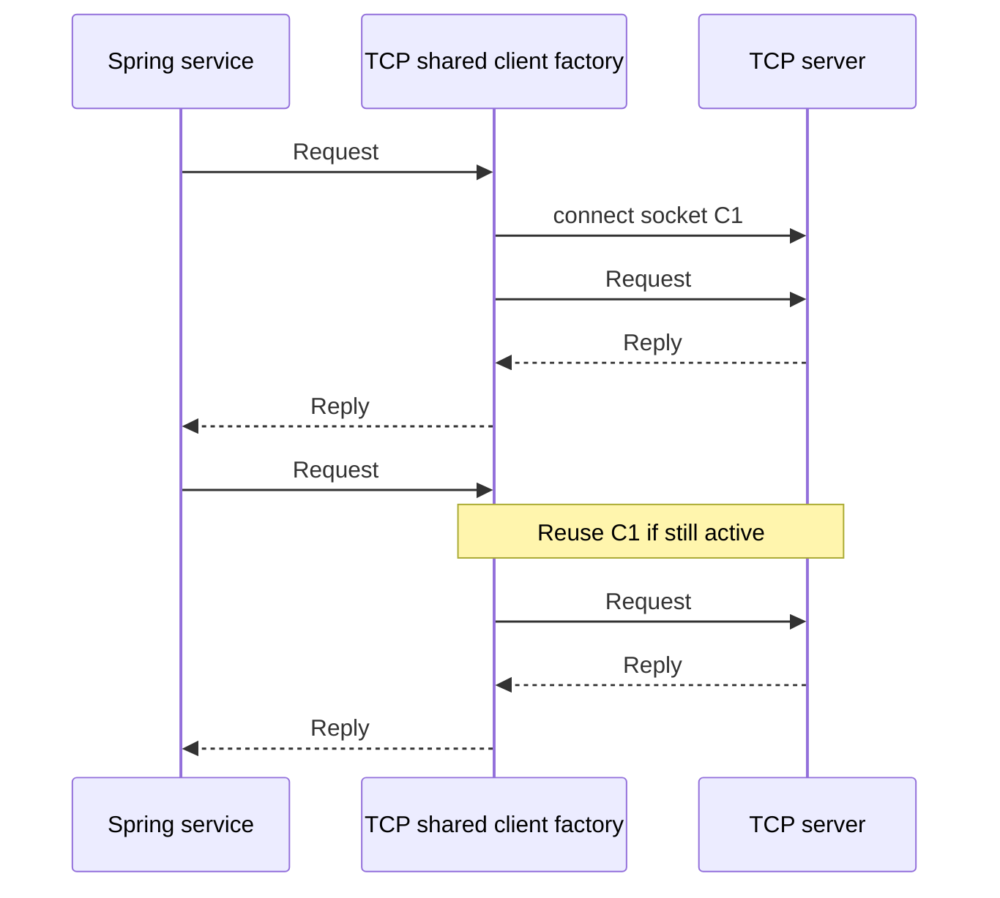
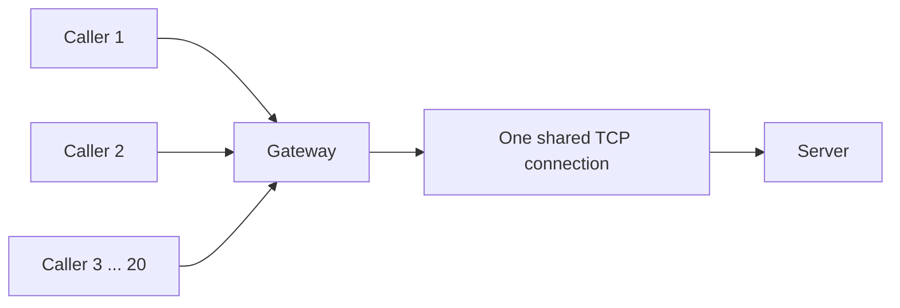
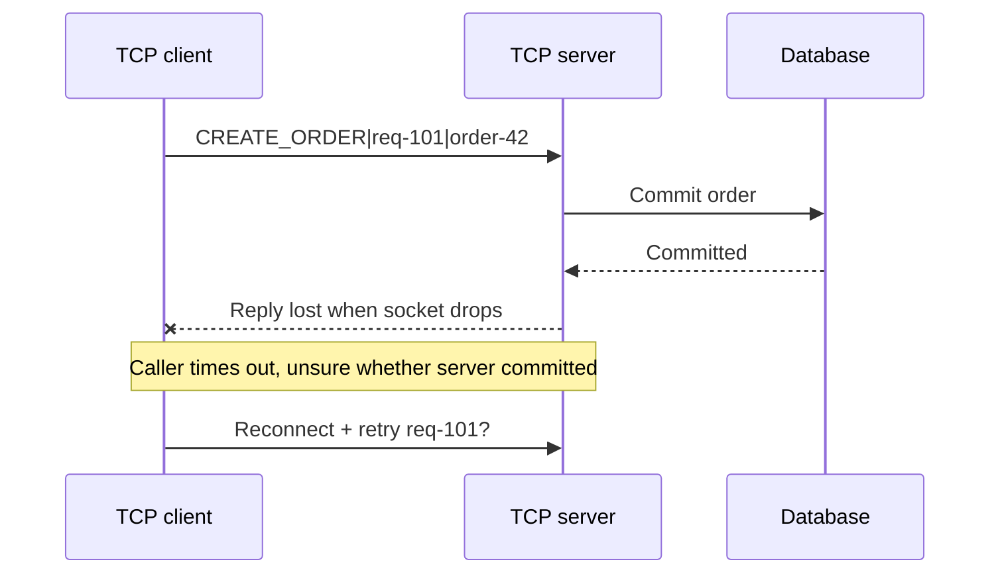

# Single-use connections and shared connections

> **Chapter:** TCP Adapter  
> **Module:** SPRING_INTEGRATION_ADAPTERS  
> **Scope:** Connect external systems to Spring Integration using inbound/outbound adapters, gateways, pollers, and MessageChannel; practice message exchange flows over files, SFTP, HTTP, JMS, AMQP, Kafka, and databases, focusing on message contracts, errors, and connection lifecycles.

## 1. Learning objectives

After completing this lesson, you will be able to:

- Explain **single-use connections** and **shared connections** in Spring Integration TCP; understand the exact meaning of `setSingleUse(true/false)`.
- Distinguish **one TCP connection**, **one request/reply**, **one Spring Message**, and **one reconnect attempt**.
- Configure `TcpNetClientConnectionFactory` and `TcpNetServerConnectionFactory` with consistent serializers/deserializers.
- Use `Tcp.outboundGateway(...)` with single-use and shared connections and observe socket open/close behavior.
- Analyze trade-offs across TCP handshake cost, socket count, latency, concurrency, session state, and reliability.
- Understand when `CachingClientConnectionFactory` is needed and why a connection pool **does not** guarantee unlimited multithreading.
- Set bounds on timeouts, connection counts, framing, retries, and idempotency when connections drop.
- Design tests distinguishing **network errors**, **protocol errors**, and **unknown business outcomes**.

## 2. Why must you choose a TCP connection lifecycle?

TCP is a **stateful connection**: the client actively opens a socket, the server accepts it, both sides exchange a **byte stream**, and then close the connection. Establishing a new socket carries system overhead, potentially a TLS handshake, and consumes a client ephemeral port.

Yet keeping sockets open long-term also has costs: connections occupy file descriptors, the server must track clients, and sockets can drop on idle timeouts, network errors, or make requests **block behind each other** when only one active request-reply path exists.

In Spring Integration, **ConnectionFactory** manages sockets; adapters and gateways manage converting bytes to Spring Messages and back.



The `singleUse` setting affects **socket lifecycle in ConnectionFactory**; it does not automatically change payloads, framing, or business guarantees.

### 2.1. Three distinct entities

| Entity | Example | Scope |
| --- | --- | --- |
| **TCP connection** | Socket between a local ephemeral port and `server:9700` | Lives from connect/accept until close. |
| **TCP frame / message** | `PING|req-101\r\n` | Byte boundary defined by serializer/deserializer. |
| **Business request** | Request `req-101` querying device status | Identified by application contract; may require retry on a new socket. |

One connection **can** carry multiple frames; one frame can be split across multiple `read()` calls. One business request can also be resent over a **different connection** if the prior attempt timed out. Therefore, never equate *connection ID* with *request ID*.

## 3. Single-use: one exchange round, one connection

When configured as:

```java
factory.setSingleUse(true);
```

The connection factory uses a connection for **one single use** per endpoint contract and never reuses that socket for subsequent rounds. In a **TCP outbound gateway request-reply** model, this corresponds to sending one request, receiving one reply, and closing the connection.



**Advantages:**

- Each exchange gets its own socket, reducing the risk of carrying **leftover bytes** from a previous turn into the next.
- No need to share one socket across callers; request-reply behavior is straightforward to reason about.
- Fits legacy protocols specifying **one request per connection** or servers that close sockets right after replying.
- A failed connection in one turn has minimal direct impact on another turn's socket.

**Costs and limits:**

- Incurs a fresh TCP connect—and potentially TLS handshake—per turn.
- Increases socket open/close churn and OS/network state management.
- Under high throughput, can hit server connection limits, file descriptors, ephemeral ports, or connection-tracking tables.
- **Does not** make retrying a write command safe: the server can still finish processing before the reply is lost.

### 3.1. Single-use does not mean "close on every byte read"

`singleUse=true` governs the scope of **connection usage**, not individual TCP `read()` calls. A long request may take multiple reads until **one complete frame** (CRLF or length header) arrives.

If the deserializer has not received a complete frame, it cannot emit a valid message just because a few bytes were read. An EOF mid-frame must be handled as a framing/connection error per contract.

### 3.2. One request-reply vs. one-way event

With an outbound adapter, "one use" may mean **one message send**; with a gateway, it means **one request-reply cycle**. Never infer "business ACK received" merely because an outbound adapter closed the connection after writing bytes.

Protocols using **EOF to delimit messages** need careful design: if the server only treats a request as complete when the client fully closes the socket, while the client waits for a reply on that same socket, both sides can deadlock. Distinguish **half-close**, **full close**, and delimiter/length-header framing.

## 4. Shared connection: reusing a live socket

When configured as:

```java
factory.setSingleUse(false);
```

The connection factory allows reusing an **active connection** across multiple messages or request-reply rounds. With a shared client factory, many sends can travel over **one socket** instead of opening a fresh socket per request.



**Advantages:**

- Saves socket setup/teardown overhead and can cut latency, especially when TLS handshakes are expensive.
- Fits many small, sequential requests or protocols requiring a **persistent session**.
- Reduces connection churn and short-lived sockets on the server.

**Trade-offs:**

- The socket can die at any time due to idle timeouts, server restarts, firewalls/NAT, or network drops.
- Unless the request-reply protocol supports multiplexing, multiple requests on the same socket must be **coordinated/serialized**.
- A late reply, extra reply, or framing error can desynchronize the connection.
- Long-lived connections hold resources longer and require close/health-check policies.

**Note:** `singleUse=false` is not a promise to *keep the socket alive forever*. It merely allows reuse. If the peer closes the socket or the connection becomes unusable, the factory/endpoint must detect it and open a new connection appropriately.

## 5. Comparing single-use vs. shared

| Criterion | **Single-use** — `true` | **Shared** — `false` |
| --- | --- | --- |
| One request-reply round | Uses its own connection and closes afterward. | Can reuse an existing connection. |
| Connect cost | Paid per round. | Amortized across many rounds. |
| TLS handshake | Repeated per new socket. | Fewer handshakes overall. |
| Resources under high load | Frequent open/close; must bound concurrency. | Fewer sockets, but longer-lived connections. |
| Concurrent request-reply | Can use separate sockets if resources permit. | A single shared socket typically serializes gateway turns. |
| Server session state | Should not rely on long-lived session state. | Suits servers maintaining per-connection sessions. |
| Framing/late-reply glitch | Usually isolated to that single round/socket. | Can corrupt subsequent rounds on the socket. |
| Server closes after one request | Fits naturally. | Factory must detect close and reconnect on the next turn. |
| Server requires persistent connection | Unsuitable. | Better fit. |
| Exactly-once guarantee | **None.** | **None.** |

**How to decide:** The peer's protocol comes first. Next consider throughput, latency, connection counts, session state, backpressure, and operational constraints.

## 6. Client mode, server mode, and adapter/gateway direction

"Single-use" and "shared" are **not** synonymous with TCP client/server:

- **TCP client** actively calls `connect` to an external host/port.
- **TCP server** calls `bind/listen/accept` for incoming clients.
- Spring Integration **inbound/outbound** describes **Spring Message** direction, not who opens the TCP socket.
- **Gateways** add a request-reply contract, whereas **channel adapters** primarily move data unidirectionally.

| Role | Example endpoint | Meaning of reuse |
| --- | --- | --- |
| TCP client + **outbound gateway** | Spring calls TCP server and awaits reply. | One request-reply uses a new socket or a shared socket. |
| TCP server + **inbound gateway** | Peer calls Spring and awaits reply. | Server allows a client to send one or many rounds on the same socket. |
| TCP client + **outbound adapter** | Spring only pushes frames. | One message uses a dedicated or shared socket; no reply wait. |
| TCP server + **inbound adapter** | Spring receives events from devices. | Device may send one event and close or keep a long-lived session. |

For a **server connection factory**, each accepted TCP client already gets its own socket. `singleUse=false` lets **one client** send multiple frames over its socket; it does not mean **all external clients share one socket**.

```text
Client A -> accepted socket A ----\
                                    > TcpNetServerConnectionFactory
Client B -> accepted socket B ----/   -> inbound endpoint

socket A != socket B
```

If the server needs to **proactively push** back to a client via a TCP outbound adapter, it must preserve `IpHeaders.CONNECTION_ID` pointing to a live accepted connection. Neither shared nor single-use turns connection ID into a request ID or device identity.

## 7. Demo: comparing two TCP client factories against one server

The experiment involves **two applications**:

1. **Server Spring Boot app** listening on port `9700`, returning `ACK|<requestId>` for `PING|<requestId>` requests.
2. **Client Spring Boot app** with two outbound gateways—one using `singleUse=true`, one using `singleUse=false`—sending two sequential requests through each setup.

The goal is comparing **socket lifecycle behavior**, not running a formal performance benchmark.

### 7.1. Wire format contract

| Element | Convention |
| --- | --- |
| TCP server | `127.0.0.1:9700` when running locally. |
| Encoding | UTF-8. |
| Request payload | `PING|req-001`. |
| Reply payload | `ACK|req-001`. |
| Framing | CRLF `0D 0A` at the end of every frame. |
| Reply count | Strictly **one reply per request**. |
| Demo request order | Sent **sequentially**, awaiting each reply before sending the next request. |

Both sides use `ByteArrayCrLfSerializer`. Spring Message payloads **must not** manually append `\r\n`, because the serializer adds it when writing wire bytes.

### 7.2. Maven dependencies

With Spring Boot BOM version management, each application needs:

```xml
<dependencies>
    <dependency>
        <groupId>org.springframework.boot</groupId>
        <artifactId>spring-boot-starter-integration</artifactId>
    </dependency>
    <dependency>
        <groupId>org.springframework.integration</groupId>
        <artifactId>spring-integration-ip</artifactId>
    </dependency>
</dependencies>
```

Examples follow Java 17+ and Spring Integration 6.x conventions without pinning a patch version. Each app needs its own `@SpringBootApplication` class whose component scan covers **only its own** configuration.

### 7.3. Server: inbound gateway and shared ConnectionFactory

Create `TcpDemoServerConfiguration.java` **only in the server application**:

```java
import java.nio.charset.StandardCharsets;

import org.springframework.context.annotation.Bean;
import org.springframework.context.annotation.Configuration;
import org.springframework.integration.config.EnableIntegration;
import org.springframework.integration.dsl.IntegrationFlow;
import org.springframework.integration.ip.IpHeaders;
import org.springframework.integration.ip.dsl.Tcp;
import org.springframework.integration.ip.tcp.connection.TcpNetServerConnectionFactory;
import org.springframework.integration.ip.tcp.serializer.ByteArrayCrLfSerializer;

@Configuration
@EnableIntegration
public class TcpDemoServerConfiguration {

    @Bean
    TcpNetServerConnectionFactory demoServerFactory() {
        var factory = new TcpNetServerConnectionFactory(9700);
        factory.setSerializer(new ByteArrayCrLfSerializer());

        var decoder = new ByteArrayCrLfSerializer();
        decoder.setMaxMessageSize(1024);
        factory.setDeserializer(decoder);

        // One accepted socket can serve multiple sequential requests.
        factory.setSingleUse(false);
        return factory;
    }

    @Bean
    IntegrationFlow demoServerFlow(
            TcpNetServerConnectionFactory demoServerFactory) {

        return IntegrationFlow
                .from(Tcp.inboundGateway(demoServerFactory))
                .handle((payload, headers) -> {
                    String request = new String(
                            (byte[]) payload, StandardCharsets.UTF_8
                    );

                    Object connectionId =
                            headers.get(IpHeaders.CONNECTION_ID);

                    String[] parts = request.split("\\|", -1);
                    String reply;

                    if (parts.length == 2
                            && "PING".equals(parts[0])
                            && parts[1].matches("[A-Za-z0-9_-]{1,40}")) {
                        reply = "ACK|" + parts[1];
                    } else {
                        reply = "ERR|BAD_REQUEST";
                    }

                    System.out.printf(
                            "received=%s connectionId=%s%n",
                            request, connectionId
                    );

                    return reply.getBytes(StandardCharsets.UTF_8);
                })
                .get();
    }
}
```

The server keeps `singleUse=false` so that:

- The **shared client** can send multiple requests over the same accepted socket.
- The **single-use client** can still close its own side after each request; the server simply accepts a new socket on the next turn.
- Both modes are compared **by changing only the client factory**, avoiding mixing two changes in one experiment.

**Note:** `TcpNetServerConnectionFactory(9700)` specifies the listening port without restricting binding to loopback. In production, enforce explicit network address binding, TLS, firewalls, and authentication.

### 7.4. Client: two separate ConnectionFactories

Create `TcpDemoClientConfiguration.java` **only in the client application**:

```java
import org.springframework.beans.factory.annotation.Qualifier;
import org.springframework.context.annotation.Bean;
import org.springframework.context.annotation.Configuration;
import org.springframework.integration.annotation.IntegrationComponentScan;
import org.springframework.integration.config.EnableIntegration;
import org.springframework.integration.dsl.IntegrationFlow;
import org.springframework.integration.ip.dsl.Tcp;
import org.springframework.integration.ip.tcp.connection.TcpNetClientConnectionFactory;
import org.springframework.integration.ip.tcp.serializer.ByteArrayCrLfSerializer;

@Configuration
@EnableIntegration
@IntegrationComponentScan
public class TcpDemoClientConfiguration {

    @Bean("singleUseClientFactory")
    TcpNetClientConnectionFactory singleUseClientFactory() {
        var factory =
                new TcpNetClientConnectionFactory("127.0.0.1", 9700);

        factory.setSingleUse(true);
        factory.setSerializer(new ByteArrayCrLfSerializer());
        factory.setDeserializer(new ByteArrayCrLfSerializer());
        return factory;
    }

    @Bean("sharedClientFactory")
    TcpNetClientConnectionFactory sharedClientFactory() {
        var factory =
                new TcpNetClientConnectionFactory("127.0.0.1", 9700);

        factory.setSingleUse(false);
        factory.setSerializer(new ByteArrayCrLfSerializer());
        factory.setDeserializer(new ByteArrayCrLfSerializer());
        return factory;
    }

    @Bean
    IntegrationFlow singleUseRequestFlow(
            @Qualifier("singleUseClientFactory")
            TcpNetClientConnectionFactory singleUseFactory) {

        return IntegrationFlow
                .from("singleUseRequests")
                .handle(Tcp.outboundGateway(singleUseFactory))
                .get();
    }

    @Bean
    IntegrationFlow sharedRequestFlow(
            @Qualifier("sharedClientFactory")
            TcpNetClientConnectionFactory sharedFactory) {

        return IntegrationFlow
                .from("sharedRequests")
                .handle(Tcp.outboundGateway(sharedFactory))
                .get();
    }
}
```

In both cases, Spring Integration uses an outbound **gateway** awaiting replies. The intentional difference is strictly `setSingleUse(...)` on the **client ConnectionFactory**.

**Never share one ConnectionFactory** between a single-use flow and a shared flow expecting each endpoint to keep a different lifecycle. Keep configuration consistent across endpoints using a factory.

### 7.5. Two Messaging Gateway interfaces

To invoke both flows from Java code like normal methods, create:

```java
import org.springframework.integration.annotation.MessagingGateway;

@MessagingGateway(defaultRequestChannel = "singleUseRequests")
public interface SingleUsePingGateway {
    byte[] exchange(byte[] request);
}
```

And:

```java
import org.springframework.integration.annotation.MessagingGateway;

@MessagingGateway(defaultRequestChannel = "sharedRequests")
public interface SharedPingGateway {
    byte[] exchange(byte[] request);
}
```

`@MessagingGateway` is the **Spring Messaging** interface on the service side; it does **not** open sockets itself. `Tcp.outboundGateway(...)` handles TCP communication using its ConnectionFactory.

### 7.6. Sending two sequential requests in each mode

Create `ConnectionModeDemoRunner.java`:

```java
import java.nio.charset.StandardCharsets;

import org.springframework.boot.ApplicationRunner;
import org.springframework.context.annotation.Bean;
import org.springframework.context.annotation.Configuration;

@Configuration
public class ConnectionModeDemoRunner {

    @Bean
    ApplicationRunner compareModes(
            SingleUsePingGateway singleUse,
            SharedPingGateway shared) {

        return args -> {
            System.out.println("--- single-use ---");
            test(singleUse::exchange, "req-single-1");
            test(singleUse::exchange, "req-single-2");

            System.out.println("--- shared ---");
            test(shared::exchange, "req-shared-1");
            test(shared::exchange, "req-shared-2");
        };
    }

    private static void test(
            java.util.function.Function<byte[], byte[]> exchange,
            String requestId) {

        byte[] request = ("PING|" + requestId)
                .getBytes(StandardCharsets.UTF_8);

        byte[] reply = exchange.apply(request);

        String text = new String(reply, StandardCharsets.UTF_8);
        if (!("ACK|" + requestId).equals(text)) {
            throw new IllegalStateException(
                    "Unexpected reply: " + text
            );
        }

        System.out.printf(
                "request=%s reply=%s%n", requestId, text
        );
    }
}
```

Test run steps:

1. Start the **server application** first, ensuring port `9700` is unused.
2. Start the **client application** with the client configuration and runner.
3. Read client output: four requests must produce four replies with matching `requestId` values.
4. Read server logs: the single-use group typically produces distinct connection IDs for the two requests; the shared group typically shows the **same connection ID** unless the peer closed the socket in between.
5. Restart the server between two shared calls to observe how an invalidated connection behaves.

**Expected** client output:

```text
--- single-use ---
request=req-single-1 reply=ACK|req-single-1
request=req-single-2 reply=ACK|req-single-2
--- shared ---
request=req-shared-1 reply=ACK|req-shared-1
request=req-shared-2 reply=ACK|req-shared-2
```

Actual connection IDs are generated by the framework and are not hardcoded here. To confirm reuse in a real environment, check **connection open/close events** alongside request logs; reading four reply lines alone does not distinguish the two modes.

### 7.7. Analyzing the results

- **Single-use:** two requests open separate sockets; the server observes two distinct accepted connections.
- **Shared:** after the first request, the client keeps the socket open for the second request to reuse; the server typically sees the same connection ID.
- If the shared socket is closed by the peer before the second request, the client may have to open a new socket. This does not contradict `singleUse=false`.
- On framing errors or incomplete replies, the gateway may wait until timeout; do not immediately blame reuse without inspecting wire bytes.

This is a **behavioral observation exercise**, not a benchmark proving single-use is always slow or shared is always fast. Proper benchmarks require representative load, explicit timeouts, warm-up, metrics, and verified connection policies.

## 8. Concurrency issues: multiple callers and one socket

### 8.1. A shared connection does not create multiplexing by itself

Suppose 20 concurrent callers send requests to the same TCP outbound gateway backed by **one shared client connection**:



In a **one-reply-per-request** protocol lacking independent reply correlation, the gateway must protect the request ↔ reply pairing on the connection. Consequently, turns may be **serialized** or forced to wait for connection ownership.

Consequences:

- Trailing requests wait for earlier requests to receive their replies.
- When the server slows down, caller latency climbs and timeouts can trigger at multiple layers.
- A TCP socket can carry many frames at the byte level, yet **business-safe multiplexing** does not appear automatically just from `singleUse=false`.

Do not confuse "TCP full-duplex" with "the gateway allows unlimited concurrent in-flight request-replies without correlation." If the protocol requires **parallel requests over one socket**, you must explicitly design request IDs, reply correlation, asynchronous flows, and late-reply handling.

### 8.2. Single-use also needs concurrency bounds

If 20 callers invoke a single-use gateway simultaneously and each request opens a socket, the system can open many connections at once. That is not free:

- The server has accepted-connection limits.
- The OS bounds file descriptors and ephemeral port ranges.
- TLS handshakes consume CPU.
- If the server uses blocking I/O or handles one client at a time, more sockets may **not increase throughput**.

Bound concurrent requests, wait times, queues, max connections, and retry budgets instead of opening connections without limit.

## 9. Pooling/caching: the middle-ground solution

Between the extremes of "open a fresh socket per turn" and "share one socket across everyone" sits a **pool of live connections**.

Spring Integration provides `CachingClientConnectionFactory` to maintain a bounded pool of cached connections that are borrowed and returned per policy.

```text
                          ┌── Connection 1 ──┐
Gateway requests ──> Pool ├── Connection 2 ──┤ ──> TCP server
                          └── Connection 3 ──┘
```

### 9.1. Bounded cache configuration example

```java
import org.springframework.integration.ip.tcp.connection.CachingClientConnectionFactory;
import org.springframework.integration.ip.tcp.connection.TcpNetClientConnectionFactory;
import org.springframework.integration.ip.tcp.serializer.ByteArrayCrLfSerializer;

// Factory providing connections to the cache.
var target = new TcpNetClientConnectionFactory("127.0.0.1", 9700);
target.setSingleUse(true);
target.setSerializer(new ByteArrayCrLfSerializer());
target.setDeserializer(new ByteArrayCrLfSerializer());

// Cache at most 4 connections per this example config.
var cache = new CachingClientConnectionFactory(target, 4);
```

This snippet shows **illustrative configuration** (which can be exposed as a Spring-managed `@Bean`). The wrapped target factory must configure `singleUse` according to `CachingClientConnectionFactory`'s contract; check your Spring Integration version's requirements before wiring the cache into a gateway.

**Right mental model:** a cache/pool reuses **different sockets** to increase how many request-reply rounds can run concurrently, while each individual socket still has its own correlation and framing constraints.

### 9.2. Pools are not infinite

| Parameter | Decision required |
| --- | --- |
| **Pool size** | How many concurrent TCP connections suit the server and workload? |
| **Borrow wait timeout** | How long should a caller wait when the pool is exhausted? |
| **Broken connections** | How are reset/closed/timed-out sockets evicted? |
| **Idle timeout** | How long should idle connections stay open? |
| **Shared session state** | Does the server allow one client identity to open multiple sockets? |
| **Reply correlation** | What prevents one connection from carrying multiple unacknowledged requests illegally? |
| **TLS** | How many concurrent handshakes, sessions, and certificate checks occur? |

A TCP connection cache is **not a business result cache** and does not durably store unacknowledged requests. If the application process crashes, the connection pool disappears along with its sockets.

### 9.3. When should you not use a pool?

- The server permits only **one connection per account/device**.
- The protocol stores **per-connection session state** without cross-socket session synchronization.
- Global message ordering is required such that multiple connections would reorder business events.
- Load is low and pooling/health-check overhead offers no clear benefit.
- The protocol or server cannot handle increased concurrency.

If adding a pool, benchmark against a **real server** and verify session-state correctness, not just requests/second.

## 10. Framing must be right in both modes

Single-use vs. shared only governs socket lifecycle. It **does not replace** rules for separating messages from the TCP byte stream.

| Framing | When suitable | Watch out for |
| --- | --- | --- |
| **CRLF** | Text commands, line protocols. | Payloads with CRLF must be escaped/forbidden; serializer adds CRLF automatically. |
| **LF** | Line protocols ending strictly with `0A`. | Do not swap arbitrarily with CRLF. |
| **Length header** | Binary payloads or arbitrary bytes. | Align header size, byte order, frame limits, and inclusive/exclusive convention. |
| **EOF/close** | Protocol ends a single frame by closing the stream. | Unsuitable for shared connections carrying multiple frames; must address reply path. |

### 10.1. Why do shared connections demand crystal-clear framing?

On a shared socket, the second frame begins **immediately after the last byte of the first frame**. If serializer/deserializer settings mismatch, a stray byte or extra delimiter causes the parser to **misread the next frame**.

Example:

```text
Client -> Server: PING|req-1\r\n
Server -> Client: ACK|req-1\r\n
Client -> Server: PING|req-2\r\n
Server -> Client: ACK|req-2\r\n
```

If the server accidentally writes `ACK|req-1\r\n\r\n`, the decoder can emit an **empty frame** in between. With a request-reply gateway, stray frames must be treated as protocol errors rather than silently matched to the next request.

### 10.2. Can single-use skip framing?

**Never assume so.** Even on a single-turn socket, if the server expects CRLF to know when a request is complete, the client must still send CRLF. Omit delimiters only when the protocol explicitly defines **EOF** or **length** as the boundary.

"Close socket to signal end of request" does not combine cleanly with "await reply on the same socket" unless both sides agree on half-close or close sequencing. Setting `singleUse=true` does not solve that automatically.

## 11. Timeouts, reconnects, and unknown outcomes

### 11.1. Distinguishing wait points

| Timeout | Role |
| --- | --- |
| **Connect timeout** | Bounds time to open a new socket; critical with single-use. |
| **Socket/read timeout** | Bounds wait for bytes from the peer; may occur mid-frame. |
| **Gateway reply timeout** | Bounds wait for the matching reply. |
| **Pool wait timeout** | Bounds wait to borrow a connection when the cache/pool is empty. |
| **Business timeout** | Bounds handler/DB/downstream API execution time. |

Example client-factory property:

```java
var factory =
        new TcpNetClientConnectionFactory("127.0.0.1", 9700);

factory.setSingleUse(false);
factory.setSoTimeout(5_000);
```

`setSoTimeout(...)` applies to socket I/O and does **not** necessarily cap the total elapsed time of the Java method calling the gateway, because connect, resource waits, reply timeouts, and application work also take time. Configure the appropriate timeouts for your library version and test with an intentionally slow TCP server.

### 11.2. What happens when a shared socket closes?

Scenario:

1. Client sends `PING|req-1`, receives reply cleanly, keeps the socket.
2. Server closes the connection due to idle timeout or restart.
3. Client sends `PING|req-2`.
4. Depending on timing and policy, this either raises an I/O error followed by reconnect on the next turn, or the factory detects the stale connection and opens a new socket.

**Never** assume the factory automatically replays in-flight requests on reconnect. Especially for side-effecting requests, a lost reply leaves an **unknown outcome**.

### 11.3. Request committed, reply lost



If the client retries with a **different ID** or the server lacks deduplication, the order can be created twice. This hazard exists in **both single-use and shared** modes; connection mode does not ensure business transaction correctness.

### 11.4. Idempotency when retries are needed

For write commands:

- Generate `requestId` **once** before attempts begin.
- Carry the request ID in the payload/envelope if the external system must correlate it.
- Server persists request ID and outcome atomically with the business transaction.
- Replies echo the request ID and clear status (`ACCEPTED`/`COMPLETED`/`REJECTED`).
- On a retry with the same request ID, the server returns the stored result instead of repeating the operation.
- Enforce a total deadline, backoff/jitter, and `UNKNOWN` reconciliation when outcomes cannot be confirmed.

**A new TCP connection does not mean a safe new transaction.**

## 12. Connection ID and correlation headers

Spring Integration provides `IpHeaders.CONNECTION_ID` (typically named `ip_connectionId`) to identify **which socket** received a message. When a server uses an **inbound/outbound adapter pair**, the outbound adapter needs this header to write back to **the exact accepted socket**.

| ID | Scope | Key point |
| --- | --- | --- |
| **Connection ID** | One specific TCP connection. | Shared connections can reuse one ID across many requests; reconnect creates a new session. |
| **Spring Message ID** | One message in an internal flow. | Not a durable transaction key. |
| **Correlation ID** | Group/flow of related messages. | Set by app/EIP; not automatically transmitted on the wire. |
| **Request ID** | End-to-end business command. | Should stay stable across retries and be placed in TCP payload when the peer needs it. |

If a client uses a shared connection to send `req-1` and `req-2`, both may have the **same connection ID**. Hence, connection ID cannot substitute for request ID to distinguish two commands.

Moreover, standard `ByteArray*Serializer` codecs **transmit only payload + framing**: Spring Message headers do not automatically travel over TCP. To share a request ID with the peer, include it in the payload schema or define a compatible message envelope.

## 13. Security and operations

### 13.1. Single-use and TLS cost

With TLS, opening a new socket typically triggers a full handshake and certificate verification per configuration. Consequently, single-use can raise CPU and latency costs compared to reusing connections.

Conversely, shared connections require dead-connection detection, certificate rotation handling, idle timeouts, and clean shutdown. **Never** pick shared solely to cut overhead while ignoring protocol or security constraints.

Both modes require:

- TLS and server identity verification when transporting sensitive data.
- Command authentication/authorization independent of connection ID.
- Bounds on frame size, connection counts, pending requests, and retries.
- Never logging secrets or sensitive raw payloads.
- Rules to close connections if the protocol loses synchronization.

### 13.2. Metrics to measure

| Metric | Meaning |
| --- | --- |
| **Connections opened / closed** | Does single-use open far more connections than shared? |
| **Connection lifetime** | Spot overly short sessions or connections held idle too long. |
| **Open socket count** | Ensure file descriptor/port budgets are never exceeded. |
| **Connect duration** | Measure socket setup latency, especially with single-use/TLS. |
| **Request-reply latency p50/p95/p99** | Compare the real-world impact of each mode. |
| **Gateway pending requests** | Find serialization bottlenecks on shared connections. |
| **Pool in-use / waiting / exhausted** | Spot undersized cache pools or slow servers. |
| **Connection resets / timeouts / reconnects** | Track transport stability. |
| **Reply framing errors / late replies** | Detect protocol desynchronization on sockets. |
| **Duplicate request IDs** | Evaluate retry and idempotency behavior. |

Log **connection ID**, **request ID**, **attempt**, **endpoint mode**, and **business result** separately so you never draw wrong conclusions from a single `send success` log line.

### 13.3. Graceful shutdown

In both modes, the application should stop accepting new requests, let in-flight turns finish up to a deadline, and close connections. A request still lacking a reply at shutdown may require **reconciliation** rather than unconditionally marking it `FAILED`.

If a connection is shared across turns, avoid closing it abruptly while requests are waiting. With a pool, ensure borrowed connections are returned, broken ones evicted, and everything cleaned up on shutdown.

## 14. Troubleshooting: pinpointing the right error

| Symptom | Likely cause | Resolution |
| --- | --- | --- |
| Single-use sends one message fine, second request fails | Server exhausted resources or connection churn. | Check socket limits, accept rate, and ephemeral ports. |
| Shared works first time, fails second time | Server closed socket after one reply or idle timeout. | Check server contract, close events, and reconnect behavior. |
| Shared has many callers but low throughput | One request-reply connection is serializing calls. | Measure wait time; consider a pool if server supports it. |
| Shared returns reply for wrong request | Protocol lacks correlation, late reply, or stray frame. | Inspect framing, request IDs, synchronization, and timeouts. |
| Single-use is very slow with TLS | Repeated handshakes. | Measure connect/TLS latency; consider reuse if contract allows. |
| Socket opens, handler never invoked | Missing CRLF/length header. | Inspect wire bytes and serializer/deserializer. |
| Server closes after every request despite shared client | Single-use server policy or one-command-per-connection protocol. | Switch client to single-use or update server contract if possible. |
| Pool exhausted | Too many concurrent calls or connections not returned. | Bound load, monitor wait/borrow times, handle timeouts/broken sockets. |
| Timeout then retry creates duplicate work | Missing idempotency or changing request ID. | Deduplicate on server, persist outcomes, reconcile unknown states. |
| Client/server produce garbled UTF-8 | Mismatched charset handling. | Standardize on one charset and validate payloads. |

**Recommended investigation sequence:** (1) did the socket connect? (2) is framing valid? (3) did the request become a Spring Message? (4) did the handler run? (5) was the reply serialized/written? (6) did the caller receive the reply with the right request ID?

## 15. Single-use vs. shared test matrix

| Case | Single-use | Shared |
| --- | --- | --- |
| Two sequential requests succeed | Typically two sockets. | Typically one socket if still alive. |
| Server closes connection after reply | Fits cleanly. | Needs detection/recovery on next turn. |
| Server requires long-lived session | May fail requirements. | Better fit. |
| Two concurrent callers | Multiple sockets; bound resources. | May serialize on one socket. |
| Reply arrives slower than timeout | Unknown outcome; never retry blindly. | Unknown outcome; also risks desynchronizing the socket. |
| Frame missing delimiter | No valid message produced. | No valid message produced. |
| Server sends extra out-of-contract reply | Affects that single round. | Can corrupt the next round on the same socket. |
| Idle server closes socket | Next turn opens a fresh socket. | Next turn may hit the closed stale socket. |
| Expensive TLS handshake | Paid on every turn. | Amortized via reuse. |
| Reconnect with existing request ID | New socket, same request ID. | New socket, same request ID. |

### 15.1. Fault injection

Run in a development environment:

1. Start server and client; record connection IDs for all four requests in the demo.
2. Stop the server between two **shared** calls; observe exceptions/reconnects per configuration.
3. Have the server return a reply missing CRLF; verify the client does not accept an incomplete reply.
4. Make the server handler sleep for several seconds; spawn multiple shared callers and measure wait times.
5. Test single-use under bounded load and measure socket churn and file descriptors.
6. Enable a bounded pool; measure connection borrow wait time and throughput if the server supports multiple sessions.
7. For write commands, simulate the server finishing work and closing the socket before replying; verify idempotency.

**Never run fault injection in production without clear blast-radius limits and approval.**

## 16. Extension exercises

**Exercise 1 — Observe lifecycles.** Run the demo and record a table of requests, connection IDs, and socket open/close counts. Explain from observed data why single-use and shared behave differently.

**Exercise 2 — Switch server to single-use.** Set `singleUse=true` on the server factory. Predict what happens when the shared client tries to send two sequential requests. When should the client choose single-use to match its peer?

**Exercise 3 — Concurrency.** Create 20 concurrent callers against a server taking 300 ms per request. Compare p95 latency across one shared connection, concurrency-bounded single-use, and a four-connection cache/pool. State clearly whether the server can process requests in parallel.

**Exercise 4 — Framing.** Switch both server and client to a 4-byte length header; send payloads containing `\r\n`. Explain why connection mode does not replace framing.

**Exercise 5 — Stateful protocol.** The server requires sending `LOGIN` before `QUERY` on the same connection. Choose the right mode, highlight the hazard if a pool spreads calls across multiple sockets, and design an authentication/session policy.

**Exercise 6 — Retries and idempotency.** Design `CHARGE|requestId|orderId|amount`. Simulate the server committing while the client loses the reply; show how request IDs and a deduplication store keep retries safe in both single-use and shared modes.

**Exercise 7 — TLS and operations.** Compare TLS handshake count, connection lifetime, CPU, and p95 latency across 1,000 requests in single-use vs. shared under equivalent load. Do not draw conclusions from a single test duration alone.

## 17. Knowledge self-check

1. What does `setSingleUse(true)` mean for the lifecycle of a TCP outbound gateway request-reply exchange?
2. Does `setSingleUse(false)` guarantee a socket lives forever?
3. Why can using one shared connection cause request-reply calls to wait behind each other?
4. Does TCP full-duplex mean a gateway can match unlimited parallel replies without correlation?
5. Which header does a server-side inbound/outbound adapter pair need to reply to the right accepted socket?
6. Why can single-use incur more TCP/TLS handshakes?
7. When is shared better than single-use in session-oriented protocols?
8. When does a server permitting only one request per connection make shared unsuitable?
9. What limitation of a single shared client connection does `CachingClientConnectionFactory` address?
10. Does a TCP connection cache durably persist business outcomes or unacknowledged requests?
11. Does a timeout after sending `CREATE_ORDER` prove the server never created the order?
12. If the peer uses CRLF, does `singleUse=true` allow omitting the delimiter from payloads?
13. Why can request ID not replace connection ID?
14. Should a pool be sized infinitely to maximize throughput?
15. Which metrics help decide between single-use, shared, and pooling?

**Answer hints:** (1) One request-reply round uses its own socket and does not reuse it. (2) No; the server or network can close the connection. (3) The gateway must keep each reply matched to its request on the socket. (4) No. (5) `IpHeaders.CONNECTION_ID`. (6) Opens a new socket per round. (7) When the protocol relies on sessions or benefits from reuse. (8) When the peer closes the socket after one command. (9) Provides multiple managed connections for bounded concurrency. (10) No. (11) No, the reply could be lost after commit. (12) No, the framing contract still applies. (13) Connection ID identifies the socket; request ID identifies the business task. (14) No, server and system resources must be protected. (15) Connect latency, open sockets, request latency, pool wait times, throughput, resets/retries, and errors.

## 18. References

- [Spring Integration Reference — TCP Connection Factories](https://docs.spring.io/spring-integration/reference/ip/tcp-connection-factories.html).
- [Spring Integration Reference — TCP Gateways](https://docs.spring.io/spring-integration/reference/ip/tcp-gateways.html).
- [Spring Integration Reference — TCP Adapters](https://docs.spring.io/spring-integration/reference/ip/tcp-adapters.html).
- [Spring Integration Reference — IP Message Headers](https://docs.spring.io/spring-integration/reference/ip/msg-headers.html).
- [Spring Integration API — CachingClientConnectionFactory](https://docs.spring.io/spring-integration/docs/current/api/org/springframework/integration/ip/tcp/connection/CachingClientConnectionFactory.html).

**Key takeaway:** **Single-use connections** favor a dedicated socket per exchange; **shared connections** favor reusing live sockets. Neither is universally superior: choose based on the **peer's protocol**, concurrency, latency, session state, and resource limits. Both require proper framing, explicit timeouts/reconnects, request-reply correlation, and idempotency for side-effecting commands.
