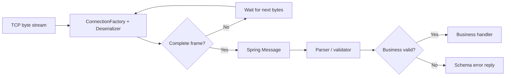
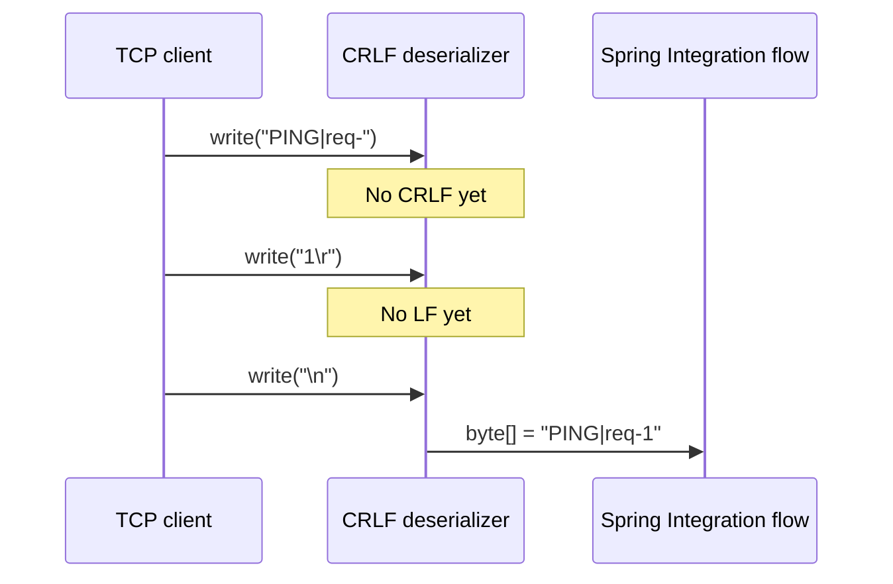
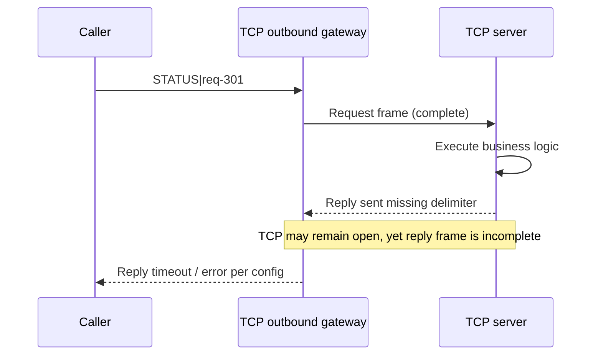
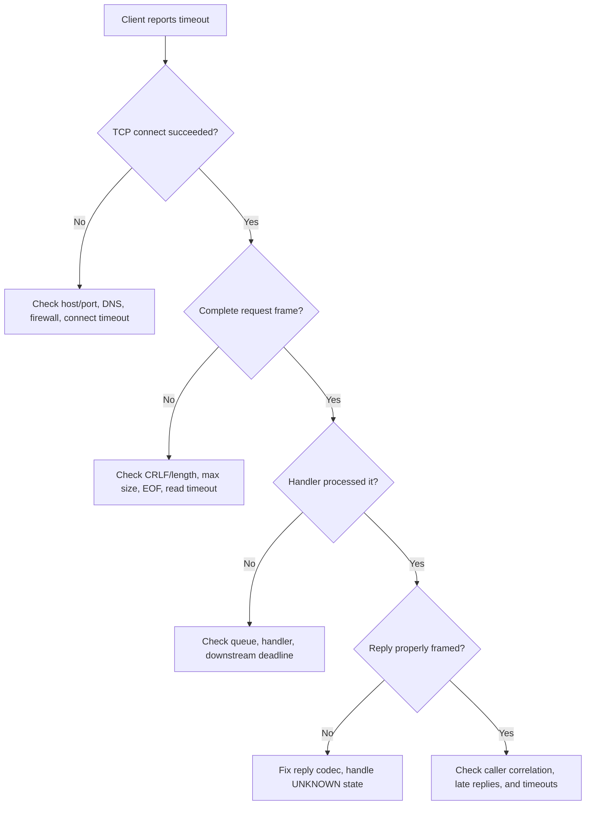

# Handling socket timeouts and partial messages

> **Chapter:** TCP Adapter  
> **Module:** SPRING_INTEGRATION_ADAPTERS  
> **Module scope:** Connect external systems to Spring Integration using inbound/outbound adapters, gateways, pollers, and MessageChannel. Practice message exchange flows over files, SFTP, HTTP, JMS, AMQP, Kafka, and databases; handle message contracts, errors, and connection lifecycles.

## 1. Learning objectives

After this lesson, you will be able to:

- Explain accurately why TCP can deliver data in **multiple chunks (partial reads)** even when the sender calls `write()` once.
- Distinguish **partial TCP frames**, **partial business requests**, **timeouts**, and **EOF** without conflating them.
- Design serializers/deserializers that emit a Spring Message only after receiving a complete delimiter or the declared byte count.
- Distinguish **connect timeout**, **socket/read timeout**, **gateway reply timeout**, **send/channel timeout**, and **business deadline**.
- Configure `TcpNetServerConnectionFactory` with `setSoTimeout(...)`, `ByteArrayCrLfSerializer`, `ByteArrayLengthHeaderSerializer`, and `setMaxMessageSize(...)`.
- Build an example with two TCP server endpoints using Spring Integration Java DSL, tested via a Java Socket client intentionally sending split or incomplete frames.
- Explain the risks of **desynchronization on shared connections**, late replies, duplicate-causing retries, and how to prevent them.
- Build a test matrix and observability metrics for network, framing, and business errors.

## 2. TCP is a byte stream: a partial message is not necessarily an error

TCP provides an **ordered byte stream on a connection**; it does not remember "one write equals one message." A single application message can be divided into multiple TCP segments and returned by the kernel across several `read()` calls; multiple messages can also appear in a single read.

Suppose the system sends a request:

```text
STATUS|req-101|sensor-01\r\n
```

This is **one frame** in a CRLF protocol, yet bytes may be read by the receiver in several ways:

```text
Case A:
  read #1: STATUS|req-101|sensor-01\r\n

Case B:
  read #1: STATUS|req-
  read #2: 101|sensor-01\r
  read #3: \n

Case C (two frames in one read):
  read #1: STATUS|req-101|sensor-01\r\nSTATUS|req-102|sensor-02\r\n
```

All three cases are **valid at the TCP layer**. Therefore:

- **Partial read:** one read does not yet contain enough bytes to assemble a frame. This may simply be normal segmentation.
- **Partial frame:** the codec is buffering part of a frame, waiting for more bytes to determine the boundary.
- **Truncated frame:** connection closure/EOF or error prevents the frame from completing per protocol.
- **Incomplete business message:** the frame is complete, yet the payload lacks a required field—e.g., `STATUS|req-101\r\n` missing device ID. This is a **validation** error, not a framing error.



**Core principle:** Never parse a request every time a socket returns a byte array. Let the **codec** maintain frame boundaries and forward only complete payloads to `MessageChannel`/handlers.

## 3. Three layers of a TCP protocol

| Layer | Question | Example |
| --- | --- | --- |
| **Transport/socket** | Does a connection exist, and can bytes flow? | Connect, EOF, read timeout, reset. |
| **Framing/codec** | Which bytes form **one** message? | CRLF `0D 0A`; 4-byte length header. |
| **Business logic** | Does the complete payload satisfy schema/auth, and what is the outcome? | `STATUS|req-101|sensor-01` → `OK|req-101|ACTIVE`. |

Classification examples:

| Situation | Error or normal? | Layer handling it |
| --- | --- | --- |
| TCP receives `STATUS|req` and 20 ms later receives the rest. | **Normal**, if within deadlines. | Deserializer reassembles the frame. |
| CRLF missing `\n`, connection stays open. | **Incomplete** frame. | Deserializer waits further or expires. |
| CRLF missing `\n` and peer closes socket. | **Truncated frame / mid-frame EOF**. | Decoder/connection; never emits a valid business message. |
| Length header declares 100 bytes, only 40 bytes arrive before EOF. | **Truncated frame**. | Decoder/connection. |
| Valid CRLF frame containing `STATUS|req-1`. | **Invalid schema**. | Handler/validator. |
| Request processed, but reply is lost. | **Outcome unknown to caller**. | Gateway/application/idempotency. |

## 4. Two typical codecs and partial frames

### 4.1. CRLF delimiter: waiting for both trailing bytes

A logical message `PING|req-1` is serialized as:

```text
50 49 4E 47 7C 72 65 71 2D 31 0D 0A
 P  I  N  G  |  r  e  q  -  1 CR LF
```

With `ByteArrayCrLfSerializer`, the deserializer must read up to **CRLF** before returning a complete payload. If `\r` has arrived without `\n`, it must not be treated as the terminator.



If the application adds `\r\n` to the payload itself while still using a CRLF serializer on write, the wire can end up with **two delimiters** and produce an extra empty frame. Payloads passed to `ByteArrayCrLfSerializer` should contain **logical content only**, with no manually appended trailing delimiter.

**Delimiter risk:** Payloads containing embedded CRLF will be split into multiple frames unless escaped or newlines are forbidden. For arbitrary binary content, a length header is usually easier to manage.

### 4.2. Length header: waiting for full header then full payload

Suppose the protocol uses **4-byte big-endian** to state payload byte count (excluding the header):

```text
[00 00 00 05][48 45 4C 4C 4F]
 length = 5     H  E  L  L  O
```

The codec must:

1. Read the **full 4 header bytes**; if only 1–3 bytes have arrived, the length is **not** known yet.
2. Decode length and validate `0 ≤ length ≤ maxMessageSize` (or reject 0 if the protocol forbids it).
3. Read the **full `length` payload bytes**, possibly across multiple socket reads.
4. Emit a message only once the full payload has arrived.

Split example:

```text
read #1: 00 00
read #2: 00 05 48
read #3: 45 4C
read #4: 4C 4F

=> Header = 00 00 00 05, payload = HELLO
=> Exactly 1 message is emitted after read #4.
```

In Spring Integration, `ByteArrayLengthHeaderSerializer` is the standard serializer/deserializer for length-prefixed framing. External systems may use different header sizes, byte orders, or inclusive lengths; **both sides must match exactly**.

### 4.3. A partial frame is not a lost TCP packet

TCP handles packet retransmission at the transport layer, yet the application can still observe an **incomplete** frame because the peer sends slowly, the socket closes early, or reads happen mid-transfer. Never retry whenever `read()` returns a few bytes: that gives no indication that the peer lost data rather than simply not having sent the rest yet.

**Frame extraction is the deserializer's job**, not the job of a poller or `MessageChannel`. A TCP inbound adapter/gateway receives a `Message` **after** this step.

## 5. Timeouts: each clock measures something different

| Timeout/deadline | Start point and what it measures | Effect on expiration |
| --- | --- | --- |
| **Connect timeout** | Client opening TCP socket to host/port. | New connection is not established in time. |
| **Socket read timeout** (`SO_TIMEOUT`) | A single socket read waiting for bytes. | Read may throw `SocketTimeoutException`; does not prove the overall request failed at the business layer. |
| **Frame completion deadline** | From start of a frame until complete delimiter/length arrives. | Stops peers from trickling one byte at a time to pin connections forever. Must be designed/enforced separately. |
| **Gateway reply timeout** | TCP request-reply endpoint awaiting matching reply. | Caller did not receive complete reply in time; server outcome may be unknown. |
| **Channel send timeout** | Producer waiting on a bounded channel/consumer. | Message may never have reached the TCP handler, unlike a reply timeout. |
| **Business deadline** | Total budget for a command, covering connect, wait, processing, and retries. | Application stops waiting per SLA; must establish a clear final state. |

### 5.1. `setSoTimeout(...)` on a connection factory

Common configuration:

```java
TcpNetServerConnectionFactory factory =
        new TcpNetServerConnectionFactory(9800);

factory.setSoTimeout(2_000);
```

The primary meaning of `SO_TIMEOUT`: it bounds how long **waiting to read data from the socket** takes in the active I/O implementation. It is **not** equivalent to:

- A completion deadline for an **entire CRLF frame**.
- Total processing time of a business request.
- An HTTP/DB call timeout inside a handler.
- A guarantee that a Java method calling the gateway finishes in exactly 2 seconds.

For example, a peer sending **one byte every 1 second** can evade a 2-second read timeout while a long frame never finishes. To defend against *slowloris/trickle attacks*, add a **frame deadline** or minimum rate limits per network/protocol policy.

> **Version note:** After a `SocketTimeoutException`, whether a connection is closed, re-established, or continues reading depends on the connection factory type (Net/NIO), endpoint, and Spring Integration version. Do not write business code assuming **every read timeout automatically closes the socket** or **every read timeout preserves the buffer**. Verify exact behavior on your running version.

### 5.2. Connect and reply timeouts can add up

Suppose a caller has:

- Connect attempts up to 3 seconds.
- Waiting for a shared connection or pool up to 2 seconds.
- Waiting for a reply up to 5 seconds.
- Two retries with 500 ms backoff each.

You cannot assume the caller's total elapsed time stays under 5 seconds. Enforce an **end-to-end deadline** and cap retries so total latency fits real SLAs.

### 5.3. A read timeout does not mean the business request was canceled

If the server already processed `CREATE_ORDER|req-201` while the reply is delayed, a client hitting a reply timeout still does not know whether the order was created. Dropping the socket only severs the reply path; it does not roll back the remote transaction.

States to distinguish:

- **REJECTED:** A valid reply confirmed the server rejected it.
- **COMPLETED:** A contract-compliant reply confirmed completion.
- **UNKNOWN:** Caller has no definitive proof of outcome after timeout or reset.

For commands with side effects, `UNKNOWN` must never be mapped blindly to `FAILED` and retried with a brand-new request ID.

## 6. EOF, half-close, and incomplete frames

### 6.1. EOF between frames vs. mid-frame EOF

**EOF** means the input stream has ended. There are two cases:

- **EOF between two frames:** peer closes the connection right after a complete frame; the application can treat this as a normal session end if the protocol permits.
- **EOF inside header/payload:** part of a frame has arrived, but the peer closes before completing it. This is a **truncated frame** and must raise an error/discard connection per contract.

Length-header example:

```text
Received: 00 00 00 0A 41 42 43
Header requires: 10 bytes
Actual payload: 3 bytes "ABC"
Peer: EOF
=> Truncated frame error; never emit "ABC" as a complete request.
```

Some Spring Integration serializers distinguish clean EOF before any new frame bytes from mid-frame EOF using dedicated exceptions (such as `SoftEndOfStreamException` for certain clean EOF cases). However, **exact exception types** and where events are emitted can vary by serializer and version; test rather than hardcoding a single assumption for all EOFs.

### 6.2. Half-close is a special contract

In Java `Socket`, `shutdownOutput()` closes only the **sending half** of the socket; the peer's reading side sees EOF after consuming all sent bytes. This differs from `close()`, which tears down the entire socket.

Some protocols use EOF to mark the **end of a request** while still expecting a reply in the reverse direction. Both sides must agree on half-close, reply rules, suitable serializers, and endpoint support.

**Never** configure `ByteArrayCrLfSerializer` and expect a missing CRLF to be excused by `shutdownOutput()`: if the contract is CRLF, a mid-frame EOF remains a protocol error.

## 7. Spring Integration example: two ports to observe partial frames

We build one **Spring Boot application** with two TCP inbound gateways:

- Port **9800**: CRLF framing, receiving `STATUS|req-id|device-id`.
- Port **9801**: 4-byte length header, receiving binary `byte[]` and echoing back the exact payload.

Two ports are used because the two endpoints apply **two different wire protocols**. Both use server connection factories because the application **listens/accepts** external clients.

### 7.1. Dependencies

With Java 17+, Spring Boot, and Spring Integration 6.x (versions managed by Spring Boot BOM):

```xml
<dependencies>
    <dependency>
        <groupId>org.springframework.boot</groupId>
        <artifactId>spring-boot-starter-integration</artifactId>
    </dependency>
    <dependency>
        <groupId>org.springframework.integration</groupId>
        <artifactId>spring-integration-ip</artifactId>
    </dependency>
</dependencies>
```

The application has a `@SpringBootApplication` class whose component scan covers the configuration below.

### 7.2. CRLF server with socket timeout and max frame size

```java
import java.nio.charset.StandardCharsets;

import org.springframework.context.annotation.Bean;
import org.springframework.context.annotation.Configuration;
import org.springframework.integration.config.EnableIntegration;
import org.springframework.integration.dsl.IntegrationFlow;
import org.springframework.integration.ip.IpHeaders;
import org.springframework.integration.ip.dsl.Tcp;
import org.springframework.integration.ip.tcp.connection.TcpNetServerConnectionFactory;
import org.springframework.integration.ip.tcp.serializer.ByteArrayCrLfSerializer;
import org.springframework.integration.ip.tcp.serializer.ByteArrayLengthHeaderSerializer;

@Configuration
@EnableIntegration
public class TcpPartialMessageConfiguration {

    @Bean
    TcpNetServerConnectionFactory textTcpFactory() {
        var factory = new TcpNetServerConnectionFactory(9800);

        var decoder = new ByteArrayCrLfSerializer();
        decoder.setMaxMessageSize(2048);
        factory.setDeserializer(decoder);
        factory.setSerializer(new ByteArrayCrLfSerializer());

        factory.setSoTimeout(2_000);
        factory.setSingleUse(false);
        return factory;
    }

    @Bean
    IntegrationFlow textRequestReplyFlow(
            TcpNetServerConnectionFactory textTcpFactory) {

        return IntegrationFlow
                .from(Tcp.inboundGateway(textTcpFactory))
                .handle((payload, headers) -> {
                    String request = new String(
                            (byte[]) payload, StandardCharsets.UTF_8
                    );
                    Object connectionId =
                            headers.get(IpHeaders.CONNECTION_ID);

                    System.out.printf(
                            "CRLF frame complete: connection=%s text=%s%n",
                            connectionId, request
                    );

                    String[] fields = request.split("\\|", -1);

                    String reply;
                    if (fields.length == 3
                            && "STATUS".equals(fields[0])
                            && fields[1].matches("[A-Za-z0-9_-]{1,40}")
                            && fields[2].matches("[A-Za-z0-9_-]{1,40}")) {
                        reply = "OK|" + fields[1] + "|ACTIVE";
                    } else {
                        reply = "ERR|BAD_REQUEST";
                    }

                    return reply.getBytes(StandardCharsets.UTF_8);
                })
                .get();
    }

    @Bean
    TcpNetServerConnectionFactory binaryTcpFactory() {
        var factory = new TcpNetServerConnectionFactory(9801);

        var decoder = new ByteArrayLengthHeaderSerializer();
        decoder.setMaxMessageSize(4096);
        factory.setDeserializer(decoder);
        factory.setSerializer(new ByteArrayLengthHeaderSerializer());

        factory.setSoTimeout(2_000);
        factory.setSingleUse(false);
        return factory;
    }

    @Bean
    IntegrationFlow binaryEchoFlow(
            TcpNetServerConnectionFactory binaryTcpFactory) {

        return IntegrationFlow
                .from(Tcp.inboundGateway(binaryTcpFactory))
                .handle((payload, headers) -> {
                    byte[] bytes = (byte[]) payload;
                    System.out.println(
                            "Length frame complete: size=" + bytes.length
                    );
                    return bytes; // Reply carries the same binary payload.
                })
                .get();
    }
}
```

**Explanation:**

1. Each factory **reads bytes** via its own deserializer and **writes replies** with a serializer matching the same contract.
2. `setMaxMessageSize(...)` bounds incoming frames, preventing the codec from buffering or allocating unbounded memory.
3. `setSoTimeout(2_000)` bounds socket read waiting at the I/O layer; this is **not** a 2-second deadline for an entire frame.
4. `singleUse=false` allows reusing the socket across frames, making it easy to test how partial-frame errors affect long-lived sessions.
5. Handlers are invoked **only when the deserializer produces a complete frame**. For a frame missing bytes, never expect the handler to return `ERR|BAD_REQUEST`.
6. In the demo, the CRLF handler uses a text parser while the length-header handler keeps raw `byte[]`; never pass binary data through `String`.

### 7.3. Keeping framing errors out of business handlers

The code in `textRequestReplyFlow` intentionally logs `CRLF frame complete` **only after a full frame arrives**. When sending `STATUS|req-101|sensor-01\r` and pausing, you may observe a connection exception/timeout, yet **no** handler log appears.

That is the desired correctness: an incomplete frame must not be emitted as a message causing the handler to act as if it received a complete request.

To handle protocol errors in production, add observability for exceptions and events at the connection/serializer layer. **Do not assume** all framing errors automatically turn into `Message<?>` on `errorChannel`, since those errors can happen **before any Spring Message exists**.

## 8. Java Socket client: intentionally creating partial CRLF frames

### 8.1. Sending one frame across multiple write calls

Create `PartialCrLfClientDemo.java` and run it after the Spring server starts:

```java
import java.io.BufferedReader;
import java.io.InputStreamReader;
import java.net.InetSocketAddress;
import java.net.Socket;
import java.nio.charset.StandardCharsets;

public class PartialCrLfClientDemo {

    public static void main(String[] args) throws Exception {
        try (Socket socket = new Socket()) {
            socket.connect(
                    new InetSocketAddress("127.0.0.1", 9800), 3000
            );
            socket.setSoTimeout(3000);

            // Intentionally split request across three write() calls.
            var out = socket.getOutputStream();

            out.write("STATUS|req-101|".getBytes(
                    StandardCharsets.UTF_8));
            out.flush();

            Thread.sleep(100);

            out.write("sensor-01\r".getBytes(
                    StandardCharsets.UTF_8));
            out.flush();

            Thread.sleep(100);

            out.write('\n'); // CRLF completes here.
            out.flush();

            var reader = new BufferedReader(new InputStreamReader(
                    socket.getInputStream(), StandardCharsets.UTF_8));

            System.out.println(reader.readLine());
        }
    }
}
```

**Expected** output:

```text
OK|req-101|ACTIVE
```

Explanation:

- The client called `write()` three times, yet it is still **one CRLF frame**.
- The deserializer creates **one** Spring Message only after seeing `\r\n`.
- The handler runs once and sends back one reply.
- Calling `write()` three times **does not guarantee** the kernel delivers three `read()` calls to the server; this test verifies end-to-end behavior without inferring TCP packet boundaries from write counts.

### 8.2. Missing delimiter, reading reply with timeout

Replace the sending section on the client with:

```java
socket.getOutputStream().write(
        "STATUS|req-102|sensor-02\r".getBytes(
                StandardCharsets.UTF_8)
);
socket.getOutputStream().flush();

// Do not send the final LF byte of the frame.
socket.setSoTimeout(3000);

var reader = new BufferedReader(new InputStreamReader(
        socket.getInputStream(), StandardCharsets.UTF_8));

try {
    String reply = reader.readLine();
    System.out.println("reply=" + reply);
}
catch (java.net.SocketTimeoutException e) {
    System.out.println("Client timed out waiting for reply");
}
```

This snippet **illustrates replacing the logic inside `socket`'s scope from Section 8.1**, not a standalone class. Because the server has not received a valid frame, the handler has no basis to return `OK`.

After the client times out, several outcomes can be observed depending on server handling:

- The client throws `SocketTimeoutException` while waiting for the reply.
- The server may close the connection, causing the client to read `null`/EOF while waiting for a line.
- The server logs a decoder exception or connection-close event.

**Do not hardcode a single expected error output.** Attach logs/events with request/connection IDs and test on your active Spring Integration version.

### 8.3. What if LF arrives slowly without exceeding `SO_TIMEOUT`?

Have the client send bytes spaced **shorter than** `SO_TIMEOUT` while never sending the final `\n`. No *individual read timeout* may fire even though the frame stays incomplete for a long time.

That is why production environments need a **frame completion deadline** or rate/idle-connection limits. `setSoTimeout(...)` alone is insufficient against a peer intentionally holding many connections in a waiting state.

## 9. Java Socket client: length header missing payload

### 9.1. Testing a mid-frame cutoff

Start the Spring server on port `9801`, then create `PartialLengthClientDemo.java`:

```java
import java.io.DataInputStream;
import java.io.DataOutputStream;
import java.net.InetSocketAddress;
import java.net.Socket;

public class PartialLengthClientDemo {

    public static void main(String[] args) throws Exception {
        try (Socket socket = new Socket()) {
            socket.connect(
                    new InetSocketAddress("127.0.0.1", 9801), 3000
            );
            socket.setSoTimeout(3000);

            DataOutputStream out =
                    new DataOutputStream(socket.getOutputStream());

            // 4-byte big-endian declaring 10 payload bytes.
            out.writeInt(10);

            // Actually send only 3 bytes.
            out.write(new byte[]{0x41, 0x42, 0x43});
            out.flush();

            // Signal EOF on send side; length framing is still missing 7 bytes.
            socket.shutdownOutput();

            try {
                // If peer sends no reply, we may hit EOF/timeout.
                int b = socket.getInputStream().read();
                System.out.println("First reply byte = " + b);
            }
            catch (java.net.SocketTimeoutException e) {
                System.out.println("No complete reply before client timeout");
            }
        }
    }
}
```

Actual wire frame:

```text
Header: 00 00 00 0A  (length=10)
Payload: 41 42 43   (3 bytes)
EOF after 3 bytes

=> Missing 7 bytes. This is a truncated frame.
=> Handler binaryEchoFlow must not receive a 3-byte message.
```

`shutdownOutput()` is a half-close, not a full `close()`. Even so, the **length-header** deserializer does not accept EOF as a valid completion of a declared 10-byte frame. Exact timing and server exception/close behavior depend on implementation, so verify via decoder logs/events.

### 9.2. Testing a split yet valid header

A frame with length=5 and payload `HELLO`:

```text
write #1: 00
write #2: 00 00 05 48
write #3: 45 4C
write #4: 4C 4F

=> Complete 4-byte header + 5-byte payload.
=> Echo handler returns the exact 5 bytes of HELLO.
```

To write a client test, send chunks via `OutputStream.write(byte[])` and use `DataInputStream` to read the reply:

```java
var input = new DataInputStream(socket.getInputStream());

// Read full reply header; do not assume 1 read() equals 1 frame.
int length = input.readInt();
if (length < 0 || length > 4096) {
    throw new java.io.IOException("Invalid reply length");
}

byte[] reply = new byte[length];
input.readFully(reply);
```

This snippet uses an already-created `socket` and assumes the peer also uses **4-byte big-endian exclusive**. For binary data, **never** use `BufferedReader.readLine()` since newline bytes can appear inside the payload.

### 9.3. Validating length headers before allocating

If a client sends `7F FF FF FF`, the 4-byte signed int length is huge. Never allocate `byte[length]` from untrusted input without bounds. Codecs must enforce limits like `maxMessageSize`, and plain clients must validate lengths before creating arrays.

This is especially critical when the server is a public TCP listener or accepts data from untrusted external devices.

## 10. Request-reply gateways and timeout layers

### 10.1. Gateways add a response-wait clock

With `Tcp.outboundGateway(...)`, the caller sends a Spring Message, the gateway serializes the request, and waits for the deserializer to read the matching reply frame.



A server may process the request **completely** yet forget to append CRLF at the end of the reply. The client receives partial reply bytes, the deserializer never emits a message, and the outbound gateway eventually times out even though the **server business handler** finished.

**Accurate diagnosis:** This is a **reply framing** error, not an unprocessed request on the server.

### 10.2. Distinguishing response timeouts from handler timeouts

- **Socket/read timeout:** can fire while the deserializer is waiting for enough bytes.
- **Gateway reply timeout:** fires when no matching response arrives, including incomplete reply framing.
- **Handler timeout:** server has not generated a reply because downstream processing is slow.
- **Channel timeout:** caller waiting on internal resource or message delivery.

Do not add timeouts up arbitrarily while ignoring SLAs. Set an end-to-end deadline and measure branches to locate real bottlenecks.

### 10.3. A shared connection can lose synchronization

Suppose a client uses `singleUse=false` and the gateway sends sequential requests:

```text
Request #1:  STATUS|req-1\r\n
Reply #1:    OK|req-1|ACTIVE         (missing CRLF)

Request #2:  STATUS|req-2\r\n
Reply #2:    OK|req-2|ACTIVE\r\n
```

At the byte level, the CRLF deserializer may see partial reply #1 glued to reply #2 as **one frame** once the final CRLF arrives. That breaks correlation between responses and requests.

In this situation, **do not keep reusing the shared socket as if nothing happened**. You must:

1. Detect the **timeout/protocol mismatch**.
2. Discard or close the desynchronized connection via the appropriate endpoint/factory mechanism.
3. Resume sending only over a connection in a clean framing state.
4. For request #1 lacking a valid reply, retain `UNKNOWN` status until reconciled; never blindly retry a write command.

**Do not assume `singleUse=false` or retries will fix a framing bug.**

## 11. Partial writes and write errors: senders also lack exact certainty

Partial messages do not occur only on reads. The sender can hit an exception mid-write to the socket:

```text
Client intends to send a 100-byte frame
  - Writes part into socket buffer
  - Network/peer drops connection
  - Subsequent write fails: IOException
```

Never conclude:

- "Write failed" means **the server received zero bytes**.
- "Write succeeded" means **the server processed and committed**.
- "Connect failed on this turn" means the prior request on the old socket **was not** processed.

A successful write usually confirms only that bytes were handed to the transport layer at the moment observed. Business outcomes must rely on **contractual ACKs/replies** or dedicated reconciliation.

### 11.1. Never resend half a frame on an old socket

If a write fails mid-frame, trying to send the remaining bytes over an unknown-state socket is usually wrong. With framed protocols, **close/discard the failed connection**, establish a fresh session, and then decide whether to **retry the full request** if business-safe.

Never turn a "partial write" into "just send the remaining few bytes" when you do not know how many bytes the peer received or whether the socket is still synchronized.

## 12. Error channels and connection events

A message enters `IntegrationFlow` only after the decoder sees a complete frame. Consequently:

- Parser errors **after a Spring Message exists** can be handled via the flow's error channel/advice mechanisms.
- **Socket read/EOF/deserializer** errors can occur before any Spring Message exists; observe TCP-layer logs and application events.
- **Gateway reply timeout** errors occur on the request/reply path and can surface to the caller as exceptions.
- A **send** failure at an outbound adapter/gateway may traverse an error flow differently depending on synchronous vs. asynchronous channels; verify against your actual configuration.

### 12.1. Event groups to monitor

Spring Integration IP emits connection lifecycle events; exact event classes and subscription APIs depend on version. Monitor:

| Event type | What to log |
| --- | --- |
| Connection open | Connection ID, remote endpoint, open timestamp. |
| Connection close | Socket age, close reason if available, processed message count. |
| Connection exception | Exception class, frame mode, request ID if already known. |
| Deserialization error | Whether header/delimiter arrived, bytes received so far. |
| Gateway timeout | Wait duration, request ID, `UNKNOWN` status. |
| Protocol error | Wrong delimiter, oversized length, encoding/schema error. |

Never log full sensitive payloads or tokens to debug issues; log **byte counts, filtered hex prefix/suffix snippets**, timestamps, and connection IDs instead.

### 12.2. Connection ID differs from request ID

`IpHeaders.CONNECTION_ID` identifies the **socket** receiving a message. It does not replace request ID:

- One shared socket can handle many requests.
- A new socket after reconnect gets a new connection ID.
- Business request IDs can remain unchanged across retries.
- Before a frame completes, no Spring Message with IP headers exists yet.

If you need to track requests before frames complete, add **connection-level metrics/events**; do not expect handlers to log a request ID before the handler is even invoked.

## 13. Designing retries, reconnects, and idempotency

### 13.1. Distinguishing the three mechanisms

| Mechanism | What it recovers | What it does not solve |
| --- | --- | --- |
| **Reconnect** | Opens a new socket after EOF/reset/idle close. | Does not automatically recover old frames/requests. |
| **Retry** | Resends a failed/inconclusive command. | Not safe if the server already processed it before timeout. |
| **Failover** | Picks another TCP server when the first fails. | Does not synchronize business state between nodes. |

Never treat read timeouts as an automatic reason to retry every command. A `CREATE_ORDER` command may have committed while its reply was fragmented and lost.

### 13.2. Request ID and idempotency

Example:

```text
Request: CREATE_ORDER|req-501|order-42\r\n
Reply:   OK|req-501|COMPLETED\r\n
```

The server finishes processing, but the reply is lost right before the `\n` byte. The client times out. If the client retries with a **new ID**, the server may create a second order.

Safe design requires:

1. Generate `requestId` **once** before sending.
2. Server enforces request ID uniqueness in durable storage.
3. On receiving the same ID again, return the stored result instead of re-executing.
4. Distinguish `ACCEPTED` vs. `COMPLETED` replies.
5. Provide a **status query/reconciliation** path when the client only knows `UNKNOWN`.
6. Cap retries, use backoff/jitter, and enforce a total deadline.

For **pure read** commands like `STATUS`, retries are simpler, yet you must still handle stale data on backup servers or replies with mismatched request IDs.

### 13.3. Backpressure and slow clients

A TCP server with many clients sending one byte every few seconds can pin many connections inside the decoder. To avoid exhausting resources:

- Limit concurrent connections and sockets awaiting frames.
- Enforce `maxMessageSize`.
- Configure appropriate read timeouts and **frame completion deadlines**.
- Cap request rates and in-flight task counts.
- Monitor idle connections, connection durations, and bytes accumulated in incomplete frames.
- Apply TLS/authentication, rate limiting, or proxies as needed.

**Read timeouts do not replace frame deadlines** if a peer keeps trickling bytes to defeat the read timeout.

## 14. Timeout and partial-message test matrix

| Scenario | Expected result and layer to observe |
| --- | --- |
| Complete CRLF request | One Spring Message; handler runs once; one reply with matching request ID. |
| CRLF split across three `write()` calls | Still one message; independent of write boundaries. |
| `\r` and `\n` arrive separately | Decoder waits for `\n` before emitting message. |
| CRLF missing `\n`, socket stays open | Handler does not receive message; times out per config. |
| CRLF missing `\n` followed by EOF | Truncated frame; never becomes a valid request. |
| Two complete frames in one send | Emits two separate messages without merging payloads. |
| CRLF embedded in payload content | Protocol must escape/forbid or switch to length header. |
| Only 1–3 bytes of length header received | Waits for all 4 bytes before computing payload length. |
| Length=10, 3 payload bytes then EOF | Truncated frame; never emits a 3-byte message. |
| Header length exceeds `maxMessageSize` | Codec rejects early without arbitrary allocation. |
| Long frame sent 1 byte per second | May evade 2-second read timeout; requires separate frame deadline. |
| Server finishes work, reply lacks delimiter | Client gateway timeout/protocol error; unknown business outcome. |
| Shared connection receives late reply from prior request | Must prevent matching old reply to new request; reset connection. |
| Server accepts connection without replying | TCP connect succeeds; gateway reply timeout fires. |
| Client gets connection refused | Connect failure; distinct from partial frame. |
| Server shuts down mid-frame | EOF/reset/exception; verify connection cleanup. |
| Many clients simultaneously send incomplete frames | Sockets, memory, and threads stay within operational bounds. |

### 14.1. Three questions to answer for every test

1. **Was a Spring Message created?** If not, the issue is socket/framing, not the handler.
2. **Was the full business request sent?** If yes, a reply timeout does not prove the server skipped processing.
3. **Is the connection still synchronized for reuse?** If uncertain, never blindly reuse a shared socket after a partial frame.

## 15. Layer-by-layer troubleshooting

| Symptom | Common causes | How to investigate |
| --- | --- | --- |
| Socket connects, handler never runs | Missing CRLF, wrong length header, incomplete frame. | Controlled hex dump; compare against wire contract. |
| Handler runs only after client closes socket | Protocol uses EOF/raw framing or unexpected codec. | Check serializer/deserializer on both sides. |
| Gateway times out, yet server logged processing | Reply lacks framing, reply lost, or reply delayed. | Inspect response bytes, timeouts, and request IDs. |
| Repeated `SocketTimeoutException` | Slow peer, idle socket, partial frame. | Measure byte arrival intervals and frame completion deadlines. |
| Oversized frame spikes memory | Unbounded decoder or corrupt length header. | Set `maxMessageSize`; validate length before allocating. |
| Second request receives bytes from first request's reply | Shared socket desynchronized after partial reply. | Stop reusing broken connection; inspect protocol and late replies. |
| Mid-frame EOF on length-header stream | Peer closed before sending full payload. | Classify as truncated frame; never emit partial payload. |
| Parser fails after receiving full frame | Schema/encoding/validation error. | Return business error response per protocol. |
| Client write fails, retry causes duplicate action | Server may have received part or all of command before losing reply. | Request ID, idempotency store, reconciliation. |
| One client pins socket by dripping single bytes | Read timeout present without frame deadline. | Rate limits, connection limits, frame deadlines. |

### 15.1. Recommended diagnostic order



Do not start by raising every timeout: that only makes protocol errors **wait longer**. First determine whether you are missing **bytes**, a **reply**, **resources**, or **processing time**.

## 16. Hands-on exercises

**Exercise 1 — Segmented CRLF.** Run `PartialCrLfClientDemo`. Split the request across 2, 3, and 5 `write()` calls at different points. Verify the handler still runs **once** after the frame completes.

**Exercise 2 — CRLF missing byte.** Send only `STATUS|req-102|sensor-02\r` and keep the socket open. Observe timeout/close per configuration. Explain why the handler does not return `ERR|BAD_REQUEST`.

**Exercise 3 — Trickle attack.** Have the client send one byte every 1 second without CRLF; server `SO_TIMEOUT=2s`. Explain why a frame deadline and connection limits are also needed.

**Exercise 4 — Length header missing payload.** Send `length=10` with only 3 bytes `ABC` followed by `shutdownOutput()`. Observe the decoder; confirm no valid `ABC` echo reply is sent.

**Exercise 5 — Split length header.** Split the 4-byte header across multiple writes; confirm the server echoes the exact binary payload containing `0D 0A` once the frame completes.

**Exercise 6 — Reply missing delimiter.** Build a mock TCP server that sends `OK|req-201|ACTIVE` **without CRLF**. Use an outbound gateway with timeout, distinguishing reply framing errors from business errors.

**Exercise 7 — Desynchronized shared connection.** Send a reply without CRLF followed by a valid reply on the same socket. Predict what bytes the decoder sees; design a policy to close/discard broken connections.

**Exercise 8 — Preventing duplicates.** Design `CREATE_ORDER|req-401|order-42`. Server commits and socket closes before the reply. Use request IDs, uniqueness constraints, and a result store for safe retries.

**Exercise 9 — Observability and alerting.** Design metrics for connection timeouts, incomplete frames, rejected oversize frames, gateway timeouts, reconnects, and `UNKNOWN` outcomes. Set alert thresholds suited to load.

**Exercise 10 — Total deadline.** Caller allows 3 attempts, 2-second connect timeout each, 5-second reply timeout, and backoff. Design an 8-second total deadline and rules to trim remaining attempts so the SLA is never exceeded.

## 17. Knowledge self-check

1. Why does one `write()` on a TCP client not guarantee one `read()` on the server returns the exact request?
2. Is a partial read always a connection error?
3. With a CRLF codec, when `\r` has arrived without `\n`, should the deserializer emit a message?
4. With a length header declaring 10 bytes but only 3 bytes arriving before EOF, should the server pass those 3 bytes to the handler?
5. Does `setSoTimeout(2_000)` guarantee an entire frame finishes within 2 seconds?
6. What problem does a frame completion deadline solve that socket read timeout does not?
7. How do a connect timeout and a gateway reply timeout differ?
8. Why can a reply missing its delimiter cause a gateway timeout even after the server ran the handler?
9. How does a clean EOF between two frames differ from a mid-frame EOF?
10. Why can continuing to use a shared socket after an unframed reply be dangerous?
11. Does `errorChannel` always receive a Spring Message when the deserializer fails to read a full frame?
12. If a client times out after `CREATE_ORDER`, can it conclude the order was definitely not created?
13. Why are reconnect and retry two separate decisions?
14. Should a retried request keep the same request ID or generate a new ID?
15. When a test intentionally splits a request into three `write()` calls, is the server guaranteed to see exactly three `read()` calls?
16. Which metrics distinguish protocol framing errors, network timeouts, and business timeouts?

**Answer hints:** (1) TCP is a byte stream and does not preserve write boundaries. (2) No, the frame may still be arriving. (3) No, it must wait for full CRLF. (4) No, it is a truncated frame. (5) No; `SO_TIMEOUT` primarily bounds waiting on a single socket read. (6) Prevents frames from being dragged out indefinitely with trickled bytes. (7) One establishes the connection; the other waits for a reply. (8) The decoder lacks a complete frame to return to the gateway. (9) Mid-frame EOF leaves partial data and must raise an error. (10) Old and new replies can merge or mis-correlate. (11) No, errors can occur before a message is created. (12) No; the server may have committed. (13) Reconnect restores the socket; retry replays the operation. (14) Keep the same ID for deduplication. (15) No. (16) Socket/decoder errors, bytes received, gateway latency, business requests/results, and connection lifecycle events.

## 18. References

- [Spring Integration Reference — TCP Connection Factories and Message Demarcation](https://docs.spring.io/spring-integration/reference/ip/tcp-connection-factories.html).
- [Spring Integration Reference — TCP Gateways](https://docs.spring.io/spring-integration/reference/ip/tcp-gateways.html).
- [Spring Integration Reference — TCP Adapters](https://docs.spring.io/spring-integration/reference/ip/tcp-adapters.html).
- [Spring Integration Reference — IP Message Headers](https://docs.spring.io/spring-integration/reference/ip/msg-headers.html).
- [Spring Integration API — ByteArrayCrLfSerializer](https://docs.spring.io/spring-integration/api/org/springframework/integration/ip/tcp/serializer/ByteArrayCrLfSerializer.html).
- [Spring Integration API — ByteArrayLengthHeaderSerializer](https://docs.spring.io/spring-integration/api/org/springframework/integration/ip/tcp/serializer/ByteArrayLengthHeaderSerializer.html).

**Key takeaway:** **Partial TCP reads are normal**, whereas **frames missing bytes at EOF/timeout** may indicate protocol errors. Serializers and deserializers must reassemble and split frames accurately; `SO_TIMEOUT` does not replace whole-frame deadlines or request-reply timeouts. When failures occur, distinguish **no Spring Message created yet**, **processed with lost reply**, and **desynchronized socket**. Retries and reconnects are safe only with explicit request IDs, idempotency, resource limits, and business outcome reconciliation.
