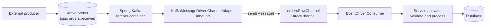
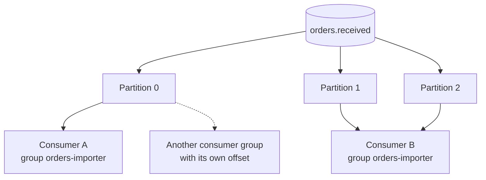
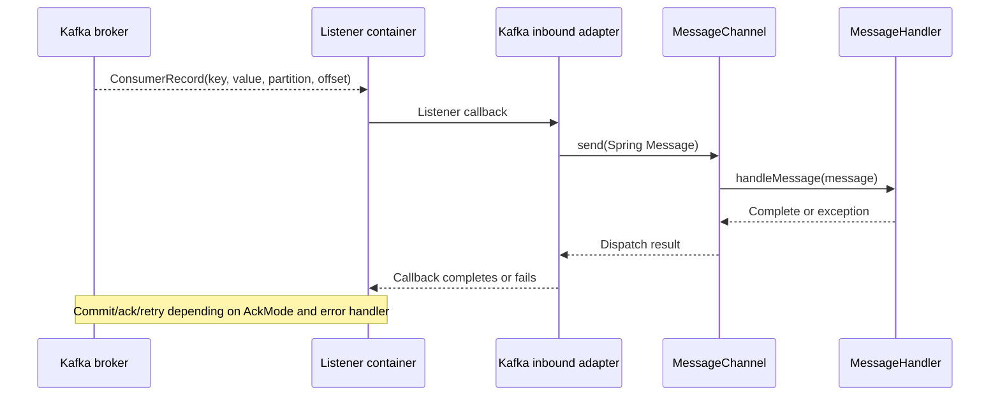
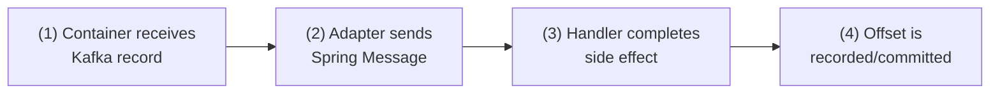
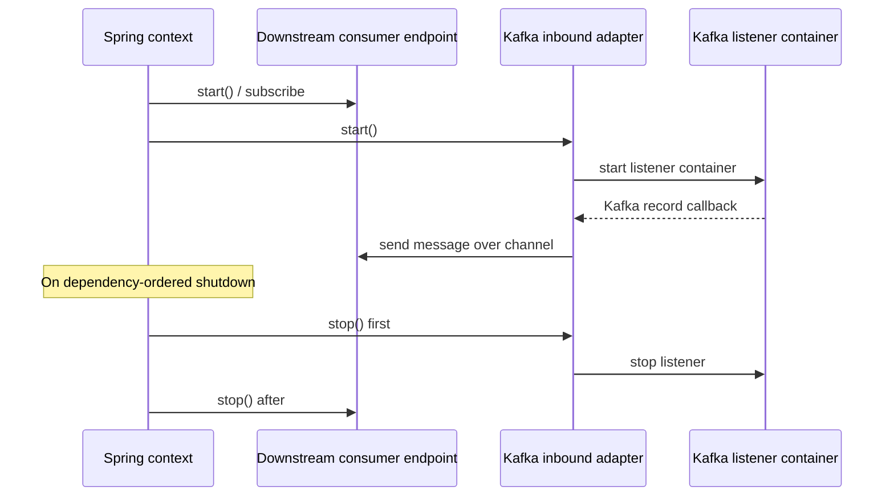

# Kafka inbound channel adapter

The **Kafka inbound channel adapter** brings records from an Apache Kafka topic into a Spring Integration message flow. A listener container managed by Spring for Apache Kafka handles connections, record reception, partitioning, and offsets; the adapter converts each record into a `Message<?>` and sends it to a `MessageChannel`. Subsequent steps can be a transformer, filter, router, service activator, or a JDBC/HTTP/SFTP outbound adapter.

This lesson belongs to the **Kafka Adapter** chapter of the **SPRING_INTEGRATION_ADAPTERS** module. The module connects external systems using inbound/outbound adapters, gateways, pollers, and `MessageChannel`; it covers files, SFTP, HTTP, JMS, AMQP, Kafka, and databases, focusing on message contracts, errors, and lifecycle. In this lesson, the focus is the **Kafka → Spring Integration direction**, not sending data back out to Kafka.

> **Key takeaway:** A Kafka inbound adapter is a **producer endpoint of the Spring Integration flow** but a **consumer of the Kafka broker**. The terms "producer/consumer" are viewed from two different systems.

## 1. Learning objectives

After studying this lesson, you will be able to:

1. Describe the relationship between topic, partition, consumer group, listener container, inbound adapter, and output channel.
2. Explain why a message-driven Kafka inbound adapter **does not need a Spring Integration poller**, even though the Kafka consumer client has its own `poll()` loop.
3. Instantiate `KafkaMessageDrivenChannelAdapter` with `ConcurrentMessageListenerContainer` and a `DirectChannel` in Spring Boot.
4. Distinguish between **record** and **batch** consumption modes, payloads, and Kafka metadata in headers.
5. Design when processing succeeds, offset commit, acknowledgment, retry, and dead-letter topic (DLT).
6. Evaluate the impact of `DirectChannel` and asynchronous channels on errors, transactions, and the risk of losing/re-receiving messages.
7. Monitor lag, throughput, partition assignment, rebalance, and lifecycle state in operations.

## 2. Where does Kafka inbound sit in an IntegrationFlow?



**Responsibility layers:**

| Component | Responsibility | Is it a Spring Integration poller? |
|---|---|---|
| Kafka broker | Store records by topic/partition, manage log and offset | No |
| Kafka consumer client | Send fetch/poll to broker, join consumer group | No |
| `ConcurrentMessageListenerContainer` | Manage consumer threads, listener callbacks, ack, rebalance | No |
| `KafkaMessageDrivenChannelAdapter` | Convert received events into Spring messages, send to output channel | No |
| `DirectChannel` | Dispatch messages to registered handlers | No |
| `EventDrivenConsumer` | Subscribe handler to `DirectChannel` | No |
| `MessageHandler` | Process data or send to target system | No |

On the Kafka side, the consumer **actually still calls `poll()`** inside the listener container. However, you do not configure `Pollers.fixedDelay(...)` or `SourcePollingChannelAdapter` to receive Kafka records in this model. Be sure to distinguish the **Kafka client's consumer poll** from a **Spring Integration polling endpoint**.

### 2.1. Kafka topic, partition, and consumer group

Suppose the topic `orders.received` has 3 partitions. Three instances with the same `group.id=orders-importer` can be assigned partitions to **share record processing** within the group. Another group can read the same topic independently.



Within a consumer group, each partition is assigned to at most **one active consumer at a time**. Kafka guarantees record ordering **within each partition** by offset, not global ordering across the entire topic. If there are fewer partitions than total consumers in the group, some consumers may sit idle without assigned work.

## 3. Which adapter fits?

Spring Integration Kafka provides data-receiving endpoints with different contracts. In this lesson, we use the **message-driven channel adapter**.

| Option | Message direction | When to use |
|---|---|---|
| `KafkaMessageDrivenChannelAdapter` | Kafka → `MessageChannel` | Receive one-way events and process them in an IntegrationFlow |
| Kafka inbound gateway | Kafka request → Spring flow → Kafka reply | When a request–reply model over Kafka is needed |
| Kafka outbound channel adapter | Spring `MessageChannel` → Kafka topic | Publish messages to Kafka without a business reply message |
| Kafka outbound gateway | Spring request → Kafka → reply | When reply/correlation over Kafka is needed |
| Spring Kafka `@KafkaListener` | Kafka → Java method | When you only need a Spring Kafka listener without necessarily going through an IntegrationFlow |

`@KafkaListener` is not wrong; it is suitable if the flow is simple and you do not need Spring Integration EIP channels/transformers/routers. `KafkaMessageDrivenChannelAdapter` is useful when you want a **unified internal message contract** to connect Kafka with JDBC, HTTP, SFTP, JMS, AMQP, or other flows.

## 4. Lifecycle of receiving a record



This sequence describes the **synchronous processing path** with `DirectChannel`. If the output channel is an `ExecutorChannel` or `QueueChannel`, sending may finish before the handler actually finishes processing. In that case, the listener container may consider the callback complete and execute the offset/ack policy before downstream side effects are committed: this is an architectural difference that must be carefully evaluated.

### 4.1. Kafka record vs. Spring Message

A Kafka record typically has a key, value, topic, partition, offset, timestamp, and native headers. Through a converter/mapper, the adapter puts data into a Spring `Message<?>`:

- **Payload:** usually the record value processed by the deserializer/converter; not a business DTO by default.
- **Message headers:** may include topic, partition, offset, key, timestamp, and mapped headers.
- **Message ID/correlation:** the `MessageHeaders.ID` header is the Spring message ID, **not the Kafka offset** and not a business ID.

Do not use the Kafka offset **alone** as a global deduplication key: an offset is only meaningful within the scope of **topic + partition**; when reprocessing data or changing topics, a business key such as `orderId`/`eventId` is usually more appropriate.

## 5. Example project configuration

We will build an application that receives string messages from the `orders.received` topic, sends them to a `DirectChannel`, and then processes them at a `@ServiceActivator`.

Prerequisites:

- Java 17+ and a Spring Boot version compatible with Spring Integration and Spring Kafka.
- A Kafka broker accessible at `localhost:9092` or another configured address.
- The `orders.received` topic already exists; for example, with 3 partitions.
- The demo consumer group `orders-integration-demo` has read permission on the topic.

### 5.1. Maven dependencies

In `pom.xml`, use Spring Boot's dependency management so that Spring Kafka and Spring Integration versions are compatible:

```xml
<dependencies>
    <dependency>
        <groupId>org.springframework.boot</groupId>
        <artifactId>spring-boot-starter-integration</artifactId>
    </dependency>

    <dependency>
        <groupId>org.springframework.integration</groupId>
        <artifactId>spring-integration-kafka</artifactId>
    </dependency>
</dependencies>
```

There is no need to also create another `@KafkaListener` receiving the same topic/group just to demo the adapter: that listener would act as a **competing consumer** and could cause records to be split to another flow.

### 5.2. Connection configuration

In `application.properties`:

```properties
app.kafka.bootstrap-servers=localhost:9092

# Use a dedicated group ID for the demo environment;
# do not reuse a group running production business workloads.
app.kafka.orders-group=orders-integration-demo
```

In a real system, add TLS/SASL and secret management depending on the cluster. Do not store usernames/passwords in Markdown, publicly committed sample source code, or message headers.

## 6. Complete example: `KafkaMessageDrivenChannelAdapter`

The class below creates three components: `ConsumerFactory`, `ConcurrentMessageListenerContainer`, and the inbound adapter. The container is created locally and passed to the adapter; the adapter manages the listener container within its lifecycle. The business-processing consumer is configured separately with `@ServiceActivator`.

```java
package com.example.integration;

import java.util.HashMap;
import java.util.Map;

import org.apache.kafka.clients.consumer.ConsumerConfig;
import org.apache.kafka.common.serialization.StringDeserializer;

import org.springframework.beans.factory.annotation.Qualifier;
import org.springframework.beans.factory.annotation.Value;
import org.springframework.context.annotation.Bean;
import org.springframework.context.annotation.Configuration;
import org.springframework.integration.channel.DirectChannel;
import org.springframework.integration.config.EnableIntegration;
import org.springframework.integration.kafka.inbound.KafkaMessageDrivenChannelAdapter;
import org.springframework.kafka.core.ConsumerFactory;
import org.springframework.kafka.core.DefaultKafkaConsumerFactory;
import org.springframework.kafka.listener.ConcurrentMessageListenerContainer;
import org.springframework.kafka.listener.ContainerProperties;
import org.springframework.messaging.MessageChannel;

@Configuration
@EnableIntegration
public class OrdersKafkaInboundConfig {

    @Bean("ordersConsumerFactory")
    public ConsumerFactory<String, String> ordersConsumerFactory(
            @Value("${app.kafka.bootstrap-servers}") String brokers,
            @Value("${app.kafka.orders-group}") String groupId) {

        Map<String, Object> props = new HashMap<>();
        props.put(ConsumerConfig.BOOTSTRAP_SERVERS_CONFIG, brokers);
        props.put(ConsumerConfig.GROUP_ID_CONFIG, groupId);
        props.put(ConsumerConfig.KEY_DESERIALIZER_CLASS_CONFIG,
                StringDeserializer.class);
        props.put(ConsumerConfig.VALUE_DESERIALIZER_CLASS_CONFIG,
                StringDeserializer.class);
        props.put(ConsumerConfig.ENABLE_AUTO_COMMIT_CONFIG, false);
        props.put(ConsumerConfig.AUTO_OFFSET_RESET_CONFIG, "earliest");

        return new DefaultKafkaConsumerFactory<>(props);
    }

    @Bean("ordersRawChannel")
    public MessageChannel ordersRawChannel() {
        return new DirectChannel();
    }

    @Bean("ordersKafkaInbound")
    public KafkaMessageDrivenChannelAdapter<String, String> ordersKafkaInbound(
            @Qualifier("ordersConsumerFactory")
                    ConsumerFactory<String, String> factory,
            @Qualifier("ordersRawChannel") MessageChannel outputChannel) {

        ContainerProperties containerProperties =
                new ContainerProperties("orders.received");

        // With RECORD, the container marks/commits per successfully
        // processed record, following Spring Kafka's commit rules.
        containerProperties.setAckMode(ContainerProperties.AckMode.RECORD);

        ConcurrentMessageListenerContainer<String, String> container =
                new ConcurrentMessageListenerContainer<>(
                        factory, containerProperties);
        container.setConcurrency(2);

        KafkaMessageDrivenChannelAdapter<String, String> adapter =
                new KafkaMessageDrivenChannelAdapter<>(container);
        adapter.setOutputChannel(outputChannel);
        return adapter;
    }
}
```

**Explanation of each configuration:**

1. `ConsumerFactory` creates Kafka consumers with `String` key/value deserializers. Replace with the corresponding JSON/Avro/Protobuf deserializer or converter when the actual payload is a DTO with a schema.
2. `group.id` identifies the offset state and competing consumer group. Two applications in the same group share partitions; two different groups read independently.
3. `enable.auto.commit=false` avoids the Kafka client's scheduled auto-commit mechanism; committing is controlled by the listener container and `AckMode`.
4. `auto.offset.reset=earliest` **only takes effect when the group/partition does not yet have a valid committed offset** or the offset is no longer valid under configured conditions; it does not "replay from the beginning" on every restart.
5. `ContainerProperties("orders.received")` registers the topic to listen to.
6. `AckMode.RECORD` is an illustrative choice for a single-record callback; the offset is recorded by the container according to its commit policy after a record is processed successfully. It does **not** span the DB transaction or external systems.
7. `setConcurrency(2)` can create two consumer threads; actual parallel consumption also depends on the number of assigned partitions and other consumers in the group.
8. `adapter.setOutputChannel(outputChannel)` is the connection point **Kafka inbound → Spring Integration channel**.

**Important:** The example chooses `DirectChannel` so the processing path is synchronous. Replacing it with `QueueChannel` while keeping the expectation "callback succeeds = DB write finished" can cause offsets to be committed too early. You must use a durable handoff or a separate acknowledgment strategy if you want a different delivery guarantee boundary.

### 6.1. Consumer receiving the Spring Message

```java
package com.example.integration;

import org.springframework.integration.annotation.ServiceActivator;
import org.springframework.kafka.support.KafkaHeaders;
import org.springframework.messaging.Message;
import org.springframework.stereotype.Component;

@Component
public class OrderReceivedHandler {

    @ServiceActivator(inputChannel = "ordersRawChannel")
    public void handle(Message<String> message) {

        String orderId = message.getPayload();
        Object topic = message.getHeaders()
                .get(KafkaHeaders.RECEIVED_TOPIC);
        Object partition = message.getHeaders()
                .get(KafkaHeaders.RECEIVED_PARTITION);
        Object offset = message.getHeaders()
                .get(KafkaHeaders.OFFSET);

        // Demo: replace with validation + DB transaction when needed.
        if (orderId == null || orderId.isBlank()) {
            throw new IllegalArgumentException("Invalid orderId");
        }

        System.out.printf(
                "Kafka topic=%s partition=%s offset=%s orderId=%s%n",
                topic, partition, offset, orderId);
    }
}
```

The `@ServiceActivator` method is a **consumer endpoint** on `DirectChannel`. The framework registers a `MessageHandler` to invoke the method. The inbound Kafka adapter and the downstream consumer endpoint are **two distinct endpoints**.

The application needs a `@SpringBootApplication` class in `com.example.integration` or a parent package. With sample data `ORD-101` sent by a producer to the topic, expected output includes a log line with topic, partition, offset, and `orderId`. The specific offset depends on existing data; **do not** assume records will always be at offset 0.

### 6.2. Controlled testing steps

1. Start the Kafka broker and create the `orders.received` topic with three partitions.
2. Start the Spring Boot application and verify that the `ordersKafkaInbound` adapter and downstream handler are running.
3. Use a Kafka producer or console producer to send values such as `ORD-101`, `ORD-102`, `ORD-103`.
4. Observe logs and consumer group offsets/lag using Kafka tools.
5. Stop the application, send additional records, and restart with the same `group.id`: verify that uncommitted records can be re-received according to the current policy.
6. Test having the handler throw an exception for a record with value `BAD` and observe the error handler/retry; do not mistake an error log for having sent the record to a DLT.

If using `kafka-console-producer`, keys may not be sent by default the way you expect. To test key-based partitioning, configure the key serializer, key input options, and an appropriate partitioner.

## 7. Record and batch modes

`KafkaMessageDrivenChannelAdapter` supports two ways of receiving events depending on `ListenerMode` and container/converter configuration.

| Mode | Callback unit | Common payload | When to use |
|---|---|---|---|
| **Record** | One `ConsumerRecord` at a time | A single value/DTO after conversion | Per-event logic, unit DB writes, clear per-record retry |
| **Batch** | A group of `ConsumerRecord`s | Collection of elements after batch conversion | Bulk processing, batch DB writes, higher throughput |

In **record mode**, the handler in the example uses `Message<String>`. When switching to **batch mode**, you cannot keep the assumption that the payload is a single `String`; the handler/converter must accept batch payloads and metadata according to the library version's contract.

Batch size does not mean exactly `max.poll.records` every time: it also depends on available data, the container, and the consumer poll. In batch mode, how one bad record affects the whole batch depends on the batch error handler, the failing record's position, and the seek/commit mechanism.

### 7.1. When to choose batch?

Batching helps when the destination supports inserting multiple records in one transaction and high throughput is required. However, batching increases the complexity of failed-record handling, reprocessing, and idempotency. Do not switch to batch just to reduce log lines or pack more items into one callback if the business logic still has to send an HTTP request per record.

## 8. Header mapping and message contract

A `ConsumerRecord<K,V>` contains Kafka information. The adapter converts it to a `Message<?>` and places certain fields into headers according to the converter/header mapper. Commonly used headers include:

| Information | Example | Usage |
|---|---|---|
| Received topic | `KafkaHeaders.RECEIVED_TOPIC` | Source classification/routing |
| Received partition | `KafkaHeaders.RECEIVED_PARTITION` | Partition tracking |
| Offset | `KafkaHeaders.OFFSET` | Processing position observation |
| Key | `KafkaHeaders.RECEIVED_KEY` | Preserve key affinity |
| Acknowledgment | `KafkaHeaders.ACKNOWLEDGMENT` in appropriate manual modes | Acknowledge record after processing conditions |
| Payload | `String`, DTO, `byte[]`, ... | Business logic |

Header names and presence depend on the converter, record/batch mode, receive configuration, and Spring Kafka version. **Do not assume every message has every header**; when required, validate and handle missing metadata intentionally.

With compacted topics, a **tombstone** with a null value is a signal with special semantics. Spring Kafka can represent a null payload using a sentinel compatible with Spring Messaging (for example `KafkaNull`, depending on the converter). Do not force every record value into a non-null `String` while ignoring tombstones if the application needs to handle deletions.

### 8.1. Schema and deserializer

The example uses `StringDeserializer`, so the consumer sees string values. When records are JSON `OrderCreated`, add explicit constraints:

- Schema version and backward/forward compatibility.
- Corresponding key/value serializer on the producer side.
- Converter/deserializer with validation and parse error classification.
- Rules for handling records from older schemas.
- Do not log raw payloads containing PII or sensitive information.

The adapter does not automatically turn a JSON string into `OrderCreated` just because the handler accepts a DTO. You must configure conversion or an explicit transformer.

## 9. Offsets, acknowledgment, and completion boundaries

Kafka stores records in partitions, while the consumer group stores **committed offsets** to track where reading can resume. When a consumer is reassigned partitions or restarts, it relies on committed offsets according to the container's policy.

There are four milestones that must not be conflated:



In a synchronous flow with `DirectChannel`, the callback does not complete successfully before the handler returns normally. This works well with `AckMode.RECORD`, but it **does not create a distributed transaction** between Kafka and the database.

### 9.1. Ack modes to know

| `AckMode` (Spring Kafka) | Idea | Considerations |
|---|---|---|
| `RECORD` | Container processes ack/commit per completed record | Easy to tie success to a synchronous record callback |
| `BATCH` | Acknowledges by group of records from one poll | Broader commit boundary than per-record |
| `MANUAL` | Listener/application calls `Acknowledgment.acknowledge()` | Must ensure proper ack timing and thread/lifecycle compatibility |
| `MANUAL_IMMEDIATE` | Manual acknowledgment that attempts to commit at call time on the consumer thread | Calling from another thread may not have the expected "immediate" semantics |

Other modes may exist depending on the Spring Kafka version. Do not choose an ack mode by name alone while ignoring concurrency, error handler, transaction, commit timeout, and delivery requirements.

### 9.2. Is manual acknowledgment always better?

No. Manual ack is useful when you need to tie acknowledgment to a specific business step, but you must understand **who owns the consumer thread and when the handler has completed**.

Illustrative snippet in a synchronous consumer when the container and adapter are configured for manual ack:

```java
// Snippet inside a handler of a synchronous flow.
Acknowledgment acknowledgment = message.getHeaders()
        .get(KafkaHeaders.ACKNOWLEDGMENT, Acknowledgment.class);

saveOrderIdempotently(message.getPayload()); // Requires real implementation.

if (acknowledgment == null) {
    throw new IllegalStateException("Missing acknowledgment");
}
acknowledgment.acknowledge();
```

Import `org.springframework.kafka.support.Acknowledgment` and `KafkaHeaders` when using this. **The snippet above is not the default in Section 6**, because Section 6 uses `AckMode.RECORD`. To run manual ack, update the container configuration accordingly and ensure the processing point receives the acknowledgment header. With a synchronous `DirectChannel`, the callback is at the listener boundary; with asynchronous channels, carefully study the rules for acknowledging from another thread.

### 9.3. Does it achieve exactly-once?

Not with the adapter alone. Suppose the handler writes to the DB successfully, then the application crashes **before the offset commits**. On restart, Kafka may redeliver the record. If the handler is not idempotent, the DB may get duplicate writes. This is typical **at-least-once** behavior at a Kafka → DB boundary under standard designs.

Safe practice is to use a business key like `orderId`, a unique constraint or inbox table, an appropriate DB transaction, and only acknowledge Kafka once the business outcome is durable. If the business requires stronger guarantees, design transactions and idempotency around the participating resources. Kafka transactions/producer exactly-once **do not automatically cover an arbitrary database or HTTP API**.

## 10. `DirectChannel` vs. asynchronous channels: a major difference

### 10.1. `DirectChannel`: synchronous with the callback

```text
Kafka listener thread
  -> KafkaMessageDrivenChannelAdapter
  -> DirectChannel.send(message)
  -> EventDrivenConsumer
  -> handler writes DB
  -> callback returns (or throws exception)
  -> container applies ack/error policy
```

Advantage: handler success/failure can propagate back to the listener callback, allowing the container to apply per-record retry/error handling. Disadvantage: a slow handler holds the listener thread, which can slow polling, increase consumer lag, or hit `max.poll.interval.ms` if processing exceeds the allowed duration.

### 10.2. `QueueChannel` or `ExecutorChannel`: asynchronous boundary

```text
Kafka listener thread
  -> KafkaMessageDrivenChannelAdapter
  -> QueueChannel.enqueue(message)  [send succeeds]
  -> callback returns

At another point in time:
  -> PollingConsumer.dequeue(message)
  -> handler writes DB [may fail]
```

If the offset is committed when the callback succeeds in enqueuing, but the **queue only lives in RAM** and the application crashes before writing to the DB, the record may already be considered processed in Kafka while the side effect does not exist. Therefore, you must not replace `DirectChannel` with an in-memory queue while keeping the same delivery guarantee.

Options to consider are a durable handoff (an appropriate queue/broker or message store), acknowledgment tied to post-processing confirmation, or designing source/target with reliable recovery mechanisms. Passing `Acknowledgment` across threads must also obey Spring Kafka's contract; never ack arbitrarily from a background thread.

## 11. Error handling, retry, and dead-letter topic

In a flow with Kafka inbound, errors can occur in at least three layers:

| Error layer | Examples | Handling approach |
|---|---|---|
| **Kafka consumer / deserialization** | Cannot parse JSON, broker unavailable, auth failure | Suitable deserializer, container error handling, alerts |
| **Adapter / channel dispatch** | No subscriber, converter error, overloaded channel | Check wiring, lifecycle, configured error channel |
| **Downstream handler** | DB timeout, HTTP 503, failed validation | Bounded retry, business error handling, idempotency, DLT |

### 11.1. Synchronous errors and Spring Kafka error handler

With `DirectChannel`, an exception from the handler can propagate back to the listener container if not handled/suppressed by another layer. Then Spring Kafka's `DefaultErrorHandler` can be configured to retry, back off, or send the failing record to a DLT via `DeadLetterPublishingRecoverer`.

However, these features **do not appear automatically just by having an inbound adapter**. You must configure the error handler, the producer used to write to the DLT, topic/permissions, and the policy on whether recovered records count as processed.

### 11.2. Spring Integration error channel

Some adapters/endpoints support turning errors into an `ErrorMessage` sent through an error channel. This is a **Spring Integration** error-handling flow, which does not mean the Kafka container will receive an exception back or automatically seek to replay the record.

Pitfall example:

```text
Handler throws error
  -> errorChannel logs it
  -> container sees callback complete
  -> offset may be treated as successful
```

This scenario can happen if the exception is "swallowed" or the error flow finishes without signaling failure. You must test **when offset commit, retry, and recovery happen** under the actual running configuration, not just check logs.

### 11.3. Non-recoverable errors

Records with invalid schemas or permanent data violations should not be retried indefinitely. A sound strategy:

1. Classify recoverable errors (DB timeout, HTTP 503) vs. non-recoverable errors (corrupt JSON, violated business invariant).
2. Use bounded retry/backoff for transient errors.
3. Route non-recoverable records to a DLT or quarantine store with metadata.
4. Record topic, partition, offset, key, error type, and correlation ID sufficient for investigation, avoiding logging secrets.
5. Define an inspection, data-fix, and replay procedure.
6. Test that a failure to write to the DLT is not mistaken for successful recovery.

DLT does not replace idempotency. When replaying records from a DLT, the handler still needs protection against duplicate side effects.

## 12. Concurrency, ordering, rebalance, and latency

### 12.1. Concurrency does not mean linear throughput

With `container.setConcurrency(2)`, two consumer threads can receive different partitions. If the topic has only one partition or the group already has other consumers, extra threads have no work. If the handler writes to a bottlenecked DB, increasing concurrency can overload the DB instead of improving throughput.

Throughput depends on partition count, payload size, handler duration, network, serialization, transactions, and downstream resource limits. Measure rather than adding threads by intuition.

### 12.2. Ordering is only per partition

Kafka preserves ordering by offset **within a partition**. A synchronous handler running sequentially on a listener thread generally preserves callback order within that partition. However, if you offload records to a multi-threaded executor or group them into batches, the **side-effect completion order** can differ from record order.

If the business requires events for the same `orderId` to be in order, the producer should use an appropriate key so the same key lands consistently in the same partition; the consumer must avoid routing events with the same key into a processing path that breaks order.

### 12.3. Rebalance and reprocessing

When instances join/leave a group or a consumer fails to poll within the valid interval, partitions can be reassigned. Uncommitted records may be delivered to another consumer; the system must tolerate **duplicates**. Processing that takes too long can hit `max.poll.interval.ms`, triggering a rebalance and increasing reprocessing.

### 12.4. Metrics to monitor

- **Consumer lag** by group/topic/partition.
- Current reading offset vs. committed offset.
- Handler duration and records/second.
- Retry counts, DLT counts, and deserialization failures.
- Rebalance count and partition assignment.
- Commit duration, broker disconnect/auth failures.
- Queue depth and in-flight tasks if decoupled asynchronously.
- `isRunning()` state of the adapter, container, and downstream endpoints.

An endpoint with `running=true` **does not prove** it currently holds partition assignments or is processing successfully. Measure lag and verify the latest event committed downstream.

## 13. Lifecycle and startup ordering

`KafkaMessageDrivenChannelAdapter` is an inbound message producer for Spring Integration, while `ConcurrentMessageListenerContainer` manages the consumer connecting to Kafka. On startup, the container must have the right listener and full configuration, and the downstream channel must have ready consumers.



A common design principle is **internal consumers are ready before the inbound adapter**; on stop, the inbound stops receiving new messages first, then downstream finishes processing within configured limits. `SmartLifecycle`/phases can be used to coordinate within the same Spring context.

However, phases **do not guarantee** that external HTTP APIs/DBs are ready, do not guarantee in-flight messages will finish immediately on shutdown, and do not synchronize startup across multiple services/pods. For Kafka, coordinate container shutdown, offsets/acks, in-flight tasks, and graceful shutdown timeouts.

## 14. Comparison with other inbound adapters in the module

| Protocol | Common inbound trigger | Specific delivery factors |
|---|---|---|
| **File** | Spring Integration polls `FileReadingMessageSource` | Incomplete file writes, filters, metadata store |
| **SFTP/FTP** | Source polling/remote synchronization | Session, timeout, accept-once, remote file rename |
| **HTTP inbound** | Server receives HTTP request | Response, request timeout, client-side retry |
| **JMS inbound** | Listener container receives message | Session, acknowledgment, transaction, redelivery |
| **AMQP inbound** | Listener receives delivery from broker | Ack/nack, requeue, dead-letter |
| **Kafka inbound** | Spring Kafka listener container consumes topic/partition | Consumer group, offset commit, rebalance, DLT |
| **JDBC inbound** | Query/claim records via poller | Atomic claim, transaction, deduplication |

All protocols can deliver payloads into a `MessageChannel`, but they **do not share a single acknowledgment mechanism**. The adapter standardizes the internal message contract; it does not erase the semantics of Kafka, SFTP, JMS, HTTP, or databases.

## 15. Common misconceptions

| Misconception | Correct understanding |
|---|---|
| "Kafka inbound adapter needs `Pollers.fixedDelay`." | The message-driven adapter uses a Kafka listener container; the Kafka client has its own poll loop. |
| "Inbound adapter is a Kafka producer." | It is a consumer from Kafka, but an **internal message producer**. |
| "Two instances with the same `group.id` both receive every record." | Within the same group, partitions are shared among consumers; independent processing requires separate groups. |
| "Kafka guarantees topic-wide ordering." | Kafka guarantees ordering within each partition, not globally. |
| "`auto.offset.reset=earliest` replays from the start on every restart." | Once the group has a valid offset, the consumer resumes from the committed offset. |
| "A successful `send()` to the channel means the DB has committed." | Especially false with asynchronous queues/executors. |
| "`RECORD` ack mode guarantees exactly-once with the DB." | There is no automatic distributed transaction; you must design idempotency/commit boundaries. |
| "Having an error channel guarantees Kafka will retry." | If the exception is handled, the container may not see an error to retry. |
| "Increasing concurrency is always faster." | Partition count, broker, handler, and DB limits can render it ineffective. |
| "DLT is automatic when a handler throws an exception." | DLT requires configuring a recoverer/publisher, permissions, and acknowledgment policy. |
| "Kafka record value is always a non-null String." | Value depends on the deserializer/schema, and compacted topics have tombstones. |
| "Offset is a business ID." | Offset only identifies position within a topic/partition; it does not replace a business key. |

## 16. Practice exercises

### Exercise 1 — Test-drive Kafka inbound

Run the configuration from Section 6 with topic `orders.received`. Send 5 messages using a Kafka producer and record topic, partition, offset, and value. Explain why two records can land in different partitions and why offsets between them should not be compared.

### Exercise 2 — Verify `group.id` and `auto.offset.reset`

Start the application with group `orders-integration-demo`, process some records, and restart with the same group. Then use a **new group ID** and `auto.offset.reset=earliest`. Observe the difference in which records are read, and explain the role of committed offsets and retention.

### Exercise 3 — Handler fails after writing to DB

Suppose the handler successfully executes an `INSERT` for an order, but the JVM dies before the offset is committed. Sketch the cycle in which the record is re-received. Design a unique constraint on `orderId`, a DB transaction, and an offset/ack policy so reprocessing does not create duplicate records.

### Exercise 4 — Swap the output channel

Replace `DirectChannel` with a `QueueChannel` of capacity 10 and add a `PollingConsumer` to write to the DB. Predict what happens if the listener callback enqueues successfully, the offset is committed, and the process dies while records are still in the queue. Propose a durable design or a different acknowledgment boundary.

### Exercise 5 — Retry and DLT

Classify 3 error types: unparseable JSON, DB timeout, and unique constraint violation. Propose which error should have bounded retry, which should be quarantined/DLT'd, and which can be treated as a safely handled duplicate. List the metadata that must be saved for replay and how to verify offsets are not wrongly committed.

### Exercise 6 — Concurrency and ordering

A topic has 3 partitions and a group has 2 consumer threads. For key `customer-42`, describe how Kafka decides the partition and record order. If the downstream is replaced with a multi-threaded `ExecutorChannel`, what condition can cause DB operations to complete out of order?

### Exercise 7 — Production operations

A consumer group has growing lag, the adapter has `isRunning=true`, the database is at 100% CPU, and there are many `HTTP 503` responses downstream. Propose how to investigate the root cause, reduce load in a controlled way, monitor retries, and decide whether to increase concurrency. Indicate when to pause consumption and the recovery strategy once the DB stabilizes.

## 17. Self-check questions

1. Is `KafkaMessageDrivenChannelAdapter` a producer or a consumer, from Kafka's perspective and from Spring Integration's perspective?
2. Does a Kafka listener container use a Spring Integration `Poller`?
3. Why is `DirectChannel` more favorable than `QueueChannel` when you want the listener callback to reflect synchronous processing results?
4. How do `group.id`, topic, partition, and offset differ?
5. When does `auto.offset.reset=earliest` apply?
6. Can `KafkaHeaders.OFFSET` alone be used as a business deduplication key?
7. How does record mode differ from batch mode in processing and error boundaries?
8. When a handler throws an exception but an error flow finishes handling it, why can that affect Kafka's retry mechanism?
9. When is manual acknowledgment needed, and why must thread ownership be considered?
10. Why do Kafka transactions not automatically guarantee exactly-once for databases or HTTP APIs outside Kafka?
11. What signs indicate an adapter is running yet not processing work effectively?
12. Does a DLT replace validation and idempotency?

## 18. Summary

The Kafka inbound channel adapter connects **Kafka topic/partition → Spring Kafka listener container → `KafkaMessageDrivenChannelAdapter` → output `MessageChannel` → Spring Integration handler**. It is a one-way bridge suited for flows that ingest events from Kafka and process them using Enterprise Integration Patterns.

Sound design does not stop at getting records onto a channel. You must define **when side effects complete**, the **offset/ack** policy, **retry/rebalance/duplicate** scenarios, concurrency limits, and error-handling paths. These boundaries determine recoverability when connecting Kafka with files, SFTP, HTTP, JMS, AMQP, or databases.

## References

- [Spring Integration Reference — Kafka Support](https://docs.spring.io/spring-integration/reference/kafka.html)
- [Spring Integration API — KafkaMessageDrivenChannelAdapter](https://docs.spring.io/spring-integration/api/org/springframework/integration/kafka/inbound/KafkaMessageDrivenChannelAdapter.html)
- [Spring for Apache Kafka Reference — Message Listener Containers](https://docs.spring.io/spring-kafka/reference/kafka/receiving-messages/message-listener-container.html)
- [Spring for Apache Kafka Reference — Handling Exceptions](https://docs.spring.io/spring-kafka/reference/kafka/annotation-error-handling.html)
- [Spring for Apache Kafka Reference — Topic/Partition/Offset](https://docs.spring.io/spring-kafka/reference/kafka/receiving-messages/kafkalistener-attrs.html)
- [Apache Kafka Documentation — Consumer Configuration](https://kafka.apache.org/documentation/#consumerconfigs)
