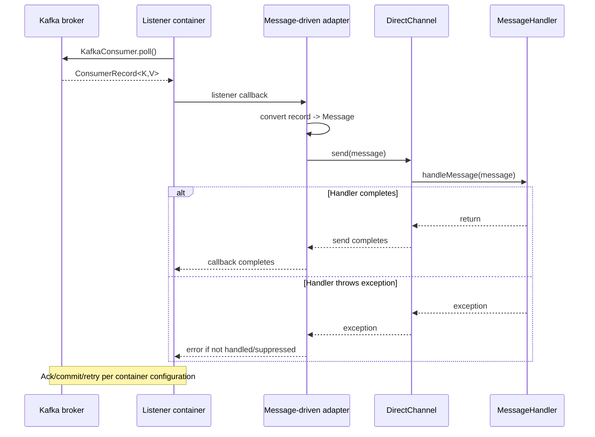
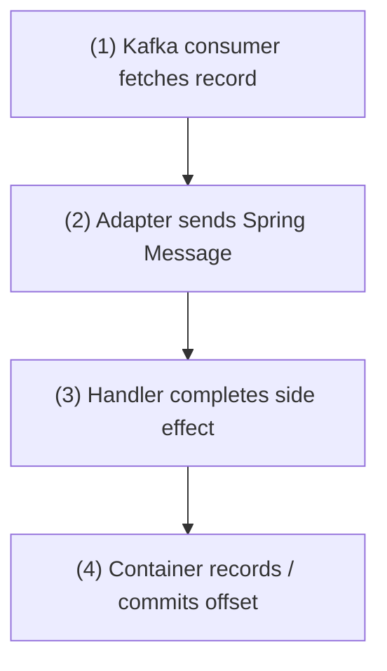
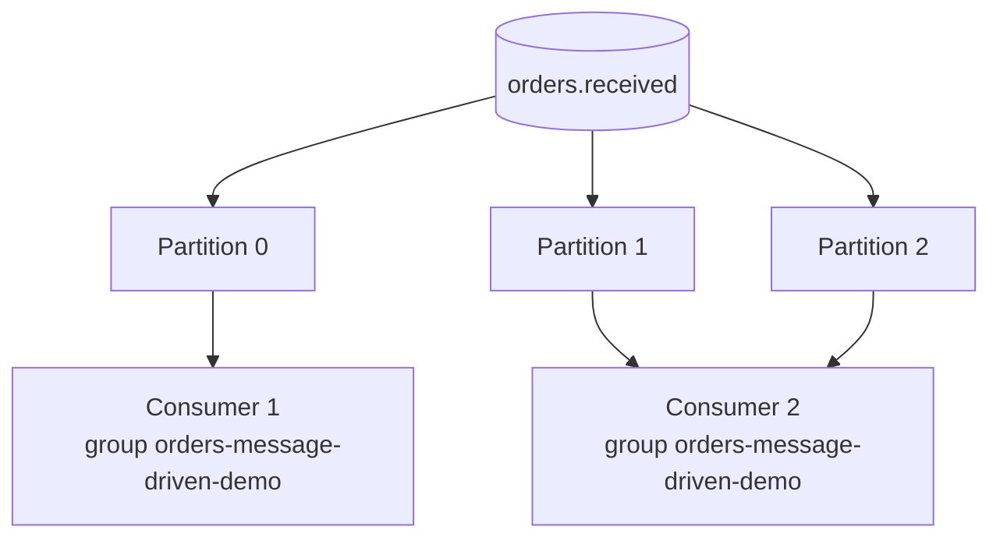
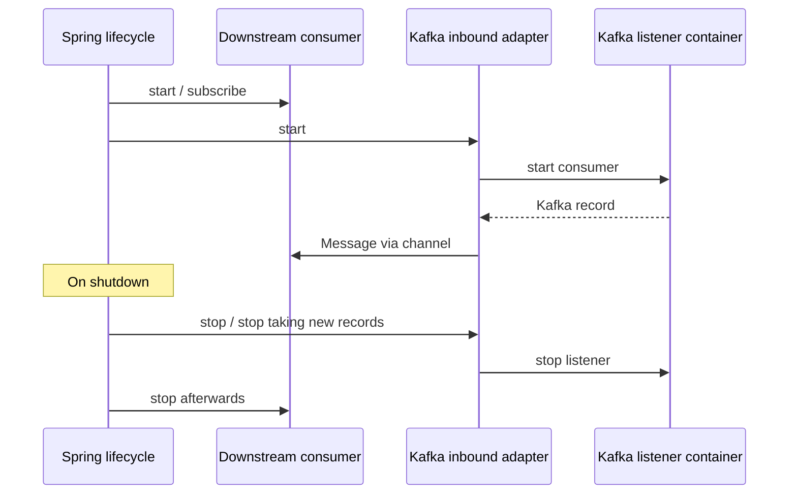

# Kafka message-driven channel adapter

The **Kafka message-driven channel adapter** is an event-triggered data ingestion endpoint in Spring Integration. Instead of having a Spring Integration `Poller` periodically call `MessageSource.receive()`, the adapter uses a **Spring for Apache Kafka listener container** to receive callbacks when the Kafka consumer fetches records. The adapter converts each record into a Spring `Message<?>` and sends it to an **output `MessageChannel`**, from which EIP components such as filters, transformers, routers, or service activators continue processing.

This lesson belongs to the **Kafka Adapter** chapter of the **SPRING_INTEGRATION_ADAPTERS** module. The module focuses on connecting external systems via inbound/outbound adapters, gateways, pollers, and `MessageChannel`, practicing with files, SFTP, HTTP, JMS, AMQP, Kafka, and databases, while controlling message contracts, errors, and lifecycle. This lesson dives deep into the **message-driven mechanism**, distinguishes it from **Kafka inbound polling**, and clarifies the relationship between callbacks, channels, transactions, acknowledgment, and offset commits.

## 1. Learning objectives

After this lesson, you will be able to:

1. Describe how `KafkaMessageDrivenChannelAdapter` coordinates with `ConcurrentMessageListenerContainer` and `MessageChannel`.
2. Distinguish between the **internal Kafka client poll**, **message-driven adapter**, **KafkaMessageSource polling adapter**, and **outbound adapter**.
3. Configure a message-driven adapter in `record` mode using Java configuration and wire it to a `@ServiceActivator` via a `DirectChannel`.
4. Explain `record` and `batch` modes, Kafka headers, and conversion boundaries.
5. Analyze outcomes when a handler succeeds, throws an exception, retries, sends errors to an error channel, or routes records to a dead-letter topic.
6. Evaluate the risks of replacing `DirectChannel` with `QueueChannel` or `ExecutorChannel`.
7. Design offset confirmation boundaries, idempotency, ordering, rebalance handling, lifecycle, and production observability.

## 2. Architectural overview: what does message-driven mean?

```mermaid
flowchart LR
    Producer["Event-producing application"] --> Topic[("Kafka topic<br/>orders.received")]
    Topic --> Container["Spring Kafka<br/>ConcurrentMessageListenerContainer"]
    Container -->|"listener callback"| Adapter["KafkaMessageDrivenChannelAdapter"]
    Adapter -->|"send(Message<?>)"| Channel["DirectChannel<br/>ordersFromKafka"]
    Channel --> Consumer["EventDrivenConsumer"]
    Consumer --> Handler["Service activator<br/>business processing"]
    Handler --> Database[("Database")]
```

`KafkaMessageDrivenChannelAdapter<K,V>` is a **Spring Integration message producer endpoint**, while on the Kafka side it consumes records through a listener container.



Responsibility boundaries:

| Component | What it handles | What it does not handle |
|---|---|---|
| Kafka broker | Stores records by topic/partition, serves fetches | Does not run Spring Integration flows |
| Kafka consumer client | Joins consumer group, calls `poll()`, and tracks read positions | Does not run application `MessageHandler`s directly |
| Listener container | Manages consumer threads, listener callbacks, ack/commit, rebalance | Does not automatically know whether all business side effects have committed |
| `KafkaMessageDrivenChannelAdapter` | Converts Kafka data into Spring messages, sends to output channel | Is not a Kafka producer sending records to a broker |
| `MessageChannel` | Dispatches messages according to channel semantics | Does not persist to DB or call HTTP on its own |
| Consumer endpoint + handler | Receives messages from the channel, executes target logic | Does not decide Kafka offsets by handler name alone |

### 2.1. Why is there still a `poll()` if it is called message-driven?

The Spring Kafka listener container runs a `KafkaConsumer.poll()` loop to fetch records from the broker, keep the consumer group alive, and handle heartbeats/rebalances. **That is the Kafka client API**. A Spring Integration application does not need to declare `@Poller(fixedDelay=...)` for `KafkaMessageDrivenChannelAdapter`: the listener callback delivers records to the adapter as soon as the container receives data.

The two occurrences of "poll" refer to **two different abstraction layers** and do not contradict each other.

### 2.2. Comparison with the Kafka polling inbound adapter

Spring Integration provides another inbound style based on `KafkaMessageSource`:

| Criterion | Message-driven adapter | Kafka inbound polling adapter |
|---|---|---|
| Main component | `KafkaMessageDrivenChannelAdapter` | `KafkaMessageSource` |
| Trigger at Spring Integration level | Callback from listener container | `SourcePollingChannelAdapter` / Spring Integration poller |
| How messages enter the flow | Adapter calls `send()` to output channel | Poller calls source `receive()` then `send()` |
| Optimized for | Continuous event streams and Kafka consumer groups | Throttling/scheduling via a Spring Integration poller |
| Reception control | Container, pause/resume, ack/error handler | Trigger, poll schedule, message source metadata |
| Key concepts | Container, record/batch, offset commit, rebalance | `KafkaMessageSource`, polling interval, claim/ack, and offset |
| Same as Kafka outbound? | No | No |

**Do not configure both endpoints to consume the same topic/group if the goal is a single processing flow**: they can compete for partitions, causing records to appear in an unintended flow.

## 3. Data contract: how does a Kafka record enter a channel?

A `ConsumerRecord<K,V>` carries topic, partition, offset, key, value, timestamp, and Kafka headers. The adapter uses a converter to build a Spring `Message<?>`, then sends it to the output channel.



When the output is a `DirectChannel` and the handler runs synchronously, the listener callback can observe the handler's outcome. If the output is a `QueueChannel`, the callback may finish after **enqueueing**, without waiting for the handler to write to the DB. The two setups have very different **delivery boundaries**.

### 3.1. Headers to know

Constant names in modern versions of Spring Kafka are in `org.springframework.kafka.support.KafkaHeaders`:

| Metadata | Common header | Notes |
|---|---|---|
| Received topic | `KafkaHeaders.RECEIVED_TOPIC` | Source topic name |
| Received partition | `KafkaHeaders.RECEIVED_PARTITION` | Partition number |
| Offset | `KafkaHeaders.OFFSET` | Record position in the partition |
| Received key | `KafkaHeaders.RECEIVED_KEY` | Header may be **absent** if the key is null |
| Timestamp | `KafkaHeaders.RECEIVED_TIMESTAMP` | Depends on metadata/converter |
| Acknowledgment | `KafkaHeaders.ACKNOWLEDGMENT` | Only available in appropriate manual ack configurations |

Do not assume every header is always present: converter, record/batch mode, null keys, ack mode, and library version can alter metadata. Spring's `MessageHeaders.ID` is not equivalent to a Kafka offset or business event ID.

A Kafka offset is only meaningful within **topic + partition**. For business logic, a durable `orderId`/`eventId` is more suitable to prevent duplicate writes.

## 4. Preparing the Spring Boot example

This hands-on example receives order strings from the Kafka topic `orders.received` and logs/validates them in a handler. To stay focused on the message-driven behavior, the example does not need a real database; in production, replace the logging step with idempotent business logic and an appropriate transaction.

Prerequisites: Java 17+; compatible versions of Spring Boot/Spring Integration/Spring Kafka; a running Kafka broker with the topic already created. The example assumes Kafka is at `localhost:9092`.

### 4.1. Maven dependencies

Use the Spring Boot BOM or parent to manage versions rather than manually combining incompatible versions:

```xml
<!-- Inside <dependencies> of pom.xml -->
<dependency>
    <groupId>org.springframework.boot</groupId>
    <artifactId>spring-boot-starter-integration</artifactId>
</dependency>
<dependency>
    <groupId>org.springframework.integration</groupId>
    <artifactId>spring-integration-kafka</artifactId>
</dependency>
```

### 4.2. Properties configuration

```properties
demo.kafka.bootstrap-servers=localhost:9092
demo.kafka.group-id=orders-message-driven-demo
```

In real deployments, Kafka may require `SASL_SSL`, a TLS truststore, and topic read permissions. Use appropriate secret/configuration management, and never store credentials in message headers or example code.

## 5. Java configuration example: listener container + adapter

The class below creates the Kafka consumer factory, `DirectChannel`, listener container, and adapter. The container is created **inside the adapter bean**, not registered redundantly as a separate standalone listener bean for the same flow.

```java
package com.example.integration;

import java.util.HashMap;
import java.util.Map;

import org.apache.kafka.clients.consumer.ConsumerConfig;
import org.apache.kafka.common.serialization.StringDeserializer;

import org.springframework.beans.factory.annotation.Qualifier;
import org.springframework.beans.factory.annotation.Value;
import org.springframework.context.annotation.Bean;
import org.springframework.context.annotation.Configuration;
import org.springframework.integration.channel.DirectChannel;
import org.springframework.integration.config.EnableIntegration;
import org.springframework.integration.kafka.inbound.KafkaMessageDrivenChannelAdapter;
import org.springframework.kafka.core.ConsumerFactory;
import org.springframework.kafka.core.DefaultKafkaConsumerFactory;
import org.springframework.kafka.listener.ConcurrentMessageListenerContainer;
import org.springframework.kafka.listener.ContainerProperties;
import org.springframework.messaging.MessageChannel;

@Configuration
@EnableIntegration
public class OrdersKafkaConfig {

    @Bean("ordersKafkaConsumerFactory")
    ConsumerFactory<String, String> ordersKafkaConsumerFactory(
            @Value("${demo.kafka.bootstrap-servers}") String brokers,
            @Value("${demo.kafka.group-id}") String groupId) {

        Map<String, Object> config = new HashMap<>();
        config.put(ConsumerConfig.BOOTSTRAP_SERVERS_CONFIG, brokers);
        config.put(ConsumerConfig.GROUP_ID_CONFIG, groupId);
        config.put(ConsumerConfig.KEY_DESERIALIZER_CLASS_CONFIG,
                StringDeserializer.class);
        config.put(ConsumerConfig.VALUE_DESERIALIZER_CLASS_CONFIG,
                StringDeserializer.class);
        config.put(ConsumerConfig.ENABLE_AUTO_COMMIT_CONFIG, false);
        config.put(ConsumerConfig.AUTO_OFFSET_RESET_CONFIG, "earliest");

        return new DefaultKafkaConsumerFactory<>(config);
    }

    @Bean("ordersFromKafka")
    MessageChannel ordersFromKafka() {
        return new DirectChannel();
    }

    @Bean("ordersKafkaMessageDrivenAdapter")
    KafkaMessageDrivenChannelAdapter<String, String> ordersKafkaAdapter(
            @Qualifier("ordersKafkaConsumerFactory")
            ConsumerFactory<String, String> consumerFactory,
            @Qualifier("ordersFromKafka")
            MessageChannel outputChannel) {

        ContainerProperties containerProperties =
                new ContainerProperties("orders.received");

        // Record listener + offset managed by container.
        containerProperties.setAckMode(ContainerProperties.AckMode.RECORD);

        ConcurrentMessageListenerContainer<String, String> container =
                new ConcurrentMessageListenerContainer<>(
                        consumerFactory, containerProperties);
        container.setConcurrency(2);

        KafkaMessageDrivenChannelAdapter<String, String> adapter =
                new KafkaMessageDrivenChannelAdapter<>(
                        container,
                        KafkaMessageDrivenChannelAdapter.ListenerMode.record);

        adapter.setOutputChannel(outputChannel);
        return adapter;
    }
}
```

**Notable configuration choices:**

1. `ConsumerFactory<String,String>` defines bootstrap servers, group ID, deserializers, and Kafka client properties. Using `String` avoids needing a JSON converter in the example.
2. `ContainerProperties("orders.received")` instructs the container to subscribe to the topic. The container is the component coordinating the Kafka consumer poll loop.
3. `enable.auto.commit=false` avoids timer-based auto-commits by the Kafka client; the Spring Kafka container uses the `AckMode` policy instead.
4. `AckMode.RECORD` records/commits as each record listener finishes according to the container's mechanism, **not committing a database transaction**.
5. `setConcurrency(2)` creates up to two Kafka consumer threads for the container; throughput also depends on partition count and other consumers in the group.
6. `ListenerMode.record` means each callback from the adapter emits a message for **one record**.
7. `setOutputChannel(...)` is the **Kafka → Spring Integration** connection point. This channel is not a Kafka topic or a Kafka consumer group.

**Version note:** The example uses modern Spring Integration/Spring Kafka Java APIs. For projects on different versions, verify the corresponding Javadocs and project BOM; do not copy configurations across versions assuming all imports and methods match.

### 5.1. Handler receiving messages from `DirectChannel`

Add this class in a package scanned by Spring Boot component scanning:

```java
package com.example.integration;

import org.springframework.integration.annotation.ServiceActivator;
import org.springframework.kafka.support.KafkaHeaders;
import org.springframework.messaging.Message;
import org.springframework.stereotype.Component;

@Component
public class OrdersHandler {

    @ServiceActivator(inputChannel = "ordersFromKafka")
    public void process(Message<String> message) {
        String orderId = message.getPayload();

        // Intentional demo: error to test the propagation path.
        if (orderId == null || orderId.isBlank()) {
            throw new IllegalArgumentException("Missing orderId");
        }

        Object topic = message.getHeaders()
                .get(KafkaHeaders.RECEIVED_TOPIC);
        Object partition = message.getHeaders()
                .get(KafkaHeaders.RECEIVED_PARTITION);
        Object offset = message.getHeaders()
                .get(KafkaHeaders.OFFSET);

        System.out.printf(
                "ORDER %s from %s-%s@%s%n",
                orderId, topic, partition, offset);
    }
}
```

The application needs a `@SpringBootApplication` class in `com.example.integration` or a parent package. When Spring starts, `@ServiceActivator` on `DirectChannel` creates an **event-driven consumer endpoint**. The adapter is a separate inbound endpoint managing the listener that receives records from Kafka.

Real business processing in the handler should add payload validation, idempotency keys, transactions, and retry capabilities. `System.out.printf(...)` is only for observing the message contract.

### 5.2. Running a test with Kafka CLI

CLI syntax varies by Kafka distribution and environment. Example using standard Kafka CLI, local broker, and test topic:

```bash
kafka-topics.sh --bootstrap-server localhost:9092 \
  --create --if-not-exists \
  --topic orders.received --partitions 3 --replication-factor 1

kafka-console-producer.sh \
  --bootstrap-server localhost:9092 \
  --topic orders.received
```

Enter one by one:

```text
ORD-1001
ORD-1002
ORD-1003
```

Watch the application logs: each record prints the orderId along with its actual topic, partition, and offset. **Offsets do not necessarily start at 0**, as they depend on the topic and group state. `auto.offset.reset=earliest` only determines the read position when the group has no valid offset or in reset situations defined by Kafka; it does not force reading from the beginning on every restart.

### 5.3. Why should `@KafkaListener` not run alongside the adapter?

If you add another `@KafkaListener` on the same topic and `group.id`, that listener joins **the same consumer group** and may receive a share of the partitions instead of the adapter. You might think the adapter is "dropping records," when in fact they were distributed to the other consumer. Only do that intentionally for load sharing or testing consumer group behavior.

## 6. Configuration with Java DSL and XML

You can use the Java DSL so the framework builds the endpoint/container instead of directly calling `new KafkaMessageDrivenChannelAdapter`:

```java
// Placed inside a @Configuration class with a suitable ConsumerFactory bean.
@Bean
IntegrationFlow orderListenerFlow(
        ConsumerFactory<String, String> consumerFactory) {

    return IntegrationFlow
            .from(Kafka.messageDrivenChannelAdapter(
                    consumerFactory,
                    KafkaMessageDrivenChannelAdapter.ListenerMode.record,
                    "orders.received")
                .id("ordersKafkaDslAdapter"))
            .channel("ordersFromKafka")
            .get();
}
```

You need to import `org.springframework.integration.dsl.IntegrationFlow`, `org.springframework.integration.kafka.dsl.Kafka`, and `KafkaMessageDrivenChannelAdapter`. This is an **alternative** to the adapter bean in Section 5; do not run both simultaneously for the same topic/group unless you want multiple consumers.

With the DSL, `id("ordersKafkaDslAdapter")` gives the endpoint an explicit name. Spring Integration may register the associated listener container under a name derived from the endpoint ID (such as a `.container` suffix as described in the DSL documentation). Check the actual bean names rather than relying on generated names.

XML configuration can express the same setup using the `int-kafka` namespace:

```xml
<!-- Illustrated in a configuration with the int-kafka namespace declared. -->
<int-kafka:message-driven-channel-adapter
        id="ordersKafkaInbound"
        listener-container="ordersListenerContainer"
        channel="ordersFromKafka"
        mode="record"
        auto-startup="true"/>
```

`ordersListenerContainer` and `ordersFromKafka` must be declared/injected appropriately. In this case, the `channel` attribute is the **output channel** of the inbound adapter, not the input channel of an outbound adapter.

## 7. Record mode vs. batch mode: two different contracts

`KafkaMessageDrivenChannelAdapter.ListenerMode` has two common values: `record` and `batch`. The default is `record` in supported configurations.

| Aspect | `record` | `batch` |
|---|---|---|
| Message unit | One record converted into one message | Multiple records from a poll converted into one message |
| Payload | Typically a single value/DTO | Typically a list of values/DTOs |
| Topic/partition/offset metadata | Typically single values | Can be lists of positions corresponding to the payload |
| Error handling | Per record, convenient for targeted checks | Must identify bad records and partial retry strategy |
| DB writes | One operation per record | Enables bulk inserts/updates |
| Ack/commit | Fits `AckMode.RECORD` or record policies | Fits batch policies and corresponding listener modes |

For batch mode, the constructor can take `ListenerMode.batch`:

```java
new KafkaMessageDrivenChannelAdapter<>(
        listenerContainer,
        KafkaMessageDrivenChannelAdapter.ListenerMode.batch);
```

**This snippet only illustrates the constructor**, not a complete batch configuration. The listener container, converter, handler, and `AckMode` must all be compatible with batch types. In particular, **do not keep a `Message<String>` method expecting a single string** if the adapter converts a batch into a list. In batch mode, metadata headers like `RECEIVED_TOPIC`, `RECEIVED_PARTITION`, and `OFFSET` may contain lists aligned with each item.

### 7.1. Batches do not have a fixed size

`max.poll.records` caps how many records one consumer poll returns; it **does not guarantee returning that exact count**. Actual batch size depends on available data, broker fetch behavior, consumer configuration, and the container.

For example, `max.poll.records=500` does not mean every batch message always contains 500 events.

### 7.2. When to choose record mode?

Record mode is usually easier to design when each event causes an individual side effect (such as calling a partner HTTP API or creating an order in a DB) or needs error handling by business key. Batch mode fits when downstream truly supports batch operations and you have clearly designed how to handle failing batches.

## 8. Acknowledgment and committed offsets

There are at least four distinct milestones for a "received" message:



In practice, commit order and timing vary with `AckMode`, transactions, and error handling. In a synchronous `DirectChannel` flow, milestone (2) typically does not finish until the handler returns; with `QueueChannel`, it may finish right after enqueueing.

### 8.1. Common ack modes

| `AckMode` | Typical behavior when auto-commit is disabled |
|---|---|
| `RECORD` | Container commits offset after the listener finishes processing the record successfully |
| `BATCH` | Commits after processing the records from one consumer poll per container mechanism |
| `MANUAL` | Application calls `Acknowledgment.acknowledge()`; commits with batch semantics |
| `MANUAL_IMMEDIATE` | Application calls `acknowledge()`; commits immediately when called on the consumer thread |

With `enable.auto.commit=false`, the Spring Kafka container manages offsets according to its policy. A **successful commit records read progress**; it does not prove that an external DB, SFTP server, or HTTP service has committed its corresponding transaction.

### 8.2. Is manual ack necessary?

Not required for every problem. If you choose manual ack, configure the container with `AckMode.MANUAL` or `MANUAL_IMMEDIATE` and ensure the listener/adapter forwards the acknowledgment per contract. Only then is the `KafkaHeaders.ACKNOWLEDGMENT` header meaningful in the handler.

```java
// Illustrated in a synchronous handler, with manual ack already configured.
Acknowledgment ack = message.getHeaders().get(
        KafkaHeaders.ACKNOWLEDGMENT,
        Acknowledgment.class);

if (ack == null) {
    throw new IllegalStateException(
            "Missing acknowledgment; check AckMode");
}

persistIdempotently(message.getPayload()); // Custom business method.
ack.acknowledge();
```

You need to import `org.springframework.kafka.support.Acknowledgment`. This code will not run as-is with the `AckMode.RECORD` configuration in Section 5. In an asynchronous model, holding onto an acknowledgment to use on another thread must obey Spring Kafka constraints and out-of-order ack policies; never assume callbacks can ack from arbitrary threads.

### 8.3. At-least-once and duplicate handling

Example: the handler writes to the DB successfully, and the process dies before the Kafka offset is committed. After restart, the record may be processed again. If the handler executes an `INSERT` without a deduplication key, the DB may end up with two rows for one event.

Typical solution:

1. Choose `eventId` or `orderId` as a business key.
2. Apply a unique constraint, inbox table, or durable idempotency key at the destination.
3. Commit the DB transaction together with the processed business state.
4. Only treat the Kafka record as complete once the appropriate acknowledgment protocol and error policy have run.
5. Test with a crash scenario **after DB commit, before offset commit**.

Kafka producer transactions/exactly-once do not automatically create a distributed transaction across a DB or HTTP API. Design realistically for the participating resources.

## 9. Error channel, retry, and dead-letter: picking the right layer

A failing path can have **three different origins**:

| Origin | Examples | Mechanisms to inspect |
|---|---|---|
| Deserializer / Kafka consumer | Corrupt data, auth failure, partition revocation | Container error handler, deserializer, and recoverer |
| Adapter / channel dispatch | Converter failure, output channel has no subscribers | Adapter error channel, exception propagation |
| Handler / target system | DB timeout, HTTP 503, validation exception | Retry, transaction, DLT, or error flow |

### 9.1. How exceptions propagate matters greatly

With `DirectChannel`, an exception thrown by the handler can propagate back to the listener callback, giving the Spring Kafka container a chance to apply `DefaultErrorHandler` if no intermediate component swallows the error.

If an **error channel** and recovery callback are configured at the adapter level, an exception can be turned into an `ErrorMessage` and sent to an error-handling flow. If that flow ends normally, **do not assume Kafka will still retry the record**: inspect the recovery/exception-propagation contract. This is especially critical when ack/commit depends on callback success.

### 9.2. Adapter retry vs. container retry

Spring Integration Kafka supports adapter-level retry configuration and listener container error mechanisms. The two options can carry different semantics:

- **Adapter retry:** retries the message send/dispatch operation according to a policy; can configure a recovery callback or error channel once attempts are exhausted. Retrying directly inside the callback can tie up the consumer thread for a long time.
- **Container retry/error handler:** `DefaultErrorHandler` can manage retries, backoff, and recovery at the Kafka record level. It can be combined with `DeadLetterPublishingRecoverer` to publish failed records to a DLT if producer/topic/permissions are configured.
- **Business error flow:** route permanently invalid records to quarantine; handle duplicates idempotently; report conditions that cannot be fixed automatically.

**Warning:** Blocking retries that run too long can exceed `max.poll.interval.ms` and trigger a rebalance. Spring Integration documentation recommends considering the container error handler instead of retry styles that occupy the listener for long periods.

### 9.3. Dead-letter topics do not appear automatically

A DLT strategy requires:

1. A DLT topic and appropriate naming/partitioning rules.
2. A Kafka producer/template with write permissions to the DLT.
3. A recoverer or error handler forwarding the exact record and error metadata.
4. A policy for **when writing to the DLT fails**.
5. A tracing, data-correction, and idempotent replay process.

Sending an `ErrorMessage` to a logging handler is **not** publishing to a Kafka DLT. Test target side effects, committed offsets, and actual records in the DLT rather than only looking for a "recovered" log line.

### 9.4. Decision table by failure type

| Failure | Reference policy | Rationale |
|---|---|---|
| Kafka payload invalid schema | Quarantine/DLT after classification | Retrying identical bytes indefinitely cannot fix the schema |
| DB temporarily unreachable | Bounded retry/backoff, do not ack too early | Failure is potentially recoverable |
| Business key already processed | Idempotent no-op, then acknowledge per policy | Re-receiving the record must not cause duplicate side effects |
| Channel has no subscribers | Fix lifecycle/wiring, alert | Cannot pretend the handler ran |
| DLT publish fails | Continue error handling per policy, do not report false recovery | Treating it as recovered loses track of the record |
| Rebalance during slow processing | Reduce blocking, tune intervals/throughput | Consumer may have partitions revoked |

## 10. Why does changing the output channel alter data guarantees?

### 10.1. `DirectChannel`: synchronous execution

```text
Kafka listener thread
  -> adapter.send()
  -> DirectChannel
  -> EventDrivenConsumer
  -> handler writes database
  -> callback success / exception
  -> container ack / error policy
```

The advantage is that the callback usually reflects the handler's outcome. In return, a slow handler occupies the consumer thread, potentially increasing lag and risking exceeding `max.poll.interval.ms`.

### 10.2. `QueueChannel`: enqueuing is not completing processing

```text
Kafka listener thread
  -> adapter.send()
  -> QueueChannel.enqueue(message)
  -> callback success, container may commit offset

Later:
  -> PollingConsumer.dequeue(message)
  -> JDBC handler
```

If the queue is in RAM, the offset is committed, and the JVM dies before the handler runs, Kafka may **not redeliver the record**, while the DB also lacks the data. This is a message-loss risk caused by shifting the acknowledgment boundary.

When decoupling load with a queue, you need a **durable handoff** or a mechanism that only acknowledges Kafka after downstream succeeds, implemented and verified under Spring Kafka's thread/ack constraints. Do not infer that adding a `QueueChannel` automatically makes messages durable.

### 10.3. `ExecutorChannel` and ordering

`ExecutorChannel` dispatches on an executor, so processing can run concurrently and finish out of order. If downstream requires preserving order per customer/order, account for partition keys, routing, key-serialized processing, or data designs that tolerate out-of-order execution.

### 10.4. `PublishSubscribeChannel` does not replace Kafka fan-out

A Kafka record sent to an internal `PublishSubscribeChannel` can reach multiple subscribers inside **one service**. However, that is not equivalent to two independent Kafka consumer groups: separate groups have their own offsets and replayability. Choose the fan-out mechanism based on failure and reliability requirements, not just the number of handlers.

## 11. Consumer groups, partitions, concurrency, and rebalance



With `container.setConcurrency(2)`, the container can have two consumer clients. **Each partition in a group is assigned to only one consumer at a time**. If a topic has fewer partitions than consumer threads, some threads sit unassigned. With multiple instances in the same group, Kafka distributes partitions across the group rather than sending every record to every instance.

- **Ordering:** Kafka preserves offset order within a single partition. There is no global order across all partitions.
- **Key:** Producers typically map the same key to the same partition via the partitioner, enabling per-key ordering when producer configuration is stable.
- **Rebalance:** When members join/leave a group, session/poll timeouts expire, or assignments change, partitions can move to another consumer.
- **Duplicates:** Uncommitted records can be re-read after a rebalance/restart; business logic must be idempotent.
- **Throughput:** Raising concurrency when the DB/HTTP target is already saturated does not solve the bottleneck; monitor lag, CPU, handler duration, and rate limits.

### 11.1. Easily confused timeouts

| Setting | What it governs |
|---|---|
| `max.poll.interval.ms` | Maximum time between Kafka consumer polls per contract; overly long blocking processing can trigger a rebalance |
| `max.poll.records` | Maximum number of records returned in a single consumer poll |
| `session.timeout.ms` | Liveness detection timeout for consumer disconnects under the consumer group protocol |
| `request.timeout.ms` | Timeout for Kafka requests to the broker |
| Spring Integration send timeout | Wait limit when the adapter sends to a channel supporting timeout/backpressure |

Do not use Spring Integration's `fixedDelay` as a substitute for the settings above on a **message-driven adapter**.

## 12. Lifecycle, pause/resume, and shutdown

`KafkaMessageDrivenChannelAdapter` is a lifecycle-managed endpoint; the underlying listener container also manages consumer state. On startup, ensure **consumer endpoints behind the channel are ready** before the adapter begins emitting messages, especially when the output is a `DirectChannel`.



Within the same `ApplicationContext`, `SmartLifecycle`/`phase` can help coordinate start/stop order. However, **phase does not confirm that the broker, DB, or HTTP API is healthy**. A Kafka container might not yet hold partition assignments even when the bean reports running; inspect assignments and lag.

When temporary backpressure is needed, some adapters/containers support pause/resume to throttle ingestion while keeping consumer group membership per their mechanism. Distinguish **pause** from **stop**: stopping can cause leaving the group and triggering a rebalance; pausing should be invoked through valid APIs while observing the impact on already-fetched records.

**Graceful shutdown** is more than calling `stop()`: inspect in-flight callbacks, offset commits, DB transactions, async tasks, dead-letter publishers, and shutdown timeouts. Never conclude all records have finished processing simply because the adapter transitioned to `running=false`.

## 13. Production observability and diagnostics

Key signals:

| Metric / signal | Question to answer |
|---|---|
| Consumer lag by group/partition | How many records are backlogged in Kafka? |
| Committed offset, current position | Is read progress being recorded properly? |
| Handler latency & error rate | Which downstream step is slow or failing? |
| Retry count, DLT count | Transient errors or unrecoverable data? |
| Partition assignment, rebalance count | Are consumers stable in the group? |
| Container running/paused | Is the adapter running, paused, or lacking assignments? |
| Channel queue depth/in-flight | If buffered, have messages reached downstream? |
| DB transaction / HTTP status | Did target side effects actually complete? |

### Scenario 1: `running=true` but no processing logs

Check topic, `group.id`, committed offsets, topic retention, partition assignments, consumer lag, deserializer, output channel, and downstream endpoint state. If the group has already consumed all offsets and no new records exist, zero processing logs is normal.

### Scenario 2: records appear multiple times

Check handler errors, retries, rebalances, offset commits, changed group IDs, and business keys. A failure after DB commit but before Kafka commit can produce duplicates by at-least-once design, not necessarily an adapter bug.

### Scenario 3: DLT has records while the DB is still missing data

Determine how the record was recovered, whether the DLT publish actually succeeded, whether the source offset was committed, and who owns replay. If the handler failed due to schema issues, fix the data/transformer; do not replay the DLT verbatim expecting the error to vanish.

### Scenario 4: lag spikes after increasing concurrency

Check actual partition count, DB connection pool, HTTP rate limits, CPU, GC, timeouts, and rebalances. Multiple consumers can contend on and saturate the destination together. Lower concurrency or pause temporarily to recover, then scale load incrementally based on measurements.

## 14. Comparison with non-Kafka adapters

| System | Common inbound trigger | Confirmation/recovery mechanism |
|---|---|---|
| File, SFTP | Spring Integration source poller | Filters, metadata store, file rename/claim |
| HTTP inbound | HTTP request from client | HTTP status, request timeout, client-side retry |
| JMS, AMQP | Broker listener/consumer container | Ack/nack, transaction, redelivery, and DLQ |
| **Kafka message-driven** | Kafka listener container callback | Offsets, consumer group, rebalance, error handler/DLT |
| JDBC inbound | Scheduled query/claim | Transaction/claim and idempotency key |

All can produce Spring `Message<?>`, but you cannot apply one generic retry/ack recipe while ignoring each protocol's semantics.

## 15. Common mistakes

| Misconception | Reality |
|---|---|
| "Message-driven has nothing to do with `poll()`." | The Kafka client still polls; only **the Spring Integration endpoint does not use `@Poller`**. |
| "Kafka inbound adapter and `KafkaMessageSource` are the same." | One uses a listener callback; the other is a source for a polling adapter. |
| "`KafkaMessageDrivenChannelAdapter` is a Kafka producer." | It consumes from Kafka and produces internal Spring messages. |
| "Every record in the topic goes to every instance in the same group." | Partitions are divided among consumers in the group. |
| "A topic has global ordering." | Ordering only exists per partition. |
| "`auto.offset.reset=earliest` replays everything on every restart." | Valid committed offsets normally determine the read position. |
| "`AckMode.RECORD` guarantees exactly-once DB writes." | DB commit and Kafka offset commit are two separate boundaries. |
| "`QueueChannel.send()` succeeding means the record is processed." | It may only be enqueued, with no side effect executed yet. |
| "An error channel always makes the container retry." | Recovery may handle/suppress the exception; check callback and offset behavior. |
| "`max.poll.records` is a fixed batch size." | It is an upper bound, not a mandatory count. |
| "Increasing concurrency always reduces lag." | Limited by partitions, resources, and downstream capacity. |
| "Having a DLT eliminates the need for idempotency." | Replayed records from a DLT can still cause duplicates. |

## 16. Practice exercises

### Exercise 1 — Inspect the listener callback

Run the Section 5 configuration and send five records from the console producer. Record each record's topic, partition, and offset. Explain why two offsets in different partitions cannot be compared as a global sequence.

### Exercise 2 — Change the consumer group

Run the demo with `orders-message-driven-demo`, then restart with the same group and send new records. Switch to a non-existent group ID while keeping `auto.offset.reset=earliest`. Observe the results for records still within retention and explain the committed offset mechanism.

### Exercise 3 — Record mode vs. batch mode

Switch the adapter to `ListenerMode.batch` in a separate test branch; adjust the container and handler to be batch-compatible. Inspect payloads/headers before processing. Explain why keeping `Message<String>` violates the message contract.

### Exercise 4 — Transient DB error

Simulate the handler throwing an exception for event `ORD-FAIL` on the first two attempts and succeeding on the next. Propose a bounded retry/backoff configuration and ways to verify retry count, committed offset, and final side effect. Distinguish adapter retry from container error handler.

### Exercise 5 — Crash after side effect

Assume `orderId=ORD-101` was inserted into the DB but the process died before committing the Kafka offset. Draw the timeline and design a unique constraint/inbox table so reprocessing does not create a second row.

### Exercise 6 — Asynchronous queue

Replace `DirectChannel` with `QueueChannel(100)` and add a slow `PollingConsumer`. When the Kafka callback enqueues successfully, yet the JVM dies before the handler runs, analyze the risk of message loss if the offset was committed. Propose a durable handoff or adjusted ack boundary.

### Exercise 7 — Failing DLT

Configure recovery to publish schema-invalid records to a DLT. Simulate the Kafka producer failing to write to the DLT. Determine the expected error behavior, monitoring, and how to prove the source record **was not mistakenly marked as recovered**.

### Exercise 8 — Concurrency and ordering

You have a 4-partition topic and 3 consumer threads in a group. Send events for two customers with corresponding Kafka keys. Measure record order within each partition and compare with downstream using a multi-threaded `ExecutorChannel`. Design a mechanism to preserve per-customer order if required by the business.

### Exercise 9 — Pausing consumption when the DB is overloaded

When the DB slows down and lag grows, design a controlled pause/resume or stop/start procedure. Specify the metrics confirming downstream is ready again, conditions to avoid a retry storm, and how to handle in-flight records.

## 17. Self-check questions

1. Why is `KafkaMessageDrivenChannelAdapter` called an inbound **message producer** in Spring Integration?
2. What is the core difference between the message-driven adapter and `KafkaMessageSource`?
3. Which component owns the Kafka consumer threads and applies the offset commit policy?
4. Why is a synchronous listener callback with `DirectChannel` beneficial for reflecting downstream errors?
5. When can the Kafka key header be absent?
6. How does batch mode metadata differ from record mode metadata?
7. Why is `max.poll.interval.ms` relevant to blocking retries?
8. When a handler has written to the DB but Kafka has not committed the offset, what can happen after a restart?
9. When does `MANUAL_IMMEDIATE` differ from `MANUAL` in commit timing?
10. Can you consume records concurrently across multiple partitions while preserving topic-wide ordering?
11. In what way can changing a channel to an in-memory queue alter reliability?
12. Do a Spring Integration error channel and a Kafka DLT mean the same thing?
13. When the adapter has `running=true` yet lag does not decrease, which components should you measure?

## 18. Summary

The contract of the Kafka message-driven channel adapter is:

```text
Kafka topic / partition
    -> Spring Kafka listener container
    -> KafkaMessageDrivenChannelAdapter
    -> output MessageChannel
    -> consumer endpoint / MessageHandler
    -> database, HTTP, SFTP, or another target system
```

The most critical design concern is not "receiving the payload," but **the coupling between the callback, when side effects complete, and when the Kafka offset is confirmed**. You must clearly define when a record can be redelivered, when errors are recovered, how duplicates are handled, and what happens when switching to an asynchronous channel. That is the foundation for operating reliable Kafka inbound flows in Spring Integration.

## References

- [Spring Integration Reference — Kafka Support, Message-driven Channel Adapter](https://docs.spring.io/spring-integration/reference/kafka.html)
- [Spring Integration API — KafkaMessageDrivenChannelAdapter](https://docs.spring.io/spring-integration/api/org/springframework/integration/kafka/inbound/KafkaMessageDrivenChannelAdapter.html)
- [Spring Kafka Reference — Message Listener Containers](https://docs.spring.io/spring-kafka/reference/kafka/receiving-messages/message-listener-container.html)
- [Spring Kafka Reference — Exception Handling](https://docs.spring.io/spring-kafka/reference/kafka/annotation-error-handling.html)
- [Spring Kafka Reference — @KafkaListener / Kafka Headers](https://docs.spring.io/spring-kafka/reference/kafka/receiving-messages/listener-annotation.html)
- [Apache Kafka Documentation — Consumer Configs](https://kafka.apache.org/documentation/#consumerconfigs)
