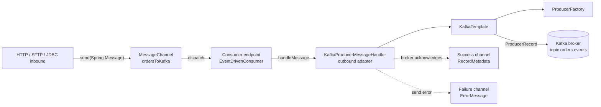
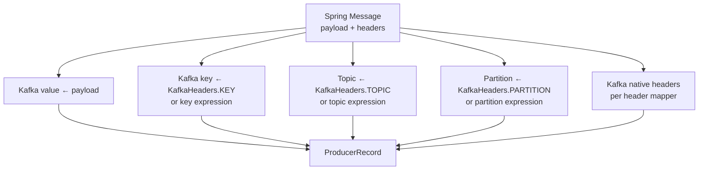
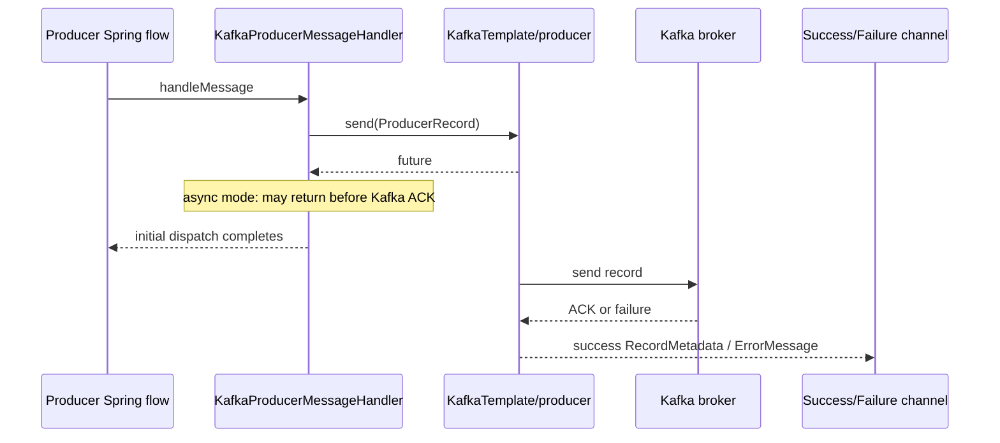
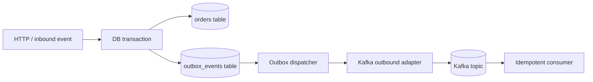
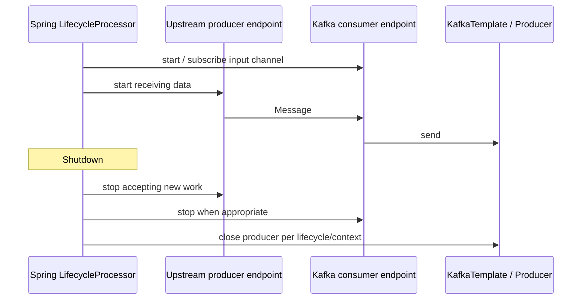

# Kafka outbound channel adapter

The **Kafka outbound channel adapter** is a Spring Integration output endpoint used to **send messages from a `MessageChannel` to an Apache Kafka topic**. Internally, the adapter typically uses `KafkaProducerMessageHandler` together with `KafkaTemplate<K,V>` and `ProducerFactory<K,V>`. A Spring message is mapped to a Kafka `ProducerRecord`, and the producer client sends the data to the broker. Upstream components can be an HTTP inbound gateway, a file/SFTP inbound adapter, a JDBC polling flow, or a service activator.

This lesson belongs to the **Kafka Adapter** chapter of the **SPRING_INTEGRATION_ADAPTERS** module. The module connects external systems using inbound/outbound adapters, gateways, pollers, and `MessageChannel`, practicing with files, SFTP, HTTP, JMS, AMQP, Kafka, and databases along with message contract, error, and lifecycle requirements. This lesson focuses strictly on the **Spring Integration → Kafka direction**, from wiring the input channel to confirming publish outcomes, routing configuration, and reliability design.

> **Key takeaway:** A successful `MessageChannel.send(message)` **does not always mean the Kafka broker has acknowledged the record**, and certainly does not mean a consumer in another system has finished processing it. These are three distinct milestones, especially when the producer sends asynchronously.

## 1. Learning objectives

After this lesson, you will be able to:

1. State the roles of `KafkaProducerMessageHandler`, `KafkaTemplate`, `ProducerFactory`, and the consumer endpoint connected to the input channel.
2. Build a `MessageChannel → Kafka outbound channel adapter → topic` flow using Java configuration and Java DSL.
3. Map payload, topic, key, partition, timestamp, and headers into a Kafka record; recognize precedence among static configuration, expressions, and headers.
4. Distinguish **async** and **sync** publishing, and use success/failure channels to observe real outcomes.
5. Diagnose serialization errors, timeouts, broker disconnects, authorization errors, oversized records, and retry scenarios that create duplicates.
6. Understand the meaning of `acks`, idempotent producers, transactions, ordering, and exactly-once boundaries when going from JDBC/HTTP/SFTP to Kafka.
7. Design lifecycle, backpressure, monitoring, outbox, and failure-path testing for production systems.

## 2. Data flow direction and participating components



**Roles that must not be confused:**

| Component | Responsible for | Does not guarantee |
|---|---|---|
| Input `MessageChannel` | Receives messages from the internal flow | Does not send data to Kafka by itself |
| Consumer endpoint | Subscribes to or polls the input channel and invokes the handler | Does not know the Kafka topic by itself |
| `KafkaProducerMessageHandler` | Converts messages into records, sends via template, handles outcomes | Does not receive records from Kafka |
| `KafkaTemplate<K,V>` | Spring Kafka API to publish records | Does not provide a distributed transaction with DB/HTTP by default |
| `ProducerFactory<K,V>` | Creates producers with serializers, brokers, security, tuning | Does not choose business keys for deduplication |
| Kafka broker | Accepts/stores records by topic/partition and `acks` | Does not prove downstream consumers have completed |
| Success/failure channel | Emits publish success or failure outcomes | Is not a request–reply business response |

A **Kafka outbound channel adapter** is a **one-way handler**. It differs from a **Kafka outbound gateway**, which has a request–reply contract over Kafka and typically uses a reply container/correlation. The adapter's **success channel** only reports the outcome of sending the record to Kafka; it does not turn the adapter into a gateway receiving business replies.

### 2.1. "Inbound" and "outbound" from which perspective?

- `KafkaMessageDrivenChannelAdapter` is Spring Integration **inbound**: it reads from Kafka and **sends to an internal output channel**.
- `KafkaProducerMessageHandler` is Spring Integration **outbound**: it **receives from an internal input channel** and publishes to Kafka.
- Both use the Kafka client at a lower layer, but their roles, lifecycle, acknowledgment/offset behavior, and error handling differ.

## 3. Message contract: from Spring Message to ProducerRecord

`KafkaProducerMessageHandler` converts a message into a Kafka producer record with key/value, topic, partition, and metadata. By default, the **payload** becomes the Kafka value. Key, topic, and partition can come from headers or be defined on the handler via literals/expressions.



### 3.1. Headers for publishing

| Spring Kafka constant | Common header name | Meaning |
|---|---|---|
| `KafkaHeaders.TOPIC` | `kafka_topic` | Target topic |
| `KafkaHeaders.KEY` | `kafka_messageKey` | Key used for partitioner, ordering, and compacted logs |
| `KafkaHeaders.PARTITION` | `kafka_partitionId` | Explicit target partition if set |
| `KafkaHeaders.TIMESTAMP` | `kafka_timestamp` | Producer record timestamp when applicable |
| `MessageHeaders.ID` | UUID managed by Spring Messaging | Does **not** automatically become the Kafka key |
| Business header, e.g., `eventId` | Schema-dependent | Requires a header mapper to carry over as native Kafka headers |

Constant names should be imported from `org.springframework.kafka.support.KafkaHeaders` rather than typed as raw strings, making intent clearer and easing version upgrades.

**Inbound vs. outbound difference:** headers such as `KafkaHeaders.RECEIVED_TOPIC`, `RECEIVED_KEY`, and `RECEIVED_PARTITION` normally describe a **received record**. For publishing, use the **`TOPIC`, `KEY`, and `PARTITION`** constants or appropriate expressions; do not assume a "received header" will automatically route an outbound record.

### 3.2. Precedence between headers and expressions

If you configure `handler.setTopicExpression(new LiteralExpression("orders.events"))`, the topic is selected by that fixed expression. A `KafkaHeaders.TOPIC` header on the message **does not override** that static value by default. The same principle applies to key and partition if they are configured on the adapter.

When you want a header to take precedence with a fallback, you can use SpEL such as:

```java
// Snippet on KafkaProducerMessageHandler; use when there is a clear topic policy.
handler.setTopicExpression(
        new SpelExpressionParser().parseExpression(
                "headers['kafka_topic'] ?: 'orders.events'"));
```

Do not use dynamic topics derived from untrusted user input in multi-tenant systems. Apply topic allowlists, authorization per producer principal, and routing conventions to avoid misrouting data.

### 3.3. Keys and event ordering

Kafka guarantees **offset ordering within a single partition**, not across the entire topic. When events for the same `orderId` must be read in order, use a consistent key (such as `orderId`) with stable partitioning rules.

Avoid forcing `KafkaHeaders.PARTITION` on every record without a business reason: it pins directly to one partition, risking hotspots or failures if the partition ID does not exist. The same key normally lands in the same partition as long as partition count, partitioner, and serialization remain stable; **increasing the partition count** can change the key → partition mapping for future records.

## 4. Preparing the demo project

Example: an internal service sends JSON strings representing orders to the `orders.events` topic via `ordersToKafka`. A success channel and a failure channel let us observe the result of each send.

Requirements:

- Java 17+ and a Spring Boot version compatible with Spring Integration/Spring Kafka.
- A Kafka broker accessible at `localhost:9092`.
- Topic `orders.events` already created or provisioned per cluster policy.
- Producer principal has write permission on the topic.
- Run the example in isolation; do not register two consumer endpoints on the same `ordersToKafka` if you only want each message sent **once**.

### 4.1. Maven

Declare dependencies and let the Spring Boot parent/BOM manage versions:

```xml
<dependency>
    <groupId>org.springframework.boot</groupId>
    <artifactId>spring-boot-starter-integration</artifactId>
</dependency>
<dependency>
    <groupId>org.springframework.integration</groupId>
    <artifactId>spring-integration-kafka</artifactId>
</dependency>
```

You do not need `spring-integration-jms`, `spring-integration-file`, or other modules for a pure Kafka outbound demo. When connecting from file/SFTP/JMS/AMQP/JDBC, add the corresponding source adapter dependency.

### 4.2. application.properties

```properties
demo.kafka.bootstrap-servers=localhost:9092
```

In production, configure `SASL_SSL`/TLS, credentials, ACLs, and topic provisioning from a proper secret/configuration management system; never hard-code passwords into documentation files or message headers.

## 5. Complete example: KafkaProducerMessageHandler + input channel

The example uses Java configuration to clearly separate the **producer factory**, **`KafkaTemplate`**, **outbound adapter's input channel**, **handler**, and **two outcome channels**. We choose **async** mode to observe the difference between application-side enqueue/send and broker acknowledgment.

### 5.1. Producer and flow configuration

```java
package com.example.integration;

import java.util.HashMap;
import java.util.Map;

import org.apache.kafka.clients.producer.ProducerConfig;
import org.apache.kafka.common.serialization.StringSerializer;

import org.springframework.beans.factory.annotation.Qualifier;
import org.springframework.beans.factory.annotation.Value;
import org.springframework.context.annotation.Bean;
import org.springframework.context.annotation.Configuration;
import org.springframework.expression.common.LiteralExpression;
import org.springframework.integration.channel.DirectChannel;
import org.springframework.integration.config.EnableIntegration;
import org.springframework.integration.dsl.IntegrationFlow;
import org.springframework.integration.kafka.outbound.KafkaProducerMessageHandler;
import org.springframework.kafka.core.DefaultKafkaProducerFactory;
import org.springframework.kafka.core.KafkaTemplate;
import org.springframework.kafka.core.ProducerFactory;
import org.springframework.messaging.MessageChannel;

@Configuration
@EnableIntegration
public class OrdersKafkaOutboundConfig {

    @Bean("ordersProducerFactory")
    public ProducerFactory<String, String> producerFactory(
            @Value("${demo.kafka.bootstrap-servers}") String brokers) {

        Map<String, Object> config = new HashMap<>();
        config.put(ProducerConfig.BOOTSTRAP_SERVERS_CONFIG, brokers);
        config.put(ProducerConfig.KEY_SERIALIZER_CLASS_CONFIG,
                StringSerializer.class);
        config.put(ProducerConfig.VALUE_SERIALIZER_CLASS_CONFIG,
                StringSerializer.class);

        // Illustrative options for send durability.
        config.put(ProducerConfig.ACKS_CONFIG, "all");
        config.put(ProducerConfig.ENABLE_IDEMPOTENCE_CONFIG, true);

        return new DefaultKafkaProducerFactory<>(config);
    }

    @Bean("ordersKafkaTemplate")
    public KafkaTemplate<String, String> kafkaTemplate(
            @Qualifier("ordersProducerFactory")
            ProducerFactory<String, String> factory) {
        return new KafkaTemplate<>(factory);
    }

    // This is the INPUT channel of the outbound adapter.
    @Bean("ordersToKafka")
    public MessageChannel ordersToKafka() {
        return new DirectChannel();
    }

    @Bean("ordersKafkaSendSuccess")
    public MessageChannel ordersKafkaSendSuccess() {
        return new DirectChannel();
    }

    @Bean("ordersKafkaSendFailures")
    public MessageChannel ordersKafkaSendFailures() {
        return new DirectChannel();
    }

    @Bean("ordersKafkaPublishHandler")
    public KafkaProducerMessageHandler<String, String> publishHandler(
            @Qualifier("ordersKafkaTemplate")
            KafkaTemplate<String, String> template,
            @Qualifier("ordersKafkaSendSuccess")
            MessageChannel successes,
            @Qualifier("ordersKafkaSendFailures")
            MessageChannel failures) {

        KafkaProducerMessageHandler<String, String> handler =
                new KafkaProducerMessageHandler<>(template);

        // Fixed topic for the entire flow; the KafkaHeaders.TOPIC header
        // does not automatically override this static topic expression.
        handler.setTopicExpression(
                new LiteralExpression("orders.events"));

        handler.setSync(false); // Broker result is handled asynchronously.
        handler.setSendSuccessChannel(successes);
        handler.setSendFailureChannel(failures);

        return handler;
    }

    @Bean("ordersKafkaOutboundFlow")
    public IntegrationFlow ordersKafkaOutboundFlow(
            @Qualifier("ordersKafkaPublishHandler")
            KafkaProducerMessageHandler<String, String> handler) {

        return IntegrationFlow.from("ordersToKafka")
                .handle(handler, endpoint -> endpoint
                        .id("ordersKafkaOutboundEndpoint"))
                .get();
    }
}
```

**Correct flow path:**

```text
Spring producer/HTTP/SFTP/JDBC flow
    -> MessageChannel: ordersToKafka
    -> EventDrivenConsumer: ordersKafkaOutboundEndpoint
    -> KafkaProducerMessageHandler: ordersKafkaPublishHandler
    -> KafkaTemplate
    -> Kafka topic: orders.events
```

`ordersToKafka` is the **input channel of the outbound adapter**, even though the content is subsequently published to Kafka. Inside Spring Integration, the consumer endpoint takes messages from the channel to invoke the handler; no `@Poller` is needed for a `DirectChannel`.

### 5.2. Listening for publish outcomes

Create another component for successes and failures:

```java
package com.example.integration;

import org.apache.kafka.clients.producer.RecordMetadata;
import org.springframework.integration.annotation.ServiceActivator;
import org.springframework.integration.kafka.support.KafkaSendFailureException;
import org.springframework.messaging.Message;
import org.springframework.messaging.support.ErrorMessage;
import org.springframework.stereotype.Component;

@Component
public class KafkaPublishMonitor {

    @ServiceActivator(inputChannel = "ordersKafkaSendSuccess")
    public void onSuccess(Message<RecordMetadata> message) {
        RecordMetadata metadata = message.getPayload();
        System.out.printf(
                "KAFKA ACK topic=%s partition=%d offset=%d%n",
                metadata.topic(),
                metadata.partition(),
                metadata.offset());
    }

    @ServiceActivator(inputChannel = "ordersKafkaSendFailures")
    public void onFailure(ErrorMessage error) {
        Throwable cause = error.getPayload();

        if (cause instanceof KafkaSendFailureException sendFailure) {
            System.err.println(
                    "PUBLISH FAILED topic="
                    + sendFailure.getRecord().topic()
                    + ", cause=" + sendFailure.getCause());
        } else {
            System.err.println("PUBLISH FAILED " + cause);
        }
    }
}
```

With `KafkaProducerMessageHandler`, the success channel receives a message whose **payload is `RecordMetadata`**; the failure channel receives an **`ErrorMessage` containing `KafkaSendFailureException`**, providing the failed record, original Spring message, and cause (per the API of the version in use).

The handler in this example only logs and **does not perform automatic retries**. Production must decide whether the event must be kept in an outbox/quarantine, which layer handles retries, and when alerts are raised. Do not log full messages if they contain sensitive data.

### 5.3. Sending a test message

In the demo application's configuration class, you can add:

```java
import org.springframework.beans.factory.annotation.Qualifier;
import org.springframework.boot.ApplicationRunner;
import org.springframework.context.annotation.Bean;
import org.springframework.kafka.support.KafkaHeaders;
import org.springframework.messaging.MessageChannel;
import org.springframework.messaging.support.MessageBuilder;

@Bean
ApplicationRunner sendSample(
        @Qualifier("ordersToKafka") MessageChannel channel) {
    return args -> {
        boolean accepted = channel.send(
                MessageBuilder.withPayload(
                        "{\"orderId\":\"ORD-1001\",\"status\":\"CREATED\"}")
                    .setHeader(KafkaHeaders.KEY, "ORD-1001")
                    .setHeader("eventId", "evt-1001")
                    .build());

        System.out.println("Accepted by Spring channel = " + accepted);
    };
}
```

This is a snippet **added inside the `@Configuration` class**, not a standalone Java file. In `@SpringBootApplication`, ensure Spring component scanning covers `com.example.integration` and that the Kafka broker/topic are ready.

The line `Accepted by Spring channel = true` only indicates that `DirectChannel.send(...)` **dispatched the handler successfully up to the point it returned**. Because the handler sends asynchronously, that is **not yet a Kafka ACK**. Once the broker confirms the publish, you will see the `KAFKA ACK...` log on the success channel.

### 5.4. Verifying data arrived in Kafka

Use a topic management tool or Kafka CLI, for example:

```bash
kafka-topics.sh --bootstrap-server localhost:9092 \
  --create --if-not-exists \
  --topic orders.events --partitions 3 --replication-factor 1

kafka-console-consumer.sh \
  --bootstrap-server localhost:9092 \
  --topic orders.events --from-beginning
```

Expected record value output:

```json
{"orderId":"ORD-1001","status":"CREATED"}
```

Actual offset and partition numbers depend on topic state, key, partitioner, and existing data. On production clusters, topic creation permissions and policies may disallow creating topics from the CLI. Never create demo topics on a production cluster.

## 6. Concise Java DSL alternative

Spring Integration provides the DSL factory `org.springframework.integration.kafka.dsl.Kafka`. An alternative flow can directly declare the outbound handler from `ProducerFactory`:

```java
import org.springframework.context.annotation.Bean;
import org.springframework.integration.dsl.IntegrationFlow;
import org.springframework.integration.kafka.dsl.Kafka;
import org.springframework.kafka.core.ProducerFactory;

@Bean
IntegrationFlow ordersKafkaDslFlow(
        ProducerFactory<String, String> producerFactory) {

    return IntegrationFlow.from("ordersToKafka")
            .handle(
                Kafka.outboundChannelAdapter(producerFactory)
                    .topicExpression("'orders.events'")
                    .sendSuccessChannel("ordersKafkaSendSuccess")
                    .sendFailureChannel("ordersKafkaSendFailures")
                    .sync(false),
                endpoint -> endpoint.id("ordersKafkaDslEndpoint"))
            .get();
}
```

This is an **alternative** to `ordersKafkaOutboundFlow` in Section 5; do not run both subscribed to the `DirectChannel` `ordersToKafka` if you want every event published **once**. Two subscribers on a `DirectChannel` normally compete to process each message rather than broadcasting; if you need two topics, design a deliberate fan-out.

The DSL lets you configure topic/key/partition via expressions or lambdas, success/failure channels, and `KafkaTemplate`. For exact APIs/overloads, use the Spring Integration version managed by the Spring Boot BOM and verify against that version's documentation.

## 7. Equivalent XML configuration

In systems still using XML namespaces, the outbound adapter receives messages from the `channel` attribute (which is the **input channel**) and references a template bean:

```xml
<!-- Snippet inside XML with int-kafka and beans namespaces declared -->
<int-kafka:outbound-channel-adapter
        id="ordersKafkaOutboundEndpoint"
        channel="ordersToKafka"
        kafka-template="ordersKafkaTemplate"
        topic="orders.events"
        sync="false"
        send-success-channel="ordersKafkaSendSuccess"
        send-failure-channel="ordersKafkaSendFailures"/>
```

Do not declare both `topic` and `topic-expression` for the same purpose; the same applies to `message-key`/`message-key-expression` and `partition-id`/`partition-id-expression`. Choose a static value if all records share one topic; choose an expression when dynamic routing is permitted.

## 8. Sync vs. async: what does "sent successfully" mean?

By default `KafkaProducerMessageHandler` can send **asynchronously** (`sync=false`). In that mode, the handler calls `KafkaTemplate` to initiate publishing and returns without waiting for the broker result. With `sync=true`, the handler waits for the send result within the configured timeout.



| Milestone | What does it mean? | What does it NOT prove? |
|---|---|---|
| `MessageChannel.send` returns true | The message was accepted by the channel/handler per its semantics | That the broker persisted the record |
| `KafkaTemplate` future completes successfully | The producer received the send outcome/ACK per `acks` | That another consumer has read/processed it |
| Success channel receives `RecordMetadata` | You have topic/partition/offset metadata for the successful publish | That downstream DB/HTTP transactions completed |
| Consumer group commits offset | Consumer group recorded read progress | That every consumer side effect is durable |

### 8.1. When should `sync=true` be used?

If the caller needs to know whether publishing succeeded or failed **before continuing a synchronous operation**, `sync=true` makes the handler wait for the send result and can propagate exceptions on the call path. For example:

```java
handler.setSync(true);
```

However, it **holds the calling thread** (which may be an HTTP thread, JMS listener, or SFTP/JDBC poller), increasing latency and reducing throughput. Configure timeouts and handling logic for slow brokers.

**Even `sync=true` does not guarantee "exactly-once from DB to Kafka."** If an HTTP client disconnects after Kafka ACKs, the client may retry and publish the event again. If the DB commit and Kafka publish are not part of a true atomic transaction, states can diverge.

### 8.2. `acks=all` and timeouts

`acks=all` requires the leader to wait for acknowledgments from in-sync replicas per Kafka's mechanism. The actual behavior depends on broker/topic settings like replication factor and `min.insync.replicas`; `acks=all` does not create multiple replicas if a topic only has one replica.

Related Kafka producer parameters:

| Setting | Role |
|---|---|
| `acks` | Broker acknowledgment policy |
| `enable.idempotence` | Reduces the chance of producer retries creating duplicate records within its supported scope |
| `retries` | Number of times the producer client can retry eligible errors |
| `delivery.timeout.ms` | Overall upper time limit for sending a record per configuration |
| `request.timeout.ms` | Timeout for a single request to the broker |
| `max.block.ms` | Wait limit for client-side producer operations such as buffer space or metadata fetch |
| `batch.size` and `linger.ms` | Accumulate records before sending to optimize batching |
| `compression.type` | Compress payloads/batches to reduce network and storage usage |

Timeouts can produce an **unknown outcome** as to whether the broker received the record: the producer timed out, yet the broker may already have processed the record. You therefore need business-layer idempotency and reconciliation rather than assuming "a timeout means it definitely was not sent."

## 9. Success channel vs. reply channel

The outbound Kafka adapter is **one-way**. The two channels `sendSuccessChannel` and `sendFailureChannel` describe the **outcome of the publish operation**, not a business response from a Kafka consumer.

Example:

```text
ordersToKafka
   -> Kafka outbound adapter
   -> Kafka broker ACK
   -> ordersKafkaSendSuccess (RecordMetadata)

When Kafka producer fails:
   -> ordersKafkaSendFailures (ErrorMessage)
```

If another service needs to **process the event and return a result** over Kafka, consider the Kafka outbound gateway/request–reply pattern, a reply topic, correlation IDs, a reply consumer container, and corresponding timeouts. A successful ACK from the Kafka broker is not confirmation that a partner accepted the order.

### 9.1. Send failure vs. `errorChannel`

- The Kafka outbound handler's **send-failure channel** is a dedicated mechanism for receiving publish errors (including errors occurring asynchronously when the future completes).
- **Spring Integration's `errorChannel`** receives `ErrorMessage`s as configured on flows/task executors/pollers/message handlers; not every exception is automatically routed there.
- With a synchronous `DirectChannel`, errors from the handler may be thrown straight back to the producer on the same thread.
- Once you have a failure channel, attach a real consumer to it and decide whether to persist, alert, or retry. Simply logging and dropping can lose business events.

Do not conclude that having an error channel means the system **automatically retries exactly once**. A retry policy must define attempt limits, backoff, non-retryable cases, business keys, and where unsent records are held.

## 10. Kafka key, partition, ordering, and headers

### 10.1. Choosing keys by aggregate or business identity

If each `orderId` has a sequence of events `CREATED → PAID → SHIPPED` and per-order ordering is required, use `orderId` consistently as the Kafka key. This generally sends events for the same order to the same partition when the producer uses the same partitioner and partition count.

Yet even within the same partition, **two independent producers** can publish out of business order. In addition, retries, partition count changes, or asynchronous downstream processing can alter observed order. When strict ordering is a hard requirement, design versions/sequences or per-aggregate serialization.

### 10.2. Dynamic topics

One adapter can send events to multiple topics using the `KafkaHeaders.TOPIC` header if the handler is configured to read it. Do not allow arbitrary input payloads to dictate topic names unchecked; this risks cross-tenant misrouting or writing data to unintended topics.

If policy only allows `orders.created` and `orders.updated`, validate the value in a transformer/router before the outbound handler or use an expression with an explicit allowlist.

### 10.3. Header mappers and sensitive data

Not every Spring message header becomes a native Kafka header automatically: conversion/header mapping depends on `KafkaProducerMessageHandler` and `KafkaTemplate`. System headers (reply channels, error channels, runtime objects) should not be indiscriminately serialized to the broker. Choose an appropriate mapper and whitelist/blacklist, inspect native header byte formats, and avoid putting unnecessary credentials, tokens, or PII into logs/headers.

In the demo, `"eventId"` is a business header for illustration. If a consumer requires that header, **verify the header mapper** in the actual configuration or place the business ID in the schema payload rather than assuming it is propagated.

### 10.4. When the payload is a pre-built `ProducerRecord`

`KafkaProducerMessageHandler` supports accepting a pre-built `ProducerRecord` as the payload. In that case, most handler properties such as topic/key expressions **may be ignored**, because the record already carries its routing information.

This is helpful when upstream needs exact control over the record, but it increases the risk of bypassing the adapter's topic/header policies. Do not mix both styles arbitrarily in the same flow; establish a clear contract so downstream consumers know how to inspect events.

### 10.5. Null payload / tombstones on compacted topics

In Kafka, a record with a **null value** is a tombstone for log compaction. Spring Messaging normally disallows null payloads in `Message<?>`; therefore, if the business logic requires tombstones, use the sentinel/conversion mechanism supported by Spring Kafka/Spring Integration or construct an appropriate `ProducerRecord`. Do not try passing `MessageBuilder.withPayload(null)` assuming a tombstone record will be created.

## 11. Idempotent producer, transactions, and exactly-once

### 11.1. What does `enable.idempotence=true` help with?

A Kafka idempotent producer reduces the risk of duplicates when **the same producer session** retries sending a record to Kafka using per-partition sequence numbers and configuration constraints. However, it **does not eliminate** duplicates at the business layer:

- The application may submit **two separate business messages** containing the same `eventId`.
- An HTTP caller may retry after an ambiguous timeout.
- A JDBC listener may reprocess the same row after a restart.
- An outbox dispatcher may re-publish an event after crashing before marking it sent.

**Distinction:** producer idempotence addresses one technical retry layer; **business idempotency** based on durable `eventId`/`orderId` keys handles replays across the entire pipeline.

### 11.2. Kafka transactions

`KafkaTemplate` can participate in Kafka transactions when the producer factory and transaction management are configured appropriately, such as with `transactionIdPrefix`. A Kafka transaction can wrap multiple published records, and consume-transform-produce workflows using Kafka transactions have corresponding offset-commit policies.

However, a Kafka transaction **does not automatically commit atomically** with a database, SFTP server, or HTTP API. When publishing from a DB to Kafka, never claim "one `@Transactional` method covers all resources" without a proper transaction coordination mechanism and failure-window analysis.

### 11.3. Why outbox usually fits JDBC → Kafka

A reliable implementation pattern is the **transactional outbox**:



1. The DB transaction writes the business entity and an **outbox event** in the same database.
2. The dispatcher fetches only events not yet published or not yet sufficiently confirmed.
3. The dispatcher sends messages to the Kafka outbound adapter.
4. Upon receiving a success confirmation from Kafka, the system marks the outbox event as published under a consistent policy.
5. If the dispatcher crashes **after publishing, before updating the outbox**, the event may be published again; consumers must deduplicate by `eventId`.

The outbox pattern prioritizes **never losing events** and accepts controlled duplicates, rather than assuming exactly-once across DB and Kafka from a single transaction annotation.

## 12. Backpressure, throughput, and threading

### 12.1. `DirectChannel` input

In the example, `ordersToKafka` is a `DirectChannel`. `KafkaProducerMessageHandler` is invoked directly on the sending thread. With `sync=false`, the operation usually does not wait for a Kafka ACK, yet it can still wait on serializers, topic metadata retrieval, or buffer space when the producer is overloaded. Thus, async **does not mean always instantaneous or non-blocking**.

If upstream is an HTTP request or SFTP polling, consider `max.block.ms`, serializer latency, error paths, and broker unavailability scenarios.

### 12.2. `QueueChannel` input

If you decouple ingress from publishing using a `QueueChannel`, the consumer endpoint needs a **poller** to drain messages. That paces publishing but introduces a new boundary:

```text
HTTP / SFTP inbound
    -> QueueChannel.enqueue
    -> PollingConsumer
    -> KafkaProducerMessageHandler
    -> Kafka
```

An in-memory queue is **not durable** across restarts. If inbound acknowledges the source right after enqueueing, and the process dies before the producer publishes, events can be lost. For data durability, use a persistent message store, transactional outbox, or durable broker; never equate "inside internal queue" with "published to Kafka."

### 12.3. Batching and compression

`linger.ms`, `batch.size`, compression, partition count, and broker configuration affect throughput. Batching can improve efficiency when publishing many small messages, at the cost of higher latency. Monitor producer record send rate, request latency, buffer wait time, retry rate, and error rate before tuning concurrency.

### 12.4. Ordering and concurrent publishing threads

If multiple producer threads send events for the same key concurrently, the order the broker receives them reflects the actual `send` invocation order, not necessarily the business transaction order. Preserving order requires an ordering source (DB version/sequence), per-aggregate publishing serialization, and stale-event handling on the consumer.

## 13. Retries, errors, and uncertain outcomes

| Error | When it can occur | Mitigation |
|---|---|---|
| Serializer fails to convert payload | Before a valid request is sent | Validate schema/converter; do not retry the same bad object infinitely |
| Topic missing / unauthorized | During metadata fetch or publish | Provisioning/ACL, alert, and retain event for replay |
| Slow broker / network timeout | Before or after broker receives record | Retry per policy, idempotency, reconcile outcomes |
| Producer buffer full | Before record is sent | Backpressure, buffer/timeout tuning, throttle upstream |
| Record too large | During serialization or broker rejection | Enforce size/schema limits; do not retry infinitely |
| Kafka publish succeeds but dispatcher dies before DB update | After broker ACK | Outbox + `eventId` deduplication |
| Success/failure channel has no consumer | After future completes | Ensure handlers, monitoring, and error policies exist |
| Dynamic topic violates tenant rules | During routing | Validate allowlist, ACLs, and header contracts |

### 13.1. Do not retry at multiple layers without a design

You may have Kafka producer internal retries, Spring Integration retry advice, HTTP client retries, and outbox dispatcher retries. If each layer retries 5 times independently, total publish attempts and latency can multiply unexpectedly.

Your design should specify:

- Which errors are **recoverable** vs. **permanent**.
- Which layer owns retries, attempt counts, and backoff/jitter.
- How **state is recorded** in the DB/outbox.
- How to detect whether an event succeeded after a previous ambiguous timeout.
- A dedicated quarantine/DLT mechanism if the business requires controlled replay.

### 13.2. Kafka DLT vs. producer failure channel

A **dead-letter topic (DLT)** is a Kafka topic dedicated to records that could not be processed in a given flow, typically on the consumer side. The outbound adapter's **send-failure channel** is a Spring `MessageChannel` receiving publish failure notifications. You can build a flow from the failure channel to a storage/retry store, but it does **not automatically** write to a Kafka DLT; if the Kafka broker is down, attempting to publish to a DLT on the same broker can also fail.

## 14. Lifecycle and startup/shutdown ordering

`KafkaProducerMessageHandler` and the flow's consumer endpoint have lifecycles managed by Spring Integration. The producer factory/template owns Kafka client resources, which may perform their own cleanup when the Spring context closes.



If upstream is inbound SFTP polling, a JDBC poller, or HTTP ingress, ensure the input channel's consumer is ready before the source emits messages. On shutdown, stop accepting new input first, then wait for **in-flight** Kafka sends according to deadlines and library policies. Merely seeing `isRunning=false` **does not prove** all futures succeeded or all events left the outbox.

`SmartLifecycle.phase` only coordinates ordering within the same context; it does not wait for the Kafka cluster to be healthy and does not coordinate across multiple pods. You need health/readiness probes, timeouts, retries, producer flush/close management per API, and graceful shutdown tests.

## 15. Observability and troubleshooting

### 15.1. Key signals

| Signal | What to verify |
|---|---|
| Ingress count on `ordersToKafka` | Are internal producers actually sending messages? |
| Success count / failure count | Is the broker ACKing per the producer policy? |
| `RecordMetadata` topic/partition/offset | Is publishing targeting the right topic and partition? |
| Producer request latency / retry rate | Is the broker or network congested? |
| Producer buffer wait / queued records | Is outbound experiencing backpressure? |
| Outbox pending events | How many DB-committed events have not been published? |
| End-to-end delivery age | How long from event creation to broker ACK? |
| Downstream consumer lag | How far behind are other consumers? |
| Unauthorized / serialization / too-large errors | Are there config or schema issues? |

`RecordMetadata` does not contain the business status of recipients on the target topic. If you need proof that downstream business logic finished, design application-level acknowledgments or response events with correlation IDs and timeouts.

### 15.2. Debugging procedure when records are missing

1. Verify messages are sent to the right `ordersToKafka` input channel and that the consumer endpoint has `running=true`.
2. Verify handler wiring, topic expression/`KafkaHeaders.TOPIC`, producer serializers, ACLs, and broker bootstrap addresses.
3. Check the success/failure channels, distinguishing Kafka ACKs from `MessageChannel.send`.
4. Inspect Kafka producer metrics and broker logs; check whether the topic actually has the record while a CLI consumer is reading from the latest offset.
5. When duplicates appear, inspect HTTP/JDBC retries, outbox dispatcher, producer idempotence, and `eventId` before concluding the adapter published twice.
6. Only increase concurrency or adjust timeouts after measuring the bottleneck.

## 16. Common misconceptions

| Misconception | Reality |
|---|---|
| "An outbound adapter must have an output channel because it sends data out." | It receives **from an internal input channel**, then sends out to external Kafka. |
| "`KafkaProducerMessageHandler` is a listener reading Kafka." | It is an outbound handler using `KafkaTemplate` to publish. |
| "`send() == true` means Kafka ACKed." | In async mode, the broker outcome can arrive later. |
| "The success channel is a reply topic." | It only reports metadata of the **send operation**, not a business reply. |
| "`acks=all` guarantees another consumer has processed the event." | It is strictly a Kafka producer acknowledgment policy. |
| "`KafkaHeaders.RECEIVED_TOPIC` sets the publish topic." | Use `KafkaHeaders.TOPIC` or a topic expression. |
| "`MessageHeaders.ID` automatically becomes the Kafka key." | The key requires an explicit header or expression. |
| "Topic expression and topic header automatically merge." | Static/expression settings take precedence; define an explicit policy. |
| "`enable.idempotence=true` eliminates all DB/outbox duplicates." | It only addresses part of Kafka producer retries; business replays can still duplicate. |
| "`sync=true` means exactly-once across HTTP/DB/Kafka." | Sync waits for publish outcomes; it does not create a distributed transaction. |
| "`QueueChannel` is always safer than `DirectChannel`." | An in-memory queue can lose messages on crash; use a durable handoff. |
| "If sending fails, just retry infinitely." | Classify errors, bound retries, and preserve events for inspection/replay. |
| "A pre-built `ProducerRecord` is still always overridden by topic expressions." | With a pre-built record, many adapter expressions may be ignored. |

## 17. Practice exercises

### Exercise 1 — Publish events and inspect broker ACK

Run the Section 5 code and send three order payloads with different `KafkaHeaders.KEY` values. Observe the `Accepted by Spring channel` and `KAFKA ACK` logs. Why is the order of these two log types insufficient to prove a downstream consumer finished processing?

### Exercise 2 — Test topic expression and header precedence

Send a Spring message with `KafkaHeaders.TOPIC="orders.override"` while the handler has a fixed topic expression `orders.events`. Predict which topic receives the record. Then replace the expression with a fallback reading the header and test again, assuming both topics exist and the producer has write permissions.

### Exercise 3 — Sync mode vs. async mode

Change `setSync(false)` to `setSync(true)`. Simulate a slow/unreachable broker and observe the calling thread, timeouts, and success/failure channels. Explain why an HTTP request thread or SFTP poller can suffer throughput degradation.

### Exercise 4 — Kafka key and ordering

Publish a sequence of events for the same `orderId` with `KafkaHeaders.KEY` set to the orderId, then send a sequence without a key. Compare the partitions of the records and analyze how changing the partition count affects future key mappings.

### Exercise 5 — Does the failure channel perform real recovery?

Create a handler on `ordersKafkaSendFailures` that persists failures to a quarantine/outbox table; simulate an authorization error or unreachable broker. Define a business ID, retry interval, `PENDING/RETRY/SENT/FAILED` states, and how to avoid duplicate publishes on restart.

### Exercise 6 — Outbox from database to Kafka

A REST endpoint must update an order in the DB and emit `OrderCreated` to Kafka. Design a transaction writing `orders` and `outbox_events`, a dispatcher reading the outbox and invoking the Kafka outbound adapter, and status updates triggered by the success channel. Identify crash windows that cause duplicates and how an idempotent consumer handles them.

### Exercise 7 — Queues and durability

Replace `ordersToKafka` with `QueueChannel(50)` and configure an appropriate poller. Send 100 events rapidly while the Kafka producer is slow. Explain what happens when the queue fills, what happens if the JVM dies, and how to design a persistent message store so the queue does not lose data.

### Exercise 8 — Payload and serialization

Switch the producer value serializer to JSON/Avro/Protobuf for a hypothetical schema. Design the converter, schema version, and serialization error tests; explain why changing only the Java type in the handler is not enough to guarantee other Kafka consumers can read the data.

### Exercise 9 — Business reply path

A target system needs to receive an event and return `PaymentAccepted` within 10 seconds. Analyze why the send-success channel does not meet this requirement, then propose a Kafka outbound gateway or a dedicated request/reply flow with correlation ID, reply topic, timeout, and duplicate handling.

### Exercise 10 — Shutdown with in-flight sends

Run the adapter asynchronously, send 1,000 records, and immediately request shutdown. Design the upstream stop condition, tracking of futures/success/error callbacks, producer flush or close under a timeout, and outbox pending status. State clearly what can be known for sure and what remains an "unknown outcome" after a crash.

## 18. Self-check questions

1. Which channel does the Kafka outbound channel adapter consume from, and where does it send records?
2. How does `KafkaProducerMessageHandler` differ from `KafkaMessageDrivenChannelAdapter` in data flow direction?
3. Why might an input `DirectChannel` still involve a consumer endpoint?
4. Which headers/expressions determine Kafka key, topic, and partition?
5. If a fixed topic expression is set, is `KafkaHeaders.TOPIC` guaranteed to be used?
6. What is the meaning of the `RecordMetadata` payload on the success channel?
7. Where are asynchronous publish failures detected?
8. Does `sync=true` prove another Kafka consumer has finished writing to its DB?
9. Why does `acks=all` not equal exactly-once from JDBC to Kafka?
10. Which kind of duplicates does `enable.idempotence=true` prevent, and which kind still requires `eventId`?
11. When an in-memory `QueueChannel` accepts a message and the app crashes, what risk arises?
12. What changes when the payload is a pre-built `ProducerRecord`?
13. At what point can an outbox send duplicates after a crash?
14. Why is a failure channel not equivalent to a Kafka DLT?
15. When records do not appear on a Kafka topic, which components should you check before increasing retries?

## 19. Summary

The **Spring Integration → Kafka** flow consists of:

```text
Inbound or internal application business logic
    -> input MessageChannel
    -> consumer endpoint
    -> KafkaProducerMessageHandler
    -> KafkaTemplate / ProducerFactory
    -> Kafka broker / topic / partition
    -> success or failure channel (if configured)
```

Reliable Kafka outbound design requires separating **message acceptance in Spring**, **Kafka broker acknowledgment of the record**, and **downstream consumer business processing**. Choose topic/key/partition carefully, establish clear payload and header contracts, design idempotent retries, keep events durable via an outbox when the source is a database, and observe lifecycle and publish outcomes. This is the foundation for connecting files, SFTP, HTTP, JMS, AMQP, or JDBC to Kafka without conflating transaction and error boundaries.

## References

- [Spring Integration Reference — Apache Kafka Support, Outbound Channel Adapter](https://docs.spring.io/spring-integration/reference/kafka.html)
- [Spring Integration API — KafkaProducerMessageHandler](https://docs.spring.io/spring-integration/api/org/springframework/integration/kafka/outbound/KafkaProducerMessageHandler.html)
- [Spring Integration Reference — Message Endpoints](https://docs.spring.io/spring-integration/reference/endpoint.html)
- [Spring Kafka Reference — Sending Messages](https://docs.spring.io/spring-kafka/reference/kafka/sending-messages.html)
- [Spring Kafka Reference — Transactions](https://docs.spring.io/spring-kafka/reference/kafka/transactions.html)
- [Spring Kafka API — KafkaHeaders](https://docs.spring.io/spring-kafka/api/org/springframework/kafka/support/KafkaHeaders.html)
- [Apache Kafka Documentation — Producer Configuration](https://kafka.apache.org/documentation/#producerconfigs)
