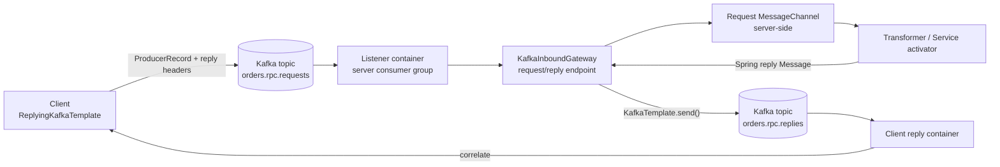
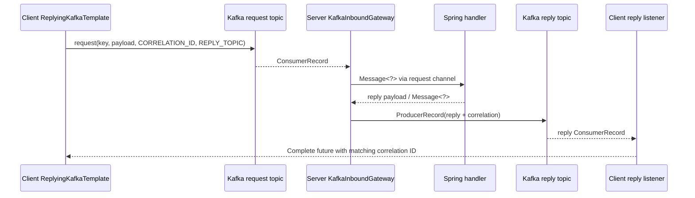
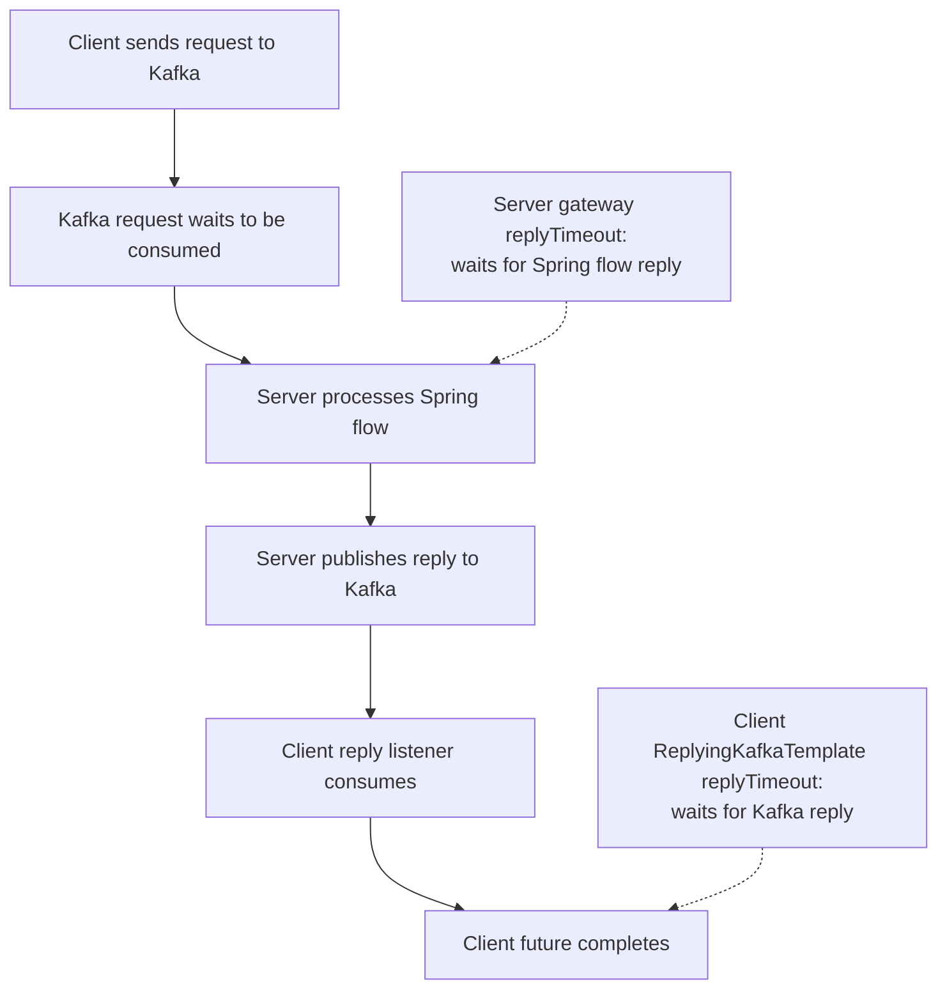
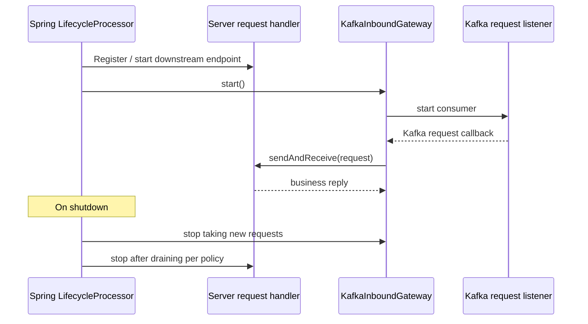

# Kafka inbound gateway request-reply

The **Kafka inbound gateway** receives a request from an Apache Kafka topic, passes the request as a Spring `Message<?>` into a Spring Integration flow, **waits for the processing result in the internal flow**, and then uses a Kafka producer to send a reply to the caller's reply topic. Unlike a one-way inbound channel adapter, a gateway has a **request–reply contract**: an input record can result in a reply record paired by a correlation ID.

This lesson belongs to the **Kafka Adapter** chapter of the **SPRING_INTEGRATION_ADAPTERS** module. This module connects external systems via inbound/outbound adapters, gateways, pollers, and `MessageChannel`, practicing with files, SFTP, HTTP, JMS, AMQP, Kafka, and databases, while controlling message contracts, errors, and connection lifecycles. The focus here is **Kafka → Spring Integration → Kafka reply**, including two-topic setup, reply paths, timeouts, errors, and handling duplicates when requests are redelivered.

> **Core principle:** Kafka request–reply is **not synchronous RPC at the broker layer**. Kafka still stores and distributes records by topic/partition; pairing replies with requests is an application-level protocol built on Spring Kafka/Spring Integration headers and correlation mechanisms.

## 1. Learning objectives

After this lesson, you will be able to:

1. Distinguish `KafkaInboundGateway` from `KafkaMessageDrivenChannelAdapter`, `KafkaMessageSource`, and the `KafkaProducerMessageHandler` outbound gateway.
2. Trace the path of a request from a client-side `ReplyingKafkaTemplate` through the request topic to a server-side `KafkaInboundGateway` and back to the reply topic.
3. Describe the meaning of `KafkaHeaders.CORRELATION_ID`, `KafkaHeaders.REPLY_TOPIC`, and `KafkaHeaders.REPLY_PARTITION`.
4. Configure the server using `ConcurrentMessageListenerContainer`, `KafkaTemplate`, and Java DSL `Kafka.inboundGateway(...)`.
5. Build a client with `ReplyingKafkaTemplate.sendAndReceive(...)`, handling the send future and reply future separately.
6. Choose appropriate timeouts and handle missing replies, late replies, processing errors, or lost replies.
7. Explain how ack/offset, retries, rebalances, and transactions affect duplicate requests/replies.
8. Design partitions, consumer groups, security, and lifecycle for multi-instance request–reply.

## 2. Where does the inbound gateway sit?

A typical request–reply flow involves **two Kafka topics** and the server's internal channels:



From the **server** perspective:

- `KafkaInboundGateway<K,V,R>` is an **inbound endpoint** because it brings requests from Kafka into Spring Integration.
- The gateway uses `requestChannel` to send the request message to a handler/transformer.
- The handler returns a result (payload or message) via the **Spring Integration reply contract**.
- The gateway uses `KafkaTemplate<K,R>` to publish the result as a **Kafka reply record**.
- The gateway does not need its own **reply Kafka listener container** just to send replies; the container receiving replies belongs to the **waiting client**.

From the **client** perspective:

- `ReplyingKafkaTemplate<K,V,R>` sends a request and holds a future waiting for a reply with a matching correlation ID.
- `ReplyingKafkaTemplate` has a **reply listener container** subscribed to the reply topic.
- When a valid reply arrives, the template matches the correlation ID and completes the corresponding request's future.

### 2.1. Why is it called a "gateway"?

A gateway is a component that carries a **request–response conversation** across a system boundary:



If a request has been stored by the broker while the server is not yet ready, the record can wait in the topic. If the server finishes processing but the reply arrives later than the client's deadline, the client **can still time out**. These two facts do not contradict each other because server-side processing and the client-side wait deadline are independent boundaries.

## 3. Comparing Kafka endpoints

| Component | Path | Response contract |
|---|---|---|
| `KafkaMessageDrivenChannelAdapter` | Kafka topic → Spring output channel | One-way; does not automatically publish a business Kafka reply |
| `KafkaMessageSource` | Kafka → `MessageSource.receive()` with Spring Integration poller | Polling inbound, not request–reply by default |
| **`KafkaInboundGateway`** | Kafka request topic → Spring flow → Kafka reply topic | **Server-side request–reply** |
| `KafkaProducerMessageHandler` outbound adapter | Spring input channel → Kafka topic | One-way; send ACK outcome is not a business reply |
| Kafka outbound gateway | Spring request channel → Kafka → Spring reply channel | **Client-side request–reply** |
| `ReplyingKafkaTemplate` | Kafka producer + reply listener container | Client API for sending and awaiting replies |
| `@KafkaListener` + `@SendTo` | Kafka → method → Kafka reply | Another server option without necessarily going through an IntegrationFlow |

Do not spin up **two server consumers in the same group** "for extra safety" without understanding partition assignment: consumers in the same group **split** records rather than every consumer receiving every request.

## 4. Three Kafka headers that govern the reply path

In Kafka request–reply, distinguish routing metadata from business data.

| Header | Used by whom? | Role |
|---|---|---|
| `KafkaHeaders.CORRELATION_ID` | Created and tracked by client; server must echo it back | Pairs the reply with the waiting request |
| `KafkaHeaders.REPLY_TOPIC` | Specified by client; used by server to publish reply | Indicates the topic that receives the response |
| `KafkaHeaders.REPLY_PARTITION` | Optional | Specifies the reply partition when the contract requires it |
| `KafkaHeaders.RECEIVED_TOPIC` | Observed by server for received request | Not the destination address for sending replies |
| `KafkaHeaders.RECEIVED_PARTITION` | Observed by server for request partition | Not the reply partition by default |
| `KafkaHeaders.OFFSET` | Kafka request progress metadata | Not a correlation ID |
| Kafka record key | Chosen by client per business rules | Can affect request partitioning and ordering |
| Business key such as `orderId` | Application | Deduplication or transaction tracing |

`ReplyingKafkaTemplate` normally generates a `CORRELATION_ID` for each request and, if its reply container subscribes to **one identifiable reply topic/partition**, can automatically populate `REPLY_TOPIC` or `REPLY_PARTITION` accordingly. If the reply container has a more complex setup, the client must supply the appropriate routing headers.

**Preserve correlation headers across intermediate systems:** if there are custom converters, header mappers, non-Spring producers, or multi-step services, ensure Kafka request/reply headers are preserved. A reply missing or altering its correlation ID may appear on the topic yet **fail to complete the waiting future**.

### 4.1. Correlation ID and business ID are not the same

```text
Kafka request:
  correlationId = A9D2...       (one send/wait-for-reply attempt)
  orderId       = ORD-101       (business identifier)

Kafka request resent by client:
  correlationId = B731...       (new wait-for-reply attempt)
  orderId       = ORD-101       (still the same business entity)
```

If a client times out and retries, the second request may carry a **different correlation ID** even for the same `orderId`. The server must guard against duplicate side effects by **business key**, not just by correlation ID.

### 4.2. Do not treat the reply topic as an internal `MessageChannel`

`orders.rpc.replies` is a **Kafka topic**. The `replyChannel` of `KafkaInboundGateway`, if configured, is a **Spring Integration `MessageChannel`** belonging to the mechanism that receives results from the internal flow. The two concepts share similar names but operate at different layers.

## 5. Key classes in the implementation

| API/class | Role |
|---|---|
| `KafkaInboundGateway<K,V,R>` | Spring Integration inbound request–reply endpoint |
| `ConcurrentMessageListenerContainer<K,V>` | Receives Kafka request records per consumer group |
| `ConsumerFactory<K,V>` | Creates Kafka consumer clients/deserializers |
| `KafkaTemplate<K,R>` | Sends reply records from server to Kafka |
| `ProducerFactory<K,R>` | Creates Kafka producer clients/serializers |
| `IntegrationFlow` | Defines request processing in Spring Integration |
| `Kafka.inboundGateway(...)` | Java DSL factory to create/configure the inbound gateway |
| `ReplyingKafkaTemplate<K,V,R>` | Client that sends requests, listens for replies, correlates responses |
| `RequestReplyFuture<K,V,R>` | Future for client-side send-result and reply-result |

**Generic types:** `K` is the Kafka record key; `V` is the **request value**; `R` is the **reply value**. In the demo below, all three use `String`. Real systems may use JSON DTOs, Avro/Protobuf, or binary formats, requiring matching serializers/deserializers and converters.

## 6. Preparing the demo applications

This hands-on example consists of two separate applications or two separate processes:

- **Server:** listens on `orders.rpc.requests`, processes payload `status:ORD-101`, and returns `ACK:status:ORD-101`.
- **Client:** sends a request and waits for a reply on `orders.rpc.replies`.
- **Kafka:** a local broker at `localhost:9092` with both topics provisioned.

With a Java 17+ compatible Spring Boot setup, declare:

```xml
<dependency>
    <groupId>org.springframework.boot</groupId>
    <artifactId>spring-boot-starter-integration</artifactId>
</dependency>
<dependency>
    <groupId>org.springframework.integration</groupId>
    <artifactId>spring-integration-kafka</artifactId>
</dependency>
```

Use the Spring Boot parent/BOM to keep Spring Integration and Spring Kafka versions aligned. In production, configure `SASL_SSL`/TLS, Kafka ACLs, and secret management; never commit passwords in source code or Kafka headers.

### 6.1. Creating the two topics

If using Kafka CLI and a test broker:

```bash
kafka-topics.sh --bootstrap-server localhost:9092 \
  --create --if-not-exists \
  --topic orders.rpc.requests --partitions 3 --replication-factor 1

kafka-topics.sh --bootstrap-server localhost:9092 \
  --create --if-not-exists \
  --topic orders.rpc.replies --partitions 3 --replication-factor 1
```

`--replication-factor 1` is only suitable for a single-broker demo. Production requires setting replication factor, `min.insync.replicas`, retention, and ACLs according to SLA.

## 7. Server: Java DSL creating `KafkaInboundGateway`

In the **server application**, configure Spring Boot:

```properties
demo.kafka.bootstrap-servers=localhost:9092
demo.kafka.server-group=orders-rpc-server
```

### 7.1. ConsumerFactory, ProducerFactory, KafkaTemplate, and flow

```java
package com.example.rpcserver;

import java.util.HashMap;
import java.util.Map;

import org.apache.kafka.clients.consumer.ConsumerConfig;
import org.apache.kafka.clients.producer.ProducerConfig;
import org.apache.kafka.common.serialization.StringDeserializer;
import org.apache.kafka.common.serialization.StringSerializer;

import org.springframework.beans.factory.annotation.Value;
import org.springframework.context.annotation.Bean;
import org.springframework.context.annotation.Configuration;
import org.springframework.integration.config.EnableIntegration;
import org.springframework.integration.dsl.IntegrationFlow;
import org.springframework.integration.kafka.dsl.Kafka;
import org.springframework.kafka.core.ConsumerFactory;
import org.springframework.kafka.core.DefaultKafkaConsumerFactory;
import org.springframework.kafka.core.DefaultKafkaProducerFactory;
import org.springframework.kafka.core.KafkaTemplate;
import org.springframework.kafka.core.ProducerFactory;
import org.springframework.kafka.listener.ConcurrentMessageListenerContainer;
import org.springframework.kafka.listener.ContainerProperties;

@Configuration
@EnableIntegration
public class KafkaRpcServerConfig {

    @Bean
    ConsumerFactory<String, String> rpcConsumerFactory(
            @Value("${demo.kafka.bootstrap-servers}") String brokers,
            @Value("${demo.kafka.server-group}") String groupId) {

        Map<String, Object> cfg = new HashMap<>();
        cfg.put(ConsumerConfig.BOOTSTRAP_SERVERS_CONFIG, brokers);
        cfg.put(ConsumerConfig.GROUP_ID_CONFIG, groupId);
        cfg.put(ConsumerConfig.KEY_DESERIALIZER_CLASS_CONFIG,
                StringDeserializer.class);
        cfg.put(ConsumerConfig.VALUE_DESERIALIZER_CLASS_CONFIG,
                StringDeserializer.class);
        cfg.put(ConsumerConfig.ENABLE_AUTO_COMMIT_CONFIG, false);
        cfg.put(ConsumerConfig.AUTO_OFFSET_RESET_CONFIG, "earliest");

        return new DefaultKafkaConsumerFactory<>(cfg);
    }

    @Bean
    ProducerFactory<String, String> rpcReplyProducerFactory(
            @Value("${demo.kafka.bootstrap-servers}") String brokers) {

        Map<String, Object> cfg = new HashMap<>();
        cfg.put(ProducerConfig.BOOTSTRAP_SERVERS_CONFIG, brokers);
        cfg.put(ProducerConfig.KEY_SERIALIZER_CLASS_CONFIG,
                StringSerializer.class);
        cfg.put(ProducerConfig.VALUE_SERIALIZER_CLASS_CONFIG,
                StringSerializer.class);
        cfg.put(ProducerConfig.ACKS_CONFIG, "all");
        cfg.put(ProducerConfig.ENABLE_IDEMPOTENCE_CONFIG, true);

        return new DefaultKafkaProducerFactory<>(cfg);
    }

    @Bean
    KafkaTemplate<String, String> rpcReplyTemplate(
            ProducerFactory<String, String> rpcReplyProducerFactory) {
        return new KafkaTemplate<>(rpcReplyProducerFactory);
    }

    @Bean("ordersRpcServerFlow")
    IntegrationFlow ordersRpcServerFlow(
            ConsumerFactory<String, String> rpcConsumerFactory,
            KafkaTemplate<String, String> rpcReplyTemplate) {

        ContainerProperties properties =
                new ContainerProperties("orders.rpc.requests");
        properties.setAckMode(ContainerProperties.AckMode.RECORD);

        ConcurrentMessageListenerContainer<String, String> container =
                new ConcurrentMessageListenerContainer<>(
                        rpcConsumerFactory, properties);
        container.setConcurrency(2);

        return IntegrationFlow
                .from(Kafka.inboundGateway(container, rpcReplyTemplate)
                        .id("ordersKafkaInboundGateway")
                        .replyTimeout(10_000))
                .<String, String>transform(request -> {
                    if (request.isBlank()) {
                        throw new IllegalArgumentException(
                                "Invalid request");
                    }
                    return "ACK:" + request;
                })
                .get();
    }
}
```

Place `@SpringBootApplication` in `com.example.rpcserver` or a parent package. Adjust Kafka configuration and application classes according to your project conventions.

**Explanation:**

1. `rpcConsumerFactory` uses `StringDeserializer` to read Kafka request values as `String`; `group.id` is the **server** group.
2. `ConcurrentMessageListenerContainer` listens to `orders.rpc.requests`, using `AckMode.RECORD` and concurrency up to 2.
3. `Kafka.inboundGateway(container, rpcReplyTemplate)` creates an inbound gateway working with both the request-receiving container and the reply-sending `KafkaTemplate`.
4. `id("ordersKafkaInboundGateway")` enables bean lookup/lifecycle management in the Spring context.
5. `replyTimeout(10_000)` is the wait limit for a **reply from the internal Spring Integration flow**. It is **not** the client-side timeout waiting on the Kafka reply topic.
6. The `transform` step returns a `String` so Spring Integration can pass the reply back to the gateway via the reply contract. If `transform` throws an exception, the flow errors and is handled by the error-handling configuration rather than **sending a successful business reply by default**.
7. The gateway uses request metadata (such as reply topic/correlation) to send the reply record via `KafkaTemplate`, per the Spring Integration/Spring Kafka contract.

**Configuration choice:** In the example, the container is created inside the flow bean and managed by the gateway/DSL. Do not simultaneously register another Kafka listener/container consuming the same topic/group without an explicit design reason.

### 7.2. Why not hard-code the reply topic inside transform?

`transform` only returns the business result, such as `"ACK:status:ORD-101"`. The reply address should be determined by the **request–reply contract**, not by the payload string. On the caller side, `ReplyingKafkaTemplate` sends the request with Kafka routing headers; the server side uses that information when building the reply.

If you need to restrict replies to allowed topics, validate/enforce policy on `KafkaHeaders.REPLY_TOPIC`, ACLs, and publish paths. Never let an untrusted client use the reply topic header to make the server publish data to unauthorized topics.

### 7.3. Why can the handler return a value without declaring a reply channel?

When `KafkaInboundGateway` sends a request into the internal flow, it uses `MessagingGatewaySupport` to establish a **reply contract**, typically via a reply channel header in Spring message headers. EIP endpoints that return a valid payload/message route the result back along that path. That is why the Java DSL can concisely write `.transform(...).get()` without declaring the Kafka reply topic as a Spring `DirectChannel`.

However, if you insert `.channel("someOtherChannel")` or switch to asynchronous processing, you must ensure the reply path and correlation headers are preserved. If no internal reply is produced before the deadline, the gateway can time out.

## 8. Explicit Java configuration

If you need to separate channel beans and business logic for manageability, you can instantiate `KafkaInboundGateway` directly. This is an **alternative** to the flow in Section 7; do not run both gateways concurrently on the same request topic/group when testing a single server.

```java
// Snippet inside a @Configuration class where Kafka beans
// rpcConsumerFactory and rpcReplyTemplate already exist.

@Bean("rpcRequestsChannel")
MessageChannel rpcRequestsChannel() {
    return new DirectChannel();
}

@Bean("ordersKafkaInboundGateway")
KafkaInboundGateway<String, String, String> ordersKafkaInboundGateway(
        ConsumerFactory<String, String> rpcConsumerFactory,
        KafkaTemplate<String, String> rpcReplyTemplate,
        @Qualifier("rpcRequestsChannel") MessageChannel requests) {

    ContainerProperties props =
            new ContainerProperties("orders.rpc.requests");
    props.setAckMode(ContainerProperties.AckMode.RECORD);

    ConcurrentMessageListenerContainer<String, String> container =
            new ConcurrentMessageListenerContainer<>(
                    rpcConsumerFactory, props);

    KafkaInboundGateway<String, String, String> gateway =
            new KafkaInboundGateway<>(container, rpcReplyTemplate);
    gateway.setRequestChannel(requests);
    gateway.setReplyTimeout(10_000);
    return gateway;
}
```

Additional imports are `org.springframework.messaging.MessageChannel`, `org.springframework.integration.channel.DirectChannel`, `org.springframework.integration.kafka.inbound.KafkaInboundGateway`, and `org.springframework.beans.factory.annotation.Qualifier`.

A service activator can return a reply:

```java
package com.example.rpcserver;

import org.springframework.integration.annotation.ServiceActivator;
import org.springframework.stereotype.Component;

@Component
public class OrderRpcService {

    @ServiceActivator(inputChannel = "rpcRequestsChannel")
    public String process(String command) {
        return "ACK:" + command;
    }
}
```

The gateway receives a request from Kafka, dispatches it to `rpcRequestsChannel`, and the method returns a `String` so the internal flow routes the reply back to the gateway. `setReplyChannel(...)` is an optional configuration when designing a dedicated internal reply channel; it does **not** specify the Kafka reply topic. Classes/beans are assumed to reside in packages scanned by Spring Boot.

### 8.1. XML namespace

Spring Integration also provides the `int-kafka` namespace for the inbound gateway. Concise configuration example:

```xml
<!-- In XML with int-kafka and beans namespaces declared -->
<int-kafka:inbound-gateway
        id="ordersKafkaInboundGateway"
        listener-container="ordersRequestListenerContainer"
        kafka-template="rpcReplyTemplate"
        request-channel="rpcRequestsChannel"
        reply-timeout="10000"
        auto-startup="true"/>
```

`ordersRequestListenerContainer`, `rpcReplyTemplate`, and `rpcRequestsChannel` must be appropriately declared. To return a reply from the Spring flow, you need a handler/transformer that produces a result or an explicit reply path. XML is merely a configuration syntax choice; the underlying request–reply and offset semantics remain unchanged.

## 9. Client: sending requests and awaiting replies with `ReplyingKafkaTemplate`

The **client is a separate application** from the server in Section 7. It needs a Kafka producer to send requests and a reply listener container to consume `orders.rpc.replies`.

In a Spring Boot client, you can rely on a properly configured `ProducerFactory<String,String>` and `ConcurrentKafkaListenerContainerFactory<String,String>`. Illustrative properties:

```properties
spring.kafka.bootstrap-servers=localhost:9092
spring.kafka.producer.key-serializer=org.apache.kafka.common.serialization.StringSerializer
spring.kafka.producer.value-serializer=org.apache.kafka.common.serialization.StringSerializer
spring.kafka.consumer.key-deserializer=org.apache.kafka.common.serialization.StringDeserializer
spring.kafka.consumer.value-deserializer=org.apache.kafka.common.serialization.StringDeserializer
spring.kafka.consumer.auto-offset-reset=latest
```

### 9.1. Creating the reply container and template

```java
package com.example.rpcclient;

import java.time.Duration;
import java.util.UUID;

import org.springframework.context.annotation.Bean;
import org.springframework.context.annotation.Configuration;
import org.springframework.kafka.core.ProducerFactory;
import org.springframework.kafka.listener.ConcurrentKafkaListenerContainerFactory;
import org.springframework.kafka.listener.ConcurrentMessageListenerContainer;
import org.springframework.kafka.requestreply.ReplyingKafkaTemplate;

@Configuration
public class KafkaRpcClientConfig {

    @Bean
    ReplyingKafkaTemplate<String, String, String> rpcClientTemplate(
            ProducerFactory<String, String> producerFactory,
            ConcurrentKafkaListenerContainerFactory<String, String>
                    containerFactory) {

        ConcurrentMessageListenerContainer<String, String> replyContainer =
                containerFactory.createContainer("orders.rpc.replies");

        // With a shared reply topic, each requester instance needs its own group.
        replyContainer.getContainerProperties().setGroupId(
                "orders-rpc-replies-" + UUID.randomUUID());

        // The template manages the listener container waiting for replies.
        replyContainer.setAutoStartup(false);

        ReplyingKafkaTemplate<String, String, String> template =
                new ReplyingKafkaTemplate<>(
                        producerFactory, replyContainer);
        template.setDefaultReplyTimeout(Duration.ofSeconds(15));
        return template;
    }
}
```

**Note:** `UUID.randomUUID()` in the group ID is only a demo choice to ensure each requester instance receives all replies when sharing one reply topic. Production can use a stable instance-unique group ID tied to instance lifecycle, dedicated reply partitions, or dedicated reply topics. A shared reply topic with multiple requester instances has an **unnecessary fan-out** trade-off: multiple instances receive replies not meant for them and discard them due to unmatched correlation IDs.

When sharing a reply topic in this manner, `ReplyingKafkaTemplate.setSharedReplyTopic(true)` can reduce log noise about unmatched replies. This does **not** alter delivery guarantees.

### 9.2. Sending a request in `ApplicationRunner`

```java
package com.example.rpcclient;

import java.time.Duration;
import java.util.concurrent.TimeUnit;

import org.apache.kafka.clients.consumer.ConsumerRecord;
import org.apache.kafka.clients.producer.ProducerRecord;
import org.springframework.boot.ApplicationRunner;
import org.springframework.context.annotation.Bean;
import org.springframework.context.annotation.Configuration;
import org.springframework.kafka.requestreply.ReplyingKafkaTemplate;
import org.springframework.kafka.requestreply.RequestReplyFuture;

@Configuration
public class KafkaRpcClientRunner {

    @Bean
    ApplicationRunner runRequest(
            ReplyingKafkaTemplate<String, String, String> template) {

        return args -> {
            // Avoid race: request processed before the reply listener
            // has received partition assignment.
            if (!template.waitForAssignment(Duration.ofSeconds(10))) {
                throw new IllegalStateException(
                        "Reply listener not ready");
            }

            ProducerRecord<String, String> request =
                    new ProducerRecord<>(
                            "orders.rpc.requests",
                            "ORD-101",
                            "status:ORD-101");

            RequestReplyFuture<String, String, String> future =
                    template.sendAndReceive(
                            request, Duration.ofSeconds(15));

            // (1) Did the Kafka broker receive the request?
            var sendResult = future.getSendFuture()
                    .get(10, TimeUnit.SECONDS);
            System.out.println("REQUEST SENT offset="
                    + sendResult.getRecordMetadata().offset());

            // (2) Did the server return a valid reply?
            ConsumerRecord<String, String> reply =
                    future.get(15, TimeUnit.SECONDS);
            System.out.println("RPC REPLY: " + reply.value());
        };
    }
}
```

With the Section 7 server running and ready, the expected business output is:

```text
REQUEST SENT offset=...
RPC REPLY: ACK:status:ORD-101
```

Each output has a distinct meaning:

- `getSendFuture()` completing successfully only proves **the request was sent by the Kafka producer per the ACK policy**.
- `future.get(...)` returns the Kafka reply record matched by **correlation ID**, not just a broker ACK.
- `waitForAssignment(...)` helps prevent sending a request before the reply listener receives partition assignment, especially when using `auto.offset.reset=latest`.

When the reply container subscribes to **one topic**, `ReplyingKafkaTemplate` normally sets `KafkaHeaders.REPLY_TOPIC` and `CORRELATION_ID` automatically; the client does not need to build these headers manually in this demo. With multiple reply topics/partitions or non-Spring clients, configure/publish the headers explicitly.

### 9.3. A single-broker demo is not enough for production validation

The two code listings illustrate a **server application** and a **client application** running separately against the same Kafka cluster, not all classes placed inside one Spring Boot context. Production also requires topic provisioning, ACLs, serializers, timeouts, observability, a multi-instance reply strategy, and recovery testing.

## 10. Two different timeouts: server-side and client-side

A request–reply interaction has multiple clocks running in parallel:



| Timeout | Where configured | What it bounds |
|---|---|---|
| **Server `KafkaInboundGateway.replyTimeout`** | `.replyTimeout(10_000)` or `setReplyTimeout(10000)` | Waiting for reply from the **Spring Integration processing flow** |
| **Client `ReplyingKafkaTemplate` reply timeout** | `setDefaultReplyTimeout(Duration)` or `sendAndReceive` parameter | Waiting for a matching **Kafka reply record** |
| Kafka producer delivery timeout | Kafka producer config | Time to send request/reply to broker |
| Kafka request timeout | Kafka client config | Time waiting for a single broker request |
| Kafka `max.poll.interval.ms` | Consumer client | Max time between polls, can trigger rebalance |
| Downstream DB/HTTP timeout | Business service/client | Time waiting on target resources |

**Typical design:** the server `replyTimeout` is shorter than the client's end-to-end deadline, while the client timeout must cover request delivery, processing, reply publishing, and client reply consumption, plus an appropriate buffer. The values **10s** (server) and **15s** (client) in the demo are purely illustrative.

### 10.1. Client times out even though server succeeded

```mermaid
sequenceDiagram
    participant C as Client
    participant Q as Kafka request topic
    participant S as Server
    participant R as Kafka reply topic

    C->>Q: Request orderId=ORD-101
    Q-->>S: Consume request
    S->>S: Write DB successfully
    Note over C: Reply deadline expires
    C-->>C: TimeoutException
    S->>R: Publish late reply
    Note over C,R: Old future already timed out; reply may be discarded
```

**Never infer "timeout = request was not processed."** A client retry can cause the server to execute the side effect a second time without idempotency.

When requests cause side effects such as creating an order, include a business key/idempotency key in the payload or header, persist the processing outcome durably, and be able to return the stored result on resent requests.

### 10.2. Server returns no reply

This can happen because the handler throws an exception, a filter branch drops the message, the handler returns null, the reply channel is wrong, or asynchronous processing drops reply headers. When the wait expires, the gateway may report an error/timeout per its configuration, and the client may also time out at a different moment.

For business operations that must return a status, **never use null or swallow exceptions as an implicit answer**. Design a reply schema such as `OK/REJECTED/ERROR` with a clear `requestId` and business key, alongside error/recovery policies.

## 11. Reply topic, partitions, and multi-instance consumer groups

### 11.1. Why not use the same group for all clients waiting on the same reply topic?

Suppose client A and client B both subscribe to `orders.rpc.replies` with **the same `group.id`**. Kafka assigns each partition to one consumer in the group, so A's reply may be delivered to B. B does not have the pending correlation ID and ignores the reply; A **times out**.

Available strategies:

| Strategy | Idea | Trade-off |
|---|---|---|
| Dedicated reply topic per client instance | Each instance has its own topic/permissions | Increases topic count and operational overhead |
| One reply topic with **a unique group ID per instance** | Every instance receives replies, accepts only matching correlation | Unnecessary fan-out; must handle unexpected replies |
| One reply topic, **dedicated partition per instance** | Client owns a fixed partition; server replies to that partition | Must manage partitions/scaling and reply-partition header |
| Application gateway protocol with state store | Persists results and request status durably | More complexity, but survives client restarts |

If using `KafkaHeaders.REPLY_PARTITION`, ensure the header uses the format Kafka requires and the client listener is configured to consume that exact partition. With native Kafka headers, partition numbers are typically four-byte big-endian integers; do not send the string `"1"` assuming the server interprets it as an int.

### 11.2. Caution with dynamic reply topics

Do not let untrusted clients specify an arbitrary `REPLY_TOPIC` causing the server to publish sensitive data to unauthorized topics. Combine producer principal ACLs, topic allowlists, payload validation, and request/reply size limits.

### 11.3. Correlation headers across versions or non-Spring clients

Spring Kafka allows customizing correlation/reply header names in certain versions and APIs. When client and server use different languages, document a **wire contract** covering header names, byte encodings, serializers, schemas, and timeouts, and test with a real record. Do not treat `MessageHeaders.ID` or `traceId` as automatic replacements for `KafkaHeaders.CORRELATION_ID`.

## 12. Ack, offsets, and message durability

An inbound gateway receiving requests from Kafka has at least four milestones:

1. Kafka consumer fetches the record from the request topic.
2. Spring flow processes the request, potentially causing side effects in DB/HTTP/SFTP.
3. Kafka producer sends the reply to the reply topic.
4. Server consumer container commits the request offset per configuration.

The order of steps 2–4 and the success boundary depend on processing design, timeouts, commit/ack policies, and `KafkaTemplate`. **Never claim that `AckMode.RECORD` alone puts the Kafka reply and DB commit in the same transaction.**

### 12.1. `AckMode.RECORD` on the server

With `enable.auto.commit=false`, the listener container can use `AckMode.RECORD` to record progress after the record callback finishes successfully. When the callback fails and an exception propagates back to the container, the error handler decides retry, seek/recovery, and offset handling per configuration.

However:

- If an error flow handles/suppresses the exception, the container may treat the callback as successful per contract.
- If sending the reply is asynchronous, the callback completion and the Kafka broker ACK for the reply may happen at different times.
- DB commit, Kafka reply send, and request offset commit do not share an atomic transaction by default.
- After a crash, an uncommitted request can be redelivered and produce a **duplicate reply** or duplicate side effect.

### 12.2. Achieving at-least-once safely in business logic

Use a **business ID**, DB transactions/idempotent handlers, and the ability to return a stable result when receiving the same request again. For example: a `requests_processed(request_id, result)` table with a unique constraint. When a duplicate request arrives, the server reads the saved result instead of re-executing the side effect, and can then publish a reply matching the current attempt's correlation ID.

### 12.3. Is "exactly-once" real?

Kafka transactions help achieve certain guarantees in **Kafka-only** workflows when producers, consumer offsets, and isolation levels are properly configured. However, database writes or HTTP/SFTP calls do not automatically join a Kafka transaction.

For Kafka request–reply connected to a DB, design deduplication, durable state, or an outbox; avoid claiming "end-to-end exactly-once" merely because Kafka transactions or producer idempotence are enabled.

## 13. Errors, retries, and dead-letter

Three error layers must be distinguished:

| Error source | Examples | Mechanisms to inspect |
|---|---|---|
| Kafka consumer / deserializer | Request fails deserialization, lost read ACL, rebalance | Container error handler, error deserializer |
| Spring flow / gateway | No consumer on request channel, handler throws exception, reply timeout | Spring Integration error channel, request/reply contract |
| Kafka reply producer | Cannot write reply topic, ACL, broker timeout | `KafkaTemplate` future/error handling, retry/outbox |
| Client reply container | Not assigned partitions, missing correlation header, wrong deserializer | Client future timeout, unmatched reply logs, consumer group |

### 13.1. Retries in the gateway vs. the container

`KafkaInboundGateway` provides APIs for retry/recovery; Spring Kafka's `DefaultErrorHandler` manages errors at the listener container. The two layers **do not automatically merge** into a single policy.

- Blocking retries in the gateway hold the listener thread; exceeding `max.poll.interval.ms` can trigger a rebalance.
- The container error handler can retry/back off or use `KafkaErrorSendingMessageRecoverer` to forward errors to an appropriate flow.
- If an error channel and recoverer finish normally, the exception may **not** reach the container; verify offset consequences with tests.
- DLT requires a proper producer and publish policy; merely logging an `ErrorMessage` does not send the request to a Kafka DLT.

### 13.2. Should you return an error reply instead of throwing?

Both models are viable, with different contracts:

**Model A — business reply with status:** The handler returns a payload such as `{"status":"REJECTED","reason":"INVALID_ORDER"}`. The client receives a successful transport reply, then distinguishes `OK`, `REJECTED`, or `FAILED` via the schema.

**Model B — infrastructure/unprocessable error:** The handler throws an exception and the container retries or routes the request to a DLT. The client may time out if no valid reply arrives; a status-query mechanism is needed so retries do not cause duplicates.

Never return `"OK"` after catching an exception just to complete the client's future. If the side effect was not committed, a success reply is false information.

### 13.3. When publishing the reply fails

The server may have written to the DB, yet the Kafka reply template fails to publish due to ACLs or broker unavailability. Never delete business state or assume the client can infer the outcome. You may need a reply outbox, stored results keyed by request ID, bounded publish retries, and/or a status query API.

## 14. Concurrency, ordering, and throughput

The gateway server also relies on Kafka consumer groups:

- A request partition is assigned to one consumer in the group at a time; multiple instances in the same group split requests.
- Kafka preserves ordering **within a partition**, not across the entire topic.
- `container.setConcurrency(2)` does not help if the topic has only one partition or the downstream DB is saturated.
- Long-running request processing on the listener thread increases lag and risks exceeding `max.poll.interval.ms`.
- Replies can arrive **out of request order** due to multiple partitions, concurrency, or varying processing times. The client must match by correlation ID, **not by arrival order**.

### 14.1. What if the handler executes asynchronously?

When request processing is offloaded to an `ExecutorChannel` or `QueueChannel`, the listener thread separates from the business thread. Do not assume the result will automatically find its way back to the gateway: preserve reply channel/correlation metadata, finish before the deadline, and understand offset acks once the listener callback has returned.

For tasks lasting several minutes, request–reply over Kafka may not be suitable. Prefer **async command + result event**, where the client does not hold a short-lived future and instead tracks progress by business ID on a reply/status stream.

## 15. Lifecycle and ordered startup

`KafkaInboundGateway` is a lifecycle-managed endpoint; its listener container is started and stopped by the framework. The server must also have handlers/transformers ready to receive Spring messages.



Configure appropriate phases when **internal consumers must be ready before the inbound gateway**. `isRunning()==true` only describes endpoint state; it does not ensure Kafka has assigned partitions or the broker is ready. On the client, use `ReplyingKafkaTemplate.waitForAssignment` to avoid sending before the reply listener is active.

On shutdown, stop accepting new requests, manage in-flight requests, pending reply futures, and timeouts, and then close producers/containers per policy. If the process crashes between DB commit and Kafka reply publish, request redelivery and an idempotent result store determine correctness.

## 16. Operations and observability

Signals to measure:

| Signal | Question |
|---|---|
| Request consumer lag (server group) | Are many requests piling up unprocessed? |
| Record arrival and processing latency | How long does it take from Kafka to business handler? |
| Server gateway timeout count | Are handlers failing to return internal replies? |
| Reply producer success/failure | Are replies ACKed by the broker? |
| Client reply timeout / unmatched correlation | Are replies late, on the wrong topic/group, or missing headers? |
| Partition assignment / rebalance | Are containers stable? |
| Duplicate requestId / business key | How often are requests replayed or retried by clients? |
| DB/HTTP/SFTP side-effect outcome | Did the target system actually execute the operation? |
| DLT / retry rates | Are failed records stored and reprocessed per policy? |
| Request/reply size and serialization errors | Are payloads/schemas compatible on both sides? |

### 16.1. Troubleshooting table

| Symptom | Possible cause | Where to check |
|---|---|---|
| Client send future succeeds but reply future times out | Server hasn't processed yet, no reply produced, wrong reply topic or correlation | Request lag, server logs, reply topic, headers |
| Server logs show processed, yet client times out | Reply publish failed, reply arrived late, reply container unassigned | `KafkaTemplate` send outcome, client assignment, timeouts |
| One client instance receives another instance's reply | Shared reply topic with wrong group ID/partition design | Per-instance group ID, `REPLY_PARTITION`, correlation |
| Gateway server reports timeout even though background handler finished | Reply arrived in Spring flow after deadline or lost reply channel | Gateway `replyTimeout`, async channels, header propagation |
| Client sees multiple replies for the same business ID | Client retry or Kafka redelivery | Request ID, offsets, DB idempotency, duplicate handling |
| Reply topic has records but client fails to match | Missing/wrong correlation or deserializer | Raw Kafka headers, converter, correlation ID |
| Server increases concurrency yet lag does not drop | DB/HTTP bottleneck, too few partitions | Partition count, handler latency, connection pool |
| Error channel logs yet broker does not retry | Exception was recovered/suppressed | Error flow, container `DefaultErrorHandler`, offsets |
| Client times out during server restart | Request unprocessed or reply delayed | Reply state, request offset, idempotent replay |

## 17. Practical request–reply design rules

A system requiring fast responses, short tasks, and Kafka-based communication can use an inbound gateway. However, you should:

1. Define clear **request topic** and **reply topic**, separate from business event streams.
2. Standardize `CORRELATION_ID`, `REPLY_TOPIC`, `REPLY_PARTITION` (if used), payload schemas, and error payloads.
3. Require a **business request ID** to protect against replays/duplicates and support status lookups after timeouts.
4. Establish client deadlines, gateway timeouts, Kafka send timeouts, and downstream timeouts.
5. Choose a reply topic strategy that supports multiple requester instances.
6. Bound pending requests and concurrency; never leave unbounded pending futures open.
7. Test crashes/rebalances at boundaries **before DB commit**, **after DB commit before reply send**, and **after reply send before request offset commit**.
8. Persist result state durably when side effects matter and clients may time out/retry.
9. Configure alerts for lag, reply timeouts, unmatched correlations, retry storms, and DLT growth.
10. Switch to an asynchronous command/result event pattern when tasks run for a long time, span hours, or have SLAs unsuitable for request–reply.

## 18. Practice exercises

### Exercise 1 — Run independent client and server

Start the two topics and the server from Section 7, then the client from Section 9. Send three requests and verify `sendFuture`, `replyFuture`, and the reply payload. Read the reply's metadata: topic, partition, and offset. Explain why a request send ACK does not mean a reply exists.

### Exercise 2 — Break correlation

Configure a custom converter/header mapper to intentionally strip `KafkaHeaders.CORRELATION_ID` on replies; observe the client receiving the reply topic message yet failing to complete the future. Restore the correct header mapper and explain the difference between correlation ID and business order ID.

### Exercise 3 — Timeout testing

Make the server process slower than the client timeout while still completing the business transaction. Observe the late reply and have the client resend the same `orderId`. Design a unique constraint/idempotent result store to prevent repeating side effects.

### Exercise 4 — Two client instances

Run clients A and B against the same reply topic. Try using the same group ID first, then switch to a unique group ID per instance. Measure unmatched correlation replies and explain reply topic/partition choices for autoscaling.

### Exercise 5 — Missing reply

Create a filter branch that drops messages or a handler that returns null. Inspect server/client timeouts and logs. Design a reply payload with an explicit `REJECTED` status instead of silently dropping the request.

### Exercise 6 — Transient DB error

Simulate the handler timing out on the DB twice before succeeding. Propose where to place retries, backoff limits, non-retryable conditions, and how to verify request offsets are only committed according to the intended error policy.

### Exercise 7 — Reply send fails after DB commit

Have the DB write succeed while the Kafka reply template fails to publish due to ACLs or broker unavailability. Analyze the failure windows, design a reply/outbox store, and show how the client can check outcomes without depending on a single reply.

### Exercise 8 — Non-Spring client configuration

Suppose a client is written in another language and sends Kafka headers with arbitrary byte encodings. Define a wire contract for reply topic, correlation, reply partition, schema, and timeouts. Explain how to test compatibility with the Spring server.

### Exercise 9 — Asynchronous handler

Replace the request channel with an `ExecutorChannel` and process on a thread pool. Inspect reply headers and the gateway deadline. Why is `send()` succeeding inside Spring insufficient to guarantee the gateway received a reply?

### Exercise 10 — When should request–reply NOT be used?

Design a 20-minute report export task requiring retries across nodes. Compare the inbound gateway with a **command topic → job state table → result event topic** pattern plus a client lookup by `jobId`. Explain why a 20-minute RPC future creates resource pressure and complicates restarts.

## 19. Self-check questions

1. How does `KafkaInboundGateway` differ from `KafkaMessageDrivenChannelAdapter` in its output contract?
2. In Kafka request–reply, does the **client** or the **server** need the reply listener container?
3. What does `KafkaInboundGateway.replyTimeout` limit?
4. How does `ReplyingKafkaTemplate` determine which request a reply belongs to?
5. When the client's `getSendFuture()` succeeds yet `future.get()` times out, can you conclude the server did not process the request?
6. How does `KafkaHeaders.REPLY_TOPIC` differ from `KafkaHeaders.RECEIVED_TOPIC`?
7. Why does `REPLY_PARTITION` require exact byte formatting and clear ownership?
8. Why do two requester instances sharing a reply topic and sharing a consumer group easily lose matching replies?
9. When a reply arrives after the request future has timed out, what happens?
10. Does `AckMode.RECORD` make the DB and reply producer commit in the same transaction?
11. Which key is needed to deduplicate when a client times out and retries?
12. When should you return an error-status reply vs. letting the container handle an exception?
13. Which pattern should a multi-minute task switch to?
14. Which metrics distinguish a running gateway with a slow service from a broken correlation header?
15. Which two object types must `Kafka.inboundGateway(...)` be called with in the Java DSL?

## 20. Summary

**Kafka inbound gateway request–reply** bridges two worlds:

```text
Client:
ReplyingKafkaTemplate
    -> request Kafka topic
    -> (waits for correlation ID on reply topic)

Server:
Kafka listener container
    -> KafkaInboundGateway
    -> Spring Integration request MessageChannel
    -> transformer/service activator
    -> Spring reply Message
    -> KafkaTemplate
    -> reply Kafka topic

Client reply listener:
    -> matches KafkaHeaders.CORRELATION_ID
    -> completes RequestReplyFuture
```

A solid implementation goes beyond returning `"ACK"`. It preserves **reply destination and correlation**, separates **server gateway timeout from client Kafka reply timeout**, handles **late replies** and **duplicate requests**, and controls ack/offsets, transactions, producer retries, and lifecycle. With those boundaries clear, you can integrate Kafka request–reply with JDBC, HTTP, SFTP, JMS, or AMQP without mistakenly assuming Kafka automatically guarantees system-wide exactly-once delivery.

## References

- [Spring Integration Reference — Apache Kafka Support, Inbound Gateway](https://docs.spring.io/spring-integration/reference/kafka.html#inbound-gateway)
- [Spring Integration API — KafkaInboundGateway](https://docs.spring.io/spring-integration/api/org/springframework/integration/kafka/inbound/KafkaInboundGateway.html)
- [Spring Integration API — KafkaInboundGatewaySpec](https://docs.spring.io/spring-integration/api/org/springframework/integration/kafka/dsl/KafkaInboundGatewaySpec.html)
- [Spring for Apache Kafka Reference — Sending Messages / ReplyingKafkaTemplate](https://docs.spring.io/spring-kafka/reference/kafka/sending-messages.html#replying-kafka-template)
- [Spring for Apache Kafka Reference — Listener Containers](https://docs.spring.io/spring-kafka/reference/kafka/receiving-messages/message-listener-container.html)
- [Spring for Apache Kafka Reference — Error Handling](https://docs.spring.io/spring-kafka/reference/kafka/annotation-error-handling.html)
- [Apache Kafka — Consumer Configuration](https://kafka.apache.org/documentation/#consumerconfigs)
