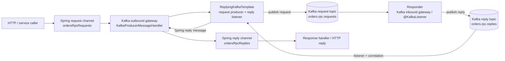
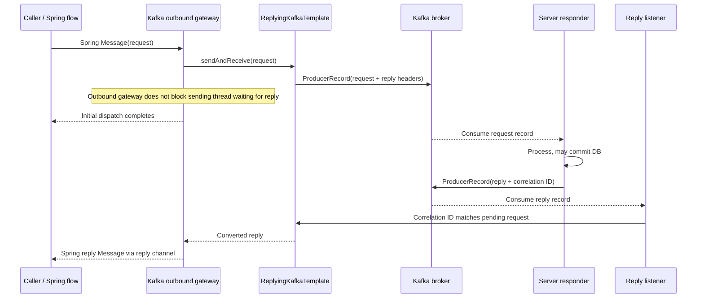
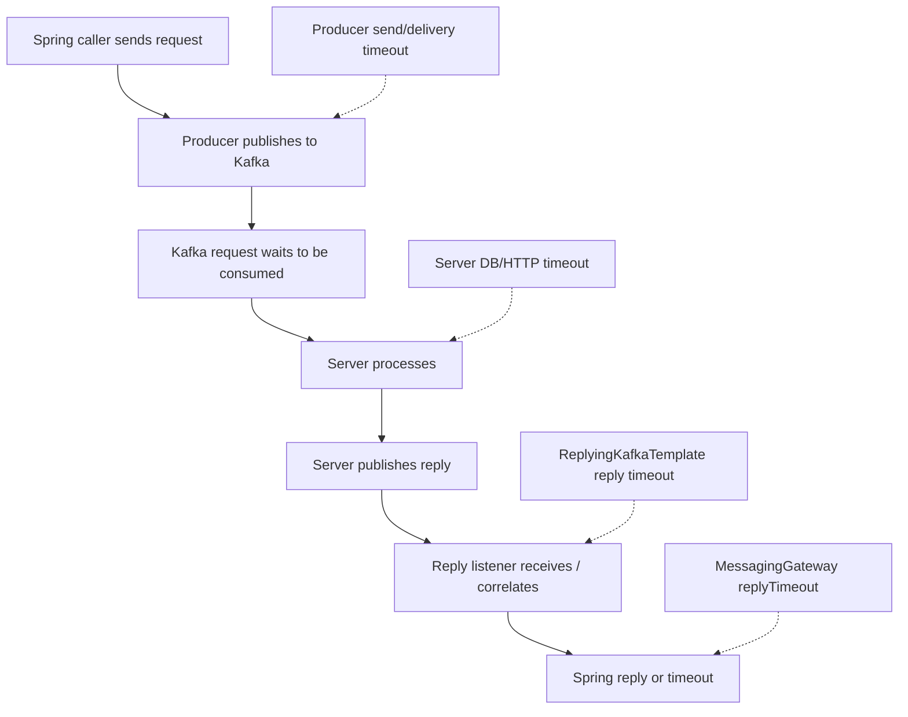

# Kafka outbound gateway request-reply

The **Kafka outbound gateway** is a Spring Integration output endpoint used to send a **request message** to a Kafka topic and bring the **corresponding reply message** back into the Spring Integration flow. Unlike the one-way Kafka outbound channel adapter, in addition to publishing records, the gateway must manage the **reply destination, correlation ID, timeout, and return value**.

This lesson belongs to the **Kafka Adapter** chapter of the **SPRING_INTEGRATION_ADAPTERS** module. The module aims to connect external systems via inbound/outbound adapters, gateways, pollers, and `MessageChannel`; it covers files, SFTP, HTTP, JMS, AMQP, Kafka, and databases along with message contracts, errors, and connection lifecycles. This topic focuses on the **Spring Integration → Kafka request → Kafka reply → Spring Integration** direction, using an example where an application queries order status from another service.

> **Design point to remember:** The Spring Integration Kafka outbound gateway **does not block the sending thread waiting for the Kafka reply** at the handler layer. Replies are typically handled on the **reply listener container thread** and then forwarded to the Spring Integration reply channel. When the caller is a synchronous `@MessagingGateway`, the **thread calling the gateway proxy** is the one that waits for the reply or times out.

## 1. Learning objectives

After this lesson, you will be able to:

1. Distinguish the one-way Kafka outbound channel adapter, the request–reply Kafka outbound gateway, and the server-side Kafka inbound gateway.
2. Explain the collaboration among `KafkaProducerMessageHandler`, `ReplyingKafkaTemplate`, the reply listener container, and Spring Integration input/reply channels.
3. Write Java configuration and Java DSL for a request–reply flow, along with an illustrative Kafka server returning results.
4. Recognize `KafkaHeaders.TOPIC`, `KEY`, `CORRELATION_ID`, `REPLY_TOPIC`, and `REPLY_PARTITION`, along with the roles of topics, partitions, and consumer groups.
5. Distinguish **broker ACK on request send**, **reply reception**, and **server-side business handler commit**.
6. Choose timeouts and handle retries, late replies, missing replies, mismatched correlations, and serialization errors.
7. Design request–reply for multiple requester instances, preserve idempotency, manage lifecycle, and monitor production.
8. Decide when to use request–reply vs. asynchronous command/result events.

## 2. Architecture from requester to responder

Suppose application A has an HTTP inbound gateway receiving order status queries, while the data is owned by application B. A sends a command to Kafka; B returns a response via another topic:



There are **two distinct channel systems**:

- **Spring Integration `MessageChannel`:** `ordersRpcRequests` receives requests from application A; `ordersRpcReplies` receives replies to continue the internal flow.
- **Kafka topics:** `orders.rpc.requests` holds request records; `orders.rpc.replies` holds reply records. They store, distribute, and maintain offsets per Kafka semantics.

An internal channel does not automatically become a Kafka topic. Likewise, a Kafka topic is not a Spring `MessageChannel` simply because their names look similar.

### 2.1. Components and responsibilities

| Component | Responsibility | What it is NOT |
|---|---|---|
| `KafkaProducerMessageHandler<K,V>` | Handler that sends Kafka records; when given a `ReplyingKafkaTemplate`, acts as an outbound gateway | A Kafka request consumer |
| `ReplyingKafkaTemplate<K,V,R>` | Kafka producer to send requests; reply listener to receive and correlate replies | A Spring Integration `Poller` |
| `ProducerFactory<K,V>` | Configures producer client/serializers/acks | A business processor |
| `ConsumerFactory<K,R>` | Configures reply reader client/deserializers/group | The server's request consumer factory |
| Reply listener container | Consumes reply topic, completes pending requests by correlation | The business server |
| Input `MessageChannel` | Delivers Spring requests to the outbound gateway | The reply topic |
| Output `MessageChannel` | Receives Spring replies and continues the flow | A Kafka broker ACK |
| Server-side Kafka inbound gateway or `@KafkaListener` | Consumes requests, executes logic, and publishes replies | The client awaiting replies |

**An easily overlooked detail:** In modern Spring Integration versions, **the same class `KafkaProducerMessageHandler`** is used for both the outbound adapter and the outbound gateway. The core difference is the template:

```java
// One-way outbound channel adapter:
new KafkaProducerMessageHandler<>(ordinaryKafkaTemplate);

// Request-reply outbound gateway:
new KafkaProducerMessageHandler<>(replyingKafkaTemplate);
```

These illustrate *mutually exclusive alternatives*; do not wire both to the same `DirectChannel` simultaneously if you want each request sent exactly once.

## 3. Lifecycle of a conversation



In practice, request send callbacks and reply receive callbacks can interleave, fail, or time out. Do not assume requests/replies are processed in strict global order when there are multiple partitions and multiple consumers.

### 3.1. Three distinct "success" milestones

| Milestone | Evidence | What is NOT guaranteed yet |
|---|---|---|
| Spring `send()` accepts request | Input channel dispatched per channel semantics | That Kafka broker persisted the record |
| Kafka producer reports request ACK | Producer send future succeeded per `acks` | That the server processed the business logic |
| Correlation-matched reply received | Reply listener received a valid reply; Spring flow has result | That server DB side effects are durable if server contract doesn't guarantee it |

Therefore **request send ACK ≠ business reply**; and an ill-contracted `"OK"` reply can still mask a business failure. Define the reply schema and how the server confirms side effects clearly.

## 4. When to use the outbound gateway?

| Need | Suitable component | Reason |
|---|---|---|
| Fire-and-forget event publish | Kafka outbound channel adapter | No application-level reply required |
| Query another service for status/identifier | **Kafka outbound gateway** | Provides request–reply with correlation and timeout |
| Server receives command and returns Kafka reply | Kafka inbound gateway | Acts as the responder side |
| Need Kafka request/reply in code without EIP | `ReplyingKafkaTemplate` directly | Less abstraction when no IntegrationFlow is needed |
| Very long-running task or progress tracking | Command topic + result event/status store | Avoid holding long-lived pending reply futures |
| Immediate HTTP response from internal DB | Direct service call or HTTP gateway | Kafka RPC may be unnecessary |

**Kafka is not an RPC broker:** Kafka only provides record storage and distribution. **Client and server** establish conventions for reply topics, correlation, serializers, timeouts, and idempotency to turn two records into a conversation.

## 5. Headers coordinating requests and replies

`ReplyingKafkaTemplate` and reply-capable inbound handlers rely on special Spring Kafka headers. When sending messages from Spring Integration, the adapter also uses headers or expressions to build Kafka records.

| Header | Role |
|---|---|
| `KafkaHeaders.TOPIC` | Specifies request topic unless overridden by an explicit topic expression |
| `KafkaHeaders.KEY` | Kafka record key, often `orderId` or an aggregate ID |
| `KafkaHeaders.PARTITION` | Explicit request partition if needed |
| **`KafkaHeaders.CORRELATION_ID`** | ID pairing the reply with the pending request |
| **`KafkaHeaders.REPLY_TOPIC`** | Kafka topic address where the server must send the reply |
| **`KafkaHeaders.REPLY_PARTITION`** | Explicit reply partition (if used) |
| `KafkaHeaders.RECEIVED_TOPIC` | Topic metadata of a received record, not the publish topic |
| `MessageHeaders.ID` | Spring message UUID; does not automatically replace correlation ID |
| Business `requestId`/`orderId` | Key for idempotency, workflow tracking, and reconciliation |

### 5.1. Who sets the correlation ID?

`ReplyingKafkaTemplate` generates/assigns a correlation ID for each pending request and uses that ID to complete the reply future. When the reply listener reads a record, it looks up the correlation header and matches it against pending requests.

```text
Attempt 1: orderId=ORD-1001, correlationId=corr-A
Attempt 2: orderId=ORD-1001, correlationId=corr-B
```

Both attempts share the same **business ID** but have different correlations. If the client times out and retries, the server needs **idempotency by business `orderId`/`requestId`**, not using correlation ID as the sole guard against duplicate side effects.

### 5.2. Who sets the reply topic?

If `ReplyingKafkaTemplate`'s reply listener container subscribes to **exactly one topic**, the template typically infers and adds `KafkaHeaders.REPLY_TOPIC` when sending requests. If the client has multiple topics/partitions or uses a non-Spring producer, reply headers must be configured explicitly.

With the outbound gateway, if the incoming Spring message already carries `KafkaHeaders.REPLY_TOPIC`, it is **checked against the reply container's subscriptions**; if the reply container subscribes to only one topic, that topic can be used. `KafkaHeaders.REPLY_PARTITION` must also be consistent with the corresponding assignment.

Never allow untrusted input to supply arbitrary reply topics and cause a high-privilege producer to send data to any topic. Enforce allowlists and Kafka ACLs.

### 5.3. Preserving headers through converters

A custom `RecordMessageConverter` or `KafkaHeaderMapper` can alter which metadata is serialized/deserialized. In cross-language integrations, specify **wire header names, byte encodings, request/reply schemas, and failure semantics**, then verify with a real record.

The `KafkaHeaders.REPLY_PARTITION` header in native Kafka headers is typically encoded as a **four-byte big-endian** integer. Do not send the string `"1"` expecting the server to interpret it as integer partition 1.

## 6. Setting up the hands-on environment

The example uses two processes:

- **Requester:** Spring Boot + Spring Integration Kafka **outbound gateway**.
- **Responder:** Spring Boot + Spring Kafka `@KafkaListener` and `@SendTo`; can be replaced by the Kafka inbound gateway shown in Section 9.1.
- **Broker:** Kafka at `localhost:9092`, with topics `orders.rpc.requests` and `orders.rpc.replies`.

Use Java 17+ with a Spring Boot BOM aligning Spring Kafka and Spring Integration. Both request and reply demo payloads use `String` so no JSON converter is required.

### 6.1. Requester dependencies

```xml
<!-- Inside <dependencies> of pom.xml; Spring Boot parent/BOM manages versions -->
<dependency>
    <groupId>org.springframework.boot</groupId>
    <artifactId>spring-boot-starter-integration</artifactId>
</dependency>
<dependency>
    <groupId>org.springframework.integration</groupId>
    <artifactId>spring-integration-kafka</artifactId>
</dependency>
```

The responder uses `spring-kafka` via a BOM-managed dependency and can use `spring-boot-starter` as its base. Do not add SFTP/JDBC/JMS modules if the example does not use them.

### 6.2. Preparing topics

```bash
kafka-topics.sh --bootstrap-server localhost:9092 \
  --create --if-not-exists --topic orders.rpc.requests \
  --partitions 3 --replication-factor 1

kafka-topics.sh --bootstrap-server localhost:9092 \
  --create --if-not-exists --topic orders.rpc.replies \
  --partitions 3 --replication-factor 1
```

Replication factor 1 is only suitable for a single-broker lab. Production requires replication factor and `min.insync.replicas` tuned for availability/durability, along with Kafka ACLs for requester and responder.

### 6.3. Requester properties

```properties
demo.kafka.bootstrap-servers=localhost:9092
demo.kafka.reply-group=orders-rpc-client-dev-1
```

`reply-group` in the demo is for a **single requester instance**. When running multiple requester instances against the same reply topic, design **reply group/partitioning** so instance A's reply is not consumed by instance B, causing A to time out.

## 7. Requester example: ProducerFactory, reply ConsumerFactory, ReplyingKafkaTemplate

This class creates the producer sending Kafka requests, the reply listener reading responses, and the template correlating them. The configuration uses two independent factories to make the two roles clear.

```java
package com.example.rpcrequester;

import java.time.Duration;
import java.util.HashMap;
import java.util.Map;

import org.apache.kafka.clients.consumer.ConsumerConfig;
import org.apache.kafka.clients.producer.ProducerConfig;
import org.apache.kafka.common.serialization.StringDeserializer;
import org.apache.kafka.common.serialization.StringSerializer;

import org.springframework.beans.factory.annotation.Qualifier;
import org.springframework.beans.factory.annotation.Value;
import org.springframework.context.annotation.Bean;
import org.springframework.context.annotation.Configuration;
import org.springframework.integration.config.EnableIntegration;
import org.springframework.kafka.core.ConsumerFactory;
import org.springframework.kafka.core.DefaultKafkaConsumerFactory;
import org.springframework.kafka.core.DefaultKafkaProducerFactory;
import org.springframework.kafka.core.ProducerFactory;
import org.springframework.kafka.listener.ConcurrentMessageListenerContainer;
import org.springframework.kafka.listener.ContainerProperties;
import org.springframework.kafka.requestreply.ReplyingKafkaTemplate;

@Configuration
@EnableIntegration
public class KafkaRpcRequesterInfrastructure {

    @Bean("rpcRequestProducerFactory")
    ProducerFactory<String, String> rpcRequestProducerFactory(
            @Value("${demo.kafka.bootstrap-servers}") String brokers) {

        Map<String, Object> cfg = new HashMap<>();
        cfg.put(ProducerConfig.BOOTSTRAP_SERVERS_CONFIG, brokers);
        cfg.put(ProducerConfig.KEY_SERIALIZER_CLASS_CONFIG,
                StringSerializer.class);
        cfg.put(ProducerConfig.VALUE_SERIALIZER_CLASS_CONFIG,
                StringSerializer.class);
        cfg.put(ProducerConfig.ACKS_CONFIG, "all");
        cfg.put(ProducerConfig.ENABLE_IDEMPOTENCE_CONFIG, true);
        return new DefaultKafkaProducerFactory<>(cfg);
    }

    @Bean("rpcReplyConsumerFactory")
    ConsumerFactory<String, String> rpcReplyConsumerFactory(
            @Value("${demo.kafka.bootstrap-servers}") String brokers,
            @Value("${demo.kafka.reply-group}") String replyGroup) {

        Map<String, Object> cfg = new HashMap<>();
        cfg.put(ConsumerConfig.BOOTSTRAP_SERVERS_CONFIG, brokers);
        cfg.put(ConsumerConfig.GROUP_ID_CONFIG, replyGroup);
        cfg.put(ConsumerConfig.KEY_DESERIALIZER_CLASS_CONFIG,
                StringDeserializer.class);
        cfg.put(ConsumerConfig.VALUE_DESERIALIZER_CLASS_CONFIG,
                StringDeserializer.class);
        cfg.put(ConsumerConfig.ENABLE_AUTO_COMMIT_CONFIG, false);

        // Reply topic is only used for new responses in this demo session.
        cfg.put(ConsumerConfig.AUTO_OFFSET_RESET_CONFIG, "latest");
        return new DefaultKafkaConsumerFactory<>(cfg);
    }

    @Bean("rpcReplyingKafkaTemplate")
    ReplyingKafkaTemplate<String, String, String> rpcReplyingKafkaTemplate(
            @Qualifier("rpcRequestProducerFactory")
                    ProducerFactory<String, String> requestFactory,
            @Qualifier("rpcReplyConsumerFactory")
                    ConsumerFactory<String, String> replyFactory) {

        ContainerProperties properties =
                new ContainerProperties("orders.rpc.replies");

        properties.setAckMode(ContainerProperties.AckMode.RECORD);

        ConcurrentMessageListenerContainer<String, String> replyContainer =
                new ConcurrentMessageListenerContainer<>(
                        replyFactory, properties);

        // Template manages the reply container lifecycle.
        replyContainer.setAutoStartup(false);

        ReplyingKafkaTemplate<String, String, String> template =
                new ReplyingKafkaTemplate<>(
                        requestFactory, replyContainer);

        template.setDefaultReplyTimeout(Duration.ofSeconds(15));
        return template;
    }
}
```

**Explanation:**

1. `ProducerFactory` is the client sending requests to `orders.rpc.requests`.
2. `ConsumerFactory` creates the client reading `orders.rpc.replies`; it is not the server's business request consumer.
3. `ConcurrentMessageListenerContainer` subscribes to the reply topic. `setAutoStartup(false)` on the container lets `ReplyingKafkaTemplate` control the listener.
4. `ReplyingKafkaTemplate` tracks pending requests and correlation IDs. When a valid reply arrives, it completes the future/callback so the outbound gateway emits a Spring reply.
5. `setDefaultReplyTimeout(15s)` sets the timeout waiting for the **Kafka reply**; it is not the timeout for calling `DirectChannel.send()` into the gateway.

In multi-instance setups with a shared reply topic, use a **distinct reply group per instance** or dedicated reply partitions. Do not share the same reply group across independent requesters if each must receive replies sent to the same topic.

## 8. Requester example: Java DSL wiring input and reply channels

This class builds the `IntegrationFlow`. A message sent to `ordersRpcRequests` passes through the Kafka outbound gateway, and when the reply arrives, it is forwarded to `ordersRpcReplies`.

```java
package com.example.rpcrequester;

import java.time.Duration;

import org.springframework.beans.factory.annotation.Qualifier;
import org.springframework.boot.ApplicationRunner;
import org.springframework.context.annotation.Bean;
import org.springframework.context.annotation.Configuration;
import org.springframework.integration.channel.DirectChannel;
import org.springframework.integration.dsl.IntegrationFlow;
import org.springframework.integration.kafka.dsl.Kafka;
import org.springframework.kafka.requestreply.ReplyingKafkaTemplate;
import org.springframework.kafka.support.KafkaHeaders;
import org.springframework.messaging.MessageChannel;
import org.springframework.messaging.support.MessageBuilder;

@Configuration
public class KafkaRpcRequesterFlow {

    @Bean("ordersRpcRequests")
    MessageChannel ordersRpcRequests() {
        return new DirectChannel();
    }

    @Bean("ordersRpcReplies")
    MessageChannel ordersRpcReplies() {
        return new DirectChannel();
    }

    @Bean("ordersOutboundGatewayFlow")
    IntegrationFlow ordersOutboundGatewayFlow(
            @Qualifier("rpcReplyingKafkaTemplate")
            ReplyingKafkaTemplate<String, String, String> template) {

        return IntegrationFlow.from("ordersRpcRequests")
                .handle(
                    Kafka.outboundGateway(template)
                            .topic("orders.rpc.requests"),
                    endpoint -> endpoint.id("ordersKafkaOutboundGateway"))
                .channel("ordersRpcReplies")
                .get();
    }

    @Bean
    ApplicationRunner publishDemoRequest(
            @Qualifier("rpcReplyingKafkaTemplate")
                    ReplyingKafkaTemplate<String, String, String> template,
            @Qualifier("ordersRpcRequests") MessageChannel requests) {

        return args -> {
            // Reply listener must receive partition assignment from Kafka before sending.
            if (!template.waitForAssignment(Duration.ofSeconds(10))) {
                throw new IllegalStateException(
                        "Reply listener not ready");
            }

            boolean accepted = requests.send(
                    MessageBuilder.withPayload("status:ORD-1001")
                            .setHeader(KafkaHeaders.KEY, "ORD-1001")
                            .setHeader("requestId", "request-1001")
                            .build());

            System.out.println("Spring request dispatched=" + accepted);
        };
    }
}
```

Create a handler to receive replies:

```java
package com.example.rpcrequester;

import org.springframework.integration.annotation.ServiceActivator;
import org.springframework.stereotype.Component;

@Component
public class RpcReplyObserver {

    @ServiceActivator(inputChannel = "ordersRpcReplies")
    public void printReply(String reply) {
        System.out.println("KAFKA RPC REPLY: " + reply);
    }
}
```

All three requester classes must sit in packages scanned by `@SpringBootApplication`, such as `com.example.rpcrequester`. With the Section 9 responder running, expected output is:

```text
Spring request dispatched=true
KAFKA RPC REPLY: ACK:status:ORD-1001
```

`dispatched=true` means the message was sent into the flow by the Spring channel; it **does not prove** the server processed it or that the Kafka reply arrived. The reply may appear later on a different thread.

### 8.1. Why don't we see `sendAndReceive()` in the DSL code?

The DSL `Kafka.outboundGateway(template)` constructs a handler backed by `ReplyingKafkaTemplate`. The handler uses the template's request-sending and reply-receiving capabilities to implement EIP request–reply.

`.channel("ordersRpcReplies")` is placed **after** `.handle(...)` to receive replies. Replacing it with an outbound **channel adapter** leaves no business reply to flow through this step under the same contract.

### 8.2. Checking input/output channels

| Name | Role |
|---|---|
| `ordersRpcRequests` | **Input channel** of the Kafka outbound gateway |
| `ordersKafkaOutboundGateway` | ID of the consumer endpoint/gateway handler in the flow |
| `orders.rpc.requests` | Kafka **request topic** |
| `orders.rpc.replies` | Kafka **reply topic** |
| `ordersRpcReplies` | Spring Integration **output/reply channel** after the outbound gateway |
| `rpcReplyingKafkaTemplate` | Template bean managing the producer and reply listener |

**Do not confuse:** a Kafka topic name is not a `MessageChannel` bean. A Kafka reply topic is not a Spring `replyChannel`.

## 9. Demo responder: Kafka listener sending replies

To keep the demo independent of the inbound gateway lessons, the server can use **Spring Kafka `@KafkaListener` + `@SendTo`**. This is a valid responder option; when multiple EIP steps are needed, it can be replaced with Spring Integration's `KafkaInboundGateway`.

In the **separate server application**, example `application.properties`:

```properties
spring.kafka.bootstrap-servers=localhost:9092
spring.kafka.consumer.group-id=orders-rpc-server-demo
spring.kafka.consumer.key-deserializer=org.apache.kafka.common.serialization.StringDeserializer
spring.kafka.consumer.value-deserializer=org.apache.kafka.common.serialization.StringDeserializer
spring.kafka.producer.key-serializer=org.apache.kafka.common.serialization.StringSerializer
spring.kafka.producer.value-serializer=org.apache.kafka.common.serialization.StringSerializer
```

Configure the listener container factory with a reply template:

```java
package com.example.rpcresponder;

import org.springframework.context.annotation.Bean;
import org.springframework.context.annotation.Configuration;
import org.springframework.kafka.annotation.EnableKafka;
import org.springframework.kafka.config.ConcurrentKafkaListenerContainerFactory;
import org.springframework.kafka.core.ConsumerFactory;
import org.springframework.kafka.core.KafkaTemplate;

@Configuration
@EnableKafka
public class KafkaResponderConfig {

    @Bean("kafkaListenerContainerFactory")
    ConcurrentKafkaListenerContainerFactory<String, String>
    kafkaListenerContainerFactory(
            ConsumerFactory<String, String> consumerFactory,
            KafkaTemplate<String, String> kafkaTemplate) {

        ConcurrentKafkaListenerContainerFactory<String, String> factory =
                new ConcurrentKafkaListenerContainerFactory<>();

        factory.setConsumerFactory(consumerFactory);
        factory.setReplyTemplate(kafkaTemplate);
        return factory;
    }
}
```

Handler:

```java
package com.example.rpcresponder;

import org.springframework.kafka.annotation.KafkaListener;
import org.springframework.messaging.handler.annotation.SendTo;
import org.springframework.stereotype.Component;

@Component
public class OrderStatusResponder {

    @KafkaListener(
            topics = "orders.rpc.requests",
            groupId = "orders-rpc-server-demo")
    @SendTo
    public String process(String request) {
        if (request.isBlank()) {
            return "REJECTED:EMPTY_REQUEST";
        }
        return "ACK:" + request;
    }
}
```

`@SendTo` without an explicit topic value uses the request's reply destination metadata per Spring Kafka configuration. The reply infrastructure also echoes the matching correlation header. The client's `ReplyingKafkaTemplate` matches the correlation to deliver the reply into `ordersRpcReplies`.

**This is a simplified demo**: the server returns `"ACK"` without writing to a database. When a handler performs real side effects, it needs transactions/idempotency and a reply schema with precise meaning. Do not put the demo server in the same application context as the requester if their `KafkaTemplate` and `ConsumerFactory` beans share names or serve different group purposes.

### 9.1. Alternative responder using Spring Integration inbound gateway

If the server also uses Spring Integration, `@KafkaListener` can be replaced with a flow:

```java
// Snippet inside server @Configuration; do not run simultaneously with
// the @KafkaListener responder on the same request topic/group.
@Bean
IntegrationFlow ordersServerFlow(
        ConcurrentMessageListenerContainer<String, String> requestContainer,
        KafkaTemplate<String, String> replyTemplate) {

    return IntegrationFlow
            .from(Kafka.inboundGateway(requestContainer, replyTemplate)
                    .replyTimeout(10_000))
            .<String, String>transform(request -> "ACK:" + request)
            .get();
}
```

Here `requestContainer` is the listener container subscribed to `orders.rpc.requests`, and `replyTemplate` publishes responses. This is only the **flow part**; the two supporting infrastructure beans must be defined. The server's direction is **Kafka → Spring Integration → Kafka reply**, as opposed to the requester's outbound gateway which is **Spring Integration → Kafka → Spring Integration reply**.

## 10. What if the caller wants to return results synchronously?

`@ServiceActivator` on `ordersRpcReplies` fits **asynchronous** reply consumption. If the application needs an RPC-style Java method that returns a value, place a **Messaging Gateway proxy** in front.

**Alternative example**, do not use simultaneously on the same input channel as `ordersOutboundGatewayFlow` in Section 8:

```java
import org.springframework.integration.annotation.MessagingGateway;

@MessagingGateway(
        defaultRequestChannel = "syncRpcRequests",
        defaultReplyTimeout = "20000")
public interface OrderStatusClient {
    String lookup(String query);
}
```

Corresponding flow:

```java
@Bean
IntegrationFlow synchronousRpcFlow(
        ReplyingKafkaTemplate<String, String, String> template) {

    return IntegrationFlow.from("syncRpcRequests")
            .handle(Kafka.outboundGateway(template)
                    .topic("orders.rpc.requests"))
            // Do not force replies to a dedicated channel: use the temporary
            // replyChannel passed in headers by the Messaging Gateway proxy.
            .get();
}
```

You need a `MessageChannel` bean named `syncRpcRequests` and the appropriate imports. This is an **illustrative alternative configuration**, assuming `ReplyingKafkaTemplate` is started and the reply listener is ready.

When calling:

```java
String result = orderStatusClient.lookup("status:ORD-1001");
```

The thread calling `lookup()` **may block until a reply arrives or 20 seconds elapse**, because `@MessagingGateway` creates a temporary reply channel and awaits the result. **The Kafka outbound handler is not blocking the Kafka reply listener thread**. That is the separation of responsibilities between the synchronous gateway proxy outside and the asynchronous Kafka outbound handler inside.

Note that a `@MessagingGateway` timeout may return `null` or trigger an error path depending on the contract and version/configuration. Never assume it always throws `TimeoutException` like `ReplyingKafkaTemplate.sendAndReceive(...).get(...)`; always verify the return value and error contract.

### 10.1. When should synchronous waiting be avoided?

If an HTTP endpoint has a 2-second SLA while the server's Kafka/DB p99 is 10 seconds, blocking HTTP threads for 20 seconds exhausts threads and causes cascading timeouts. Consider returning `202 Accepted + requestId` and publishing results as events or exposing a status-query endpoint.

## 11. Reply topic, reply partitions, and scaling multiple requesters

Suppose **three requester pods** all listen to the reply topic `orders.rpc.replies`. If all belong to the same Kafka **consumer group**, Kafka assigns each partition to only one consumer in the group. Pod A's reply may be delivered to pod B; B has no pending correlation ID and discards the record, while A **times out**.

Several strategies exist:

| Strategy | Implementation | Trade-off |
|---|---|---|
| Dedicated reply topic per requester instance | Each pod listens to its own topic | More topics and ACLs |
| Shared reply topic, **distinct group ID per pod** | Each pod has its own offset/assignment and receives all replies | Unnecessary fan-out; must handle unmatched replies |
| Shared reply topic, **dedicated partition per pod** | Client and server agree on `REPLY_PARTITION` | Must manage partitions, scaling, and fixed assignments |
| Durable status store | Store results by business ID; client queries status | Extra storage/orchestration cost |

`ReplyingKafkaTemplate.setSharedReplyTopic(true)` helps when multiple templates consume the same shared reply topic under different groups: it lowers the log level for replies with **unmatched correlation**. It **does not fix** a misconfigured group, nor does it turn Kafka into a broadcast within a single consumer group.

### 11.1. Responder consumer group vs. requester reply group

- **Responder group:** multiple servers share request topic partitions and process in parallel.
- **Requester reply group:** designed so the **exact instance** sees replies to the requests it sent.

Do not reuse the responder's group for the reply container just because they belong to the same application suite.

### 11.2. Reply listener must be ready before the first request

If the reply container uses `auto.offset.reset=latest` and a request is sent **before the container receives partition assignment**, the reply may be published and missed at startup. Call:

```java
if (!replyingKafkaTemplate.waitForAssignment(Duration.ofSeconds(10))) {
    throw new IllegalStateException("Reply container has not been assigned partitions");
}
```

This is a useful **startup/readiness** check. Having partitions assigned still does not confirm the server is healthy, so timeouts and business status checks remain necessary.

## 12. Independent timeouts

Kafka outbound request–reply has multiple timeouts, not just one:



| Timeout | Typical setting | Meaning |
|---|---|---|
| Kafka producer `delivery.timeout.ms` | Producer configuration | Total time limit for delivery |
| Handler `sendTimeoutExpression` | `KafkaProducerMessageHandler` | Wait limit for send-result on relevant paths |
| `ReplyingKafkaTemplate.defaultReplyTimeout` | `Duration.ofSeconds(15)` | Waiting for Kafka reply matching correlation |
| `@MessagingGateway.defaultReplyTimeout` | `"20000"` (ms) | Waiting for Spring reply on synchronous method |
| Downstream DB/HTTP timeout | Responder client/service | Waiting for business operation |
| `max.poll.interval.ms` | Kafka consumer | Limit between polls; can affect rebalance |

Spring Integration documentation notes that the default `KafkaProducerMessageHandler.sendTimeoutExpression` is derived from the Kafka producer's `delivery.timeout.ms + 5000` to favor surfacing **actual Kafka send errors** rather than timing out prematurely in the framework. Kafka's default delivery timeout can be quite long (commonly 120 seconds). If your SLA requires failing fast, configure **both the producer and gateway consistently**, instead of shrinking only a single timeout.

### 12.1. A late reply is entirely possible

```mermaid
sequenceDiagram
    participant C as Requester
    participant T as Kafka topics
    participant S as Responder
    C->>T: Request(orderId=ORD-1001)
    T-->>S: Consume request
    S->>S: DB commit succeeds
    Note over C: Reply deadline expires
    C-->>C: Timeout / no pending correlation left
    S->>T: Publish late reply
    T-->>C: Reply listener sees record
    Note over C: No waiting future left; may log unmatched reply
```

**A timeout does not prove the server did not execute.** A user retrying after a timeout can cause additional side effects if the server is not idempotent. Use a business request ID, durable processing state, or a result lookup mechanism.

## 13. Error handling: send failure, reply timeout, reply error

A Kafka request can fail at many points:

| Location | Examples | Handling approach |
|---|---|---|
| Spring input channel | No subscriber, stopped endpoint | Check wiring and `SmartLifecycle` |
| Producer sending request | Missing ACL, serialization error, broker timeout | Error channel/exception, bounded retry |
| Server request consumer | Invalid schema, server unassigned, lag | Container error handler, validation, DLT |
| Server business logic | DB timeout, HTTP 503, invalid command | Reply status or classified retry |
| Producer sending reply | Reply topic missing, authorization error | Server-side retry/outbox/quarantine |
| Requester reply listener | Deserialization fail, wrong group/partition, missing correlation | Reply deserializer, consumer config, tracing |
| Reply past deadline | Slow server or lost reply | Client timeout, uncertain outcome, idempotency |

### 13.1. Request send failures vs. missing replies

- **Send failure:** the producer failed to send the record per Kafka outcome. `ReplyingKafkaTemplate` exposes a send future and a reply future; a send future failure can fail the reply future per Spring Kafka's contract.
- **Reply timeout:** the request may have been sent successfully, but no valid reply arrived before the deadline.
- **Business rejection reply:** the server returned payload `REJECTED`; this is a **successful transport reply** carrying a business rejection.
- **Unmatched correlation:** a reply arrived on the right topic but could not be matched to a current request; caused by late replies, lost headers, or another instance's reply.

Do not collapse all of these into one `"Kafka failed"` message. Log `requestId`/business ID, root cause, topic, partition, and callback status separately.

### 13.2. When the server cannot process

There are two ways to model this:

**Error-status reply:** The server returns `{"status":"REJECTED","code":"INVALID_ORDER"}`. The requester distinguishes rejected from success via schema. If needed, `ReplyingKafkaTemplate` supports `replyErrorChecker` to turn convention-based error replies into exceptions, though the policy must be explicit.

**Throw exception / no reply:** The server container retries or sends the record to a DLT per configuration; the requester may time out. Provide a status lookup by `requestId` when outcomes are uncertain.

An `ErrorMessage` on Spring Integration's `errorChannel` **does not automatically mean Kafka published an error reply**. Nor does it automatically mean a DLT received the record.

### 13.3. Retries must go hand in hand with idempotency

If retries exist in the HTTP caller, Spring Integration advice, Kafka producer, responder container, and business client, total attempts can multiply sharply. Clearly specify:

1. Which errors are retryable vs. permanent.
2. Which layer owns retries, backoff, jitter, and time limits.
3. Where **business `requestId`** is stored to prevent duplicate side effects.
4. How to check whether the server already committed despite a client timeout.
5. A quarantine/DLT policy for corrupt or unprocessable records.

## 14. Transactions, offsets, and duplicate requests/replies

### 14.1. Execution milestones on the server

A request–reply flow connecting Kafka to a database can go through:

```text
(1) Responder consumes request Kafka record
(2) Responder processes and commits DB
(3) Responder publishes reply Kafka record
(4) Responder commits request consumer offset
(5) Requester consumes reply and completes pending request
```

Between any two steps, the process can crash. For instance, **DB committed, yet request offset not committed**: the same command arrives again after restart. If the responder is not idempotent, the DB is updated twice; the reply can also be sent twice.

Kafka producer idempotence or Kafka-only transactions **do not cover databases/HTTP/SFTP**, so end-to-end exactly-once cannot be claimed from Kafka configuration alone.

### 14.2. How to implement idempotency on the responder

For an order creation command, use `clientRequestId` or `orderId`:

1. Inside one DB transaction, check/insert the unprocessed request ID.
2. Persist business side effects and the result state durably.
3. For an already-processed request ID, **do not re-execute side effects**; return the stored result.
4. When reply publishing fails, use a reply outbox to re-emit the result without re-running business logic.
5. When the requester times out, the application can query status by business ID before issuing a new request.

**Correlation ID** completes a waiting call; **`requestId`** prevents re-executing a business operation.

### 14.3. Duplicate replies on the requester

A reply may be re-published due to server retries, requester restarts, or duplicate requests from callers. `ReplyingKafkaTemplate` may encounter replies that no longer match pending correlations after a timeout. Monitor unmatched/late replies and never treat them as a reply to a different request.

## 15. Ordering, keys, partitions, and concurrency

- Kafka guarantees record order **within each partition**; there is no global topic order.
- If command order for the same `orderId` matters, set `KafkaHeaders.KEY = orderId` and standardize partitioning/aggregate versioning.
- Replies may arrive **out of request-send order** due to parallel server processing or varying latencies. Match by correlation ID, not arrival order.
- The responder consumer group can scale concurrency up to the partition count; the requester reply listener can also process replies concurrently. Increasing concurrency while the DB is saturated usually worsens contention.
- Increasing a topic's partition count can change future key → partition mappings, so design robust ordering/sequencing.
- With `ExecutorChannel` in a Spring flow, replies may be handed off across threads; preserve reply headers/correlation and finish before the gateway proxy times out.

## 16. Lifecycle, startup, and shutdown

`KafkaProducerMessageHandler` in the flow has a managed lifecycle, and `ReplyingKafkaTemplate` manages the producer/reply container. A safe startup sequence:

1. Kafka request/reply topics are provisioned with proper ACLs and serializers.
2. The reply listener container is started and **has received partition assignments**.
3. The Spring input channel has the outbound gateway's consumer endpoint ready.
4. New requests are sent with clear timeouts and idempotency keys.

On shutdown:

1. Stop accepting new requests (HTTP/SFTP/JDBC inbound or upstream events).
2. Track pending request futures and running handlers.
3. Wait for replies or finish according to a clear deadline.
4. Close the reply listener and producer per template/context lifecycle.
5. Record requests with uncertain outcomes for safe inspection/retry.

`isRunning() == true` does not mean the reply listener has assignments, the broker is healthy, or the responder can reply. `SmartLifecycle.phase` orders beans **within a single Spring context**, not across pods or independent processes.

### 16.1. Why shouldn't pending futures be held too long?

Each pending request holds resources (correlation state, timers, callbacks, or a caller thread if synchronous). If server processing takes 20 minutes under high volume, keeping a pending map inside one process increases memory/timeout risks and breaks across restarts.

For long-running work, use **command topic → durable job state → result event or status API** instead of a long-lived Kafka RPC future.

## 17. Observability and troubleshooting

| Symptom | Possible cause | What to inspect |
|---|---|---|
| `send()` succeeded yet no reply appears | Request was only dispatched, server slow/down, reply listener unassigned | Send result, request lag, server logs, reply lag |
| Request topic has records, server isn't processing | Group ID, partition assignment, deserialization, container error | Kafka consumer group, error handler |
| Server sent reply yet requester times out | Wrong reply topic, shared reply group, wrong correlation, or late reply | Reply topic records/headers, group design, deadline |
| Same request creates two DB rows | Caller retried after timeout, server redelivery | Business `requestId`, unique constraint, transaction |
| Reply record exists yet never enters Spring channel | Unmatched correlation or conversion error | Raw headers, `ReplyingKafkaTemplate` logs, converter |
| Gateway fails to start | Channel/wiring, bean lifecycle, reply container config | Endpoint ID, bean types, `isRunning()` |
| Reply handler runs twice | Two flows/subscribers or duplicate request/reply | Consumer group, flow IDs, business key |
| Pending requests grow unbounded | Slow responder, overly large timeout, high concurrency | p95/p99 latency, pending count, in-flight limit |
| Serialization errors show no reply timeout | Send future failed before waiting for reply | Producer serializer, cause chain, request future |

### 17.1. Production metrics to collect

- Request publish success/failure rate and Kafka producer latency.
- Request topic consumer lag by responder group/partition.
- Response latency at p50, p95, p99.
- Reply timeouts, unmatched replies, and missing correlation headers.
- Reply listener partition assignment, rebalance count, and lag.
- Pending request count and concurrency limits.
- Business rejected/success/failed counts.
- DB commit latency and idempotency duplicate-detected counts.
- DLQ/DLT/quarantine rates and replayability.
- Producer/consumer auth, SSL/TLS, or serialization failures.

When logging, record `requestId`/correlation ID and topic/partition/offset for reconciliation; **never log payloads containing tokens, sensitive personal information, or passwords**.

## 18. Practice exercises

### Exercise 1 — Run two processes

Create both topics, run the responder from Section 9, and run the requester from Sections 7–8. Send three distinct requests. Record when `requests.send()` finishes and when `ordersRpcReplies` receives the reply. Explain why those two timestamps differ.

### Exercise 2 — Test late replies

Add a controlled sleep in the responder to exceed `defaultReplyTimeout`. Observe the timeout/unmatched reply. Resend with the same `requestId` and explain why the server must return the stored result instead of executing the side effect a second time.

### Exercise 3 — Switch to synchronous `@MessagingGateway`

Implement the Section 10 option. Compare the thread processing the Kafka reply with the thread calling `lookup()`. Test `defaultReplyTimeout="2000"` when the server takes 5 seconds. Record the actual result/exception produced by your Spring version.

### Exercise 4 — Two requester instances

Run requesters A and B with the same reply topic and the same reply group: observe replies failing correlation matching. Then give each instance its own reply group. Explain the trade-off between a shared reply topic and dedicated reply partitions.

### Exercise 5 — Headers and a non-Spring responder

Write a plain Kafka responder without Spring. It must read `CORRELATION_ID` and `REPLY_TOPIC`, echo the correlation, and publish the reply. Define the wire format/byte encoding, reject disallowed topics, and test failure when correlation is missing.

### Exercise 6 — Request send failure vs. reply failure

Misconfigure a serializer or Kafka ACL to trigger a **send failure**, then restore the producer while making the responder withhold replies to trigger a **reply timeout**. Distinguish both causes in logs/metrics.

### Exercise 7 — Duplicate after crash

Simulate the server writing to the DB and crashing before committing the request offset. On restart, the request is redelivered. Design `requestId` + unique constraint + stored result/reply outbox to avoid duplicate rows while still replying.

### Exercise 8 — Kafka outbound adapter or gateway?

Design two flows:

- A: HTTP inbound receives a payment event and only needs the Kafka broker to accept the publish.
- B: HTTP inbound must query a payment processor to return `APPROVED/REJECTED`.

Choose the corresponding outbound adapter or outbound gateway and describe the reply, timeout, and transaction contracts of each.

### Exercise 9 — Observability under load

Send 1,000 requests to a slow responder while tuning pending limits and concurrency. Monitor request lag, reply lag, timeouts, CPU/memory, and blocked caller threads. Propose throttling and async command/result if SLAs are missed.

### Exercise 10 — Designing long-running jobs

A report takes 30 minutes to aggregate across multiple databases. Replace Kafka RPC with a `report.command` topic + DB `jobId` state + `report.result` topic. Describe how users poll progress, how restarts preserve work, and idempotency when commands are redelivered.

## 19. Self-check questions

1. How does a Kafka outbound gateway differ in contract from a Kafka outbound channel adapter?
2. Why does the outbound gateway still use `KafkaProducerMessageHandler`?
3. Which two Kafka client types does `ReplyingKafkaTemplate` hold?
4. Which thread typically processes the Kafka reply, and which thread can block when calling a synchronous `@MessagingGateway`?
5. How do `ordersRpcRequests` and `orders.rpc.requests` differ?
6. How do `CORRELATION_ID` and business `requestId` differ in purpose?
7. When the reply listener subscribes to one topic, who can automatically populate `REPLY_TOPIC`?
8. Why can two requester pods sharing a reply consumer group lose expected replies?
9. When `send()` returns `true` yet no reply arrives, is it guaranteed the Kafka broker received the request?
10. Why does a reply timeout not prove the responder did not commit to the DB?
11. When is `waitForAssignment()` especially important?
12. Does `AckMode.RECORD` on the responder create a transaction across the DB and reply producer?
13. When should dedicated reply topic partitions be used?
14. How do send failures and reply timeouts differ?
15. Why can increasing concurrency make a system slower when the database is bottlenecked?
16. Which pattern should a 30-minute command use instead of short-lived request–reply?

## 20. Summary

The Kafka outbound gateway connects both halves of a conversation:

```text
Requester / Spring Integration:
    Spring input MessageChannel
    -> KafkaProducerMessageHandler (ReplyingKafkaTemplate)
    -> Kafka request topic

Responder:
    Kafka request listener / inbound gateway
    -> Business service
    -> Kafka reply topic + correlation ID

Requester / Spring Integration:
    ReplyingKafkaTemplate reply listener
    -> correlation match
    -> Spring reply MessageChannel
    -> caller / next handler
```

Correct implementation requires keeping boundaries clear: **request dispatch**, **Kafka send ACK**, **responder processing**, **reply reception**, **caller timeouts**, and **side-effect commits**. Use correlation headers to pair calls, business request IDs to prevent duplicates, reply topics/groups to route by instance, and deadlines to avoid unbounded waits. For long-running tasks or critical side effects, favor idempotent responders, result stores, and async command/result patterns where appropriate.

## References

- [Spring Integration Reference — Apache Kafka Support, Outbound Gateway](https://docs.spring.io/spring-integration/reference/kafka.html#outbound-gateway)
- [Spring Integration API — KafkaProducerMessageHandler](https://docs.spring.io/spring-integration/api/org/springframework/integration/kafka/outbound/KafkaProducerMessageHandler.html)
- [Spring Integration API — Kafka DSL](https://docs.spring.io/spring-integration/api/org/springframework/integration/kafka/dsl/Kafka.html)
- [Spring Integration Reference — Messaging Gateway](https://docs.spring.io/spring-integration/reference/gateway.html)
- [Spring Kafka Reference — ReplyingKafkaTemplate](https://docs.spring.io/spring-kafka/reference/kafka/sending-messages.html#replying-kafka-template)
- [Spring Kafka Reference — Message Listener Containers](https://docs.spring.io/spring-kafka/reference/kafka/receiving-messages/message-listener-container.html)
- [Spring Kafka Reference — Handling Exceptions](https://docs.spring.io/spring-kafka/reference/kafka/annotation-error-handling.html)
- [Apache Kafka Documentation — Producer Configs](https://kafka.apache.org/documentation/#producerconfigs)
