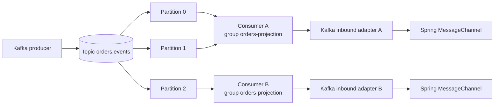
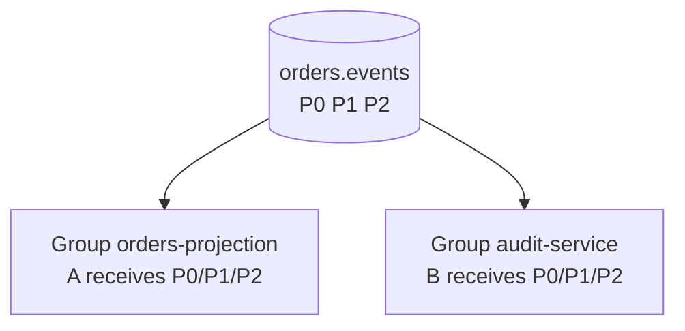
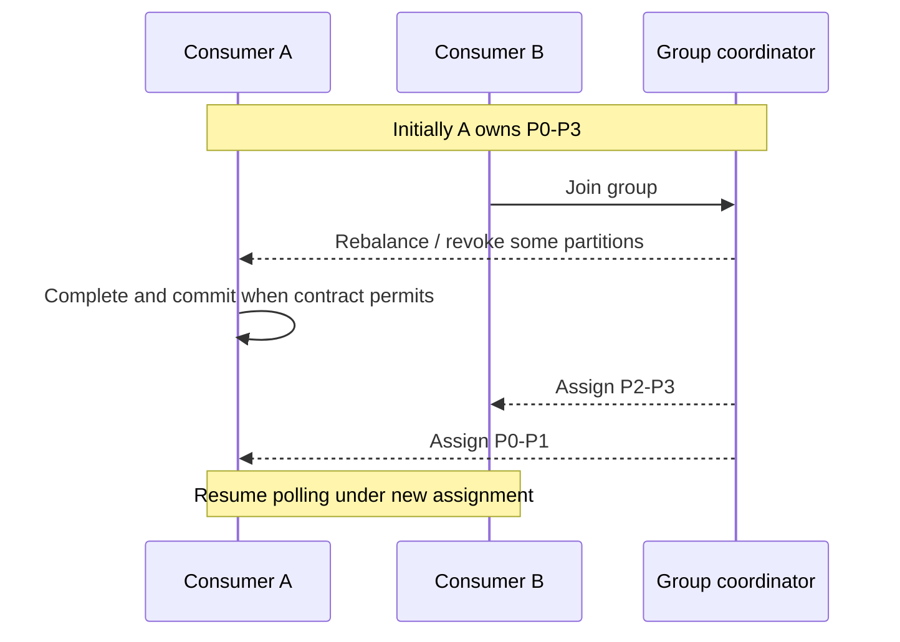
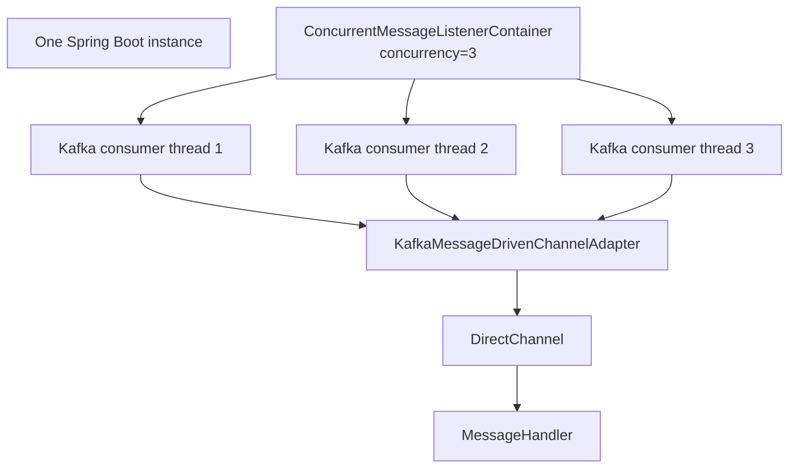
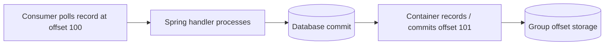
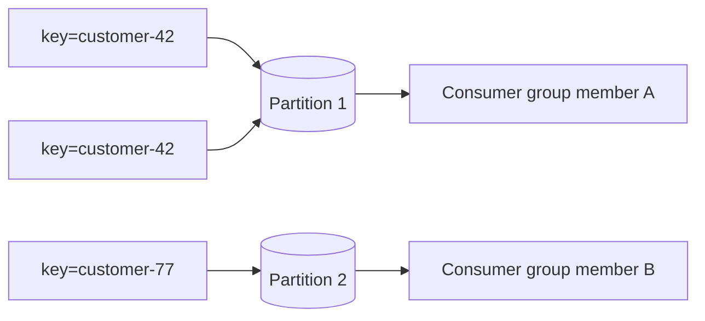

# Consumer groups and partition assignment

When a Spring Integration application consumes records from Apache Kafka, which instance receives a given record is **not decided by the `MessageChannel` name or the number of `@ServiceActivator`s**. Kafka distributes work by **consumer group** and **partition assignment**. Misconfiguring `group.id`, `concurrency`, or rebalance behavior can leave consumers idle, increase lag, lose business-level ordering, or cause records to be reprocessed after partition handoffs.

This lesson belongs to the **Kafka Adapter** chapter in the **SPRING_INTEGRATION_ADAPTERS** module. The module uses inbound/outbound adapters, gateways, pollers, and `MessageChannel` to integrate files, SFTP, HTTP, JMS, AMQP, Kafka, and databases while handling message contracts, errors, and connection lifecycles. In this lesson, we focus on **Kafka consumer groups and partition assignment** when using Kafka inbound channel adapters, listener containers, and Spring Integration flows.

> **Foundational rule:** In a **traditional Kafka consumer group**, each partition is assigned to **at most one consumer in the group at a time**. One consumer can own multiple partitions; consumers exceeding the partition count may sit idle with no work. This is distinct from Kafka *share groups*, a different model from traditional consumer groups.

## 1. Learning objectives

After this lesson, you will be able to:

1. Explain the differences among **topic**, **partition**, **Kafka consumer**, **consumer group**, **member assignment**, **consumer offset**, and **committed offset**.
2. Predict how partitions are distributed when increasing `concurrency` or pod count under the same `group.id`.
3. Distinguish **two independent groups reading the same topic** from **multiple competing consumers in the same group**.
4. Describe the group coordinator, rebalances, and partition transfer scenarios caused by scaling, restarts, timeouts, or metadata changes.
5. Compare Range, RoundRobin, Sticky, and CooperativeSticky; recognize differences between Kafka's `classic` and `consumer` group protocols.
6. Configure `ConcurrentMessageListenerContainer`, `ConsumerFactory`, and `KafkaMessageDrivenChannelAdapter` in Spring Integration.
7. Observe assignment/revocation using `ConsumerAwareRebalanceListener` and Kafka CLI tools.
8. Analyze how rebalances impact offset commits, acknowledgments, side effects, idempotency, and ordering.
9. Design scale-out, static membership, monitoring, backpressure, and production incident response procedures.

## 2. Vocabulary and responsibility map



| Term | Nature | Role |
|---|---|---|
| **Topic** | Named Kafka data log composed of partitions | Groups events sharing a contract |
| **Partition** | An offset-ordered, replicated log | The unit Kafka assigns to a consumer |
| **Consumer** | A `KafkaConsumer` client instance | Polls records, participates in a group |
| **Consumer group** | Consumers sharing the same `group.id` | Cooperatively divides subscribed partitions |
| **Assignment** | Set of `TopicPartition`s owned by a consumer | Determines where the consumer reads data from |
| **Group coordinator** | Kafka broker component managing the group | Membership, rebalance, generation/epoch |
| **Current position** | Next offset the consumer will fetch | Can advance ahead of committed offsets |
| **Committed offset** | Stored position for the group for recovery | Determines read position after reassignment/restart |
| **Lag** | Difference between log end offset and committed/processed position per tool | Backlog signal; does not prove business progress |
| **Spring Integration channel** | In-process communication channel | Connects the Kafka inbound adapter to handlers |

**Two separate scheduling layers:** Kafka decides *which consumer owns a partition*. Only then does Spring Integration decide *which handler receives a message from the adapter* based on `MessageChannel`. For example, two `EventDrivenConsumer`s subscribed to one `DirectChannel` do not cause Kafka to assign one partition to both; they only create competing handlers **inside Spring**.

## 3. Partition division: step-by-step examples

Suppose topic `orders.events` has six partitions:

```text
orders.events:
  P0  P1  P2  P3  P4  P5
```

### 3.1. One consumer in the group

```text
group.id = orders-projection
consumer A: P0, P1, P2, P3, P4, P5
```

Consumer A polls sequentially across all six partitions. Record order within **one partition** is defined by offset, while Kafka establishes no global order across all six partitions.

### 3.2. Two consumers in the same group

```text
group.id = orders-projection
consumer A: P0, P1, P2
consumer B: P3, P4, P5
```

This is an **illustrative assignment**, not guaranteed for every assignor. Each partition is still owned by at most one consumer in the group. The two consumers may run inside one JVM or across two separate pods.

### 3.3. Four consumers in the same group

```text
group.id = orders-projection
consumer A: P0, P1
consumer B: P2, P3
consumer C: P4
consumer D: P5
```

A load-balancing assignor can produce a 2–2–1–1 distribution; exact assignments depend on strategy, subscriptions, and prior state.

### 3.4. Eight consumers but only six partitions

At any moment, at most **six consumers** can receive partitions from this **single six-partition topic**. At least two consumers will be idle if all eight subscribe only to this topic.

```text
6 partitions / 8 consumers in the same group
    -> at most 6 consumers have assignments
    -> at least 2 consumers have no partitions
```

Increasing JVMs, pods, or `concurrency` beyond the partition count **does not increase parallelism at the Kafka partition level**.

### 3.5. Two completely separate groups



Two distinct groups maintain **independent committed offsets**, so each group can process the full topic data according to its own read position and retention. This is the standard way to build multiple independent logical subscribers such as `orders-projection`, `audit-service`, and `fraud-detector`.

It does **not** mean both groups receive records in the exact same millisecond, nor that a new group will always re-read every historical record forever: the starting point is governed by committed offsets and `auto.offset.reset`.

## 4. `group.id` is the work-sharing and read-progress contract

A `group.id` identifies which logical subscriber a consumer belongs to and forms part of the key for storing committed offsets (along with topic and partition).

| Configuration | Typical outcome |
|---|---|
| Two instances with same `group.id`, subscribed to same topic | Share partitions for competing consumption |
| Two instances with different `group.id`, subscribed to same topic | Each group reads independently |
| Changing `group.id` from `orders-v1` to `orders-v2` | Acts as a **new group**; does not resume `orders-v1`'s old offsets |
| Restarting with same `group.id` and valid committed offsets | Resumes from committed offsets |
| Group without committed offsets | Applies `auto.offset.reset` accordingly |
| Two Kafka listener containers in the same process and same group | They can also compete for partitions |

### 4.1. `auto.offset.reset` is not a "replay from start" button

`auto.offset.reset=earliest` applies when a group/partition has no valid committed offset (or the old position no longer exists per policy). It does **not** force a group with valid committed offsets to re-read from offset 0 on every application restart.

For controlled replays, account for retention and group state; reset offsets while consumers are stopped, or use a dedicated group ID for testing. Never change a production `group.id` casually just to "fix lag," as that can trigger massive re-reads and duplicate side effects.

### 4.2. `group.id` does not replace business identity

- Group ID: identifies the logical subscriber.
- Record key: governs partitioning per producer policy, e.g., `customerId`.
- `MessageHeaders.ID`: Spring message ID.
- Business `eventId`: reconciliation/idempotency key.
- Topic-partition-offset: address of a Kafka record within a specific topic.

Do not use group ID or a bare offset as a global business key. Offset `7` of `orders.events-0` and offset `7` of `orders.events-1` are two different records.

## 5. When does a rebalance occur?

**Rebalance** is the process of transferring partition ownership among members of a group. In the `classic` protocol, the group coordinator tracks membership; assignment planning is carried out via the group leader/assignor mechanism. When a member leaves or joins, some partitions are revoked and reassigned.



Common triggers for assignment changes:

1. Scale-out: adding pods or increasing consumers in the same group.
2. Scale-in, shutdown, or container stop: consumer leaves the group.
3. Process crash, network partition, missed heartbeat, or session timeout.
4. Handler holds the poll thread too long, exceeding `max.poll.interval.ms`.
5. Topic subscription/metadata changes, such as increasing partition count.
6. Changing group protocol, assignor, or membership configuration.
7. A consumer gets **fenced** when using a duplicate `group.instance.id` under static membership.

**Not every rebalance revokes all partitions.** Eager assignment can cause broad pauses; cooperative or broker-driven incremental assignment aims to minimize moved partitions. Exact behavior depends on Kafka version, protocol, and strategy.

### 5.1. Rebalance does not mean Kafka data is deleted

Kafka retains records according to retention settings. What changes is **which consumer is authorized to read** a partition. If an offset was not committed, the new consumer may re-read records the previous consumer already processed. Duplicates after rebalances are something the system must tolerate, especially when a handler wrote to the DB before committing offsets.

### 5.2. Lost vs. revoked

- **Revoked:** the container is notified that some partitions are about to be reclaimed, giving it a chance to perform handoff steps and commit valid offsets before/during handoff.
- **Lost:** partitions may already belong to another consumer; do not assume you still hold authority to act on or commit them as in a normal revocation.

When implementing callbacks, do not manually invoke `onPartitionsRevoked` from `onPartitionsLost` if the framework already manages the callback chain. Respect the `ConsumerAwareRebalanceListener` contract and Kafka consumer thread constraints.

## 6. Partition assignment strategies

In Kafka's `classic` group protocol, `partition.assignment.strategy` selects a compatible `ConsumerPartitionAssignor` across members. Common options:

| Assignor | Idea | Notes |
|---|---|---|
| `RangeAssignor` | Splits partitions **per topic** into contiguous ranges | Multiple topics with equal partition counts can concentrate work on a subset of consumers |
| `RoundRobinAssignor` | Distributes partitions in round-robin across eligible members | Can balance total partition count better when subscriptions match |
| `StickyAssignor` | Balances while trying to keep existing assignments | Reduces partition movement compared to full recomputation |
| `CooperativeStickyAssignor` | Sticky combined with cooperative/incremental revoke/assign | Reduces disruption during membership changes; must be compatible across the group |

### 6.1. Why can Range leave many consumers idle?

Suppose there are three topics `orders`, `payments`, and `refunds`, **each with 5 partitions**, and 15 consumers all subscribing to all three. With Range's per-topic division, potentially only **5 consumers** stay active—each receiving one partition from **every topic**—leaving 10 consumers unassigned.

In the same scenario, `RoundRobinAssignor` can spread the 15 partitions across more consumers. This is a situation where inspecting actual assignments matters more than looking at total partitions or `concurrency=15`.

### 6.2. Choosing a strategy by goal

- Few topics, identical subscriptions across consumers, simplicity desired: Range is often sufficient.
- Many topics needing even total partition distribution: consider RoundRobin.
- Wanting to minimize partition movement when scaling: Sticky or CooperativeSticky can fit.
- When maintaining per-partition state (local caches, state stores): pay special attention to revoke/lost timing and state migration.

**Configuration must match version and protocol.** Specifically, when using `group.protocol=consumer` (the new protocol), assignment is coordinated broker-side; client-side `partition.assignment.strategy` does not drive assignment as in `classic`.

## 7. Two group protocols: `classic` and `consumer`

Modern Kafka supports two group coordination approaches, depending on broker/client versions:

| Characteristic | `classic` | `consumer` (new protocol) |
|---|---|---|
| Assignment decision | Client leader using negotiated assignor | Broker-side group coordinator/assignor |
| Rebalance style | Eager or cooperative depending on assignor | Incremental, broker-driven |
| Assignment customization | Client `partition.assignment.strategy` | Server-side assignor and version-supported selection |
| Heartbeat/timeout handling | `heartbeat.interval.ms` tuned on client | Heartbeat interval coordinated by broker |
| Availability | Widespread across Kafka versions | Requires broker/client/framework support for KIP-848 |

Illustrative configuration when using compatible Kafka/Spring Kafka versions:

```properties
# Only use if broker/client and Spring Kafka are compatible:
spring.kafka.consumer.properties.group.protocol=consumer
```

Do not force this property in older projects: an unsupported broker or client can prevent consumers from joining the group. In Spring for Apache Kafka 4.0, documentation supports the new protocol and notes that **custom client-side assignors are ignored** in `consumer` mode.

**Do not mix in the same example** a snippet forcing `CooperativeStickyAssignor` and another setting `group.protocol=consumer` claiming both collaborate on assignment; they are two distinct coordination mechanisms.

## 8. How does Spring Kafka `ConcurrentMessageListenerContainer` map concurrency?

`ConcurrentMessageListenerContainer` creates child `KafkaMessageListenerContainer` instances. Each child container runs one Kafka consumer, joining the group together under the `ConsumerFactory` and group configuration.



`container.setConcurrency(3)` means **3 Kafka consumer clients** in one application, not 3 new Kafka partitions. Assignment is computed across **all consumer clients in the same group across all pods**.

### 8.1. Example consumer count calculation

| Pod | `concurrency` | Consumer clients |
|---|---:|---:|
| Pod A | 2 | 2 |
| Pod B | 2 | 2 |
| Pod C | 2 | 2 |
| **Total** | — | **6** |

For a topic with 4 partitions, **at most 4 of the 6 consumers** receive assignments for that topic in the group. Adding concurrency increases overhead, connections, and rebalance scope without creating useful work.

### 8.2. `@KafkaListener(concurrency=...)` vs. adapter

Spring Kafka allows `@KafkaListener` to use a container factory and concurrency. Spring Integration's `KafkaMessageDrivenChannelAdapter` typically wraps a configured listener container. Both rely on Kafka consumer group assignment.

Do not confuse Kafka `concurrency` with Spring Integration poller's `maxMessagesPerPoll` or the number of subscribers on a `DirectChannel`. They operate at **different layers**.

### 8.3. Multiple topics, subscriptions, and assignments

When `ContainerProperties("topicA", "topicB")` is used, Kafka assigns partitions via the group. If `ContainerProperties(TopicPartitionOffset...)` is used, the container can **pin fixed partitions** instead of participating in `subscribe`/group balancing.

Keep these separate: if using fixed assignments, do not expect pods to automatically redistribute partitions on scale-out as with group subscriptions.

## 9. Complete example: Kafka inbound adapter and consumer group

Goal: two or more Spring Boot instances subscribe to topic `orders.events` with `group.id=orders-projection-demo`. Each instance can run 2 Kafka consumers. Every record is sent from the Kafka inbound adapter to `ordersInput`, then processed by `@ServiceActivator`. A rebalance listener logs assignment/revocation events.

### 9.1. Maven dependencies

Use the Spring Boot parent/BOM to manage compatible Spring Integration and Spring Kafka versions:

```xml
<dependency>
    <groupId>org.springframework.boot</groupId>
    <artifactId>spring-boot-starter-integration</artifactId>
</dependency>
<dependency>
    <groupId>org.springframework.integration</groupId>
    <artifactId>spring-integration-kafka</artifactId>
</dependency>
```

### 9.2. application.properties

```properties
demo.kafka.bootstrap-servers=localhost:9092
demo.kafka.group-id=orders-projection-demo
demo.kafka.concurrency=2
```

**Single demo group:** When running multiple instances, keep the same `group-id`. To test independent consumption, run a second time with a different group ID. In production, configure ACLs, TLS/SASL, serializers, retention, and schemas properly.

### 9.3. Java configuration

```java
package com.example.kafka;

import java.util.Collection;
import java.util.HashMap;
import java.util.Map;

import org.apache.kafka.clients.consumer.Consumer;
import org.apache.kafka.clients.consumer.ConsumerConfig;
import org.apache.kafka.common.TopicPartition;
import org.apache.kafka.common.serialization.StringDeserializer;
import org.springframework.beans.factory.annotation.Qualifier;
import org.springframework.beans.factory.annotation.Value;
import org.springframework.context.annotation.Bean;
import org.springframework.context.annotation.Configuration;
import org.springframework.integration.channel.DirectChannel;
import org.springframework.integration.config.EnableIntegration;
import org.springframework.integration.kafka.inbound.KafkaMessageDrivenChannelAdapter;
import org.springframework.kafka.core.ConsumerFactory;
import org.springframework.kafka.core.DefaultKafkaConsumerFactory;
import org.springframework.kafka.listener.ConcurrentMessageListenerContainer;
import org.springframework.kafka.listener.ConsumerAwareRebalanceListener;
import org.springframework.kafka.listener.ContainerProperties;
import org.springframework.messaging.MessageChannel;

@Configuration
@EnableIntegration
public class OrdersGroupConfig {

    @Bean("ordersConsumerFactory")
    public ConsumerFactory<String, String> ordersConsumerFactory(
            @Value("${demo.kafka.bootstrap-servers}") String brokers,
            @Value("${demo.kafka.group-id}") String groupId) {

        Map<String, Object> properties = new HashMap<>();
        properties.put(ConsumerConfig.BOOTSTRAP_SERVERS_CONFIG, brokers);
        properties.put(ConsumerConfig.GROUP_ID_CONFIG, groupId);
        properties.put(ConsumerConfig.KEY_DESERIALIZER_CLASS_CONFIG,
                StringDeserializer.class);
        properties.put(ConsumerConfig.VALUE_DESERIALIZER_CLASS_CONFIG,
                StringDeserializer.class);
        properties.put(ConsumerConfig.ENABLE_AUTO_COMMIT_CONFIG, false);
        properties.put(ConsumerConfig.AUTO_OFFSET_RESET_CONFIG, "earliest");
        properties.put(ConsumerConfig.CLIENT_ID_CONFIG, "orders-projection");

        // An assignor can be configured for group.protocol=classic.
        // Do not force a strategy when using group.protocol=consumer.
        return new DefaultKafkaConsumerFactory<>(properties);
    }

    @Bean("ordersInput")
    public MessageChannel ordersInput() {
        return new DirectChannel();
    }

    @Bean("ordersKafkaInbound")
    public KafkaMessageDrivenChannelAdapter<String, String>
    ordersKafkaInbound(
            @Qualifier("ordersConsumerFactory")
                    ConsumerFactory<String, String> factory,
            @Qualifier("ordersInput") MessageChannel outputChannel,
            @Value("${demo.kafka.concurrency}") int concurrency) {

        ContainerProperties cp =
                new ContainerProperties("orders.events");
        cp.setAckMode(ContainerProperties.AckMode.RECORD);

        cp.setConsumerRebalanceListener(
                new ConsumerAwareRebalanceListener() {

                    @Override
                    public void onPartitionsAssigned(
                            Consumer<?, ?> consumer,
                            Collection<TopicPartition> partitions) {
                        System.out.println("ASSIGNED " + partitions);
                    }

                    @Override
                    public void onPartitionsRevokedBeforeCommit(
                            Consumer<?, ?> consumer,
                            Collection<TopicPartition> partitions) {
                        System.out.println("REVOKED " + partitions);
                        // Log only: the framework/container remains responsible
                        // for committing per AckMode and error policy.
                    }

                    @Override
                    public void onPartitionsLost(
                            Consumer<?, ?> consumer,
                            Collection<TopicPartition> partitions) {
                        System.err.println("LOST " + partitions);
                    }
                });

        ConcurrentMessageListenerContainer<String, String> container =
                new ConcurrentMessageListenerContainer<>(factory, cp);
        container.setConcurrency(concurrency);

        KafkaMessageDrivenChannelAdapter<String, String> adapter =
                new KafkaMessageDrivenChannelAdapter<>(
                        container,
                        KafkaMessageDrivenChannelAdapter.ListenerMode.record);
        adapter.setOutputChannel(outputChannel);
        return adapter;
    }
}
```

In this code, `ContainerProperties("orders.events")` is a **topic subscription**; Kafka assigns partitions by group. Replacing it with a fixed list of `TopicPartitionOffset` changes how assignment works. `client.id` aids client observability; Spring Kafka may append suffixes to child consumers to distinguish metrics/JMX entries.

### 9.4. Downstream Spring Integration consumer

```java
package com.example.kafka;

import org.springframework.integration.annotation.ServiceActivator;
import org.springframework.kafka.support.KafkaHeaders;
import org.springframework.messaging.Message;
import org.springframework.stereotype.Component;

@Component
public class OrdersProjectionHandler {

    @ServiceActivator(inputChannel = "ordersInput")
    public void handle(Message<String> message) {
        String event = message.getPayload();

        Object topic = message.getHeaders()
                .get(KafkaHeaders.RECEIVED_TOPIC);
        Object partition = message.getHeaders()
                .get(KafkaHeaders.RECEIVED_PARTITION);
        Object offset = message.getHeaders()
                .get(KafkaHeaders.OFFSET);
        Object key = message.getHeaders()
                .get(KafkaHeaders.RECEIVED_KEY);

        // Demo: production requires DB transactions and idempotency.
        System.out.printf(
                "PROCESS thread=%s topic=%s part=%s offset=%s "
                        + "key=%s value=%s%n",
                Thread.currentThread().getName(),
                topic, partition, offset, key, event);
    }
}
```

Place `@SpringBootApplication` in `com.example.kafka` or a parent package. With `DirectChannel`, the handler typically runs synchronously on the Kafka listener thread; exceptions can propagate back to the container if not handled/suppressed in between.

### 9.5. Expected output

Running one instance: `ASSIGNED [...]` logs can list multiple partitions. Starting a second instance **in the same group**: the group rebalances and assignments shift across Kafka consumers; some partitions appear on the new instance. Stopping the second instance: partitions can be reassigned back to the first instance.

**Do not expect every record to appear on every instance.** Within one group, a record from a partition goes to the consumer owning that partition. Only with a **second group** does a second logical subscriber independently receive data according to its own offsets.

## 10. Hands-on with Kafka CLI

### 10.1. Creating a test topic

On a machine with Kafka CLI and a local broker:

```bash
kafka-topics.sh --bootstrap-server localhost:9092 \
  --create --if-not-exists \
  --topic orders.events --partitions 6 --replication-factor 1
```

This command suits learning environments. Production may disallow auto/CLI topic creation; replication factor 1 is also not fault-tolerant against broker failures.

### 10.2. Sending keyed records

```bash
kafka-console-producer.sh \
  --bootstrap-server localhost:9092 \
  --topic orders.events \
  --property parse.key=true \
  --property key.separator=:
```

Enter:

```text
customer-1:order-101-created
customer-1:order-102-created
customer-2:order-201-created
customer-1:order-101-paid
```

When the producer uses a consistent partitioner and partition count stays unchanged, records with the same key usually go to the same partition. This does **not** mean records with different keys always go to different partitions.

### 10.3. Inspecting groups and assignments

Once the application has joined the group:

```bash
# Committed offsets, log end offset, and lag per partition:
kafka-consumer-groups.sh \
  --bootstrap-server localhost:9092 \
  --describe --group orders-projection-demo

# Members and detailed assignments:
kafka-consumer-groups.sh \
  --bootstrap-server localhost:9092 \
  --describe --group orders-projection-demo \
  --members --verbose
```

Output formatting varies slightly by Kafka CLI version. Fields to record:

| Field | Meaning |
|---|---|
| `GROUP` | Consumer group being inspected |
| `TOPIC` / `PARTITION` | Partition address |
| `CURRENT-OFFSET` | Group's committed offset |
| `LOG-END-OFFSET` | Log end position reported by the tool |
| `LAG` | Difference between log end and committed position |
| `CONSUMER-ID` | Active consumer member ID |
| `HOST` | Where the consumer is running |
| `CLIENT-ID` | Client ID for correlating with Spring Kafka metrics |
| `ASSIGNMENT` | List of partitions owned by the member |

If the consumer has not committed offsets yet, some fields may display `-` or blank values. Do not treat lag readings taken mid-rebalance as absolute truth at all times.

### 10.4. Observe 4 scenarios

1. Run 1 instance, concurrency 2; record assignments.
2. Start a second instance in the same group; compare assignments and rebalance logs.
3. Stop the second instance; observe partitions moving back.
4. Change the group ID on the second instance; verify two independent groups subscribing to the topic.

Perform experiments with a **demo topic** and non-sensitive payloads. Never reset offsets or switch production groups during learning exercises.

## 11. Group assignment vs. fixed partition assignment

An important distinction in Spring Kafka is the two ways to construct `ContainerProperties`:

### 11.1. Topic subscription — Kafka group decides

```java
ContainerProperties cp =
        new ContainerProperties("orders.events");

ConcurrentMessageListenerContainer<String, String> container =
        new ConcurrentMessageListenerContainer<>(consumerFactory, cp);
container.setConcurrency(3);
```

With a subscription, consumers join a group and Kafka assigns partitions. When scaling, crashing, or changing metadata, the group can rebalance.

### 11.2. Explicit partition assignment — application decides

```java
import org.springframework.kafka.support.TopicPartitionOffset;

ContainerProperties cp = new ContainerProperties(
        new TopicPartitionOffset("orders.events", 0),
        new TopicPartitionOffset("orders.events", 1));

ConcurrentMessageListenerContainer<String, String> container =
        new ConcurrentMessageListenerContainer<>(consumerFactory, cp);
container.setConcurrency(2);
```

Here the container is given two `TopicPartitionOffset`s. Spring Kafka divides the listed partitions among its child consumers. It **does not rely on the group coordinator to automatically balance these partitions across pods** as in subscription mode.

**Severe consequence:** Deploying two pods with the identical explicit assignment `P0, P1` allows both pods to read those same partitions independently. They will not automatically split P0 to pod A and P1 to pod B just because they share `group.id`. This risks duplicate side effects or offset contention. Use explicit assignment only when you truly take responsibility for partition ownership, failover, and offsets.

### 11.3. Use cases for explicit assignment

- Pinning partitions to specific devices/jobs or specialized data processing.
- Manual recovery of specific partitions using a dedicated consumer.
- Test consumers intended to read only selected partitions.
- Systems managing partition ownership **outside Kafka group balancing**.

In business applications that autoscale on Kubernetes, **topic subscription** is generally simpler and safer.

## 12. Offsets, acknowledgment, and rebalances

Each consumer tracks its **current position** per partition; the group stores **committed offsets** for recovery. The two can differ.



The diagram above is the **ideal scenario**: the consumer successfully processes the record at offset 100 and then commits **next offset 101**. Actual boundaries depend on `AckMode`, error handlers, transactions, and whether the flow is synchronous or asynchronous.

### 12.1. Why is the committed offset usually the "next offset"?

If the processed Kafka record had offset `100`, the committed offset is normally `101`, meaning the next read starts at position 101. Do not misread `CURRENT-OFFSET=101` as "record 101 was committed to the DB."

### 12.2. Losing a partition before commit

Suppose:

```text
T0: Consumer A receives record at offset 100
T1: Consumer A writes to database successfully
T2: Group rebalance; P0 moves to consumer B
T3: Offset 101 not yet committed
T4: Consumer B re-reads from previous committed offset
```

Consumer B may receive record offset 100 again. Without DB idempotency, the side effect repeats. This is a classic **at-least-once** failure window.

### 12.3. `AckMode.RECORD` and processing errors

In record listener mode, Spring Kafka's `AckMode.RECORD` manages offsets after a record callback completes successfully per container policy. If `DirectChannel` dispatches synchronously and the handler throws an exception, the container can apply its error handler/retry if the exception is not intercepted.

**However:**

- `AckMode.RECORD` does not form a joint transaction with JDBC, HTTP, or SFTP.
- An error channel may handle the exception successfully, leaving the Kafka container unaware of any failure.
- If the handler returns early while side effects run on another thread, the callback no longer reflects true completion.
- If the application dies after DB commit but before Kafka commit, the record can be redelivered.

### 12.4. Asynchronous channels shift the ack boundary

```text
Kafka listener
  -> KafkaMessageDrivenChannelAdapter
  -> QueueChannel.enqueue(record)  [callback succeeds]
  -> container may commit offset

Later:
  -> PollingConsumer.dequeue
  -> JDBC handler [may fail]
```

If `QueueChannel` is in RAM, the offset commits, and the JVM crashes before DB commit, the record can be **lost from the business flow**. Use a durable handoff or a contract-aligned ack/transaction design when decoupling the Kafka listener from handlers. Simply adding a queue does not solve idempotency or exactly-once.

## 13. Rebalance listeners: what to do and what to avoid?

In the Section 9 example, `ConsumerAwareRebalanceListener` receives callbacks for assigned, revoked, and lost partitions.

| Callback | Approximate timing | Appropriate action |
|---|---|---|
| `onPartitionsAssigned` | Partitions assigned to consumer | Initialize per-partition state, metrics/logs |
| `onPartitionsRevokedBeforeCommit` | About to return partitions before container's pending offset commit | Enter draining state, finish eligible work within deadline |
| `onPartitionsRevokedAfterCommit` | After container handles pending commits | Record state/tracing, cleanup per contract |
| `onPartitionsLost` | Partition ownership already lost | Do not assume authority to commit/write state for those partitions |

**Do not place slow HTTP calls or large batch processing inside rebalance callbacks.** They execute in a sensitive context tied to the consumer thread and group coordination. Blocking too long increases downtime, destabilizes the group further, and can cause timeouts.

If storing offsets/state externally, only record positions the application has confirmed were truly processed; never use `consumer.position()` alone as proof of "business committed."

### 13.1. Cooperative/incremental rebalance

With cooperative strategies or the `consumer` protocol, each callback may mention **a small subset of partitions** rather than always all partitions. Cleanup logic should operate per partition rather than wiping an entire cache on any rebalance event.

### 13.2. Combining idempotency with a business DB

When handlers receive messages carrying `eventId`, a common deduplication approach:

```sql
-- Illustrative schema; adjust for the actual database.
CREATE TABLE processed_events (
    event_id VARCHAR(128) PRIMARY KEY,
    processed_at TIMESTAMP NOT NULL
);
```

Inside the **same DB transaction** as the business side effect, atomically check/insert `event_id`. When Kafka redelivers a record, the duplicate is detected and the handler can acknowledge per policy without repeating side effects. Do not use `topic-partition-offset` as a business key if events may be replayed to another topic.

## 14. Static membership with `group.instance.id`

**Dynamic membership** lets the broker assign a member ID per group session. **Static membership** uses `group.instance.id` to identify a stable consumer instance across restarts, reducing unnecessary rebalances.

Illustrative configuration:

```properties
# Only use when each process/pod has a unique, stable group.instance.id:
spring.kafka.consumer.properties.group.instance.id=orders-projection-pod-0
```

Key rules:

- **Never duplicate `group.instance.id` across two active consumers in the same group**; duplicates can cause a consumer to be fenced.
- With Spring Kafka's `ConcurrentMessageListenerContainer`, when concurrency > 1 and static membership is supported, the framework may append `-n` to the base instance ID for child consumers. Verify the exact naming behavior in your version.
- Static membership suits pods with stable identities (e.g., certain StatefulSet setups). Pods getting random IDs per deployment do not achieve stability.
- A large session timeout can **reduce rebalances during brief restarts**, yet it can also **delay failover when a member genuinely dies**.
- Static membership **does not replace** business idempotency, offset commits, or readiness checks.

### 14.1. A rebalance is not always a bug

Planned scale-outs or assignment updates after adding partitions are normal operations. What warrants investigation is **excessively frequent rebalances**, slow rebalances, or uncontrolled spikes in lag/duplicates.

## 15. Partition keys, ordering, and load distribution

The Kafka producer selects partitions based on explicit partition, key/partitioner, and client configuration. The consumer group does **not** decide which partition a record is written to; it only decides which consumer **reads** that partition.



**Ordering:**

- Kafka preserves offset order **within a partition**.
- If the producer sends the same key to the same partition and the consumer processes sequentially, per-key record ordering can be preserved.
- There is no total ordering across all partitions.
- A multi-threaded `ExecutorChannel` or asynchronous handler can make **side-effect completion order** differ from offset order even when records arrive in order.
- When **increasing partition counts**, key → partition mappings can shift, invalidating historical ordering assumptions.

### 15.1. Hot partitions and scale-out limits

If 80% of traffic shares one key or is forced into a single partition, that partition is still owned by one consumer in the group. Scaling from 3 to 30 consumers will not allow 30 consumers to read that single partition concurrently under the traditional consumer group model.

Possible steps:

1. Evaluate key distribution and per-partition metrics.
2. Revisit the key model if business rules allow sharding.
3. Optimize handlers and batch processing for hot partitions.
4. Increase partitions with a migration and ordering plan.
5. Split heavy events to a separate topic/flow if appropriate.

Do not switch to a random partitioner if aggregate ordering requirements still apply.

## 16. A simple capacity formula

For **one topic** with `P` partitions and a total of `C` Kafka consumer clients in the same group:

```text
Max consumers with work from that topic <= min(P, C)
```

Examples:

| P | Pods | Concurrency/pod | Total C | Max active consumers for topic |
|---:|---:|---:|---:|---:|
| 3 | 1 | 1 | 1 | 1 |
| 3 | 1 | 3 | 3 | 3 |
| 3 | 2 | 2 | 4 | 3 |
| 6 | 3 | 2 | 6 | 6 |
| 6 | 3 | 4 | 12 | 6 |

This is only a **theoretical assignment limit**, not a linear throughput forecast. A consumer may own a partition with no new records; evenly divided partition counts still do not guarantee even load.

### 16.1. Calculating throughput from bottlenecks

For example, if each consumer processes 100 events/second with a healthy downstream, 4 active consumers might reach ~400 events/second under favorable conditions. Yet if the DB can only sustain 250 updates/second, scaling to 8 consumers can saturate the DB, trigger timeouts, and increase lag.

Whenever tuning `concurrency`, check:

- Consumer lag per partition.
- Poll time, handler latency, and `max.poll.interval.ms`.
- CPU/GC/memory and DB/HTTP connection pools.
- Retries, rebalance counts, and error handling.
- Broker fetch/throughput, network, and message sizes.
- Ordering and record reprocessing rates.

### 16.2. Correlation with Kubernetes

Scaling pods changes **total consumers in the group** and can trigger rebalances. If using lag-based HPA, configure stabilization/limits so scaling does not oscillate rapidly. Stopping pods requires graceful shutdown and proper offset/side-effect coordination; Kubernetes SIGTERM does not automatically flush all Spring Integration work.

## 17. Group membership, timeouts, and health

Settings easily confused:

| Property | Primary impact |
|---|---|
| `group.id` | Identifies consumer group and committed offset namespace |
| `client.id` | Identifies consumer for metrics/traces |
| `group.instance.id` | Static member identity; must be unique within the group |
| `session.timeout.ms` | Detects dead members per group protocol |
| `heartbeat.interval.ms` | Heartbeat cadence in the `classic` protocol |
| `max.poll.interval.ms` | Limit between polls; overly long blocking work can shift group ownership |
| `max.poll.records` | Max records returned per consumer poll, not a fixed batch size |
| `partition.assignment.strategy` | Selects client-side assignor for `classic` |
| `group.protocol` | Selects `classic` or `consumer` when supported |
| `auto.offset.reset` | Starting position when no valid committed offset exists |
| `enable.auto.commit` | Whether the Kafka client auto-commits offsets periodically |

**Remember:** With `group.protocol=consumer`, certain heartbeat/session options live broker-side and client-side assignment strategies behave differently or do not apply. Consult documentation for your **exact broker/client version** before tuning.

### 17.1. A running container does not guarantee partition assignments

`adapter.isRunning() == true` or `container.isRunning() == true` can coincide with:

- Consumers currently joining/rebalancing without partitions yet.
- More consumers than partitions.
- Group paused or no new records on the topic.
- Unreachable broker or insufficient ACLs.
- Slow handler processing causing lag to keep climbing.

Readiness therefore requires checking **assignments, lag, last-successful-processing time, and downstream health**, not just Spring bean state.

## 18. Diagnosing common symptoms

| Symptom | Hypothesis | How to verify |
|---|---|---|
| 4 pods but only 1 pod processes | Topic has only 1 partition or extreme key skew | Check partition count and group assignment |
| `concurrency=10` yet many threads idle | Too few partitions or multi-topic `RangeAssignor` | `--members --verbose`, assignor |
| Two services in the same group, one receives no records | They are splitting partitions rather than acting as separate subscribers | Give each independent subscriber its own group ID |
| After restart, all old records are re-read | Group ID changed or no valid offsets | Check committed offsets, `auto.offset.reset`, retention |
| DB duplicates after rebalance | Side effect committed before Kafka offset commit | Idempotency, ack/error policy, transactions |
| Continuous rebalances | Long-blocking handler, network issues, constant member churn | `max.poll.interval.ms`, rebalance events, heartbeats, HPA |
| One static member fails to start | `group.instance.id` collides with another member | Check fencing and per-instance IDs |
| Group has lag while adapter is running | No assignment, slow downstream, or async channel | Per-partition metrics, handler latency, queue depth |
| Increasing partitions fails to raise throughput | Key skew, DB bottleneck, mismatched consumer count | Key/lag distribution, DB metrics |
| Switched to `QueueChannel` and records vanished after crash | Offset committed before handler finished; in-memory queue | Durable handoff, ack boundary |
| Consumer B re-reads offsets already processed by A | Rebalance occurred with uncommitted offsets | Crash window, idempotency store |
| Explicit assignment causes duplicates across pods | Same partition pinned on multiple instances | Inspect `TopicPartitionOffset` vs. `subscribe()` |

### 18.1. Safe investigation workflow

1. Confirm the exact **topic, group ID, partition count, pod count, and concurrency per pod**.
2. Inspect Kafka CLI `--describe --group` and `--members --verbose`.
3. Correlate `client.id`, hostname/pod, and assignments from rebalance logs.
4. Check `last processed offset`, committed offset, and lag, keeping them distinct.
5. Compare handler latency, error rates, DB/HTTP capacity, and Kafka client timeouts.
6. Determine whether errors caused duplicates via rebalance/retry; verify business idempotency.
7. Change **one variable at a time**: concurrency, assignor, poll batch size, session/heartbeat, or instance count.
8. Re-measure and document results. Never reset production offsets without a replay/rollback plan.

## 19. Practice exercises

### Exercise 1 — Sketch assignments for a topic

A topic has 8 partitions. Sketch a possible assignment for 1, 2, 4, 8, and 10 consumers in the same group. State the maximum number of consumers that actually hold partitions in each case.

### Exercise 2 — Two groups on one topic

Run two applications both subscribing to `orders.events` using different `group.id`s. Send five records. Verify each group maintains independent committed offsets. Then switch both to the same group and observe partition sharing.

### Exercise 3 — Concurrency across multiple pods

Run the Section 9 example with 2 pods, each with `concurrency=2`, on a 6-partition topic. Use `kafka-consumer-groups.sh --members --verbose` to map actual assignments. Increase concurrency to 4/pod and explain which consumers sit idle.

### Exercise 4 — Multi-topic Range vs. RoundRobin

Create 3 topics with 5 partitions each; have 15 consumers subscribe to all of them. Observe with `classic` `RangeAssignor`, then test `RoundRobinAssignor` in a separate environment. Record active consumer counts and partitions/member. Do not assume every Kafka version shares the same default assignor.

### Exercise 5 — Intentional rebalance

Start one instance, then add a second instance, then stop the first instance. Collect `ASSIGNED`, `REVOKED`, and `LOST` logs. When can the `LOST` callback occur? Why should you avoid manually committing offsets after losing ownership?

### Exercise 6 — Crash after DB commit

Have the handler commit to the DB and then crash before Kafka commits the offset. Create a `processed_events` table with a unique constraint on `eventId` and implement an idempotency check. Verify redelivered records do not create duplicate side effects.

### Exercise 7 — Explicit assignment

Create two instances both configured with `TopicPartitionOffset("orders.events",0)`. Observe that they can both read the same partition instead of splitting via the group. Explain why copying this configuration identically across pods is dangerous.

### Exercise 8 — Hot partition

Send 90% of records with the same `customerId`. Inspect per-partition lag and per-consumer CPU/latency. If doubling concurrency fails to reduce lag on the hot partition, propose key, batching, or data-model changes compatible with ordering requirements.

### Exercise 9 — Static membership

On a supporting cluster and Spring Kafka version, configure a unique `group.instance.id` for pods with stable identities. Compare rebalance durations during a rolling restart against dynamic membership. Analyze the trade-off when session timeout is too long and a pod genuinely dies.

### Exercise 10 — `classic` vs. `consumer` protocol

On a supporting Kafka 4.x cluster, compare assignments/rebalances under `group.protocol=classic` vs. `group.protocol=consumer`. Observe partial assignment callback counts, warnings about client assignors being ignored in the new protocol, and relevant timeout properties. Never run this directly on a production group.

### Exercise 11 — Asynchronous `MessageChannel`

Replace `DirectChannel` in the example with an in-memory `QueueChannel` and a polling consumer writing to the DB. Have the listener enqueue and kill the JVM before the handler commits. Identify the data-loss boundary and propose a durable message store/outbox or alternative ack coordination.

### Exercise 12 — Production scale-out design

A system has 12 partitions, 3 pods, 3 consumers per pod; the DB allows at most 400 updates/second. Data has key skew and retry rates rise when scaling. Create an inspection plan covering partition lag, handler p95, connection pools, and rebalances before proposing scaling up to 6 consumers/pod.

## 20. Self-check questions

1. Can a single partition be assigned simultaneously to two consumers in **the same traditional consumer group**?
2. Do consumer groups and Kafka share groups have the same assignment contract?
3. Do two different groups share the same committed offsets?
4. How do `client.id` and `group.id` differ?
5. Does `concurrency` on `ConcurrentMessageListenerContainer` create more partitions or more consumers?
6. With 4 partitions and 10 consumers in the same group, at most how many consumers hold partitions?
7. Why can `RangeAssignor` across multiple topics leave many consumers idle?
8. How does cooperative rebalance differ from eager rebalance in revoking partitions?
9. Does `group.protocol=consumer` use client-side `partition.assignment.strategy` like `classic`?
10. How must `group.instance.id` be provisioned when running multiple pods?
11. What happens when a consumer holds the poll thread longer than `max.poll.interval.ms`?
12. How does explicit `TopicPartitionOffset` assignment differ from topic subscription?
13. Does the committed offset usually point to the last processed record or the **next** position?
14. If the DB commit succeeds while the Kafka offset has not yet committed, what can happen?
15. Why does `isRunning=true` not prove a consumer has partition assignments?
16. Why can increasing partition count affect per-key ordering?
17. How should a Kafka rebalance listener behave upon receiving `onPartitionsLost`?
18. If consumer lag is 0 yet an internal queue still holds 1,000 messages, can you conclude the flow has finished?

## 21. Summary

A **consumer group** is the load-sharing and committed-offset tracking unit for a logical Kafka subscriber; **partition assignment** determines which Kafka consumer actually owns each partition. In Spring Integration, a `KafkaMessageDrivenChannelAdapter` receives records via a listener container and emits Spring messages to a channel, while the Kafka group protocol coordinates partitions across all consumers on every JVM/pod sharing `group.id`.

Solid design combines **partition count, total concurrency, assignor/protocol, rebalance behavior, committed offsets, business idempotency, and downstream capacity**. Do not just add consumers or check `running=true`. Observe assignments, per-partition lag, handler latency, and business outcomes; test crash/rebalance windows to protect data when connecting Kafka to files, SFTP, HTTP, JMS, AMQP, or databases.

## References

- [Spring Integration Reference — Apache Kafka Support](https://docs.spring.io/spring-integration/reference/kafka.html)
- [Spring Integration API — KafkaMessageDrivenChannelAdapter](https://docs.spring.io/spring-integration/api/org/springframework/integration/kafka/inbound/KafkaMessageDrivenChannelAdapter.html)
- [Spring Kafka Reference — Message Listener Containers](https://docs.spring.io/spring-kafka/reference/kafka/receiving-messages/message-listener-container.html)
- [Spring Kafka Reference — Rebalancing Listeners / Kafka 4.0 Consumer Rebalance Protocol](https://docs.spring.io/spring-kafka/reference/kafka/receiving-messages/rebalance-listeners.html)
- [Spring Kafka API — ConsumerAwareRebalanceListener](https://docs.spring.io/spring-kafka/api/org/springframework/kafka/listener/ConsumerAwareRebalanceListener.html)
- [Apache Kafka Documentation — Consumer Configs](https://kafka.apache.org/44/configuration/consumer-configs/)
- [Apache Kafka API — KafkaConsumer Consumer Groups and Topic Subscriptions](https://kafka.apache.org/44/javadoc/org/apache/kafka/clients/consumer/KafkaConsumer.html)
- [Apache Kafka Documentation — Consumer Group Design](https://kafka.apache.org/documentation/)
