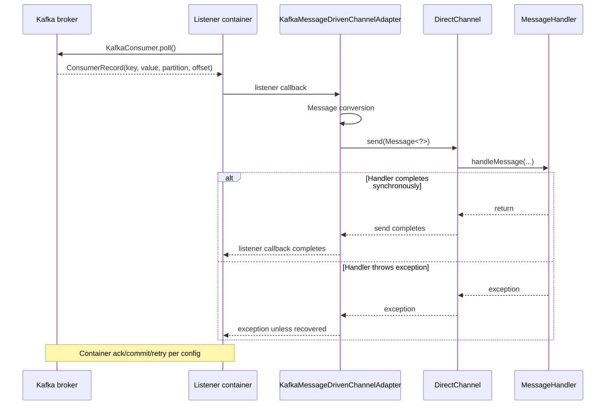
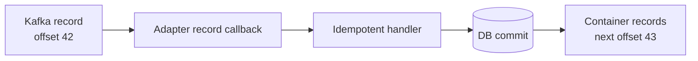
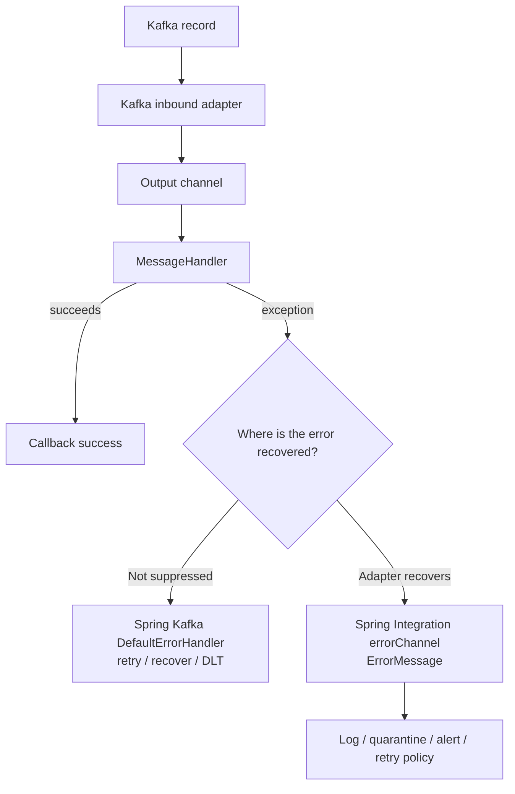
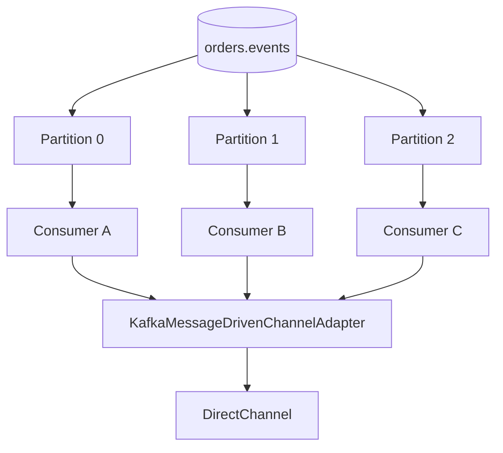
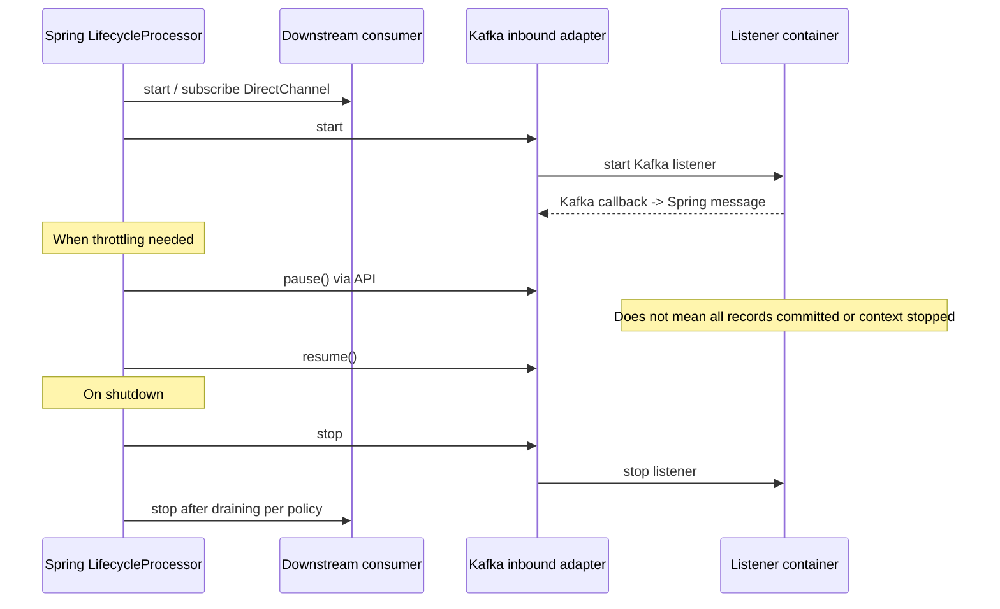

# KafkaMessageDrivenChannelAdapter

`KafkaMessageDrivenChannelAdapter<K,V>` is Spring Integration's **message-driven Kafka ingestion** endpoint. It uses a Spring Kafka listener container to receive callbacks containing a record or batch, converts the data into a Spring `Message<?>`, and sends it to an **output `MessageChannel`**. It is the bridge between Kafka's consumption model (topic, partition, group, offset) and Spring Integration's Enterprise Integration Patterns (channel, filter, transformer, router, service activator).

This lesson belongs to the **Kafka Adapter** chapter of the **SPRING_INTEGRATION_ADAPTERS** module, where files, SFTP, HTTP, JMS, AMQP, Kafka, and databases are integrated using inbound/outbound adapters, gateways, pollers, and `MessageChannel`, while controlling message contracts, error handling, and connection lifecycles. This lesson dives deeply into the **API and runtime mechanics of `KafkaMessageDrivenChannelAdapter` itself**, going beyond high-level Kafka inbound concepts.

> **Safety principle:** A record moving from Kafka into a Spring channel **does not mean** database/HTTP side effects have completed or offsets were committed as intended. Flow reliability depends on the listener container, channel type, acknowledgment, errors, and deduplication policy.

## 1. Learning outcomes

After this lesson, you will be able to:

1. Describe the chain `KafkaConsumer → MessageListenerContainer → KafkaMessageDrivenChannelAdapter → MessageChannel → MessageHandler`.
2. Read the Javadoc and choose `KafkaMessageDrivenChannelAdapter(container)` or `KafkaMessageDrivenChannelAdapter(container, ListenerMode)`.
3. Distinguish `ListenerMode.record` from `ListenerMode.batch` and pick compatible converters and handler payload types.
4. Configure the adapter with Java `@Bean`, Java DSL, and XML namespace; assign explicit endpoint IDs and output channels.
5. Use `setMessageConverter`, `setPayloadType`, `setRecordFilterStrategy`, `setAckDiscarded`, and `setBindSourceRecord` where appropriate.
6. Distinguish **Spring Integration's error channel** from **Spring Kafka container's error handler**, and understand how retries/recovery affect offsets.
7. Analyze the differences among `DirectChannel`, `QueueChannel`, and `ExecutorChannel` at the processing confirmation boundary.
8. Manage lifecycle, pause/resume, rebalances, concurrency, partition ordering, and observability metrics.
9. Practice simulating retries, duplicate records, batch failures, DLT routing, and restarts without losing business data.

## 2. Where the class sits in Spring Integration

```mermaid
flowchart LR
    Broker[("Kafka topic<br/>orders.events")]
    Container["Kafka listener container<br/>ConcurrentMessageListenerContainer"]
    Adapter["KafkaMessageDrivenChannelAdapter<br/>MessageProducerSupport"]
    Output["Spring output channel<br/>ordersFromKafka"]
    Consumer["EventDrivenConsumer"]
    Handler["MessageHandler<br/>validate / persist"]
    Target[("Database / HTTP / SFTP")]

    Broker -->|"KafkaConsumer.poll()"| Container
    Container -->|"listener callback"| Adapter
    Adapter -->|"send(Message<?>)"| Output
    Output --> Consumer
    Consumer --> Handler
    Handler --> Target
```

According to its Javadoc, `KafkaMessageDrivenChannelAdapter<K,V>` extends `MessageProducerSupport` and implements inbound/lifecycle contracts such as `KafkaInboundEndpoint`, `SmartLifecycle`, and `Pausable`.



There are **two perspectives**:

- **From Kafka's side:** the application is a topic consumer, receiving records and managing offsets within a consumer group.
- **From Spring Integration's side:** the adapter is a **message producer endpoint**, emitting messages to an output channel; the downstream handler is the message consumer endpoint.

Calling the adapter a "producer" therefore **does not mean it publishes Kafka records**. The component that publishes out to Kafka is the **Kafka outbound channel adapter**, typically backed by `KafkaProducerMessageHandler`.

### 2.1. Classes and interfaces to distinguish

| Component | Role |
|---|---|
| `ConsumerFactory<K,V>` | Configures Kafka consumer client: brokers, deserializers, group ID, security |
| `ContainerProperties` | Topic/partition, ack mode, and listener configuration |
| `KafkaMessageListenerContainer<K,V>` | Listener container with one Kafka consumer |
| `ConcurrentMessageListenerContainer<K,V>` | Coordinates multiple child listener containers per `concurrency` |
| `KafkaMessageDrivenChannelAdapter<K,V>` | Converts Kafka callbacks to Spring messages and sends to output channel |
| `MessageProducerSupport` | Base class providing output/error channels and message sending support |
| `MessageChannel` | Routes messages to downstream consumers |
| `EventDrivenConsumer` | Subscribes a handler to a `SubscribableChannel` such as `DirectChannel` |
| `PollingConsumer` | Receives from a `PollableChannel` such as `QueueChannel` via a Spring Integration poller |
| `KafkaMessageSource` | Kafka source for the **polling inbound adapter**, a different model |

### 2.2. Why is it called "message-driven" if the Kafka client still polls?

The Kafka listener container calls `KafkaConsumer.poll()` to fetch records, send heartbeats, and participate in the consumer group. At the Spring Integration level, however, you **do not** put `@Poller(fixedDelay="...")` on `KafkaMessageDrivenChannelAdapter`. When the container receives records, it invokes the listener registered by the adapter.

Conversely, `KafkaMessageSource` can be wired to a `SourcePollingChannelAdapter` so Spring Integration **actively calls `receive()` via a poller**:

```text
Message-driven:
  Kafka consumer poll loop (Spring Kafka container)
       -> listener callback
       -> KafkaMessageDrivenChannelAdapter
       -> output channel

Polling inbound:
  Spring Integration Poller
       -> KafkaMessageSource.receive()
       -> SourcePollingChannelAdapter
       -> output channel
```

The two mechanisms have different lifecycles, throttling, and acknowledgments. Do not configure both on the same topic and group unless you intentionally want competing consumers.

## 3. Core API of `KafkaMessageDrivenChannelAdapter`

### 3.1. Two constructors

```java
// Record mode: default when passing only the container.
KafkaMessageDrivenChannelAdapter<String, String> recordAdapter =
        new KafkaMessageDrivenChannelAdapter<>(container);

// Record or batch mode chosen explicitly.
KafkaMessageDrivenChannelAdapter<String, String> batchAdapter =
        new KafkaMessageDrivenChannelAdapter<>(
                anotherContainer,
                KafkaMessageDrivenChannelAdapter.ListenerMode.batch);
```

`container` and `anotherContainer` here are illustrative variables of type `AbstractMessageListenerContainer<String,String>`; in real code they must be created and lifecycle-managed properly. These are **two options for comparison**, not meant to both start on the same group/topic unintentionally.

In Javadoc, `ListenerMode` includes:

| Value | One Spring message represents |
|---|---|
| `ListenerMode.record` | **One** converted `ConsumerRecord` |
| `ListenerMode.batch` | **A group** of records from a consumer poll, after batch conversion |

**Note:** `ConsumerRecord<K,V>` is Kafka data prior to conversion; the Spring `Message<?>` payload is not necessarily the entire `ConsumerRecord`. With typical converter configurations, the payload is the converted **value** or collection of values, while topic/partition/offset metadata goes into headers.

### 3.2. Important setters

| API | Purpose | Notes |
|---|---|---|
| `setOutputChannel(channel)` | Defines where the adapter emits messages | Channel needs an appropriate consumer |
| `setErrorChannel(channel)` | Configures Spring Integration's `ErrorMessage` path | Recovery behavior affects exception propagation |
| `setSendTimeout(long)` | Wait limit when sending to channels that support it | Not a Kafka broker timeout |
| `setRecordMessageConverter(converter)` | Converter for `record` mode | Must match deserializer/schema |
| `setBatchMessageConverter(converter)` | Converter for `batch` mode | Payloads/headers take batch shapes |
| `setMessageConverter(converter)` | General converter configuration | Converter must be compatible with listener mode |
| `setPayloadType(SomeDto.class)` | Hints target type to type-aware converters | Does not create a JSON parser without a converter configured |
| `setRecordFilterStrategy(filter)` | Selects records to drop before downstream | Applies to record filter paths |
| `setAckDiscarded(boolean)` | Controls acknowledging filtered records | Consider lost-message risk and ack policy |
| `setFilterInRetry(boolean)` | Whether filter re-runs on each retry or once | Relevant when combining filter and adapter retry |
| `setRetryTemplate(retryTemplate)` | Retries delivery/dispatch at the adapter layer | Blocking; can affect `max.poll.interval.ms` |
| `setRecoveryCallback(callback)` | Runs after adapter retries are exhausted | Determines whether errors are suppressed or propagated |
| `setBindSourceRecord(true)` | Keeps raw source record in `IntegrationMessageHeaderAccessor.SOURCE_DATA` | Useful for tracing; do not pass across threads to touch the consumer |
| `setPhase(int)`, `setAutoStartup(boolean)` | Controls lifecycle | Does not alter Kafka readiness or offset semantics |
| `pause()`, `resume()`, `isPaused()` | Manages runtime ingestion | Not commit, seek, or full context stop |

This list is primarily based on modern Spring Integration Javadocs; APIs and defaults can vary across versions. Ensure your project uses a **compatible Spring Boot/Spring Integration/Spring Kafka set** and check the Javadoc for your exact running version.

### 3.3. Message producer endpoint vs. `MessageHandler`

`KafkaMessageDrivenChannelAdapter` is an **endpoint at the start of a flow**, not a `MessageHandler` receiving from an input channel. Correct wiring:

```text
Kafka topic -> adapter -> outputChannel -> consumer endpoint -> handler
```

Wrong direction:

```text
inputChannel -> KafkaMessageDrivenChannelAdapter   // Wrong role
```

To receive messages from a channel and send them to Kafka, use `KafkaProducerMessageHandler`/Kafka outbound adapter.

## 4. Lifecycle of a record from broker to handler



With `DirectChannel`, the handler normally runs on the **listener thread**; once the handler succeeds, the callback can be treated as complete. With `QueueChannel` or `ExecutorChannel`, `send()` returning may only prove **enqueuing or handoff to an executor**, not that side effects committed.

### 4.1. Four milestones to distinguish

1. Kafka consumer **fetches** the record.
2. Adapter **converts and dispatches** the Spring message.
3. Downstream **executes the side effect** (e.g., DB commit).
4. Container **acks/commits the offset** per `AckMode`, transaction, and error handler.

These milestones can fall out of order in asynchronous models. Any failure window can cause re-received records or missing/duplicate side effects without a durable strategy.

## 5. Preparing the hands-on environment

We receive `String` order events from topic `orders.events` using `KafkaMessageDrivenChannelAdapter<String,String>`. The handler logs metadata; a later exercise replaces logging with a DB transaction.

Prerequisites:

- Java 17+ and Spring Boot with compatible Spring Integration/Spring Kafka dependency management.
- Test Kafka broker at `localhost:9092` (adjust to your environment).
- Existing `orders.events` topic, e.g., with three partitions.
- Dedicated demo `group.id`, never a production group.

### 5.1. Maven dependencies

In `pom.xml`, rely on the Spring Boot BOM or parent:

```xml
<dependency>
    <groupId>org.springframework.boot</groupId>
    <artifactId>spring-boot-starter-integration</artifactId>
</dependency>
<dependency>
    <groupId>org.springframework.integration</groupId>
    <artifactId>spring-integration-kafka</artifactId>
</dependency>
```

Depending on your BOM, inspect the dependency tree if conflicts arise among `spring-integration-kafka`, `spring-kafka`, and `kafka-clients`. **Do not** copy arbitrary versions from an online snippet assuming all APIs stay compatible.

### 5.2. Properties

```properties
demo.kafka.bootstrap-servers=localhost:9092
demo.kafka.group-id=orders-adapter-class-demo
demo.kafka.concurrency=2
```

In production, brokers may require TLS/SASL, ACLs, schema registry, and secret management; never log tokens/passwords in payloads or Kafka headers.

## 6. Complete Java configuration: adapter in record mode

This example focuses on the **`KafkaMessageDrivenChannelAdapter` class**: creating `ConsumerFactory`, `ContainerProperties`, `ConcurrentMessageListenerContainer`, the output channel, and the adapter.

```java
package com.example.integration;

import java.util.HashMap;
import java.util.Map;

import org.apache.kafka.clients.consumer.ConsumerConfig;
import org.apache.kafka.common.serialization.StringDeserializer;

import org.springframework.beans.factory.annotation.Qualifier;
import org.springframework.beans.factory.annotation.Value;
import org.springframework.context.annotation.Bean;
import org.springframework.context.annotation.Configuration;
import org.springframework.integration.channel.DirectChannel;
import org.springframework.integration.config.EnableIntegration;
import org.springframework.integration.kafka.inbound.KafkaMessageDrivenChannelAdapter;
import org.springframework.kafka.core.ConsumerFactory;
import org.springframework.kafka.core.DefaultKafkaConsumerFactory;
import org.springframework.kafka.listener.ConcurrentMessageListenerContainer;
import org.springframework.kafka.listener.ContainerProperties;
import org.springframework.messaging.MessageChannel;

@Configuration
@EnableIntegration
public class OrdersKafkaAdapterConfig {

    @Bean("ordersConsumerFactory")
    public ConsumerFactory<String, String> ordersConsumerFactory(
            @Value("${demo.kafka.bootstrap-servers}") String brokers,
            @Value("${demo.kafka.group-id}") String groupId) {

        Map<String, Object> props = new HashMap<>();
        props.put(ConsumerConfig.BOOTSTRAP_SERVERS_CONFIG, brokers);
        props.put(ConsumerConfig.GROUP_ID_CONFIG, groupId);
        props.put(ConsumerConfig.KEY_DESERIALIZER_CLASS_CONFIG,
                StringDeserializer.class);
        props.put(ConsumerConfig.VALUE_DESERIALIZER_CLASS_CONFIG,
                StringDeserializer.class);
        props.put(ConsumerConfig.ENABLE_AUTO_COMMIT_CONFIG, false);
        props.put(ConsumerConfig.AUTO_OFFSET_RESET_CONFIG, "earliest");

        return new DefaultKafkaConsumerFactory<>(props);
    }

    @Bean("ordersFromKafka")
    public MessageChannel ordersFromKafka() {
        return new DirectChannel();
    }

    @Bean("ordersMessageDrivenAdapter")
    public KafkaMessageDrivenChannelAdapter<String, String> inboundAdapter(
            @Qualifier("ordersConsumerFactory")
                ConsumerFactory<String, String> factory,
            @Qualifier("ordersFromKafka")
                MessageChannel output,
            @Value("${demo.kafka.concurrency}") int concurrency) {

        // Container subscribes to topic by group.
        ContainerProperties listenerProperties =
                new ContainerProperties("orders.events");

        // Commit when record callback finishes, per Spring Kafka.
        listenerProperties.setAckMode(
                ContainerProperties.AckMode.RECORD);

        ConcurrentMessageListenerContainer<String, String> container =
                new ConcurrentMessageListenerContainer<>(
                        factory, listenerProperties);
        container.setConcurrency(concurrency);

        KafkaMessageDrivenChannelAdapter<String, String> adapter =
                new KafkaMessageDrivenChannelAdapter<>(
                        container,
                        KafkaMessageDrivenChannelAdapter.ListenerMode.record);

        adapter.setOutputChannel(output);
        adapter.setAutoStartup(true);

        // Internal consumer on DirectChannel should start first.
        adapter.setPhase(200);

        return adapter;
    }
}
```

#### Complete explanation

1. `StringDeserializer` turns Kafka keys/values into `String`. It does **not automatically** turn JSON into a validated DTO.
2. `ConsumerConfig.GROUP_ID_CONFIG` identifies the logical subscriber; multiple instances in the same group share partitions.
3. `ENABLE_AUTO_COMMIT_CONFIG=false` lets the container manage commits via `AckMode`, avoiding timer-based Kafka client auto-commits.
4. `AUTO_OFFSET_RESET_CONFIG=earliest` only applies when the group/partition **lacks a valid committed offset** or meets reset conditions; it does not replay from the start on every restart.
5. `ContainerProperties("orders.events")` uses **topic subscription**, not explicit partition assignment.
6. `AckMode.RECORD` is straightforward to reason about with a `record` listener and `DirectChannel`; it is not a distributed transaction with the DB.
7. `setConcurrency(2)` creates up to two child consumers; throughput depends on partition count and other consumers in the group.
8. The adapter uses **output `ordersFromKafka`**; the channel must have a subscribed consumer before the adapter emits records.
9. `setPhase(200)` denotes endpoint lifecycle phase, **not** a 200 ms timeout or Kafka priority.
10. The adapter is a managed `SmartLifecycle` bean, so **do not** manually call `container.start()` outside it in this example.

**Run conditions:** add `@SpringBootApplication` in `com.example.integration` or a parent package; ensure the handler in the next section is component-scanned. If another `@KafkaListener` shares the same topic/group, consumers will **compete for assignments** rather than every component receiving every record.

## 7. Handler consuming messages from the output channel

Here the handler is wired via `@ServiceActivator(inputChannel=...)`:

```java
package com.example.integration;

import org.springframework.integration.annotation.EndpointId;
import org.springframework.integration.annotation.ServiceActivator;
import org.springframework.kafka.support.KafkaHeaders;
import org.springframework.messaging.Message;
import org.springframework.stereotype.Component;

@Component
public class OrdersEventHandler {

    @EndpointId("ordersEventConsumer")
    @ServiceActivator(inputChannel = "ordersFromKafka")
    public void onEvent(Message<String> message) {

        String payload = message.getPayload();
        String topic = message.getHeaders().get(
                KafkaHeaders.RECEIVED_TOPIC, String.class);

        Object partition = message.getHeaders().get(
                KafkaHeaders.RECEIVED_PARTITION);
        Object offset = message.getHeaders().get(KafkaHeaders.OFFSET);
        Object key = message.getHeaders().get(
                KafkaHeaders.RECEIVED_KEY);

        if (payload.isBlank()) {
            // Let container notice the error when not recovered at the adapter layer.
            throw new IllegalArgumentException(
                    "Missing order payload");
        }

        System.out.printf(
                "RECEIVED topic=%s partition=%s offset=%s "
                        + "key=%s value=%s%n",
                topic, partition, offset, key, payload);
    }
}
```

- `@ServiceActivator` creates a **consumer endpoint** listening on `DirectChannel`.
- `@EndpointId` sets a clear ID for lifecycle/management inspection; it is **not** the Kafka group ID.
- `KafkaHeaders.RECEIVED_KEY` can be **absent** when the Kafka record key is null; use a nullable lookup.
- `KafkaHeaders.OFFSET` gives the record's position in the partition; it is not a business idempotency key.
- `System.out.printf` is for demo only; production requires structured logging without exposing sensitive data.

### 7.1. Testing with Kafka CLI

```bash
# Single-broker lab environment:
kafka-topics.sh --bootstrap-server localhost:9092 \
  --create --if-not-exists \
  --topic orders.events --partitions 3 --replication-factor 1

# Send value without key (CLI varies by version):
kafka-console-producer.sh \
  --bootstrap-server localhost:9092 \
  --topic orders.events
```

Enter:

```text
ORD-101
ORD-102
ORD-103
```

In application logs, you will see topic, partition, offset, and value metadata; **do not assume** offsets start at 0 or events always land on one fixed partition.

Inspect the group:

```bash
kafka-consumer-groups.sh \
  --bootstrap-server localhost:9092 \
  --describe --group orders-adapter-class-demo

kafka-consumer-groups.sh \
  --bootstrap-server localhost:9092 \
  --describe --group orders-adapter-class-demo \
  --members --verbose
```

These two commands display committed offsets, lag, and partition assignments; while the group is rebalancing, some fields may temporarily be blank.

## 8. Java DSL: creating the adapter via Spring Integration's factory

Instead of creating the adapter bean with `new`, the Java DSL offers `Kafka.messageDrivenChannelAdapter(...)`.

```java
// Placed in a @Configuration class as an alternative to the @Bean adapter in Section 6.
import org.springframework.context.annotation.Bean;
import org.springframework.integration.dsl.IntegrationFlow;
import org.springframework.integration.kafka.dsl.Kafka;
import org.springframework.integration.kafka.inbound.KafkaMessageDrivenChannelAdapter;
import org.springframework.kafka.core.ConsumerFactory;

@Bean
public IntegrationFlow ordersKafkaDslInbound(
        ConsumerFactory<String, String> factory) {
    return IntegrationFlow
            .from(
                Kafka.messageDrivenChannelAdapter(
                        factory,
                        KafkaMessageDrivenChannelAdapter.ListenerMode.record,
                        "orders.events")
                    .id("ordersDslInbound"))
            .channel("ordersFromKafka")
            .get();
}
```

This DSL setup illustrates **the builder taking responsibility for creating the container and adapter**. When using a listener container created by `ConcurrentKafkaListenerContainerFactory`, there is also an overload accepting an **already-created container**; documentation example:

```java
IntegrationFlow.from(
    Kafka.messageDrivenChannelAdapter(
            kafkaListenerContainerFactory.createContainer("orders.events"),
            KafkaMessageDrivenChannelAdapter.ListenerMode.record)
        .id("ordersDslInbound"))
    .channel("ordersFromKafka")
    .get();
```

The second snippet is an **illustrative DSL fragment** assuming a `kafkaListenerContainerFactory` is present, not a standalone Java method.

With DSL-registered containers, giving the adapter an ID like `ordersDslInbound` lets the framework name the listener container by convention, such as `ordersDslInbound.container`. Conventions depend on registration method/component version; **never guess bean names** when introspecting production.

**Important:** Sections 6 and 8 are **two mutually exclusive alternatives**. Enabling both on the same `group.id` and topic makes Kafka split partitions between them; you might think one adapter is "losing records" when in fact they were delivered to the other consumer.

## 9. XML namespace for declarative configurations

`KafkaMessageDrivenChannelAdapter` maps to the XML element `<int-kafka:message-driven-channel-adapter>`.

```xml
<!-- Snippet inside Spring XML with beans and int-kafka namespaces declared. -->
<int-kafka:message-driven-channel-adapter
        id="ordersKafkaInbound"
        listener-container="ordersListenerContainer"
        channel="ordersFromKafka"
        mode="record"
        auto-startup="true"
        phase="200"
        send-timeout="5000"
        error-channel="ordersKafkaErrors"/>
```

In XML:

- `listener-container` references the container bean receiving from Kafka.
- `channel` is the **output channel** carrying Spring messages after conversion.
- `mode="record"` selects the listener mode.
- `auto-startup` and `phase` manage endpoint lifecycle.
- `send-timeout` applies to sending into the Spring channel, **not Kafka `request.timeout.ms`**.
- `error-channel` relates to Spring Integration error messages, **not publishing to a Kafka DLT**.

Declare corresponding `ordersListenerContainer`, `ordersFromKafka`, and `ordersKafkaErrors` beans. Do not run the XML adapter alongside Java config on the same topic/group unless partition splitting is intended.

## 10. `ListenerMode.record` vs. `ListenerMode.batch`

### 10.1. Record mode

```text
Kafka poll() returns:
  [ConsumerRecord A, ConsumerRecord B, ConsumerRecord C]

Adapter ListenerMode.record emits:
  Spring Message A
  Spring Message B
  Spring Message C
```

Each message typically carries one payload value (or converted DTO) and single-valued topic/partition/offset metadata.

### 10.2. Batch mode

```text
Kafka poll() returns:
  [ConsumerRecord A, ConsumerRecord B, ConsumerRecord C]

Adapter ListenerMode.batch emits:
  1 Spring Message:
      payload = [value A, value B, value C]
      headers contain corresponding list metadata
```

In batch mode, the payload is typically a list of values/DTOs, and headers like `KafkaHeaders.RECEIVED_KEY`, `RECEIVED_PARTITION`, `RECEIVED_TOPIC`, and `OFFSET` can be positionally aligned lists.

| Aspect | Record | Batch |
|---|---|---|
| Messages sent to Spring channel | One message / Kafka record | One message / batch from poll |
| Typical handler signature | `Message<String>` / `Message<Order>` | `Message<List<String>>` / list of DTOs |
| Metadata | Single topic/partition/offset | Lists aligned to batch elements |
| Failed record handling | Easy to isolate specific record | Requires policy for identifying failing items |
| Target transaction | Per record or handler-batched | Enables bulk processing |
| Ack/commit | Depends on container record `AckMode` | Depends on batch listener/`AckMode`, not identical to record |
| Ordering | Per partition by offset | May span multiple partitions in one poll |

**Common mistake:** Switching the constructor to `ListenerMode.batch` while keeping a `Message<String>` handler. The payload contract has changed; rewrite the handler and ensure the batch converter/container match.

### 10.3. Example switching to batch

```java
KafkaMessageDrivenChannelAdapter<String, String> batchAdapter =
        new KafkaMessageDrivenChannelAdapter<>(
                batchContainer,
                KafkaMessageDrivenChannelAdapter.ListenerMode.batch);
batchAdapter.setOutputChannel(batchOutputChannel);
```

This snippet assumes `batchContainer` and `batchOutputChannel` already exist; to run for real, the listener container must be batch-compatible and downstream must accept a list:

```java
@ServiceActivator(inputChannel = "ordersBatchChannel")
public void processBatch(Message<java.util.List<String>> message) {
    for (String value : message.getPayload()) {
        // Validate and process each record / batch per policy.
        System.out.println("Batch value=" + value);
    }
}
```

The method lives in a Spring bean and imports `@ServiceActivator` and `Message`. A batch does not always contain `max.poll.records` items; that is only an upper bound on a consumer poll.

### 10.4. Why are batch failures harder?

If a batch holds 100 records and record 53 fails, you must decide:

- Retry the whole batch or only the failing record?
- Were the first 52 records already written to the DB? Can they roll back?
- Should record 53 go to a DLT while 54–100 proceed?
- Which offset is safe to ack/commit?
- Are business keys sufficient for bulk reprocessing?

Do not pick batch mode solely for throughput without clearly designing partial-failure handling and idempotency.

## 11. Message conversion and `setPayloadType`

Kafka key/value deserializers run **before** Spring Integration conversion. For example:

```text
Kafka bytes
    -> StringDeserializer / JsonDeserializer / ...
    -> ConsumerRecord<K,V>
    -> RecordMessageConverter / BatchMessageConverter
    -> Spring Message<?> with payload/headers
```

Each layer has its own responsibility:

| Layer | Examples | If misconfigured |
|---|---|---|
| Kafka deserializer | `StringDeserializer`, `ErrorHandlingDeserializer` | Cannot produce record value |
| Spring Kafka message converter | `StringJsonMessageConverter`, custom converter | Mismatched schema/target type |
| Adapter `setPayloadType(...)` | `OrderCreated.class` | Type-aware converter lacks target type hint |
| Spring Integration transformer/validator | JSON → business DTO, Bean Validation | Downstream receives invalid payload |
| Business handler | DB write, HTTP call | Failed or duplicate side effects |

### 11.1. Type-aware converter example

When the Kafka value is a JSON string and your Spring Kafka version provides `StringJsonMessageConverter`:

```java
// Snippet added to the adapter in record mode.
// OrderCreated is an application-defined DTO.
adapter.setRecordMessageConverter(
        new StringJsonMessageConverter());
adapter.setPayloadType(OrderCreated.class);
```

Import `org.springframework.kafka.support.converter.StringJsonMessageConverter`. You need the `OrderCreated` class and Jackson on the classpath per BOM, plus JSON matching the target schema.

Do not call `setPayloadType(OrderCreated.class)` expecting `StringDeserializer` to parse JSON into a DTO without a suitable converter.

### 11.2. Null values and tombstones

Compacted Kafka topics can contain records with `value=null` representing key deletions (tombstones). Spring Messaging normally disallows null payloads; Spring Kafka may use a marker like `KafkaNull` or another conversion mechanism depending on library version.

If your application handles tombstones, verify the **converter contract**, test null values, and avoid `message.getPayload().toString()` logic that crashes or deletes the wrong data.

### 11.3. Header mapping

Common inbound headers:

| Header | Meaning |
|---|---|
| `KafkaHeaders.RECEIVED_TOPIC` | Topic of received record |
| `KafkaHeaders.RECEIVED_PARTITION` | Partition of received record |
| `KafkaHeaders.OFFSET` | Offset read |
| `KafkaHeaders.RECEIVED_KEY` | Kafka key; typically absent if key is null |
| `KafkaHeaders.RECEIVED_TIMESTAMP` | Timestamp if supplied by converter |
| `KafkaHeaders.ACKNOWLEDGMENT` | Present under appropriate manual ack configurations |
| `IntegrationMessageHeaderAccessor.SOURCE_DATA` | May hold raw source record if `setBindSourceRecord(true)` is enabled |

**Thread-safety warning:** If a message header references `KafkaConsumer` (depending on converter/config), that consumer is **not thread-safe**. Never call `pause`/`seek`/`commit` on the consumer from another thread after handing the message off to an `ExecutorChannel`.

Avoid logging entire raw records if they contain personal data, tokens, or sensitive fields.

## 12. Filtering records before downstream

Sometimes you need to skip records irrelevant to the flow. The class supports `setRecordFilterStrategy`:

```java
// Configuration snippet on a record-mode adapter.
// Discard events whose value starts with prefix "IGNORED:".
adapter.setRecordFilterStrategy(record ->
        record.value() != null
                && record.value().startsWith("IGNORED:"));

// Enable only when business rules truly permit discarding those records.
adapter.setAckDiscarded(true);
```

`RecordFilterStrategy.filter(record)` returning `true` means **discard the record**, not "let it pass." This is easy to misread backwards.

### 12.1. What is the consequence of `setAckDiscarded(true)`?

When a filter discards records, depending on the acknowledgment mode, `ackDiscarded` controls acknowledging those records. If a valid record is accidentally discarded and acknowledged, the application may **never re-read it under the current group offset**.

You should:

1. Base filtering on a testable business rule.
2. Track metrics/counters for discarded records.
3. Never use a filter as a substitute for validation/error routing on uninvestigated corrupt records.
4. Test behavior alongside retries, ack modes, and handler exceptions.

### 12.2. `setFilterInRetry`

When combining a filter with an adapter `RetryTemplate`:

- `setFilterInRetry(false)`: the filter normally evaluates once per container delivery.
- `setFilterInRetry(true)`: the filter can re-run on every retry attempt.

If a filter is stateful or time-dependent, the two settings can yield different decisions. Filters should be deterministic when paired with retries, never mutating state as a side effect.

## 13. AckMode and offset commit timing

A Kafka consumer group stores committed offsets as the resume point after restarts/rebalances. With a Spring Kafka listener container, `AckMode` governs when the container records/commits offsets **once Kafka client auto-commit is disabled**.

| AckMode | Idea |
|---|---|
| `RECORD` | Commits offset after the record callback returns successfully |
| `BATCH` | Commits after processing records from a single consumer poll |
| `TIME`, `COUNT`, `COUNT_TIME` | Commits based on elapsed time / processed record count per container rules |
| `MANUAL` | Application calls `acknowledge()`; applies batch-like commit semantics |
| `MANUAL_IMMEDIATE` | Application acknowledges; attempts immediate commit if called on the consumer thread |

**Note:** `ListenerMode.record/batch` on the adapter and `AckMode` on the container are **two separate settings**. Pick compatible ones; do not assume `ListenerMode.record` forces the container into `AckMode.RECORD`.

### 13.1. Desired safe ordering example



When the handler is synchronous and finishes cleanly, the container can record the offset per policy. Yet if the JVM dies **after DB commit and before offset commit**, Kafka may redeliver record offset 42. Therefore:

- Require a business ID such as `eventId`/`orderId`.
- Write a durable idempotency key in the same DB transaction where applicable.
- Never claim exactly-once across Kafka and a database solely from `AckMode.RECORD`.
- For HTTP/SFTP/AMQP/JMS targets, add retry/deduplication appropriate to each protocol.

### 13.2. Manual acknowledgment

In a synchronous flow with manual ack configured on the container, the handler can read the header:

```java
// Example inside handler method; differs from the AckMode.RECORD example in Section 6.
Acknowledgment ack = message.getHeaders().get(
        KafkaHeaders.ACKNOWLEDGMENT,
        Acknowledgment.class);

if (ack == null) {
    throw new IllegalStateException(
            "Missing acknowledgment: check manual AckMode");
}

persistIdempotently(message.getPayload()); // Custom application method.
ack.acknowledge();
```

Import `org.springframework.kafka.support.Acknowledgment` and `KafkaHeaders`; `persistIdempotently` is business pseudocode. To run this, set the container to `AckMode.MANUAL` or `MANUAL_IMMEDIATE` as needed.

Never use manual acknowledgment to casually "patch" an asynchronous queue architecture: `KafkaConsumer` and many ack/seek APIs have consumer-thread constraints; verify the exact contract (especially when calling from worker threads or acking out of order).

## 14. `DirectChannel`, `QueueChannel`, `ExecutorChannel`, and delivery boundaries

### 14.1. `DirectChannel`

```text
Kafka listener thread
  -> KafkaMessageDrivenChannelAdapter
  -> DirectChannel
  -> EventDrivenConsumer / JDBC handler
  -> handler completes or throws error
  -> listener callback finishes
  -> container applies ack/error policy
```

Advantage: downstream errors can propagate back to the Kafka container. Drawback: a slow handler slows the Kafka poll loop, increases lag, and can exceed `max.poll.interval.ms`.

### 14.2. In-memory `QueueChannel`

```text
Kafka listener thread
  -> adapter.send()
  -> QueueChannel.enqueue() [succeeds]
  -> listener callback finishes; offset may be committed

Later:
  -> PollingConsumer.dequeue()
  -> JDBC handler [may fail]
```

If the offset is committed while the message only sits in an in-memory queue, a JVM crash before DB commit can **lose business messages**: Kafka considers the offset processed while the queue vanishes.

**Never use an in-memory queue as a durable handoff.** To decouple Kafka ingestion from slow side effects, use a persistent message store, durable broker/queue, or an ack design tied directly to processing completion. Every approach must be tested against failure windows.

### 14.3. `ExecutorChannel`

`ExecutorChannel` dispatches via a thread pool: the Kafka listener thread can return before the handler runs, and completion order can change. If events for the same `orderId` must process in offset order, serialize per key or design versioned domain events tolerant of out-of-order execution.

### 14.4. `PublishSubscribeChannel`

Used when one Kafka event must trigger multiple subscribers in one process. However, internal fan-out **differs** from two independent Kafka consumer groups: subscribers share no separate broker offsets or durability. With multiple subscribers, define whether a failure in one branch counts as **the whole Kafka record failing**.

## 15. Spring Integration error channel vs. container error handler

This determines behavior when a handler throws an exception.



### 15.1. Where do synchronous errors go?

With `DirectChannel` and a throwing handler:

- If nothing handles/suppresses it, the exception can return to the listener container, giving `DefaultErrorHandler` a chance to retry or recover the record per policy.
- If adapter retry/recovery handles the error and **completes normally**, the listener container sees a successful callback; offsets may commit per `AckMode` even though the main handler did not finish.
- If using `errorChannel`, understand **which layer creates the `ErrorMessage`** and what happens once the error channel consumer finishes.

**Never assume** "having an errorChannel means Kafka retries automatically" or "having a DefaultErrorHandler means every exception reaches it."

### 15.2. `setRetryTemplate` and `setRecoveryCallback`

The adapter supports retrying **delivery/dispatch**:

```java
// Policy illustration; in real code import and configure Spring Retry.
RetryTemplate template = new RetryTemplate();
adapter.setRetryTemplate(template);

// If you want the container to handle the final error,
// ensure the error channel/recovery callback does not suppress it.
```

When the adapter has both a `RetryTemplate` and an error channel, the framework may default to `ErrorMessageSendingRecoverer` as its recovery callback. You can configure a custom `setRecoveryCallback(...)` or let exceptions propagate back to the container per supported contract.

**Warning:** Blocking retries in the callback can run long enough to miss `max.poll.interval.ms` and trigger a rebalance. For errors needing Kafka-record-level backoff/recovery, typically consider **Spring Kafka's `DefaultErrorHandler`** on the listener container.

### 15.3. Container `DefaultErrorHandler`

Example configuring bounded retries on the listener container:

```java
import org.springframework.kafka.listener.DefaultErrorHandler;
import org.springframework.util.backoff.FixedBackOff;

// Snippet before passing the container into KafkaMessageDrivenChannelAdapter.
// 2 retries after the initial attempt, 1 second apart.
container.setCommonErrorHandler(
        new DefaultErrorHandler(new FixedBackOff(1_000L, 2L)));
```

This is a **retry/backoff example**, not a complete DLT configuration. Behavior after retries exhaust depends on the recoverer and error handler settings. Do not assume records land in a DLT without a configured `DeadLetterPublishingRecoverer` and working publisher.

### 15.4. DLT requires explicit configuration

To send unprocessable records to a dead-letter topic:

1. Provision the DLT topic with an appropriate partition count (or define a custom destination resolver).
2. Create a Kafka producer template with matching serializers and ACLs.
3. Configure `DeadLetterPublishingRecoverer` on the error handler.
4. Choose retry/backoff and classify permanent vs. transient errors.
5. Test **DLT publish failures**: never report false recovery if writing to the DLT fails.
6. Establish a triage, payload-fix, and idempotent replay procedure.

Spring Integration's `errorChannel` carries **internal `ErrorMessage`s**; it is not automatically a Kafka DLT topic.

### 15.5. What context does `ErrorMessage` carry?

The adapter inherits `setErrorMessageStrategy(...)` from `MessageProducerSupport`. Kafka-oriented defaults may use `RawRecordHeaderErrorMessageStrategy` to supply both the converted message and the raw source record in error context.

When logging errors, record topic, partition, offset, message ID/correlation, and exception type; avoid logging raw payloads containing sensitive data. Raw record headers help debugging but do not replace a durable replay store.

## 16. How do record filters, deserialization errors, and retries relate?

Three mechanisms handle errors/filtering at different layers:

| Layer | Examples | What to do |
|---|---|---|
| **Deserializer** | Corrupt JSON bytes, invalid schema class | `ErrorHandlingDeserializer` and container/error handler per version |
| **Record filter** | Valid event, irrelevant to this application | `RecordFilterStrategy`; discard only when policy allows |
| **Business validation** | Order missing required field | Validate in flow, business error, quarantine/DLT or reject |
| **Infrastructure** | DB timeout, HTTP 503 | Bounded retry, backoff, idempotency |
| **Unknown error** | Logic bug, bad mapping | Alert; never ack/skip blindly |

If a deserializer fails **before building a message**, a handler on `ordersFromKafka` **cannot process broken JSON as if it were a normal payload**. That is why deserialization errors generally need tooling at the Spring Kafka container layer.

If a record is valid yet should be skipped by policy, a record filter can be cleaner than throwing exceptions to a DLT. Still, test `ackDiscarded` to avoid infinite replays or wrong commits.

## 17. Concurrency, partition assignment, and ordering

A `ConcurrentMessageListenerContainer` with `concurrency=3` can create three Kafka consumers in the same group. If the topic has only two partitions, one consumer will sit without an assignment from that topic.



**Rules to verify:**

- Each partition is assigned to at most one consumer in **the same traditional group** at a time.
- Kafka preserves record order within a partition, **not across the whole topic**.
- Multiple pods in the same group divide partitions; separate groups maintain independent offsets.
- Stable keys help route records for the same business aggregate to the same partition when producer partitioning is consistent.
- Kafka concurrency does not guarantee downstream handler concurrency; a slow DB can bottleneck even with more listener threads.
- Rebalances or restarts can cause records that were **processed but not yet offset-committed** to be redelivered.

### 17.1. `max.poll.interval.ms` is not a message channel timeout

If a synchronous handler takes too long, the Kafka consumer cannot poll in time and the group may rebalance. To reduce blocking, design a durable asynchronous handoff with proper acknowledgment rather than blindly swapping in an `ExecutorChannel` or cranking up `max.poll.interval.ms`.

### 17.2. Group assignment vs. explicit partition pinning

`ContainerProperties("orders.events")` subscribes to the topic using group management to share partitions. `ContainerProperties(new TopicPartitionOffset(...))` is explicit assignment: the application pins partitions and should not expect the Kafka group to redistribute them across pods as with topic subscription.

Two instances copying the exact same pinned partition list can read concurrently and cause duplicate side effects. Only use pinning with a dedicated ownership/failover strategy.

## 18. Lifecycle, `pause()`, and `resume()`

The class implements `SmartLifecycle`, exposing `start()`, `stop()`, `isRunning()`, `getPhase()`, and `isAutoStartup()`. Modern versions also provide `pause()`, `resume()`, and `isPaused()`.



### 18.1. When to pause instead of stop?

- **Pause:** temporarily suspends fetch/delivery via container mechanics, useful when the DB is overloaded without tearing down the listener lifecycle like stop. The consumer still needs to honor poll/heartbeat rules and in-flight records.
- **Stop:** halts the endpoint/container per lifecycle, which can cause leaving the group and triggering a rebalance; restarting may require new assignments.

Exact pause behavior depends on container and Kafka versions. After `pause()`, watch `isPaused()` alongside metrics; **never equate pausing with "all records finished processing."**

### 18.2. Managing state via `ApplicationContext`

```java
// Snippet inside ApplicationRunner or management service.
KafkaMessageDrivenChannelAdapter<?, ?> adapter =
        context.getBean(
                "ordersMessageDrivenAdapter",
                KafkaMessageDrivenChannelAdapter.class);

System.out.printf("running=%s phase=%d paused=%s%n",
        adapter.isRunning(),
        adapter.getPhase(),
        adapter.isPaused());

// Only invoke with an operational reason and explicit authorization.
// adapter.pause();
// adapter.resume();
```

This snippet requires `ApplicationContext` and Kafka adapter imports. If you used a different ID/bean name, match the actual context bean name. Never expose a public unauthenticated HTTP endpoint allowing arbitrary callers to pause/stop consumers.

### 18.3. Startup/shutdown does not guarantee external system readiness

Consumer endpoints behind the output channel should subscribe before the inbound adapter starts, especially with `DirectChannel`. On shutdown, stop inbound first, then manage in-flight/backlogs before stopping downstream.

Yet `phase` only coordinates within **one Spring context**; it does not wait for the Kafka broker to be healthy, database migrations to finish, or other pods to be ready. Readiness checks should also inspect partition assignments, lag, and target system health.

## 19. Monitoring, tracing, and production diagnostics

### 19.1. Essential metrics

| Metric / log | Question |
|---|---|
| Consumer group lag by topic/partition | Are we falling behind the Kafka producer? |
| Current/committed offset | How do read position and commit progress compare? |
| Partition assignments and rebalance count | Does the consumer hold assignments, and is the group stable? |
| Adapter running/paused | Is the endpoint active or paused? |
| Record conversion/deserialization errors | Do payloads follow the contract? |
| Downstream handler p95/p99 latency | Is JDBC/HTTP/SFTP slowing down? |
| Retry, recovery, and DLT counts | Transient vs. permanent errors? |
| Message channel send failures | Are subscribers present with sufficient capacity? |
| Queue depth / executor active tasks | Is there backlog/in-flight work after Kafka callbacks return? |
| Business dedup / DB commit outcomes | Did side effects complete and block duplicates? |

### 19.2. When adapter has `running=true` yet receives no records

Check in order:

1. Topic exists, bootstrap servers and ACLs are valid.
2. `group.id` and committed offsets; is the group already at the end of the topic?
3. Partition assignments; does concurrency exceed partition count?
4. Is the container paused or continuously rebalancing?
5. Are deserializers/converters failing before creating messages?
6. Does the output channel have a subscribed consumer?
7. Is the handler blocked on DB/HTTP or timing out?
8. Is another consumer taking records under the same group ID?

### 19.3. When duplicate records appear

Determine whether duplicates came from:

- The Kafka producer emitting a new **business event**.
- Kafka redelivery because offsets did not commit after handler/DB commit.
- Retries in the adapter or container.
- Container rebalances moving partitions across consumers.
- Changing consumer group ID or resetting offsets.
- An outbox/replay re-publishing the same event to the topic.

Use `eventId` or a DB unique constraint to distinguish **reading the same Kafka record twice** from **two Kafka records carrying identical business payloads**. Never conclude "Kafka sent duplicates" solely from two similar log lines.

### 19.4. When data is lost after changing channels

If a flow previously used `DirectChannel` and was switched to an in-memory `QueueChannel`, Kafka offset commits can happen after enqueuing but before DB writes. Inspect:

- How long do messages sit enqueued before dequeueing?
- When do offset commits occur?
- Does a JVM crash/restart wipe the queue?
- Has the handler actually committed the DB?
- Is there a durable message store or idempotent source/consumer?

This is a design boundary issue, not a bean naming mistake.

## 20. Common misconceptions

| Misconception | Correct understanding |
|---|---|
| "`KafkaMessageDrivenChannelAdapter` is a Kafka producer." | It **consumes Kafka**, then **produces Spring messages** onto a channel. |
| "Message-driven means there is no `poll()`." | The Kafka client still polls; only Spring Integration does not use a source poller. |
| "The output channel is a Kafka topic." | It is a Spring `MessageChannel`; the Kafka topic sits on the listener container side. |
| "The adapter executes business logic itself." | Downstream consumer endpoint handlers execute it. |
| "`ListenerMode.record` automatically enables `AckMode.RECORD`." | Adapter mode and container `AckMode` are independent settings. |
| "`ListenerMode.batch` still emits `Message<String>`." | Usually the payload is a list; handler and converter must match. |
| "`setPayloadType` alone parses JSON." | You need an appropriate deserializer/converter. |
| "`filter(record)==true` means keep the record." | Normally it means **discard** the record. |
| "Discarded records can always be re-read." | If acknowledged/committed, the group may not receive them again. |
| "An error channel guarantees the container retries." | The exception may have been recovered/suppressed. |
| "`RetryTemplate` does not affect Kafka rebalances." | Blocking retries can exceed `max.poll.interval.ms`. |
| "`send()` to `QueueChannel` succeeding means DB committed." | It may only be enqueued; in-memory queues do not survive crashes. |
| "`isRunning()` proves partition assignment." | Check actual group/assignments/lag. |
| "`pause()` equals draining all messages." | Pause only changes fetch behavior; it does not confirm in-flight work/commits. |
| "`AckMode.RECORD` guarantees exactly-once with the DB." | DB and Kafka offset commits have no default atomic transaction. |

## 21. Practice exercises

### Exercise 1 — Run record mode and record metadata

Run the Section 6–7 example with three partitions. Send ten Kafka records via CLI and record topic/partition/offset/key/value. Use Kafka CLI to inspect assignments by `group.id`. Explain why offsets from two different partitions cannot be compared to establish global ordering.

### Exercise 2 — Migrate from Java `@Bean` to Java DSL

Keep the `ConsumerFactory` and downstream handler unchanged. Replace the `@Bean` adapter with `Kafka.messageDrivenChannelAdapter(...)`, set ID `ordersDslInbound`, and inspect the actual endpoint/container bean names via `ApplicationContext`. Why must both adapters not start on the same topic/group if the test needs one logical consumer?

### Exercise 3 — Batch mode and payload contract

Create a `ListenerMode.batch` version with `Message<List<String>>` and an appropriate batch converter. Send 20 records, print each batch's size and list metadata. Explain why you cannot expect every batch to equal `max.poll.records`.

### Exercise 4 — Filtering and acking discarded records

Configure a filter dropping records prefixed with `IGNORED:`. Send normal and filtered records interleaved. Inspect logs/metrics and committed offsets before and after enabling `setAckDiscarded(true)`. Explain why explicit business rules are required before discarding.

### Exercise 5 — Typed JSON converter

Change values to JSON `{"eventId":"e101","orderId":"ORD-101"}`. Add a converter supporting `OrderCreated.class` and `setPayloadType(OrderCreated.class)`; update the handler to accept the DTO. Test malformed JSON and distinguish deserializer errors from converter errors and business validation.

### Exercise 6 — `DirectChannel` vs. in-memory queue

Change the output channel to `QueueChannel(10)` and add a slow DB `PollingConsumer`. Let the listener enqueue and commit offsets, then kill the JVM before DB commit. Identify which records can be lost and redesign with a durable handoff or verified ack strategy.

### Exercise 7 — Adapter retry vs. container retry

Have the handler throw an exception twice before succeeding. Test `RetryTemplate` on the adapter and `DefaultErrorHandler` on the container one at a time. Measure attempts, threads, latency, and committed offsets. Why can combining uncoordinated retries at both layers cause a retry storm?

### Exercise 8 — DLT after exhausted retries

Configure a recoverer to publish unrecoverable errors to a DLT topic. Send a schema-violating record. Inspect the raw DLT record, error metadata, and source offset. Simulate a DLT publish failure to confirm policy does not falsely mark the record as recovered.

### Exercise 9 — Rebalance with a slow handler

Use a long-sleeping handler with `DirectChannel` and set a small `max.poll.interval.ms` in a lab environment. Observe rebalances/duplicates/lag. Design a way to reduce blocking time or use a safe durable async handoff.

### Exercise 10 — Pause/resume

Build an internal control hook protected by authorization. When the DB signals overload, call `adapter.pause()`, and monitor `isPaused()`, lag, and in-flight tasks. Once healthy, call `resume()` and observe lag catch-up. Why is pausing not equivalent to committing offsets or stopping completely?

### Exercise 11 — Raw source record and thread safety

Enable `setBindSourceRecord(true)` and inspect `IntegrationMessageHeaderAccessor.SOURCE_DATA` in the handler. Route to an `ExecutorChannel` only to safely read/log metadata; explain why `KafkaConsumer` methods must never be called from a processing thread that does not own the consumer.

### Exercise 12 — Production Kafka → JDBC design

A 12-partition Kafka topic has 3 pods, each with `concurrency=2`; the JDBC handler takes 200 ms/record, and the DB has a bounded connection pool. Propose theoretical throughput, practical limits, `AckMode`, error handler, idempotency key, batch vs. record mode, HPA, and metrics to monitor. Outline a plan before scaling up to 6 pods.

## 22. Self-check questions

1. Which class does `KafkaMessageDrivenChannelAdapter` extend, and what endpoint type is it?
2. Which responsibilities does the Kafka listener container own that the adapter does not perform itself?
3. Why does this class have an output channel rather than an input channel?
4. How does `ListenerMode.record` differ from `ListenerMode.batch` in message count and payload?
5. Is `AckMode.RECORD` enabled automatically when using `ListenerMode.record`?
6. Which method configures a converter for records? Which one for batches?
7. Does `setPayloadType(OrderCreated.class)` automatically parse all JSON without a suitable converter?
8. What does `RecordFilterStrategy.filter(record) == true` mean?
9. What business risk can `setAckDiscarded(true)` introduce?
10. When is `setFilterInRetry(true)` relevant—alongside which components?
11. How do an error channel and a Kafka container error handler differ?
12. Why can blocking retries trigger a rebalance?
13. When `DirectChannel` is swapped for `QueueChannel`, what changes about the commit boundary?
14. Why might `KafkaHeaders.RECEIVED_KEY` be absent?
15. Can source record/raw metadata replace a business ID for deduplication?
16. How does `pause()` differ from `stop()` in its effect on the listener?
17. With three partitions and six Kafka consumers in the same group, how many consumers at most own partitions from that topic?
18. Does `adapter.isRunning() == true` guarantee the broker has assigned partitions?
19. When the DB commits before Kafka commits the offset, what can happen after a restart?
20. Can a DLT be created solely by calling `adapter.setErrorChannel(...)`?

## 23. Summary

`KafkaMessageDrivenChannelAdapter` is the dedicated bridge for **message-driven Kafka inbound**:

```text
Kafka topic / partition
    -> Spring Kafka listener container
    -> KafkaMessageDrivenChannelAdapter (record or batch)
    -> Spring output MessageChannel
    -> consumer endpoint / MessageHandler
    -> Database, HTTP, SFTP, JMS, AMQP, or other logic
```

Knowing the class API helps you configure **output channels, listener modes, converters, filters, retry/recovery, error channels, and lifecycle** accurately. Yet a reliable flow also requires mastering **consumer groups, offset/acks, synchronous vs. asynchronous channels, side-effect transactions, and idempotency**. The boundaries among "Kafka record fetched," "Spring message sent," and "business work committed" determine error handling and recoverability in real production operation.

## References

- [Spring Integration Reference — Kafka Message-driven Channel Adapter](https://docs.spring.io/spring-integration/reference/kafka.html#message-driven-channel-adapter)
- [Spring Integration API — KafkaMessageDrivenChannelAdapter](https://docs.spring.io/spring-integration/api/org/springframework/integration/kafka/inbound/KafkaMessageDrivenChannelAdapter.html)
- [Spring Integration API — KafkaMessageDrivenChannelAdapter.ListenerMode](https://docs.spring.io/spring-integration/api/org/springframework/integration/kafka/inbound/KafkaMessageDrivenChannelAdapter.ListenerMode.html)
- [Spring for Apache Kafka Reference — Message Listener Containers](https://docs.spring.io/spring-kafka/reference/kafka/receiving-messages/message-listener-container.html)
- [Spring for Apache Kafka Reference — Handling Exceptions](https://docs.spring.io/spring-kafka/reference/kafka/annotation-error-handling.html)
- [Spring for Apache Kafka API — KafkaHeaders](https://docs.spring.io/spring-kafka/api/org/springframework/kafka/support/KafkaHeaders.html)
- [Apache Kafka Documentation — Consumer Configuration](https://kafka.apache.org/documentation/#consumerconfigs)
