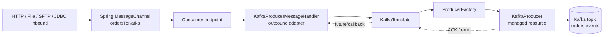
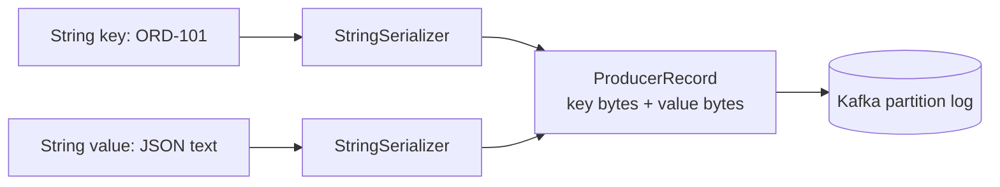
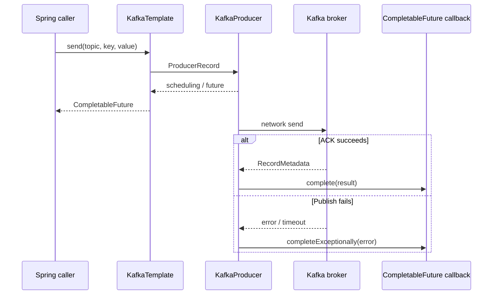
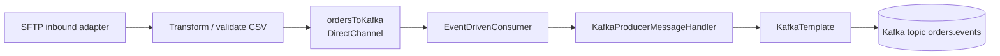
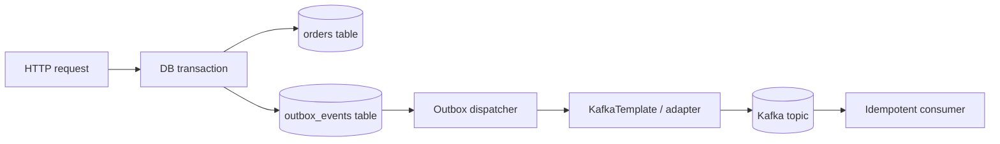

# KafkaTemplate and producer factory

**`KafkaTemplate<K,V>`** is the high-level Spring for Apache Kafka API for publishing Kafka records; **`ProducerFactory<K,V>`** is the contract for creating and managing the Kafka producers the template uses. In Spring Integration, these two components typically sit **underneath a Kafka outbound channel adapter or outbound gateway**: a message is sent to a Spring `MessageChannel`, a handler receives it, and then calls `KafkaTemplate` to publish to the broker.

This lesson belongs to the **Kafka Adapter** chapter of the **SPRING_INTEGRATION_ADAPTERS** module. This module connects external systems via inbound/outbound adapters, gateways, pollers, and `MessageChannel`; it practices integrating over files, SFTP, HTTP, JMS, AMQP, Kafka, and databases while emphasizing message contracts, errors, and connection lifecycles. This lesson focuses on the **Kafka sending infrastructure and real publishing guarantees**, rather than inbound consumer groups/offsets.

> **Key takeaway:** `KafkaTemplate.send(...)` returns a `CompletableFuture<SendResult<K,V>>` in modern Spring Kafka versions. **Initiating a send**, **broker acknowledgment**, and **downstream consumer business completion** are three separate milestones. Specifically, sending asynchronously does not mean the broker confirmed success when `send()` returns.

## 1. Learning objectives

After this lesson, you will be able to:

1. Explain the boundaries among `ProducerFactory`, `DefaultKafkaProducerFactory`, Kafka `Producer`, `KafkaTemplate`, `KafkaProducerMessageHandler`, and Spring `MessageChannel`.
2. Create a producer factory with bootstrap servers, key/value serializers, `acks`, idempotence, and timeout limits.
3. Create `KafkaTemplate<String,String>` and use `send(topic, key, value)`, `send(ProducerRecord)`, and `send(Message<?>)` according to contract.
4. Handle `CompletableFuture<SendResult<K,V>>`, `RecordMetadata`, and synchronous/asynchronous errors without blocking Kafka I/O callbacks.
5. Connect the template to a Kafka outbound channel adapter in Spring Integration using the Java DSL.
6. Choose between shared producers, per-thread producers, and factory lifecycle/reconfiguration management.
7. Explain retries, `acks=all`, `enable.idempotence`, ordering, batching, compression, and throughput.
8. Distinguish Kafka transactions from database transactions, use `executeInTransaction`, and recognize when a transactional outbox is required.
9. Test, observe, and troubleshoot serializer, topic, ACL, network, buffer, timeout, and uncertain-outcome errors.

## 2. Where do producer factory and template sit?



| Component | Responsibility | Does NOT automatically guarantee |
|---|---|---|
| `ProducerFactory<K,V>` | Creates/provides producers per configuration, manages reuse and lifecycle | Does not define business requests or message routing |
| `DefaultKafkaProducerFactory<K,V>` | Standard Spring Kafka producer factory implementation | Not a `MessageHandler` |
| `KafkaProducer<K,V>` | Serializes, partitions, batches, retries, and sends requests to brokers | Does not guarantee downstream consumers processed it |
| `KafkaTemplate<K,V>` | Provides send API, futures, listeners, transaction helpers, metrics | Does not create a distributed transaction with a DB |
| `KafkaProducerMessageHandler` | Receives Spring messages, converts to Kafka records, publishes via template | Does not read Kafka topics like an inbound adapter |
| Spring `MessageChannel` | Connects internal producers to outbound consumer endpoints | Not a Kafka topic |
| Kafka broker | Accepts records, appends to topic/partition logs, returns ACKs | Does not know whether external business logic committed |

### 2.1. What are generics `K` and `V`?

With `KafkaTemplate<String,String>`:

- `K` is the **record key** type: `String`, which must be handled by `StringSerializer` or a compatible serializer.
- `V` is the **record value** type: `String`, also requiring an appropriate serializer.
- A Spring `Message<?>` payload can become the Kafka value when sent via `KafkaTemplate.send(Message<?>)` or an outbound handler with a compatible converter.

Never treat Java generics as automatic runtime conversion. If you declare `ProducerFactory<String, OrderCreated>` while the value serializer only handles `String`, sending will fail. Producer and consumer must agree on the **wire format**: JSON, Avro, Protobuf, bytes, or a defined convention.

### 2.2. Why not create a `new KafkaProducer` on every send?

A Kafka producer manages network connections, buffers, batches, an I/O thread, and metadata. Creating a new producer per message wastes resources, destroys batching, and complicates closing/cleanup.

`DefaultKafkaProducerFactory` lets the template reuse producers per Spring Kafka mechanics. For **non-transactional** setups, by default the factory shares one producer across calls; `KafkaProducer` is designed for concurrent use. For **transactional** setups, the factory can maintain a cache of dedicated transactional producers.

## 3. Configuring `ProducerFactory`

`ProducerFactory<K,V>` is the interface; `DefaultKafkaProducerFactory<K,V>` is the common implementation. Its primary configuration source is a `Map<String,Object>` of Kafka client properties.

```java
@Bean("orderProducerFactory")
ProducerFactory<String, String> orderProducerFactory(
        @Value("${demo.kafka.bootstrap-servers}") String brokers) {

    Map<String, Object> props = new HashMap<>();
    props.put(ProducerConfig.BOOTSTRAP_SERVERS_CONFIG, brokers);
    props.put(ProducerConfig.KEY_SERIALIZER_CLASS_CONFIG,
            StringSerializer.class);
    props.put(ProducerConfig.VALUE_SERIALIZER_CLASS_CONFIG,
            StringSerializer.class);
    props.put(ProducerConfig.ACKS_CONFIG, "all");
    props.put(ProducerConfig.ENABLE_IDEMPOTENCE_CONFIG, true);

    return new DefaultKafkaProducerFactory<>(props);
}
```

This is a method inside a `@Configuration` class; it requires the corresponding Java/Spring imports shown in the complete example in Section 6. Producer configuration must match your SLA and Kafka topic replication settings rather than copying every setting verbatim from an old tutorial.

### 3.1. Serializers: Java types vs. bytes on Kafka



| Data type | Common serializer | Notes |
|---|---|---|
| `String` | `StringSerializer` | Encoding, payload length; JSON text has no enforced schema on its own |
| `byte[]` | `ByteArraySerializer` | Application controls the wire format directly |
| JSON DTO | `JsonSerializer<T>` or matching converter | Align schema/version/type headers with consumers |
| Integer/Long key | `IntegerSerializer`, `LongSerializer` | Must match the actual key type |
| Avro/Protobuf | Ecosystem/schema registry serializers | Requires compatible schemas, compatibility rules, and credentials |

Do not simply change `KafkaTemplate<String,String>` to `KafkaTemplate<String,OrderCreated>` expecting JSON to be emitted automatically. Update the **producer factory value serializer** and verify records with an independent consumer.

### 3.2. Serializer instances and serializer suppliers

`DefaultKafkaProducerFactory` supports serializer **classes** via properties, or **serializer instances**/**suppliers** depending on constructor and version.

- Serializer **class**: client/factory instantiates the serializer from properties.
- Serializer **instance**: can be shared across producers depending on how the factory is constructed.
- Serializer **supplier**: supplies a fresh instance when a stateful or lifecycle-scoped serializer is required.

For custom serializers holding mutable state, evaluate how the factory reuses instances and thread safety. Never share a single serializer across concurrent producers if its implementation is not thread-safe.

## 4. Producer configs that govern durability and performance

Important configurations:

| Kafka producer property | Meaning | Common mistake |
|---|---|---|
| `bootstrap.servers` | Seed brokers for metadata discovery | One wrong address mistaken for a missing topic |
| `key.serializer` / `value.serializer` | Converts Java objects to bytes | DTO cannot be handled by configured serializer |
| `acks` | Broker acknowledgment policy | Confusing broker ACK with business consumer completion |
| `enable.idempotence` | Reduces duplicates from producer retries within Kafka's scope | Confusing with business idempotency across restarts |
| `retries` | Retries eligible send errors in the Kafka producer | Multi-layer retries multiplying attempts |
| `delivery.timeout.ms` | Overall upper time limit to deliver a record | Assuming timeout proves the broker never received it |
| `request.timeout.ms` | Wait limit for one broker request response | Ignoring its relationship to delivery timeout |
| `max.block.ms` | Block limit for metadata/buffer on certain producer calls | "Async" can still block the caller thread |
| `linger.ms` | Allows brief wait to accumulate batches | Setting too high increases latency |
| `batch.size` | Target batch size in bytes per partition | Not a mandatory message count per batch |
| `compression.type` | Compresses record batches | Trades CPU for less network/storage |
| `buffer.memory` | Producer memory buffer budget | Full buffer blocks or fails sends |
| `max.in.flight.requests.per.connection` | Un-ACKed requests pipelined per connection | Must stay compatible with idempotence and ordering |
| `client.id` | Identifies producer for observability | Not a consumer group ID |
| `transactional.id` / factory prefix | Identifies transactional producer | Colliding across pods causes fencing |

**Trio to understand together:** `acks=all`, `enable.idempotence=true`, and appropriate `retries` mitigate retry-induced issues in the Kafka producer; to keep idempotence valid, obey Kafka client requirements (such as `acks=all`, retries > 0, and `max.in.flight.requests.per.connection <= 5` per version). Never set conflicting values.

### 4.1. `acks=all` is not magic

`acks=all` tells the leader to wait for in-sync replicas per policy. Durability still depends on **replication factor**, `min.insync.replicas`, and cluster health. A topic with a replication factor of 1 does not gain broker-failure tolerance from `acks=all` alone.

### 4.2. Which duplicates does `enable.idempotence=true` prevent?

The Kafka producer uses sequence numbers and producer identity to reduce duplicates from technical retries within the same producer session. It does **not** eliminate duplicates caused by:

- An HTTP caller retrying the same request after a timeout.
- An outbox dispatcher republishing after a restart.
- An application producer calling `send()` twice for the same business event.
- The same event being emitted to Kafka by two different services.

To block duplicate business side effects, use `eventId`, unique constraints, or a consumer inbox/idempotency store.

### 4.3. Producer retries and ambiguous timeouts

When a network timeout occurs, the Kafka broker may **have already appended the record** while the ACK was lost, or the broker may never have stored it. Senders must never conclude "timeout means not sent." Design safe retries using business keys and reconciliation.

## 5. Key APIs of `KafkaTemplate`

`KafkaTemplate<K,V>` implements `KafkaOperations<K,V>` and wraps the Kafka producer with high-level APIs:

| Method | When to use |
|---|---|
| `send(String topic, V data)` | Send a value to a topic |
| `send(String topic, K key, V data)` | Send with a key for partitioning |
| `send(String topic, Integer partition, K key, V data)` | Specify an explicit partition when genuinely needed |
| `send(ProducerRecord<K,V> record)` | Build the Kafka record manually, controlling headers/timestamp |
| `send(Message<?> message)` | Convert a Spring message to a Kafka record |
| `sendDefault(...)` | Send to the template's configured default topic |
| `execute(callback)` | Access the underlying producer via callback |
| `executeInTransaction(callback)` | Send inside a local Kafka transaction |
| `metrics()` | Access producer metrics |
| `partitionsFor(topic)` | Fetch partition metadata for a topic |
| `flush()` | Request the producer to flush buffered records per contract |

In modern Spring Kafka, `send` methods return **`CompletableFuture<SendResult<K,V>>`**, not an immediate Kafka ACK result.

### 5.1. Sending by topic/key/value

```java
CompletableFuture<SendResult<String, String>> future =
        kafkaTemplate.send(
                "orders.events", "ORD-101",
                "{\"eventId\":\"evt-101\",\"status\":\"CREATED\"}");
```

`ORD-101` is the Kafka key; the JSON here is **still a String**, not a Java DTO. A stable key helps route events for the same aggregate to the same partition while partitioner, partition count, and serializer remain unchanged.

### 5.2. Using `ProducerRecord` for fine-grained metadata

```java
ProducerRecord<String, String> record =
        new ProducerRecord<>(
                "orders.events",       // topic
                "ORD-101",             // key
                "{\"eventId\":\"evt-101\",\"status\":\"CREATED\"}");

record.headers().add(
        "eventId",
        "evt-101".getBytes(StandardCharsets.UTF_8));

CompletableFuture<SendResult<String, String>> future =
        kafkaTemplate.send(record);
```

This requires importing `ProducerRecord` and `StandardCharsets`. The `eventId` header consists of **native Kafka header bytes**, distinct from String headers inside a Spring message before a mapper/converter runs.

### 5.3. Using Spring `Message<?>` and `KafkaHeaders`

```java
Message<String> message = MessageBuilder
        .withPayload("{\"eventId\":\"evt-101\"}")
        .setHeader(KafkaHeaders.TOPIC, "orders.events")
        .setHeader(KafkaHeaders.KEY, "ORD-101")
        .build();

CompletableFuture<SendResult<String, String>> future =
        kafkaTemplate.send(message);
```

Import `KafkaHeaders`, `Message`, and `MessageBuilder`. The template/converter uses headers such as `TOPIC`, `KEY`, `PARTITION`, and `TIMESTAMP` to construct the record.

**Do not confuse:** `KafkaHeaders.RECEIVED_TOPIC` is metadata from a record **received** in Kafka inbound. It does not automatically substitute for `KafkaHeaders.TOPIC` when sending outbound.

### 5.4. `sendDefault(...)` requires a default topic

```java
KafkaTemplate<String, String> template =
        new KafkaTemplate<>(producerFactory);
template.setDefaultTopic("orders.events");

template.sendDefault("ORD-101", "CREATED");
```

This snippet illustrates a locally instantiated template; in Spring Boot applications, let the container manage the bean. Without a default topic configured, calling `sendDefault` has no valid destination.

### 5.5. Timestamps and partitions

Kafka producer records can carry an application-set timestamp; broker/topic policies may use `CreateTime` or `LogAppendTime`. Under `LogAppendTime`, the broker overwrites timestamps with broker-side time rather than using the client value.

Specifying an explicit partition can cause hotspots or errors if that partition does not exist. Unless there is a specific requirement, letting the partitioner choose by key is simpler and scales better.

## 6. Complete demo: Spring Boot Java configuration

Goal: use `DefaultKafkaProducerFactory` and `KafkaTemplate<String,String>` to send an order event to `orders.events`, observing the future/callback and broker metadata.

### 6.1. Dependencies

Use Java 17+ and a compatible Spring Boot/Spring Kafka/Spring Integration stack. For a Spring Integration application, declare:

```xml
<dependency>
    <groupId>org.springframework.boot</groupId>
    <artifactId>spring-boot-starter-integration</artifactId>
</dependency>

<dependency>
    <groupId>org.springframework.integration</groupId>
    <artifactId>spring-integration-kafka</artifactId>
</dependency>
```

The Kafka integration dependency pulls in the corresponding Spring Kafka artifacts per the project's BOM/metadata. If you only need plain Kafka publishing without an `IntegrationFlow`, use the appropriate Spring Kafka dependency. Avoid manually mixing incompatible versions.

### 6.2. application.properties

```properties
demo.kafka.bootstrap-servers=localhost:9092
demo.kafka.topic=orders.events
```

The Kafka cluster and topic must be created or provisioned properly. If relying on auto-creation via a `NewTopic` bean, **do not send inside `@PostConstruct`** because `KafkaAdmin`/topic beans may not be ready yet; use `ApplicationRunner` or a post-refresh lifecycle hook.

### 6.3. Producer factory and template configuration class

```java
package com.example.integration;

import java.util.HashMap;
import java.util.Map;

import org.apache.kafka.clients.producer.ProducerConfig;
import org.apache.kafka.common.serialization.StringSerializer;
import org.springframework.beans.factory.annotation.Value;
import org.springframework.context.annotation.Bean;
import org.springframework.context.annotation.Configuration;
import org.springframework.kafka.core.DefaultKafkaProducerFactory;
import org.springframework.kafka.core.KafkaTemplate;
import org.springframework.kafka.core.ProducerFactory;

@Configuration
public class OrdersKafkaProducerConfig {

    @Bean("ordersProducerFactory")
    public ProducerFactory<String, String> ordersProducerFactory(
            @Value("${demo.kafka.bootstrap-servers}") String brokers) {

        Map<String, Object> config = new HashMap<>();
        config.put(ProducerConfig.BOOTSTRAP_SERVERS_CONFIG, brokers);
        config.put(ProducerConfig.KEY_SERIALIZER_CLASS_CONFIG,
                StringSerializer.class);
        config.put(ProducerConfig.VALUE_SERIALIZER_CLASS_CONFIG,
                StringSerializer.class);

        config.put(ProducerConfig.ACKS_CONFIG, "all");
        config.put(ProducerConfig.ENABLE_IDEMPOTENCE_CONFIG, true);
        config.put(ProducerConfig.DELIVERY_TIMEOUT_MS_CONFIG, 30_000);
        config.put(ProducerConfig.REQUEST_TIMEOUT_MS_CONFIG, 10_000);
        config.put(ProducerConfig.LINGER_MS_CONFIG, 5);
        config.put(ProducerConfig.COMPRESSION_TYPE_CONFIG, "gzip");

        return new DefaultKafkaProducerFactory<>(config);
    }

    @Bean("ordersKafkaTemplate")
    public KafkaTemplate<String, String> ordersKafkaTemplate(
            ProducerFactory<String, String> ordersProducerFactory) {

        KafkaTemplate<String, String> template =
                new KafkaTemplate<>(ordersProducerFactory);
        template.setDefaultTopic("orders.events");
        return template;
    }
}
```

The timeouts and compression above are **lab values** illustrating producer configs; production must tune them for broker capacity, throughput, SLAs, and reliability needs. No `transactionIdPrefix` is set here, so this is a **non-transactional producer factory**.

### 6.4. Publisher returning the future

```java
package com.example.integration;

import java.util.concurrent.CompletableFuture;

import org.springframework.beans.factory.annotation.Qualifier;
import org.springframework.kafka.core.KafkaTemplate;
import org.springframework.kafka.support.SendResult;
import org.springframework.stereotype.Service;

@Service
public class OrderEventPublisher {

    private final KafkaTemplate<String, String> kafkaTemplate;

    public OrderEventPublisher(
            @Qualifier("ordersKafkaTemplate")
            KafkaTemplate<String, String> kafkaTemplate) {
        this.kafkaTemplate = kafkaTemplate;
    }

    public CompletableFuture<SendResult<String, String>> publish(
            String orderId, String eventJson) {

        // Return future to caller so caller can observe the outcome.
        return kafkaTemplate.send("orders.events", orderId, eventJson);
    }
}
```

This publisher **does not ignore the send operation's future**. The caller must observe success/failure or persist events durably for retry—never fire-and-forget and claim "delivered."

### 6.5. Demo ApplicationRunner

```java
package com.example.integration;

import java.util.concurrent.CompletableFuture;

import org.springframework.boot.ApplicationRunner;
import org.springframework.context.annotation.Bean;
import org.springframework.context.annotation.Configuration;
import org.springframework.kafka.support.SendResult;

@Configuration
public class OrdersKafkaDemoRunner {

    @Bean
    ApplicationRunner sendOrderEvent(OrderEventPublisher publisher) {
        return args -> {
            CompletableFuture<SendResult<String, String>> future =
                    publisher.publish(
                            "ORD-101",
                            "{\"eventId\":\"evt-101\","
                                + "\"orderId\":\"ORD-101\","
                                + "\"type\":\"ORDER_CREATED\"}");

            future.whenComplete((result, error) -> {
                if (error != null) {
                    System.err.println(
                            "KAFKA SEND FAILED: " + error);
                    return;
                }

                var metadata = result.getRecordMetadata();
                System.out.printf(
                        "KAFKA ACK topic=%s partition=%d offset=%d%n",
                        metadata.topic(),
                        metadata.partition(),
                        metadata.offset());
            });
        };
    }
}
```

A `@SpringBootApplication` in `com.example.integration` or a parent package will scan these beans. The demo does not need a Kafka consumer inside the publisher application itself; use Kafka CLI or another app to verify records landed on the topic.

**Do not assume** offset always starts at 0 or a record always lands in a specific partition. Kafka chooses partitions based on key/partitioner, partition count, and existing data.

### 6.6. Preparing the Kafka topic and inspecting records

On a single-broker lab, using Kafka CLI:

```bash
kafka-topics.sh --bootstrap-server localhost:9092 \
  --create --if-not-exists \
  --topic orders.events --partitions 3 --replication-factor 1

kafka-console-consumer.sh \
  --bootstrap-server localhost:9092 \
  --topic orders.events --from-beginning
```

Example record value:

```json
{"eventId":"evt-101","orderId":"ORD-101","type":"ORDER_CREATED"}
```

CLI commands are for test environments. On production clusters, topics/replication/ACLs must be provisioned through dedicated governance workflows.

## 7. Async callbacks, send results, and errors

The send API returns `CompletableFuture<SendResult<K,V>>`:



`SendResult<K,V>` exposes the original `ProducerRecord` and `RecordMetadata`, where metadata typically contains topic, partition, and offset. When the future fails, the root cause may be a `KafkaProducerException`/serializer/broker exception depending on error and version.

### 7.1. `whenComplete` handles both success and failure

```java
CompletableFuture<SendResult<String, String>> future =
        kafkaTemplate.send("orders.events", "ORD-101", "CREATED");

future.whenComplete((result, ex) -> {
    if (ex == null) {
        RecordMetadata meta = result.getRecordMetadata();
        metrics.incrementSuccess(meta.topic());
    } else {
        metrics.incrementFailure();
        logger.error("Kafka publish failure for orderId={}",
                "ORD-101", ex);
        // Transition event/outbox status to RETRY per policy.
    }
});
```

In this snippet, `metrics` and `logger` are application dependencies you declare/inject. **Do not block or run slow DB reads inside the callback**: callbacks can execute on the producer I/O thread or a future completion thread depending on context. Offload heavy work to a managed executor and store events durably.

### 7.2. `ProducerListener` for centralized observation

`KafkaTemplate` can attach a `ProducerListener`; the interface supports `onSuccess(ProducerRecord, RecordMetadata)` and `onError(ProducerRecord, RecordMetadata, Exception)`.

```java
kafkaTemplate.setProducerListener(
        new ProducerListener<String, String>() {
            @Override
            public void onSuccess(
                    ProducerRecord<String, String> record,
                    RecordMetadata metadata) {
                System.out.println("ACK " + metadata.topic()
                        + "-" + metadata.partition());
            }

            @Override
            public void onError(
                    ProducerRecord<String, String> record,
                    RecordMetadata metadata,
                    Exception exception) {
                System.err.println(
                        "SEND FAILURE " + exception.getClass().getName());
            }
        });
```

Import `org.springframework.kafka.support.ProducerListener`, `ProducerRecord`, and `RecordMetadata`. Place this where the template is configured, **before sending starts**.

By default `KafkaTemplate` has a `LoggingProducerListener` to log errors. That **does not replace** persisting events/outbox state or a business retry policy.

### 7.3. Exceptions can also be thrown directly by `send()`

Do not attach `whenComplete` assuming every error always happens asynchronously. Depending on serializers, client buffers/metadata, and send path, some errors can occur synchronously before returning a future to observe.

For critical business flows, cover both:

```java
try {
    CompletableFuture<SendResult<String, String>> future =
            kafkaTemplate.send("orders.events", "ORD-101", payload);

    future.whenComplete((result, ex) -> {
        if (ex != null) {
            recordPublishFailure("ORD-101", ex);
        } else {
            recordPublishSuccess("ORD-101",
                    result.getRecordMetadata().offset());
        }
    });
} catch (RuntimeException sendFailure) {
    recordPublishFailure("ORD-101", sendFailure);
}
```

`payload`, `recordPublishFailure`, and `recordPublishSuccess` are illustrative application-defined variables/methods. When reusing the same event object for retries, deduplicate and account for ambiguous outcomes.

## 8. When synchronous sending is needed: `get(timeout)`

`CompletableFuture.get(timeout, unit)` blocks the caller thread until the producer finishes or the deadline expires:

```java
try {
    SendResult<String, String> result =
            kafkaTemplate.send(
                    "orders.events", "ORD-101", "CREATED")
            .get(10, TimeUnit.SECONDS);

    System.out.println("Broker ACK offset="
            + result.getRecordMetadata().offset());
} catch (InterruptedException ex) {
    Thread.currentThread().interrupt();
    throw new IllegalStateException("Interrupted while publishing", ex);
} catch (TimeoutException ex) {
    throw new IllegalStateException(
            "No confirmed Kafka result within deadline", ex);
} catch (ExecutionException ex) {
    throw new IllegalStateException(
            "Kafka producer returned failure", ex.getCause());
}
```

Import `TimeUnit`, `ExecutionException`, `TimeoutException`, and `SendResult`. With a Spring Integration outbound handler, you can configure sync mode instead of calling `get()` manually in business code.

**Key point:** A timeout on the waiting thread **does not prove the record was not appended by the broker**. The future may complete after the deadline; handle uncertain states and idempotency on retries.

### 8.1. Why not call `flush()` after every event?

`KafkaTemplate.flush()` tells the producer to flush buffered records per contract. Calling it after every message destroys batching benefits and creates contention when multiple threads share a producer.

- Use `flush()` at explicit boundaries that require immediate pushing under a clear deadline.
- Never equate `flush()` with consumer acknowledgment or business commit.
- If using `producerPerThread`, manage cleanup separately for thread-bound producers.
- On shutdown, coordinate producer lifecycle, pending futures, and outbox; never simply call flush and assume all side effects are durable.

## 9. KafkaTemplate with a Spring Integration outbound adapter

A core goal of the **SPRING_INTEGRATION_ADAPTERS** module is connecting other systems to Kafka while keeping `MessageChannel` as the internal contract. Example:



### 9.1. Java DSL using an existing template

In a `@Configuration` class with the `ordersKafkaTemplate` bean from Section 6:

```java
package com.example.integration;

import org.springframework.beans.factory.annotation.Qualifier;
import org.springframework.context.annotation.Bean;
import org.springframework.context.annotation.Configuration;
import org.springframework.expression.common.LiteralExpression;
import org.springframework.integration.channel.DirectChannel;
import org.springframework.integration.dsl.IntegrationFlow;
import org.springframework.integration.kafka.outbound.KafkaProducerMessageHandler;
import org.springframework.kafka.core.KafkaTemplate;
import org.springframework.messaging.MessageChannel;

@Configuration
public class OrdersKafkaFlowConfig {

    @Bean("ordersToKafka")
    MessageChannel ordersToKafka() {
        return new DirectChannel();
    }

    @Bean("ordersKafkaOutboundHandler")
    KafkaProducerMessageHandler<String, String> ordersKafkaOutboundHandler(
            @Qualifier("ordersKafkaTemplate")
            KafkaTemplate<String, String> template) {

        KafkaProducerMessageHandler<String, String> handler =
                new KafkaProducerMessageHandler<>(template);

        handler.setTopicExpression(
                new LiteralExpression("orders.events"));
        handler.setSync(false);
        return handler;
    }

    @Bean("ordersKafkaOutboundFlow")
    IntegrationFlow ordersKafkaOutboundFlow(
            @Qualifier("ordersKafkaOutboundHandler")
            KafkaProducerMessageHandler<String, String> handler) {

        return IntegrationFlow.from("ordersToKafka")
                .handle(handler, endpoint -> endpoint
                        .id("ordersKafkaOutboundEndpoint"))
                .get();
    }
}
```

Message path:

```text
ordersToKafka (Spring input channel)
    -> EventDrivenConsumer (ordersKafkaOutboundEndpoint)
    -> KafkaProducerMessageHandler
    -> KafkaTemplate
    -> ProducerFactory
    -> Kafka broker / topic
```

An **outbound adapter** receives from a Spring Integration **input channel**, even though it sends data *out to Kafka*. It differs from a **Kafka inbound adapter**, which has an **output channel**.

### 9.2. Sending a Spring Message into the flow

```java
Message<String> message = MessageBuilder
        .withPayload("{\"eventId\":\"evt-101\"}")
        .setHeader(KafkaHeaders.KEY, "ORD-101")
        .build();

ordersToKafka.send(message);
```

This snippet lives inside a Spring-managed method with the `ordersToKafka` bean injected. When the handler sets a static topic expression `orders.events`, a `KafkaHeaders.TOPIC` header on the message **does not override** that expression automatically. For dynamic topics, define an explicit policy/allowlist.

### 9.3. Java DSL building the handler from a factory

Spring Integration also provides a DSL factory:

```java
@Bean
IntegrationFlow kafkaDslFlow(
        @Qualifier("ordersProducerFactory")
        ProducerFactory<String, String> factory) {

    return IntegrationFlow.from("ordersToKafka")
            .handle(
                Kafka.outboundChannelAdapter(factory)
                    .topic("orders.events"),
                endpoint -> endpoint.id("ordersKafkaDslEndpoint"))
            .get();
}
```

Import `org.springframework.integration.kafka.dsl.Kafka` and `ProducerFactory`. This is an **alternative** to the flow in Section 9.1; do not run both subscribed to the same `DirectChannel` just to "increase reliability." With `DirectChannel`, multiple consumers normally compete for messages rather than creating fan-out.

### 9.4. Outbound handler success/failure channels

An outbound handler can configure a **success channel** receiving `RecordMetadata` on successful Kafka publishes and a **failure channel** receiving `ErrorMessage` with details of the failed record. These are **Spring Integration channels**, not Kafka reply topics.

When publish status must be tracked, the failure flow must durably persist events, retry/quarantine, and raise alerts. A logging-only handler creates no delivery guarantee.

## 10. Shared producer, producer-per-thread, and lifecycle

An easily missed detail is that **the factory manages long-lived resources**, rather than just holding a properties map in its constructor.

### 10.1. Default: non-transactional shared producer

In the default non-transactional configuration, `DefaultKafkaProducerFactory` creates one shared producer for clients/templates that need it; this fits most cases and takes full advantage of Kafka producer batching.

- Multiple threads calling `KafkaTemplate.send(...)` can share the same producer.
- `flush()` on a template backed by a shared producer can affect other threads sharing that producer.
- Never call `producer.close()` directly in business code when the producer is managed by a Spring factory.
- Let the container/factory handle shutdown or use controlled lifecycle APIs.

### 10.2. `producerPerThread`

Some workloads need to isolate one thread's `flush()` from affecting other threads:

```java
DefaultKafkaProducerFactory<String, String> factory =
        new DefaultKafkaProducerFactory<>(producerConfigs);

factory.setProducerPerThread(true);
```

When enabled, the factory creates/caches a separate producer per thread. **Important:** thread-bound producers are not automatically cleaned up by default `reset()` or `destroy()`; the application must call `closeThreadBoundProducer()` when a thread no longer needs its producer.

Do not enable this lightly when using long-lived executor pools or dynamically changing thread counts; it increases connections, buffers, and memory, creating resource leak risks.

### 10.3. Transactional producer cache

When `transactionIdPrefix` is set, the factory creates/caches transactional producers. Each producer carries a distinct `transactional.id`. If multiple instances share the same ID, the broker can **fence** the older producer; ensure a unique prefix per application instance.

A bounded cache can also run out of available producers if concurrent transactions exceed pool size; Spring Kafka may throw `NoProducerAvailableException` in certain configurations. Tune concurrency and cache size appropriately.

### 10.4. `reset()` and runtime config updates

Some versions of `DefaultKafkaProducerFactory` support:

```java
factory.updateConfigs(changedConfigs);
factory.removeConfig("some.config.key");
factory.reset();
```

This is a snippet; `changedConfigs` must be a valid `Map<String,Object>` with the necessary imports. Updating factory configs **does not modify already-created producer instances**. Calling `reset()` forces producers to be recreated with the updated configuration per factory mechanics.

Do not call `reset()` casually while sends/transactions are active: account for in-flight futures and graceful handoff. Also never convert a transactional factory into a non-transactional one (or vice versa) by mutating a few configs at runtime.

## 11. Transactions: `KafkaTemplate.executeInTransaction`

Kafka provides producer transactions to group Kafka operations; Spring Kafka supports this via a transactional `DefaultKafkaProducerFactory` and `KafkaTemplate`.

### 11.1. Enabling transactions on the producer factory

Create a **dedicated factory** for transactional configurations instead of mutating the demo's working non-transactional factory:

```java
@Bean("transactionalProducerFactory")
ProducerFactory<String, String> transactionalProducerFactory(
        @Value("${demo.kafka.bootstrap-servers}") String brokers,
        @Value("${demo.instance-id}") String instanceId) {

    Map<String, Object> configs = new HashMap<>();
    configs.put(ProducerConfig.BOOTSTRAP_SERVERS_CONFIG, brokers);
    configs.put(ProducerConfig.KEY_SERIALIZER_CLASS_CONFIG,
            StringSerializer.class);
    configs.put(ProducerConfig.VALUE_SERIALIZER_CLASS_CONFIG,
            StringSerializer.class);
    configs.put(ProducerConfig.ACKS_CONFIG, "all");

    DefaultKafkaProducerFactory<String, String> factory =
            new DefaultKafkaProducerFactory<>(configs);

    factory.setTransactionIdPrefix(
            "orders-tx-" + instanceId + "-");
    return factory;
}

@Bean("transactionalKafkaTemplate")
KafkaTemplate<String, String> transactionalKafkaTemplate(
        @Qualifier("transactionalProducerFactory")
        ProducerFactory<String, String> factory) {
    return new KafkaTemplate<>(factory);
}
```

`demo.instance-id` is an identifier **unique across all simultaneously running processes/pods**; supply it from the deployment environment rather than using the same value across replicas. This is an additional example inside a `@Configuration` class with matching imports.

### 11.2. Local Kafka transaction

```java
String result = transactionalKafkaTemplate.executeInTransaction(ops -> {
    ops.send("orders.events", "ORD-101", "CREATED");
    ops.send("orders.audit", "ORD-101", "AUDITED");
    return "PUBLISHED";
});
```

This group of operations runs inside **one Kafka transaction** started and committed/rolled back by the template. If the callback throws an exception, the transaction rolls back per contract. The broker/topic must support transactions, and downstream consumers must use `isolation.level=read_committed` to avoid reading records from aborted transactions.

`executeInTransaction` does not start a database transaction. A method containing both `jdbcTemplate.update(...)` and `transactionalKafkaTemplate.executeInTransaction(...)` **does not** automatically form an atomic transaction across both systems.

### 11.3. `KafkaTransactionManager` and `@Transactional`

With a transaction-capable producer factory, `KafkaTransactionManager` can manage Kafka transactions through Spring's transaction APIs.

```java
@Bean("kafkaTransactionManager")
KafkaTransactionManager<String, String> kafkaTransactionManager(
        @Qualifier("transactionalProducerFactory")
        ProducerFactory<String, String> factory) {
    return new KafkaTransactionManager<>(factory);
}
```

A service can then use `@Transactional("kafkaTransactionManager")` or `TransactionTemplate` to group Kafka sends. However, when an application has multiple transaction managers (Kafka and JDBC), **you must explicitly choose which manager**. Never assume an unqualified annotation coordinates all managers together.

In Spring Boot, transaction configuration can also be auto-configured from `spring.kafka.producer.transaction-id-prefix`; if you declare custom producer factories/managers manually, avoid unnecessary duplicates/conflicts.

### 11.4. A transactional template normally requires an active transaction

A `KafkaTemplate` backed by a transactional producer factory normally requires sends to run inside a transaction via `@Transactional`, `TransactionTemplate`, `executeInTransaction`, or a container transaction. Calling `send` outside a transaction can throw `IllegalStateException`.

Spring Kafka provides `allowNonTransactional` when mixed modes are needed, though separating concerns explicitly is safer than letting callers silently perform non-transactional sends in a flow assumed to be transactional.

## 12. Kafka transactions do not replace an outbox with a database

Suppose an API must **save an order in JDBC** and **publish `OrderCreated` to Kafka**. If the DB commit succeeds while Kafka send/commit fails, the two systems diverge. If Kafka commits before the DB commits, consumers can observe events for an order that does not yet exist.



A **transactional outbox** is generally the stronger choice for DB → Kafka:

1. Within **one DB transaction**, write the entity and an outbox row containing `eventId`, payload, and status `PENDING`.
2. The dispatcher reads/claims unpublished events and sends them with `KafkaTemplate` or a Kafka outbound adapter.
3. Upon receiving a successful producer ACK, update the outbox status to `SENT` per policy.
4. If the dispatcher crashes **after Kafka ACK but before updating the outbox**, the event may be sent again next run; consumers must deduplicate by `eventId`.
5. When Kafka is unavailable, the outbox retains DB-committed events for bounded retries and backlog visibility.

Kafka idempotent producers and producer transactions remain useful, yet they **do not guarantee end-to-end exactly-once between a DB and Kafka** without proper coordination design.

### 12.1. Minimal outbox schema example

```sql
CREATE TABLE outbox_events (
    event_id VARCHAR(128) PRIMARY KEY,
    aggregate_id VARCHAR(128) NOT NULL,
    topic VARCHAR(255) NOT NULL,
    payload TEXT NOT NULL,
    status VARCHAR(20) NOT NULL,
    created_at TIMESTAMP NOT NULL
);
```

This is an illustrative schema; adjust it for your SQL dialect and data model. Production needs safe claiming when multiple dispatchers run, retry count/next attempt timestamps, uncertain states, and retention/cleanup.

## 13. Optimizing throughput: batching, compression, and backpressure

The Kafka producer optimizes sending by **batching at the partition level**. Key factors:

| Factor | Impact |
|---|---|
| `linger.ms` | Allows waiting briefly to accumulate more records |
| `batch.size` | Byte target/limit per partition batch |
| `compression.type` | Compresses batches to save network/storage at CPU cost |
| `buffer.memory` | Producer buffer cap; governs `max.block.ms` when full |
| `max.in.flight.requests.per.connection` | Pipelines un-ACKed requests; tied to ordering |
| Partition count | Creates independent append streams; affects batching |
| Record size/schema | Drives network, CPU, and broker/topic limits |
| Consumer/downstream | Even when producers send fast, consumer lag can still climb |

### 13.1. Why is increasing `linger.ms` not always better?

If an application sends one event per minute with a 50 ms SLA, waiting to accumulate a batch adds unnecessary end-to-end latency. If it sends tens of thousands of small events per second, batching/compression significantly cuts request overhead.

Never tune solely by producer "messages/s"; measure **record send rate, request latency, batch size, retry/error rate, buffer wait, CPU/network, and consumer lag**.

### 13.2. Where does backpressure appear?

Even with async `KafkaTemplate.send(...)`, the producer can block briefly when fetching topic metadata or waiting on a full buffer, bounded by `max.block.ms`. If the source is HTTP inbound or an SFTP poller, this can stall caller threads and propagate backpressure upstream.

**Never add an in-memory `QueueChannel` and treat it as durable data:** internal RAM queues lose data on JVM restarts. If the source was acknowledged before events reached Kafka, use a durable queue, an outbox, or a proper acknowledgment policy.

### 13.3. Preserving order by business aggregate

Kafka preserves record order within **one partition**, not across the whole topic. Using `orderId` as the Kafka key keeps events for the same aggregate in the same partition while partitioning rules stay constant. Yet multiple parallel senders can still publish out of business order; use aggregate version/sequence numbers or single-writer discipline when strict ordering is mandatory.

Increasing partition count can alter key → partition mappings for future records. Never treat "same Kafka key" as an absolute historical ordering guarantee across partition count/partitioner changes.

## 14. `RoutingKafkaTemplate` and multiple serializer types

When an application sends to different topics using **different wire formats**, you can use separate producer factories/templates. Spring Kafka also provides `RoutingKafkaTemplate` to select a factory by **topic name**.

```text
orders.json  -> ProducerFactory<String, String>   -> JSON text
images.raw   -> ProducerFactory<String, byte[]>   -> bytes
```

Selecting factories by topic regex helps when one application handles multiple types; however, `RoutingKafkaTemplate` **does not support** certain APIs like transactions, `execute`, `flush`, and `metrics` because those operations lack a topic to select a factory.

Use a routing template when the topic name validly determines the serializer. If a single topic carries multiple payload shapes, consider a delegating serializer/schema envelope rather than routing producers solely by topic.

### 14.1. When to use one template per flow?

Separate templates/factories when:

- Two topic groups require different serializers or security principals.
- Separate `client.id`s and metrics are needed to track SLAs.
- One flow requires transactions while another is non-transactional.
- One flow sends large/batched records while another needs low latency.
- You need to prevent `flush()`/throttling in one flow from affecting another.

In return, more factories add connections, buffers, and operational complexity. Never create a `KafkaTemplate` per message; manage them as reusable beans.

## 15. Security and message contracts

In production, producers must address:

- **TLS/SASL:** encrypted connections, broker authentication, and truststore/keystore as required.
- **Kafka ACLs:** permit publishing only to authorized topics/topic patterns.
- **Secret management:** never commit passwords/tokens in code or example YAML.
- **Header mapping:** not every Spring message header belongs in native Kafka headers.
- **Schema evolution:** versioning/backward compatibility, size limits, and sensitive fields.
- **Dynamic topics:** if topics come from headers/payloads, enforce allowlists and tenant isolation.
- **Logging:** avoid dumping raw payloads containing personal data, secret keys, or credentials.

With a Kafka outbound handler, configuring an explicit topic/key expression can **take precedence** over the corresponding header. Test this carefully to avoid accidentally routing tenant A's data to tenant B's topic.

## 16. Observing producers and templates

`KafkaTemplate.metrics()` exposes Kafka producer metrics; Spring Boot/Micrometer can also collect supported meters per configuration.

| Signal | Question to answer |
|---|---|
| Producer send success/failure | How many records were acknowledged by the broker? |
| `RecordMetadata` topic/partition/offset | Where were records published? |
| Record send rate, byte rate | What is the actual publish rate? |
| Request latency p95/p99 | Is the Kafka broker/network slowing down? |
| Retry/error rate | Are there transient errors or wrong topics/ACLs? |
| Batch size/compression ratio | Is batching effective? |
| Buffer available/wait time | Is the producer experiencing backpressure? |
| Outbox pending/retry age | How many DB-committed events await Kafka ACK? |
| Downstream consumer lag | Are consumers lagging even though publishing succeeded? |
| Producer count/connection usage | Are too many factories/templates or per-thread producers created? |

### 16.1. Metadata is not a business receipt

`RecordMetadata` contains topic, partition, offset, and publish outcome metadata. It is not proof that a receiving system committed its database. When a workflow needs business confirmation, use Kafka request–reply with reply topics/correlation or result events with business IDs.

### 16.2. Correlation ID vs. event ID

- `MessageHeaders.ID`: Spring Messaging internal message ID.
- Kafka record key: drives partitioning, e.g., `orderId`.
- `eventId`: identifies **one business event**, suited for idempotency.
- Correlation ID: links a conversation or chain of operations.
- Topic/partition/offset: address of a specific Kafka record.

If the same event is republished at a new offset, using topic-partition-offset as a deduplication key fails to detect the business duplicate.

## 17. Diagnosing common errors

| Symptom | Possible cause | How to inspect |
|---|---|---|
| `ClassCastException`/serialization exception | Serializer and value type mismatch | `K,V`, producer config, DTO/schema |
| `send()` returns yet no record exists | Future failed, wrong topic, or unreachable broker | `whenComplete`, `ProducerListener`, broker logs |
| Timeout even though record reached broker | Lost/slow ACK or overly tight deadline | Producer metadata, retries, `eventId` |
| Topic does not exist | Topic not provisioned, auto-create disabled | `KafkaAdmin`/CLI, ACLs, startup order |
| `TopicAuthorizationException` | Producer lacks WRITE/DESCRIBE permission | Kafka ACLs, principal, topic |
| `RecordTooLargeException` | Record exceeds client/broker/topic limit | Payload size, schema, compression, broker config |
| Producer buffer full | Slow downstream Kafka, traffic spike | `buffer.memory`, `max.block.ms`, producer metrics |
| Low throughput after adding `flush()` | Breaks batching / global producer contention | Flush frequency, linger, latency |
| Duplicate events after HTTP retry | Caller retried the same business request | `eventId`, idempotent producer vs. business dedup |
| `IllegalStateException` on transactional template | Sent outside required Kafka transaction | `transactionIdPrefix` and transaction boundaries |
| `ProducerFencedException` | Duplicate `transactional.id` or expired/invalid producer | Unique instance prefix, producer `maxAge`, broker settings |
| Memory/connections grow with producer-per-thread | Thread-bound producers never closed | `closeThreadBoundProducer()` per thread |
| DB committed yet Kafka lacks event | No atomic DB–Kafka transaction | Transactional outbox, pending dispatcher |
| Spring input channel accepted message yet Kafka never ACKed | Async outbound handler, publish failed later | Success/failure channels, producer future, outbox |

### 17.1. Investigation workflow

1. Identify **which producer bean**, template, and factory the flow uses.
2. Check `bootstrap.servers`, serializers, topic, key, payload size, and ACLs.
3. Inspect the **send result future**, not just "dispatched to channel" logs.
4. When using Spring Integration, inspect endpoint ID, input channel, success/failure channels, and lifecycle state.
5. Check Kafka producer metrics, buffer wait, timeouts/retries, and broker responses.
6. Distinguish **unpublished** records from **published records not yet processed by consumers**.
7. When duplicates occur, separate producer retries, caller retries, outbox replays, and consumer redeliveries using `eventId`.
8. Change one setting at a time and re-evaluate latency/durability/throughput trade-offs.

## 18. Testing reliable producers

### 18.1. Unit-testing publishing policies

For a service wrapping `KafkaTemplate`, you can mock the template to verify:

- Topic and key match the contract.
- Payloads are validated/serialized into the expected form.
- Success/failure futures are handled per policy.
- When a future fails, the event is recorded for retry instead of silently dropped.
- No extra `KafkaTemplate` or `KafkaProducer` instances are created inside business methods.

Unit tests alone with mocks do not prove real Kafka broker ACKs or serialization behavior.

### 18.2. Integration testing with real/embedded Kafka

Use an isolated Kafka test environment (such as Testcontainers or a version-compatible embedded broker), then:

1. Publish records with the template.
2. Await the future and verify `RecordMetadata`.
3. Consume records using a separate test consumer group.
4. Inspect actual keys, values, and native headers.
5. Test serializer failures, missing topics, and missing ACLs (if the test environment supports it).
6. Test restarts, timeouts, and resent events keyed by `eventId`.
7. Test Kafka transaction commit/abort with a `read_committed` consumer if using transactions.

Never rely on fixed `Thread.sleep()` calls as sole proof that records arrived; await futures/records using polling/await helpers with explicit deadlines.

### 18.3. Testing outbox failure windows

For DB → Kafka, test crashes at these points:

| Failure window | Expected outcome | Protection mechanism |
|---|---|---|
| Before DB commit | No durable order/outbox event | DB rollback |
| After DB commit, before Kafka publish | Outbox remains `PENDING` | Dispatcher re-sends |
| After Kafka ACK, before marking `SENT` | May publish again | Consumer dedup by `eventId` |
| Broker unavailable | Pending/retry age climbs | Backoff, alerts, keep outbox row |
| Consumer processes duplicate event | Business side effect does not repeat | Inbox / unique constraint |

## 19. Misconceptions to avoid

| Misconception | Correct understanding |
|---|---|
| "`KafkaTemplate` opens a new broker connection on every `send()`." | The template uses producers from its factory and normally reuses a producer. |
| "`ProducerFactory` is a consumer group manager." | It creates producers; consumer groups belong to consumer clients/containers. |
| "Generic `KafkaTemplate<String,Order>` serializes JSON automatically." | You need a matching value serializer or converter. |
| "`send()` returning a future means the broker ACKed." | The future must **complete successfully** to have a send result. |
| "`acks=all` guarantees the consumer DB committed." | ACKs belong strictly to Kafka producer/broker, not downstream business work. |
| "A timeout proves the record was not published." | The record may have appended while the ACK arrived late or was lost. |
| "`enable.idempotence=true` prevents all event duplicates." | Business retries/replays can still create duplicate events. |
| "Calling `flush()` after every record is always safer." | It breaks batching and can block other threads. |
| "`producerPerThread=true` needs no cleanup." | Thread-bound producers must be closed via the API. |
| "`executeInTransaction` creates a DB transaction." | It is a Kafka-local transaction. |
| "`@Transactional` commits Kafka and JDBC atomically by default." | Managers/resources require explicit design and still have failure windows. |
| "In-memory `QueueChannel` guarantees events won't be lost." | In-memory queues lose messages on restarts if the source already acked. |
| "`KafkaHeaders.RECEIVED_TOPIC` always sets the send topic." | That is inbound metadata; outbound uses `TOPIC`/expressions. |
| "More templates always increase throughput." | They can add connections/buffers without solving the real bottleneck. |

## 20. Practice exercises

### Exercise 1 — Producer factory and KafkaTemplate

Run the Section 6 example with a three-partition topic and publish 20 events across two `orderId`s. Record topic, partition, offset, and key metadata. Explain why records with the same key normally share a partition under consistent partitioning.

### Exercise 2 — Testing send futures

Write a service returning `CompletableFuture<SendResult<String,String>>` and observe success/failure callbacks. Simulate an unreachable broker in a lab environment and compare errors thrown immediately by `send()` against errors reported later via the future.

### Exercise 3 — Mismatched serializer type

Keep `StringSerializer` as the value serializer but attempt to send an `OrderCreated` DTO. Describe the expected error. Fix it by serializing the DTO to JSON string or configuring a compatible JSON serializer, then verify with an independent Kafka consumer.

### Exercise 4 — Comparing sync and async

Send 1,000 events using future callbacks, then try awaiting `get(10, TimeUnit.SECONDS)` after every send. Compare latency, throughput, in-flight requests, and the risk of blocking HTTP/poller threads. Never claim async is done before broker ACKs arrive.

### Exercise 5 — Impact of `acks` and timeouts

On a Kafka test cluster with suitable replication, vary `acks` and `min.insync.replicas` while simulating an unavailable broker. Observe send results, error classes, and wait times. Explain why `acks=all` on a replication-factor-1 topic cannot tolerate broker loss.

### Exercise 6 — Integrating the template into an IntegrationFlow

Use `KafkaProducerMessageHandler` from Section 9 receiving from `ordersToKafka`. Add a transformer converting `Message<File>` from a file inbound adapter into a JSON string before publishing. Verify the payload/header contract across file, channel, and Kafka.

### Exercise 7 — Shared producer and `flush()`

Run two threads sending through the same template and measure latency when one thread calls `flush()` repeatedly. Test `producerPerThread=true` in a separate test, ensuring every thread calls `closeThreadBoundProducer()`. Compare resources and the consequences of forgetting cleanup.

### Exercise 8 — Kafka transactions

Create a transactional factory with a unique per-instance prefix. Use `executeInTransaction` to publish two records, then throw an exception to test rollback. With an `isolation.level=read_committed` consumer, verify aborted records do not appear in normal reads.

### Exercise 9 — JDBC and transactional outbox

A REST endpoint writes `orders` and `outbox_events` in the same DB transaction. A dispatcher publishes events to Kafka via `KafkaTemplate` and updates outbox status after ACK. Simulate a crash between Kafka ACK and marking `SENT`, then prove the consumer uses `eventId` to block duplicate side effects.

### Exercise 10 — Tuning batching

Test multiple `linger.ms`, `batch.size`, and `compression.type` values under a synthetic workload. Collect producer latency, `batch-size-avg`, throughput, CPU, and compression ratio. Explain settings when SLA favors low p99 latency vs. high throughput.

### Exercise 11 — Security and dynamic topics

Design a multi-tenant publisher where Spring messages carry a topic header. Enforce an allowlist and Kafka ACLs, then test an input trying to route to an unauthorized topic. Distinguish business validation errors from broker authorization errors.

### Exercise 12 — Uncertain outcomes

Simulate a producer timeout where the broker may already have appended the record. Propose `eventId`, an outbox, and reconciliation rather than relying on "send error means definitely not recorded."

## 21. Self-check questions

1. How do `ProducerFactory` and `KafkaTemplate` differ in responsibility?
2. Why does `DefaultKafkaProducerFactory` typically reuse one non-transactional producer?
3. Is generic `KafkaTemplate<String,Order>` sufficient by itself to serialize a DTO?
4. What is the purpose of the Kafka key in `send(String topic, K key, V value)`?
5. Which key `KafkaHeaders` does `send(Message<?>)` read?
6. What must be configured before calling `sendDefault(...)`?
7. What do `CompletableFuture<SendResult<K,V>>` and `RecordMetadata` prove?
8. Why should `whenComplete` callbacks avoid long blocking work?
9. When can an exception occur before receiving a future?
10. Does `get(timeout)` timing out prove the broker did not append the record?
11. Does `acks=all` guarantee every Kafka consumer has processed the record?
12. Which class of duplicates does `enable.idempotence` solve?
13. Why can `flush()` cause interference when a template uses a shared producer?
14. When `producerPerThread` is enabled, what cleanup is required?
15. How must `transactionIdPrefix` be chosen when deploying multiple pods?
16. Does `executeInTransaction` create a transaction across JDBC and Kafka?
17. When should a transactional outbox be used?
18. Does `KafkaProducerMessageHandler` take an input or output channel when publishing to Kafka?
19. How do `KafkaHeaders.TOPIC` and `RECEIVED_TOPIC` differ?
20. Does high consumer lag prove the producer is failing to send?

## 22. Summary

`ProducerFactory<K,V>` creates and manages Kafka producers according to serializers, brokers, ACKs, retries, and transaction settings; `KafkaTemplate<K,V>` exposes the **send API with futures, metadata, callbacks, and transaction helpers**. In Spring Integration, a Kafka outbound handler uses the template to read Spring messages from an **input channel** and publish them to a Kafka topic.

```text
Spring MessageChannel
    -> KafkaProducerMessageHandler
    -> KafkaTemplate<K,V>
    -> DefaultKafkaProducerFactory<K,V>
    -> KafkaProducer
    -> Kafka broker ACK / send result
    -> callback, success/failure channel, or outbox status
```

To operate reliably, always separate **internal dispatch**, **producer ACK**, and **business completion**; design matching serializers/schemas, producer resource lifecycles, ACK/timeout/retry/idempotency, and appropriate transaction strategies. When bridging databases or HTTP/SFTP/JMS/AMQP to Kafka, use **business event IDs and durable handoffs** to survive crash windows without losing critical data.

## References

- [Spring for Apache Kafka Reference — Sending Messages / KafkaTemplate](https://docs.spring.io/spring-kafka/reference/kafka/sending-messages.html)
- [Spring for Apache Kafka Reference — Using DefaultKafkaProducerFactory](https://docs.spring.io/spring-kafka/reference/kafka/sending-messages.html#using-defaultkafkaproducerfactory)
- [Spring for Apache Kafka Reference — Transactions](https://docs.spring.io/spring-kafka/reference/kafka/transactions.html)
- [Spring for Apache Kafka API — KafkaTemplate](https://docs.spring.io/spring-kafka/api/org/springframework/kafka/core/KafkaTemplate.html)
- [Spring for Apache Kafka API — DefaultKafkaProducerFactory](https://docs.spring.io/spring-kafka/api/org/springframework/kafka/core/DefaultKafkaProducerFactory.html)
- [Spring Integration Reference — Apache Kafka Outbound Channel Adapter](https://docs.spring.io/spring-integration/reference/kafka.html)
- [Spring Integration API — KafkaProducerMessageHandler](https://docs.spring.io/spring-integration/api/org/springframework/integration/kafka/outbound/KafkaProducerMessageHandler.html)
- [Apache Kafka Documentation — Producer Configuration](https://kafka.apache.org/documentation/#producerconfigs)
