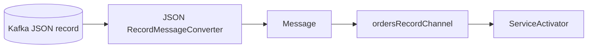
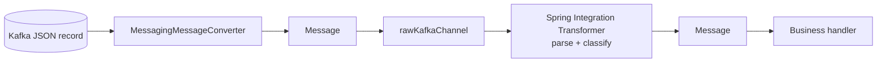
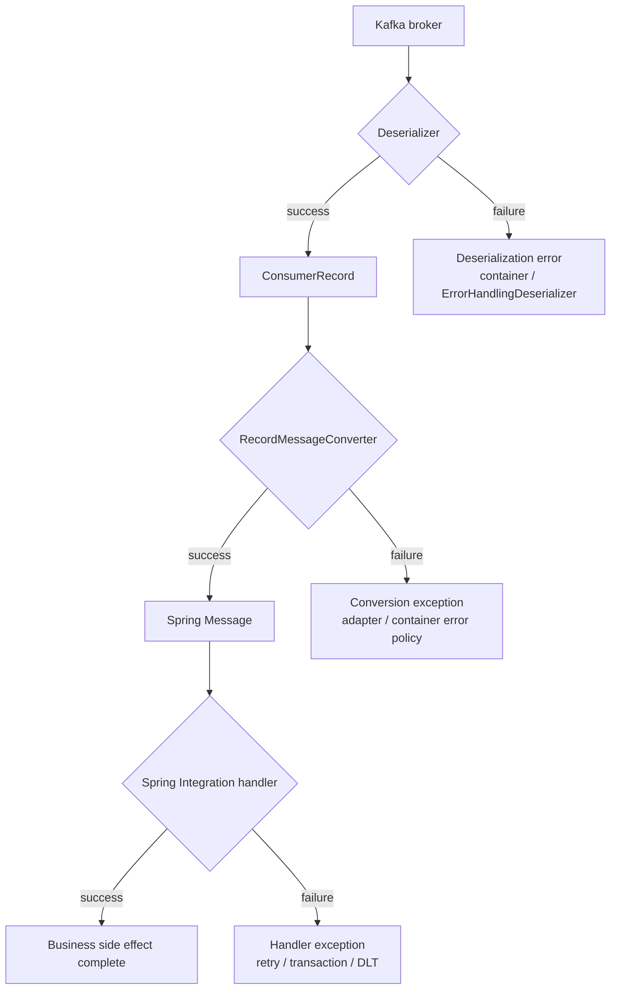
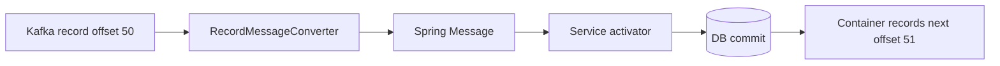

# Record message converter

A **record message converter** converts **one Kafka `ConsumerRecord<K,V>` into one Spring Messaging `Message<?>`**, allowing Spring Integration to process the payload and headers across `MessageChannel`s. In the outbound direction, the same converter type can assist in turning a Spring message into a Kafka `ProducerRecord`. The most important distinction is separating **Kafka deserializer**, **record message converter**, and **Spring Integration transformer**: they operate at different layers, at different times, and raise errors through different mechanisms.

This lesson belongs to the **Kafka Adapter** chapter of the **SPRING_INTEGRATION_ADAPTERS** module. The module teaches how to connect external systems via inbound/outbound adapters, gateways, pollers, and `MessageChannel`, practicing with files, SFTP, HTTP, JMS, AMQP, Kafka, and databases while managing message contracts, errors, and connection lifecycles. This lesson focuses on **`RecordMessageConverter` when Kafka inbound receives individual records**, especially in `KafkaMessageDrivenChannelAdapter`.

> **Principle:** The deserializer decides what Java type Kafka `ConsumerRecord.value()` has; the record message converter decides **how Spring `Message.payload` and `Message.headers` are built**. Without suitable JSON configuration, a JSON string remains a plain `String`.

## 1. Learning objectives

After studying this lesson, you will be able to:

1. Precisely distinguish `Deserializer<V>`, `RecordMessageConverter`, `BatchMessageConverter`, and a Spring Integration transformer.
2. Explain `toMessage(...)`, `fromMessage(...)`, and the parameters `ConsumerRecord`, `Acknowledgment`, Kafka `Consumer`, and `payloadType`.
3. Choose between `MessagingMessageConverter` (default pass-through) and an appropriate JSON converter when you want DTOs.
4. Recognize class name differences between Spring Kafka using **Jackson 2** and modern versions using **Jackson 3**.
5. Configure `KafkaMessageDrivenChannelAdapter` in `ListenerMode.record` with `setRecordMessageConverter(...)` and `setPayloadType(...)`.
6. Read payloads, Kafka topic/key/partition/offset, native headers, and metadata that may be absent.
7. Distinguish pre-listener deserialization errors, message conversion errors, validation/transformer errors, and business handler errors.
8. Handle tombstones (null Kafka values), type information, trusted packages, and schema evolution safely.
9. Unit-test converters independently using sample `ConsumerRecord`s and integration-test with a real Kafka broker.
10. Decide when to convert right at the Kafka boundary vs. keeping raw payloads and converting in a downstream transformer.

## 2. Where does the converter sit in a Spring Integration flow?

```mermaid
flowchart LR
    Producer["Producer sends JSON bytes"] --> Broker[("Kafka topic<br/>orders.events")]
    Broker --> Deser["Kafka value deserializer<br/>StringDeserializer"]
    Deser --> Record["ConsumerRecord<String,String><br/>value is JSON text"]
    Record --> Converter["RecordMessageConverter<br/>JacksonJsonMessageConverter"]
    Converter --> Message["Spring Message<OrderCreated><br/>DTO payload + Kafka headers"]
    Message --> Adapter["KafkaMessageDrivenChannelAdapter<br/>outputChannel"]
    Adapter --> Channel["DirectChannel"]
    Channel --> Handler["Service activator<br/>validate + persist"]
    Handler --> DB[("Database")]
```



**Looking at each boundary:**

| Boundary | Input | Output | Component |
|---|---|---|---|
| Broker → Kafka client | Bytes in Kafka log | Java key/value | Kafka `Deserializer` |
| Kafka client → listener container | `ConsumerRecord<K,V>` | Record callback | `MessageListenerContainer` |
| Listener callback → Spring message | `ConsumerRecord<K,V>` + ack/consumer/target type | `Message<?>` | `RecordMessageConverter` |
| Spring message → channel | `Message<?>` | Message dispatch | `KafkaMessageDrivenChannelAdapter` |
| Channel → business logic | Converted Spring message | Side effect or another message | Transformer/filter/service activator |

For example, if the producer sends:

```json
{"eventId":"evt-101","orderId":"ORD-101","type":"ORDER_CREATED"}
```

and the consumer uses `StringDeserializer`, the Kafka record value is typically:

```java
String value =
        "{\"eventId\":\"evt-101\",\"orderId\":\"ORD-101\","
        + "\"type\":\"ORDER_CREATED\"}";
```

**Without a record converter**, the handler receives `Message<String>`, not `Message<OrderCreated>`. Using a JSON record converter with target type `OrderCreated.class` lets the converter produce a Spring message holding a schema-matching DTO.

### 2.1. Is the inbound adapter a producer or a consumer?

`KafkaMessageDrivenChannelAdapter` is a **Kafka consumer** but a **Spring Integration message producer endpoint**: it receives records from the listener container and emits Spring messages to an **output `MessageChannel`**. It does not publish Kafka records to another topic. To consume from an input channel and publish to Kafka, use a Kafka outbound adapter with `KafkaProducerMessageHandler`.

### 2.2. Why is a record converter not a Spring Integration poller?

A message-driven adapter receives callbacks from the Spring Kafka listener container; the consumer client still calls `poll()` at the Kafka layer, yet **you do not need Spring Integration's `Pollers.fixedDelay(...)`** to trigger this adapter.

The record converter **does not poll**, does not coordinate partition assignment, and does not decide offset commits. Those belong to the container, Kafka client, and acknowledgment policy.

## 3. The `RecordMessageConverter` API

In Spring Kafka, the interface:

```java
org.springframework.kafka.support.converter.RecordMessageConverter
```

defines conversion between Spring messages and Kafka producer/consumer records.

### 3.1. Inbound `toMessage(...)` method

Core signature (omitting version-specific nullability annotations):

```java
Message<?> toMessage(
        ConsumerRecord<?, ?> record,
        Acknowledgment acknowledgment,
        Consumer<?, ?> consumer,
        Type payloadType);
```

| Parameter | Meaning |
|---|---|
| `record` | Kafka record just received by consumer: topic, partition, offset, timestamp, key, value, headers |
| `acknowledgment` | Object for manual ack when provided by container/mode |
| `consumer` | Current Kafka consumer if provided; **not thread-safe** |
| `payloadType` | Target Java type hint for converters supporting type-aware mapping |
| Returns `Message<?>` | Spring message with converted payload and headers |

**`payloadType` does not force every converter to deserialize JSON.** For example, the default `MessagingMessageConverter` normally keeps the value returned by the deserializer; a JSON converter is what binds String/bytes into a DTO.

### 3.2. Outbound `fromMessage(...)` method

```java
ProducerRecord<?, ?> fromMessage(
        Message<?> message,
        String defaultTopic);
```

This converts a Spring message into a Kafka producer record when needed, such as in `KafkaTemplate.send(Message<?>)` or an outbound handler with a compatible converter. However, **this lesson focuses on the inbound `toMessage` direction**; having both methods on a class does not mean every inbound converter should unconditionally be reused for outbound.

### 3.3. Do not confuse with two other `MessageConverter`s

| Name/contract | Package/concept | Purpose |
|---|---|---|
| **`RecordMessageConverter`** | `org.springframework.kafka.support.converter` | Kafka `ConsumerRecord` ↔ Spring `Message` |
| Spring Kafka `MessageConverter` | `org.springframework.kafka.support.converter` | Kafka-specific superinterface; handles record or batch per implementation |
| Spring Messaging `MessageConverter` | `org.springframework.messaging.converter` | Payload conversion inside Spring Messaging |
| `SmartMessageConverter` | Spring Messaging | Supports conversion hints/content types; Kafka converters can delegate to it |
| `Transformer` | Spring Integration | EIP step transforming messages/payloads once inside the flow |

**Common import mistake:** a method expects `RecordMessageConverter` while the code accidentally imports `org.springframework.messaging.converter.MessageConverter`. Use full package names during code reviews or bean declarations to avoid mix-ups.

## 4. `MessagingMessageConverter` and JSON converters

### 4.1. `MessagingMessageConverter`

`MessagingMessageConverter` is a widely used implementation of `RecordMessageConverter`. With incoming `String` values or already-deserialized DTOs, by default it mainly builds a Spring message, sets the payload from `record.value()`, and maps Kafka metadata/headers.

It is **not an automatic JSON parser** for arbitrary JSON strings. If the Kafka value is a JSON String, downstream still receives a String unless a JSON converter or additional Spring Messaging converter is configured.

### 4.2. JSON converters by version

In Spring Kafka 4.x / Jackson 3, common class names are:

| Modern Jackson 3 API | Context |
|---|---|
| `JacksonJsonMessageConverter` | Base JSON converter; inbound handles `String`, `byte[]`, and Kafka `Bytes` |
| `StringJacksonJsonMessageConverter` | JSON converter; outbound value is `String` when paired with `StringSerializer` |
| `ByteArrayJacksonJsonMessageConverter` | JSON converter; outbound value is `byte[]` |
| `BytesJacksonJsonMessageConverter` | JSON converter; outbound value is Kafka `Bytes` |
| `JacksonProjectingMessageConverter` | Converts JSON to projection interfaces when using compatible Spring Data projections |

In Spring Boot 3.x / Spring Kafka 3.x projects using Jackson 2, common names are:

| Jackson 2 API | Upgrade note |
|---|---|
| `JsonMessageConverter` | Base JSON converter from the Jackson 2 generation |
| `StringJsonMessageConverter` | JSON/String converter from the Jackson 2 generation |
| `ByteArrayJsonMessageConverter` | JSON/`byte[]` converter from the Jackson 2 generation |
| `BytesJsonMessageConverter` | JSON/`Bytes` converter from the Jackson 2 generation |
| `ProjectingMessageConverter` | Projection converter from the Jackson 2 generation |

When upgrading to Spring Kafka 4.x, the legacy Jackson 2 classes may still exist yet are **deprecated in favor of Jackson 3**. **Never** copy an import of `StringJsonMessageConverter` from a Spring Boot 3 guide and a `tools.jackson...` import from Spring Boot 4 into the same project assuming no runtime differences.

> **Primary demo version scope:** Java 17+, **Spring Boot 4.x / Spring Integration 7.x / Spring Kafka 4.x**, and Jackson 3. When applying to Spring Boot 3.x, substitute `JsonMessageConverter`/`StringJsonMessageConverter` as appropriate and use Jackson 2 classes managed by the Boot 3 BOM. Do not mix versions manually.

### 4.3. Choosing a converter by actual data

| Kafka value after deserializer | Spring requirement | Option |
|---|---|---|
| Plain `String`, e.g., `ORD-101` | Keep String | Default `MessagingMessageConverter` |
| `String` containing JSON | `OrderCreated` DTO | JSON record converter + target type |
| `byte[]` containing JSON | `OrderCreated` DTO | JSON converter supporting bytes + target type |
| `OrderCreated` already built by JSON deserializer | Keep DTO and map metadata | Default `MessagingMessageConverter` usually suffices |
| `byte[]` containing Protobuf | Protobuf DTO | Dedicated Protobuf deserializer/converter |
| Null value (tombstone) | Delete signal | Compatible `KafkaNull`/null contract; do not blindly force a JSON DTO |

The best choice depends on **wire format**, data producers, schema compatibility, and how many event types share the topic. Do not force every topic to use JSON when partners actually emit Avro/Protobuf/binary.

## 5. Type resolution: how does the converter know which DTO to build?

Suppose the JSON payload on the topic is:

```json
{
  "eventId": "evt-101",
  "orderId": "ORD-101",
  "type": "ORDER_CREATED"
}
```

We want to receive:

```java
public record OrderCreated(
        String eventId,
        String orderId,
        String type) {
}
```

On the Spring Integration inbound adapter, you can configure the **target payload type**:

```java
adapter.setRecordMessageConverter(
        new JacksonJsonMessageConverter());
adapter.setPayloadType(OrderCreated.class);
```

Here `setPayloadType` supplies a type hint to a type-aware converter. **It does not run Jackson for you** if the adapter still uses a default converter that does not perform JSON binding.

### 5.1. Type hints vs. type ID headers

Spring Kafka JSON producers can attach type information in native Kafka headers. JSON converters provide a type mapper and precedence rules across:

- **Caller/adapter-suggested type** such as `OrderCreated.class`.
- **Type ID in Kafka headers** if present and permitted by the type mapper.
- **Default/fallback type** configured on the converter.

Never let headers containing class names from untrusted sources arbitrarily choose which Java class gets deserialized. Restrict **trusted packages, explicit type mappings/allowlists, and fixed target types** wherever possible. A payload field like `"type": "ORDER_CREATED"` is a business event type, **not a Spring Kafka Java type header by default**.

### 5.2. Target types and schema evolution

If a producer adds fields, renames fields, or changes data types, the converter behaves according to Jackson mapper settings. Define:

1. Which fields are required vs. defaulted.
2. How nulls, missing fields, and unknown fields are handled.
3. Schema/event versions and producer/consumer compatibility.
4. How renamed events or split event types are handled.
5. How incompatible records are quarantined and replayed.
6. Contract tests with real records across producer versions.

**Successful conversion does not mean business-valid data.** For example, `orderId=""` still produces a valid Java `OrderCreated` instance; a validator/downstream handler must enforce the invariant "orderId must not be blank."

## 6. Complete example: JSON record → `Message<OrderCreated>`

This example builds a Spring Boot 4.x application consuming topic `orders.events`. Kafka values are JSON **Strings**; a `JacksonJsonMessageConverter` converts them into DTOs, and the adapter sends them over `DirectChannel` to a `@ServiceActivator`.

### 6.1. Maven dependencies

Use a matching Spring Boot parent/BOM; do not mix Spring Kafka and Spring Integration versions manually:

```xml
<dependencies>
    <dependency>
        <groupId>org.springframework.boot</groupId>
        <artifactId>spring-boot-starter-integration</artifactId>
    </dependency>

    <dependency>
        <groupId>org.springframework.integration</groupId>
        <artifactId>spring-integration-kafka</artifactId>
    </dependency>

    <!-- JSON mapper for Spring Boot 4 / Jackson 3 -->
    <dependency>
        <groupId>org.springframework.boot</groupId>
        <artifactId>spring-boot-starter-json</artifactId>
    </dependency>
</dependencies>
```

A compatible Spring Boot 4 BOM manages Spring Kafka 4 / Jackson 3. For Boot 3, use the JSON converter classes and Jackson dependencies from Boot 3's BOM; **do not copy Jackson 3 imports into Boot 3**.

### 6.2. application.properties

```properties
demo.kafka.bootstrap-servers=localhost:9092
demo.kafka.group-id=orders-json-record-demo
demo.kafka.concurrency=2
```

The `orders.events` topic must exist and the Kafka broker must be reachable. Production must add TLS/SASL, topic ACLs, secret management, and schema policies—never use demo groups or credentials in production.

### 6.3. Data DTO

Java file `com.example.kafka.OrderCreated`:

```java
package com.example.kafka;

public record OrderCreated(
        String eventId,
        String orderId,
        String type) {
}
```

A Java 17+ `record` represents a simple immutable DTO. JSON property names in sample payloads must match record component names. Production may add a `schemaVersion` field and Bean Validation, while the demo keeps fields minimal.

### 6.4. Kafka consumer factory, container, and converter

```java
package com.example.kafka;

import java.util.HashMap;
import java.util.Map;

import org.apache.kafka.clients.consumer.ConsumerConfig;
import org.apache.kafka.common.serialization.StringDeserializer;
import org.springframework.beans.factory.annotation.Qualifier;
import org.springframework.beans.factory.annotation.Value;
import org.springframework.context.annotation.Bean;
import org.springframework.context.annotation.Configuration;
import org.springframework.integration.channel.DirectChannel;
import org.springframework.integration.config.EnableIntegration;
import org.springframework.integration.kafka.inbound.KafkaMessageDrivenChannelAdapter;
import org.springframework.kafka.core.ConsumerFactory;
import org.springframework.kafka.core.DefaultKafkaConsumerFactory;
import org.springframework.kafka.listener.ConcurrentMessageListenerContainer;
import org.springframework.kafka.listener.ContainerProperties;
import org.springframework.kafka.support.converter.JacksonJsonMessageConverter;
import org.springframework.messaging.MessageChannel;

@Configuration
@EnableIntegration
public class OrdersJsonRecordInboundConfig {

    @Bean("ordersJsonConsumerFactory")
    public ConsumerFactory<String, String> ordersJsonConsumerFactory(
            @Value("${demo.kafka.bootstrap-servers}") String brokers,
            @Value("${demo.kafka.group-id}") String groupId) {

        Map<String, Object> props = new HashMap<>();
        props.put(ConsumerConfig.BOOTSTRAP_SERVERS_CONFIG, brokers);
        props.put(ConsumerConfig.GROUP_ID_CONFIG, groupId);
        props.put(ConsumerConfig.KEY_DESERIALIZER_CLASS_CONFIG,
                StringDeserializer.class);
        props.put(ConsumerConfig.VALUE_DESERIALIZER_CLASS_CONFIG,
                StringDeserializer.class);
        props.put(ConsumerConfig.ENABLE_AUTO_COMMIT_CONFIG, false);
        props.put(ConsumerConfig.AUTO_OFFSET_RESET_CONFIG, "earliest");
        return new DefaultKafkaConsumerFactory<>(props);
    }

    @Bean("ordersRecordChannel")
    public MessageChannel ordersRecordChannel() {
        return new DirectChannel();
    }

    @Bean("ordersRecordKafkaInbound")
    public KafkaMessageDrivenChannelAdapter<String, String> ordersInbound(
            @Qualifier("ordersJsonConsumerFactory")
                    ConsumerFactory<String, String> factory,
            @Qualifier("ordersRecordChannel")
                    MessageChannel outputChannel,
            @Value("${demo.kafka.concurrency}") int concurrency) {

        ContainerProperties containerProperties =
                new ContainerProperties("orders.events");
        containerProperties.setAckMode(
                ContainerProperties.AckMode.RECORD);

        ConcurrentMessageListenerContainer<String, String> container =
                new ConcurrentMessageListenerContainer<>(
                        factory, containerProperties);
        container.setConcurrency(concurrency);

        KafkaMessageDrivenChannelAdapter<String, String> adapter =
                new KafkaMessageDrivenChannelAdapter<>(
                        container,
                        KafkaMessageDrivenChannelAdapter.ListenerMode.record);

        // RecordMessageConverter: String JSON -> OrderCreated DTO.
        adapter.setRecordMessageConverter(
                new JacksonJsonMessageConverter());
        adapter.setPayloadType(OrderCreated.class);

        // Kafka record is converted into a Spring Message<?> before
        // being sent to this output channel.
        adapter.setOutputChannel(outputChannel);
        return adapter;
    }
}
```

**Worth noting:** `ConsumerFactory<String,String>` still returns a **`String`** value from `StringDeserializer`. `setPayloadType(OrderCreated.class)` acts at the **conversion layer into the Spring message**. Do not change the factory generic to `ConsumerFactory<String,OrderCreated>` while the actual value deserializer remains `StringDeserializer`.

`ContainerProperties.AckMode.RECORD` is a listener container policy, independent of the record converter. The converter does not decide when offsets are committed.

### 6.5. Service activator receiving the DTO

```java
package com.example.kafka;

import org.springframework.integration.annotation.ServiceActivator;
import org.springframework.kafka.support.KafkaHeaders;
import org.springframework.messaging.Message;
import org.springframework.stereotype.Component;

@Component
public class OrdersRecordHandler {

    @ServiceActivator(inputChannel = "ordersRecordChannel")
    public void onEvent(Message<OrderCreated> message) {
        OrderCreated order = message.getPayload();

        if (order.eventId() == null
                || order.eventId().isBlank()
                || order.orderId() == null
                || order.orderId().isBlank()) {
            throw new IllegalArgumentException(
                    "Missing eventId or orderId");
        }

        Object topic = message.getHeaders()
                .get(KafkaHeaders.RECEIVED_TOPIC);
        Object partition = message.getHeaders()
                .get(KafkaHeaders.RECEIVED_PARTITION);
        Object offset = message.getHeaders()
                .get(KafkaHeaders.OFFSET);

        System.out.printf(
                "ORDER eventId=%s orderId=%s type=%s"
                + " from %s-%s@%s%n",
                order.eventId(), order.orderId(), order.type(),
                topic, partition, offset);

        // Production: call a service with idempotency + DB transaction.
    }
}
```

Include a `@SpringBootApplication` in `com.example.kafka` or a parent package so Spring scans the beans. `@ServiceActivator` creates a consumer endpoint on `DirectChannel`, **not** a new Kafka consumer client.

### 6.6. Expected run output

If Kafka contains the record:

```json
{"eventId":"evt-101","orderId":"ORD-101","type":"ORDER_CREATED"}
```

then expected output looks similar to:

```text
ORDER eventId=evt-101 orderId=ORD-101 type=ORDER_CREATED
  from orders.events-1@42
```

Actual topic/partition/offset depend on producer key, partitioner, and topic state; **do not** assume partition 1 and offset 42 are fixed.

## 7. Running tests and observing the message contract

In a lab environment with Kafka CLI:

```bash
kafka-topics.sh --bootstrap-server localhost:9092 \
  --create --if-not-exists \
  --topic orders.events --partitions 3 --replication-factor 1

kafka-console-producer.sh \
  --bootstrap-server localhost:9092 \
  --topic orders.events
```

Enter one JSON record value per line:

```json
{"eventId":"evt-101","orderId":"ORD-101","type":"ORDER_CREATED"}
{"eventId":"evt-102","orderId":"ORD-102","type":"ORDER_CREATED"}
{"eventId":"evt-103","orderId":"ORD-103","type":"ORDER_PAID"}
```

Observe:

1. The Kafka console producer emits **JSON strings**.
2. The consumer uses `StringDeserializer` to produce `ConsumerRecord<String,String>`.
3. `JacksonJsonMessageConverter` converts the value to `OrderCreated` per `payloadType`.
4. The adapter sends `Message<OrderCreated>` to `ordersRecordChannel`.
5. `@ServiceActivator` logs and can throw exceptions when validation fails.

### 7.1. Checking committed offsets and lag

```bash
kafka-consumer-groups.sh \
  --bootstrap-server localhost:9092 \
  --describe --group orders-json-record-demo
```

`auto.offset.reset=earliest` only determines the starting point when the group has no valid committed offset or meets Kafka's reset conditions. It does **not** force the consumer to read from the beginning of the topic on every restart.

A converter failure may cause a record to be retried or recovered; verify offsets, logs, retries, and DLT according to the **actual container error policy**, rather than assuming an error log means the record was definitely not committed.

## 8. Header mapping: Kafka data to Spring headers

A Kafka record carries topic, partition, offset, timestamp, key, value, and **native Kafka headers**. The record converter places needed information into `MessageHeaders`.

| Kafka field | Common Spring header | Notes |
|---|---|---|
| Topic | `KafkaHeaders.RECEIVED_TOPIC` | Name of received topic |
| Partition | `KafkaHeaders.RECEIVED_PARTITION` | Partition containing the record |
| Offset | `KafkaHeaders.OFFSET` | Offset in partition, not a business ID |
| Key | `KafkaHeaders.RECEIVED_KEY` | Header may be absent if key is null |
| Timestamp | `KafkaHeaders.RECEIVED_TIMESTAMP` | Depends on metadata/converter/version |
| Timestamp type | `KafkaHeaders.RECEIVED_TIMESTAMP_TYPE` when supported | Depends on converter |
| Acknowledgment | `KafkaHeaders.ACKNOWLEDGMENT` | Only valid when supplied by matching ack mode |
| Consumer object | `KafkaHeaders.CONSUMER` when supported | Not thread-safe; never save to call from another thread |
| Native Kafka headers | Per `KafkaHeaderMapper` | May be decoded/filtered per policy |
| Spring message ID | `MessageHeaders.ID` | Not equivalent to Kafka offset or `eventId` |

**Never assume every header is present.** When a record key is null, `KafkaHeaders.RECEIVED_KEY` may be missing. If ack mode is not manual, `Acknowledgment` may not be populated on the message. If the converter does not map a custom header, downstream will not see it automatically.

### 8.1. Kafka key vs. `eventId`

Example:

```text
topic             orders.events
partition         2
offset            38
Kafka key         ORD-101
payload.eventId   evt-101
Spring Message.ID UUID(...)
```

- **Kafka key** helps partition/order by aggregate.
- **`eventId`** identifies a business event for deduplication.
- **topic-partition-offset** locates a specific Kafka write.
- **`MessageHeaders.ID`** identifies the internal Spring message.

If the same business event is republished at a new offset, deduplicating by offset **will fail** to detect the business duplicate. Use a durable `eventId` or equivalent business key.

### 8.2. Native Kafka headers and security

Native Kafka headers are `String key → byte[] value` pairs, whereas Spring `MessageHeaders` can hold typed objects. `KafkaHeaderMapper` controls conversion and does not necessarily copy every header.

Specifically avoid:

- Copying credentials, tokens, connection objects, or the `Consumer` itself into Kafka headers or logs.
- Allowing untrusted class names/type IDs to make the converter instantiate classes outside an allowlist.
- Logging full raw JSON when payloads contain PII.
- Confusing `kafka_receivedTopic` with `kafka_topic` when building outbound flows.

## 9. `setRecordMessageConverter` vs. `setMessageConverter` and listener factory config

### 9.1. Direct configuration on the adapter

The clearest approach when using Spring Integration message-driven inbound:

```java
KafkaMessageDrivenChannelAdapter<String, String> adapter =
        new KafkaMessageDrivenChannelAdapter<>(
                container,
                KafkaMessageDrivenChannelAdapter.ListenerMode.record);

adapter.setRecordMessageConverter(
        new JacksonJsonMessageConverter());
adapter.setPayloadType(OrderCreated.class);
adapter.setOutputChannel(ordersRecordChannel);
```

Javadoc also offers `setMessageConverter(...)` for the general converter contract; however, `setRecordMessageConverter(...)` **explicitly states record mode**, helping readers and reviewers avoid confusing it with `BatchMessageConverter`.

### 9.2. `@KafkaListener` configuration is a different path

In a pure Spring Kafka application, `@KafkaListener` typically uses:

```java
@Bean
ConcurrentKafkaListenerContainerFactory<String, String>
recordListenerFactory(
        ConsumerFactory<String, String> factory) {

    ConcurrentKafkaListenerContainerFactory<String, String> listenerFactory =
            new ConcurrentKafkaListenerContainerFactory<>();
    listenerFactory.setConsumerFactory(factory);
    listenerFactory.setRecordMessageConverter(
            new JacksonJsonMessageConverter());
    return listenerFactory;
}
```

This configures **the listener adapter invoking `@KafkaListener` methods**; it does not automatically replace `setRecordMessageConverter(...)` on a `KafkaMessageDrivenChannelAdapter` constructed directly as in Section 6.

**Never register a competing `@KafkaListener` on the same topic/group just to "test the converter"**: the group coordinator will split partitions across both consumers, routing data to an unexpected flow.

### 9.3. Should you change the deserializer to a DTO instead?

Not if you already chose `StringDeserializer + JacksonJsonMessageConverter + payloadType`. Another valid design exists:

```text
Option A — convert at message boundary:
 Kafka bytes
   -> StringDeserializer
   -> ConsumerRecord<String,String>
   -> JacksonJsonMessageConverter
   -> Message<OrderCreated>

Option B — deserialize to DTO:
 Kafka bytes
   -> JsonDeserializer/ JacksonJsonDeserializer<OrderCreated>
   -> ConsumerRecord<String,OrderCreated>
   -> MessagingMessageConverter
   -> Message<OrderCreated>
```

Option B pushes JSON parse errors into the **deserializer** layer; Option A keeps parsing in the **record message converter** layer. Both approaches are valid, yet **failure classification and error handling differ**.

## 10. Choosing a record converter vs. a downstream transformer

There are two implementation styles:

### 10.1. Convert immediately on ingestion



**Pros:** Downstream receives a uniform DTO, handlers do not parse JSON, and Kafka headers are mapped cleanly. Fits topics with stable schemas and one logical event type.

**Cons:** Malformed JSON never enters standard downstream handlers; error handling is required at the adapter/container layer. When a topic carries multiple schemas/events, a fixed `payloadType` can be too rigid.

### 10.2. Keep `String` and process in a transformer



**Pros:** Can inspect schema versions, route multiple event types, or persist raw input before parsing in an explicit flow. Certain error types can be handled/quarantined in the EIP layer.

**Cons:** Raw payloads need a clear contract; handlers could accidentally process unvalidated Strings. Requires designing retry/error channels and offset boundaries so records are not acked merely because raw messages entered a queue.

**Selection rule:** Converters fit **transport format → Spring message**; transformers fit **EIP/business transformations**. Never stuff validation, DB calls, or HTTP requests into a record converter just because it sits close to Kafka.

## 11. Header conversion and type mapping in more detail

`MessagingMessageConverter` supports a `KafkaHeaderMapper` and can collaborate with a Spring Messaging `SmartMessageConverter`. That contract enables payload conversion based on `contentType` in appropriate scenarios.

### 11.1. Header mapping is more than copying strings

A native Kafka header only stores bytes. A Spring message may expect a typed value such as:

```text
Kafka header:
    eventId -> UTF-8 bytes

Spring header:
    eventId -> "evt-101" (String)
```

Mapping can rely on JSON header mapper rules, pattern matching, trusted packages, or application policies. With non-Spring producers, never assume headers are encoded identically to how Spring Kafka serializes Java types.

When an interoperable wire contract is needed, explicitly specify:

- Case sensitivity of header names.
- Byte encoding, such as UTF-8 or big-endian integer.
- Whether type information is permitted.
- Payload schema/version.
- How missing, duplicate, or untrusted headers are handled.

### 11.2. Is `SmartMessageConverter` a `RecordMessageConverter`?

No. `SmartMessageConverter` belongs to Spring Messaging and can be **delegated to for conversion** by `MessagingMessageConverter`. High-level flow:

```text
ConsumerRecord
  -> Kafka RecordMessageConverter
  -> temporary Spring Message
  -> SmartMessageConverter (if configured and applicable)
  -> final Spring Message
```

If the smart converter cannot handle the target type and returns null per contract, the Kafka converter may keep the original payload. Write integration tests with real data to verify actual results rather than just checking that a converter bean exists in the context.

### 11.3. Type headers: security risks

When consuming Kafka records from untrusted sources, type metadata can try to steer deserialization toward an unintended class. With JSON converters/deserializers:

1. Configure narrow trusted packages.
2. Map **public type IDs → allowlisted DTO classes** instead of allowing arbitrary class names.
3. Prefer fixed target types on single-schema topics.
4. Never enable trust-all (`*`) unconditionally in production.
5. Reject abnormal payload sizes and validate data before executing side effects.

## 12. Tombstones: when Kafka value is null

On a **compacted topic**, a record with a key and `value=null` is normally a **tombstone**, representing key-state deletion under Kafka log compaction semantics.

Spring Messaging does not allow ordinary Java `null` payloads in `Message<?>`. Spring Kafka/Spring Integration represents tombstones via a `KafkaNull` marker or translates them to null in certain annotated method signatures depending on version.

```text
Kafka:
  key   = "ORD-101"
  value = null

Spring Messaging:
  payload cannot simply be Java null in MessageBuilder
  -> converter/framework uses an appropriate marker (e.g., KafkaNull)
```

If your use case requires key-based deletions, design a dedicated handler to accept tombstones. Do not write code like:

```java
// Unsafe if payload can be KafkaNull/tombstone.
OrderCreated dto = (OrderCreated) message.getPayload();
```

without checking marker/annotation conversion behavior. **The Section 6 example fits topics carrying non-null JSON events per the demo contract**, not full tombstone handling.

### 12.1. Why are tombstones easy to mishandle?

A system might treat null values as corrupt data and route them to a DLT or retry forever. On a compacted topic, however, null may be a **valid deletion action**. Confirm from the topic/schema contract whether tombstones are allowed, use the key to locate the aggregate to delete, and test specifically with null-value records.

## 13. Error handling: which layer does the error occur in?



| Failure | Timing | Does downstream handler receive a DTO? |
|---|---|---|
| Key/value bytes fail deserialization | Before a valid record value exists | Typically **no** |
| Malformed JSON during converter parse | `ConsumerRecord<String,String>` exists, conversion fails | **No** |
| Converter picks wrong class or untrusted type header | Inside `toMessage` | **No** |
| Missing `orderId` while JSON parses to DTO | After conversion | Yes; handler/validator decides |
| DB timeout, HTTP 503 | During business processing | Yes; downstream error |
| In-memory queue crashes after enqueue | After listener callback, before side effect | May never reach handler |

### 13.1. Deserializer errors

If using Kafka `JsonDeserializer`/`JacksonJsonDeserializer` and JSON is invalid, failure can occur during poll/deserialization **before the record converter runs**. An `ErrorHandlingDeserializer` can wrap the failure cause so the container error handler/recoverer can handle it and send data to a DLT per configuration.

Never place your only "catch deserializer error" logic inside `@ServiceActivator(inputChannel="ordersRecordChannel")`, because corrupt records may **never become Spring messages**.

### 13.2. Converter exceptions

If using `StringDeserializer` while `JacksonJsonMessageConverter` cannot parse JSON, the exception is thrown while the adapter builds the Spring message.

With synchronous `DirectChannel`, conversion/handler errors **can propagate back to the Kafka listener container** for `DefaultErrorHandler` unless intercepted and completed normally by another error/recovery layer. Test this under your exact framework version and wiring.

### 13.3. An error channel is not a Kafka DLT

A Spring Integration `errorChannel` carries internal `ErrorMessage`s. It **does not automatically publish records to a Kafka DLT**. If a recovery callback or error flow **swallows the exception**, the container may treat the callback as successful and commit offsets per policy; corrupt data can be skipped even though the business handler never processed it.

Verify:

1. Did the error occur in the deserializer, converter, or handler?
2. Does the exception still propagate to the listener container?
3. Who retries, how many times, and with what backoff?
4. Was the record genuinely recovered to a DLT/quarantine?
5. When DLT/recovery publishing fails, how is the offset handled?
6. Which business ID allows safe retries/replays without duplicate side effects?

### 13.4. Example of bounded container retries

```java
import org.springframework.kafka.listener.DefaultErrorHandler;
import org.springframework.util.backoff.FixedBackOff;

// Set before the adapter uses the container.
container.setCommonErrorHandler(
        new DefaultErrorHandler(
                new FixedBackOff(1_000L, 2L)));
```

This retries twice after the initial attempt with an illustrative 1-second backoff. This configuration **is not enough for a DLT**: you need `DeadLetterPublishingRecoverer`, a matching producer/template, topics/ACLs, and a failure policy if DLT publishing fails.

Do not infinitely retry unfixable malformed JSON by repeating conversion. Classify permanent parse/schema errors differently from transient DB/network errors.

### 13.5. Keeping raw records and metadata for investigation

`KafkaMessageDrivenChannelAdapter` can use `setBindSourceRecord(true)` (depending on version) to attach the source record to the `IntegrationMessageHeaderAccessor.SOURCE_DATA` header.

```java
adapter.setBindSourceRecord(true);
```

This assists tracing once a message converts successfully; it **is not a mechanism guaranteeing conversion-failed records reach downstream**. Records failing before/during `toMessage` need a dedicated container recoverer/error strategy to store raw bytes for inspection.

## 14. The converter does not decide offset commits

Kafka consumer groups store committed offsets; the Spring Kafka listener container decides ack/commit timing per `AckMode` and error handling. The converter only builds messages and has no awareness of whether DB transactions succeeded.



This diagram shows the **desired processing path** for a synchronous flow; in reality, failures or retries/recovery may occur.

### 14.1. `DirectChannel`

With `DirectChannel`, the handler runs synchronously inside the listener callback unless downstream spawns another thread. Exceptions from the handler can propagate back to the container. `AckMode.RECORD` records/commits after a successful record callback per container mechanics, but **does not create a distributed transaction with the DB**.

### 14.2. `QueueChannel` or `ExecutorChannel`

```text
Kafka listener thread
  -> Converter succeeds
  -> adapter.send(Message<OrderCreated>)
  -> QueueChannel.enqueue() succeeds
  -> callback returns; offset may be committed

Later:
  -> PollingConsumer.dequeue()
  -> handler writes database
```

If the queue only resides in RAM, a JVM crash after Kafka offset commit but before DB write can **lose business messages**. Changing the converter will not fix this. Use a durable handoff or acknowledgment tied to downstream completion per Kafka/Spring contracts.

### 14.3. At-least-once and idempotency

Suppose the handler commits `eventId=evt-101` to the DB, and the application crashes before Kafka commits the offset. After restart, the record may be redelivered and the converter builds an identical DTO again.

Use a business `eventId`/unique constraint/inbox table so a second processing pass **produces no duplicate side effects**. Kafka transactions or `AckMode.RECORD` alone do not guarantee exactly-once across Kafka and JDBC.

## 15. Record converter and batch converter are two contracts

`KafkaMessageDrivenChannelAdapter.ListenerMode.record` processes **one record at a time** and pairs with `RecordMessageConverter`. `ListenerMode.batch` processes **a group of records** and requires a matching `BatchMessageConverter`.

| Criterion | Record converter | Batch converter |
|---|---|---|
| Primary contract | `ConsumerRecord` → `Message<?>` | List of `ConsumerRecord`s → `Message<?>` |
| Inbound adapter mode | `ListenerMode.record` | `ListenerMode.batch` |
| Common payload | `OrderCreated` | `List<OrderCreated>` |
| Metadata | Single topic/partition/offset | Corresponding lists of topic/partition/offset |
| Error handling | Per record | Partial batch failure, failing record index |
| Spring Integration handler | `Message<OrderCreated>` | `Message<List<OrderCreated>>` |
| Adapter configuration | `setRecordMessageConverter(...)` | `setBatchMessageConverter(...)` |

### 15.1. Never switch modes while keeping the old handler signature

Broken example:

```java
// Adapter ListenerMode.batch yet handler still expects a single OrderCreated.
@ServiceActivator(inputChannel = "ordersBatchChannel")
public void handle(Message<OrderCreated> message) {
    // Actual payload may be List<OrderCreated>.
}
```

For batching, configure a batch-mode listener container and converter, have the handler accept a list, and design retry/commit behavior if record 53 fails after the first 52 wrote to the DB.

### 15.2. A batch converter can wrap a record converter internally

`BatchMessagingMessageConverter` can delegate to an appropriate `RecordMessageConverter` to convert each element before assembling the batch message. This is convenient, yet **does not make batch mode behave like record mode**: acks, headers, and partial failures still follow batch contracts.

Illustrative snippet—not meant to run alongside the record-mode adapter from Section 6:

```java
// With batch container and batch handler already configured.
adapter.setBatchMessageConverter(
        new BatchMessagingMessageConverter(
                new JacksonJsonMessageConverter()));
```

Import `org.springframework.kafka.support.converter.BatchMessagingMessageConverter` and actually configure the adapter for `ListenerMode.batch`. Verify constructor signatures and APIs in your version before applying.

## 16. Custom `RecordMessageConverter`: when is it needed?

Default JSON converters are not always sufficient. An application might need to:

- Map a native `eventType` header into a business Spring header.
- Unwrap a Kafka value wrapper/envelope into a standard payload.
- Decode an organization-defined binary/protocol format.
- Normalize metadata across heterogeneous producers.
- Reject disallowed schema versions **before** creating a Spring message.

However, **a converter must never perform side effects** such as sending HTTP requests, updating a DB, or calling external services. If the converter fails or records are retried, non-idempotent side effects would repeat.

### 16.1. Delegating custom converter example

The snippet below illustrates a wrapper design: the core converter handles JSON, and the wrapper adds an `eventId` header once the DTO is constructed.

```java
package com.example.kafka;

import java.lang.reflect.Type;

import org.apache.kafka.clients.consumer.Consumer;
import org.apache.kafka.clients.consumer.ConsumerRecord;
import org.apache.kafka.clients.producer.ProducerRecord;
import org.springframework.kafka.support.Acknowledgment;
import org.springframework.kafka.support.converter.JacksonJsonMessageConverter;
import org.springframework.kafka.support.converter.RecordMessageConverter;
import org.springframework.messaging.Message;
import org.springframework.messaging.support.MessageBuilder;

public final class OrderHeaderRecordConverter
        implements RecordMessageConverter {

    private final RecordMessageConverter delegate =
            new JacksonJsonMessageConverter();

    @Override
    public Message<?> toMessage(
            ConsumerRecord<?, ?> record,
            Acknowledgment acknowledgment,
            Consumer<?, ?> consumer,
            Type payloadType) {

        Message<?> converted = delegate.toMessage(
                record, acknowledgment, consumer, payloadType);

        if (!(converted.getPayload() instanceof OrderCreated order)) {
            throw new IllegalArgumentException(
                    "Payload is not OrderCreated");
        }

        if (order.eventId() == null || order.eventId().isBlank()) {
            throw new IllegalArgumentException("Missing eventId");
        }

        return MessageBuilder.fromMessage(converted)
                .setHeader("businessEventId", order.eventId())
                .build();
    }

    @Override
    public ProducerRecord<?, ?> fromMessage(
            Message<?> message, String defaultTopic) {
        return delegate.fromMessage(message, defaultTopic);
    }
}
```

Configuration on the adapter:

```java
adapter.setRecordMessageConverter(
        new OrderHeaderRecordConverter());
adapter.setPayloadType(OrderCreated.class);
```

**Design trade-off:** The wrapper validates `eventId` right at the conversion boundary; if `eventId` is missing, the exception belongs to the conversion stage, so no standard downstream Spring message is produced. If your schema requires parsing JSON first and running business validation separately, **move the `eventId` check into the `@ServiceActivator` or a validator** instead of hard-coding it in the converter.

`fromMessage(...)` delegates to honor the bidirectional interface contract; even an inbound-only application must implement the full contract.

## 17. Performance and conversion cost

Every Kafka record passing through deserialization, conversion, and Spring message creation incurs cost:

- Deserializing bytes → `String`/`byte[]`/DTO.
- Parsing JSON into objects and allocating intermediate objects.
- Mapping native Kafka headers and Spring message headers.
- Validating payloads.
- Dispatching through Spring channels.
- Executing downstream handlers.

### 17.1. Avoid parsing JSON twice

Do not configure `JacksonJsonDeserializer<OrderCreated>` to produce a DTO and then run a JSON record converter as if the value were still JSON text. Choose one primary parse stage unless the system has an explicit re-normalization requirement.

### 17.2. `String` vs. `byte[]`

When Kafka values are JSON bytes, using `StringDeserializer` followed by a JSON converter adds a **bytes → `String` → DTO** step. `ByteArrayDeserializer` paired with a `byte[]`-capable JSON converter removes one allocation step; the trade-off is that the rest of the pipeline must maintain that contract and handle raw bytes on errors.

Do not switch deserializers simply because "byte[] is faster" without benchmarking throughput, memory, GC, payload sizes, and broker/network bottlenecks.

### 17.3. Header mapping and message size

Large native headers or high header counts increase allocation and copy overhead. Map only required metadata and avoid binding raw source records unless truly used for observability/debugging.

### 17.4. Concurrency and ordering

`ConcurrentMessageListenerContainer.setConcurrency(n)` creates multiple Kafka consumer threads in the same group. Each partition normally belongs to only one consumer in the group at a time. The converter executes on the listener callback path; if conversion is slow, it **occupies the consumer thread**, increasing lag and risking `max.poll.interval.ms` timeouts.

Never perform network I/O or blocking DB work inside a converter. Offloading to an `ExecutorChannel` for throughput must be re-evaluated for offset boundaries, completion ordering, and durability—not just JSON parsing speed.

## 18. Testing: converter unit tests without a Kafka broker

A key benefit of `RecordMessageConverter` is that it can be unit-tested in isolation using sample `ConsumerRecord`s:

```java
import org.apache.kafka.clients.consumer.ConsumerRecord;
import org.springframework.kafka.support.converter.JacksonJsonMessageConverter;
import org.springframework.messaging.Message;

// Illustrative unit test snippet inside a @Test method.
ConsumerRecord<String, String> record = new ConsumerRecord<>(
        "orders.events",
        0,             // partition
        42L,           // offset
        "ORD-101",     // key
        "{\"eventId\":\"evt-101\","
        + "\"orderId\":\"ORD-101\","
        + "\"type\":\"ORDER_CREATED\"}");

JacksonJsonMessageConverter converter =
        new JacksonJsonMessageConverter();

Message<?> converted = converter.toMessage(
        record, null, null, OrderCreated.class);

OrderCreated order = (OrderCreated) converted.getPayload();

assertEquals("evt-101", order.eventId());
assertEquals("ORD-101", order.orderId());
```

This assumes `OrderCreated`, JUnit's `assertEquals`, and the JSON converter dependency are present. It is a **conversion unit test**; it does not verify brokers, consumer groups, retries, or offset commits.

### 18.1. Essential test cases

| Test | What to verify |
|---|---|
| Valid JSON | Builds exact DTO and metadata |
| JSON missing `eventId` | Mapper vs. validation behavior |
| JSON with future extra fields | Backward-compatible contract |
| JSON with wrong field type | Conversion error properly classified |
| Malformed JSON | Throws exception; record is not silently dropped |
| Null Kafka key | Key header may be absent |
| UTF-8 native headers | Proper byte/encoding mapping |
| Untrusted type ID | Does not deserialize classes outside allowlist |
| Null value / tombstone | Follows topic contract; does not blindly force DTO |
| Record with many custom headers | Mapper does not leak forbidden data |
| Second retry of same record | Side effect is deduplicated in handler/DB |
| Batch mode misconfigured with record converter | Config failure or contract mismatch caught early |

### 18.2. Integration testing with a real broker

Use an isolated Kafka test cluster (such as Testcontainers or a compatible embedded Kafka), publish JSON records with a separate producer, and then:

1. Wait until the Spring Integration consumer group holds partition assignments.
2. Send valid JSON messages.
3. Assert the handler receives `OrderCreated`, not `String`.
4. Verify topic, partition, offset, key, and headers.
5. Send malformed JSON and observe retries/error handler/offsets per policy.
6. Test restarts to verify idempotency with `eventId`.
7. Test custom headers and schema versions from a non-Spring producer.
8. Test shutdown and rebalances while conversion or business handlers are active.

Avoid relying solely on fixed `Thread.sleep(...)` calls; use deadline-bounded await/assertions to prevent flaky tests. **Never** use a production Kafka group for replay/offset-reset tests.

## 19. Troubleshooting: where did the converter go wrong?

| Symptom | Likely cause | How to check |
|---|---|---|
| Handler expects `OrderCreated` but gets `String` | Missing JSON converter or `payloadType` | Adapter wiring, converter, deserializer |
| Handler receives DTO but fields are null | JSON schema/field names mismatch | Raw record, Jackson mapping, validation |
| Fails before any Spring message is seen | Deserializer or converter threw exception | Stack trace/cause, listener phase |
| Type header resolves an unwanted class | Type mapper precedence / trusted packages | Native Kafka headers, type allowlist |
| Corrupt JSON retries forever | Error handler doesn't classify permanent errors | Retry/backoff/DLT, committed offset |
| `KafkaHeaders.RECEIVED_KEY` is null | Kafka key is actually null or unmapped | `ConsumerRecord.key()`, mapper |
| `Acknowledgment` is missing | Manual ack disabled or converter/header policy | Container `AckMode` |
| `QueueChannel` received it, yet DB lacks data after crash | Offset committed before side effect | Durable handoff / ack boundary |
| Switching to batch causes `ClassCastException` | Handler still expects a single DTO | `ListenerMode`, `BatchMessageConverter`, handler signature |
| DTO parses cleanly, yet DB writes wrong data | Missing business validation | Validator, transaction, event schema |
| High conversion CPU and growing lag | Expensive JSON parsing / header mapping | Profiling, `String` vs. bytes, payload size |
| Native Kafka header missing from Spring message | Header mapper filtered or unsupported type | Mapper patterns, encoding, tests |
| Spring Integration error channel logs, yet Kafka doesn't retry | Error was recovered/suppressed | Propagation, error policy, offset |
| Compacted topic fails payload on tombstone | Missing `KafkaNull`/null semantics handling | Topic contract, converter, tombstone handler |

### 19.1. Short investigation workflow

1. Inspect the **actual Kafka record**: topic, key, value bytes, headers, schema.
2. Check the `ConsumerFactory` **value deserializer**.
3. Check the **converter attached to the adapter itself**, not just whether a converter bean exists in the context.
4. Verify `ListenerMode.record` and `setPayloadType(...)`.
5. Inspect the Java payload at the entry of the output channel.
6. On failures, separate **deserializer → converter → business handler** errors.
7. Check container error handler/retry/recovery and committed offset status.
8. Fix one layer at a time, then re-verify with a real record.

## 20. Practice exercises

### Exercise 1 — JSON String to DTO

Run the Section 6 demo with five Kafka JSON events. Print the runtime class of `message.getPayload()` and Kafka metadata. Explain why `ConsumerFactory<String,String>` remains valid when the handler accepts `Message<OrderCreated>`.

### Exercise 2 — Remove the JSON converter

Temporarily remove `adapter.setRecordMessageConverter(...)` and `setPayloadType(...)`. Send the same JSON record and observe the payload becoming a `String` (or failing method signature binding if the handler still requires a DTO). Document the difference between `Deserializer` and `RecordMessageConverter`.

### Exercise 3 — Move the JSON parse point

Switch to a JSON deserializer producing `OrderCreated` before the listener, letting the default converter map the Spring message. Compare malformed JSON failures against parsing inside the converter. Which layer needs `ErrorHandlingDeserializer`, and which layer needs adapter/container error policies?

### Exercise 4 — Header mapping

Use a producer to attach native Kafka headers `eventId`, `tenantId`, and a mock sensitive token header. Check whether they enter the Spring message, add a policy mapping only required headers, and ensure the token is never logged.

### Exercise 5 — Untrusted Kafka type header

Send a record with a type information header pointing to a class outside the allowlist. Inspect how the converter behaves with a fixed target type vs. a type mapper reading header type IDs; describe trusted packages and how to block arbitrary class deserialization.

### Exercise 6 — Validation vs. conversion

Send syntactically valid JSON with `orderId=""`. The converter can build the DTO; the handler must reject it. Design a reply/error/DLT policy that distinguishes schema errors from business errors without infinitely retrying unfixable records.

### Exercise 7 — Malformed JSON

Send the string `{eventId:` to the demo topic. Inspect the exception type, how many times the container retries, whether offsets commit, and whether a DLT receives it. Propose classifying this as a permanent conversion error and archiving the raw record for inspection.

### Exercise 8 — Tombstone

Use a test compacted topic and send a record with key `ORD-101` and null value. Design a dedicated handler for tombstones; confirm the flow does not blindly cast a null payload to `OrderCreated`.

### Exercise 9 — Custom converter

Use `OrderHeaderRecordConverter` from Section 16 and verify header `businessEventId` matches the DTO's `eventId`. Test a missing `eventId` and observe the error thrown at the converter; compare this with placing validation in the service activator.

### Exercise 10 — Record mode vs. batch mode

Build a variant using `ListenerMode.batch`, `BatchMessageConverter`, and a handler accepting a DTO list. Send 30 records. Explain why batch size is not automatically `max.poll.records`, and specify the policy when the 7th record in a batch fails.

### Exercise 11 — `DirectChannel` vs. `QueueChannel`

Switch output from `DirectChannel` to an in-memory `QueueChannel`. Simulate a crash after enqueueing but before DB commit. Identify the premature offset-commit risk and design a durable handoff or completion-driven acknowledgment.

### Exercise 12 — Schema evolution

Suppose producer v2 adds `currency` and renames `type` to `eventType`. Write a compatibility contract covering old/new producers, configure the mapper/DTO/validation, and define which records are accepted vs. quarantined.

### Exercise 13 — Security review

Review a system that enables trust-all packages for JSON type headers and logs complete raw payloads. Propose trusted-package policies, fixed `payloadType`, header filtering, data masking, and safe diagnostic fields that avoid exposing PII.

### Exercise 14 — Conversion performance

Compare `StringDeserializer + JacksonJsonMessageConverter` against `ByteArrayDeserializer + byte[]-capable converter` on the same dataset. Measure p95/p99 parse latency, allocations/GC, consumer lag, and malformed JSON handling; choose based on measured evidence.

## 21. Self-check questions

1. How do a Kafka `Deserializer` and a `RecordMessageConverter` differ in input and output?
2. Which parameters does `RecordMessageConverter.toMessage(...)` take?
3. Why is Spring Messaging's `MessageConverter` not equivalent to `RecordMessageConverter`?
4. When using only `StringDeserializer`, does a JSON payload automatically become `OrderCreated`?
5. What does `setPayloadType(OrderCreated.class)` do when paired with a JSON converter?
6. Which JSON converter class names does Spring Kafka 4.x use instead of the Jackson 2 names?
7. Does `KafkaMessageDrivenChannelAdapter` send messages to an input or output channel?
8. If `KafkaHeaders.RECEIVED_KEY` is absent, is that necessarily a converter bug?
9. Is `MessageHeaders.ID` a Kafka offset or an `eventId`?
10. How does a native Kafka header differ from a typed Spring header?
11. Why do type headers require trusted packages/allowlists?
12. Is a converter the right place to invoke JDBC or HTTP?
13. Why can cleanly parsed JSON still violate business rules?
14. Are deserializer errors guaranteed to reach `@ServiceActivator`?
15. How should converter exceptions and DB handler exceptions be classified for retries?
16. Does `errorChannel` automatically create a Kafka DLT?
17. What must tombstones handle differently from ordinary JSON records?
18. Should `ListenerMode.batch` use `RecordMessageConverter` directly like record mode?
19. When `DirectChannel` is replaced with `QueueChannel`, what happens to the ack boundary?
20. Why are `eventId`/idempotency still needed even when converters and Kafka offsets work properly?

## 22. Summary

`RecordMessageConverter` bridges **Kafka `ConsumerRecord`** and **Spring `Message<?>`** when an endpoint receives Kafka records. It determines the post-conversion Java payload and metadata headers available to the rest of Spring Integration.

```text
Kafka broker bytes
  -> Kafka Deserializer<K,V>
  -> ConsumerRecord<K,V>
  -> RecordMessageConverter.toMessage(...)
  -> Spring Message<DTO> + Kafka metadata headers
  -> KafkaMessageDrivenChannelAdapter output MessageChannel
  -> Transformer / ServiceActivator / Outbound adapter
  -> Database / HTTP / SFTP / JMS / AMQP
```

To build a reliable pipeline, clearly separate **deserializing**, **converting**, **validating**, **executing side effects**, **acking/committing offsets**, and **handling errors**. Pick converters matching your Spring Kafka/Jackson versions, verify type mappings and trusted headers, handle tombstones per topic contract, and place retry/DLT/idempotency at the right boundaries. Only with clear boundaries do messages flowing from Kafka to external systems have a verifiable operational contract.

## References

- [Spring Integration Reference — Kafka Support](https://docs.spring.io/spring-integration/reference/kafka.html)
- [Spring Integration API — KafkaMessageDrivenChannelAdapter](https://docs.spring.io/spring-integration/api/org/springframework/integration/kafka/inbound/KafkaMessageDrivenChannelAdapter.html)
- [Spring Kafka Reference — Serialization, Deserialization and Message Conversion](https://docs.spring.io/spring-kafka/reference/kafka/serdes.html)
- [Spring Kafka API — RecordMessageConverter](https://docs.spring.io/spring-kafka/api/org/springframework/kafka/support/converter/RecordMessageConverter.html)
- [Spring Kafka API — MessagingMessageConverter](https://docs.spring.io/spring-kafka/api/org/springframework/kafka/support/converter/MessagingMessageConverter.html)
- [Spring Kafka API — JacksonJsonMessageConverter](https://docs.spring.io/spring-kafka/api/org/springframework/kafka/support/converter/JacksonJsonMessageConverter.html)
- [Spring Kafka API — BatchMessagingMessageConverter](https://docs.spring.io/spring-kafka/api/org/springframework/kafka/support/converter/BatchMessagingMessageConverter.html)
- [Spring Kafka Reference — Handling Exceptions](https://docs.spring.io/spring-kafka/reference/kafka/annotation-error-handling.html)
- [Spring Boot 4.0 — JSON](https://docs.spring.io/spring-boot/4.0/reference/features/json.html)
- [Spring Kafka Reference — Change History](https://docs.spring.io/spring-kafka/reference/appendix/change-history.html)
