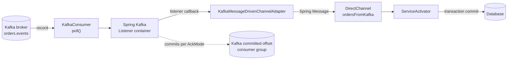
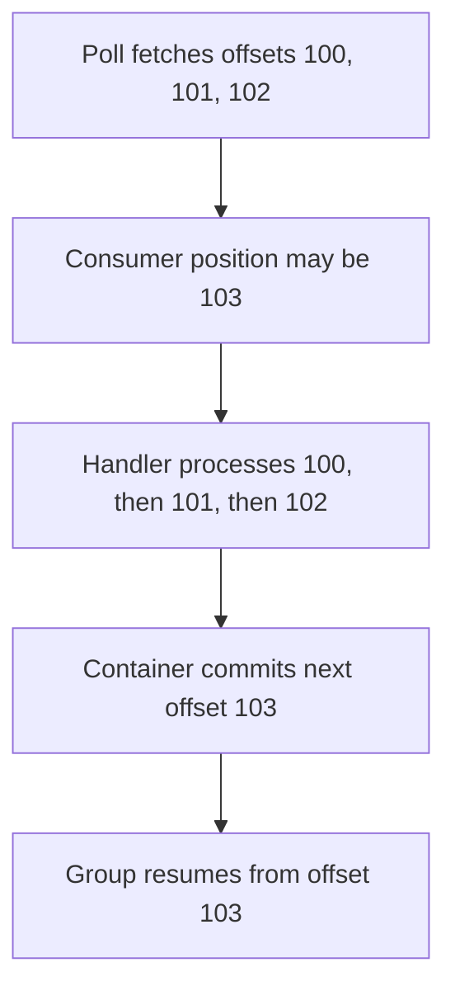
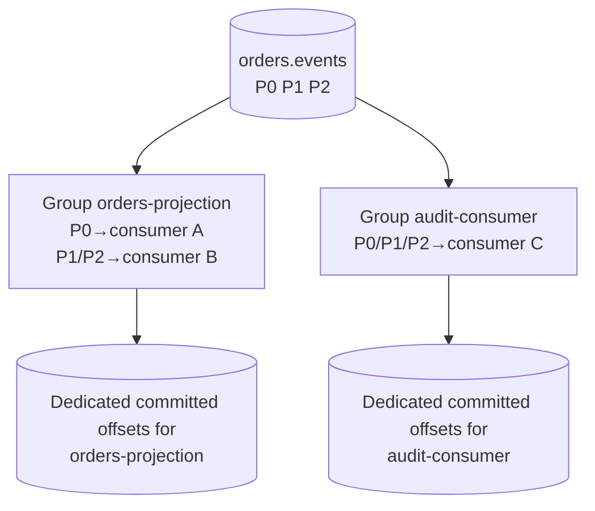
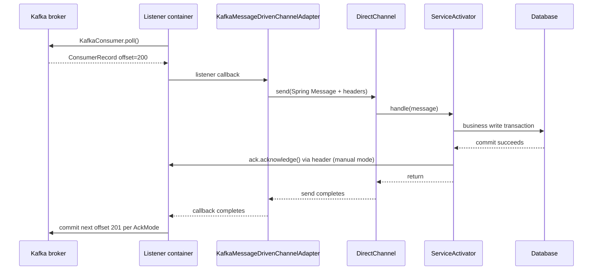
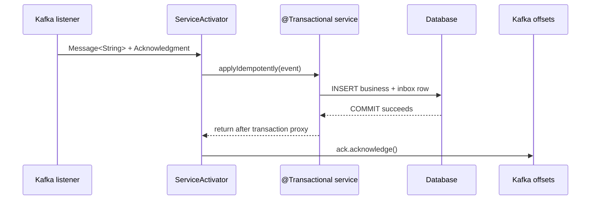
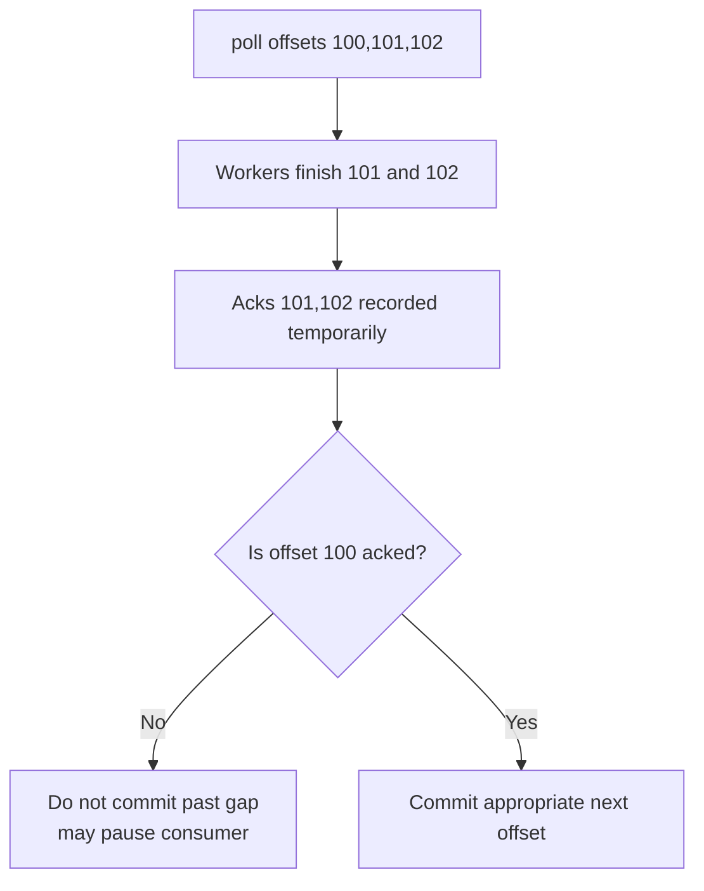
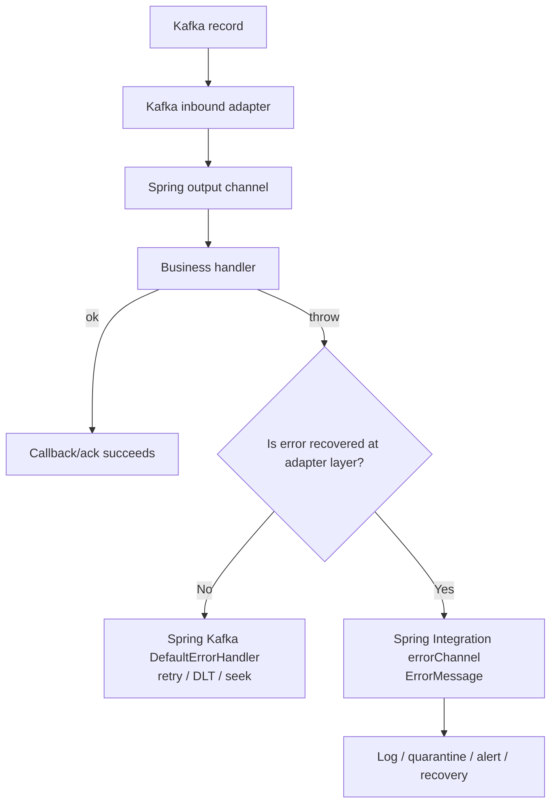
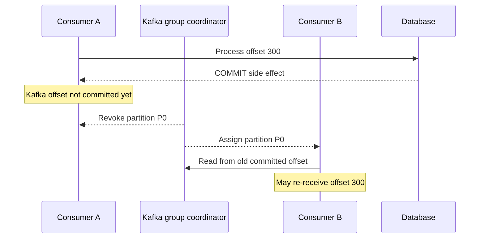

# Offset commit and acknowledgment

**Offset commit** and **acknowledgment** are two essential concepts when consuming data from Apache Kafka. A Kafka consumer may have **fetched a record from the broker**, and Spring Integration may have **sent the message onto a channel**, yet the target system **has not finished the business operation**. Recording the offset too early risks skipping redelivery after a failure; recording it too late can process the same record multiple times. Understanding both mechanisms lets you build safe flows rather than merely "reading Kafka messages."

This lesson belongs to the **Kafka Adapter** chapter of the **SPRING_INTEGRATION_ADAPTERS** module. The module connects external systems via inbound/outbound adapters, gateways, pollers, and `MessageChannel`, practicing with files, SFTP, HTTP, JMS, AMQP, Kafka, and databases while controlling message contracts, errors, and connection lifecycles. This lesson focuses on **consumer offsets, acknowledgment, and confirmation boundaries when a Kafka inbound message-driven adapter connects into Spring Integration**.

> **Distinguish from the start:** Calling `Acknowledgment.acknowledge()` is an **action notifying the Spring Kafka listener container**. Whether and when the offset is **committed to Kafka** can happen immediately or later, depending on `AckMode` and thread. Committing an offset also **does not mean database, HTTP, or SFTP transactions have committed**.

## 1. Learning objectives

After this lesson, you will be able to:

1. Distinguish **record offset**, **consumer position**, **committed offset**, **consumer group**, **acknowledgment**, and **business completion**.
2. Explain why the committed offset is normally the **next record's offset** rather than the last processed offset.
3. Compare `enable.auto.commit=true` with Spring Kafka's container-managed commits.
4. Correctly use `AckMode.RECORD`, `BATCH`, `TIME`, `COUNT`, `COUNT_TIME`, `MANUAL`, and `MANUAL_IMMEDIATE`.
5. Configure `KafkaMessageDrivenChannelAdapter` with `ConcurrentMessageListenerContainer`, `DirectChannel`, and manual acknowledgment.
6. Call `ack.acknowledge()` **after** durable business work completes; recognize the bug of acking before a database transaction commits.
7. Distinguish `commitSync()`, `commitAsync()`, container commit modes, and out-of-order acknowledgments.
8. Explain `nack`, retry/error handlers, DLTs, and how recovery affects committed offsets.
9. Analyze failure windows across crashes, rebalances, shutdowns, asynchronous queues, and Kafka transactions.
10. Inspect committed offsets/consumer lag with Kafka CLI and design idempotency, replay, and backpressure tests.

## 2. Context: from Kafka record to side effect



| Layer | Question | Responsible component |
|---|---|---|
| Kafka fetch | Has the record been fetched into consumer memory? | `KafkaConsumer.poll()` |
| Adapter conversion | Has `ConsumerRecord` become Spring `Message<?>`? | `KafkaMessageDrivenChannelAdapter` and converter |
| Spring channel dispatch | Was the message handled or only enqueued? | `MessageChannel` and consumer endpoint |
| Business side effect | Did DB/HTTP/SFTP/JMS/AMQP execute and commit? | Downstream logic, transactions/retries |
| Kafka acknowledgment | Was the listener/container notified the record is handled? | `Acknowledgment` or listener return per `AckMode` |
| Kafka offset commit | Did the group persist the next read position? | Spring Kafka container/Kafka client, group coordinator |

**Important:** Each row can complete at a different point in time. Receiving a record from the Kafka broker **cannot** substitute for a DB transaction outcome, and succeeding on a send to `QueueChannel` **does not** prove downstream work is done.

### 2.1. Message-driven vs. polling adapter

- `KafkaMessageDrivenChannelAdapter` receives callbacks from a **Spring Kafka listener container**. The Kafka client still calls `poll()` internally, without needing a Spring Integration `@Poller`.
- `KafkaMessageSource` is the source for the **Spring Integration inbound polling adapter**; its poll scheduling and message retrieval differ from a message-driven container.
- This lesson uses the **message-driven adapter**. Do not copy its acknowledgment assumptions verbatim onto `KafkaMessageSource` or JMS/AMQP/SFTP adapters expecting identical contracts.

## 3. Record addressing: topic, partition, and offset

Kafka stores records within each partition in strictly increasing offset order:

```text
Topic: orders.events

Partition 0:
  offset 100 -> OrderCreated(ORD-10)
  offset 101 -> OrderPaid(ORD-10)
  offset 102 -> OrderShipped(ORD-10)

Partition 1:
  offset  85 -> OrderCreated(ORD-11)
  offset  86 -> OrderPaid(ORD-11)
```

Kafka **has no topic-wide global offset**. Offset 100 on partition 0 cannot be compared like a single global clock against offset 85 on partition 1.

A record's concrete address is **topic + partition + offset**. Within a consumer group, committed offsets are also tracked per topic/partition. Another group can commit different positions on the same topic.

### 3.1. Consumer position vs. committed offset

Suppose `KafkaConsumer.poll()` returns records at offsets 100, 101, and 102 from `orders.events-0`.

- **Current position:** The next offset the consumer expects to fetch; right after `poll()`, it may already be 103 **even before handlers finish**.
- **Committed offset:** The position persisted for the group to recover after restart/reassignment; e.g., still 100.
- **Business processed offset:** An application-tracked notion of side-effect progress; Kafka does not automatically verify DB transactions.



While records are still in flight, the group's committed offset may remain 100 even though consumer position is 103. After a crash, a new consumer can re-read from 100, 101, and 102.

### 3.2. Why commit offset 103 instead of 102?

A Kafka committed offset represents **where to start reading next**. If offset 102 is the last record processed contiguously, the next position is **103**.

| Last processed record | Committed next offset (typical) | Meaning |
|---:|---:|---|
| 0 | 1 | Can resume from record 1 |
| 41 | 42 | Can resume from record 42 |
| 102 | 103 | Can resume from record 103 |

This does **not** mean record 103 has already been processed. When reading `CURRENT-OFFSET` from Kafka CLI, avoid misinterpreting "shows offset 103" as "the business handler already wrote record 103 to the DB."

### 3.3. Committing does not delete records

Committing an offset only records **one consumer group's read progress**. It does not delete records from the Kafka topic, shorten retention immediately, or affect any other group's committed offsets. Records remain in Kafka until retention expires or log compaction removes them.

## 4. Consumer groups and committed offset ownership



In a **traditional consumer group**, each partition is assigned to **one consumer in the group at a time**. Consumers with the same `group.id` divide reading; separate groups track progress independently.

- Changing `group.id` creates a new logical subscriber and **does not** inherit committed offsets from the old group.
- Increasing pods or `concurrency` can trigger a rebalance, transferring partition ownership.
- When a new consumer takes over a partition, it restarts from the **relevant committed offset**; processed-but-uncommitted records may be redelivered.
- When a group has no valid offset, `auto.offset.reset` governs the starting policy, not `AckMode`.

### 4.1. `auto.offset.reset=earliest` does not mean "replay every restart"

`auto.offset.reset=earliest` applies when there is no valid committed offset (or the offset is invalid under Kafka's rules). Once a group has validly committed offset 103, restarting with the same group resumes from 103 rather than **re-reading from offset 0**.

Never change a production group ID or reset production offsets just to "fix lag" without a replay plan and idempotency.

## 5. Kafka client auto-commit vs. container-managed commit

The Kafka consumer client has settings:

```properties
enable.auto.commit=true
auto.commit.interval.ms=5000
```

When `enable.auto.commit=true`, the client commits periodically per Kafka mechanics. The committed point may reflect **records fetched/polled by the consumer**, not all downstream side effects having committed.

### 5.1. Why can auto-commit be unsuitable?

Suppose a consumer polls 100 records, the adapter quickly enqueues them into an in-memory queue, and the DB handler is slow. If Kafka auto-commits progress before DB commits, a JVM crash leaves:

```text
Kafka group offset has advanced
In-memory queue vanishes when JVM dies
DB lacks the corresponding record
=> Business flow may lose messages
```

**Auto-commit does not guarantee business completion.** For flows with critical side effects, let the Spring Kafka container manage offsets and align the policy with your processing boundary.

### 5.2. What is Spring Kafka's default?

Since Spring Kafka 2.3, the listener container sets `enable.auto.commit=false` unless the application explicitly configures that property. With auto-commit disabled, the container uses its own `AckMode` and commit policies.

**The default `AckMode` of a Spring Kafka listener container is `BATCH`**, not `RECORD`. Therefore never assume every `@KafkaListener` or `KafkaMessageDrivenChannelAdapter` commits right after each individual record without inspecting container configuration.

| Property/setting | Controlling layer | Meaning |
|---|---|---|
| `enable.auto.commit` | Kafka consumer client | Whether the client auto-commits offsets periodically |
| `auto.commit.interval.ms` | Kafka consumer client | Auto-commit interval when auto-commit is enabled |
| `ContainerProperties.AckMode` | Spring Kafka listener container | Condition/frequency for container offset commits |
| `syncCommits` | Spring Kafka listener container | Chooses `commitSync` vs. `commitAsync` |
| `Acknowledgment.acknowledge()` | Listener/handler | Notifies the container that the application acks the record/batch |
| `auto.offset.reset` | Kafka consumer client | Starting position when no valid offset exists |
| `group.id` | Kafka consumer group | Namespace for partition assignment and offset progress |

For a container you **instantiate manually in Java** and pass into Spring Integration, set `AckMode` **on that `ContainerProperties` instance itself**. The Spring Boot property `spring.kafka.listener.ack-mode` targets Spring Boot's managed container factory; it does not automatically alter manually constructed containers.

## 6. Seven `AckMode` modes in Spring Kafka

When `enable.auto.commit=false` and **not using Kafka transactions**, Spring Kafka supports these policies:

| `AckMode` | When does the container record/commit offsets? | When to consider? |
|---|---|---|
| **`RECORD`** | After a single record callback returns successfully | Need commits tightly aligned with synchronous per-record processing |
| **`BATCH`** | After all records from one `poll()` are processed per contract | Reduce commit count under high traffic |
| **`TIME`** | At an appropriate check after record/poll processing when `ackTime` elapses | Bound commit frequency by time |
| **`COUNT`** | When `ackCount` records are processed at an appropriate commit point | Reduce commit overhead by count |
| **`COUNT_TIME`** | When either time threshold **or** record count is reached | Balance throughput vs. crash replay window |
| **`MANUAL`** | Handler calls `acknowledge()`; commits with `BATCH`-like semantics | App controls when to ack while allowing deferred batch commits |
| **`MANUAL_IMMEDIATE`** | Attempts to commit immediately on `acknowledge()` on the **consumer thread** | Need per-record confirmation after side effects with low commit latency |

**Container default is `BATCH`.** `RECORD` and `BATCH` in this table are **container `AckMode`s**, not `KafkaMessageDrivenChannelAdapter.ListenerMode.record/batch`. The two enums serve different purposes.

### 6.1. `RECORD` example

Suppose `poll()` returns records `[100, 101, 102]` and the listener/handler runs synchronously:

```text
Process 100 OK -> container commits next offset 101
Process 101 OK -> container commits next offset 102
Process 102 OK -> container commits next offset 103
```

This is the ideal mental model for `RECORD` without transactions or errors. Errors, recovery, or rebalances can change actual commit timing; committing is not a DB guarantee.

### 6.2. `BATCH` example

```text
Poll returns [100, 101, 102]

Process 100 OK
Process 101 OK
Process 102 OK
=> container commits next offset 103 when poll batch finishes
```

If a crash happens after record 101 but before the batch commits, records 100 and 101 may be redelivered. Thus `BATCH` reduces commit overhead at the cost of **increasing the replay window on crash** compared to `RECORD`, depending on workload.

### 6.3. `TIME`, `COUNT`, and `COUNT_TIME` examples

```java
// Mutually exclusive config snippets; do not apply all three AckModes at once.
ContainerProperties cp = new ContainerProperties("orders.events");

cp.setAckMode(ContainerProperties.AckMode.TIME);
cp.setAckTime(5_000L);

// Or:
cp.setAckMode(ContainerProperties.AckMode.COUNT);
cp.setAckCount(100);

// Or:
cp.setAckMode(ContainerProperties.AckMode.COUNT_TIME);
cp.setAckTime(5_000L);
cp.setAckCount(100);
```

These thresholds **do not create a shared DB transaction**. Do not infer that `COUNT=100` means the Kafka listener always receives batches of exactly 100 records; `max.poll.records` is likewise an upper limit, not a guaranteed poll size.

### 6.4. How do `MANUAL` and `MANUAL_IMMEDIATE` differ?

`MANUAL`:

```text
Handler receives record -> processes successfully -> ack.acknowledge()
                                      |
                                      v
             Container queues acknowledgment and commits per
             BATCH semantics once related records have been processed
```

`MANUAL_IMMEDIATE`:

```text
Handler receives record on consumer thread
  -> processes successfully
  -> ack.acknowledge()
  -> container commits immediately per chosen sync/async mechanism
```

**Condition:** `MANUAL_IMMEDIATE` has immediate-commit semantics when `acknowledge()` is called **on the consumer thread itself**. If called from a different thread, the container may **queue the ack for later processing**, so it must not be advertised as "immediate commit from any thread." Mixing acks across consumer and worker threads makes commit timing unpredictable; Spring Kafka docs warn outcomes may behave unexpectedly.

### 6.5. `acknowledge()` alone does not prove commit succeeded

Calling `acknowledge()` signals the framework. Actual commits still depend on `AckMode`, `syncCommits`, consumer group state, broker availability, and exceptions. With `syncCommits=true`, the container can use `commitSync()`; when async, commit outcomes arrive via callback.

Commit failures must be logged/monitored and can cause records to be redelivered. Never treat executing `acknowledge()` as proof that the offset is durable on the broker.

## 7. Exact path in a Kafka inbound adapter



**This diagram shows logical order**, not a claim that every commit happens at that exact instant. With `MANUAL_IMMEDIATE` and synchronous commits, the commit can execute inside the `acknowledge()` call before the handler returns. With `MANUAL`, the commit may occur later. With `RECORD`, the handler does not call `acknowledge()`; the container relies on callback success.

### 7.1. Relevant Kafka headers

| Header | Role |
|---|---|
| `KafkaHeaders.RECEIVED_TOPIC` | Topic received from |
| `KafkaHeaders.RECEIVED_PARTITION` | Partition of the record |
| `KafkaHeaders.OFFSET` | Offset **of the received record**, not the next committed offset |
| `KafkaHeaders.RECEIVED_KEY` | Kafka record key; may be absent if key is null |
| `KafkaHeaders.ACKNOWLEDGMENT` | `Acknowledgment`, available in appropriate manual ack containers |
| `KafkaHeaders.CONSUMER` | May hold Kafka consumer reference; **not thread-safe** |

`KafkaHeaders.ACKNOWLEDGMENT` is not an offset number. It is an object exposing `acknowledge()` and in some versions `nack(...)`/partial batch APIs.

**Do not use `MessageHeaders.ID` as a Kafka offset** or business event ID. It is Spring Messaging's internal message ID.

## 8. Runnable example: Kafka adapter with `MANUAL_IMMEDIATE`

This hands-on example receives individual `String` records from `orders.events`. The handler validates the payload and calls `acknowledge()`. This initial demo does not write to a database yet; Section 10 shows **acking after a real DB transaction**.

### 8.1. Maven dependencies

Use Java 17+ and a Spring Boot BOM compatible with Spring Kafka/Spring Integration:

```xml
<dependency>
    <groupId>org.springframework.boot</groupId>
    <artifactId>spring-boot-starter-integration</artifactId>
</dependency>
<dependency>
    <groupId>org.springframework.integration</groupId>
    <artifactId>spring-integration-kafka</artifactId>
</dependency>
```

Do not manually force incompatible Spring Kafka/Spring Integration versions. The demo uses APIs present across common Spring Kafka 3.x/4.x branches; verify against your project's BOM and Javadocs.

### 8.2. application.properties

```properties
demo.kafka.bootstrap-servers=localhost:9092
demo.kafka.group-id=orders-manual-ack-demo
demo.kafka.concurrency=2
```

The Kafka broker must be running and topic `orders.events` must exist; only use demo group IDs in test environments. Production requires TLS/SASL, ACLs, topic provisioning, and secret management.

### 8.3. ConsumerFactory, listener container, and inbound adapter

```java
package com.example.integration;

import java.util.HashMap;
import java.util.Map;

import org.apache.kafka.clients.consumer.ConsumerConfig;
import org.apache.kafka.common.serialization.StringDeserializer;

import org.springframework.beans.factory.annotation.Qualifier;
import org.springframework.beans.factory.annotation.Value;
import org.springframework.context.annotation.Bean;
import org.springframework.context.annotation.Configuration;
import org.springframework.integration.channel.DirectChannel;
import org.springframework.integration.config.EnableIntegration;
import org.springframework.integration.kafka.inbound.KafkaMessageDrivenChannelAdapter;
import org.springframework.kafka.core.ConsumerFactory;
import org.springframework.kafka.core.DefaultKafkaConsumerFactory;
import org.springframework.kafka.listener.ConcurrentMessageListenerContainer;
import org.springframework.kafka.listener.ContainerProperties;
import org.springframework.messaging.MessageChannel;

@Configuration
@EnableIntegration
public class OrdersManualAckConfig {

    @Bean("ordersConsumerFactory")
    ConsumerFactory<String, String> consumerFactory(
            @Value("${demo.kafka.bootstrap-servers}") String brokers,
            @Value("${demo.kafka.group-id}") String groupId) {

        Map<String, Object> config = new HashMap<>();
        config.put(ConsumerConfig.BOOTSTRAP_SERVERS_CONFIG, brokers);
        config.put(ConsumerConfig.GROUP_ID_CONFIG, groupId);
        config.put(ConsumerConfig.KEY_DESERIALIZER_CLASS_CONFIG,
                StringDeserializer.class);
        config.put(ConsumerConfig.VALUE_DESERIALIZER_CLASS_CONFIG,
                StringDeserializer.class);

        // Choose container-managed acknowledgment, not auto-commit.
        config.put(ConsumerConfig.ENABLE_AUTO_COMMIT_CONFIG, false);
        config.put(ConsumerConfig.AUTO_OFFSET_RESET_CONFIG, "earliest");

        return new DefaultKafkaConsumerFactory<>(config);
    }

    @Bean("ordersFromKafka")
    MessageChannel ordersFromKafka() {
        return new DirectChannel();
    }

    @Bean("ordersKafkaManualAckInbound")
    KafkaMessageDrivenChannelAdapter<String, String> ordersInbound(
            @Qualifier("ordersConsumerFactory")
                    ConsumerFactory<String, String> consumerFactory,
            @Qualifier("ordersFromKafka") MessageChannel output,
            @Value("${demo.kafka.concurrency}") int concurrency) {

        ContainerProperties cp =
                new ContainerProperties("orders.events");

        cp.setAckMode(
                ContainerProperties.AckMode.MANUAL_IMMEDIATE);
        cp.setSyncCommits(true);

        ConcurrentMessageListenerContainer<String, String> container =
                new ConcurrentMessageListenerContainer<>(
                        consumerFactory, cp);
        container.setConcurrency(concurrency);

        KafkaMessageDrivenChannelAdapter<String, String> adapter =
                new KafkaMessageDrivenChannelAdapter<>(
                        container,
                        KafkaMessageDrivenChannelAdapter.ListenerMode.record);

        adapter.setOutputChannel(output);
        return adapter;
    }
}
```

**Configuration explanation:**

1. `ENABLE_AUTO_COMMIT_CONFIG=false` prevents the Kafka client from timer-based auto-commits.
2. `AckMode.MANUAL_IMMEDIATE` delegates ack control to the handler; if the handler never acks, the record is normally not considered handled merely because the handler returned.
3. `setSyncCommits(true)` chooses synchronous commits for container-performed commits; it does not make DB commits part of a Kafka transaction.
4. `ListenerMode.record` sets the adapter to emit one Spring message per Kafka record.
5. `ContainerProperties("orders.events")` subscribes to the topic and lets the group coordinator assign partitions.
6. `concurrency=2` sets up to two Kafka consumer threads in the container, not two new partitions.
7. `ordersFromKafka` is the **inbound adapter's output channel**, not a Kafka topic and not an outbound adapter's input channel.

In the code, the listener container is built **inside the adapter configuration**. Do not register another standalone active container on the same topic/group unless intentionally adding competing consumers.

### 8.4. Service activator retrieving acknowledgment from headers

```java
package com.example.integration;

import org.springframework.integration.annotation.ServiceActivator;
import org.springframework.kafka.support.Acknowledgment;
import org.springframework.kafka.support.KafkaHeaders;
import org.springframework.messaging.Message;
import org.springframework.stereotype.Component;

@Component
public class OrdersManualAckHandler {

    @ServiceActivator(inputChannel = "ordersFromKafka")
    public void process(Message<String> message) {

        String payload = message.getPayload();
        if (payload.isBlank()) {
            throw new IllegalArgumentException(
                    "Empty payload: must not ack as a valid record");
        }

        Object topic = message.getHeaders()
                .get(KafkaHeaders.RECEIVED_TOPIC);
        Object partition = message.getHeaders()
                .get(KafkaHeaders.RECEIVED_PARTITION);
        Object offset = message.getHeaders()
                .get(KafkaHeaders.OFFSET);

        Acknowledgment ack = message.getHeaders().get(
                KafkaHeaders.ACKNOWLEDGMENT,
                Acknowledgment.class);

        if (ack == null) {
            throw new IllegalStateException(
                "Missing Acknowledgment: check manual AckMode");
        }

        // DEMO: log only, no DB write yet; production requires durable effect.
        System.out.printf(
                "PROCESS %s at %s-%s@%s%n",
                payload, topic, partition, offset);

        // Because DirectChannel processes synchronously, callback runs
        // on the Kafka listener thread in this demo setup.
        ack.acknowledge();
    }
}
```

Place `@SpringBootApplication` in `com.example.integration` or a parent package so Spring scans the beans. This handler demonstrates **proper manual ack API usage**, though logging is **not** a durable side effect. When moving to production, replace it with a call to a transactional service and ack only **after the service returns cleanly and the DB transaction has committed**.

### 8.5. Testing with Kafka CLI

```bash
kafka-topics.sh --bootstrap-server localhost:9092 \
  --create --if-not-exists \
  --topic orders.events --partitions 3 --replication-factor 1

kafka-console-producer.sh \
  --bootstrap-server localhost:9092 \
  --topic orders.events
```

Enter line by line:

```text
evt-101|ORD-101|CREATED
evt-102|ORD-102|CREATED
evt-103|ORD-101|PAID
```

Using a new demo group ID reads records from the start per `auto.offset.reset`. **Do not assume** offsets start at 0 or records sharing an orderId land in the same partition when the console producer sends no Kafka key.

Inspect the group:

```bash
kafka-consumer-groups.sh \
  --bootstrap-server localhost:9092 \
  --describe --group orders-manual-ack-demo
```

When the handler succeeds and acks, `CURRENT-OFFSET` advances with the commit. If an invalid record makes the handler throw an exception, retry/seek/recovery depends on the container error handler; inspect `LAG` and logs rather than only watching handler output.

### 8.6. Alternative `AckMode.RECORD` configuration

For comparison, you can change **only** one setting:

```java
cp.setAckMode(ContainerProperties.AckMode.RECORD);
```

When using `RECORD`, **remove the manual ack call** from the handler; the container commits upon successful record callback completion. Do not keep code requiring `KafkaHeaders.ACKNOWLEDGMENT` when the listener is not in manual mode, as that header may not exist.

## 9. Java DSL and `@KafkaListener`: do not mix configuration places

Spring Integration Java DSL can define the inbound endpoint via:

```java
// An alternative configuration to the adapter bean in Section 8.
// Requires importing org.springframework.integration.kafka.dsl.Kafka.
@Bean
IntegrationFlow kafkaOrdersFlow(ConsumerFactory<String, String> factory) {
    return IntegrationFlow
            .from(Kafka.messageDrivenChannelAdapter(
                    factory,
                    KafkaMessageDrivenChannelAdapter.ListenerMode.record,
                    "orders.events")
                .id("ordersDslManualAck")
                .configureListenerContainer(c -> c
                    .ackMode(ContainerProperties.AckMode.MANUAL_IMMEDIATE)))
            .channel("ordersFromKafka")
            .get();
}
```

This illustrates **configuring the listener container on the DSL endpoint** and serves as an **alternative** to the Java bean adapter above. Verify exact DSL overloads against your Spring Integration version; do not run both on the same topic/group if you only want one logical consumer.

With plain Spring Kafka `@KafkaListener`, applications configure `AckMode` via `ConcurrentKafkaListenerContainerFactory.getContainerProperties().setAckMode(...)` or Spring Boot's `spring.kafka.listener.ack-mode`. This **does not automatically** apply to `ContainerProperties` instantiated with `new` in Spring Integration.

## 10. DB transactions and the right time to ack

This is the **most critical** part when Kafka inbound writes to a database.

### 10.1. An easy trap: acking inside an uncommitted transaction

```java
// DO NOT do this:
@Transactional
@ServiceActivator(inputChannel = "ordersFromKafka")
public void process(Message<String> message) {
    jdbcTemplate.update("UPDATE orders ...");
    ack.acknowledge(); // May commit Kafka before the DB transaction commits!
}
```

A method managed by a Spring transaction proxy normally **commits the DB only after the method body returns**. Calling `ack.acknowledge()` inside the method under `MANUAL_IMMEDIATE` can commit the Kafka offset before the DB. If the DB transaction fails during commit afterward, Kafka may already mark the record done while the DB lacks the side effect.

**Never treat a single `@Transactional` annotation as proof that Kafka and JDBC committed atomically.** Both resources have separate failure windows.

### 10.2. Safer pattern: call a transactional service via Spring proxy, then ack



In this design:

1. The handler is a Spring bean receiving the Kafka message.
2. It calls **another Spring service bean** with a public `@Transactional` method through the Spring proxy.
3. The service writes both business data and the idempotency record **in the same DB transaction**.
4. Only when the service call returns after a successful transaction commit does the handler call `ack.acknowledge()`.
5. If the service throws an exception, the handler **does not ack** and lets the container's error policy handle it.

This remains **at-least-once**: crashing after DB commit before Kafka commit can still redeliver the record. The idempotency key ensures the second pass causes no duplicate side effects.

### 10.3. Minimal idempotency schema

PostgreSQL example:

```sql
CREATE TABLE processed_events (
    event_id VARCHAR(128) PRIMARY KEY,
    processed_at TIMESTAMP NOT NULL DEFAULT CURRENT_TIMESTAMP
);

CREATE TABLE order_events (
    event_id VARCHAR(128) PRIMARY KEY,
    order_id VARCHAR(128) NOT NULL,
    event_type VARCHAR(64) NOT NULL
);
```

The transactional service can use an insert protected by a unique constraint to claim the event:

```java
package com.example.integration;

import org.springframework.jdbc.core.JdbcTemplate;
import org.springframework.stereotype.Service;
import org.springframework.transaction.annotation.Transactional;

@Service
public class OrderProjectionService {

    private final JdbcTemplate jdbc;

    public OrderProjectionService(JdbcTemplate jdbc) {
        this.jdbc = jdbc;
    }

    @Transactional
    public void applyIdempotently(
            String eventId, String orderId, String eventType) {

        // PostgreSQL: atomic insert if eventId does not yet exist.
        int inserted = jdbc.update(
                "INSERT INTO processed_events (event_id) VALUES (?) "
                + "ON CONFLICT (event_id) DO NOTHING",
                eventId);

        if (inserted == 0) {
            // Event already processed previously: intentional no-op.
            return;
        }

        // This is only an example business side effect.
        jdbc.update(
                "INSERT INTO order_events "
                + "(event_id, order_id, event_type) VALUES (?, ?, ?)",
                eventId, orderId, eventType);
    }
}
```

**Runtime requirements:** needs `spring-boot-starter-jdbc`, a JDBC driver, datasource, and SQL schema. `ON CONFLICT` SQL is **PostgreSQL-specific**; other databases need matching atomic upsert/unique constraint syntax.

### 10.4. Handler acking after the transactional service returns

Replace the logging logic in the Section 8 handler with:

```java
// Snippet inside @Component handler, with
// OrderProjectionService projectionService injected.
@ServiceActivator(inputChannel = "ordersFromKafka")
public void persistThenAck(Message<String> message) {
    String[] fields = message.getPayload().split("\\|", 3);

    if (fields.length != 3
            || fields[0].isBlank()
            || fields[1].isBlank()
            || fields[2].isBlank()) {
        throw new IllegalArgumentException(
                "Expected eventId|orderId|eventType");
    }

    Acknowledgment ack = message.getHeaders().get(
            KafkaHeaders.ACKNOWLEDGMENT,
            Acknowledgment.class);
    if (ack == null) {
        throw new IllegalStateException(
                "Manual acknowledgment is not configured");
    }

    // @Transactional proxy completes before method returns.
    projectionService.applyIdempotently(
            fields[0], fields[1], fields[2]);

    // Only ack after business commit succeeds.
    ack.acknowledge();
}
```

This is an **alternative** to the `process` method in Section 8.4; do not register two `@ServiceActivator`s on the same `DirectChannel` when each event should have one business handler. In real code, inject `OrderProjectionService` via constructor.

**Do not self-invoke** an internal `@Transactional` method via `this.applyIdempotently(...)` expecting Spring's proxy to open a transaction; self-invocation can bypass the proxy. Separating into two Spring beans clarifies the transaction boundary.

### 10.5. Crash windows still exist

| Crash point | DB | Kafka committed offset | After restart |
|---|---|---|---|
| Before DB commit | Rolled back | Not marked complete | Record can be redelivered and processed fresh |
| After DB commit, before `ack()` | Committed | May still be old offset | Record can be redelivered; inbox catches duplicate |
| During/after `ack()` with uncertain Kafka commit | Committed | Not guaranteed durable | Observe/retry safely; never guess |
| After Kafka commit succeeds | Committed | Advanced | Group normally reads from next offset |
| DB commit fails after premature ack (broken design) | No side effect | May have advanced | Risk of **losing business events** |

Therefore reliable design is not merely "ack after DB" but also **idempotency**, observability, and crash/replay testing.

## 11. Synchronous vs. asynchronous commits

The Spring Kafka container has a `syncCommits` property:

```java
// For an already-created container:
container.getContainerProperties().setSyncCommits(true);
```

In the Section 8 example, we set `cp.setSyncCommits(true)` directly before constructing the container. Per Spring Kafka documentation, the default is typically `true`.

### 11.1. `commitSync()`

- Consumer sends the offset commit and waits for success/failure within a timeout.
- Easier to observe errors immediately on the relevant call path.
- Can increase latency when the Kafka group coordinator/broker is slow.

### 11.2. `commitAsync()`

- Consumer sends the commit request without blocking for a response like sync.
- Results may arrive later via callback; **do not** treat a sent request as immediately successful.
- Applications needing offset reconciliation must observe commit callbacks, ordering, and errors.

```java
// Snippet in ContainerProperties config before start:
cp.setSyncCommits(false);
cp.setCommitCallback((offsets, exception) -> {
    if (exception != null) {
        System.err.println("KAFKA COMMIT FAILED: " + exception);
    } else {
        System.out.println("COMMITTED OFFSETS: " + offsets);
    }
});
```

With `syncCommits=true`, async commit callbacks are not the primary evidence of synchronous commits. When using `commitAsync`, keep callbacks lightweight without long blocking operations on the consumer thread.

**Do not confuse:** "async commit" here is not the same as "handler running asynchronously via `ExecutorChannel`." One chooses how the Kafka client writes offsets; the other changes the completion boundary of Spring message dispatch.

## 12. Manual acknowledgment and commit ordering within a partition

A Kafka group does not store per-record state like "record 101 acked, record 100 unacked" as a general durable bitmap. It stores a **committed next offset per partition**. Consequently, offset 102 cannot safely become the resume point while record 100 or 101 has not yet succeeded.

```text
Partition 0:
  offset 100 -> PENDING
  offset 101 -> ACKED
  offset 102 -> ACKED

Cannot consider next offset 103 safe
while record 100 has not yet succeeded.
```

### 12.1. In-order acks in a synchronous flow

With `DirectChannel` and handlers processing sequentially inside the listener callback, ack order matches record order within the partition. This is the easiest setup to reason about when preserving ordering and clear transaction boundaries.

### 12.2. `asyncAcks=true`: allows out-of-order acks without committing across gaps

Spring Kafka supports:

```java
// Only use with AckMode.MANUAL or MANUAL_IMMEDIATE
// and when async processing adheres to constraints.
cp.setAsyncAcks(true);
```

`asyncAcks=true` allows acknowledgments for records from a poll to arrive **out of order**. The container **defers commits** until missing ack gaps are filled; it may **pause the consumer**, halting further record delivery while waiting for missing acks.



**Trade-off:** Useful for parallel processing, yet increases duplicate likelihood after crashes; if one worker never acks, the consumer can stay paused indefinitely. Spring Kafka disallows `nack()` when `asyncAcks` is enabled.

**Never infer** that `asyncAcks` makes an in-memory `QueueChannel` durable. Uncommitted offsets allow replays; prematurely called acks can still lose business effects.

### 12.3. What risks come with acking from a worker thread?

- `KafkaConsumer` is **not thread-safe**; never pass its reference into an executor to call `commit`/`seek` arbitrarily.
- `MANUAL_IMMEDIATE` loses "commit immediately" semantics when acking from another thread; the container queues the ack.
- Verify version behavior, ordering, executor backpressure, shutdown, and unfinished tasks.
- If choosing async processing, ensure acknowledgment is triggered by **durable side effects**, not merely scheduling a callback.

## 13. Negative acknowledgment: `nack()` and redelivery

Some Spring Kafka versions provide `Acknowledgment.nack(...)` to request reprocessing a record or the remainder of a poll:

| Listener mode | General API | Meaning |
|---|---|---|
| Record listener | `nack(sleep)` | Discards remaining records from the poll, seeks to redeliver the failing record and unprocessed tail |
| Batch listener | `nack(index, sleep)` | Commits already-processed prefix before `index` per policy, seeks to redeliver the rest |

**Important limitations:**

1. `nack()` must be called on the **consumer thread** executing the listener callback.
2. Cannot use `nack()` when `asyncAcks=true`.
3. It can pause the entire listener for the sleep interval; granularity relates to the container's `pollTimeout`.
4. Do not treat `nack()` as a "database rollback" command—DB transactions retain their own boundaries.
5. For batch listeners, test `index` and partial-commit behavior on your exact Spring Kafka version.

### 13.1. When to use `nack` vs. throwing an exception?

- `nack`: the application explicitly requests redelivery at a processing point and accepts the container's pause/seek mechanism.
- Exception: lets `DefaultErrorHandler` or a transaction rollback processor apply retry/backoff/recoverer per policy.

In production, prefer **one centrally configured retry mechanism** with metrics. Do not combine `nack`, adapter retries, container retries, and business HTTP retries without bounding total time and attempts.

### 13.2. Partial batch acknowledgment

In supporting Spring Kafka versions (e.g., 3.0.10+), `Acknowledgment.acknowledge(index)` can commit the leading portion of a batch under conditions such as:

- `AckMode.MANUAL_IMMEDIATE`.
- Called on the listener thread.
- Listener receives a `List` of records rather than raw `ConsumerRecords`.
- Valid, monotonically increasing index across multiple calls.

This is an advanced API; consult the **Javadoc for your exact version**. Do not take Section 8's record-mode code and add an index to `acknowledge()` expecting to "commit one individual record" outside a compatible batch listener.

## 14. Retries, error handlers, and committed offsets

A record may go unacknowledged because:

- Deserializer or converter failed.
- Business validation failed.
- Database transaction rolled back.
- Target HTTP/SFTP/JMS/AMQP timed out.
- Channel has no subscribers or handler threw an exception.
- Listener thread or Kafka broker error occurred.

With `DirectChannel` and a synchronous handler, exceptions can propagate back from `@ServiceActivator` to `KafkaMessageDrivenChannelAdapter` and the Spring Kafka listener container **unless caught and suppressed by a recovery layer**.

### 14.1. Container `DefaultErrorHandler`

Illustrative retry policy:

```java
import org.springframework.kafka.listener.DefaultErrorHandler;
import org.springframework.util.backoff.FixedBackOff;

// Run before adapter/container is started.
// 1 initial attempt + 2 retries, 1 second between retries.
container.setCommonErrorHandler(
        new DefaultErrorHandler(new FixedBackOff(1_000L, 2L)));
```

This is **not yet a DLT**. After retries exhaust, behavior depends on the recoverer and the error handler's commit/recovery settings. Never conclude "if the handler throws an exception, the offset never advances" or "once retries finish, the DLT definitely received the record."

### 14.2. Spring Integration error channel vs. container error handler



A Spring Integration adapter may have a `retryTemplate`/`recoveryCallback`/`errorChannel`. If the recovery callback **completes without rethrowing**, the Kafka container can see the listener callback succeed, altering retry and offset commit behavior.

This is especially important when a flow combines **manual ack** with an error channel: who is responsible for acknowledging a rejected or DLT-routed record? Define a clear policy and test committed offsets explicitly—neither leaving records stuck forever without acks nor acking records that were never durably handled/quarantined.

### 14.3. A DLT does not materialize from an `ErrorMessage` alone

Sending failed records to a Kafka dead-letter topic requires:

1. A provisioned DLT topic and producer write permissions.
2. `DeadLetterPublishingRecoverer` or a recovery flow that actually publishes the record.
3. Retry/backoff and permanent vs. transient error classification.
4. Rules for **when DLT publishing fails**; never report recovery success if the record was not persisted.
5. Source offset commit policy **after durable recovery**, depending on error handler, listener mode, and `AckMode`.
6. A payload-fix and replay workflow with **business idempotency**.

`DefaultErrorHandler` provides recovery/commit flags such as `ackAfterHandle` or `commitRecovered` under appropriate conditions. **Do not tune these flags by a one-size-fits-all recipe**: `commitRecovered` has specific preconditions (especially with `MANUAL_IMMEDIATE`). Check Javadocs and verify committed offsets in your project's tests.

### 14.4. Classifying retries

| Failure | Usually appropriate approach |
|---|---|
| Un-deserializable Kafka bytes | `ErrorHandlingDeserializer` + error handler/quarantine/DLT |
| Unfixable corrupt JSON | Minimal or zero retries; store raw record for inspection |
| Permanent business validation failure | Reject reply / quarantine / DLT per business rules |
| Transient DB/HTTP 503 | Bounded retry/backoff; do not ack before success |
| Event already processed by `eventId` | Idempotent no-op, ack per policy |
| DLT publish also fails | Signal recovery failure, preserve redelivery, alert |
| Unknown handler code bug | Alert; never blindly skip infinitely or fake-ack |

**Blocking warning:** Long retries directly inside the listener callback can exceed `max.poll.interval.ms`, triggering a rebalance and extra duplicates. Evaluate total retry duration across all records in a poll.

## 15. Rebalance: in-flight records may be reassigned



Within a group, Kafka can reassign partitions during:

- Scale out/in or rolling deployments.
- Consumer crashes or heartbeat/session loss.
- Long-blocking processing exceeding `max.poll.interval.ms`.
- Topic partition count or assignment strategy changes.
- Rebalances caused by membership or network glitches.

When partitions are revoked, the container runs logic to commit pending offsets per policy. Yet if the business transaction just committed and **the Kafka offset did not commit in time**, the new consumer can still re-receive the record. **Idempotency is mandatory whenever side effects must not repeat.**

### 15.1. Commits during revocation vs. lost partitions

`ConsumerAwareRebalanceListener` provides callbacks such as `onPartitionsAssigned`, `onPartitionsRevokedBeforeCommit`, `onPartitionsRevokedAfterCommit`, and `onPartitionsLost`.

- For **revoked**, callbacks can still execute during handoff to clean state/flush per contract.
- For **lost**, the consumer may already have lost partition ownership; do not attempt to commit as if you still own the partition.
- All callbacks run on the sensitive Kafka consumer thread; avoid slow blocking DB/HTTP calls.
- Never treat the highest consumer position as "business processed" if messages sit in an async queue.

### 15.2. Static membership and timeouts

`group.instance.id` (static membership) can reduce rebalances across brief restarts when IDs are stable and unique, though it does not eliminate duplicates. Setting `session.timeout.ms` too high slows failover when a pod truly dies; setting `max.poll.interval.ms` too low causes slow handlers to trigger rebalances.

Tune them using measured data and SLAs rather than using timeouts to mask a broken ack architecture.

## 16. `DirectChannel`, `QueueChannel`, and `ExecutorChannel`

This directly concerns **Spring Integration**: keeping the same `AckMode` while swapping channel types changes what "listener callback succeeded" means.

### 16.1. `DirectChannel`: synchronous dispatch

```text
Kafka listener thread
  -> KafkaMessageDrivenChannelAdapter
  -> DirectChannel
  -> EventDrivenConsumer
  -> JDBC handler
  -> DB commit / exception
  -> return to Kafka listener
  -> ack or container error policy
```

With a synchronous handler, the callback accurately reflects downstream results. In return, slow DB/HTTP work holds the listener thread, increasing lag and `max.poll.interval.ms` risk.

### 16.2. In-memory `QueueChannel`: enqueue is not business commit

```text
Kafka listener thread
  -> adapter.send()
  -> QueueChannel.enqueue(message)    [succeeds]
  -> listener callback returns
  -> with RECORD/BATCH, offset may advance

Later:
  -> PollingConsumer.dequeue(message)
  -> JDBC handler commits DB
```

If the Kafka offset commits **before** JDBC processes and the JVM dies, the in-memory queue vanishes; the Kafka group may **never redeliver** the record. This is an architectural bug at the ack/durability boundary, not a converter bug.

Solutions include a **durable message store**, transactional inbox/outbox, or manual ack tied to downstream completion following exact thread/version constraints. Test crashes between enqueue, dequeue, DB commit, and Kafka commit.

### 16.3. `ExecutorChannel` and completion order

`ExecutorChannel` offloads work to an executor; handlers may run later or finish out of offset order. `asyncAcks=true` allows out-of-order acks in certain setups, yet does not automatically:

- Make in-flight tasks durable across crashes.
- Preserve business ordering per customer/order.
- Make `KafkaConsumer` methods safe to call from arbitrary threads.
- Combine safely with `nack`.

When per-aggregate ordering matters, pick stable Kafka keys, serialize processing per partition/key, or attach sequences/versions and build out-of-order-tolerant consumers.

### 16.4. Internal fan-out has no independent offsets

`PublishSubscribeChannel` delivers one Spring message to multiple internal subscribers, without creating multiple Kafka consumer groups. If two side-effect branches have different SLAs or rollback needs, decide **when the record counts as complete**, or split into separate consumer groups with independent committed offsets.

## 17. Kafka transactions and exactly-once boundaries

### 17.1. Kafka-only consume–transform–produce

Within Kafka, producer transactions can group:

1. Published Kafka records.
2. Consumer offsets sent into the same Kafka transaction via container/template support.

Downstream consumers with `isolation.level=read_committed` only observe committed transactional records per protocol. Spring Kafka container transactions provide corresponding offset semantics for record/batch listeners.

**However:** Kafka transactions do not automatically include databases, SFTP servers, HTTP services, or independent JMS brokers. If a Kafka transaction commits while the DB rolls back (or vice versa), external systems still diverge.

### 17.2. Example failure window for Kafka → DB

```text
Consumer reads Kafka event
  -> DB transaction commits successfully
  -> Kafka offset commit fails / process crashes
  -> Kafka redelivers event
```

A `@Transactional` JDBC service and a Kafka transaction manager **do not automatically form a flawless XA transaction** between Kafka and a DB. Chained transactions still leave a commit-order failure window. For Kafka → DB, normally use an **idempotent consumer/inbox table**. For DB → Kafka, normally use a **transactional outbox**.

### 17.3. "At-most-once," "at-least-once," and "effectively-once"

| Model | Typical implementation | Trade-off |
|---|---|---|
| At-most-once | Ack/commit before business completion | Fewer duplicates, but can lose events on crash |
| At-least-once | Complete side effect, then commit offset | Possible duplicates after crashes/retries |
| Kafka-only exactly-once | Properly contracted Kafka transactions, `read_committed` | Scoped strictly to Kafka operations |
| Effectively-once business effect | At-least-once + DB idempotency/unique keys | Survives replays without repeating side effects |

**Never claim end-to-end exactly-once across JDBC/HTTP/SFTP solely from using `AckMode.MANUAL_IMMEDIATE` or Kafka producer idempotence.**

## 18. Relationship to other adapters in the module

| Inbound/outbound source | What does "received" mean? | What must be controlled before completion? |
|---|---|---|
| Kafka inbound | Kafka consumer polls a record | Offset commit, ack, retry, idempotency |
| JMS/AMQP inbound | Broker delivers a message | Ack/nack/redelivery, transactions, DLQ |
| File/SFTP inbound | Poller finds/downloads a file | File filter, remote/local metadata, claim/rename |
| HTTP inbound gateway | HTTP request enters handler | Response status, timeouts, client retries |
| JDBC polling inbound | Query/claims a row | DB transaction/claim, deduplication |
| Kafka outbound | `KafkaTemplate` starts sending | Broker ACK, publish failure callback/outbox |

Protocols share the abstract concept of "confirming processing" yet **confirm different things**. Never treat Kafka's `Acknowledgment.acknowledge()` as if it acked a JMS message or marked an SFTP file done.

A cross-system flow must map end-to-end boundaries:

```text
Kafka inbound -> Spring MessageChannel -> JDBC -> Kafka outbound
                      |                  |            |
                  dispatch          DB commit    Kafka send ACK
                      |
                Kafka input offset commit per policy
```

When strict response/commit guarantees are needed, design transactions, outboxes/inboxes, and idempotency at every boundary.

## 19. Observability: measure real offsets, not just "processed" logs

### 19.1. Kafka CLI for reading committed offsets and lag

```bash
kafka-consumer-groups.sh \
  --bootstrap-server localhost:9092 \
  --describe --group orders-manual-ack-demo

kafka-consumer-groups.sh \
  --bootstrap-server localhost:9092 \
  --describe --group orders-manual-ack-demo \
  --members --verbose
```

Commonly reported fields:

| Field | How to read it |
|---|---|
| `GROUP` | Logical subscriber being inspected |
| `TOPIC`, `PARTITION` | Kafka record stream / assignment unit |
| `CURRENT-OFFSET` | Group's **committed** position per topic/partition |
| `LOG-END-OFFSET` | Log tail position reported by the tool |
| `LAG` | Difference between log end and committed offset |
| `CONSUMER-ID`, `CLIENT-ID`, `HOST` | Active consumer member/client |
| `ASSIGNMENT` | Partitions assigned to the member |

**Warning:** `LAG=0` does not guarantee the DB finished processing if offsets committed before side effects or messages sit in an in-memory queue. Conversely, `LAG>0` is not always an error: handlers may have committed to the DB while Kafka offsets lag behind, or the group may be rebalancing.

### 19.2. Signals to collect

- `records-polled`, `records-converted`, `records-dispatched`.
- `business-transaction-success` and `business-transaction-failure`.
- `ack-invocations` tracked separately from `offset-commit-success/failure`.
- Consumer lag per topic/partition, committed offsets, and current positions where available.
- Container `isRunning`, `isPaused`, partition assignments, and rebalance counts.
- `DefaultErrorHandler` retry attempts, recovery/DLT counts, and DLT publish failures.
- Handler p95/p99 latency, DB connection pool usage, HTTP timeouts, and queue depth.
- Business duplicate count by `eventId`.
- Unacked record count and pending age when using `asyncAcks`.

A `"PROCESS COMPLETED"` log line does not prove a Kafka offset committed. Record `eventId`, topic, partition, offset, transaction outcome, and commit outcome in your observability systems without logging sensitive payloads.

### 19.3. Easily misread states

| Symptom | What might it be? |
|---|---|
| Adapter `isRunning=true` yet processing no records | No partitions assigned, lag=0, paused, or broker error |
| Handler logs the same topic-partition-offset twice | Redelivery from retry/rebalance/uncommitted offset |
| Handler logs the same `eventId` at different offsets | Business event may have been published twice |
| Committed offset advances while DB lacks data | Premature ack, async queue, or recovery skip |
| DB has events yet lag keeps growing | Heavy consumer load, slow commits, or ongoing rebalances |
| DLT has records yet the group stays stuck | Recovery/ack policy did not advance committed offsets properly |
| `ack.acknowledge()` called yet CLI doesn't advance | `MANUAL` deferred commit, async commit, or commit failure |

## 20. Troubleshooting runbook

### Scenario 1 — Records processed repeatedly after restart

Check `group.id`, committed offsets, handler side effects, ack calls, commit errors, rebalances, and retries. If the DB committed before Kafka committed, replay is expected behavior. The fix is idempotency by `eventId`, **not** "ack earlier to stop duplicates."

### Scenario 2 — Handler throws exceptions and lag stops dropping

Check whether the error handler retries indefinitely or recovers; whether `max.poll.interval.ms` accommodates blocking work; whether malformed records are retried as transient errors; and whether the DLT actually receives records. In manual mode, check how records are acked after recovery.

### Scenario 3 — Offsets advance yet downstream loses messages

Inspect `QueueChannel`/`ExecutorChannel` and when the listener callback returns. If messages sit only in an in-memory queue, this is a **durable handoff** issue. Switch back to `DirectChannel` in a lab to compare, then build a durable queue or completion-driven acks.

### Scenario 4 — Running `MANUAL_IMMEDIATE` yet offsets do not advance immediately

Verify `enable.auto.commit=false`, presence of the ack header, that ack is called on the listener thread, `syncCommits`, commit exceptions, and group ownership. When acking from a worker thread, "immediate" commit semantics no longer apply.

### Scenario 5 — After a rebalance, an event is reprocessed

Inspect revoke/lost events, Kafka committed offsets at partition handoff, and DB `eventId` records. Never call `KafkaConsumer` commit from a thread not owning the consumer; never treat lost partitions as revoked partitions still eligible for commits.

### Scenario 6 — Manual ack stalls the container

Check if any record is **never acknowledged**, especially with `asyncAcks=true`. A single pending ack can pause the container from delivering more records. Review cancellation/shutdown timeouts, worker failure paths, and recovery strategies.

## 21. Common mistakes

| Misconception | Correct understanding |
|---|---|
| "Offset is a topic-wide sequence number." | Offsets only have meaning within **one partition**. |
| "Committed offset 103 means record 103 was processed." | It normally means **resume reading at 103**. |
| "`poll()` returning means business work is done." | Poll can advance ahead of DB transactions. |
| "`enable.auto.commit=true` is safe for every flow." | Periodic commits can outpace side effects. |
| "Spring Kafka defaults to `AckMode.RECORD`." | The container default is **`BATCH`**. |
| "`ListenerMode.record` automatically picks `AckMode.RECORD`." | The two enums are independent. |
| "Calling ack in `MANUAL` commits to Kafka immediately." | Commits may be deferred under batch semantics. |
| "`MANUAL_IMMEDIATE` commits immediately even from worker threads." | Immediate semantics apply to the consumer thread. |
| "`acknowledge()` deletes the Kafka record." | It only signals progress; retention/compaction are separate. |
| "`syncCommits=true` means JDBC and Kafka commit atomically." | It only selects consumer-side offset commit mode. |
| "Putting `@Transactional` on the handler and acking at method end is safe." | DB normally commits **after** method body, risking ack before DB commit. |
| "`asyncAcks` lets you skip unacked records." | The container waits to fill gaps and may pause. |
| "`nack()` can be called from any thread." | Must follow the consumer-thread contract. |
| "Having an error channel means Kafka always retries." | Recovery may suppress the exception. |
| "DLT works automatically when `DefaultErrorHandler` is enabled." | Requires a recoverer/template/topic/ACL and policy. |
| "`LAG=0` proves DB business work finished." | Offsets may commit before DB/queue completion. |
| "Kafka transactions guarantee exactly-once for HTTP/DB." | Guarantees only hold within coordinated transactional resources. |
| "Raising concurrency fixes every ack issue." | It only adds consumer threads, not fixing failure windows or DB bottlenecks. |

## 22. Practice exercises

### Exercise 1 — Compute the next committed offset

Topic `orders.events` partition 0 has record offsets 10, 11, 12, 13. The consumer finished processing up through offset 12. Determine the proper next committed offset, where consumer position might be, and why they differ.

### Exercise 2 — Compare `RECORD` and `BATCH`

Use a 3-partition topic and 100 records. Run twice in isolated environments with `AckMode.RECORD` and `AckMode.BATCH`, recording commit counts, lag, throughput, and how many records can replay on a mid-poll crash.

### Exercise 3 — Basic manual ack

Run the Section 8 example and send 10 records. Log topic, partition, and offset right before `ack.acknowledge()` and compare against `CURRENT-OFFSET` using Kafka CLI. Explain why acking does not delete records from the Kafka topic.

### Exercise 4 — Switch `MANUAL_IMMEDIATE` to `MANUAL`

Keep the same handler while changing `AckMode`. Observe when `ack()` is called vs. when the committed offset advances. Explain the difference and its impact on crash replays.

### Exercise 5 — Uncommitted transaction trap

Build a `@Transactional` handler calling `ack` inside the method and simulate a failure during DB commit. Then extract the transactional service into a separate bean and ack only after the service returns. Explain why the second design reduces event loss risk.

### Exercise 6 — Inbox/idempotency

Implement `processed_events` and `order_events` per Section 10. Send the same `eventId` twice. Verify Kafka may hold two records while the DB applies only one business effect, without relying on Kafka offsets as business keys.

### Exercise 7 — Crash after DB commit

Inject a fault right after `projectionService.applyIdempotently(...)` and before `ack.acknowledge()`. Restart the consumer with the same group ID. Verify record replay and that the unique constraint blocks duplicate side effects.

### Exercise 8 — In-memory `QueueChannel`

Replace the `DirectChannel` output with `QueueChannel(100)` and add a slow polling consumer. Let the Kafka offset commit after enqueueing, then kill the JVM before the DB write. Explain why messages are lost and propose a durable handoff.

### Exercise 9 — `asyncAcks` and out-of-order completion

Simulate three workers processing offsets 100, 101, 102 that finish in order 102, 101, 100. With `asyncAcks=true`, observe how the container defers commits, pauses, and increases redelivery scope after a crash.

### Exercise 10 — `nack` in a record listener

On a supporting Spring Kafka version, use manual ack and explicitly `nack` a transiently failing record on the consumer thread. Observe pause/seek/redelivery. Compare with throwing an exception to `DefaultErrorHandler`; verify `nack` cannot be used with `asyncAcks=true`.

### Exercise 11 — Error handler and DLT

Configure `DefaultErrorHandler` + `DeadLetterPublishingRecoverer` for unparseable JSON records. Verify the record lands in the real DLT, inspect the source committed offset, and test behavior when DLT publishing fails. Do not rely solely on a `"recovered"` log line.

### Exercise 12 — Rebalance under slow processing

Have the handler block for a long time, lower `max.poll.interval.ms` in a lab environment, and scale up an instance in the same group. Observe revoke/assign, duplicates, DB transactions, and committed offsets. Design retry/backpressure to reduce rebalance risk.

### Exercise 13 — `commitSync` vs. `commitAsync`

Run `MANUAL_IMMEDIATE` with `syncCommits=true` and then `false`; observe callbacks and when offsets are recorded. Explain why "commit request sent" is insufficient to conclude the broker committed successfully.

### Exercise 14 — Kafka-only transactions vs. Kafka → DB

Design a transactional Kafka → transformer → Kafka outbound flow and compare it to a Kafka → JDBC projection. Identify which resources participate in the transaction and why business idempotency is still required when a DB is the target.

### Exercise 15 — Production design

A 12-partition topic has three Spring Boot pods, each with concurrency 2; the DB handles at most 400 records/second. Select `AckMode`, channel type, retry/DLT, idempotency, shutdown policy, and dashboards. Explain quantitatively why raising concurrency does not fix a DB bottleneck.

## 23. Self-check questions

1. Is a Kafka record offset a topic-wide sequence number?
2. How do consumer position and committed offset differ?
3. Why is the committed offset normally the **next** offset?
4. Does a different consumer group share the current group's committed offsets?
5. Does `auto.offset.reset=earliest` re-read from the start after every restart?
6. Does `enable.auto.commit=true` guarantee DB commits finished?
7. What is the default `AckMode` of a Spring Kafka container?
8. How does `AckMode.RECORD` differ from `ListenerMode.record`?
9. When does `BATCH` commit?
10. How do `TIME`, `COUNT`, and `COUNT_TIME` differ in commit triggers?
11. Why does `MANUAL` not mean immediate commit?
12. With `MANUAL_IMMEDIATE`, what is the consequence of calling `ack()` from a worker thread instead of the listener thread?
13. Is `KafkaHeaders.ACKNOWLEDGMENT` always present?
14. Why can acking inside a `@Transactional` method execute before the DB commit?
15. How do you ensure ack occurs only after a transactional service truly returns cleanly?
16. Why is idempotency still necessary even when acking after DB commit?
17. What does `syncCommits` select, and what does it not guarantee?
18. How does `asyncAcks=true` handle missing ack gaps?
19. Can `nack` be used with `asyncAcks`?
20. Why can an in-memory `QueueChannel` lose business work even when Kafka lag is 0?
21. Are `DefaultErrorHandler` and Spring Integration's `errorChannel` the same thing?
22. Is a DLT created simply by enabling `AckMode.RECORD`?
23. Under what condition can a rebalance redeliver a record already written to the DB?
24. Do Kafka transactions automatically coordinate atomically with JDBC/HTTP/SFTP?

## 24. Summary

Kafka offset commit answers **"where will the consumer group resume reading?"**; acknowledgment answers **"how was the listener/container notified of processing progress?"**. Neither answers **"have DB/HTTP/SFTP or business operations completed durably?"**.

```text
Kafka poll / ConsumerRecord
    -> Spring Kafka listener container
    -> KafkaMessageDrivenChannelAdapter
    -> Spring MessageChannel
    -> Business handler / DB transaction
    -> Acknowledgment (MANUAL / MANUAL_IMMEDIATE if used)
    -> Container commits offset per AckMode
    -> Kafka consumer group resumes from next offset
```

A reliable design simultaneously selects the right **`AckMode`**, ensures **downstream side effects finish before acking**, distinguishes sync/async commits, handles **retries/rebalances/DLT**, and maintains **business idempotency** to survive crashes right after DB commit but before Kafka commit. When connecting Kafka with files, SFTP, HTTP, JMS, AMQP, or databases, always verify **each system's commit boundary** rather than conflating them with Kafka acknowledgments.

## References

- [Spring Kafka Reference — Message Listener Containers: Committing Offsets](https://docs.spring.io/spring-kafka/reference/kafka/receiving-messages/message-listener-container.html)
- [Spring Kafka Reference — Manually Committing Offsets](https://docs.spring.io/spring-kafka/reference/kafka/receiving-messages/ooo-commits.html)
- [Spring Kafka Reference — Container Properties](https://docs.spring.io/spring-kafka/reference/kafka/container-props.html)
- [Spring Kafka Reference — Container Error Handlers](https://docs.spring.io/spring-kafka/reference/kafka/annotation-error-handling.html)
- [Spring Kafka Reference — Transactions](https://docs.spring.io/spring-kafka/reference/kafka/transactions.html)
- [Spring Kafka API — Acknowledgment](https://docs.spring.io/spring-kafka/api/org/springframework/kafka/support/Acknowledgment.html)
- [Spring Kafka API — ContainerProperties](https://docs.spring.io/spring-kafka/api/org/springframework/kafka/listener/ContainerProperties.html)
- [Spring Kafka API — KafkaHeaders](https://docs.spring.io/spring-kafka/api/org/springframework/kafka/support/KafkaHeaders.html)
- [Spring Integration Reference — Apache Kafka Support](https://docs.spring.io/spring-integration/reference/kafka.html)
- [Spring Integration API — KafkaMessageDrivenChannelAdapter](https://docs.spring.io/spring-integration/api/org/springframework/integration/kafka/inbound/KafkaMessageDrivenChannelAdapter.html)
- [Apache Kafka Documentation — Consumer Configuration](https://kafka.apache.org/44/configuration/consumer-configs/)
