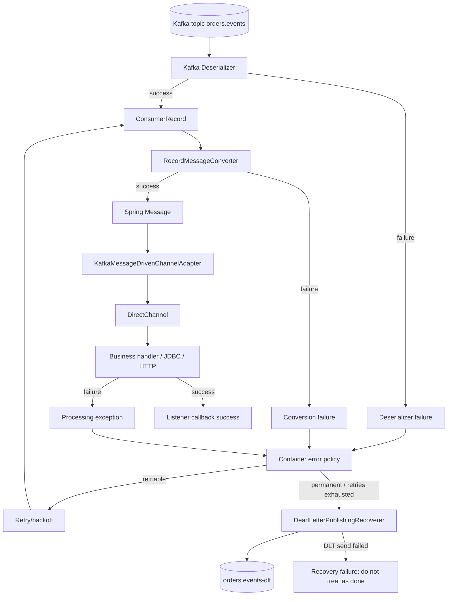
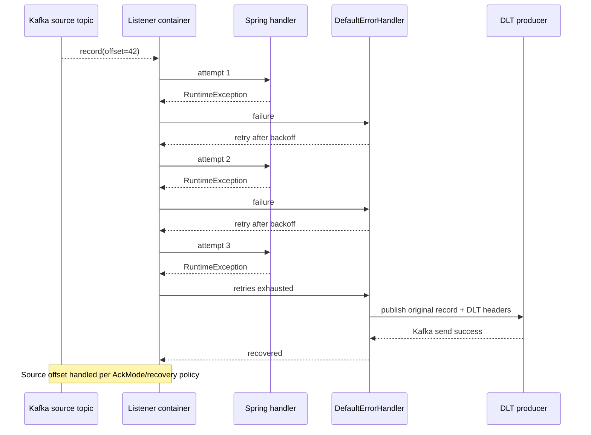
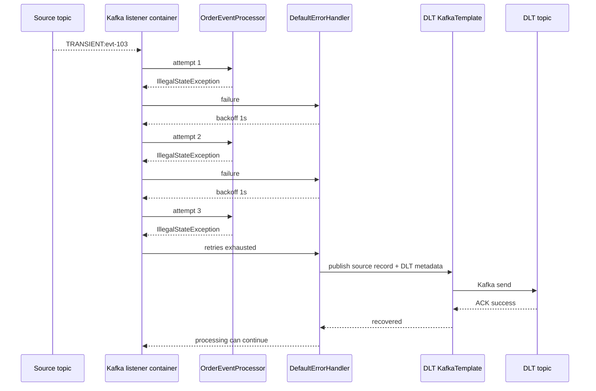
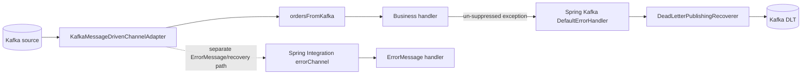
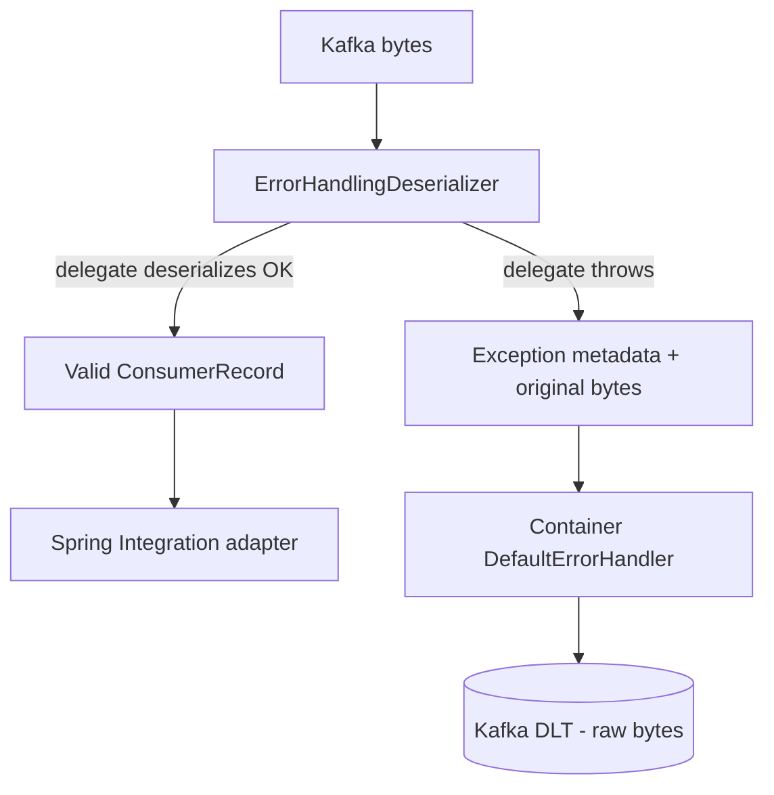
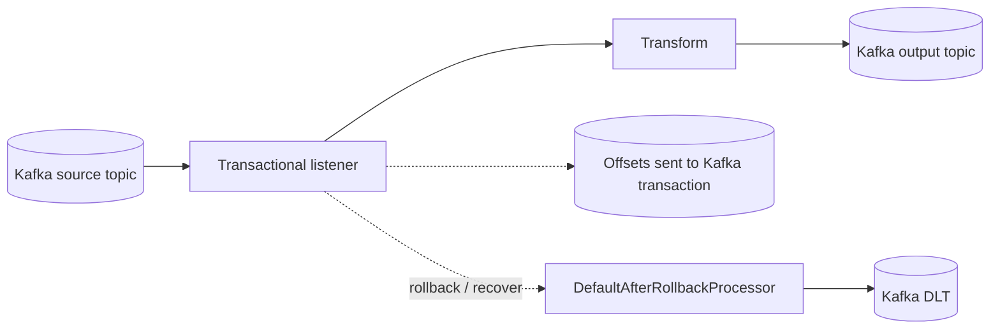
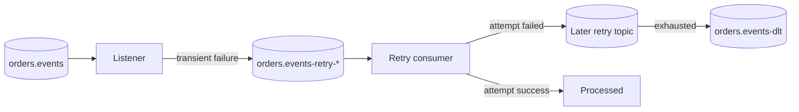
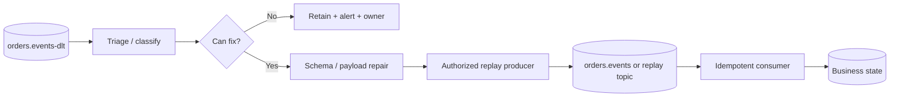

# Error handler and dead-letter topic

An **error handler** helps a Kafka consumer decide what happens when a record fails to process: retry, pause, route to an error store, or move on to the next record. A **dead-letter topic (DLT)** is a Kafka topic used to hold records that could not be processed under the defined policy, along with metadata for investigation and replay. Both mechanisms must be designed together with **offset commits, acknowledgments, idempotency, transactions, and DLT publish failures**; otherwise, an application can silently drop records or create duplicates when failures occur.

This lesson belongs to the **Kafka Adapter** chapter of the **SPRING_INTEGRATION_ADAPTERS** module. The module uses inbound/outbound adapters, gateways, pollers, and `MessageChannel` to connect files, SFTP, HTTP, JMS, AMQP, Kafka, and databases while managing message contracts, errors, and connection lifecycles. This topic focuses on **Spring Kafka `DefaultErrorHandler` and `DeadLetterPublishingRecoverer` when a Kafka message-driven inbound adapter feeds records into a Spring Integration flow**.

> **Point to remember:** Having an `ErrorMessage` on Spring Integration's `errorChannel` **does not mean** the Kafka record was published to a DLT. Having a record in the DLT **does not mean** the source topic offset committed atomically with the DLT. Verify each boundary with tests.

## 1. Learning objectives

After this lesson, you will be able to:

1. Classify Kafka deserialization, message conversion, validation, business handler, network/DB, and Kafka DLT producer errors.
2. Explain the difference between **Spring Kafka `CommonErrorHandler`** and **Spring Integration `errorChannel`**.
3. Configure `DefaultErrorHandler` with `FixedBackOff`, exception classification, and `DeadLetterPublishingRecoverer`.
4. Understand retry counts, backoff intervals, failing record handling, and how subsequent records resume.
5. Design DLT topics, partitioning, serializers, retention, ACLs, and diagnostic headers.
6. Configure Spring Boot Java `ConsumerFactory`, `ConcurrentMessageListenerContainer`, and `KafkaMessageDrivenChannelAdapter` with the error handler on the **listener container**.
7. Use `ErrorHandlingDeserializer` for deserialization failures while preserving raw bytes for proper quarantine.
8. Evaluate `ackAfterHandle`, `commitRecovered`, `AckMode.RECORD`, `MANUAL_IMMEDIATE`, crashes/rebalances, and duplicate DLT records.
9. Distinguish blocking retries in the container from non-blocking retry topics, and understand limitations in systems with Kafka transactions.
10. Design DLT triage/replay workflows, authorization, metrics, alerts, and tests ensuring critical data is never lost.

## 2. Which error layers does a record pass through?



The diagram shows the **intended handling path**, not a claim that every error automatically reaches the container. Spring Integration may have a `retryTemplate`, `recoveryCallback`, or `errorChannel` handling exceptions earlier. If an intermediate layer swallows an exception, `DefaultErrorHandler` may **never be invoked**.

| Error location | Examples | Who normally sees it first? |
|---|---|---|
| Broker/network/consumer | Missing topic ACL, timeout, broker outage, rebalance | Kafka consumer/container; not every error has a record for DLT |
| **Deserializer** | Corrupt JSON bytes, invalid Java type | `Deserializer`/`ErrorHandlingDeserializer` |
| **Converter** | JSON string fails conversion to DTO | Spring Kafka record converter / adapter |
| **Validation** | Empty order ID, unsupported schema version | Spring Integration filter/transformer/handler |
| **Business handler** | JDBC deadlock, HTTP 503, SFTP permission denied | Handler; can throw exception back to listener |
| **DLT producer** | Missing WRITE ACL, topic missing partitions, broker timeout | `DeadLetterPublishingRecoverer` |
| **Replay worker** | Stale DLT event, schema incompatible with current code | DLT consumer/replay pipeline |

**There is no DLT for every kind of error:** if a Kafka consumer cannot read records due to broker outage or missing ACLs, `DeadLetterPublishingRecoverer` has no `ConsumerRecord` to publish. That requires infrastructure alerts and recovery, not "putting a connection error into the DLT."

## 3. Retry, recovery, and DLT are three separate actions



- **Retry:** Re-attempt processing on the same data, usually suitable for transient errors such as DB connection timeouts.
- **Recovery:** Action invoked when retrying should/cannot continue; may log, store in an error repo, write to a DLT, or halt the app per policy.
- **Dead-letter topic:** A **durable Kafka destination**, considered to have received data only if the producer publishes successfully per ACK policy.

If an error handler's default recoverer only **logs**, a record may be marked recovered even though it never appeared in a DLT. For a real DLT, **configure a dedicated recoverer**.

### 3.1. What is a "poison pill"?

A record that always fails—such as invalid JSON or a contract-violating business ID—can keep retrying forever at the same offset and stall the partition. This is called a **poison pill**. Standard policy:

1. Classify permanent vs. transient errors.
2. Do not waste retries on permanent errors.
3. Publish/quarantine the record with root-cause metadata.
4. Once recovery is confirmed, advance source read progress per policy.
5. Provide triage, repair, and replay tooling.

Never treat a DLT as an "auto-deleting trash can": failed records may still be important transactional evidence.

## 4. Spring Kafka `DefaultErrorHandler`

`DefaultErrorHandler` is a `CommonErrorHandler` implementation for handling listener errors in Spring Kafka. It can retry records with backoff, seek/reset unfinished records, or pass failed records to a `ConsumerRecordRecoverer`. Some versions support retaining records for resubmission instead of seeking directly (`seekAfterError=false`).

| Component | Responsibility |
|---|---|
| `CommonErrorHandler` | Error contract used by Spring Kafka listener containers |
| **`DefaultErrorHandler`** | Retries/recovers records or batches per exception/backoff |
| `FixedBackOff` | Fixed wait interval and retry count |
| `ExponentialBackOff` | Exponentially increasing wait interval |
| `ConsumerRecordRecoverer` | Final handler for records when retries stop |
| **`DeadLetterPublishingRecoverer`** | Recoverer implementation publishing failed records to a Kafka topic |
| `RetryListener` | Observes failed deliveries, recovered records, and recovery failures |
| `DefaultAfterRollbackProcessor` | Recovery in listener containers using Kafka transactions |
| `KafkaErrorSendingMessageRecoverer` | Recoverer emitting a Spring Integration `ErrorMessage` per contract |

### 4.1. Distinction from legacy `ErrorHandler`

Older articles use `SeekToCurrentErrorHandler` or `ErrorHandler` from before the framework consolidated on `CommonErrorHandler`. In Spring Kafka 3.x/4.x, base implementations on **`DefaultErrorHandler`** and current-version APIs rather than copying legacy code verbatim.

### 4.2. Which handler gets applied?

When creating `ConcurrentMessageListenerContainer` manually, set:

```java
container.setCommonErrorHandler(errorHandler);
```

When using `@KafkaListener`, configure it on `ConcurrentKafkaListenerContainerFactory`:

```java
factory.setCommonErrorHandler(errorHandler);
```

**Do not confuse:** An `errorHandler` bean in the `ApplicationContext` **does not guarantee** manually created listener containers will automatically pick it up. Verify the actual wiring.

## 5. Configuring retry counts with `FixedBackOff`

Example:

```java
DefaultErrorHandler errorHandler = new DefaultErrorHandler(
        recoverer,
        new FixedBackOff(1_000L, 2L));
```

Meaning:

- `1_000L`: Backoff interval of **1,000 ms**.
- `2L`: At most **two retries after the initial attempt** for retryable errors.
- Up to **three attempts** total for a record, assuming the error persists and no special reset happens.
- Once retries are exhausted, `recoverer` is invoked for the record.

```text
attempt 1 (initial) -> FAIL
  sleep/backoff 1s
attempt 2           -> FAIL
  sleep/backoff 1s
attempt 3           -> FAIL
  -> recovery (e.g., publish DLT)
```

**Note:** `DefaultErrorHandler` maintains a default list of **fatal / non-retryable** exceptions. Errors in that list can go **straight to the recoverer on the first failure**, so three attempts do not apply to every exception.

### 5.1. Backoff must fit within `max.poll.interval.ms`

Long blocking retries hold the listener path or repeatedly reprocess records. If total processing time across a poll plus backoffs exceeds `max.poll.interval.ms`, Kafka can trigger a group rebalance, causing more redeliveries and lower throughput.

For multi-hour waits while external systems recover, consider **retry topics / non-blocking retries** or a durable job queue instead of sleeping inside consumer callbacks.

### 5.2. Does `seekAfterError=false` change guarantees?

In some modern versions:

```java
errorHandler.setSeekAfterError(false);
```

This lets the container retain unprocessed records and resubmit them after polling to maintain group liveness instead of seeking each time. It is a retry implementation choice; it does **not** make records exactly-once or solve DB commit atomicity.

## 6. Classifying errors: retryable vs. non-retryable

| Error type | Examples | Recommended policy |
|---|---|---|
| **Transient** | DB connection reset, HTTP 503, brief broker recovery | Bounded retry + backoff |
| **Permanent data error** | Malformed JSON structure, missing required field | Zero or minimal retries, DLT/quarantine |
| **Business rejection** | Order invalid per business rules | Decide `REJECTED` reply / DLT per contract |
| **Authorization** | Missing DB or DLT write permissions | Alert and fix config; infinite retries are useless |
| **Serialization mismatch** | Producer/consumer using incompatible schemas | Quarantine + check deployment |
| **Developer bug** | `ClassCastException`, mapping bug | Alert; avoid swallowing and falsely committing |

Exceptions not retried by default typically include `DeserializationException`, `MessageConversionException`, `ConversionException`, `MethodArgumentResolutionException`, `NoSuchMethodException`, and `ClassCastException`. The exact set depends on Spring Kafka version and config.

### 6.1. Marking business exceptions as non-retryable

```java
errorHandler.addNotRetryableExceptions(
        InvalidOrderEventException.class);
```

An application exception can be defined as:

```java
package com.example.kafka;

public final class InvalidOrderEventException
        extends RuntimeException {

    public InvalidOrderEventException(String message) {
        super(message);
    }
}
```

Then invalid events causing the handler to throw `InvalidOrderEventException` go straight to the recoverer instead of waiting through retries/backoffs.

**Watch out for exception wrapping:** Sometimes the actual exception is wrapped inside `ListenerExecutionFailedException` or `MessagingException`. Error handlers inspect cause chains per version rules; test wrapped exceptions as well, not just bare `new InvalidOrderEventException()`.

### 6.2. Do not equate "error recovered" with "business succeeded"

Recovering to a DLT is an **exception-handling outcome**. It means the record was stored for investigation per policy, **not** that the order was created or written to the DB. Dashboards and metrics must separate `processed_success` from `recovered_to_dlt`.

## 7. `DeadLetterPublishingRecoverer`

`DeadLetterPublishingRecoverer` takes the failed `ConsumerRecord` and publishes a `ProducerRecord` to a DLT using a `KafkaTemplate` or a map of templates by value type.

### 7.1. Default destination convention

With the default resolver:

```text
Source: orders.events, partition 2, offset 42
          |
          v
DLT:    orders.events-dlt, partition 2
```

The destination topic uses the **`-dlt` suffix** (lowercase), **not** always `.DLT` or `-DLT`. The recoverer tries to send to the same original partition. Thus the DLT topic must have **at least as many partitions as the source topic**, unless you provide a custom resolver.

| Source topic | Default DLT topic | Requirement |
|---|---|---|
| `orders.events` with 3 partitions | `orders.events-dlt` | DLT >= 3 partitions |
| `payments.commands` with 6 partitions | `payments.commands-dlt` | DLT >= 6 partitions |
| `inventory.changed` with 12 partitions | `inventory.changed-dlt` | DLT >= 12 partitions |

To route to another destination, a resolver can return an arbitrary `TopicPartition`. To let the Kafka producer choose the partition, return a **negative partition** like `-1` rather than a non-existent partition ID.

### 7.2. Why is matching the partition helpful?

- Easy correlation between source and DLT by partition.
- Per-partition failure order analysis.
- Per-shard/tenant triage when key-based partitioning is consistent.

Nevertheless, **the DLT is a separate topic** with newly assigned offsets, not the original offset. A DLT record at `offset=8` does not mean the Kafka source record was also at offset 8.

### 7.3. Creating a basic recoverer

```java
DeadLetterPublishingRecoverer recoverer =
        new DeadLetterPublishingRecoverer(dltKafkaTemplate);

// Prevents reporting 'recovered' when DLT publish fails.
// May block while waiting for producer send result.
recoverer.setFailIfSendResultIsError(true);
recoverer.setWaitForSendResultTimeout(
        Duration.ofSeconds(35));
```

Here `dltKafkaTemplate` is a `KafkaTemplate<String,String>` bean compatible with demo records. `setFailIfSendResultIsError(true)` checks the publish result and throws if the producer reports failure. Without verifying publish outcomes, a callback can finish **before knowing whether the broker accepted the DLT record**, depending on mechanism and version.

`Duration.ofSeconds(35)` illustrates a producer with `delivery.timeout.ms=30000` plus buffer; production must tune timeouts per SLA. Never set the DLT wait timeout shorter than producer delivery timeout and infer from a timeout that the DLT definitely lacks the record.

### 7.4. Custom destination resolver

When routing multiple error categories:

```java
DeadLetterPublishingRecoverer recoverer =
        new DeadLetterPublishingRecoverer(
            dltKafkaTemplate,
            (record, exception) ->
                new TopicPartition(
                    record.topic() + "-dlt",
                    -1)); // Let Kafka producer choose the partition.
```

This illustrates a custom resolver keeping the `-dlt` topic while removing the requirement to match source partition numbers. To route to `orders.validation-dlt` and `orders.transient-dlt`, unwrap root causes, enforce a destination allowlist, and verify producer ACLs.

**Never** dynamically take the Kafka DLT topic from untrusted partner payloads or headers.

## 8. DLT headers and forensic evidence

DLT records normally preserve original record headers and add diagnostic metadata from `DeadLetterPublishingRecoverer`.

| Common header | Meaning |
|---|---|
| `KafkaHeaders.DLT_ORIGINAL_TOPIC` | Source topic name |
| `KafkaHeaders.DLT_ORIGINAL_PARTITION` | Original partition |
| `KafkaHeaders.DLT_ORIGINAL_OFFSET` | Original offset |
| `KafkaHeaders.DLT_ORIGINAL_TIMESTAMP` | Original timestamp |
| `KafkaHeaders.DLT_ORIGINAL_TIMESTAMP_TYPE` | Original timestamp type |
| `KafkaHeaders.DLT_ORIGINAL_CONSUMER_GROUP` | Consumer group that encountered the error (when supported) |
| `KafkaHeaders.DLT_EXCEPTION_FQCN` | Outer exception class name |
| `KafkaHeaders.DLT_EXCEPTION_CAUSE_FQCN` | Root cause exception class name (when available) |
| `KafkaHeaders.DLT_EXCEPTION_MESSAGE` | Exception message |
| `KafkaHeaders.DLT_EXCEPTION_STACKTRACE` | Stack trace for diagnostics |
| `KafkaHeaders.DLT_KEY_EXCEPTION_FQCN` | Kafka key deserialization error metadata (when applicable) |

**Original payload and key** are normally preserved if the DLT producer serializers support their types. The DLT record receives a **new topic/partition/offset**, while headers trace back to the source record.

### 8.1. Metadata is not a business ID

- `topic + partition + offset`: locates the source record.
- `eventId` or `requestId` in payload/headers: identifies the business event, required for idempotency.
- `KafkaHeaders.DLT_ORIGINAL_OFFSET`: aids audit/replay, does not automatically deduplicate if the business event was published again at another offset.
- Spring `MessageHeaders.ID`: internal message ID, does not replace Kafka record identity.

### 8.2. Headers can contain sensitive data

Stack traces and exception messages sometimes include SQL, hostnames, file paths, field values, or tokens. When publishing to a DLT, enforce Kafka ACLs, retention, encryption/TLS, and masking/logging policies. Do not grant broad DLT read access to services that only need business topics.

### 8.3. Controlling header growth across multiple retry cycles

Kafka permits multiple headers with the same name. Replaying from a DLT and failing into another DLT can accumulate duplicated original/exception headers, especially large stack traces.

`DeadLetterPublishingRecoverer` offers options such as `setAppendOriginalHeaders`, `setStripPreviousExceptionHeaders`, and `excludeHeader(...)` in supporting versions. Balance forensic completeness against `RecordTooLargeException` and sensitive data exposure.

## 9. Lab environment and version choices

The main example uses a **record listener with a String payload**, matching common APIs across Spring Boot 3.x / Spring Integration 6.x / Spring Kafka 3.x. In applications using Boot 4.x / Spring Integration 7.x / Spring Kafka 4.x, use a single aligned BOM and check minor API/import changes; never mix library branches manually.

Components:

- Local Kafka broker at `localhost:9092`.
- Topic `orders.events`: 3 partitions.
- Topic `orders.events-dlt`: 3 partitions.
- Spring Boot application receiving `orders.events` via `KafkaMessageDrivenChannelAdapter`.
- Spring Kafka `DefaultErrorHandler` + `DeadLetterPublishingRecoverer` publishing errors to the DLT.
- Test handler: succeeds, throws a permanent error, or throws a transient error.

### 9.1. Maven dependencies

Use the Spring Boot BOM or parent to manage versions:

```xml
<dependency>
    <groupId>org.springframework.boot</groupId>
    <artifactId>spring-boot-starter-integration</artifactId>
</dependency>
<dependency>
    <groupId>org.springframework.integration</groupId>
    <artifactId>spring-integration-kafka</artifactId>
</dependency>
```

Kafka client, Spring Kafka, and Spring Messaging dependencies are selected by the BOM. If adding JDBC for an idempotent DB example, include `spring-boot-starter-jdbc` and the appropriate driver; the initial demo logs only.

### 9.2. Creating topics with Kafka CLI

```bash
kafka-topics.sh --bootstrap-server localhost:9092 \
  --create --if-not-exists --topic orders.events \
  --partitions 3 --replication-factor 1

kafka-topics.sh --bootstrap-server localhost:9092 \
  --create --if-not-exists --topic orders.events-dlt \
  --partitions 3 --replication-factor 1
```

Replication factor 1 is strictly for a single-broker lab. Production requires replication factor, `min.insync.replicas`, retention/cleanup policies, topic ownership, and ACLs aligned to SLAs.

### 9.3. application.properties

```properties
demo.kafka.bootstrap-servers=localhost:9092
demo.kafka.group-id=orders-dlt-demo
demo.kafka.concurrency=2
```

Never use a production group ID for fault/replay experiments. `auto.offset.reset=earliest` in the Java config only applies when the group/partition lacks a valid committed offset.

## 10. Complete configuration: ConsumerFactory and DLT producer

A Spring `@Configuration` defines the Kafka consumer reading data and a **dedicated Kafka producer template for the DLT**.

```java
package com.example.kafka;

import java.util.HashMap;
import java.util.Map;

import org.apache.kafka.clients.consumer.ConsumerConfig;
import org.apache.kafka.clients.producer.ProducerConfig;
import org.apache.kafka.common.serialization.StringDeserializer;
import org.apache.kafka.common.serialization.StringSerializer;

import org.springframework.beans.factory.annotation.Value;
import org.springframework.beans.factory.annotation.Bean;
import org.springframework.context.annotation.Configuration;
import org.springframework.kafka.core.ConsumerFactory;
import org.springframework.kafka.core.DefaultKafkaConsumerFactory;
import org.springframework.kafka.core.DefaultKafkaProducerFactory;
import org.springframework.kafka.core.KafkaTemplate;
import org.springframework.kafka.core.ProducerFactory;

@Configuration
public class KafkaDltInfrastructure {

    @Bean("ordersConsumerFactory")
    public ConsumerFactory<String, String> ordersConsumerFactory(
            @Value("${demo.kafka.bootstrap-servers}") String brokers,
            @Value("${demo.kafka.group-id}") String groupId) {

        Map<String, Object> config = new HashMap<>();
        config.put(ConsumerConfig.BOOTSTRAP_SERVERS_CONFIG, brokers);
        config.put(ConsumerConfig.GROUP_ID_CONFIG, groupId);
        config.put(ConsumerConfig.KEY_DESERIALIZER_CLASS_CONFIG,
                StringDeserializer.class);
        config.put(ConsumerConfig.VALUE_DESERIALIZER_CLASS_CONFIG,
                StringDeserializer.class);
        config.put(ConsumerConfig.ENABLE_AUTO_COMMIT_CONFIG, false);
        config.put(ConsumerConfig.AUTO_OFFSET_RESET_CONFIG, "earliest");
        return new DefaultKafkaConsumerFactory<>(config);
    }

    @Bean("dltProducerFactory")
    public ProducerFactory<String, String> dltProducerFactory(
            @Value("${demo.kafka.bootstrap-servers}") String brokers) {

        Map<String, Object> config = new HashMap<>();
        config.put(ProducerConfig.BOOTSTRAP_SERVERS_CONFIG, brokers);
        config.put(ProducerConfig.KEY_SERIALIZER_CLASS_CONFIG,
                StringSerializer.class);
        config.put(ProducerConfig.VALUE_SERIALIZER_CLASS_CONFIG,
                StringSerializer.class);
        config.put(ProducerConfig.ACKS_CONFIG, "all");
        config.put(ProducerConfig.ENABLE_IDEMPOTENCE_CONFIG, true);
        config.put(ProducerConfig.DELIVERY_TIMEOUT_MS_CONFIG, 30_000);
        config.put(ProducerConfig.REQUEST_TIMEOUT_MS_CONFIG, 10_000);
        return new DefaultKafkaProducerFactory<>(config);
    }

    @Bean("dltKafkaTemplate")
    public KafkaTemplate<String, String> dltKafkaTemplate(
            ProducerFactory<String, String> dltProducerFactory) {
        return new KafkaTemplate<>(dltProducerFactory);
    }
}
```

**Why isolate the DLT producer template?** It may use different serializers, ACLs, client IDs, timeouts/acks, and metrics than business producers. This demo uses `StringSerializer` for both key and value because the consumer uses `StringDeserializer` and the handler throws exceptions downstream. For **raw-byte deserialization errors**, this DLT producer alone **is not enough**, as explained in Section 15.

## 11. Complete configuration: listener container and `DefaultErrorHandler`

This is the core of the lesson: attaching the error handler to the **listener container** before passing it to the Spring Integration Kafka inbound adapter.

```java
package com.example.kafka;

import java.time.Duration;

import org.springframework.beans.factory.annotation.Qualifier;
import org.springframework.beans.factory.annotation.Value;
import org.springframework.context.annotation.Bean;
import org.springframework.context.annotation.Configuration;

import org.springframework.integration.channel.DirectChannel;
import org.springframework.integration.config.EnableIntegration;
import org.springframework.integration.kafka.inbound.KafkaMessageDrivenChannelAdapter;

import org.springframework.kafka.core.ConsumerFactory;
import org.springframework.kafka.core.KafkaTemplate;
import org.springframework.kafka.listener.ConcurrentMessageListenerContainer;
import org.springframework.kafka.listener.ContainerProperties;
import org.springframework.kafka.listener.DefaultErrorHandler;
import org.springframework.kafka.listener.DeadLetterPublishingRecoverer;

import org.springframework.messaging.MessageChannel;
import org.springframework.util.backoff.FixedBackOff;

@Configuration
@EnableIntegration
public class OrdersKafkaDltFlowConfig {

    @Bean("ordersFromKafka")
    public MessageChannel ordersFromKafka() {
        return new DirectChannel();
    }

    @Bean("ordersKafkaInboundAdapter")
    public KafkaMessageDrivenChannelAdapter<String, String> adapter(
            @Qualifier("ordersConsumerFactory")
                ConsumerFactory<String, String> consumerFactory,
            @Qualifier("dltKafkaTemplate")
                KafkaTemplate<String, String> dltKafkaTemplate,
            @Qualifier("ordersFromKafka")
                MessageChannel ordersFromKafka,
            @Value("${demo.kafka.concurrency}") int concurrency) {

        ContainerProperties cp =
                new ContainerProperties("orders.events");
        cp.setAckMode(ContainerProperties.AckMode.RECORD);
        cp.setSyncCommits(true);

        ConcurrentMessageListenerContainer<String, String> container =
                new ConcurrentMessageListenerContainer<>(
                    consumerFactory, cp);
        container.setConcurrency(concurrency);

        // Default: sourceTopic-dlt, same partition.
        DeadLetterPublishingRecoverer recoverer =
                new DeadLetterPublishingRecoverer(dltKafkaTemplate);
        recoverer.setFailIfSendResultIsError(true);
        recoverer.setWaitForSendResultTimeout(
                Duration.ofSeconds(35));

        // 1 initial attempt + up to 2 retries, 1-second backoff.
        DefaultErrorHandler errorHandler =
                new DefaultErrorHandler(
                    recoverer, new FixedBackOff(1_000L, 2L));

        // Invalid event cannot fix itself on retry.
        errorHandler.addNotRetryableExceptions(
                InvalidOrderEventException.class);

        // Kafka error handling attached at LISTENER CONTAINER.
        container.setCommonErrorHandler(errorHandler);

        KafkaMessageDrivenChannelAdapter<String, String> adapter =
                new KafkaMessageDrivenChannelAdapter<>(
                    container,
                    KafkaMessageDrivenChannelAdapter.ListenerMode.record);

        adapter.setOutputChannel(ordersFromKafka);

        // Demo intentionally omits adapter errorChannel/retryTemplate
        // so exceptions reach the container's DefaultErrorHandler.
        return adapter;
    }
}
```

These beans and the handler classes in Section 12 must reside in packages scanned by `@SpringBootApplication`, such as `com.example.kafka`.

### 11.1. Why choose `DirectChannel`?

`DirectChannel` executes handlers **synchronously** within the adapter's dispatch call. When the handler throws an exception and no other layer suppresses it, the exception propagates back to the Kafka listener container so `DefaultErrorHandler` can retry/recover the record.

With `QueueChannel` or `ExecutorChannel`, the adapter's send succeeding may only mean **enqueued/scheduled**, while DB/HTTP side effects fail later. The container may already have committed offsets under `AckMode.RECORD` before any exception occurs. Do not use async flows in this core demo without designing durable handoffs and ack boundaries.

### 11.2. Why `AckMode.RECORD`?

`AckMode.RECORD` simplifies reasoning about record callbacks: when a callback succeeds, the container commits the processed record's offset per policy; when it fails and the error handler runs, the **recovery/ack policy** governs progress.

Never claim "since the record went to the DLT, the source offset committed atomically." Publishing to the DLT and committing the source consumer offset are two separate operations unless coordinated inside Kafka transactions.

### 11.3. Why omit `adapter.setErrorChannel(...)`?

This example intentionally lets errors **propagate back to the container**. If the adapter configures recovery that sends an `ErrorMessage` and completes normally, the container may no longer see the exception and `DefaultErrorHandler` will not trigger DLT recovery as expected.

That does **not mean `errorChannel` is wrong**. It is a separate mechanism for building internal recovery strategies; clearly decide who owns retries and who ensures durable outcomes/quarantine.

## 12. Handler to test success, permanent failure, and transient failure

### 12.1. Service activator

```java
package com.example.kafka;

import org.springframework.integration.annotation.ServiceActivator;
import org.springframework.kafka.support.KafkaHeaders;
import org.springframework.messaging.Message;
import org.springframework.stereotype.Component;

@Component
public class OrderEventProcessor {

    @ServiceActivator(inputChannel = "ordersFromKafka")
    public void onEvent(Message<String> message) {

        String payload = message.getPayload();
        Object partition = message.getHeaders()
                .get(KafkaHeaders.RECEIVED_PARTITION);
        Object offset = message.getHeaders()
                .get(KafkaHeaders.OFFSET);

        System.out.printf(
                "PROCESS part=%s offset=%s value=%s%n",
                partition, offset, payload);

        if (payload.startsWith("INVALID:")) {
            throw new InvalidOrderEventException(
                    "Unsupported order event");
        }

        if (payload.startsWith("TRANSIENT:")) {
            throw new IllegalStateException(
                    "Simulated temporary database outage");
        }

        // Demo: log only; production needs DB
        // transaction + idempotency by eventId.
        System.out.println("BUSINESS SUCCESS: " + payload);
    }
}
```

### 12.2. Three inputs to test

```text
OK:evt-101|ORD-101|CREATED
INVALID:evt-102|ORD-102|BROKEN
TRANSIENT:evt-103|ORD-103|CREATED
```

**Expected** outcomes with the code and config above:

| Input | Exception | Retry/recover |
|---|---|---|
| `OK:...` | None | Handler completes; container manages offset |
| `INVALID:...` | `InvalidOrderEventException` | Non-retryable → recoverer publishes to DLT immediately |
| `TRANSIENT:...` | `IllegalStateException` | Initial attempt + up to 2 retries → DLT if still failing |

This test raises exceptions in the **handler** without needing JSON deserialization. Hence `StringSerializer` on the DLT template matches the failing data in this example.

### 12.3. Sending test records via Kafka CLI

```bash
kafka-console-producer.sh \
  --bootstrap-server localhost:9092 \
  --topic orders.events
```

Enter each line from Section 12.2. Independent DLT consumer to inspect results:

```bash
kafka-console-consumer.sh \
  --bootstrap-server localhost:9092 \
  --topic orders.events-dlt \
  --from-beginning \
  --group orders-dlt-inspector-demo
```

To inspect **native DLT headers**, use a consumer tool supporting header formatting, a separate audit `@KafkaListener`, or a Java consumer reading `ConsumerRecord.headers()`. Default console consumers normally print only values, which does not prove `DLT_ORIGINAL_OFFSET` or error classes were recorded properly.

### 12.4. Distinguish the two groups

- `orders-dlt-demo` reads **orders.events**.
- `orders-dlt-inspector-demo` reads **orders.events-dlt**.

These two groups track committed offsets independently. Reading the DLT does not rewrite the source topic or automatically fix business errors.

## 13. Verifying retries and DLT along a timeline



**Four metrics to verify separately:**

1. `handler_attempt_count`: 1 or 3, depending on classification.
2. `dlt_publish_success_count`: Did the broker ACK the DLT record?
3. `source_offset_commit`: Did the source offset advance to the next record?
4. `business_effect`: Did real DB/event processing succeed?

Merely seeing a `"recovered"` log line without checking producer outcomes, source offsets, and DLT contents is insufficient testing.

### 13.1. What about records after a "poison pill"?

When record offset 42 keeps failing, the error handler retries it and pauses partition progress. After the record is recovered per policy, other unfinished records from the poll can be redelivered/resumed. Never assume records immediately following offset 42 on that partition are processed while offset 42 is still retrying.

### 13.2. DLT does not delete failing records from the source

Record offset 42 remains in `orders.events` subject to retention/compaction. Committing the consumer group offset after recovery only lets **that group move forward** without revisiting offset 42 by default. Another group can still receive that record.

## 14. Spring Integration error channel vs. Kafka container error handler



| Mechanism | Layer | Input data | Auto-publishes to Kafka DLT? |
|---|---|---|---|
| Spring Kafka `DefaultErrorHandler` | Listener container | Exception + record/poll context | Only if paired with a DLT publishing recoverer |
| `DeadLetterPublishingRecoverer` | Kafka recovery | Original `ConsumerRecord` + exception | **Yes**, via `KafkaTemplate` and destination policy |
| Spring Integration `errorChannel` | Internal `MessageChannel` | `ErrorMessage` containing exception/failed message | **No** |
| `ErrorMessageSendingRecoverer` | Spring Integration retry recovery | Post-retry error + error channel | **No**, unless downstream flow publishes it |
| `KafkaErrorSendingMessageRecoverer` | Recovery bridge | Kafka record/error context | Sends `ErrorMessage`, not a Kafka DLT by default |
| Kafka DLT topic | Kafka broker | Durably published record per ACK | Storage topic for failed records, not an error callback |

### 14.1. When only logging on `errorChannel`

Suppose:

```text
Kafka listener -> adapter -> DirectChannel -> handler THROW
                               |
                          adapter recovery
                               |
                      ErrorMessage -> logging
                               |
                      recovery callback returns normally
```

If the recovery callback **completes normally**, the container may consider the callback handled. Then the Kafka offset can advance even though no DLT received the record and the business handler never finished.

**Therefore:** If `errorChannel` is your primary error sink, implement durable quarantine, retry policies, and verified send/commit handling. Never treat a `LoggingHandler` as durable recovery.

### 14.2. Does adapter `retryTemplate` duplicate container retries?

`KafkaMessageDrivenChannelAdapter` supports `setRetryTemplate(...)` and `setRecoveryCallback(...)`; by default when both an error channel and retry template exist, the framework may use `ErrorMessageSendingRecoverer`.

Enabling both adapter retries (3 times) and container retries (3 times) can invoke business logic **more than three times** for one Kafka record—up to 9 attempts in a simple setup. Add downstream HTTP client retries and total attempts multiply further.

Assign **one primary layer to own retries**. When you want Kafka-source DLT behavior tied to `ConsumerRecord` and offsets, the container's `DefaultErrorHandler` is usually the clearest starting point.

### 14.3. When is `KafkaErrorSendingMessageRecoverer` useful?

If an application has a **dedicated Spring Integration flow for handling `ErrorMessage`s**, `KafkaErrorSendingMessageRecoverer` can be used inside the container error handler. It routes errors into the Spring Integration error flow for additional handling, yet **does not turn an error flow into a Kafka DLT by itself**. Remember that if the downstream error flow returns normally, the container handles offsets according to a successful recovery.

## 15. Deserialization errors: using `ErrorHandlingDeserializer`

In Kafka, deserializers run before `KafkaMessageDrivenChannelAdapter` receives a Spring message. When a deserializer fails, `@ServiceActivator(inputChannel="ordersFromKafka")` **cannot catch the error by inspecting a String/DTO payload**: the payload may never have been created.

Spring Kafka provides `ErrorHandlingDeserializer` to wrap a delegate deserializer and record error details in headers, enabling the container to recognize bad records and apply its error policy.

### 15.1. Different path from business errors



`ErrorHandlingDeserializer` typically records metadata in headers such as `ErrorHandlingDeserializer.VALUE_DESERIALIZER_EXCEPTION_HEADER` or `KEY_DESERIALIZER_EXCEPTION_HEADER` when the delegate fails. Header contents use framework-specific serialization/encoding contracts and **should not be logged blindly or manually deserialized from untrusted sources**.

### 15.2. Configuration example for JSON deserializer in Spring Kafka 3.x

This snippet is an **alternative** to the demo's String deserializer for an application with an `OrderCreated` DTO on Spring Kafka 3.x / Jackson 2:

```java
Map<String, Object> props = new HashMap<>();

props.put(ConsumerConfig.BOOTSTRAP_SERVERS_CONFIG, brokers);
props.put(ConsumerConfig.GROUP_ID_CONFIG, "orders-json-demo");

props.put(ConsumerConfig.KEY_DESERIALIZER_CLASS_CONFIG,
        StringDeserializer.class);
props.put(ConsumerConfig.VALUE_DESERIALIZER_CLASS_CONFIG,
        ErrorHandlingDeserializer.class);

props.put(
        ErrorHandlingDeserializer.VALUE_DESERIALIZER_CLASS,
        JsonDeserializer.class.getName());
props.put(
        JsonDeserializer.VALUE_DEFAULT_TYPE,
        OrderCreated.class.getName());
props.put(
        JsonDeserializer.TRUSTED_PACKAGES,
        "com.example.kafka");

props.put(ConsumerConfig.ENABLE_AUTO_COMMIT_CONFIG, false);
```

Imports for the Spring Kafka 3.x branch:

```java
import org.springframework.kafka.support.serializer.ErrorHandlingDeserializer;
import org.springframework.kafka.support.serializer.JsonDeserializer;
```

**Version note:** Spring Kafka 4.x / Jackson 3 introduces newer JSON classes such as `JacksonJsonDeserializer`; check APIs for your active BOM. Never mix Jackson 2 `JsonDeserializer` with Jackson 3 `JacksonJsonDeserializer` arbitrarily.

### 15.3. Why doesn't the String demo automatically catch malformed JSON?

With `StringDeserializer`, the string `"{broken json"` still deserializes cleanly into a `String`. It does not fail in the deserializer simply because JSON syntax is broken. Failure occurs **later**, in a JSON record converter, transformer, or handler parsing JSON.

Therefore, "send broken JSON" tests must identify which deserializer/converter is active to predict the exact exception and error path.

### 15.4. DLT needs a serializer for raw `byte[]`

When `ErrorHandlingDeserializer` encounters undeserializable raw bytes, `DeadLetterPublishingRecoverer` can recover `value()` as the original raw `byte[]` for DLT publishing. If the DLT `KafkaTemplate<String,String>` only uses `StringSerializer`, it **cannot serialize that `byte[]` properly**.

Options:

- Use a dedicated `byte[]` template with `ByteArraySerializer`.
- Supply multiple Kafka templates keyed by **value class** so the recoverer selects the matching serializer.
- Use `DelegatingByTypeSerializer` with a matching mapping/producer factory.
- If the **Kafka key** can also fail deserialization, the DLT key may be raw bytes; verify a compatible **key serializer**.

Conceptual example of the template map supported by the API:

```java
Map<Class<?>, KafkaOperations<?, ?>> templates =
        new LinkedHashMap<>();

templates.put(String.class, stringDltTemplate);
templates.put(byte[].class, rawBytesDltTemplate);

DeadLetterPublishingRecoverer recoverer =
        new DeadLetterPublishingRecoverer(templates);
```

Here `stringDltTemplate` and `rawBytesDltTemplate` are pre-configured beans with matching serializers and ACLs; import `KafkaOperations`, `LinkedHashMap`, and `Map`. This is **not** standalone runnable code without declaring the backing producer factories.

**Security impact:** DLTs can contain raw bytes / failure evidence. Never assume raw bytes are validated, free of PII, or safe to export directly to dashboards.

## 16. Conversion errors vs. deserialization errors

A pipeline may use:

```text
Kafka bytes
  -> StringDeserializer
  -> ConsumerRecord<String, String> (value = JSON text)
  -> Jackson/JSON RecordMessageConverter
  -> Spring Message<OrderCreated>
  -> ServiceActivator
```

If a JSON error occurs inside **`RecordMessageConverter`**, it happens after the Kafka client built `ConsumerRecord`. Conversely, if it occurs inside **`JsonDeserializer`**, the container needs `ErrorHandlingDeserializer` or an error path capable of retrieving raw bytes.

| Failure | Stage | Starting solution |
|---|---|---|
| Invalid UTF-8 or custom deserializer throws | Deserializer | `ErrorHandlingDeserializer`, container error policy |
| JSON fails parsing to DTO in converter | `RecordMessageConverter` | Container error policy; verify exception propagation |
| DTO parses cleanly, yet `orderId` is blank | Validator/handler | Classify as business-invalid, DLT/reject |
| JDBC connection reset | Business handler | Transient retry + idempotency |
| JDBC unique constraint from duplicate `eventId` | Business handler | Idempotent no-op or appropriate retry policy |

In Spring Integration, `DirectChannel` lets synchronous errors return to the listener. Inserting an in-memory `QueueChannel` between adapter and parser allows the container to commit offsets before JSON parsing or DB writes complete; on a crash, queued messages can be lost.

## 17. Offset commits after recovery: never guess

When a handler fails, there are at least four stages:

```text
1. Handler processing failed
2. Error handler retries (if any)
3. Recoverer DLT publish succeeds (or fails)
4. Container handles source committed offset
```

**Distinction:** `DefaultErrorHandler` has `ackAfterHandle`; acknowledgment modes like `RECORD`, `BATCH`, `MANUAL`, and `MANUAL_IMMEDIATE` have their own semantics. Never inspect a single flag and conclude the source offset committed durably.

### 17.1. `ackAfterHandle`

`DefaultErrorHandler` can control whether, upon successful error recovery, the container records the recovered record's offset per policy:

```java
errorHandler.setAckAfterHandle(true);
```

The default is typically `true` in common versions. Keeping the default or overriding depends on whether **recovery is truly durable**; if a recoverer merely logs success, you could skip a record with nowhere to inspect it later.

### 17.2. `commitRecovered` and `MANUAL_IMMEDIATE`

With `AckMode.MANUAL_IMMEDIATE`, `DefaultErrorHandler` can be configured with:

```java
errorHandler.setCommitRecovered(true);
```

Per Spring Kafka docs, this feature has preconditions tied to **`AckMode.MANUAL_IMMEDIATE`** and how recovered records are handled. Never enable it blindly across every `AckMode` assuming it works; test actual offsets/acks alongside error handler and transaction settings.

### 17.3. Never assume atomicity between DLT and source offsets

In the **non-transactional** main demo:

```text
DLT publish ACK succeeds
   |
   | process crashes here
   v
Source offset not committed yet
   |
   v
Source record is redelivered
   |
   v
DLT may receive duplicate record
```

Hence DLT/replay handling must be **idempotent by source topic/partition/offset and business `eventId`**. If the recoverer fails to publish, preserve retryability rather than committing the offset as if quarantine succeeded.

## 18. When publishing to the DLT fails

This failure mode must be included in production test suites—do not only test handler failures.

| Scenario | Outcome/risk | Required action |
|---|---|---|
| DLT topic does not exist | `UnknownTopicOrPartitionException`/timeout | Provision beforehand, verify naming |
| DLT has fewer partitions than source | Default destination partition invalid | Increase DLT partitions or use a valid custom resolver |
| DLT producer lacks WRITE ACL | `TopicAuthorizationException` | Fix ACL/identity; alert |
| DLT producer wrong serializer | `SerializationException` | Use type-matched template, especially for raw `byte[]` |
| DLT broker unavailable | Send future fails/times out | Throw recovery failure, retry per policy |
| DLT record too large due to headers | `RecordTooLargeException` | Bound stacktrace/headers and payload sizes |
| DLT ACK arrives past deadline | Uncertain publish state | Reconcile, use idempotent DLT consumers |

### 18.1. Why is `setFailIfSendResultIsError(true)` critical?

If the recoverer **does not verify** publish outcomes, a record can be marked recovered even when the DLT write fails asynchronously. Setting `setFailIfSendResultIsError(true)` forces the recoverer to wait for the producer outcome and throw on failure per contract, preventing the error handler from treating the record as safely quarantined.

This comes with a trade-off: it adds wait time to the consumer listener path and increases blocking risk when the Kafka broker is slow. Coordinate producer timeouts, backoff, `max.poll.interval.ms`, topic replication, and liveness.

### 18.2. Do not create a DLT topic and forget operational policy

Without an operational owner, DLTs accumulate untouched for months; if retention is too short, evidence vanishes before investigation. Establish dashboards, alerts, ownership rotation, triage SLAs, and safe replay procedures.

## 19. Batch mode and partial failures

`KafkaMessageDrivenChannelAdapter.ListenerMode.batch` can emit a single Spring message containing a **list of payloads** from a poll's Kafka records. Errors in batch mode are harder than in record mode because how many items were already processed?

```text
Batch receives offsets: 10, 11, 12, 13, 14
  10: DB commit OK
  11: DB commit OK
  12: JSON/business fail
  13: not processed
  14: not processed
```

You must answer:

1. How do you identify record 12 specifically as the failing record?
2. Should DB changes for 10 and 11 be rolled back?
3. Should 12 go to the DLT alone while 13 and 14 continue?
4. Which offset is recorded after recovery?
5. If the batch is redelivered, where is business idempotency for 10 and 11?

Spring Kafka provides `BatchListenerFailedException` to indicate the failing index/record in compatible batch listener contracts. Never use a record-mode `DefaultErrorHandler` assuming it automatically knows element 12 failed inside a `Message<List<DTO>>`.

For **batch deserialization errors**, the framework has specific rules: it does not automatically route individual bad records to a DLT like a record listener. Inspect headers/failed records and throw `BatchListenerFailedException` appropriately so the error handler identifies the failing record, or stick to record mode when simplicity and precision matter more.

## 20. Kafka transactions and `DefaultAfterRollbackProcessor`

In a Kafka transactional consumer → producer pipeline, `DefaultErrorHandler` is not always the right recovery mechanism. Spring Kafka provides **`DefaultAfterRollbackProcessor`** to seek/recover records after a listener transaction rolls back.

### 20.1. Kafka-only workflow



With proper Kafka transaction configuration, **published Kafka records and source offsets** join the same Kafka transaction, narrowing failure windows within Kafka. When a record cannot be processed, the after-rollback processor can recover and, when suitably configured, publish to the DLT along with offset progress in an additional transaction.

**However:** External DB/JDBC, SFTP, HTTP, and JMS brokers do not automatically participate in Kafka atomic transactions. Never claim end-to-end exactly-once across those systems solely via Kafka transactions.

### 20.2. When to use `DefaultAfterRollbackProcessor`?

When the listener container is configured with a Kafka transaction manager/producer and requires rollback/retry aligned with Kafka transaction semantics. Verify `commitRecovered`, the recoverer's `KafkaTemplate`, producer fencing, unique transaction IDs, and consumer `isolation.level=read_committed`.

**Do not blindly add** `DefaultAfterRollbackProcessor` to the non-transactional `AckMode.RECORD` demo in Section 11 as if it were required.

### 20.3. Business side effects still need idempotency

If a source event updates a DB yet the Kafka output transaction rolls back, the record may be redelivered. Use a DB inbox / unique constraint on `eventId`, or an outbox/inbox strategy, so redelivery does not repeat side effects.

## 21. Blocking retries vs. non-blocking retry topics

### 21.1. Blocking retries in `DefaultErrorHandler`

```text
Source consumer receives record
    -> handler error
    -> backoff/retry on container path
    -> success or DLT
```

Suitable when transient errors recover quickly, retry windows are short, and relative per-partition ordering is needed. Weakness: a poison pill blocks partition progress until retries finish.

### 21.2. Non-blocking retry topics

Spring Kafka can use **retry topics** to forward records to retry topics, have separate consumers reprocess them after delays/backoffs, and route to a DLT once attempts exhaust.



**Trade-off:** Non-blocking retries avoid blocking the source partition, yet can **break per-key processing order**: newer records on the source topic may process while older records still wait in a retry topic.

### 21.3. Can `@RetryableTopic` be used directly on any IntegrationFlow?

`@RetryableTopic` is Spring Kafka's annotation-based retry-topic infrastructure for `@KafkaListener` and supported setups. Never assume slapping `@RetryableTopic` onto a `@ServiceActivator` automatically wires Kafka retry topics for a manually constructed `KafkaMessageDrivenChannelAdapter`.

To apply non-blocking retries to an `IntegrationFlow`, explicitly design the retry/DLT topics and listeners or verify your framework version's integration support. Never stack non-blocking retries, blocking container retries, and adapter `RetryTemplate` without **one centralized attempts/deadline budget**.

## 22. Safely replaying records from a DLT

A DLT is a **quarantine**, not a self-healing queue. Replaying requires an explicit workflow:



### 22.1. Recommended workflow

1. **Freeze/record evidence:** capture source topic, partition, offset, group ID, `eventId`, raw payload, and exception category per security policy.
2. **Classify:** transient infrastructure, schema mismatch, invalid business input, code bug, or duplicate.
3. **Fix root cause:** update serializers, migrate schemas, fix handler logic, fix DB permissions, or repair source data.
4. **Choose destination:** replay to the source topic or a dedicated replay topic with proper consumer groups and ACLs.
5. **Preserve business ID:** keep `eventId`/`requestId` so idempotent consumers safely absorb redeliveries.
6. **Bound rate:** throttle replay throughput to avoid building lag or overloading the DB.
7. **Track result:** assign each record status `PENDING`/`REPLAYED`/`SUCCEEDED`/`REJECTED` and attempt counts.
8. **Audit:** record who authorized replay, when, any payload modifications, and link to the incident ticket.
9. **No silent deletion:** purge DLT records only via retention/approval after verified resolution.

### 22.2. DLT offset is not the source offset

Records in `orders.events-dlt` receive **new** Kafka offsets. Re-publishing them to `orders.events` assigns yet another **new source offset**, not their historical position. Replaying can therefore alter historical ordering. If the domain relies on order, use aggregate versions/idempotency or state reconciliation.

### 22.3. Do not replay the same poison pill forever

If data remains unfixed or consumer code still fails, replays bounce right back to the DLT in a loop. Track `replayCount`/lineage, verify the fix deployment, and support transitioning records to `NEEDS_MANUAL_INTERVENTION`.

## 23. Security, sensitive data, and retention

| Risk | Mitigation |
|---|---|
| DLT holds raw payloads with PII | Dedicated ACLs, encryption, masking, policy-driven retention |
| Exception messages leak queries/secrets | Sanitize stack traces/sensitive headers; avoid logging full contents |
| Replays double-write the DB | Business `eventId` + inbox/unique constraint |
| DLT producer permitted to write any topic | Grant WRITE strictly to authorized DLT topics |
| Client chooses arbitrary topics | Destination allowlists, validation, and tenant isolation |
| DLT expires before triage | Alert on backlog age and size retention adequately |
| Unauthorized users trigger replays | RBAC, audit logs, approvals/feature flags |
| DLT topic shares group with source topic | Keep consumer groups and ownership separate |
| Malicious content in raw values/headers | Treat data as untrusted; never deserialize arbitrary header classes |

In organizations handling financial or personal data, failure records can be **even more sensitive than normal records** because of stack traces and request context. Build a dedicated threat model for DLTs.

## 24. Observability: which metrics are needed?

| Metric / log | Meaning |
|---|---|
| `kafka_consume_success_total` | Records processed successfully by business logic |
| `kafka_handler_failure_total` | Handler failures, broken down by exception category |
| `kafka_retry_attempt_total` | Actual retry attempts executed |
| `kafka_dlt_publish_success_total` | Records ACKed by DLT producer |
| `kafka_dlt_publish_failure_total` | Kafka DLT producer failures |
| `kafka_dlt_backlog` / oldest age | Unresolved DLT backlog size and age |
| `kafka_source_consumer_lag` | Uncommitted records for the source group |
| `kafka_source_commit_failure_total` | Offset commit failures even after handler/recovery succeeded |
| `kafka_rebalance_total` | Partition reassignment frequency |
| `kafka_deserialization_error_total` | Undecodable raw bytes or schemas |
| `kafka_duplicate_event_total` | Duplicates caught by business idempotency |
| `kafka_replay_success/failure_total` | DLT replay outcomes |

These are **suggested business metric names**, not a claim that Spring/Micrometer emits these exact names out of the box. Cross-check `Micrometer/Actuator` and Kafka client metrics available in your running version.

### 24.1. What should logs include?

Log fields such as:

```text
eventId=evt-103
sourceTopic=orders.events
sourcePartition=2
sourceOffset=42
consumerGroup=orders-dlt-demo
exceptionClass=java.lang.IllegalStateException
deliveryAttempt=3
dltTopic=orders.events-dlt
dltPublishStatus=SUCCESS
```

Never log tokens, credentials, full raw payloads containing PII, or SQL with sensitive parameters. Even an `eventId` must not be treated as safe if it encodes customer identities or personal data.

### 24.2. Never use `isRunning=true` as proof of flow health

A running adapter might hold no partitions, face rising consumer lag, retry handlers endlessly, or fail DLT writes. Health requires correlating assignments, lag, failure rates, DLT backlog, downstream DB health, and recent successful processing.

## 25. Quick diagnostics for common failures

| Symptom | Possible cause | Where to check |
|---|---|---|
| Handler throws yet no DLT record appears | `errorChannel` swallowed it; recoverer not wired; DLT producer failed | Adapter recovery, container error handler, `KafkaTemplate` result |
| DLT record hits wrong/invalid partition error | DLT has fewer partitions than source | Topic metadata, default resolver |
| DLT misses raw malformed JSON | Wrong serializer; failure happened before record converter | `ErrorHandlingDeserializer`, bytes template |
| Invalid record retries too many times | Misclassified exception or stacked retries | `RetryTemplate`, `DefaultErrorHandler`, HTTP retries |
| Transient error goes straight to DLT | Exception is in fatal/non-retryable list | Exception cause chain, classifier |
| Consumer lag stalls at poison pill | Blocking retries or failing DLT recoverer | Handler attempts, backoff, producer logs |
| Lag drops yet DB misses data | Recovery offset commit after log-only, or async queue | `AckMode`/recovery, channel type |
| DLT receives duplicate records | Crash after DLT publish before source offset commit | Source identifiers, replay/consumer dedup |
| DLT accumulates records unaddressed | No operational owner or replay policy | DLT backlog age, alerts |
| Source topic still contains failing record | Committing offset does not delete records | Kafka retention/compaction |
| Batch failure replays many records | Failing item not isolated | `BatchListenerFailedException`, idempotency |
| Transactional consumer uses wrong recovery | Non-tx handler used instead of after-rollback | Kafka transaction config |
| Frequent JVM pauses/rebalances | Excessively long blocking retries, slow DB | `max.poll.interval.ms`, backoff, downstream p99 |
| DLT handles Strings fine yet fails `byte[]` | Mismatched serializer/deserializer | Raw/error cases, template map |
| Retry topic reorders events | Non-blocking retry topic processing | Event versions, ordering requirements |

### 25.1. Safe investigation checklist

1. Identify the original record: topic, partition, offset, key, `eventId`, wire format.
2. Classify **deserialization / conversion / validation / business / producer failure**.
3. Confirm `DefaultErrorHandler` **is attached to the active container**.
4. Check whether an `errorChannel` or other retry/recovery swallows exceptions before the container.
5. Inspect `FixedBackOff`, exception classifiers, and actual attempt counts.
6. Verify Kafka DLT topic, partition count, serializers, ACLs, and producer success/error outcomes.
7. Cross-check original headers on the DLT record against the source record.
8. Inspect source committed offsets and lag after recovery.
9. If replaying, fix the root cause first and plan idempotent, audited replays.
10. After every change, test crash windows and real data in an isolated environment.

## 26. Practice exercises

### Exercise 1 — Run success and failure paths

Run `KafkaDltInfrastructure`, `OrdersKafkaDltFlowConfig`, and `OrderEventProcessor`. Send the three payloads from Section 12.2. Record handler attempt counts, DLT record counts, and committed offsets for the source group.

### Exercise 2 — Permanent vs. transient classification

Send `INVALID:...` and `TRANSIENT:...`. Verify one goes straight to the DLT without retries while the other retries twice. Remove `addNotRetryableExceptions(...)` to observe the change. Explain the cost of retrying unfixable errors.

### Exercise 3 — Default DLT partitions

Create a 3-partition source topic and a 1-partition DLT in an isolated lab. Observe the DLT publish error for source partitions 1 and 2. Fix it either by matching DLT partition count or using a custom resolver returning a negative partition so the producer chooses.

### Exercise 4 — DLT producer missing ACL

On an ACL-enabled Kafka cluster, revoke WRITE on the DLT topic for the DLT producer principal. Have the handler throw a permanent error. Verify `setFailIfSendResultIsError(true)` marks recovery as failed instead of silently skipping the record; observe lag and retries.

### Exercise 5 — Wrong serializer for raw bytes

Use `ErrorHandlingDeserializer` wrapping a JSON deserializer and send corrupt JSON bytes. Try using `StringSerializer` on the DLT to observe the serialization failure; then add a proper `byte[]` template and verify the raw payload lands in the DLT.

### Exercise 6 — Converter error vs. deserializer error

Test two configurations:

- `StringDeserializer` + JSON record converter.
- `ErrorHandlingDeserializer` + JSON deserializer.

Send the same malformed JSON. Identify where the exception is raised and which component sees the error first.

### Exercise 7 — Error channel swallowing exceptions

Add an adapter `errorChannel`/recovery callback that logs and returns normally; verify whether `DefaultErrorHandler` is still invoked and whether the source offset advances. Then adjust the policy so exceptions still reach the container or durable quarantine.

### Exercise 8 — Stacked retries

Enable both adapter `RetryTemplate` and container `FixedBackOff(1s,2)`. Count total handler invocations when each layer retries three times. From measured results, assign retry ownership to a single layer to avoid retry storms.

### Exercise 9 — Crash after DLT ACK

Inject a failure after DLT producer ACK and before source offset commit, then restart. Observe that the source record can be redelivered and a duplicate DLT record may appear. Design deduplication using source topic/partition/offset plus `eventId`.

### Exercise 10 — Different `AckMode`s during recovery

Test `AckMode.RECORD` and `AckMode.MANUAL_IMMEDIATE` on two isolated test groups. Inspect `ackAfterHandle`, `commitRecovered`, and actual committed next offsets. Never apply `commitRecovered` blindly outside its version constraints.

### Exercise 11 — Batch partial failure

Consume a batch of 20 records where the 7th record fails. Configure an index-aware handler/error reporter and inspect how many records retry or land in the DLT. Ensure already-committed side effects for the leading records do not repeat via `eventId`.

### Exercise 12 — DLT replay across schema versions

A DLT record was produced under schema v1; the current consumer only understands schema v2. Design a payload migration step, verify compatibility, and replay to a dedicated topic without breaking ordering of newer events.

### Exercise 13 — Non-blocking retry topics

Build a standalone `@KafkaListener` in a lab with retry-topic support; compare blocking retries vs. non-blocking retries, measuring throughput and cases where newer records with the same `orderId` overtake older records waiting in retry.

### Exercise 14 — Kafka transactions and after-rollback recovery

Use a Kafka transactional consume–transform–produce flow to observe behavior on listener rollback. Compare `DefaultAfterRollbackProcessor` with non-tx `DefaultErrorHandler`, `read_committed` consumers, and publishing DLT/offsets transactionally.

### Exercise 15 — Monitoring and security

Build a dashboard tracking retry counts, DLT publish success/failure, DLT backlog age, source lag, and duplicate event rates. Review ACLs and headers to confirm the DLT does not leak sensitive payloads/tokens to unauthorized services.

### Exercise 16 — Production operations design

A 12-partition Kafka system has 3 pods, each with concurrency 2. JDBC occasionally times out and invalid-schema records arrive. Design retry/backoff/classifiers, DLT topic/partitions/replication/retention, producer serializers, ack/commit policies, idempotent DB, triage/replay, and on-call runbooks. Explain the failure window when DLT ACK succeeds yet the source offset has not committed.

## 27. Self-check questions

1. Does `DefaultErrorHandler` sit in the Spring Kafka listener container layer or the Spring Integration `MessageChannel` layer?
2. How does `DeadLetterPublishingRecoverer` differ from a `LoggingHandler` on `errorChannel`?
3. Do Kafka broker connection errors necessarily go to a DLT?
4. How many processing attempts does `FixedBackOff(1000,2)` normally allow for a retryable error?
5. Why should `ClassCastException` generally not be retried multiple times?
6. How are the default DLT topic name and partition chosen?
7. When a DLT has fewer partitions than the source topic, what can happen?
8. Does a DLT record's offset equal the source record's offset?
9. Which metadata headers identify the original topic, partition, and offset?
10. What kind of failure does `setFailIfSendResultIsError(true)` help prevent?
11. Why are a successful DLT publish and a source offset commit not automatically atomic?
12. Why does a DLT consumer need idempotency?
13. With `StringDeserializer`, does malformed JSON always cause a deserializer error?
14. What information does `ErrorHandlingDeserializer` preserve when the delegate fails?
15. Why is a raw `byte[]` DLT incompatible with a template configured only with `StringSerializer`?
16. Does `DefaultErrorHandler` see exceptions suppressed by an adapter recovery callback?
17. How do a DLT error record and a Spring Integration `ErrorMessage` differ?
18. Where do `AckMode.RECORD` and `MANUAL_IMMEDIATE` differ when handling recovered records?
19. Should `commitRecovered` be turned on for every `AckMode`?
20. Why can an in-memory `QueueChannel` cause source offsets to commit before DB side effects?
21. What does `BatchListenerFailedException` identify in batch mode?
22. Does `@RetryableTopic` automatically create retry topics for any `@ServiceActivator`?
23. How can non-blocking retries break per-key ordering?
24. When using Kafka transactions, what role does `DefaultAfterRollbackProcessor` play?
25. Can you claim exactly-once for Kafka → JDBC using Kafka transactions alone?
26. Which metrics reveal that a DLT is sitting untriaged?
27. What condition must be met before replaying a poison pill?
28. Why must the business `eventId` be preserved when replaying from a DLT?

## 28. Summary

An **error handler** decides retry/recovery when a Kafka record fails to process; a **dead-letter topic** preserves quarantined records alongside diagnostic context. Spring Kafka's `DefaultErrorHandler`, `DeadLetterPublishingRecoverer`, and `ErrorHandlingDeserializer` operate at the **Kafka listener/container boundary**, whereas Spring Integration's `errorChannel` is an **internal message channel**. They can complement one another but do not automatically replace each other.

```text
Kafka source topic
    -> ConsumerFactory / listener container
    -> KafkaMessageDrivenChannelAdapter
    -> Spring MessageChannel (DirectChannel)
    -> Business handler
        -> SUCCESS: container acks/commits per policy
        -> FAILURE: DefaultErrorHandler
            -> classify exception
            -> retry/backoff
            -> DeadLetterPublishingRecoverer
                -> Kafka DLT + original metadata
                -> success/failure of DLT producer
            -> handle source offset per recovery policy

DLT -> triage -> fix root cause -> authorized replay
    -> idempotent business consumer
```

A reliable implementation verifies **exceptions truly reach the container**, **bounded retries**, **successful DLT producer writes**, **proper post-recovery source offset handling**, and **idempotent consumers/replays**. When bridging Kafka with JDBC, HTTP, SFTP, JMS, AMQP, or files, also guard every system's failure windows and transaction boundaries rather than merely adding a DLT topic and assuming safety.

## References

- [Spring Kafka Reference — Handling Exceptions, DefaultErrorHandler, DLT](https://docs.spring.io/spring-kafka/reference/kafka/annotation-error-handling.html)
- [Spring Kafka Reference — Message Listener Containers and AckMode](https://docs.spring.io/spring-kafka/reference/kafka/receiving-messages/message-listener-container.html)
- [Spring Kafka Reference — Serialization, Deserialization and Message Conversion](https://docs.spring.io/spring-kafka/reference/kafka/serdes.html)
- [Spring Kafka Reference — Non-Blocking Retries / Retry Topics](https://docs.spring.io/spring-kafka/reference/retrytopic.html)
- [Spring Kafka Reference — Transactions](https://docs.spring.io/spring-kafka/reference/kafka/transactions.html)
- [Spring Kafka API — DefaultErrorHandler](https://docs.spring.io/spring-kafka/api/org/springframework/kafka/listener/DefaultErrorHandler.html)
- [Spring Kafka API — DeadLetterPublishingRecoverer](https://docs.spring.io/spring-kafka/api/org/springframework/kafka/listener/DeadLetterPublishingRecoverer.html)
- [Spring Kafka API — ErrorHandlingDeserializer](https://docs.spring.io/spring-kafka/api/org/springframework/kafka/support/serializer/ErrorHandlingDeserializer.html)
- [Spring Integration Reference — Apache Kafka Support](https://docs.spring.io/spring-integration/reference/kafka.html)
- [Spring Integration API — KafkaMessageDrivenChannelAdapter](https://docs.spring.io/spring-integration/api/org/springframework/integration/kafka/inbound/KafkaMessageDrivenChannelAdapter.html)
- [Apache Kafka — Consumer Configuration](https://kafka.apache.org/documentation/#consumerconfigs)
