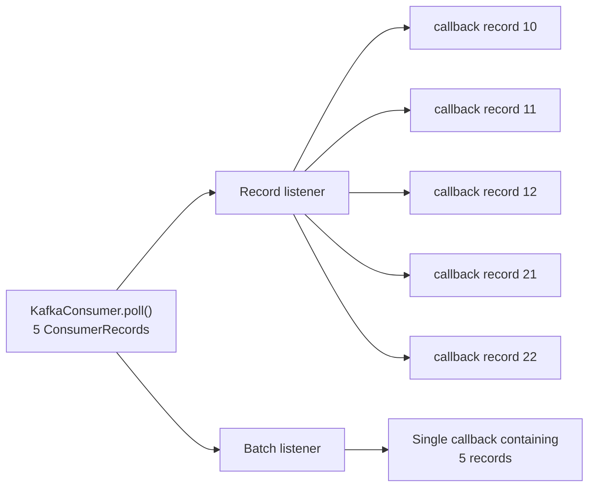
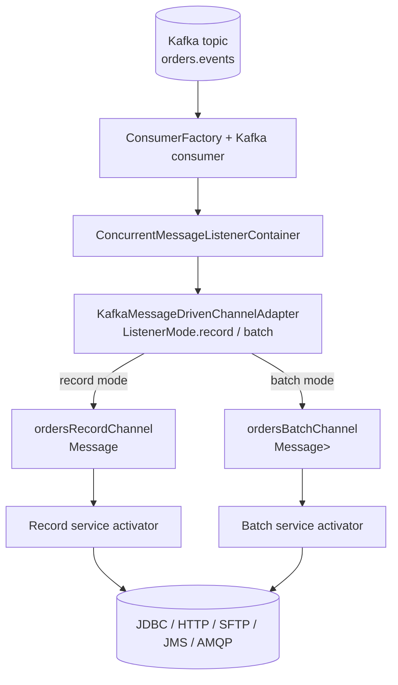
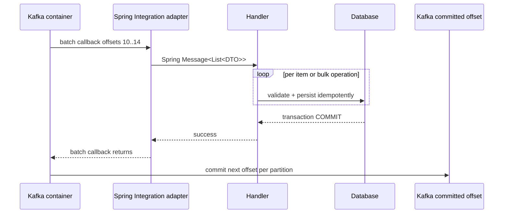
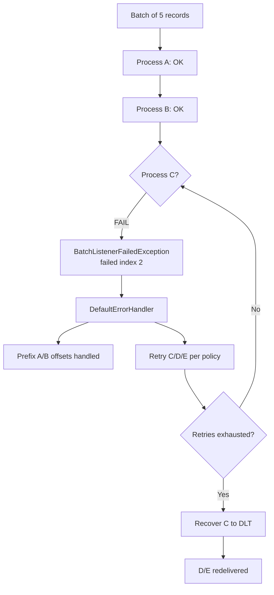

# Batch listener and record listener

A **record listener** receives and processes one Kafka `ConsumerRecord` at a time, while a **batch listener** receives a collection of records from one `KafkaConsumer.poll()` to process as a group. Both read from Kafka topics, yet they differ in **callback contract, Spring message payload type, metadata headers, error reporting, acknowledgment, and business completion boundaries**. Picking the wrong mode can make a handler receive a `List` instead of a DTO, commit offsets too early, or redeliver an entire batch because one item failed.

This lesson belongs to the **Kafka Adapter** chapter of the **SPRING_INTEGRATION_ADAPTERS** module. The module teaches how to connect external systems via inbound/outbound adapters, gateways, pollers, and `MessageChannel`, practicing with files, SFTP, HTTP, JMS, AMQP, Kafka, and databases while handling message contracts, errors, and connection lifecycles. This lesson focuses on **Kafka record listeners and batch listeners in Spring Kafka and Spring Integration's `KafkaMessageDrivenChannelAdapter`**, from design through operations.

> **Three core distinctions:** (1) Spring Integration's `ListenerMode.record/batch` is **not** the listener container's `AckMode.RECORD/BATCH`; (2) `max.poll.records` is the **maximum number of records returned in one poll**, not a fixed batch size; (3) batch listeners **do not support `AckMode.RECORD`** because the callback receives a batch rather than individual records.

## 1. Learning objectives

After this lesson, you will be able to:

1. Describe the flow `KafkaConsumer.poll() → MessageListenerContainer → KafkaMessageDrivenChannelAdapter → MessageChannel → MessageHandler` for both modes.
2. Compare record and batch modes across **processing unit, payload type, metadata, error recovery, acknowledgment, ordering, and throughput**.
3. Configure record and batch modes using `KafkaMessageDrivenChannelAdapter.ListenerMode`, `ConcurrentMessageListenerContainer`, and Java DSL.
4. Write Spring `@ServiceActivator`s accepting `Message<String>` or `Message<List<String>>` along with corresponding Kafka headers.
5. Understand the difference between `RecordMessageConverter` and `BatchMessageConverter`, and use `BatchMessagingMessageConverter` in the right mode.
6. Design `AckMode.RECORD` for records and `AckMode.BATCH` or manual modes for batches.
7. Analyze `BatchListenerFailedException`, batch fallback retries, DLT recovery, and non-blocking retry limitations.
8. Handle a failing record mid-batch without duplicating DB side effects upon redelivery.
9. Predict the impact of `max.poll.records`, concurrency, partition assignment, fetch tuning, and slow handlers.
10. Write integration tests observing offsets, lag, duplicates, crash windows, and mode selection by SLA.

## 2. Structure of a Kafka poll and the two listener types

A Kafka consumer retrieves one or more records via `poll(Duration)`. A single poll can include records from **multiple partitions** assigned to that consumer.

```text
One consumer poll can return:
  orders.events-0: offsets 10, 11, 12
  orders.events-2: offsets 21, 22

Total: 5 ConsumerRecords, coming from 2 partitions
```

A **record listener** is invoked by the Spring Kafka container sequentially per record; a **batch listener** receives the poll's collection of records in one callback.



This illustrates **callback count**, not a global ordering guarantee across partitions. Within one partition, Kafka orders by offset; across multiple partitions, there is no shared ordering clock.

### 2.1. Quick comparison table

| Criterion | Record listener | Batch listener |
|---|---|---|
| Listener input | One `ConsumerRecord<K,V>` | Collection of `ConsumerRecord<K,V>` from poll |
| Callbacks for 5 records | Typically 5 | Typically 1 |
| Spring Integration mode | `ListenerMode.record` | `ListenerMode.batch` |
| Spring message payload | Single `V`/DTO | `List<V>`/`List<DTO>` |
| Topic/partition/offset headers | Single values | Lists aligned with payload indices |
| Typical converter | `RecordMessageConverter` | `BatchMessageConverter` |
| `AckMode.RECORD` | Supported | **Not supported** |
| `AckMode.BATCH` | Supported | Supported |
| Manual ack | Can ack one record | Can ack the whole batch; conditional partial ack |
| Error handling | Easy to identify failing record | Must identify failing index/record or fall back to full batch |
| DB operation | Row by row | Can batch multiple rows/transactions |
| Throughput optimization | Reasonable for per-event logic | Reduces callback overhead and amortizes batch DB calls |
| Crash risk | Redelivery of uncommitted record | Can redeliver multiple records with prior side effects |
| Best-suited workload | Independent per-event validation/transactions, strict ordering | Bulk inserts, aggregation, idempotent ETL |

### 2.2. A batch listener does not create a new Kafka batch on the broker

The Kafka producer batches on the **sending side**; the Kafka consumer reads records with `poll()`; a batch listener only changes how **the container hands those records to application code**. It does not turn 100 Kafka records into a single Kafka record, nor does it make the broker commit 100 side effects atomically.

## 3. Flow inside Spring Integration

`KafkaMessageDrivenChannelAdapter<K,V>` is a **Kafka inbound endpoint** but a **Spring Integration message producer**: it receives Kafka records via the listener container and emits Spring `Message<?>`s to an **output channel**.



- `ConsumerFactory` creates Kafka consumer clients and configures group ID/deserializers/brokers.
- `ConcurrentMessageListenerContainer` manages the poll loop, concurrency, assignment, errors, acks, and commits.
- The adapter selects `ListenerMode` and uses the corresponding converter to build Spring messages.
- `DirectChannel` delivers messages synchronously to downstream consumer endpoints.
- `@ServiceActivator`/transformers/routers execute business logic.
- Kafka offsets are recorded strictly per **container `AckMode` and error policy**, never committed by the converter itself.

### 3.1. Do not confuse the two enum pairs

```java
// Spring Integration mode: number of Spring Messages / Kafka poll.
KafkaMessageDrivenChannelAdapter.ListenerMode.record
KafkaMessageDrivenChannelAdapter.ListenerMode.batch

// Spring Kafka Container mode: when to record/commit offsets.
ContainerProperties.AckMode.RECORD
ContainerProperties.AckMode.BATCH
ContainerProperties.AckMode.MANUAL
ContainerProperties.AckMode.MANUAL_IMMEDIATE
```

| Combination | Valid? | Explanation |
|---|---|---|
| `ListenerMode.record` + `AckMode.RECORD` | Yes | Callback/message per record; commits after each successful record callback |
| `ListenerMode.record` + `AckMode.BATCH` | Yes | Callback per record; commits after all records from a poll complete |
| `ListenerMode.batch` + `AckMode.BATCH` | Yes | Callback per batch; commits when batch callback succeeds |
| `ListenerMode.batch` + `AckMode.MANUAL` | Yes, if acked per contract | Handler acks batch; container commits per manual semantics |
| `ListenerMode.batch` + `AckMode.MANUAL_IMMEDIATE` | Yes, with thread rules | Ack on consumer thread; conditional partial batch ack supported |
| `ListenerMode.batch` + `AckMode.RECORD` | **No** | One batch callback cannot let the container commit per record like a record listener |

## 4. Record listener: contract, strengths, and limits

With `ListenerMode.record`, each `ConsumerRecord` after conversion becomes one `Message<String>` or `Message<OrderCreated>`. Topic/partition/offset headers correspond to that **single record**.

```text
Kafka record: key=ORD-101, value=CREATED, partition=2, offset=42
        |
        v
Spring Message:
  payload: "CREATED"
  kafka_receivedTopic: "orders.events"
  kafka_receivedPartition: 2
  kafka_offset: 42
  kafka_receivedKey: "ORD-101"  (if key has a value)
```

### 4.1. When to use a record listener?

- Business logic has an independent transaction or side effect per record.
- Validation errors and retry/DLT policies are needed per event.
- DB writes use simple `eventId` idempotency.
- One bad record should not force retrying an entire batch.
- Events must process sequentially by aggregate key without partial-batch complexity.
- Measured throughput already meets SLAs.

### 4.2. Trade-offs

- More callbacks and Spring message dispatches than batch mode.
- With `AckMode.RECORD`, commit overhead can rise under very high traffic.
- If the handler runs one JDBC insert or HTTP call per record, round-trip costs may exceed bulk operations.
- Long-blocking handlers on the listener thread still cause consumer lag and `max.poll.interval.ms` risks.

### 4.3. Code snippet receiving a record

```java
@ServiceActivator(inputChannel = "ordersRecordChannel")
public void processRecord(Message<String> message) {
    String value = message.getPayload();
    Object offset = message.getHeaders().get(KafkaHeaders.OFFSET);
    Object partition = message.getHeaders().get(
            KafkaHeaders.RECEIVED_PARTITION);

    if (value.startsWith("INVALID:")) {
        throw new IllegalArgumentException("Invalid event");
    }

    // In production: transaction + business idempotency.
    System.out.println(partition + "@" + offset + " : " + value);
}
```

This snippet lives inside a Spring component importing `ServiceActivator`, `Message`, and `KafkaHeaders`. Never confuse `System.out.println` with a durable business transaction.

## 5. Batch listener: one callback holding many records

With `ListenerMode.batch`, the converter can build a `Message<List<String>>` from a poll. Topic/partition/offset appear as **index-aligned lists matching the payload**.

```text
Kafka poll:
  index 0: orders.events-0@40, key=ORD-101, value=CREATED
  index 1: orders.events-0@41, key=ORD-101, value=PAID
  index 2: orders.events-2@12, key=ORD-202, value=CREATED

Spring Message:
  payload = ["CREATED", "PAID", "CREATED"]

  headers:
    kafka_receivedTopic     = ["orders.events", "orders.events", "orders.events"]
    kafka_receivedPartition = [0, 0, 2]
    kafka_offset            = [40, 41, 12]
    kafka_receivedKey       = ["ORD-101", "ORD-101", "ORD-202"]  (if provided by converter)
```

**Index alignment** is critical: `payload[2]` pairs with `partition[2]` and `offset[2]`. Never take the last offset in the batch and assign it to every record. Verify how your converter handles **null keys**: key metadata lists may contain null elements or be represented differently across converters/versions.

### 5.1. Why can batching be faster?

- Only one handler callback across many records.
- Amortizes conversion/dispatch/validation entrypoint overhead.
- Enables JDBC `batchUpdate` or bulk requests to target systems.
- Enables grouping by partition/aggregate to reduce calls.
- Using one DB transaction per small batch lowers per-transaction overhead.

**Yet batching is not automatically faster:** if the handler loops and executes synchronous per-record HTTP calls, throughput may not improve while listener threads stay occupied longer.

### 5.2. Is batch size stable?

No. `max.poll.records=500` is the **maximum records `KafkaConsumer` returns per poll**; it does not force every poll to return 500. A poll may return 1, 17, 300, or 0 records depending on traffic, assignments, consumer buffers, fetch tuning, broker state, and poll cadence.

```text
max.poll.records=500
poll #1 -> 7 records
poll #2 -> 146 records
poll #3 -> 0 records
poll #4 -> 500 records
```

Never write code assuming batches always hold 500 items, and never treat a poll batch boundary as a Kafka transaction or a shared business event.

### 5.3. A batch can mix partitions

One poll can include records from multiple partitions. Defining a DB transaction as "succeed for the whole batch" bundles results across different partitions, whereas Kafka stores committed offsets **separately per partition**. Handle metadata lists by matching indices, and consider grouping by `TopicPartition` when per-partition state or ordering matters.

## 6. Designing the example app: selecting one mode via property

This Spring Boot example uses **one listener container and one adapter**; toggle `demo.kafka.mode=record` or `batch` to switch modes. This avoids accidentally spawning two competing Kafka consumers in the same group/topic and mistaking split delivery for "lost records."

Test environment:

- Java 17+; Spring Boot BOM managing compatible Spring Integration and Spring Kafka versions.
- Kafka broker at `localhost:9092`, topic `orders.events` with three partitions.
- `String` values; no JSON parsing in the main converter example.
- Test group ID `orders-mode-demo` (change it when testing a fresh read from the beginning).
- Record handler and batch handler live in the same Spring component, yet **only the chosen mode's channel** receives messages.

### 6.1. Maven dependencies

In a Spring Boot project with parent/BOM:

```xml
<dependency>
    <groupId>org.springframework.boot</groupId>
    <artifactId>spring-boot-starter-integration</artifactId>
</dependency>
<dependency>
    <groupId>org.springframework.integration</groupId>
    <artifactId>spring-integration-kafka</artifactId>
</dependency>
```

Do not add JMS/AMQP/SFTP adapters if the demo only uses Kafka. For real projects targeting those systems, add the matching dependencies and test each transaction boundary independently.

### 6.2. application.properties

```properties
demo.kafka.bootstrap-servers=localhost:9092
demo.kafka.group-id=orders-mode-demo
demo.kafka.concurrency=2
demo.kafka.mode=record

# Use "batch" to enable the batch listener; only one mode is active.
# demo.kafka.mode=batch
```

Never use a production group ID for restart/replay tests. Switching modes **does not automatically reset Kafka committed offsets**; to compare on the same dataset, use two separate demo group IDs or a safe offset-reset plan on a test topic.

## 7. Complete Java config: Kafka consumer and single adapter

The class below creates `ConsumerFactory`, two Spring `DirectChannel`s, and **one** `KafkaMessageDrivenChannelAdapter` based on `demo.kafka.mode`.

```java
package com.example.kafka;

import java.util.HashMap;
import java.util.Map;

import org.apache.kafka.clients.consumer.ConsumerConfig;
import org.apache.kafka.common.serialization.StringDeserializer;
import org.springframework.beans.factory.annotation.Qualifier;
import org.springframework.beans.factory.annotation.Value;
import org.springframework.context.annotation.Bean;
import org.springframework.context.annotation.Configuration;
import org.springframework.integration.channel.DirectChannel;
import org.springframework.integration.config.EnableIntegration;
import org.springframework.integration.kafka.inbound.KafkaMessageDrivenChannelAdapter;
import org.springframework.kafka.core.ConsumerFactory;
import org.springframework.kafka.core.DefaultKafkaConsumerFactory;
import org.springframework.kafka.listener.ConcurrentMessageListenerContainer;
import org.springframework.kafka.listener.ContainerProperties;
import org.springframework.kafka.support.converter.BatchMessagingMessageConverter;
import org.springframework.kafka.support.converter.MessagingMessageConverter;
import org.springframework.messaging.MessageChannel;

@Configuration
@EnableIntegration
public class OrdersKafkaModeConfig {

    @Bean("ordersConsumerFactory")
    public ConsumerFactory<String, String> consumerFactory(
            @Value("${demo.kafka.bootstrap-servers}") String brokers,
            @Value("${demo.kafka.group-id}") String groupId) {

        Map<String, Object> p = new HashMap<>();
        p.put(ConsumerConfig.BOOTSTRAP_SERVERS_CONFIG, brokers);
        p.put(ConsumerConfig.GROUP_ID_CONFIG, groupId);
        p.put(ConsumerConfig.KEY_DESERIALIZER_CLASS_CONFIG,
                StringDeserializer.class);
        p.put(ConsumerConfig.VALUE_DESERIALIZER_CLASS_CONFIG,
                StringDeserializer.class);
        p.put(ConsumerConfig.ENABLE_AUTO_COMMIT_CONFIG, false);
        p.put(ConsumerConfig.AUTO_OFFSET_RESET_CONFIG, "earliest");

        // Only an upper limit per poll, not a fixed size.
        p.put(ConsumerConfig.MAX_POLL_RECORDS_CONFIG, 100);
        return new DefaultKafkaConsumerFactory<>(p);
    }

    @Bean("ordersRecordChannel")
    public MessageChannel ordersRecordChannel() {
        return new DirectChannel();
    }

    @Bean("ordersBatchChannel")
    public MessageChannel ordersBatchChannel() {
        return new DirectChannel();
    }

    @Bean("ordersKafkaInbound")
    public KafkaMessageDrivenChannelAdapter<String, String> ordersInbound(
            @Qualifier("ordersConsumerFactory")
                ConsumerFactory<String, String> consumerFactory,
            @Qualifier("ordersRecordChannel")
                MessageChannel recordChannel,
            @Qualifier("ordersBatchChannel")
                MessageChannel batchChannel,
            @Value("${demo.kafka.concurrency}") int concurrency,
            @Value("${demo.kafka.mode:record}") String mode) {

        boolean batch;
        if ("batch".equalsIgnoreCase(mode)) {
            batch = true;
        } else if ("record".equalsIgnoreCase(mode)) {
            batch = false;
        } else {
            throw new IllegalArgumentException(
                    "demo.kafka.mode must be record or batch");
        }

        ContainerProperties cp =
                new ContainerProperties("orders.events");
        cp.setAckMode(batch
                ? ContainerProperties.AckMode.BATCH
                : ContainerProperties.AckMode.RECORD);

        ConcurrentMessageListenerContainer<String, String> container =
                new ConcurrentMessageListenerContainer<>(
                        consumerFactory, cp);
        container.setConcurrency(concurrency);

        KafkaMessageDrivenChannelAdapter.ListenerMode listenerMode =
                batch
                ? KafkaMessageDrivenChannelAdapter.ListenerMode.batch
                : KafkaMessageDrivenChannelAdapter.ListenerMode.record;

        KafkaMessageDrivenChannelAdapter<String, String> adapter =
                new KafkaMessageDrivenChannelAdapter<>(
                        container, listenerMode);

        if (batch) {
            adapter.setBatchMessageConverter(
                    new BatchMessagingMessageConverter());
            adapter.setOutputChannel(batchChannel);
        } else {
            adapter.setRecordMessageConverter(
                    new MessagingMessageConverter());
            adapter.setOutputChannel(recordChannel);
        }
        return adapter;
    }
}
```

### 7.1. Reading the configuration in order

1. `StringDeserializer` turns Kafka record values into Java `String`s.
2. `MAX_POLL_RECORDS_CONFIG=100` only caps how many records one poll returns.
3. `ContainerProperties("orders.events")` **subscribes** to the topic; Kafka assigns partitions by group.
4. `AckMode.RECORD` is selected when callbacks handle individual records; `AckMode.BATCH` is selected when callbacks hold batches.
5. `setConcurrency(2)` creates up to two child Kafka consumers inside one JVM. Total concurrency across pods in the same group determines how many members compete for assignments.
6. `ListenerMode.record` wires `MessagingMessageConverter`; `ListenerMode.batch` wires `BatchMessagingMessageConverter`.
7. The adapter emits to **one of the two Spring output channels**, not out to Kafka.
8. Handlers on `DirectChannel` run synchronously on the Kafka listener thread in this demo flow.
9. Do not register another `@KafkaListener` on the same topic/group in this application unless partition sharing is intended.

**Technical note:** `BatchMessagingMessageConverter` does not necessarily return `List<String>` when customized with a different schema converter. The main example uses `StringDeserializer` and the default converter explicitly, so the payload list contains Strings per the demo contract. If null/tombstone values can arrive, design a `KafkaNull` policy before casting to `String`.

### 7.2. Error handler configuration for the lab

The demo keeps the container's default error handling to stay focused on record vs. batch. **Never rely on that default as a production policy**: once retries/recovery finish, an error may be logged and treated as recovered **without writing to a DLT**, depending on version/config. Attach `DefaultErrorHandler` and `DeadLetterPublishingRecoverer` or durable quarantine with explicit error classification as covered in Section 14.

## 8. Service activators: two distinct payload contracts

The class below defines two consumer endpoints; both Spring channels have subscribers, yet **only one adapter** emits messages per run.

```java
package com.example.kafka;

import java.util.List;
import org.springframework.integration.annotation.ServiceActivator;
import org.springframework.kafka.support.KafkaHeaders;
import org.springframework.messaging.Message;
import org.springframework.stereotype.Component;

@Component
public class OrdersModeHandler {

    @ServiceActivator(inputChannel = "ordersRecordChannel")
    public void onRecord(Message<String> message) {
        String value = message.getPayload();

        Object topic = message.getHeaders()
                .get(KafkaHeaders.RECEIVED_TOPIC);
        Object partition = message.getHeaders()
                .get(KafkaHeaders.RECEIVED_PARTITION);
        Object offset = message.getHeaders()
                .get(KafkaHeaders.OFFSET);

        if (value.startsWith("INVALID:")) {
            throw new IllegalArgumentException(
                    "Invalid record: " + value);
        }

        System.out.printf(
                "RECORD topic=%s partition=%s offset=%s value=%s%n",
                topic, partition, offset, value);
    }

    @ServiceActivator(inputChannel = "ordersBatchChannel")
    public void onBatch(Message<List<String>> message) {
        List<String> values = message.getPayload();

        List<?> topics = (List<?>) message.getHeaders()
                .get(KafkaHeaders.RECEIVED_TOPIC);
        List<?> partitions = (List<?>) message.getHeaders()
                .get(KafkaHeaders.RECEIVED_PARTITION);
        List<?> offsets = (List<?>) message.getHeaders()
                .get(KafkaHeaders.OFFSET);

        if (topics == null || partitions == null || offsets == null
                || topics.size() != values.size()
                || partitions.size() != values.size()
                || offsets.size() != values.size()) {
            throw new IllegalStateException(
                    "Batch Kafka metadata does not match payload");
        }

        for (int i = 0; i < values.size(); i++) {
            String value = values.get(i);
            if (value.startsWith("INVALID:")) {
                // Demo uses a regular exception. For partial recovery,
                // configure a suitable BatchListenerFailedException.
                throw new IllegalArgumentException(
                        "Invalid batch index=" + i + " value=" + value);
            }
            System.out.printf(
                    "BATCH index=%d topic=%s part=%s offset=%s value=%s%n",
                    i, topics.get(i), partitions.get(i),
                    offsets.get(i), value);
        }
    }
}
```

**Notes on the demo:**

- `@ServiceActivator` is strictly a **consumer endpoint inside Spring Integration**, not a new Kafka consumer.
- `onBatch(...)` receives a `Message<List<String>>`, not guaranteed to hold 100 records every call.
- Topic/partition/offset are **lists**, and the code checks list lengths before indexing.
- Both handlers only print logs without JDBC/SFTP/HTTP side effects. Production requires idempotency.
- The batch handler throws `IllegalArgumentException` to demonstrate batch failure; it **does not yet provide single-record recovery**. Section 14 covers `BatchListenerFailedException` and testing exception propagation.

### 8.1. Why not always read `KafkaHeaders.RECEIVED_KEY`?

For records **without a key**, `RECEIVED_KEY` may be absent. In batch mode, key metadata representation varies with null values, converters, and versions. Never write `message.getHeaders().get(KafkaHeaders.RECEIVED_KEY).toString()` without a null check. When Kafka keys carry vital identity, test the real producer–consumer path.

## 9. Testing both modes with Kafka CLI

### 9.1. Create the topic

```bash
kafka-topics.sh --bootstrap-server localhost:9092 \
  --create --if-not-exists \
  --topic orders.events --partitions 3 --replication-factor 1
```

Replication factor 1 is strictly for a single-broker lab. In production, set replication factor, `min.insync.replicas`, retention, and ACLs per durability requirements.

### 9.2. Send records

```bash
kafka-console-producer.sh \
  --bootstrap-server localhost:9092 \
  --topic orders.events
```

Enter:

```text
evt-101|ORD-101|CREATED
evt-102|ORD-102|CREATED
evt-103|ORD-101|PAID
evt-104|ORD-202|CREATED
evt-105|ORD-202|SHIPPED
```

No Kafka key is sent when entering lines this way, so do not assume records with the same `orderId` land in the same partition. When aggregate ordering is required, producers must set an explicit **record key**.

### 9.3. Run record mode

Set `demo.kafka.mode=record` and start the application. Expected output:

```text
RECORD topic=orders.events partition=... offset=... value=evt-101|ORD-101|CREATED
RECORD topic=orders.events partition=... offset=... value=evt-102|ORD-102|CREATED
...
```

There is **one Spring service activator callback per Kafka record** after conversion. A failing record triggers container retry/recovery per configuration.

### 9.4. Run batch mode

Stop the application and change `demo.kafka.mode=batch`. To see demo records again, use a different test group ID or send new records; remember the previous group already committed offsets. Output:

```text
BATCH index=0 topic=orders.events part=... offset=... value=evt-106|ORD-301|CREATED
BATCH index=1 topic=orders.events part=... offset=... value=evt-107|ORD-302|CREATED
...
```

The record count per batch depends on polling and traffic. If you type lines slowly one by one, you may see multiple batches of size 1—**that does not mean batch config is broken**.

### 9.5. Inspect committed offsets and assignments

```bash
kafka-consumer-groups.sh \
  --bootstrap-server localhost:9092 \
  --describe --group orders-mode-demo

kafka-consumer-groups.sh \
  --bootstrap-server localhost:9092 \
  --describe --group orders-mode-demo \
  --members --verbose
```

Output shows committed offsets, log end offsets, lag, and members/assignments. `CURRENT-OFFSET=43` normally means the group resumes reading at offset 43, **not that record 43 was committed to the database**.

## 10. Java DSL for both modes

Spring Integration's Java DSL provides `Kafka.messageDrivenChannelAdapter(...)` to build inbound flows with explicit modes.

### 10.1. Record mode DSL

```java
@Bean
IntegrationFlow recordKafkaFlow(ConsumerFactory<String, String> factory) {
    return IntegrationFlow
            .from(Kafka.messageDrivenChannelAdapter(
                    factory,
                    KafkaMessageDrivenChannelAdapter.ListenerMode.record,
                    "orders.events"))
            .channel("ordersRecordChannel")
            .get();
}
```

### 10.2. Batch mode DSL

```java
@Bean
IntegrationFlow batchKafkaFlow(ConsumerFactory<String, String> factory) {
    return IntegrationFlow
            .from(Kafka.messageDrivenChannelAdapter(
                    factory,
                    KafkaMessageDrivenChannelAdapter.ListenerMode.batch,
                    "orders.events"))
            .channel("ordersBatchChannel")
            .get();
}
```

Import `org.springframework.integration.dsl.IntegrationFlow`, `org.springframework.integration.kafka.dsl.Kafka`, `ConsumerFactory`, and `KafkaMessageDrivenChannelAdapter`. **These are mutually exclusive alternatives**; do not register them alongside the Section 7 `@Bean` adapter when only one logical consumer is desired.

The DSL builder lets you customize the listener container via version-appropriate APIs. Never assume batch mode automatically chooses the exact `AckMode` for every container; when specific commit semantics matter, configure and inspect the generated container's `ContainerProperties`.

### 10.3. Example using a pre-built container

When you need full control over `AckMode`, error handler, concurrency, and consumer group, use the DSL overload accepting a container:

```java
ContainerProperties cp = new ContainerProperties("orders.events");
cp.setAckMode(ContainerProperties.AckMode.BATCH);

ConcurrentMessageListenerContainer<String, String> container =
        new ConcurrentMessageListenerContainer<>(factory, cp);
container.setConcurrency(2);

// Snippet inside a flow-building method; do not run alongside another flow.
IntegrationFlow flow = IntegrationFlow.from(
        Kafka.messageDrivenChannelAdapter(
                container,
                KafkaMessageDrivenChannelAdapter.ListenerMode.batch))
        .channel("ordersBatchChannel")
        .get();
```

This snippet assumes `factory` is in scope. Manage the container lifecycle in **one place**; never manually start another standalone container on the same topic/group.

## 11. `@KafkaListener` compared to the Spring Integration adapter

Plain Spring Kafka typically uses `@KafkaListener` instead of an `IntegrationFlow`. Do not mix both listener registrations unintentionally.

### 11.1. `@KafkaListener` record

```java
@KafkaListener(
        topics = "orders.events",
        groupId = "orders-annotation-record")
public void onRecord(String value) {
    System.out.println("record=" + value);
}
```

This method is called once per record per the default record-listener container factory.

### 11.2. `@KafkaListener` batch

```java
@Bean("batchKafkaListenerContainerFactory")
ConcurrentKafkaListenerContainerFactory<String, String> batchFactory(
        ConsumerFactory<String, String> consumerFactory) {

    ConcurrentKafkaListenerContainerFactory<String, String> f =
            new ConcurrentKafkaListenerContainerFactory<>();
    f.setConsumerFactory(consumerFactory);
    f.setBatchListener(true);
    f.getContainerProperties().setAckMode(
            ContainerProperties.AckMode.BATCH);
    return f;
}
```

Listener:

```java
@KafkaListener(
        topics = "orders.events",
        groupId = "orders-annotation-batch",
        containerFactory = "batchKafkaListenerContainerFactory")
public void onBatch(List<String> values) {
    for (String value : values) {
        System.out.println("batch value=" + value);
    }
}
```

`@KafkaListener` requires `@EnableKafka` and a Spring configuration; this factory/listener is a **plain Spring Kafka comparison**, not code meant to run simultaneously with the Spring Integration demo under the same group.

- In newer Spring Kafka versions, `@KafkaListener(batch = "true")` can also override the factory's batch setting when supported by the API version.
- **`batchListener=true` on a container factory targets `@KafkaListener`**; it does not automatically flip mode on standalone `KafkaMessageDrivenChannelAdapter`s.
- Non-blocking retries via `@RetryableTopic` are **not supported with batch listeners** per Spring Kafka documentation.
- Batch methods can accept `List<ConsumerRecord<K,V>>` or `ConsumerRecords<K,V>` when raw record metadata is needed; when accepting a POJO `List`, metadata is supplied via parallel Kafka headers.

## 12. Converters: `RecordMessageConverter` is not `BatchMessageConverter`

`KafkaMessageDrivenChannelAdapter` supports:

```java
adapter.setRecordMessageConverter(recordConverter);
adapter.setBatchMessageConverter(batchConverter);
```

Use only the setter matching your chosen mode.

| Layer | Record mode | Batch mode |
|---|---|---|
| Kafka deserializer | `StringDeserializer` → `String` | Still `StringDeserializer` per record |
| Kafka listener callback | `ConsumerRecord<K,V>` | `ConsumerRecords<K,V>` / list |
| Kafka converter | `RecordMessageConverter` | `BatchMessageConverter` |
| Spring message payload | `String`/DTO | `List<String>` / `List<DTO>` |
| Kafka headers | Single values | Index-aligned lists |
| Downstream handler | `Message<String>` | `Message<List<String>>` |
| Business validation | Per record | Per element + batch policy |

### 12.1. `BatchMessagingMessageConverter`

By default, `BatchMessagingMessageConverter` builds a Spring message from a list of records. It can wrap an inner `RecordMessageConverter` to convert each value into a DTO when configured:

```java
// Conceptual example when records are read by StringDeserializer.
// Application-defined OrderCreated DTO.
BatchMessagingMessageConverter batchConverter =
        new BatchMessagingMessageConverter(
                recordJsonMessageConverter);

adapter.setBatchMessageConverter(batchConverter);
adapter.setPayloadType(OrderCreated.class);
```

`recordJsonMessageConverter` is a JSON/DTO-compatible `RecordMessageConverter` bean; exact class names vary by Spring Kafka/Jackson version. Spring Kafka 3.x / Jackson 2 commonly uses `StringJsonMessageConverter`; Spring Kafka 4.x / Jackson 3 provides `JacksonJsonMessageConverter` and its variants. **Never mix classes across the two version branches.**

The main demo does not need a JSON converter: since Kafka values are `String`s, `new BatchMessagingMessageConverter()` suffices.

### 12.2. Conversion error at index 7

In batch mode with a JSON converter, a malformed item can produce a null payload at that index alongside a `KafkaHeaders.CONVERSION_FAILURES` list holding exceptions by index, depending on converter and Spring Kafka version. For POJO batch `@KafkaListener`s, inspect the failures list and throw `BatchListenerFailedException` pinpointing the index.

**Condition:** the handler must never silently skip a null payload merely because 99 other items are valid. Define which failing record goes to the DLT, which commits, and whether prior side effects are idempotent.

### 12.3. Kafka tombstones

On compacted topics, `ConsumerRecord.value()==null` can be a valid tombstone. Spring messages cannot carry ordinary Java null payloads; the framework/converter may use `KafkaNull`. Both record and batch handlers need an explicit **delete-by-key** contract before casting to DTO/String, handling null/markers per version.

## 13. AckMode, offset commits, and completion milestones

`enable.auto.commit=false` is the standard choice so the Spring Kafka listener container manages offsets. **The container's default `AckMode` is `BATCH`** unless configured otherwise.

| `AckMode` | Record listener | Batch listener |
|---|---|---|
| `RECORD` | Commits after each successful record callback | **Not supported** |
| `BATCH` | Commits after all records from a poll complete per contract | Commits after a successful batch callback |
| `TIME`, `COUNT`, `COUNT_TIME` | By elapsed time / processed record count | By matching thresholds after batch callbacks |
| `MANUAL` | Handler acks; commits with batch semantics | Handler acks batch; commits with batch semantics |
| `MANUAL_IMMEDIATE` | Ack on consumer thread can commit immediately | Ack on consumer thread; conditional partial batch ack supported |



**Offset commits do not create DB transactions.** If the DB commits and the JVM crashes before offsets commit, the batch can be redelivered. Use business `eventId`s, unique constraints/inbox tables, or idempotent upserts.

### 13.1. Is record mode with `AckMode.BATCH` valid?

Yes. The listener still receives **one record at a time**, while the container defers commits until the poll's records finish. "Batch" in `AckMode.BATCH` governs commit timing; it does **not** turn Spring messages into `List`s.

### 13.2. Why can't batch mode use `AckMode.RECORD`?

A batch callback returns **one result for the entire set of records**; the container cannot commit per record based on individual record callbacks. If you need per-record confirmation via listener callbacks, use a **record listener** or conditional partial batch acknowledgment APIs.

### 13.3. Manual batch ack

In manual batch mode, `KafkaHeaders.ACKNOWLEDGMENT` can hold an `Acknowledgment`. Correct sequence:

```java
// Batch handler snippet; use only when the container configures
// AckMode.MANUAL or MANUAL_IMMEDIATE and provides the ack header.
Acknowledgment ack = message.getHeaders().get(
        KafkaHeaders.ACKNOWLEDGMENT, Acknowledgment.class);

if (ack == null) {
    throw new IllegalStateException("Missing batch Acknowledgment");
}

transactionalBatchService.processAndCommit(message.getPayload());
ack.acknowledge();   // after the DB transaction actually commits
```

`transactionalBatchService` is a transactional bean invoked **through a Spring proxy**. Never put `ack.acknowledge()` at the end of a **`@Transactional` method body** assuming the DB already committed: transactions normally commit when the proxy method returns.

### 13.4. Partial batch acknowledgment

In supporting Spring Kafka versions (3.0.10+), `Acknowledgment.acknowledge(index)` can commit a leading prefix of a batch. Conditions include `MANUAL_IMMEDIATE`, invocation **on the listener thread**, a list-based batch listener, and valid monotonically increasing indices across calls.

```text
Batch indices: [0,1,2,3,4]
Business processes 0,1 OK; DB commit
ack.acknowledge(1)  -> acknowledges prefix through index 1

Processes 2,3,4 successfully; DB commit
ack.acknowledge()   -> acknowledges the remainder
```

With a Spring Integration adapter, verify that `Acknowledgment` is attached to the Spring message and behaves as expected in your version. Never pass the acknowledgment object across an `ExecutorChannel` to invoke from an arbitrary thread expecting immediate semantics.

### 13.5. Negative ack in batches

`nack(index, sleep)` can commit processed items before `index` and seek to redeliver the failing record and remaining items per contract. It must be called on the consumer thread and cannot be used with `asyncAcks=true`. `nack()` does not roll back external DB transactions.

## 14. Partial batch failures and `BatchListenerFailedException`

This is the biggest challenge with batch listeners: processing `[A,B,C,D,E]` where C fails after A and B already produced side effects.



### 14.1. When explicitly reporting the failing record

In a **Spring Kafka batch listener under a supporting contract**, you can throw:

```java
throw new BatchListenerFailedException(
        "Cannot process batch item",
        cause,
        failedIndex);
```

`cause` is a `Throwable`, and `failedIndex` is 0-based within the batch list. Depending on listener signature, you can specify the failing `ConsumerRecord` instead of the index.

With a compatibly configured `DefaultErrorHandler`, it can commit the prefix before the failing record, retry the remaining tail, recover the failing record to a DLT, and continue with remaining records. These are **Spring Kafka semantics when `BatchListenerFailedException` is recognized**, not an automatic guarantee for any arbitrary exception thrown by any Spring Integration handler.

### 14.2. When throwing a generic exception

If the batch listener throws `IllegalStateException` without identifying which element failed, the error handler may fall back to **retrying the entire batch**. Once retries exhaust, the recoverer may be invoked for every record in the batch, depending on error handler and version.

**Consequence:** Records A and B that already executed side effects can be reprocessed. Business idempotency by `eventId` is mandatory whenever duplicates are unacceptable.

### 14.3. Spring Kafka `@KafkaListener` example specifying the index

Standalone example illustrating the explicit contract:

```java
@KafkaListener(
        topics = "orders.events",
        groupId = "orders-batch-failure-demo",
        containerFactory = "batchKafkaListenerContainerFactory")
public void onBatch(List<String> values) {
    for (int i = 0; i < values.size(); i++) {
        try {
            processIdempotently(values.get(i));
        } catch (Exception ex) {
            throw new BatchListenerFailedException(
                    "Failed at index=" + i, ex, i);
        }
    }
}
```

`processIdempotently(...)` is the business method to implement. Import `BatchListenerFailedException` from `org.springframework.kafka.listener.BatchListenerFailedException`. Attach a matching `DefaultErrorHandler`/recoverer to `batchKafkaListenerContainerFactory` alongside DB idempotency.

### 14.4. How does a Spring Integration `@ServiceActivator` differ?

In Spring Integration, exceptions can be wrapped inside `MessagingException` or intercepted by an adapter error channel/recovery callback before reaching the Kafka container. To rely on **partial batch recovery**, write an **integration test** proving `DefaultErrorHandler` actually detects `BatchListenerFailedException` in the live cause chain. If errors are suppressed, the container will not retry as expected.

Never route every handler exception into an error channel merely to log and let Kafka commit; record C would go unprocessed without reaching a DLT.

### 14.5. DLT for batches

`DeadLetterPublishingRecoverer` can publish the **failing record** to a DLT when the error handler knows exactly which record failed. If it receives a generic exception without a failed index, the batch fallback handler may recover multiple records. **Never assume** either the whole batch or only C goes to the DLT without testing your error handler and wrapped exceptions.

Kafka **non-blocking retry topics** via `@RetryableTopic` are currently **not supported for batch listeners** in documented Spring Kafka versions. For long retry delays, design a separate record listener, manual retry queues/topics, or a durable status store.

## 15. Database: per-record transactions vs. one-batch transaction?

### 15.1. Per-record transactions

```text
Record A -> DB transaction A commit
Record B -> DB transaction B commit
Record C -> DB transaction C rollback
```

Advantage: failures stay isolated per event; drawback: more DB transactions/round-trips.

### 15.2. Batch transaction

```text
Batch [A,B,C] -> single DB transaction
  INSERT A
  INSERT B
  INSERT C
  COMMIT all or ROLLBACK all
```

Advantage: lowers overhead and keeps atomicity within **one database transaction**. Drawback: oversized batches hold locks/connections longer, raise timeout risk, and require retrying the whole batch if any element fails.

If processing a batch across **several smaller DB transactions** (chunks), each chunk commits independently; if the batch fails after the first chunk, committed chunks can be reprocessed. Idempotency is required.

### 15.3. Inbox/idempotency pattern

```sql
CREATE TABLE processed_events (
    event_id VARCHAR(128) PRIMARY KEY,
    processed_at TIMESTAMP NOT NULL DEFAULT CURRENT_TIMESTAMP
);
```

Each event carries an `eventId`; inside the same DB transaction as the side effect, insert/check `eventId` via a unique constraint. On Kafka redelivery, the existing `eventId` is detected and the side effect is skipped.

```java
// PostgreSQL pseudocode inside a @Transactional service.
// Runs before business side effects in the SAME DB transaction.
int claimed = jdbc.update(
    "INSERT INTO processed_events(event_id) VALUES (?) "
    + "ON CONFLICT (event_id) DO NOTHING",
    eventId);

if (claimed == 0) {
    return; // event already processed
}
jdbc.update("UPDATE orders SET status = ? WHERE order_id = ?",
        newStatus, orderId);
```

Without full schema details, this is illustrative; production requires validation, version/order checks, DB migrations, and proper update rules. Never use topic-partition-offset as the sole business ID if the same event can be republished at another offset.

### 15.4. Are Kafka transactions enough?

Kafka transactions coordinate Kafka producer records and source offsets within Kafka, yet **do not** fold JDBC, HTTP, SFTP, JMS, or AMQP into an atomic Kafka transaction. For Kafka → JDBC, use an idempotent consumer/inbox; for JDBC → Kafka, consider a transactional outbox.

## 16. Partition assignment, concurrency, and ordering

`ConcurrentMessageListenerContainer.setConcurrency(3)` creates Kafka consumer clients in the group; it does **not** create more partitions. With a 2-partition topic and 6 consumers in the same traditional group, at most 2 consumers are assigned partitions from that topic at a time.

| Concept | What it actually controls |
|---|---|
| `group.id` | Logical subscriber and committed offsets |
| Topic partition count | Partition-level parallelism ceiling |
| `concurrency` | Number of consumer clients in the container |
| `max.poll.records` | Max records returned per poll to one consumer |
| `ListenerMode` | Whether the adapter dispatches a record or a batch |
| `AckMode` | How/when the container records/commits offsets |
| `DirectChannel` | Synchronous Spring message dispatch to handler |
| `ExecutorChannel` | Worker-thread dispatch; can alter completion order |

### 16.1. Ordering within a batch

If a batch holds records from partition 0 and partition 2, there is no global order across both partitions. **Within each partition**, records follow offset order.

- A handler looping sequentially over the list preserves per-partition processing order if no threads are spawned.
- Parallel per-item processing can **invert completion order** even within the same partition.
- When producer keys are `orderId`, matching keys land on the same partition under consistent partitioning; yet increasing partitions can shift mappings for new records.
- If the business requires strict sequencing, use aggregate versions, conflict detection, or sequential per-partition processing.

### 16.2. Large batches and `max.poll.interval.ms`

A very slow batch callback can prevent the Kafka consumer from calling `poll()` within `max.poll.interval.ms`, triggering a rebalance. Cap batch/chunk sizes, optimize downstream I/O, speed up bulk operations, or design durable async processing with accurate acknowledgments.

**Do not merely raise the timeout:** oversized timeouts slow failover when a consumer genuinely hangs, and never fix DB-committed-but-Kafka-uncommitted windows.

## 17. Fetch tuning, throughput, and backpressure

Settings easily confused:

| Property | Effect | Does NOT guarantee |
|---|---|---|
| `max.poll.records` | Caps records returned by a consumer poll | Batches always having exactly N items |
| `fetch.min.bytes` | Broker tries waiting for enough data before answering fetch, within time limit | Every poll matching byte target in record count |
| `fetch.max.wait.ms` | Max broker wait for fetch size threshold | Total processing latency below that limit |
| `max.partition.fetch.bytes` | Per-partition fetch byte cap (with first-batch exception) | Equal record counts across partitions |
| `max.poll.interval.ms` | Max gap between poll calls | DB transaction completion |
| `concurrency` | Number of Kafka consumer threads | Linear throughput scaling |
| Container `pollTimeout` | Wait timeout inside Kafka poll | Kafka business retry timeout |

### 17.1. Simple throughput estimate

If a handler makes one JDBC call per record taking 20 ms:

```text
One consumer processing sequentially, estimate:
  1 / 0.020s = ~50 records/second (excluding overhead)
```

If 50 records are grouped into one JDBC batch taking 100 ms, theoretically:

```text
50 / 0.100s = ~500 records/second
```

This is **purely back-of-the-envelope math**, not a Spring Kafka benchmark. Real results depend on brokers, payloads, DB locks, serialization, latency, concurrency, and partition skew. If the DB sustains at most 300 updates/second, raising Kafka concurrency or batch size cannot push the DB past its sustainable ceiling.

### 17.2. Backpressure when downstream slows down

In a `DirectChannel` flow, the listener callback stays busy so the Kafka consumer slows polling; lag climbs, yet synchronous errors still reach the container.

Switching to an in-memory `QueueChannel` lets callbacks return right after enqueueing so the container can commit offsets **before JDBC/HTTP completes**. A JVM crash at that moment loses business events.

Never equate a "fast batch handler" that merely enqueues 100 messages in RAM with successful processing. Use a durable handoff or acknowledgment tied to durable side effects.

### 17.3. Resource limits for batches

- Bound `max.poll.records` based on p99 processing time and memory.
- Size JDBC/HTTP timeouts and transaction scopes appropriately.
- Keep bulk write chunks small enough to avoid long locks.
- Never buffer an entire day's batches in RAM.
- Monitor GC, allocations, Kafka lag, and DB connection pools.
- With oversized records in a batch, payloads can trigger OOM/GC even with few records; enforce size limits on producers/brokers and validate payloads.

## 18. Lifecycle and graceful shutdown

Whether in record or batch mode, the adapter is a lifecycle-managed endpoint and the container participates in consumer groups/rebalances. On pod shutdown:

1. Stop accepting new external requests or upstream triggers if any.
2. Instruct the consumer/container to stop fetching new records per policy.
3. Wait for in-flight handlers and DB transactions to complete within a deadline.
4. Record offsets/acks where valid per contract while still owning partitions.
5. Close producer/consumer resources.
6. If new offsets did not commit, accept replays and rely on idempotency.

In batch mode, more records may be in-flight during a single callback than in record mode. Graceful shutdown timeouts and Kubernetes `terminationGracePeriodSeconds` must cover batch p99 duration rather than single-record latency.

### 18.1. Pause vs. stop

`KafkaMessageDrivenChannelAdapter` supports pause/resume depending on API version. Pausing throttles record delivery, yet **does not** mean in-flight batches finished, offsets committed, or the JVM stopped. Stopping can cause leaving the group and reassigning partitions; uncommitted records may replay.

## 19. Monitoring and troubleshooting

| Symptom | Hypothesis | Check |
|---|---|---|
| Batch handler gets `String` instead of `List` | Adapter lacks `ListenerMode.batch` or wrong converter | Mode, bean wiring, converter |
| Record handler gets `List` | Batch enabled on wrong channel/handler | `ListenerMode`, service activator input |
| `AckMode.RECORD` fails with batch listener | Batch callback cannot do record ack | `ContainerProperties` `AckMode` |
| Batch size is always 1 | Slow producer, low traffic, fetch/poll cadence | Producer rate, poll sizes, `max.poll.records` |
| `max.poll.records=100` yet batches have 17 | Max is a cap, not an exact size | Traffic / partition assignments |
| One invalid record retries entire batch | Exception lacks failed index | `BatchListenerFailedException`, cause chain |
| Partial retry fails in SI flow | Exception wrapped/suppressed | `MessageHandlingException`, error channel, wiring |
| Whole batch goes to DLT | Fallback batch recoverer | Exception class, `DefaultErrorHandler` version |
| DB has duplicates after crash/rebalance | Side effect committed before offset commit | `eventId`/unique constraint |
| Kafka lag=0 yet DB missing rows | Async queue, premature ack/commit | Channel type, processing timeline |
| Batch processing > `max.poll.interval.ms` | Callback takes too long | Batch p99, poll metrics, rebalances |
| Many consumers idle | Concurrency exceeds partition count | `--members --verbose` |
| Wrong metadata in bulk write | Not indexing list headers in parallel | List sizes / offset mapping |
| Null JSON DTO mid-batch | Conversion error / tombstone | `CONVERSION_FAILURES`, converter |
| Non-blocking retry topic inactive | Batch listeners do not support `@RetryableTopic` | `@RetryableTopic` restrictions |

### 19.1. Useful metrics

- Record polls/second, records per poll, batch callback size p50/p95/p99.
- Handler success/error rates per record and per batch.
- Handler p95/p99 latency, JDBC batch duration, committed rows, rollback rate.
- Kafka committed offset/lag per partition and rebalance count.
- Retry attempts, partial batch recoveries, DLT publishes, and DLT backlog.
- Business duplicates detected by `eventId`.
- Queue depth / executor active tasks if using async handoffs.
- Consumer assignments, `isRunning`/`isPaused`, and shutdown in-flight counts.
- Memory/GC, payload bytes, and deserialization/conversion time.

**`LAG=0` does not prove the DB finished** if offsets committed early, especially when batches were enqueued in RAM. Cross-check business commits against acknowledgments.

### 19.2. Inspecting the group with CLI

```bash
kafka-consumer-groups.sh \
  --bootstrap-server localhost:9092 \
  --describe --group orders-mode-demo

kafka-consumer-groups.sh \
  --bootstrap-server localhost:9092 \
  --describe --group orders-mode-demo \
  --members --verbose
```

Record `CURRENT-OFFSET`, `LOG-END-OFFSET`, `LAG`, `CLIENT-ID`, and partition assignments. If multiple independent groups subscribe to the topic, each maintains its own offsets. Never reset production offsets during a performance test.

## 20. Design mistakes to avoid

| Misconception | Reality |
|---|---|
| "Batch listener means the Kafka producer batched." | It is a **consumer poll** delivery mode. |
| "`max.poll.records=500` means every callback has 500 records." | It is strictly an upper bound. |
| "`ListenerMode.batch` is the same as `AckMode.BATCH`." | Message mode vs. commit timing. |
| "Batch listeners support `AckMode.RECORD`." | **Not supported**. |
| "Record listeners cannot use `AckMode.BATCH`." | They can; per-record callbacks, committed per poll batch. |
| "Batch metadata only carries the last offset." | Converters typically provide an offset list aligned with payload indices. |
| "Two partitions in one batch have global ordering." | Ordering holds only within each partition. |
| "Batch callback returning means all DB rows committed." | Only true if the handler enforces durable commits. |
| "On a mid-batch failure, the framework always knows the index." | Requires the right exception contract and tests. |
| "Batch retry always redelivers only the failing record." | Fallback exception handling can retry/recover the whole batch. |
| "DLT works automatically when a batch handler throws." | Requires recoverer/template/topic/ACL and policy. |
| "`@RetryableTopic` supports batch listeners like record listeners." | Not supported per Spring Kafka docs. |
| "Manual ack at the end of a `@Transactional` method runs after DB commit." | DB commit usually occurs after the method returns. |
| "Switching to `QueueChannel` is safer for large batches." | RAM queues can lose records when offsets commit before DB writes. |
| "Kafka transactions automatically cover DB/JMS/SFTP." | No default atomic transaction across external resources. |

## 21. Practice exercises

### Exercise 1 — Observe both modes on one topic

Run the sample app in `record` and `batch` modes using separate test group IDs and send the same 30 events. Record handler call counts and record counts. Explain why batch sizes vary.

### Exercise 2 — Compare `ListenerMode` and `AckMode`

Build a matrix of `record+RECORD`, `record+BATCH`, `batch+BATCH`, and `batch+MANUAL`. Record callback/commit timings. Test `batch+RECORD` in a lab environment to verify why it is unsupported.

### Exercise 3 — Metadata alignment

Send records across three partitions so batches span multiple partitions. In the batch handler, print `payload[i]`, `topic[i]`, `partition[i]`, and `offset[i]`. Fail if header list lengths do not match payload size.

### Exercise 4 — Switch values to JSON DTOs

Pair `StringDeserializer + BatchMessagingMessageConverter` with a compatible JSON record converter. Inspect `List<OrderCreated>`, schema versions, missing fields, and per-index conversion errors. Compare with record mode.

### Exercise 5 — Commit DB before ack

Create a `@Transactional` service to persist batches idempotently; manually ack **after the service returns**. Force an exception during DB commit and verify the success ack path does not run. Explain the crash window after DB commit before Kafka commit.

### Exercise 6 — 7th record fails

Send a 20-record batch where record index 6 fails validation. Test `BatchListenerFailedException` in a standalone batch `@KafkaListener` with `DefaultErrorHandler` for partial handling. In Spring Integration, prove the exception actually reaches the container before trusting partial recovery.

### Exercise 7 — Full-batch fallback exception

Throw `IllegalStateException` when the 7th record fails without supplying a failed index. Observe how many times A–F are reprocessed or recovered; use `eventId`/unique constraints to avoid duplicate side effects.

### Exercise 8 — DLT for batch failures

Configure `DeadLetterPublishingRecoverer` and a DLT topic with matching partition count. Test both a failing record with failed index and a full-batch fallback; compare DLT topic/partition/original offset headers.

### Exercise 9 — Producer sending slowly one by one

Set `max.poll.records=500` while a producer sends one event per second. Measure the batch size distribution. Tune `fetch.min.bytes`/`fetch.max.wait.ms` in a lab and note the latency vs. throughput trade-off.

### Exercise 10 — Concurrency greater than partitions

Topic has 3 partitions; run 2 pods with concurrency 4 each. Observe assignments and idle consumers. Does increasing batch size give unassigned consumers partitions? Explain.

### Exercise 11 — Hot partition and ordering

Send 90% of events with the same Kafka key and observe consumer lag on the hot partition. Have the batch handler process items concurrently to measure throughput; identify out-of-order completion risks and propose sequence/versioning or sequential per-partition processing.

### Exercise 12 — `QueueChannel` crash

Swap `DirectChannel` for an in-memory `QueueChannel` in both record and batch modes. After enqueue succeeds yet before JDBC commits, kill the JVM. Record committed offsets, identify potentially lost data, and propose a durable handoff.

### Exercise 13 — Benchmark JDBC bulk operations

Compare 1,000 individual inserts in record mode against JDBC `batchUpdate` per batch/chunk in batch mode. Measure commit duration, TPS, DB locks, lag, GC, and post-retry duplicate handling; choose by p99 rather than average throughput alone.

### Exercise 14 — Replay and idempotency

In batch mode, commit 10 events to the DB and crash before committing Kafka offsets. Restart the group and count redelivered records. Use `processed_events` inbox to verify business side effects do not repeat.

### Exercise 15 — Non-blocking retry limitation

Design a requirement that must wait 30 minutes when downstream is unavailable. Analyze why `@RetryableTopic` does not support batch listeners; propose switching to a record listener with retry topics or a durable job queue/status store.

### Exercise 16 — Production readiness review

A 12-partition Kafka system has 3 pods with concurrency 2; each JDBC bulk call takes 100 ms for 40 rows; 1% of records violate schemas. Design record/batch choice, `AckMode`, error index handling, DLT, idempotency, memory caps, shutdown, metrics, and failover. Identify failure windows needing chaos tests.

## 22. Self-check questions

1. Does `KafkaConsumer.poll()` return one record or potentially multiple records?
2. How do record listeners and batch listeners differ in **callback unit**?
3. Is `ListenerMode.record` the same as `AckMode.RECORD`?
4. Can `AckMode.BATCH` be used with a record listener?
5. Why don't batch listeners support `AckMode.RECORD`?
6. Does `max.poll.records` force every batch size to equal that exact number?
7. Can one batch contain records from multiple partitions?
8. What shape does `KafkaHeaders.OFFSET` typically take in batch mode?
9. If `payload[3]` fails, at which index should Kafka metadata be read?
10. How do `BatchMessageConverter` and `RecordMessageConverter` differ in input contract?
11. Does a batch `@ServiceActivator` create a new Kafka consumer group?
12. Does `@KafkaListener(batch=true)` automatically enable batch mode on standalone adapters?
13. Which header can report per-item JSON conversion failures in batch mode?
14. What problem does `BatchListenerFailedException` solve?
15. When no failed record is indicated, what can fallback error handling do?
16. Does a Kafka DLT automatically roll back side effects committed before the failing record?
17. Does `@RetryableTopic` support batch listeners?
18. When a batch handler inside a `@Transactional` method calls `ack()` at the end of its body, has the DB definitely committed?
19. Does a Kafka committed offset represent business success or the group resume position?
20. Why is idempotency still needed when committing DB before offsets?
21. What happens when a batch callback holds the poll thread too long?
22. Does increasing `concurrency` create more partitions?
23. How does swapping `DirectChannel` for `QueueChannel` affect callbacks and offset boundaries?
24. For a workload needing low per-event latency and strict per-key ordering, which mode should you start with?
25. When does batching deliver the clearest benefits?
26. Which metrics reveal that batch mode is causing excessive retries/duplicates?
27. What thread and `AckMode` constraints apply to partial batch acknowledgment?
28. Do Kafka transactions automatically include JDBC/HTTP/SFTP/JMS/AMQP?

## 23. Summary

**Record listeners** keep per-record contracts simple: single payloads and metadata, straightforward per-record errors and acks. **Batch listeners** reduce callback overhead and enable bulk I/O, yet require careful handling of **payload lists, metadata lists, partial failures, acknowledgments, idempotency, and per-poll latency**.

```text
Kafka topic / partitions
    -> KafkaConsumer.poll()
    -> Spring Kafka listener container
    -> KafkaMessageDrivenChannelAdapter
         ListenerMode.record -> Message<V>
         ListenerMode.batch  -> Message<List<V>>
    -> Spring MessageChannel
    -> ServiceActivator / transformer / router
    -> JDBC, HTTP, SFTP, JMS, AMQP, or Kafka outbound
    -> AckMode + container error/recovery/offset policy
```

Mode choice must reflect **business SLAs, transaction boundaries, partition counts, downstream capacity, failure data, and replayability**. Batching does **not** automatically grant exactly-once or simplify retries; record mode does **not** automatically mean low throughput. Start with a flow whose message contract, offset rules, and error policy are clear, measure real workloads, and optimize from evidence.

## References

- [Spring Integration Reference — Apache Kafka Support / Message-driven Channel Adapter](https://docs.spring.io/spring-integration/reference/kafka.html)
- [Spring Integration API — KafkaMessageDrivenChannelAdapter](https://docs.spring.io/spring-integration/api/org/springframework/integration/kafka/inbound/KafkaMessageDrivenChannelAdapter.html)
- [Spring Integration API — ListenerMode](https://docs.spring.io/spring-integration/api/org/springframework/integration/kafka/inbound/KafkaMessageDrivenChannelAdapter.ListenerMode.html)
- [Spring Kafka Reference — Message Listeners](https://docs.spring.io/spring-kafka/reference/kafka/receiving-messages/message-listeners.html)
- [Spring Kafka Reference — @KafkaListener Batch Listeners](https://docs.spring.io/spring-kafka/reference/kafka/receiving-messages/listener-annotation.html)
- [Spring Kafka Reference — Message Listener Containers / Committing Offsets](https://docs.spring.io/spring-kafka/reference/kafka/receiving-messages/message-listener-container.html)
- [Spring Kafka Reference — Batch Listener Error Handling / DLT](https://docs.spring.io/spring-kafka/reference/kafka/annotation-error-handling.html)
- [Spring Kafka Reference — Serialization and Message Conversion](https://docs.spring.io/spring-kafka/reference/kafka/serdes.html)
- [Spring Kafka API — BatchListenerFailedException](https://docs.spring.io/spring-kafka/api/org/springframework/kafka/listener/BatchListenerFailedException.html)
- [Spring Kafka API — BatchMessagingMessageConverter](https://docs.spring.io/spring-kafka/api/org/springframework/kafka/support/converter/BatchMessagingMessageConverter.html)
- [Apache Kafka — Consumer Configuration](https://kafka.apache.org/documentation/#consumerconfigs)
