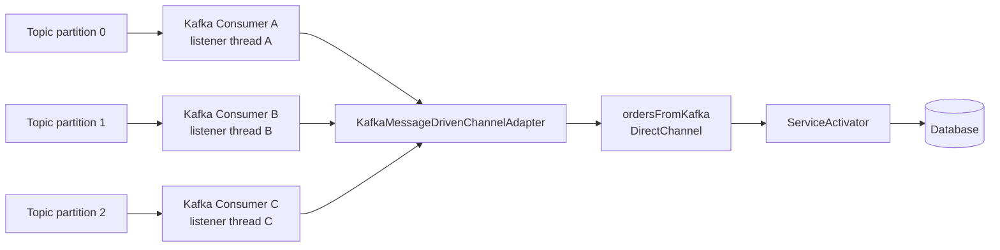
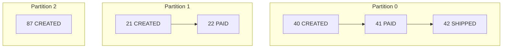
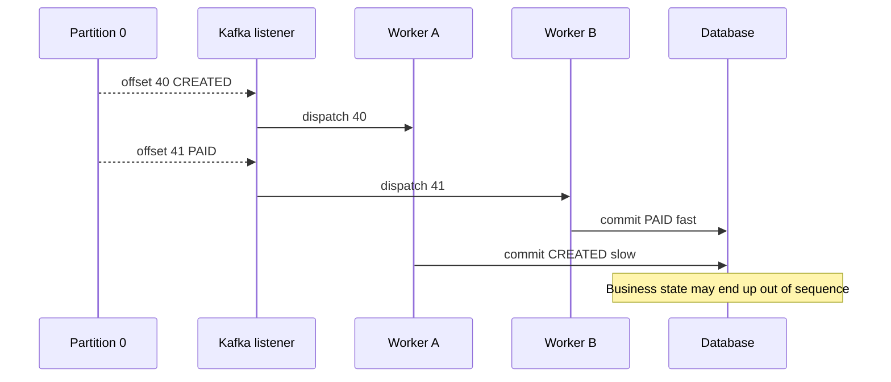
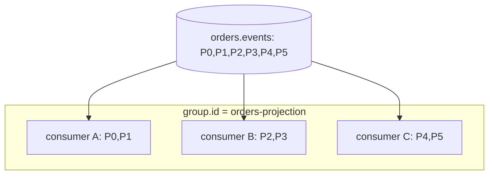
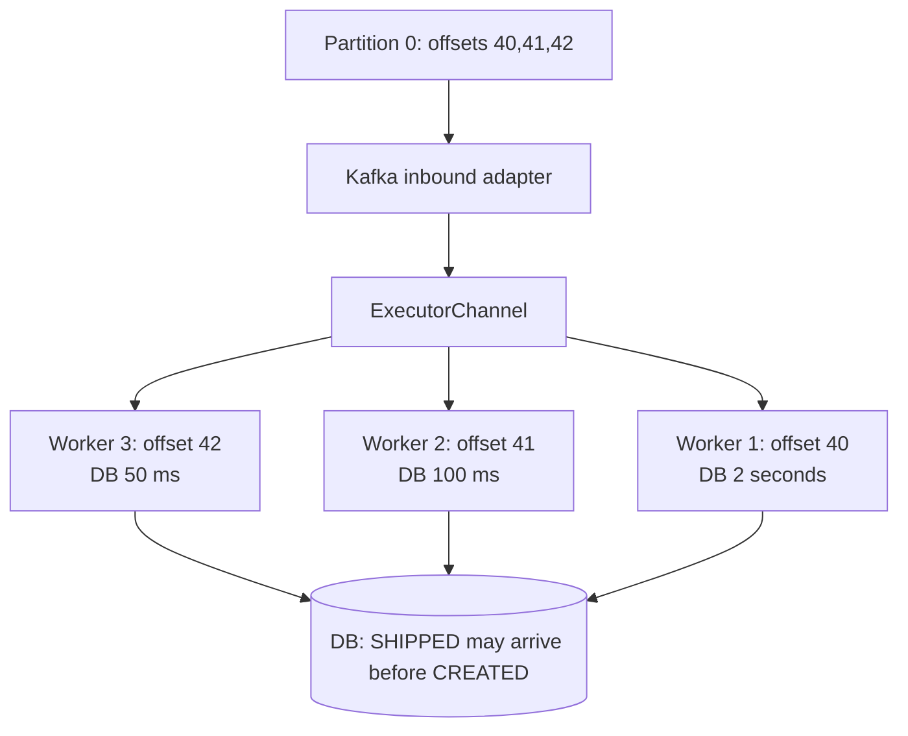
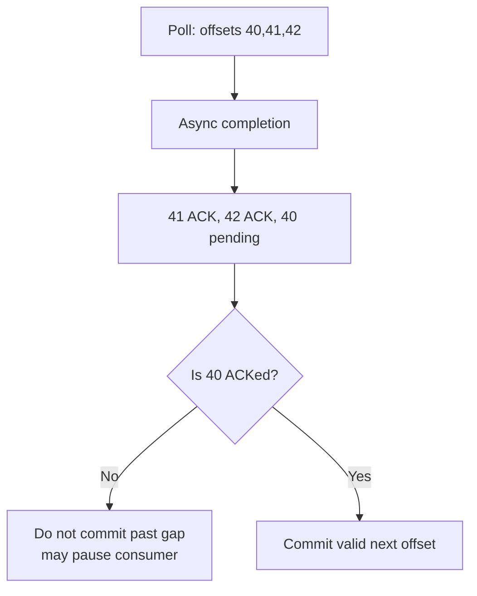
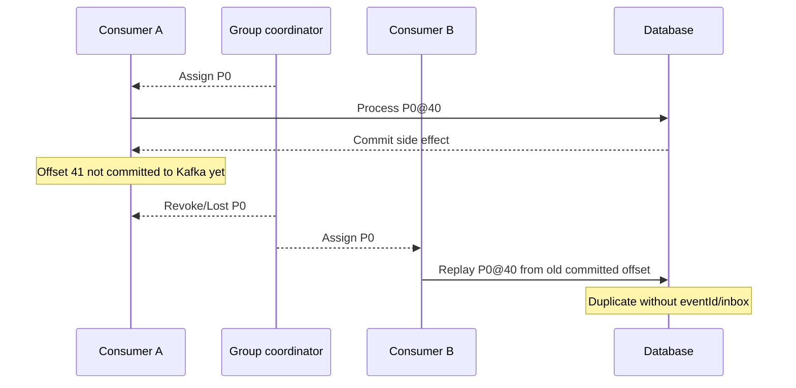
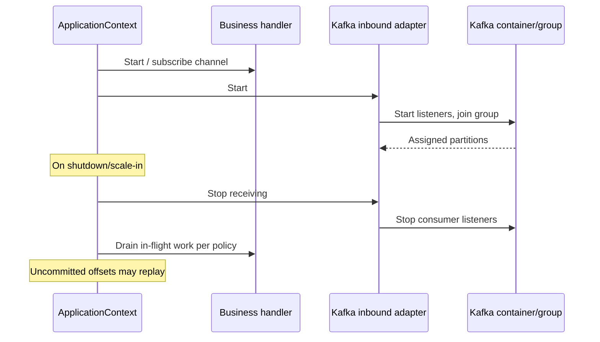

# Concurrency and ordering within a partition

**Concurrency** in Kafka is the ability for multiple consumers to process data in parallel; **in-partition ordering** is the property that Kafka stores records by offset within **a single** partition. The two do not contradict each other: you can raise total throughput by processing **multiple partitions in parallel** while preserving order inside each partition. Problems arise when an application misunderstands the unit of parallelism, routes the same aggregate across multiple partitions, or hands messages off to worker threads so **side-effect execution order** diverges from Kafka record order.

This lesson belongs to the **Kafka Adapter** chapter of the **SPRING_INTEGRATION_ADAPTERS** module. The module connects external systems via inbound/outbound adapters, gateways, pollers, and `MessageChannel`, practicing with files, SFTP, HTTP, JMS, AMQP, Kafka, databases, and message contract, error, and lifecycle concerns. The focus here is Kafka consumer groups, partition assignment, `ConcurrentMessageListenerContainer`, and `KafkaMessageDrivenChannelAdapter`, especially when Spring Integration connects Kafka inbound to JDBC/HTTP/SFTP/JMS/AMQP or Kafka outbound.

> **Principle:** Kafka guarantees records inside **one partition log are ordered by offset**. It does **not** automatically guarantee global order across partitions, that multiple business producers emit events in causal business order, or that downstream workers complete side effects in order. **Increasing `concurrency` does not create more partitions.**

## 1. Learning outcomes

After this lesson, you will be able to:

1. Distinguish partition count, consumers in a group, `concurrency` per pod, and pod count in a deployment.
2. Explain how a Kafka producer uses keys to select partitions and the limits of per-key ordering.
3. Describe how `ConcurrentMessageListenerContainer` creates child listener containers, threads, and assignments per Kafka consumer.
4. Compute useful parallelism for a topic and spot idle consumers and hot partitions.
5. Configure Spring Boot + Spring Integration Kafka inbound adapter with record mode and `DirectChannel`.
6. Compare ordering under `DirectChannel` against `ExecutorChannel`, `QueueChannel`, and `PublishSubscribeChannel`.
7. Understand `AckMode.RECORD`, manual acknowledgment, `asyncAcks`, and the interplay among ordering, redelivery, and durability.
8. Predict the effects of rebalances, rolling deployments, static membership, blocking handlers, and `max.poll.interval.ms`.
9. Use keys/aggregate versions, idempotency, and database concurrency controls to protect business ordering.
10. Monitor per-partition lag, assignments, throughput, retries, and reordering, and test crash/rebalance windows.

## 2. Four distinct concurrency layers



| Layer | Resource / decision | Type of parallelism |
|---|---|---|
| **Kafka topic** | Number of `partitions` | Unit of log/ordering and load division |
| **Kafka consumer group** | Number of consumer members sharing `group.id` | Multiple consumers receiving distinct partitions |
| **Spring Kafka container** | `ConcurrentMessageListenerContainer.setConcurrency(N)` | Up to N child Kafka consumers in one container |
| **Spring Integration channel** | `DirectChannel`, `ExecutorChannel`, `QueueChannel` | Synchronous or asynchronous boundary between adapter and business handler |
| **Business/storage** | JDBC pool, HTTP limits, SFTP sessions, service threads | Real capacity to execute side effects |

A system can have 12 partitions and 12 Kafka consumer threads yet **only one JDBC connection** available. In that case the real bottleneck is JDBC; adding consumers increases queueing, contention, or lag rather than sustainable throughput.

### 2.1. Kafka and Spring terminology

| Term | Meaning | What it is NOT |
|---|---|---|
| `topic` | Logical record stream composed of partitions | A globally ordered queue |
| `partition` | Log ordered by monotonically increasing offsets | A permanently pinned Java thread |
| `consumer` | Kafka client participating in polling and assignment | A Spring `MessageHandler` |
| `group.id` | Logical subscriber, group offsets, and partition distribution | A Spring message ID |
| `KafkaMessageListenerContainer` | Container receiving callbacks on one Kafka consumer thread | A Spring Integration `PollingConsumer` |
| `ConcurrentMessageListenerContainer` | Manages multiple child listener containers | Something that creates extra Kafka partitions |
| `KafkaMessageDrivenChannelAdapter` | Kafka inbound → Spring `MessageChannel` | A Kafka producer |
| `DirectChannel` | Dispatches handler synchronously on the caller thread | A durable queue |
| `ExecutorChannel` | Dispatches Spring messages via an executor | Kafka partition assignment |
| `QueueChannel` | Internal message queue requiring a poller to consume | A durable Kafka log by default |

## 3. Where exactly does Kafka guarantee ordering?

Suppose topic `orders.events` has three partitions:

```text
Partition 0:
  offset 40: ORD-101 CREATED
  offset 41: ORD-101 PAID
  offset 42: ORD-101 SHIPPED

Partition 1:
  offset 21: ORD-202 CREATED
  offset 22: ORD-202 PAID

Partition 2:
  offset 87: ORD-303 CREATED
```

Within **partition 0**, the log order is `40 → 41 → 42`. Kafka defines no absolute temporal order between `P0@41` and `P1@22`.



**Limits to state explicitly:**

1. Offsets are **local to each partition**; never compare offsets from two partitions directly to order events.
2. Kafka appends records to a partition log in the order accepted by the broker; this may not match **business origination order** when multiple producers publish concurrently.
3. When a consumer runs synchronously on one thread, callbacks per partition execute in offset order; yet external side effects can still fail, time out, or be pushed to async workers by the application.
4. If a record was processed but its offset did not commit, Kafka can redeliver it after a crash/rebalance. **Redelivery** does not mean the partition log was reordered.
5. When events for the same business entity cross **multiple topics/partitions**, Kafka maintains no shared order across them.

### 3.1. Receive order and completion order are not the same



In this example, **Kafka did not violate log ordering**. An `ExecutorChannel`/thread pool or asynchronous logic allowed offset 41's side effect to finish before offset 40's.

## 4. Producer keys and splitting business aggregates

Kafka typically uses the **record key** to select a partition. With matching serializers/partitioners and a stable partition count, the same key consistently lands in the same partition.

```java
// Java snippet: kafkaTemplate variable injected from Spring Kafka.
kafkaTemplate.send(
        "orders.events",
        "ORD-101", // Kafka key: orderId
        "{\"eventId\":\"evt-100\",\"type\":\"CREATED\"}");

kafkaTemplate.send(
        "orders.events",
        "ORD-101",
        "{\"eventId\":\"evt-101\",\"type\":\"PAID\"}");
```

Using `orderId` as the key lets events for the same order be consumed in partition order within **one group**, provided producers emit in logical order, partitioning stays consistent, and downstream preserves execution order.

| Business event | Kafka key to consider | Rationale |
|---|---|---|
| `OrderCreated/OrderPaid` | `orderId` | Keeps changes to the same order in one partition |
| `AccountCredited/Debited` | `accountId` | Serializes updates to a single account |
| `InventoryReserved/Released` | `skuId` or `warehouseId+skuId` | Avoids contention updating the same stock aggregate |
| `TenantCreated/Updated` | `tenantId` | Preserves per-tenant ordering when needed |
| Independent telemetry | Device key or null | Prioritizes load spreading with separate contracts |

### 4.1. Do not use `eventId` as the Kafka key if you want `orderId` ordering

If every event has a unique `eventId`, `hash(eventId)` spreads them across different partitions, breaking per-order single-partition ordering.

Conversely, setting **every** system event to one fixed key funnels all load into **one hot partition**, so adding partitions or consumers cannot scale throughput for that key.

### 4.2. Changing partition counts can change key → partition mapping

Many partitioners compute `hash(key)` modulo partition count to pick a destination. When **increasing partition counts**, a key can map to a different partition on subsequent sends. Older records for that key stay in partition A while new records land in partition B, with **no cross-partition ordering guarantee**.

Never increase partitions casually in systems requiring strict per-aggregate ordering. Test partitioning strategies, schedule migrations, drain/cut over cleanly, or design aggregate versioning.

### 4.3. Idempotent producer vs. business ordering

`enable.idempotence=true` helps a Kafka producer prevent certain retry-induced duplicates/reordering **within the producer session and Kafka client constraints**. Related settings include `acks=all`, `retries>0`, and version-appropriate `max.in.flight.requests.per.connection` limits (typically <= 5 when idempotence is enabled).

However:

- Two independent microservices publishing key `ORD-101` can race and emit `PAID` before `CREATED`.
- HTTP retries can emit the same business event again at a new offset.
- A transaction/outbox dispatcher can replay old events after a restart.
- Producer idempotence does not replace `eventId`, aggregate versions, or consumer inboxes.

**Preserving Kafka partition order** and **preserving domain event order** are two separate problems.

## 5. Consumer groups: a partition has one owner per group

In the traditional consumer group model, Kafka assigns each partition to at most one consumer member of **the same group** at a time.



With **two consumer groups**:

```text
group orders-projection -> reads P0..P5 with its own offsets
group orders-audit      -> also reads P0..P5 with its own offsets
```

Two groups **do not share work for one logical subscriber**; they are two independent logical subscribers, each maintaining its own committed offsets. That is the right model when one service builds a projection DB and another handles auditing.

### 5.1. Partitions can change owners on rebalance

Ownership is not permanent: Kafka can reassign P0 from consumer A to consumer B after scale-out, restarts, timeouts, or rebalances. Upon transfer, the new consumer resumes from committed offsets per policy; records with already-executed side effects but uncommitted Kafka offsets can be redelivered.

**Never** assume "an order is processed only once because P0 has only one consumer at any moment." At-least-once delivery and failure windows still apply.

### 5.2. Special case: explicit assignment

If a container is constructed with `ContainerProperties(new TopicPartitionOffset(...))`, the application **assigns partitions explicitly** instead of using topic subscription and group coordinator balancing.

Multiple instances can accidentally configure the same partition. This is not a safe way to "pin keys" without custom ownership/failover orchestration. For most cloud deployments, use **topic subscription + group management**.

## 6. Calculating useful concurrency

Suppose a topic has `P=12` partitions, deployed across `I=3` pods, each with `C=2` Kafka consumer threads.

```text
Total theoretical consumers = I × C = 3 × 2 = 6
Topic partition count = 12
=> Can have 6 consumer members receiving 12 partitions
=> Average ~2 partitions/consumer if assignment is relatively even
```

If scaled to `I=6` pods, each with `C=2`:

```text
I × C = 6 × 2 = 12 consumers
=> Can have 12 consumers owning 12 partitions
=> Average ~1 partition/consumer
```

If scaled to `I=8` pods, each with `C=2`:

```text
I × C = 16 consumers
P = 12 partitions
=> At most 12 consumers hold partitions of this topic
=> At least 4 consumers hold no partitions of this topic
```

This is an **estimate for one topic** when all consumers in the group subscribe to that topic. With multiple topics and specific assignors, idle members vary; a consumer holding no partitions **of this topic** may still hold partitions from another topic.

### 6.1. Practical formula

```text
Consumers created by deployment ≈ number of pods × concurrency per pod

Maximum partition-level parallelism for ONE topic
    ≤ min(consumers in group, partitions in topic)

Final sustainable throughput
    ≤ min(Kafka ingest/consume capacity,
          downstream DB/HTTP/service capacity,
          network/CPU/schema cost,
          skew of hot partitions)
```

This formula cannot predict exact throughput when partitions are heavily skewed. One hot partition carrying 80% of traffic is still handled by **one consumer owner**; adding idle consumers cannot split that single partition across multiple owners in the same group.

### 6.2. Quick capacity table

| Partitions | Pods × concurrency | Consumer threads | Active consumers for topic (max) | Notes |
|---:|---:|---:|---:|---|
| 3 | 1 × 1 | 1 | 1 | One thread reads all three partitions |
| 3 | 1 × 3 | 3 | 3 | One partition/consumer if balanced |
| 3 | 2 × 3 | 6 | 3 | Three excess consumers for this topic |
| 6 | 3 × 2 | 6 | 6 | Reaches partition-level parallelism cap |
| 12 | 3 × 2 | 6 | 6 | Each consumer can read multiple partitions |
| 12 | 6 × 2 | 12 | 12 | Maximum parallelism for the topic |
| 12 | 8 × 2 | 16 | 12 | Adding threads does not create partitions |

## 7. How does `ConcurrentMessageListenerContainer` implement concurrency?

`ConcurrentMessageListenerContainer<K,V>` spawns child `KafkaMessageListenerContainer` instances. Each child container owns one Kafka consumer and runs listener callbacks on its own Kafka consumer thread.

```text
ConcurrentMessageListenerContainer concurrency=3
 |
 +-- KafkaMessageListenerContainer child-0
 |       consumer-0 thread -> partitions P0,P3
 |
 +-- KafkaMessageListenerContainer child-1
 |       consumer-1 thread -> partitions P1,P4
 |
 +-- KafkaMessageListenerContainer child-2
         consumer-2 thread -> partitions P2,P5
```

**Assignments above are illustrative**; assignors may distribute differently. One child consumer can hold **multiple partitions**, and one poll can return records from multiple partitions.

### 7.1. Java API

```java
ContainerProperties cp = new ContainerProperties("orders.events");
cp.setAckMode(ContainerProperties.AckMode.RECORD);

ConcurrentMessageListenerContainer<String, String> container =
        new ConcurrentMessageListenerContainer<>(consumerFactory, cp);

// Three child Kafka consumers (when group/topic allows).
container.setConcurrency(3);
```

Never write `container.setConcurrency(3)` expecting 3 copies of every record. Within one group, Kafka splits partitions; each record goes to one owner per assignment, aside from retries/redeliveries or other consumption patterns.

### 7.2. The container does not spawn three business threads behind the channel

When the adapter uses `DirectChannel`, the handler runs **on the dispatching listener thread itself**. Three consumers can invoke the same singleton handler bean concurrently from three threads, so the handler and its dependencies must be **thread-safe**.

Even though each partition is assigned to one thread, a `@Component` can be invoked concurrently across multiple partitions. Never keep unsynchronized mutable fields such as `currentOrderId`, `lastOffset`, or a shared `ArrayList` on a singleton handler assuming per-partition ordering protects them.

## 8. Complete Spring Boot + Spring Integration example

We build a Kafka inbound flow reading records from `orders.events` with up to three Kafka consumer threads, emitting to a Spring `DirectChannel` and invoking a service activator.

### 8.1. Dependencies

Java 17+; use a Spring Boot BOM managing compatible Spring Kafka/Spring Integration versions:

```xml
<dependency>
    <groupId>org.springframework.boot</groupId>
    <artifactId>spring-boot-starter-integration</artifactId>
</dependency>
<dependency>
    <groupId>org.springframework.integration</groupId>
    <artifactId>spring-integration-kafka</artifactId>
</dependency>
```

If persisting to a real DB, add JDBC starter/driver or Spring Data as appropriate. The demo handler only logs metadata and requires no database.

### 8.2. application.properties

```properties
demo.kafka.bootstrap-servers=localhost:9092
demo.kafka.group-id=orders-concurrency-demo
demo.kafka.concurrency=3
```

Demo brokers/topics/groups must stay in a lab environment; never point a test consumer group at a production topic without authorization and a reset/replay plan.

### 8.3. Consumer factory and adapter

```java
package com.example.kafka;

import java.util.HashMap;
import java.util.Map;

import org.apache.kafka.clients.consumer.ConsumerConfig;
import org.apache.kafka.common.serialization.StringDeserializer;

import org.springframework.beans.factory.annotation.Qualifier;
import org.springframework.beans.factory.annotation.Value;
import org.springframework.context.annotation.Bean;
import org.springframework.context.annotation.Configuration;
import org.springframework.integration.channel.DirectChannel;
import org.springframework.integration.config.EnableIntegration;
import org.springframework.integration.kafka.inbound.KafkaMessageDrivenChannelAdapter;

import org.springframework.kafka.core.ConsumerFactory;
import org.springframework.kafka.core.DefaultKafkaConsumerFactory;
import org.springframework.kafka.listener.ConcurrentMessageListenerContainer;
import org.springframework.kafka.listener.ContainerProperties;

import org.springframework.messaging.MessageChannel;

@Configuration
@EnableIntegration
public class OrdersKafkaConcurrencyConfig {

    @Bean("ordersConsumerFactory")
    public ConsumerFactory<String, String> ordersConsumerFactory(
            @Value("${demo.kafka.bootstrap-servers}") String brokers,
            @Value("${demo.kafka.group-id}") String groupId) {

        Map<String, Object> props = new HashMap<>();
        props.put(ConsumerConfig.BOOTSTRAP_SERVERS_CONFIG, brokers);
        props.put(ConsumerConfig.GROUP_ID_CONFIG, groupId);
        props.put(ConsumerConfig.KEY_DESERIALIZER_CLASS_CONFIG,
                StringDeserializer.class);
        props.put(ConsumerConfig.VALUE_DESERIALIZER_CLASS_CONFIG,
                StringDeserializer.class);

        // Container-managed commits, no timer-based auto-commit.
        props.put(ConsumerConfig.ENABLE_AUTO_COMMIT_CONFIG, false);
        props.put(ConsumerConfig.AUTO_OFFSET_RESET_CONFIG, "earliest");
        props.put(ConsumerConfig.MAX_POLL_RECORDS_CONFIG, 200);
        props.put(ConsumerConfig.CLIENT_ID_CONFIG, "orders-inbound");

        return new DefaultKafkaConsumerFactory<>(props);
    }

    @Bean("ordersFromKafka")
    public MessageChannel ordersFromKafka() {
        return new DirectChannel();
    }

    @Bean("ordersKafkaInboundAdapter")
    public KafkaMessageDrivenChannelAdapter<String, String> kafkaInbound(
            @Qualifier("ordersConsumerFactory")
                ConsumerFactory<String, String> factory,
            @Qualifier("ordersFromKafka")
                MessageChannel output,
            @Value("${demo.kafka.concurrency:3}") int concurrency) {

        ContainerProperties containerProps =
                new ContainerProperties("orders.events");
        containerProps.setAckMode(
                ContainerProperties.AckMode.RECORD);
        containerProps.setSyncCommits(true);

        ConcurrentMessageListenerContainer<String, String> container =
                new ConcurrentMessageListenerContainer<>(
                        factory, containerProps);
        container.setConcurrency(concurrency);

        KafkaMessageDrivenChannelAdapter<String, String> adapter =
                new KafkaMessageDrivenChannelAdapter<>(
                    container,
                    KafkaMessageDrivenChannelAdapter.ListenerMode.record);

        adapter.setOutputChannel(output);
        adapter.setAutoStartup(true);

        return adapter;
    }
}
```

### 8.4. Reading each decision

1. `ENABLE_AUTO_COMMIT_CONFIG=false`: prevents Kafka client timer-based auto-commits; container manages commits.
2. `AUTO_OFFSET_RESET_CONFIG=earliest`: applies only when **no valid committed offset exists** or reset conditions trigger, not replaying from the start on every restart.
3. `MAX_POLL_RECORDS_CONFIG=200`: caps one `poll()`; does not spawn extra threads.
4. `CLIENT_ID_CONFIG`: identifies Kafka clients/metrics; concurrent children typically receive suffixes to distinguish them; not a group ID.
5. `AckMode.RECORD`: container decides commits on successful record callbacks; not a DB transaction.
6. `ListenerMode.record`: adapter emits one Spring message per `ConsumerRecord`.
7. `concurrency`: number of child Kafka consumers, **not** number of Kafka partitions.
8. `DirectChannel`: synchronous handler; exceptions can return to the Kafka container if not recovered/suppressed elsewhere.
9. `ordersFromKafka` is the **Kafka inbound adapter's output channel**, not a Kafka topic.
10. `@EnableIntegration` activates Spring Integration components; add `@SpringBootApplication` in `com.example.kafka` or a parent package.

### 8.5. Service activator and thread identity

```java
package com.example.kafka;

import org.springframework.integration.annotation.ServiceActivator;
import org.springframework.kafka.support.KafkaHeaders;
import org.springframework.messaging.Message;
import org.springframework.stereotype.Component;

@Component
public class OrdersKafkaEventHandler {

    @ServiceActivator(inputChannel = "ordersFromKafka")
    public void onEvent(Message<String> message) {

        String payload = message.getPayload();

        String key = message.getHeaders().get(
                KafkaHeaders.RECEIVED_KEY, String.class);
        Object partition = message.getHeaders().get(
                KafkaHeaders.RECEIVED_PARTITION);
        Object offset = message.getHeaders().get(
                KafkaHeaders.OFFSET);

        if (payload.isBlank()) {
            throw new IllegalArgumentException(
                    "Empty event payload");
        }

        System.out.printf(
                "thread=%s key=%s part=%s offset=%s payload=%s%n",
                Thread.currentThread().getName(),
                key, partition, offset, payload);

        // Production: call service with @Transactional + idempotency.
    }
}
```

This handler stays **stateless**: all state lives in local variables, with no `lastSeenOffset` stored in a singleton field. Payload logging is for learning; production requires structured logging minimizing PII/tokens.

With three consumers and one handler bean, you will see multiple thread names invoking the same method. **Within each partition**, Kafka record order holds; **across the topic**, log lines can interleave across partitions.

## 9. Sending keyed Kafka records to observe ordering

To ensure events for the same order generally land in one partition, the producer must use key `orderId`.

### 9.1. Kafka console producer

```bash
kafka-topics.sh \
  --bootstrap-server localhost:9092 \
  --create --if-not-exists \
  --topic orders.events --partitions 6 --replication-factor 1

kafka-console-producer.sh \
  --bootstrap-server localhost:9092 \
  --topic orders.events \
  --property parse.key=true \
  --property key.separator=:
```

Enter:

```text
ORD-101:evt-101|ORD-101|CREATED
ORD-202:evt-102|ORD-202|CREATED
ORD-101:evt-103|ORD-101|PAID
ORD-202:evt-104|ORD-202|PAID
ORD-101:evt-105|ORD-101|SHIPPED
```

When events for the same order are sent sequentially, producer partitioning is stable, and topic partitions do not change, records with `key=ORD-101` consistently land in the same partition.

**Do not** equate console line entry order with an absolute business-sequence guarantee when real applications run multiple producer instances or concurrent request threads.

### 9.2. Inspecting assignments with Kafka CLI

```bash
kafka-consumer-groups.sh \
  --bootstrap-server localhost:9092 \
  --describe --group orders-concurrency-demo

kafka-consumer-groups.sh \
  --bootstrap-server localhost:9092 \
  --describe --group orders-concurrency-demo \
  --members --verbose
```

Record group members, client IDs, assigned partitions, committed offsets, and lag. Mid-rebalance, displayed assignments/lag can shift temporarily.

### 9.3. Scaling concurrency up and down in the lab

Try running:

- `demo.kafka.concurrency=1`: one consumer thread reads multiple partitions.
- `demo.kafka.concurrency=3`: splits six partitions across three consumers.
- `demo.kafka.concurrency=8`: on a six-partition topic, at most six consumers receive topic assignments; the remaining two stay idle for this topic.

To measure on the **exact same dataset** across runs, use separate group IDs or reset offsets in a verified lab environment; never casually reset production offsets.

## 10. How does Spring Integration `DirectChannel` preserve ordering?

`DirectChannel` dispatches **on the thread calling `send()`**. In the flow:

```text
Kafka consumer thread for P0
  -> KafkaMessageDrivenChannelAdapter
  -> DirectChannel.send(...)
  -> @ServiceActivator
  -> JDBC service (synchronous)
  -> return / exception
  -> Kafka listener callback completes
  -> container AckMode/error policy
```

Provided the handler **does not offload work to another thread**, record callbacks handled by the same consumer run sequentially; the same partition preserves dispatch and **callback completion order**. Different partitions can execute in parallel on separate consumer threads.

### 10.1. Missing conditions needed for business ordering

- Producers must emit events in proper causal/business sequence per aggregate.
- Key and partition mappings must stay consistent.
- Handlers/DB transactions must run sequentially per callback without hidden async offloads.
- On retries/redeliveries, side effects must be idempotent and duplicate-tolerant.
- When multiple topics or microservices mutate the same aggregate, enforce versions/locking even if individual Kafka partitions are ordered.

`DirectChannel` does not automatically solve optimistic locking, transaction rollbacks, or synchronization between two producer services.

### 10.2. `DirectChannel` does not have "its own single worker thread"

It invokes handlers on the caller thread, not a global single-threaded Spring event loop. With `concurrency=3`, **the same handler bean** can be invoked concurrently by three Kafka listener threads, each handling its assigned partitions.

Therefore, singleton `@Component`s must be **stateless or thread-safe**. With mutable caches, enforce per-partition/aggregate thread confinement or proper synchronization—never assume one handler bean equals one thread.

## 11. `ExecutorChannel` can break completion ordering

`ExecutorChannel` hands work off to an `Executor`:



The listener receives offsets `40,41,42` in order, yet when dispatching to an executor:

- `send()` only proves **the task was accepted**.
- The Kafka listener callback can return before JDBC/HTTP completes.
- The container can commit offsets before side effects finish, especially with `AckMode.RECORD`/`BATCH`.
- Tasks sharing a key can complete out of order.
- On JVM death, unfinished tasks can vanish without a durable handoff.

### 11.1. Do not rely on pool size=1 as a universal fix

An `ExecutorChannel` with a single worker can preserve internal submission order if its queue is FIFO, yet:

1. It still **switches threads**, allowing Kafka callbacks to return early.
2. An in-memory queue still does not survive restarts.
3. One global worker serializes even independent partitions.
4. When multiple producers submit to the same executor, submission order does not prove business order.

For at-least-once guarantees with a DB, use **acks tied to durable processing completion** or a durable handoff with explicit transactions.

### 11.2. Keeping parallelism while preserving per-key ordering

One design uses a `keyed executor` where each aggregate key enters a serial lane:

```text
Order key ORD-101 -> lane A -> sequential processing
Order key ORD-202 -> lane B -> sequential processing
Order key ORD-303 -> lane C -> sequential processing
```

However, keyed lanes only guard ordering **inside the executor**. They do **not automatically couple Kafka offset commits** to DB completion, recover in-memory tasks on crash, or stop producers from emitting out-of-version events.

Pair this with **backpressure, durable queues or ack barriers**, and restart/rebalance integration tests.

## 12. `QueueChannel`, `PublishSubscribeChannel`, and durability

### 12.1. `QueueChannel`

```text
Kafka listener thread
  -> adapter.send(message)
  -> QueueChannel.enqueue(message) [succeeds]
  -> callback returns / offset may commit

Later:
  -> PollingConsumer.dequeue()
  -> DB handler
```

If `QueueChannel` uses an in-memory queue, crashing after Kafka offset commit but before the DB transaction **loses business messages**, even when Kafka consumer lag reads 0.

**Never use a RAM queue as a durable handoff.** To decouple Kafka ingestion from slow processing, use a persistent message store, a durable broker queue, or an inbox/outbox structure—guarding the offset commit window relative to enqueue/DB writes.

### 12.2. `PublishSubscribeChannel`

`PublishSubscribeChannel` fans out a Spring message to multiple subscribers in the same process. Internal subscribers **do not have independent Kafka committed offsets**.

If one branch calls HTTP and another writes JDBC, decide whether **both branches or only one** govern Kafka record completion. With async publish-subscribe, a subscriber failure can happen after the listener callback returns, requiring explicit durability and recovery strategies.

When two processing paths need independent failure isolation and replayability, **two separate Kafka consumer groups** are usually easier to manage for high durability than internal fan-out.

## 13. Acknowledgment, offsets, and ordering

A Kafka committed offset per `topic + partition + group.id` represents the **next offset to resume from**. If partition 0 has offsets `40,41,42` and processing succeeded contiguously through 42, the committed next offset is normally 43.

### 13.1. `AckMode.RECORD`

In a synchronous record listener, `AckMode.RECORD` commits per successful record callback:

```text
P0@40 -> handler completes -> container commits next offset 41
P0@41 -> handler completes -> container commits next offset 42
P0@42 -> handler completes -> container commits next offset 43
```

Commits can fail or be affected by retries/rebalances. A successful callback does not prove the DB committed if the handler merely queued async work.

### 13.2. `AckMode.BATCH`

Even when `KafkaMessageDrivenChannelAdapter.ListenerMode.record` dispatches Spring messages **one by one**, the container can use `AckMode.BATCH` to commit once all records from a `poll()` finish.

**Adapter mode** and **container `AckMode`** are independent settings. Never assume picking a record listener forces the Kafka container into `AckMode.RECORD`.

### 13.3. `MANUAL`, `MANUAL_IMMEDIATE`

With manual ack, handlers retrieve `Acknowledgment` from `KafkaHeaders.ACKNOWLEDGMENT`:

```java
Acknowledgment ack = message.getHeaders().get(
        KafkaHeaders.ACKNOWLEDGMENT,
        Acknowledgment.class);

if (ack == null) {
    throw new IllegalStateException(
            "Manual AckMode required");
}

transactionalService.applyIdempotently(message.getPayload());
ack.acknowledge();
```

This snippet assumes `transactionalService` is **another transactional bean**; `applyIdempotently()` commits the DB before returning through the Spring transaction proxy. Never call `ack()` **inside a `@Transactional` method body** assuming the DB already committed, because the DB transaction normally commits **after the method body returns**.

`MANUAL_IMMEDIATE` has immediate-commit semantics when called **on the Kafka listener/consumer thread**; acks from worker threads may be queued by the container. Never pass `KafkaConsumer` objects to other threads to call `commit/seek`; Kafka consumers are not thread-safe.

### 13.4. `asyncAcks` and out-of-order acks

Spring Kafka supports `asyncAcks=true` (with manual ack modes), allowing acks for records from the same poll to arrive **out of order**, while the container **defers commits** until gaps are filled—potentially pausing the consumer while waiting.



`asyncAcks` **does not** provide a durable queue, does not guarantee business ordering, and widens duplicate windows on crashes. Spring Kafka docs disallow `nack()` when `asyncAcks` is enabled.

### 13.5. There is no safe "commit past a gap"

If offset 40 is unfinished while 41 and 42 succeeded, committing next offset 43 would cause the Kafka group to **skip 40** after a restart. Any parallel ack scheme must therefore preserve contiguous per-partition prefix progress.

That is why per-record parallelization without an offset barrier is hazardous even if headline throughput appears higher.

## 14. Transactions and idempotency to protect business ordering

Kafka preserves log order, yet cannot atomically commit **both Kafka offsets and a database** using an ordinary JDBC transaction alone.

### 14.1. Failure windows

| Moment | DB side effect | Kafka offset | Consequence |
|---|---|---|---|
| Before handler starts | None | Unchanged | Can be redelivered |
| After DB commit, before Kafka commit | Present | Old | Record may replay → needs idempotency |
| After Kafka commit, before DB commit (premature ack) | Uncertain | Advanced | **Can lose business data** |
| After both commit | Present | Advanced | Normal, though not atomic for subsequent steps |
| Rebalance while old consumer still in-flight | Can race | Assignment shifted | Needs version/concurrency control |

### 14.2. Using business `eventId`

A minimal inbox pattern:

```sql
CREATE TABLE processed_events (
    event_id VARCHAR(128) PRIMARY KEY,
    aggregate_id VARCHAR(128) NOT NULL,
    processed_at TIMESTAMP NOT NULL DEFAULT CURRENT_TIMESTAMP
);
```

Inside the **same DB transaction** as the side effect, insert `eventId` under a unique constraint; on Kafka redelivery, skip already-processed events. Guard side effects with aggregate versions in case stale events arrive late.

```java
// PostgreSQL pseudocode inside @Transactional service.
int claimed = jdbc.update(
    "INSERT INTO processed_events(event_id, aggregate_id) "
    + "VALUES (?, ?) ON CONFLICT (event_id) DO NOTHING",
    eventId, orderId);

if (claimed == 0) {
    return; // duplicate already committed earlier
}
jdbc.update(
    "UPDATE orders SET status = ? WHERE order_id = ?",
    nextStatus, orderId);
```

In production, order updates should validate `version`/state transitions rather than overwriting blindly: a `PAID` event from another producer could arrive before `CREATED` even with the right Kafka key.

### 14.3. Aggregate versioning

```sql
-- Optimistic locking idea:
UPDATE orders
SET status = :new_status, version = :incoming_version
WHERE order_id = :order_id
  AND version = :incoming_version - 1;
```

If affected rows = 0, it could be a duplicate, out-of-order event, or missing order; classify before retrying or sending to a DLT. This SQL illustrates a monotonically incrementing aggregate version; handle initial create/upsert and appropriate transaction isolation.

### 14.4. Kafka transactions do not span databases

Kafka transactional consume–transform–produce coordinates Kafka output records with source offsets inside a Kafka transaction. It **does not** pull JDBC, HTTP, SFTP, JMS, or AMQP into an atomic Kafka transaction. For Kafka → DB, use an idempotent consumer/inbox; for DB → Kafka, consider a transactional outbox.

## 15. How do rebalances affect ordering?



Rebalances can occur during:

- Scaling pods up/down or rolling deploys.
- Consumer crashes or network partitions.
- Slow handlers exceeding `max.poll.interval.ms`.
- Topic metadata, assignor, or group membership changes.
- Inconsistent static membership configurations.

Kafka still preserves partition log order, yet **business side effects** can duplicate or contend if an old consumer is still finishing work while a new consumer starts under the new assignment.

### 15.1. `ConsumerAwareRebalanceListener`

Spring Kafka exposes callbacks:

- `onPartitionsAssigned(...)`: consumer just received partitions.
- `onPartitionsRevokedBeforeCommit(...)` / `onPartitionsRevokedAfterCommit(...)`: revocation notifications.
- `onPartitionsLost(...)`: consumer already lost partition ownership.

Never commit offsets for **lost** partitions as if the consumer still owned them. Avoid long-blocking JDBC/HTTP work inside callbacks. When keeping per-partition local state, clean up/invalidate caches and record metrics.

### 15.2. Cooperative vs. eager rebalances

- **Eager**: members may revoke all partitions together before reassignment.
- **Cooperative/incremental**: minimizes unnecessary revocations, improving continuity across membership changes.
- Exact behavior depends on group protocol, client/cluster versions, and assignment configuration.

Never enable a cooperative assignor and assume replays/duplicates cannot occur. Offset commits, side effects, and retries still have failure windows.

### 15.3. Static membership

`group.instance.id` lets Kafka recognize a stable member across brief restarts; Spring Kafka's concurrent container applies suffix rules for child consumers when static membership is configured appropriately.

- IDs must be **unique among live members**; never share the same ID across pods.
- Static membership reduces unnecessary rebalances at the cost of slower failover if a member truly dies.
- Never use it in place of idempotency, version checks, or graceful shutdown.

### 15.4. Re-reading from committed offsets

Kafka groups store the **next committed offset** per partition. When P0 processed offset 40 without committing next offset 41, the new consumer may re-read 40. That is normal at-least-once redelivery, **not Kafka reordering its log**.

## 16. Assignment strategies and multiple topics

In the classic consumer group protocol, common assignors include:

| Assignor | Idea | Risks / things to monitor |
|---|---|---|
| `RangeAssignor` | Splits partition ranges per topic | Across multiple topics and many consumers, can leave members idle despite high total partitions |
| `RoundRobinAssignor` | Distributes partitions round-robin | Often spreads more evenly; may cause more partition movement |
| `StickyAssignor` | Keeps assignments stable across rebalances | Balances load while reducing movement |
| `CooperativeStickyAssignor` | Sticky + incremental cooperative | Reduces simultaneous partition revocations |

**Official Spring Kafka example:** with three topics of five partitions each and `concurrency=15`, `RangeAssignor`'s per-topic split can leave only **five** active consumers—each holding three partitions—while ten consumers sit idle. `RoundRobinAssignor` can spread the 15 partitions more broadly. With the newer `group.protocol=consumer`, server-side assignment and related settings differ from `classic`; do not mechanically apply old assignor assumptions.

### 16.1. Configuring strategy in the consumer factory

```java
// In consumer config when using the classic group protocol
// and a Kafka client version supporting this assignor.
props.put(
    ConsumerConfig.PARTITION_ASSIGNMENT_STRATEGY_CONFIG,
    org.apache.kafka.clients.consumer.CooperativeStickyAssignor.class);
```

This is **one option**: do not mix incompatible assignors across members of the same group during rollouts. When migrating strategies, plan the rollout and watch rebalance churn.

### 16.2. Separate subscriber groups have independent throughput

If Kafka topic `orders.events` has 12 partitions:

```text
group projection -> 6 consumers split P0..P11
group audit      -> 3 consumers also read P0..P11
```

This is not 9 consumers competing for 12 partitions in one group. Each group has independent assignments and committed offsets; every business event can be received by **both groups**. DLT/retry policies must also be managed separately per group.

## 17. Hot partitions and data skew

Suppose a 12-partition topic receives 70% of traffic for one `tenantId`, and the producer uses `tenantId` as the key:

```text
Partition 7: 70% records
11 other partitions: 30% total
```

Even if you increase `concurrency` from 6 to 12, **partition 7's single consumer owner** still processes all of that load. Per-partition lag climbs on P7 while other consumers sit idle.

### 17.1. How to spot it

- Consumer lag per **partition**, not just aggregate lag.
- Record rate/bytes per partition.
- Handler latency and retry counts per partition.
- Key frequency / top aggregates (safely anonymized or summarized).
- Assignment distribution and per-pod CPU/DB utilization.
- Producer partitioning rules and recent partition count changes.

### 17.2. Mitigation options

| Approach | Benefit | Trade-off |
|---|---|---|
| Optimize DB/handler for the hot key | Raises throughput without changing ordering | Bounded by single-aggregate ceiling |
| Choose a finer key, e.g., `tenant+orderId` | Spreads load better | Drops tenant-wide ordering |
| Split logic: per-order instead of per-tenant order | Scales parallelism | Confirm domain doesn't need tenant-total order |
| Dedicate a separate topic for hot tenants | Isolates quotas/metrics | More complex ops, ACLs, routing |
| Increase partitions | Scales **across many keys** | Can remap keys, risking order |
| Durable buffering + batch DB writes | Absorbs bursts, cuts round-trips | Requires contract-aligned ack/durability |
| Aggregate versions + conflict control | Tolerates eventual out-of-order | Complex reconciliation logic |

**Never** attempt to solve a hot key solely by setting `concurrency=100` when that key lives in one partition.

## 18. How record vs. batch listeners affect concurrency

`KafkaMessageDrivenChannelAdapter.ListenerMode.record`: one Spring message per Kafka record. `ListenerMode.batch`: one Spring message carrying a list payload per poll.

| Criterion | Record | Batch |
|---|---|---|
| Handler input | `Message<String>`/DTO | `Message<List<String>>`/list of DTOs |
| Adapter callbacks | Once per record | Once per poll batch |
| `AckMode.RECORD` | Supported | Not supported in batch listeners |
| `AckMode.BATCH` | Supported | Supported |
| Bulk DB I/O | Requires manual accumulation | Easy to batch, reduces overhead |
| Error handling | Isolates single records | Partial batch failures are more complex |
| Ordering | Clean with direct synchronous | Must preserve per-item/per-partition order in batch |
| Blocking interval | Single record handler | Can occupy consumer thread for the whole batch |

### 18.1. Batching does not guarantee throughput automatically

If a batch has 100 records and the handler loops making 100 slow HTTP calls, the callback can exceed `max.poll.interval.ms` and trigger rebalances. Batching helps when downstream supports **durable bulk operations** or when conversion/dispatch overhead is a measured bottleneck.

### 18.2. Partial batch failures

When the 7th record fails after six records already wrote to the DB, decide whether to retry the whole batch or only the failing record. Spring Kafka offers `BatchListenerFailedException` to pinpoint the index in supported listener contracts; verify whether it propagates cleanly through your Spring Integration adapter and error setup.

Routing a failing record to a DLT does not roll back the six prior side effects. Batch processing still requires business idempotency.

## 19. Errors, retries, DLT, and business ordering

A `DefaultErrorHandler` with `FixedBackOff` can retry failing records before advancing the partition, or recover to a Kafka DLT once retries exhaust:

```java
DefaultErrorHandler errorHandler =
        new DefaultErrorHandler(
            recoverer,
            new FixedBackOff(1_000L, 2L));

// In listener container config before start.
container.setCommonErrorHandler(errorHandler);
```

`recoverer` is a separately configured `ConsumerRecordRecoverer`, such as `DeadLetterPublishingRecoverer` with a `KafkaTemplate` and real DLT topic. This snippet does not create a DLT by itself.

### 19.1. To what extent do blocking retries preserve order?

In a synchronous record listener, if P0@40 fails, blocking retries/seeks hold partition P0 progress at record 40. This favors per-key ordering while increasing lag if a poison pill is not resolved.

Once record 40 **is recovered to the DLT** and the source group advances to P0@41, business logic may process **newer records before the older failure is repaired/replayed**. Thus a DLT can still break continuity of **domain state transitions** even though the Kafka source log stayed ordered.

### 19.2. Non-blocking retry topics can break ordering

Moving P0@40 to a retry topic while advancing P0@41 on the source topic lets 41 process before 40. Spring Kafka offers a retry-topic ecosystem for supported listener types; do not assume adding `@RetryableTopic` onto a `@ServiceActivator` gives an `IntegrationFlow` true non-blocking retries.

For aggregates requiring strict order, consider **blocking the key/partition, business versioning, quarantining the key's entire stream, or state machines tolerant of out-of-order arrivals**.

### 19.3. Spring Integration error channel vs. Kafka DLT

`errorChannel` receives internal Spring Integration `ErrorMessage`s; it does not auto-publish to a Kafka DLT. If an adapter recovery callback **swallows the exception**, the Spring Kafka listener container may see a successful callback and commit offsets even though the business handler never finished.

Design one clear owner for retries/recovery: the container's `DefaultErrorHandler` or a durable recovery flow. Do not stack adapter retries and container retries haphazardly.

## 20. `max.poll.interval.ms`, heartbeats, and blocking handlers

Kafka requires consumers to keep polling within `max.poll.interval.ms` per the group protocol/client contract. With `DirectChannel`, slow handlers hold listener threads and widen gaps between polls.

```text
Total processing time for records of one poll
    ≈ sum of handler latencies + retry/backoff + conversion/dispatch overhead

If too long relative to max.poll.interval.ms:
    consumer may be considered stalled
    -> rebalance / partition reassignment
    -> redelivery/duplicates
```

### 20.1. Related settings

| Config | Effect | Common mistake |
|---|---|---|
| `max.poll.records` | Caps records returned per poll | Confusing with partition count or thread count |
| `max.poll.interval.ms` | Max gap between poll calls | Raising infinitely to mask hung handlers |
| `session.timeout.ms` | Consumer group membership failure detection | Confusing with DB transaction timeout |
| `heartbeat.interval.ms` | Heartbeat cadence per group protocol | Not a business heartbeat |
| `fetch.min.bytes` | Byte-based fetch batching | Does not create partition parallelism |
| `fetch.max.wait.ms` | Broker wait for fetch | Does not guarantee callback latency |
| `concurrency` | Kafka consumers in container | Does not parallelize a single-key partition |
| `pollTimeout` | Listener container poll wait | Not a Kafka producer timeout |

### 20.2. Policies to limit blocking

1. Measure handler p95/p99 latency and actual max records per poll.
2. Optimize JDBC/HTTP/SFTP APIs using connection pools and batching where appropriate.
3. Bound retry attempts and backoffs on listener threads.
4. Tune `max.poll.records` to downstream capacity instead of keeping defaults blindly.
5. Set `max.poll.interval.ms` large enough for p99 workloads with margin, without hiding hung members too long.
6. If handing off asynchronously, build **durability + acknowledgment + ordering barriers** first.
7. For hot partitions, fix skew/key design rather than just raising concurrency.

## 21. Controlling lifecycle and shutdown

`KafkaMessageDrivenChannelAdapter` is a lifecycle-managed inbound endpoint; `ConcurrentMessageListenerContainer` participates in Kafka group management. Startup/shutdown must respect downstream consumers and offset boundaries.

### 21.1. Recommended sequence



- Downstream subscribers should be ready before the adapter emits messages (especially `DirectChannel`).
- On shutdown, stop taking new messages and wait for in-flight handlers/batches within a deadline.
- Never ack/commit a record merely because shutdown began.
- When a consumer loses partitions, do not commit as if it still owned them.
- Rely on business idempotency to survive replays when restarting between DB and Kafka offset commits.

### 21.2. Pause/resume

Adapters/containers offer pause/resume APIs to temporarily throttle delivery. Pausing does **not** mean executor tasks finished or offsets committed. On resume, watch lag, backpressure, and assignments to avoid slamming the DB with a burst.

## 22. Observability: measure real parallelism, not just thread count

| Signal | Question |
|---|---|
| Topic partition count and assignment per consumer | How many consumers actually own partitions? |
| Lag per topic-partition and max lag | Is a hot partition holding the system back? |
| Consumer record rate per client ID | Are consumers evenly loaded? |
| Rebalance count/duration | Is the group churning due to scale/restarts/blocking? |
| Handler p95/p99 latency per partition | Which partition is bottlenecked? |
| DB transaction latency and pool utilization | Is the bottleneck in the database? |
| Retry count, error handler recovery, DLT backlog | Is a poison pill stalling a partition? |
| Kafka offset commit failures | Is there replay risk despite DB writes? |
| Business duplicate `eventId` count | Are records replaying or publishers duplicating? |
| Aggregate version conflicts / out-of-order count | Is business ordering being violated? |
| Executor queue depth / active tasks | How big is async handoff backlog? |
| Container running/paused/assigned state | Is the listener actively consuming? |

### 22.1. Diagnostic log sample

```text
eventId=evt-101
aggregateId=ORD-101
topic=orders.events
partition=2
offset=42
groupId=orders-concurrency-demo
clientId=orders-inbound-1
listenerThread=orders-concurrent-container-0-C-1
businessVersion=3
dbCommit=SUCCESS
```

Client and thread names above are illustrative; Spring Kafka runtime naming/suffixes vary by config. Never log sensitive raw payloads, tokens, credentials, or unnecessary PII.

### 22.2. Consumer lag=0 does not prove business completion

If Kafka offsets committed right after enqueueing into an in-memory `QueueChannel`, group lag may read 0 while the DB remains un-updated. Correlate Kafka lag with business processed counts, queue depth, pending acks, and side-effect success/failure rates.

## 23. Testing concurrency and ordering

### 23.1. Unit-testing key mapping

When a producer derives keys from `orderId`, unit tests must verify every event for the same aggregate receives the same key; actual partition routing can only be verified in integration tests because partitioners, serializers, and partition counts can change.

### 23.2. Kafka integration tests

With Testcontainers or a test Kafka broker:

1. Create a 3- or 6-partition topic.
2. Run two consumer instances in the same group or one container with `concurrency=3`.
3. Send multiple events using a fixed Kafka key for one aggregate.
4. Assert callbacks carry strictly increasing topic/partition/offset per partition.
5. Observe cross-partition interleaving without demanding topic-wide order.
6. Scale consumer instances and record new assignments.
7. Simulate slow handlers, retries, and rolling restarts.
8. With a DB, use `eventId`/aggregate versions to prove zero duplicate or out-of-order side effects.

### 23.3. Testing order inversion with an executor

```text
P0@40: handler sleeps 2 seconds
P0@41: handler sleeps 100 milliseconds
P0@42: handler sleeps 50 milliseconds
```

Run through synchronous `DirectChannel` and record completion order; then switch to a multi-worker `ExecutorChannel` and record again. Seeing `42 → 41 → 40` in the DB proves **completion was reordered by the application**, not by Kafka's log.

### 23.4. Testing crash windows

- DB commits P0@40 while Kafka's committed next offset stays 40: restart may re-deliver 40.
- Kafka's committed next offset reaches 41 while JDBC work sits in a RAM queue: crash can lose business effects.
- Handler fails on P0@40: check retry vs. DLT, and whether P0@41 processes before 40 recovers.
- Scale pods between DB commit and offset commit: test rebalance + idempotency.
- Increase partitions: test new key mappings and aggregate version ordering.

### 23.5. Testing assignments and static membership

Start multiple pods in the same group with distinct client IDs/instance IDs and verify:

- Consumer members have no duplicate `group.instance.id`s.
- Assigned partitions have no duplicate ownership inside the group.
- No unexpected idle consumers from assignors or multi-topic setups.
- Rebalances do not lose uncommitted state.
- Lag does not grow unbounded on a hot partition.

## 24. System design scenarios

### Scenario A — Eight consumers, four partitions

A system has two pods with `concurrency=4` each on a four-partition topic. Explain why at most four consumers work on that topic. Recommend a leaner thread configuration if no other topics are in the group.

### Scenario B — Keeping all events for an order in sequence

Three microservices independently publish `OrderCreated`, `OrderPaid`, and `OrderShipped`. Is using `orderId` as the Kafka key enough? Design `aggregateVersion`, outbox ordering/single-writer, or optimistic locking to handle events published out of causal order.

### Scenario C — Kafka → JDBC with p99=500 ms

A 12-partition topic has three pods with concurrency 3 each, while the DB has only six connections. Choose concurrency, JDBC pool sizing, batching, retries, and metrics; explain why raising concurrency to 12/pod bottlenecks the DB instead of raising throughput.

### Scenario D — One tenant generates 80% of traffic

Producers use `tenantId` as the key, and group lag spikes only on that tenant's partition. Decide between changing the ordering key to `tenantId+orderId` vs. keeping tenant-wide order? Describe trade-offs and a zero-data-loss key/partition migration plan.

### Scenario E — Fan-out via Spring Integration

A Kafka inbound adapter routes events to JDBC and an HTTP audit service. The two branches have different SLAs, and one branch fails for 10 minutes. Should you use `PublishSubscribeChannel`, two Kafka consumer groups, or durable queues/outboxes? Define when the Kafka offset commits.

## 25. Misconceptions to avoid

| Misconception | Correct understanding |
|---|---|
| "Kafka guarantees topic-wide ordering." | Offset ordering holds only **within each partition**. |
| "Raising concurrency creates more partitions." | No; partition count is defined on the Kafka topic. |
| "Each Spring handler bean runs on one thread." | Singleton handlers can be called concurrently by multiple listener threads. |
| "Two consumer groups subscribing share one group's load." | Two groups have independent offsets and assignments. |
| "Having the same `orderId` in payloads guarantees the same partition." | Producers must set the proper Kafka **key**. |
| "The same key always guarantees business order." | Multi-producer/async/replays can violate business sequence. |
| "Increasing partitions never affects key ordering." | Key→partition mappings can change when partitions increase. |
| "Kafka cannot produce duplicates if each partition has one owner." | At-least-once retries/rebalances still redeliver records. |
| "`DirectChannel` runs the entire app on one thread." | It uses the **caller thread**; multiple consumers mean multiple caller threads. |
| "`ExecutorChannel` boosts throughput while preserving offset order." | Worker completion can reorder; offset commit boundaries also shift. |
| "In-memory `QueueChannel` ensures messages aren't lost." | Crashing after Kafka commit can lose queued business events. |
| "`AckMode.RECORD` equals a DB commit." | Kafka offsets are not part of JDBC transactions by default. |
| "`asyncAcks` makes out-of-order acks completely safe." | Commits wait on gaps; replay risks and queue durability issues remain. |
| "Static membership eliminates rebalances entirely." | It only reduces certain unnecessary rebalances. |
| "`CooperativeStickyAssignor` guarantees exactly-once." | Assignment policies do not replace transactions or idempotency. |
| "Hot keys process faster when concurrency rises." | A single key in one partition is still processed by one consumer. |
| "Consumer lag=0 proves HTTP/JDBC finished." | Callbacks can return after async enqueue before side effects. |
| "Kafka transactions automatically cover JDBC commits." | Not atomic across JDBC/HTTP/JMS/SFTP by default. |

## 26. Practice exercises

### Exercise 1 — Inspect real assignments

Create a 6-partition topic and run the Spring adapter with `concurrency=1`, then 3, then 8. Use Kafka CLI `--members --verbose` to record assignments. Explain idle consumers when concurrency exceeds partition count.

### Exercise 2 — Two pods in the same group

Run two instances with the same `group.id` and `concurrency=2` each on six partitions, measuring distribution and per-partition lag. Contrast with two **different** groups to show the same Kafka records reach both logical subscribers.

### Exercise 3 — Producer keys and partition order

Send `CREATED/PAID/SHIPPED` with Kafka key `ORD-101` and log topic-partition-offset. Send another batch using `eventId` as the key; prove `orderId` ordering is no longer guaranteed.

### Exercise 4 — Increasing partition count

In a Kafka lab, increase partition count and measure key-to-partition mappings for a sample key list before and after. Explain the risk of old and new events for the same aggregate landing in two partitions and propose a migration plan.

### Exercise 5 — Singleton handler thread safety

Give a handler a mutable `HashMap` field tracking `lastOffset` per partition and run with `concurrency=3`. Observe race conditions, then replace with per-partition state management or concurrent/DB-safe designs. Why does thread safety not equal business-order correctness?

### Exercise 6 — `DirectChannel` vs. `ExecutorChannel`

Send three records sharing a key where the first offset processes slowest. Record completion order in a DB/test sink. Compare synchronous `DirectChannel` against a three-worker `ExecutorChannel`; distinguish dispatch order from completion order.

### Exercise 7 — In-memory queue data loss

Let the Kafka adapter enqueue into `QueueChannel` and commit offsets, then stop the JVM before downstream DB writes. Inspect Kafka lag and the business DB; design a durable handoff or verified ack barrier.

### Exercise 8 — Protecting aggregate versions

Emit `version=2` before `version=1` from two producers. Implement optimistic locking/inbox handling so state never regresses while avoiding infinite retries.

### Exercise 9 — Hot partition

Send 70% of traffic with one key and distribute the rest randomly. Plot per-partition lag; increase concurrency and explain why one partition remains the bottleneck. Try keying by `orderId` and compare trade-offs.

### Exercise 10 — Rebalances and duplicates

Inject a crash after DB commit but before Kafka commit, then restart with another consumer in the same group. Verify the `eventId` unique constraint prevents duplicate side effects.

### Exercise 11 — Retries stalling order

Make the handler fail twice on P0@40 while P0@41 is valid. Configure `DefaultErrorHandler` with bounded retries and a DLT. Observe when record 41 runs, then replay record 40 from the DLT; explain business ordering implications.

### Exercise 12 — Out-of-order manual acks

Use `asyncAcks=true` with offsets 40, 41, and 42 finishing in order 42, 41, 40. Observe container pauses/gap barriers and committed offsets. Why does `asyncAcks` not create a durable handoff?

### Exercise 13 — Scaling out with a DB bottleneck

Scale from 2 to 8 pods on a six-partition topic with a total JDBC pool of 6 connections. Measure throughput/lag and DB wait times. Pick an optimal scale level rather than maximizing pod count.

### Exercise 14 — Two topics and assignors

Have one group subscribe to two or three multi-partition topics and measure `RangeAssignor` vs. `RoundRobinAssignor` under the `classic` protocol. Observe idle consumers and partition movement. Plan an assignment strategy rollout avoiding unnecessary churn.

### Exercise 15 — Batch mode

Switch to `ListenerMode.batch` with `AckMode.BATCH` and list payloads. Observe a batch spanning multiple partitions and how mid-batch errors are handled. Explain why `AckMode.RECORD` does not support batch listeners.

### Exercise 16 — Production architecture review

Topic has 24 partitions, 4 pods with concurrency 4, 10% of events belong to one hot account, and downstream HTTP p99=2s. Design keys, concurrency, backpressure, retries, DLQ/DLT, idempotency, ordering/versioning, graceful shutdown, and dashboards. List crash windows and SLA alert metrics.

## 27. Self-check questions

1. Does Kafka guarantee ordering across a topic or within a partition?
2. Does offset 100 on P0 have a global order relative to offset 90 on P1?
3. How does a Kafka key relate to the partitioner?
4. Why can using `eventId` as the key fail to preserve `orderId` ordering?
5. How does increasing partition counts affect key → partition mapping?
6. Does an idempotent producer guarantee business event sequences across multiple producers?
7. What does `ConcurrentMessageListenerContainer.setConcurrency(4)` create?
8. Can a single child `KafkaMessageListenerContainer` own multiple partitions?
9. With a 6-partition topic and 10 consumers in the same group, at most how many consumers are active for that topic?
10. With 3 pods × concurrency 2, how many Kafka consumer clients are created?
11. In Spring Integration, does a Kafka inbound adapter send to an input or output channel?
12. Does `DirectChannel` spawn a dedicated thread for each message?
13. Is a singleton `@ServiceActivator` automatically thread-safe?
14. How does `ExecutorChannel` affect business completion order?
15. Why is an in-memory `QueueChannel` dangerous when Kafka offsets commit before DB writes?
16. Does `PublishSubscribeChannel` create separate Kafka committed offsets per subscriber?
17. Does `AckMode.RECORD` make JDBC commits atomic?
18. Why is a business `eventId`/inbox needed even when committing the DB before the Kafka offset?
19. Does `asyncAcks` allow committing past an unacknowledged record?
20. Why cannot `nack()` be used with `asyncAcks=true`?
21. How can partition reassignment/rebalances cause duplicate side effects?
22. Does static membership prevent all rebalances?
23. How does a cooperative assignor differ from an eager assignor in revocation scope?
24. Why can't a hot partition be solved solely by increasing concurrency?
25. How does `max.poll.interval.ms` relate to blocking handlers?
26. When listener mode is batch, is `AckMode.RECORD` valid?
27. When a retry topic allows record 41 to overtake record 40, what must business logic do?
28. Why does consumer lag=0 not prove HTTP/JDBC work finished?

## 28. Summary

Effective Kafka concurrency comes from **multiple partitions distributed across multiple consumers**, while ordering is guaranteed by Kafka **within each individual partition log**. Spring's `ConcurrentMessageListenerContainer` scales consumer threads, `KafkaMessageDrivenChannelAdapter` brings records into Spring Integration, and the `MessageChannel` type governs synchronous vs. asynchronous handoffs. **Never collapse these three decisions into a single "concurrency" concept.**

```text
Producer (key=aggregateId, proper domain sequence)
   -> Kafka topic partitions (ordered offsets per partition)
   -> Consumer group assignment
   -> ConcurrentMessageListenerContainer (N child consumers)
   -> KafkaMessageDrivenChannelAdapter
   -> DirectChannel -> synchronous MessageHandler
       -> idempotent DB transaction / version check
       -> Kafka container ACK/commit per policy

Async ExecutorChannel/QueueChannel:
   -> requires dedicated durable handoff, offset barrier, and ordering design
```

When choosing `concurrency`, start from **partition counts, key distribution, DB/HTTP capacity, and SLAs**. Then test **rebalances, retries, duplicates, hot partitions, slow handlers, and crash windows**. Only when Kafka ordering, business completion ordering, and acknowledgments are designed consistently will your Kafka → JDBC/HTTP/SFTP/JMS/AMQP flows recover reliably.

## References

- [Spring Kafka Reference — Message Listener Containers](https://docs.spring.io/spring-kafka/reference/kafka/receiving-messages/message-listener-container.html)
- [Spring Kafka Reference — Listener Container Properties](https://docs.spring.io/spring-kafka/reference/kafka/container-props.html)
- [Spring Kafka Reference — Committing Offsets and Asynchronous Acks](https://docs.spring.io/spring-kafka/reference/kafka/receiving-messages/ooo-commits.html)
- [Spring Kafka Reference — Handling Exceptions and Retry](https://docs.spring.io/spring-kafka/reference/kafka/annotation-error-handling.html)
- [Spring Kafka API — ConcurrentMessageListenerContainer](https://docs.spring.io/spring-kafka/api/org/springframework/kafka/listener/ConcurrentMessageListenerContainer.html)
- [Spring Kafka API — ConsumerAwareRebalanceListener](https://docs.spring.io/spring-kafka/api/org/springframework/kafka/listener/ConsumerAwareRebalanceListener.html)
- [Spring Integration Reference — Apache Kafka Support](https://docs.spring.io/spring-integration/reference/kafka.html)
- [Spring Integration API — KafkaMessageDrivenChannelAdapter](https://docs.spring.io/spring-integration/api/org/springframework/integration/kafka/inbound/KafkaMessageDrivenChannelAdapter.html)
- [Apache Kafka Documentation — Consumer Configuration](https://kafka.apache.org/documentation/#consumerconfigs)
- [Apache Kafka Documentation — Producer Configuration](https://kafka.apache.org/documentation/#producerconfigs)
