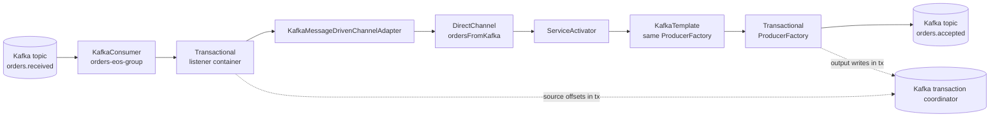
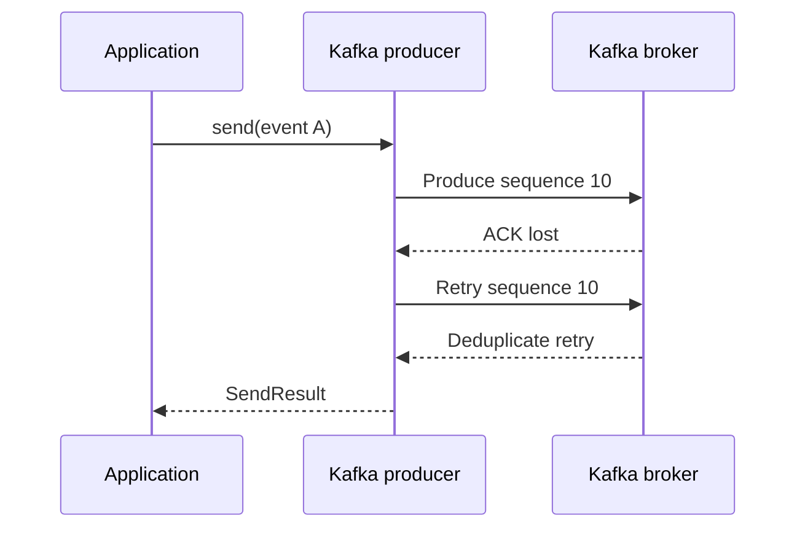
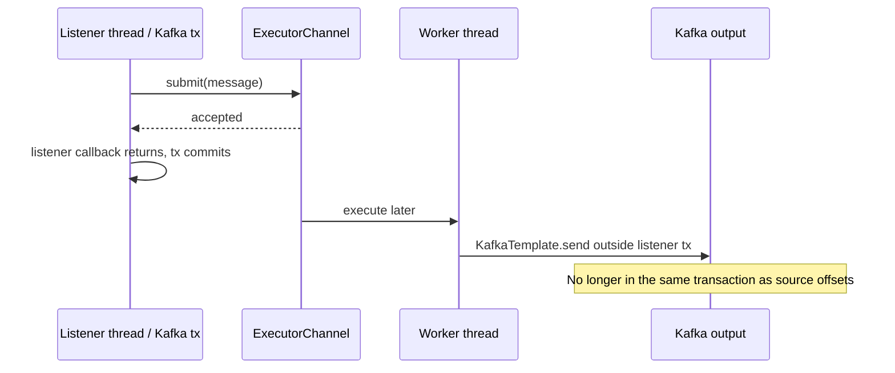
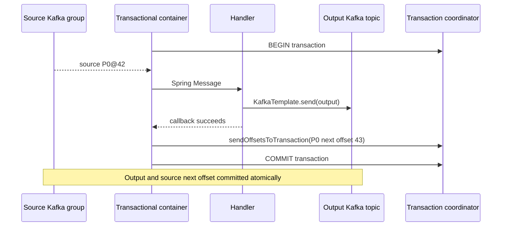
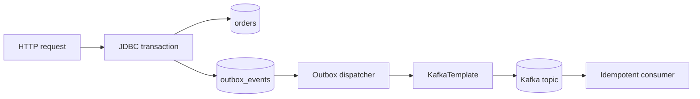

# Exactly-once and transactional producers

**Exactly-once semantics (EOS)** in Kafka has a specific scope: for a *consume → transform → produce* pipeline, Kafka can commit **records written to Kafka and the source topic's consumer offsets in the same transaction**. It does not mean Java code executes literally once, nor does it automatically encompass JDBC, HTTP, SFTP, JMS, or AMQP. Systems outside Kafka require **their own idempotency, inbox/outbox, and recovery mechanisms**.

This lesson belongs to the **Kafka Adapter** chapter of the **SPRING_INTEGRATION_ADAPTERS** module, where you connect external systems using inbound/outbound adapters, gateways, pollers, and `MessageChannel`, practicing flows over files, SFTP, HTTP, JMS, AMQP, Kafka, and databases with a focus on message contracts, errors, and connection lifecycles. This lesson covers **producer idempotence, transactional producers, `KafkaTemplate`, `KafkaTransactionManager`, and EOS when combining Kafka inbound and outbound in Spring Integration**.

> **Core takeaway:** `enable.idempotence=true` reduces duplicates from producer retries; **Kafka transactions** group Kafka writes into one commit/abort; **Kafka EOS** adds **source offsets into that transaction**; **exactly-once business effects** with an external database or API still require additional design.

## 1. Learning objectives

After this lesson, you will be able to:

1. Distinguish at-most-once, at-least-once, idempotent producers, transactional producers, Kafka EOS, and effectively-once business effects.
2. Explain `transactional.id`, producer fencing, `beginTransaction`, `commitTransaction`, `abortTransaction`, and `sendOffsetsToTransaction`.
3. Configure a transactional `DefaultKafkaProducerFactory`, `KafkaTemplate`, and `KafkaTransactionManager` sharing the same producer factory.
4. Send multiple Kafka records inside a local Kafka transaction using `executeInTransaction`.
5. Use Spring `@Transactional` or `TransactionTemplate` with `KafkaTransactionManager` at the right boundaries.
6. Attach `KafkaTransactionManager` to `ConcurrentMessageListenerContainer` for consumer-initiated Kafka transactions.
7. Connect `KafkaMessageDrivenChannelAdapter`, `DirectChannel`, service activators, and Kafka outputs.
8. Understand `isolation.level=read_committed` and why consumers do not see aborted records.
9. Analyze Kafka transaction rollbacks, after-rollback retries, DLTs, and source offset recovery.
10. Choose a unique `transactionIdPrefix` per instance, manage cache/`maxAge`/concurrency, and prevent producer fencing.
11. Distinguish chained synchronization with JDBC from true atomic transactions; pick inbox/outbox patterns when needed.
12. Test commits, aborts, crashes, fencing, and EOS correctness within Kafka's scope.

## 2. Guarantee comparison table

| Mechanism | Primary guarantee | Does NOT guarantee |
|---|---|---|
| At-most-once | Prioritizes never redelivering records | Can lose side effects if acked early |
| At-least-once | Records may be redelivered after failures | Business handler may run multiple times |
| Idempotent producer | Reduces duplicates from Kafka producer retries in same session/protocol | Two `send()` calls with the same `eventId` are not merged |
| Transactional producer | Kafka writes in one transaction commit or abort together | Does not commit source offsets automatically |
| Kafka consume–transform–produce EOS | Kafka outputs and source offsets belong to one Kafka transaction | JDBC/HTTP/SFTP/JMS/AMQP do not commit atomically with Kafka |
| Business idempotency | Side effects do not repeat when the same event is redelivered | Does not automatically make Kafka output + offset atomic |

**Do not equate transport-level "exactly once" with business-level "exactly once."** Kafka EOS allows read/process callbacks to re-run, while Kafka outputs and offset commits are bound atomically per protocol.

### 2.1. An example with three targets

```text
Kafka source: orders.received, P0@42, eventId=evt-101
      |
      v
Spring Integration handler:
  (A) transform into OrderAccepted
  (B) publish orders.accepted [Kafka]
  (C) update orders table [JDBC]
  (D) store source group offset 43 [Kafka]
```

With a transactional Kafka listener, **(B) and (D)** can commit in the same transaction. **(C)** lives in a separate JDBC transaction; Kafka does not roll back the DB when a Kafka transaction aborts. Thus if the DB commits and the Kafka transaction rolls back, the record can arrive again, requiring **`eventId` + unique constraint** to prevent repeated side effects.

## 3. EOS architecture in Spring Integration



Happy path:

1. The listener container starts a **Kafka transaction** before invoking the listener.
2. The inbound adapter converts `ConsumerRecord` into a Spring `Message<?>`.
3. `DirectChannel` dispatches the handler **synchronously on the consumer thread**.
4. The handler calls a `KafkaTemplate` backed by the **same `ProducerFactory`** as `KafkaTransactionManager`.
5. When the callback succeeds, the container adds **next source offsets** to the Kafka transaction.
6. The container commits. `read_committed` consumers see the committed output; the source group offset advances in the same transaction.

Error path: callback throws an exception → Kafka transaction aborts → offsets do not commit in the transaction → source record may be redelivered per after-rollback policy.

### 3.1. Input and output channels

- `KafkaMessageDrivenChannelAdapter` is **Kafka inbound**: it receives records and emits to a **Spring output channel**.
- `KafkaProducerMessageHandler` is **Kafka outbound**: it receives from a **Spring input channel** and calls `KafkaTemplate`.
- A `MessageChannel` is an **in-JVM conduit**, not a Kafka log or transactional resource.
- `DirectChannel` preserves thread/call stack; `ExecutorChannel`/`QueueChannel` decouples callback completion and can lose the Kafka transaction context.

### 3.2. Not every Spring Integration flow is transactional

`@ServiceActivator`, `IntegrationFlow`, and `DirectChannel` do not enable Kafka transactions automatically. You need a transactional producer factory, transaction manager or `KafkaTemplate.executeInTransaction`, and **the listener container must be configured with the transaction manager** to include source offsets in the same transaction.

## 4. Which duplicates does producer idempotence handle?

A Kafka producer can retry when an ACK is lost or a request times out. `enable.idempotence=true` uses producer identity/sequence numbers so the broker recognizes technical retries from the same producer.



Yet calling send twice from application code:

```java
kafkaTemplate.send("orders.accepted", "ORD-101", "evt-101");
kafkaTemplate.send("orders.accepted", "ORD-101", "evt-101");
```

represents **two distinct business send operations**. Producer idempotence does not deduplicate by payload/`eventId`, nor does it prevent duplicates from HTTP retries, scheduler replays, or outbox dispatcher resends.

Settings such as `acks=all`, `retries`, and `max.in.flight.requests.per.connection` must satisfy Kafka client rules when idempotence is enabled. Never combine `acks=0` with transactions expecting EOS.

## 5. What is a Kafka producer transaction?

A transactional producer groups multiple Kafka records:

```text
initTransactions()
beginTransaction()
  send("orders.accepted", A)
  send("orders.audit", B)
commitTransaction()

Or, on error:
abortTransaction()
```

A consumer with `isolation.level=read_committed` does not return records belonging to **aborted** transactions. Aborted data may remain inside the physical Kafka log, yet does not appear as business records at that consumer isolation level.

| Term | Meaning |
|---|---|
| `transactional.id` | Logical producer transaction identity across sessions |
| Producer ID / epoch | Kafka state managing sessions/sequences/fencing |
| Transaction coordinator | Broker component managing transaction state |
| `initTransactions()` | Initializes transactional producer, fencing prior sessions per protocol |
| `beginTransaction()` | Starts a Kafka transaction |
| `send()` | Writes Kafka records inside the active transaction |
| `sendOffsetsToTransaction()` | Adds source consumer offsets/group metadata into the transaction |
| `commitTransaction()` | Commits participating outputs and offsets |
| `abortTransaction()` | Aborts uncommitted outputs and offsets of the transaction |
| `ProducerFencedException` | Older producer lost authority to continue the transaction session |

### 5.1. Fencing against zombie producers

Two JVMs sharing the same `transactional.id` fence each other when a newer JVM initializes its producer. A fenced producer **must not retry forever with the same instance**; close/recreate resources per framework lifecycle and fix pod ID configuration.

### 5.2. `transactionIdPrefix` must be unique per instance

`DefaultKafkaProducerFactory` typically generates `transactional.id = transactionIdPrefix + suffix`. Under Spring Kafka `EOSMode.V2`, prefixes **must never collide across concurrently running application instances**, including for consumer-initiated transactions.

Broken example across three pods:

```properties
spring.kafka.producer.transaction-id-prefix=orders-tx-
```

Better illustration when the `HOSTNAME` environment variable is unique:

```properties
spring.kafka.producer.transaction-id-prefix=orders-tx-${HOSTNAME}-
```

**Verify in practice** that your deployment supplies a unique value to every JVM/pod, including during rolling restarts—not just appending a static `"-pod"` suffix.

## 6. Prerequisites for Kafka EOS

| Requirement | Why it matters |
|---|---|
| Kafka broker supporting transactions and EOS V2 | Spring Kafka 3.0+ supports only `EOSMode.V2`, requiring Kafka broker >= 2.5 |
| Provisioned topics | Producers/consumers need matching topics/partitions/ACLs |
| Transaction-capable producer | `DefaultKafkaProducerFactory.setTransactionIdPrefix(...)` |
| Unique transactional prefix | Prevents fencing between instances |
| `KafkaTemplate` sharing `ProducerFactory` | Joins the transaction bound to the thread |
| `KafkaTransactionManager` | Spring manages begin/commit/rollback |
| Kafka listener container wired with manager | Includes source offsets in the same Kafka transaction |
| `enable.auto.commit=false` | Prevents consumers from committing offsets outside transactions |
| `isolation.level=read_committed` | Downstream reads only committed transactional outputs |
| Synchronous handler via `DirectChannel` | Prevents callback from completing before Kafka outputs |
| Recovery/replay policy | Errors can cause callback replays; DLTs require design |
| Inbox/outbox for non-Kafka systems | Kafka does not atomically commit JDBC/HTTP/SFTP |

A single-broker Kafka cluster in a **lab** may require:

```properties
transaction.state.log.replication.factor=1
transaction.state.log.min.isr=1
```

This is **not a production recommendation**. Production should configure replication and `min.insync.replicas` for durability and operations.

## 7. Demo A — Spring Boot transactional `ProducerFactory`

The example uses Java 17+ and a compatible Spring Boot / Spring Kafka / Spring Integration stack. The `setKafkaAwareTransactionManager` API shown later targets **Spring Kafka 3.2+ or 4.x**; projects on older branches must check their exact Javadocs rather than mixing versions.

### 7.1. Maven dependencies

```xml
<dependencies>
    <dependency>
        <groupId>org.springframework.boot</groupId>
        <artifactId>spring-boot-starter-integration</artifactId>
    </dependency>
    <dependency>
        <groupId>org.springframework.integration</groupId>
        <artifactId>spring-integration-kafka</artifactId>
    </dependency>
</dependencies>
```

The Spring Boot BOM must manage a compatible version set. Never mix Spring Kafka 4.x manually with Spring Boot 3.x or incompatible Spring Integration versions.

### 7.2. application.properties

```properties
demo.kafka.bootstrap-servers=localhost:9092
demo.kafka.instance-id=local-1
demo.kafka.group-id=orders-eos-demo
demo.kafka.concurrency=2
```

`local-1` is **only for running a single demo JVM**. When scaling, each instance needs a distinct ID supplied by deployment and verified unique.

### 7.3. Complete Java configuration

```java
package com.example.kafka;

import java.time.Duration;
import java.util.HashMap;
import java.util.Map;

import org.apache.kafka.clients.producer.ProducerConfig;
import org.apache.kafka.common.serialization.StringSerializer;
import org.springframework.beans.factory.annotation.Qualifier;
import org.springframework.beans.factory.annotation.Value;
import org.springframework.context.annotation.Bean;
import org.springframework.context.annotation.Configuration;
import org.springframework.kafka.core.DefaultKafkaProducerFactory;
import org.springframework.kafka.core.KafkaTemplate;
import org.springframework.kafka.core.ProducerFactory;
import org.springframework.kafka.transaction.KafkaTransactionManager;

@Configuration
public class OrdersKafkaProducerConfig {

    @Bean("ordersTxProducerFactory")
    public ProducerFactory<String, String> producerFactory(
            @Value("${demo.kafka.bootstrap-servers}") String brokers,
            @Value("${demo.kafka.instance-id}") String instanceId) {

        Map<String, Object> props = new HashMap<>();
        props.put(ProducerConfig.BOOTSTRAP_SERVERS_CONFIG, brokers);
        props.put(ProducerConfig.KEY_SERIALIZER_CLASS_CONFIG,
                StringSerializer.class);
        props.put(ProducerConfig.VALUE_SERIALIZER_CLASS_CONFIG,
                StringSerializer.class);
        props.put(ProducerConfig.ACKS_CONFIG, "all");
        props.put(ProducerConfig.ENABLE_IDEMPOTENCE_CONFIG, true);
        props.put(ProducerConfig.DELIVERY_TIMEOUT_MS_CONFIG, 30_000);
        props.put(ProducerConfig.REQUEST_TIMEOUT_MS_CONFIG, 10_000);

        DefaultKafkaProducerFactory<String, String> factory =
                new DefaultKafkaProducerFactory<>(props);

        factory.setTransactionIdPrefix(
                "orders-eos-" + instanceId + "-");
        // Lab value: production must align with broker expiry.
        factory.setMaxAge(Duration.ofMinutes(10));

        return factory;
    }

    @Bean("ordersTxKafkaTemplate")
    public KafkaTemplate<String, String> kafkaTemplate(
            @Qualifier("ordersTxProducerFactory")
            ProducerFactory<String, String> factory) {
        return new KafkaTemplate<>(factory);
    }

    @Bean("ordersKafkaTransactionManager")
    public KafkaTransactionManager<String, String> kafkaTxManager(
            @Qualifier("ordersTxProducerFactory")
            ProducerFactory<String, String> factory) {
        return new KafkaTransactionManager<>(factory);
    }
}
```

**Exactly one shared factory** for template and manager:

```text
ordersTxProducerFactory
   |               |
   v               v
KafkaTemplate    KafkaTransactionManager
```

A `KafkaTemplate` backed by a different factory does not join the transaction just because it shares bootstrap servers or topics.

### 7.4. Producer cache and `maxAge`

When a transactional prefix is set, `DefaultKafkaProducerFactory` caches transactional producers. Recent Spring Kafka versions provide `TransactionIdSuffixStrategy`/`DefaultTransactionIdSuffixStrategy(maxCache)`; when using a fixed cache, set capacity **>= `concurrency`** of the listener container, plus headroom for nested transactions.

`maxAge` refreshes transactional producers before the broker expires an idle producer's `transactional.id`. Choose `maxAge` lower than the broker's `transactional.id.expiration.ms` and aligned with your SLA; 10 minutes is not a production default.

## 8. Demo B — `KafkaTemplate` local transaction

`KafkaTemplate.executeInTransaction(...)` fits when you only want to group Kafka writes **without source offsets**.

```java
package com.example.kafka;

import org.springframework.beans.factory.annotation.Qualifier;
import org.springframework.kafka.core.KafkaTemplate;
import org.springframework.stereotype.Service;

@Service
public class OrdersTxPublisher {

    private final KafkaTemplate<String, String> template;

    public OrdersTxPublisher(
            @Qualifier("ordersTxKafkaTemplate")
            KafkaTemplate<String, String> template) {
        this.template = template;
    }

    public String publishPair(String orderId) {
        return template.executeInTransaction(operations -> {
            operations.send(
                    "orders.accepted", orderId, "ACCEPTED|" + orderId);
            operations.send(
                    "orders.audit", orderId, "AUDIT|" + orderId);
            return "Kafka callback finished";
        });
    }

    public void publishThenAbort(String orderId) {
        template.executeInTransaction(operations -> {
            operations.send(
                    "orders.accepted", orderId, "ACCEPTED|" + orderId);
            operations.send(
                    "orders.audit", orderId, "AUDIT|" + orderId);
            throw new IllegalStateException(
                    "Simulation: rollback Kafka transaction");
        });
    }
}
```

If the callback returns normally, the template commits the Kafka transaction per contract; if the callback throws an exception, the transaction rolls back. `read_committed` consumers will not read the two records from an aborted transaction.

### 8.1. A `send()` future ACK is not yet a transaction commit

A `CompletableFuture<SendResult<K,V>>` can complete successfully when the broker ACKs a record while the Kafka transaction is still open and could later abort. Never log `"business published"` solely on future success before knowing the **transaction commit outcome**.

### 8.2. `executeInTransaction` does not join an outer transaction

Per Spring Kafka, `executeInTransaction` creates **a new local transaction** even if a `KafkaTransactionManager`/synchronized transaction is already active. It is not a nested savepoint of the listener transaction.

**Never call `executeInTransaction` inside a consumer-initiated EOS handler when outputs must join the transaction holding source offsets.** Call `template.send(...)` directly inside the context opened by the listener container.

## 9. `KafkaTransactionManager` and Spring `@Transactional`

`KafkaTransactionManager<K,V>` implements Spring's `PlatformTransactionManager`. You can use `@Transactional("ordersKafkaTransactionManager")` or `TransactionTemplate`.

```java
package com.example.kafka;

import org.springframework.beans.factory.annotation.Qualifier;
import org.springframework.kafka.core.KafkaTemplate;
import org.springframework.stereotype.Service;
import org.springframework.transaction.annotation.Transactional;

@Service
public class KafkaManagedPublisher {

    private final KafkaTemplate<String, String> template;

    public KafkaManagedPublisher(
            @Qualifier("ordersTxKafkaTemplate")
            KafkaTemplate<String, String> template) {
        this.template = template;
    }

    @Transactional("ordersKafkaTransactionManager")
    public void publish(String orderId, String value) {
        template.send("orders.accepted", orderId, value);
        template.send("orders.audit", orderId, "AUDIT|" + value);
    }
}
```

If a project has both a JDBC/JPA manager and a Kafka manager, **specify the manager explicitly**. An unqualified `@Transactional` does not automatically coordinate an atomic commit across both resource managers.

### 9.1. Self-invocation and transaction proxies

Calling `this.publish(...)` from another method **inside the same bean** can bypass the Spring proxy, causing the transaction annotation to be ignored. Split into a separate service bean or use `TransactionTemplate` when explicit boundaries are needed.

### 9.2. `TransactionTemplate`

```java
// Snippet inside a bean injecting KafkaTransactionManager<String,String>
// and KafkaTemplate<String,String> using the same ProducerFactory.
TransactionTemplate tx = new TransactionTemplate(kafkaTxManager);

tx.execute(status -> {
    kafkaTemplate.send(
            "orders.accepted", "ORD-101", "ACCEPTED|ORD-101");
    return null;
});
```

`TransactionTemplate` is a Spring transaction API; do not manually call `KafkaProducer.beginTransaction()/commitTransaction()` alongside a Spring transaction manager without an explicit design reason.

### 9.3. Sending outside a transaction

A transactional `KafkaTemplate` normally requires an active transaction (listener container, `@Transactional`, `TransactionTemplate`, or `executeInTransaction`). Calling send outside a transaction can throw `IllegalStateException`. An `allowNonTransactional` option exists, though enabling it weakens guarantees because those sends happen outside Kafka transactions.

## 10. Demo C — Consumer-initiated Kafka EOS with Spring Integration

This integrates the inbound adapter directly into a Kafka → Kafka flow.

```text
orders.received (Kafka source topic)
    -> transactional Spring Kafka listener container
    -> KafkaMessageDrivenChannelAdapter
    -> DirectChannel("ordersFromKafka")
    -> ServiceActivator
    -> KafkaTemplate.send("orders.accepted", ...)
    -> container sendOffsetsToTransaction + commit
```

### 10.1. ConsumerFactory

```java
package com.example.kafka;

import java.util.HashMap;
import java.util.Map;

import org.apache.kafka.clients.consumer.ConsumerConfig;
import org.apache.kafka.common.serialization.StringDeserializer;
import org.springframework.beans.factory.annotation.Value;
import org.springframework.context.annotation.Bean;
import org.springframework.context.annotation.Configuration;
import org.springframework.kafka.core.ConsumerFactory;
import org.springframework.kafka.core.DefaultKafkaConsumerFactory;

@Configuration
public class OrdersEosConsumerConfig {

    @Bean("ordersEosConsumerFactory")
    public ConsumerFactory<String, String> consumerFactory(
            @Value("${demo.kafka.bootstrap-servers}") String brokers,
            @Value("${demo.kafka.group-id}") String groupId) {

        Map<String, Object> props = new HashMap<>();
        props.put(ConsumerConfig.BOOTSTRAP_SERVERS_CONFIG, brokers);
        props.put(ConsumerConfig.GROUP_ID_CONFIG, groupId);
        props.put(ConsumerConfig.KEY_DESERIALIZER_CLASS_CONFIG,
                StringDeserializer.class);
        props.put(ConsumerConfig.VALUE_DESERIALIZER_CLASS_CONFIG,
                StringDeserializer.class);
        props.put(ConsumerConfig.ENABLE_AUTO_COMMIT_CONFIG, false);
        props.put(ConsumerConfig.AUTO_OFFSET_RESET_CONFIG, "earliest");
        props.put(ConsumerConfig.ISOLATION_LEVEL_CONFIG,
                "read_committed");

        return new DefaultKafkaConsumerFactory<>(props);
    }
}
```

`read_committed` is also appropriate when the input topic receives transactional writes. It **does not automatically make source offsets commit transactionally**; the listener container must hold the transaction manager.

### 10.2. Kafka message-driven inbound adapter

```java
package com.example.kafka;

import org.springframework.beans.factory.annotation.Qualifier;
import org.springframework.beans.factory.annotation.Value;
import org.springframework.context.annotation.Bean;
import org.springframework.context.annotation.Configuration;
import org.springframework.integration.channel.DirectChannel;
import org.springframework.integration.config.EnableIntegration;
import org.springframework.integration.kafka.inbound.KafkaMessageDrivenChannelAdapter;
import org.springframework.kafka.core.ConsumerFactory;
import org.springframework.kafka.listener.ConcurrentMessageListenerContainer;
import org.springframework.kafka.listener.ContainerProperties;
import org.springframework.kafka.transaction.KafkaTransactionManager;
import org.springframework.messaging.MessageChannel;

@Configuration
@EnableIntegration
public class OrdersEosInboundConfig {

    @Bean("ordersFromKafka")
    public MessageChannel ordersFromKafka() {
        return new DirectChannel();
    }

    @Bean("ordersEosInboundAdapter")
    public KafkaMessageDrivenChannelAdapter<String, String> inbound(
            @Qualifier("ordersEosConsumerFactory")
            ConsumerFactory<String, String> consumerFactory,
            @Qualifier("ordersKafkaTransactionManager")
            KafkaTransactionManager<String, String> kafkaTxManager,
            @Qualifier("ordersFromKafka")
            MessageChannel output,
            @Value("${demo.kafka.concurrency:2}") int concurrency) {

        ContainerProperties cp =
                new ContainerProperties("orders.received");

        // Spring Kafka 3.2+ / 4.x.
        cp.setKafkaAwareTransactionManager(kafkaTxManager);

        ConcurrentMessageListenerContainer<String, String> container =
                new ConcurrentMessageListenerContainer<>(
                        consumerFactory, cp);
        container.setConcurrency(concurrency);

        KafkaMessageDrivenChannelAdapter<String, String> adapter =
                new KafkaMessageDrivenChannelAdapter<>(
                    container,
                    KafkaMessageDrivenChannelAdapter.ListenerMode.record);

        adapter.setOutputChannel(output);
        return adapter;
    }
}
```

Key points:

- `setKafkaAwareTransactionManager` attaches the manager to the **manually created container**, not just declaring a bean in the `ApplicationContext`.
- The container starts a Kafka transaction around the listener callback.
- `ListenerMode.record` emits one Spring message per record.
- `DirectChannel` keeps the handler on the Kafka listener thread.
- You do not call manual `Acknowledgment.acknowledge()` to replace the container's transactional offset handling.
- Kafka `EOSMode.V2` is supported in Spring Kafka 3.0+; do not copy legacy EOS mode settings.
- Do not attach an adapter recovery callback that logs and suppresses exceptions if you expect rollbacks.

### 10.3. `ServiceActivator` publishing into the active transaction

```java
package com.example.kafka;

import org.springframework.beans.factory.annotation.Qualifier;
import org.springframework.integration.annotation.ServiceActivator;
import org.springframework.kafka.core.KafkaTemplate;
import org.springframework.kafka.support.KafkaHeaders;
import org.springframework.messaging.Message;
import org.springframework.stereotype.Component;

@Component
public class OrdersEosProcessor {

    private final KafkaTemplate<String, String> template;

    public OrdersEosProcessor(
            @Qualifier("ordersTxKafkaTemplate")
            KafkaTemplate<String, String> template) {
        this.template = template;
    }

    @ServiceActivator(inputChannel = "ordersFromKafka")
    public void handle(Message<String> incoming) {
        String value = incoming.getPayload();
        String orderId = incoming.getHeaders().get(
                KafkaHeaders.RECEIVED_KEY, String.class);

        if (orderId == null || orderId.isBlank()
                || value.isBlank()) {
            throw new IllegalArgumentException(
                    "Missing Kafka key or event value");
        }

        // Join the listener container's Kafka transaction.
        // Do not call executeInTransaction() inside this callback.
        template.send(
                "orders.accepted",
                orderId,
                "ACCEPTED|" + value);
    }
}
```

A `@SpringBootApplication` in `com.example.kafka` or a parent package scans the beans. The demo uses `StringSerializer`/`StringDeserializer` to avoid mixing JSON type mapping; production needs schemas, validation, ACLs, and idempotency.

### 10.4. Why not `ExecutorChannel` or `QueueChannel`?



`ExecutorChannel`/`QueueChannel` can return before side effects execute, committing Kafka source offsets before outputs. Kafka transaction contexts are generally thread-bound; async workers do not automatically join the right producer transaction. To decouple threads, design dedicated **durable handoffs, transaction barriers, ack/offsets, and replay**.

## 11. How does a Kafka outbound adapter participate in transactions?

Besides calling `KafkaTemplate` directly, Spring Integration provides `KafkaProducerMessageHandler` for the Kafka outbound adapter.

```java
@Bean("ordersTxOutboundHandler")
KafkaProducerMessageHandler<String, String> outboundHandler(
        @Qualifier("ordersTxKafkaTemplate")
        KafkaTemplate<String, String> template) {

    KafkaProducerMessageHandler<String, String> handler =
            new KafkaProducerMessageHandler<>(template);

    handler.setTopicExpression(
            new LiteralExpression("orders.accepted"));
    handler.setSync(true);
    return handler;
}
```

Required imports:

```java
import org.springframework.expression.common.LiteralExpression;
import org.springframework.integration.kafka.outbound.KafkaProducerMessageHandler;
```

**Condition:** The outbound handler must be invoked on the **same listener transaction thread** via `DirectChannel` and use the same `KafkaTemplate`/`ProducerFactory`. `setSync(true)` waits for the send result within a timeout; **send ACK differs from transaction commit**.

### 11.1. Forwarding the inbound key header to outbound

The inbound record key is normally `KafkaHeaders.RECEIVED_KEY`; the outbound handler typically reads `KafkaHeaders.KEY` or a key expression.

```java
Message<String> outgoing = MessageBuilder
        .withPayload("ACCEPTED|" + incoming.getPayload())
        .setHeader(
            KafkaHeaders.KEY,
            incoming.getHeaders().get(KafkaHeaders.RECEIVED_KEY))
        .build();
```

Import `Message`, `MessageBuilder`, and `KafkaHeaders`. If the contract requires `orderId` ordering, validate `key != null` before building the message.

### 11.2. Java DSL to wire the outbound adapter

```java
@Bean
IntegrationFlow ordersTxOutboundFlow(
        @Qualifier("ordersTxOutboundHandler")
        KafkaProducerMessageHandler<String, String> handler) {

    return IntegrationFlow.from("ordersToKafka")
            .handle(handler, e -> e.id("ordersTxOutboundEndpoint"))
            .get();
}
```

`ordersToKafka` must be a registered Spring input channel. This is an **alternative** to the service activator calling the template directly in Section 10.3; do not send to both if you expect only one output event. Import `org.springframework.integration.dsl.IntegrationFlow`.

## 12. `read_committed` and `read_uncommitted`

| Consumer isolation | What does it see? |
|---|---|
| `read_uncommitted` | Can read records from aborted transactions |
| `read_committed` | Returns only user records from committed transactions and non-transactional writes |

```mermaid
sequenceDiagram
  participant P as Producer
  participant K as Broker
  participant U as read_uncommitted
  participant C as read_committed
  P->>K: begin transaction; send A + B
  K-->>U: A/B may be read
  Note over C: A/B not visible yet
  P->>K: abort transaction
  Note over C: A/B are not returned
```

Notes:

- Aborted transactions leave control markers/offsets in the Kafka log; offsets observed by applications may have gaps.
- Open transactions can hold back the **Last Stable Offset (LSO)** for `read_committed` consumers.
- `read_committed` does not eliminate business duplicates if the same event was sent in two **separate committed transactions**.
- A consumer reading committed data can still retry processing if an error occurs before source offset commit.

### 12.1. CLI for inspecting output

```bash
kafka-console-consumer.sh \
  --bootstrap-server localhost:9092 \
  --topic orders.accepted \
  --from-beginning \
  --group orders-eos-inspector \
  --consumer-property isolation.level=read_committed
```

Use an inspector group distinct from source groups to avoid altering source committed offsets.

## 13. How are source offsets committed in a Kafka transaction?



If the handler throws an exception, the transaction aborts: **uncommitted output is invisible to `read_committed`**, and the source next offset is not committed via the transaction, so the source record can be redelivered.

### 13.1. Why commit 43 instead of 42?

Kafka stores committed offsets as the **next read position**. After processing record P0@42, the next offset is 43; it does not mean the handler processed record 43.

### 13.2. EOS does not mean a method runs literally once

When a transaction aborts or rebalances, the listener can reprocess the record:

```text
PROCESS eventId=evt-101, attempt=1
  Kafka output send
  exception -> Kafka ABORT

PROCESS eventId=evt-101, attempt=2
  Kafka output send
  return OK -> Kafka COMMIT
```

This matches Kafka EOS semantics: **at-least-once read/processing**, with transactional consistency between Kafka outputs and source offsets.

### 13.3. Record mode vs. batch mode

Transactional containers apply RECORD-like or BATCH-like semantics depending on listener type. A batch callback processes the whole group, and on failure requires an after-rollback policy for partial/fallback batch recovery. Do not combine `AckMode.RECORD` with a batch listener or expect batching to create a DB transaction automatically.

## 14. Errors and `DefaultAfterRollbackProcessor`

In a Kafka transactional listener, exceptions trigger a rollback. `DefaultAfterRollbackProcessor` manages seeking/retrying/recovering unfinished records. It differs from `DefaultErrorHandler`, which is commonly used when the listener is **non-transactional**.

| Layer | Role |
|---|---|
| `KafkaTransactionManager` | Begins/commits/rolls back producer transactions |
| Kafka listener container | Callbacks, sends source offsets to transaction |
| `DefaultAfterRollbackProcessor` | After rollback: seek, redelivery, retry/recover |
| `DeadLetterPublishingRecoverer` | Publishes failed records to DLT via `KafkaTemplate` |
| Spring Integration `errorChannel` | Internal channel carrying `ErrorMessage`s, not automatically a Kafka DLT |

### 14.1. Never swallow exceptions in an error flow

If `@ServiceActivator` throws an exception yet an adapter recovery callback/error channel catches it and returns normally, the container may see a successful callback and **commit the transaction**. Logging an `ErrorMessage` is not durable recovery.

Ensure exceptions propagate when rollback is needed, or ensure recovery genuinely stores records in a DLT/durable quarantine under a tested policy.

### 14.2. DLT recovery inside transactions

To include DLT publishes and recovered source offsets inside a Kafka transaction, configure a transactional recoverer / `DefaultAfterRollbackProcessor` / `commitRecovered` per your Spring Kafka version and producer factory.

**Never assume every DLT + offset commit is atomic by default.** If the DLT producer ACKs while the source offset fails to commit, a restart can send a duplicate DLT record. If the DLT producer fails, never mark the record as recovered successfully.

### 14.3. Non-blocking retry topics

Spring Kafka documentation states that **non-blocking retry topics cannot be combined with container transactions under the same mechanism**. Do not slap `@RetryableTopic` onto a Spring Integration `@ServiceActivator` expecting the Kafka transactional container to manage retry topics automatically.

When a retry topic lets record 41 overtake record 40 for the same key, business ordering can also break. Classify errors carefully and define ordering requirements.

## 15. DB-first and Kafka-first are not atomic distributed commits

Suppose an API both updates JDBC and sends a Kafka event.

### 15.1. DB-first synchronization

```text
BEGIN JDBC transaction
  UPDATE orders
  KafkaTemplate.send(...)
COMMIT JDBC
COMMIT Kafka
```

If the DB commits and then the Kafka commit fails, the DB holds the new state while Kafka may lack the event (or its state is uncertain). You must reconcile or compensate.

### 15.2. Kafka-first synchronization

```text
BEGIN Kafka transaction
  send Kafka event
  UPDATE orders in a separate JDBC transaction
COMMIT Kafka
COMMIT JDBC
```

If Kafka commits and then the DB commit fails, consumers can observe the event even though the DB lacks the state.

### 15.3. Why isn't `@Transactional` enough?

Spring can **synchronize two transactions sequentially**, yet does not turn them into an atomic distributed XA transaction. With multiple managers, `@Transactional("...")` picks the primary resource; nested managers/proxies require explicit design.

| Failure window | Consequence | Protection mechanism |
|---|---|---|
| DB commits, Kafka tx fails | DB has state, event is missing | Transactional outbox + reconciliation |
| Kafka tx commits, DB fails | Kafka event visible while DB rolled back | Inbox/state machine, redesign architecture |
| DB commits before Kafka source offset | Kafka redelivers, JDBC side effect repeats | Idempotent inbox / unique key |
| DLT ACKs before source commit | DLT may be republished after crash | DLT deduplication / source identity |
| HTTP/SFTP side effect before Kafka tx aborts | External side effect does not roll back | Idempotency keys, workflows/compensation |

## 16. Transactional outbox for DB → Kafka



Workflow:

1. Inside **one database transaction**, write the order and an outbox row carrying `eventId`, key, payload, and `PENDING`.
2. The dispatcher claims rows, sends events to Kafka, and observes producer ACK/transaction outcomes.
3. Once Kafka ACK/commit succeeds, update the row status to `SENT`.
4. Crash after Kafka commit before `SENT` → the same `eventId` may be sent again.
5. Downstream consumers use an inbox/unique constraint to ignore duplicate business effects.

```sql
CREATE TABLE outbox_events (
    event_id VARCHAR(128) PRIMARY KEY,
    aggregate_id VARCHAR(128) NOT NULL,
    topic VARCHAR(255) NOT NULL,
    payload TEXT NOT NULL,
    status VARCHAR(20) NOT NULL,
    created_at TIMESTAMP NOT NULL DEFAULT CURRENT_TIMESTAMP
);
```

A production schema also needs claim locks, retry/backoff timestamps, attempt counts, cleanup, indexes, and audit fields. Kafka producer transactions do not remove the window between Kafka commit and marking `SENT` in the DB, so an outbox **still needs downstream idempotency**.

## 17. Inbox/idempotency for Kafka → DB

When a consumer reads Kafka and calls JDBC, a record can be reprocessed after a Kafka transaction abort or before source offset commit.

```sql
CREATE TABLE processed_events (
    event_id VARCHAR(128) PRIMARY KEY,
    processed_at TIMESTAMP NOT NULL DEFAULT CURRENT_TIMESTAMP
);
```

Pseudocode inside a **JDBC transaction**, PostgreSQL example:

```java
// Method managed by the database transaction manager.
int claim = jdbc.update(
    "INSERT INTO processed_events(event_id) VALUES (?) "
    + "ON CONFLICT (event_id) DO NOTHING",
    eventId);

if (claim == 0) {
    return; // eventId already processed previously.
}

jdbc.update(
    "UPDATE orders SET status=? WHERE order_id=?",
    newStatus, orderId);
```

Keep the inbox insert and business update **inside the same JDBC transaction**. In Spring, invoke another service bean annotated with `@Transactional("jdbcTransactionManager")` via its proxy so the DB side effect commits reliably; the Kafka transaction remains separate.

**Never use topic-partition-offset as the sole business deduplication key** if the same event can be republished at a new offset. Use `eventId` or a business idempotency key.

## 18. Producer cache, concurrency, and fencing at scale

A 12-partition topic, 3 pods, each pod's Kafka container with `concurrency=2`:

```text
Total Kafka consumer threads = 3 × 2 = 6
Each pod can have 2 active Kafka listener transactions
Each pod needs enough transactional producers for concurrent transactions
transactionIdPrefix must be unique across all 3 pods
```

| Condition | Consequence |
|---|---|
| `maxCache < concurrency` with fixed suffix strategy | `NoProducerAvailableException` or insufficient transactional producers |
| Nested `executeInTransaction` inside callback | Claims an extra transactional producer, adding cache pressure |
| Same prefix across two pods | Producer fencing can occur |
| Producer idle too long | Broker expiry can cause producer to be fenced |
| Long-running transactions | Hold producers, increasing pool contention and timeouts |
| Group/partition assignment shifts | Records may replay after rollback/rebalance |

Since Spring Kafka 3.2, `DefaultTransactionIdSuffixStrategy(maxCache)` manages suffix IDs with a pool. With fixed caches, size at least equal to `concurrency` plus headroom for nested cases. Never give every pod the same `transactionIdPrefix` just for prettier logs.

### 18.1. `maxAge` and broker expiration

`DefaultKafkaProducerFactory.setMaxAge(...)` lets the producer factory recycle idle producers before the broker's `transactional.id.expiration.ms` elapses. `ProducerFencedException` is not an error to retry endlessly on the same producer; replace/close resources per lifecycle.

### 18.2. Graceful shutdown

- Stop accepting new source records.
- Allow in-flight Kafka transactions to commit or abort within a deadline.
- Never manually close producers managed by the factory/cache.
- Monitor group rebalances, fencing, and transaction commit errors.
- If a crash prevents committing in time, accept redelivery and rely on business idempotency.

## 19. Isolation, timeouts, and backpressure

| Property / factor | Impact |
|---|---|
| `isolation.level=read_committed` | Returns only transactionally committed user records |
| `transaction.timeout.ms` | Limits Kafka transaction duration per broker policy |
| `delivery.timeout.ms` | Total time producer attempts to send a record |
| `request.timeout.ms` | Timeout waiting for a single broker request response |
| `max.poll.interval.ms` | Limit between consumer poll calls |
| `max.poll.records` | Caps records returned in one poll |
| `producer maxAge` | Refreshes producers before transactional ID expiration |
| `concurrency` | Number of child Kafka consumer threads in the container |
| `maxCache` | Capacity of transactional IDs/producers under fixed suffix strategy |

A `DirectChannel` handler making multi-minute JDBC/HTTP calls holds the Kafka transaction open, risking transaction timeouts or `max.poll.interval.ms` expirations that trigger rollbacks/rebalances. Never raise every timeout indefinitely. Shorten callbacks, offload external side effects via outbox/inbox, and size records per poll to downstream capacity.

## 20. Errors and diagnostics

| Symptom | Possible cause | What to check |
|---|---|---|
| Transactional template `send` throws `IllegalStateException` | Sent outside a transaction | Container manager, `@Transactional`, `executeInTransaction` |
| Producer fenced | Duplicate prefix or expired producer session | Instance IDs, broker coordinator, `maxAge` |
| `NoProducerAvailableException` | Transactional producer cache exhausted | `maxCache`, concurrency, nested transactions |
| Send future succeeds yet output is invisible | Transaction uncommitted or aborted | Transaction outcome, isolation level |
| `read_uncommitted` sees record, `read_committed` does not | Aborted or open transaction | Isolation, LSO |
| Source offset advances yet Kafka output is missing | Output sent outside container tx or swallowed error | `ProducerFactory` identity, thread, error path |
| Kafka output has duplicates | Producer sent outside source tx or business republish | `eventId`, source committed offsets |
| DB updates repeat even with Kafka EOS enabled | JDBC is outside Kafka transactions | Inbox, unique constraint |
| DLT duplicates | DLT commit not atomic with recovered source offset | `AfterRollbackProcessor` config, recovery result |
| Transaction timeout | Handler/retries took too long or broker setting | Duration, Kafka client/broker logs |
| `LAG=0` yet JDBC not finished | Async `QueueChannel`/`ExecutorChannel` | Callback boundary, queue durability |
| Topic unready / ACL error | Topic or permission mismatch | `KafkaAdmin`/CLI, broker errors |

### 20.1. Layer-by-layer investigation checklist

1. Identify source topic/group/partition/offset and output topic.
2. Verify the producer factory has a `transactionIdPrefix` that is unique across instances.
3. Verify `KafkaTemplate` uses **the exact same** factory as the transaction manager.
4. Verify the listener container **has the manager attached**, not merely a manager bean in the context.
5. Check whether any async channel or nested `executeInTransaction` sits between inbound and outbound.
6. Confirm handler exceptions propagate back to the container for rollback.
7. Inspect output with a `read_committed` consumer alongside source committed offsets.
8. When JDBC/HTTP is involved, test business idempotency independently of Kafka commit outcomes.

## 21. Testing transactions with a real Kafka broker

Mocking `KafkaTemplate` does not prove Kafka EOS; use a real Kafka test broker/cluster (such as Testcontainers or an embedded broker) and test isolation and offsets.

### 21.1. Local commit

- Use `executeInTransaction` to send A and B to two Kafka topics.
- Verify a `read_committed` consumer receives them only after commit.
- Never infer global ordering across the two topics.

### 21.2. Local abort

- Send A and B inside a transaction, then throw an exception.
- Verify `read_committed` does not receive A or B as user records.
- `read_uncommitted` may observe the aborted records.

### 21.3. Container EOS

- Send source `orders.received P0@42`.
- Handler calls `KafkaTemplate.send` for output, and container commits.
- Read output using `read_committed`.
- Confirm the source group committed **next offset 43**.
- In another test, have the handler send then throw: output aborts and the source record can be redelivered.

### 21.4. Crash window

```text
Kafka source P0@42
  -> begin transaction
  -> output send scheduled
  -> kill JVM before commit
  -> restart with same group
  -> source redelivery
  -> only one committed Kafka output of the valid flow is visible
```

Use barriers/latches to inject faults and deadline-bounded awaits; never rely solely on `Thread.sleep` to claim EOS.

### 21.5. JDBC is outside EOS

Inside the listener callback, commit to the DB and then throw an exception so the Kafka tx aborts. On retry, the DB is called again. Add inbox `processed_events(eventId UNIQUE)` and prove business side effects do not repeat.

### 21.6. Fencing, rebalance, and cache

- Two instances with the same literal prefix → observe producer fencing.
- Two distinct prefixes → rolling restart, verify output and source offsets.
- Fixed `maxCache` smaller than concurrency → observe pool exhaustion.
- DLT publisher failure → check true recovered offsets.
- Stop a pod between Kafka send and commit → `read_committed` output must not expose aborted outputs.

## 22. Kafka CLI for the lab

Create topics (single broker, lab only):

```bash
kafka-topics.sh --bootstrap-server localhost:9092 \
  --create --if-not-exists \
  --topic orders.received --partitions 3 --replication-factor 1

kafka-topics.sh --bootstrap-server localhost:9092 \
  --create --if-not-exists \
  --topic orders.accepted --partitions 3 --replication-factor 1

kafka-topics.sh --bootstrap-server localhost:9092 \
  --create --if-not-exists \
  --topic orders.audit --partitions 3 --replication-factor 1
```

Send keyed source events:

```bash
kafka-console-producer.sh \
  --bootstrap-server localhost:9092 \
  --topic orders.received \
  --property parse.key=true \
  --property key.separator=:
```

Enter:

```text
ORD-101:evt-101|ORD-101|CREATED
ORD-102:evt-102|ORD-102|CREATED
ORD-101:evt-103|ORD-101|PAID
```

Inspect output:

```bash
kafka-console-consumer.sh \
  --bootstrap-server localhost:9092 \
  --topic orders.accepted --from-beginning \
  --group orders-output-inspector \
  --consumer-property isolation.level=read_committed
```

Check source committed offsets:

```bash
kafka-consumer-groups.sh \
  --bootstrap-server localhost:9092 \
  --describe --group orders-eos-demo
```

The inspector group has its own committed offsets and never resets production source groups. `CURRENT-OFFSET` shows the next read position, not proof that JDBC/HTTP completed.

## 23. Observability and operations

| Metric / signal | Question |
|---|---|
| Producer transaction commit/abort count | Are there abnormal rollbacks? |
| Transaction commit latency p95/p99 | Are coordinator/broker/handlers slowing down? |
| Producer fenced events | Are transactional IDs colliding or expiring while idle? |
| Active transactional producer cache | Is cache capacity sufficient for concurrency? |
| Source group lag per partition | Are consumers processing and retrying properly? |
| Kafka output `read_committed` rate | Are Kafka outputs visible after commits? |
| `AfterRollbackProcessor` retries/DLT | Are poison pills being recovered? |
| DLT backlog age | Do failures have owners and triage SLAs? |
| JDBC inbox duplicate count | How often are external business effects replayed? |
| Outbox pending/retry age | Are DB → Kafka events stuck unpublished? |
| Rebalance count and transaction duration | Do rolling deploys spike aborts/retries? |
| Producer send errors/timeouts | Are there network, ACL, or schema issues? |

These are **suggested business metrics**, not a claim that the framework automatically exports meters with those exact names. Log `eventId`, source topic/partition/offset, transaction outcome, producer ID, and commit state securely; never log raw tokens or PII.

## 24. Common mistakes

| Misconception | Correct understanding |
|---|---|
| "`enable.idempotence=true` gives system-wide exactly-once." | It only reduces producer retry duplicates within Kafka. |
| "A transactional producer automatically commits source offsets." | Requires a transactional listener container/`sendOffsetsToTransaction`. |
| "`KafkaTemplate` future success means the tx committed." | Send ACK differs from transaction commit outcome. |
| "`read_committed` prevents a Java method from running twice." | Listeners can still retry/redeliver; reading/processing is at-least-once. |
| "`executeInTransaction` joins the container tx." | It opens a new local transaction; avoid inside EOS handlers sharing source offsets. |
| "Having a `KafkaTransactionManager` bean makes all containers transactional." | Manually constructed containers must have the manager attached explicitly. |
| "One `@Transactional` binds JDBC and Kafka atomically." | Sequential commits still leave a failure window. |
| "Sharing the same prefix across pods simplifies management." | Can trigger producer fencing. |
| "`DirectChannel` is a Kafka transaction." | It only preserves synchronous dispatch/thread execution. |
| "`ExecutorChannel` preserves Kafka tx context across a thread pool." | Does not propagate listener-thread transactions automatically. |
| "In-memory `QueueChannel` durably preserves Kafka messages." | Crashing after callback can lose queued business work. |
| "Kafka transaction abort rolls back HTTP/SFTP/JDBC." | External side effects need idempotency or compensation. |
| "DLT records and source offsets are always atomic." | Requires configuring a transactional recoverer/after-rollback policy. |
| "`LAG=0` means the business DB finished." | Source offsets can advance ahead of external side effects. |
| "Kafka EOS makes `eventId` unnecessary." | Business republishes/replays can still create duplicates. |

## 25. Practice exercises

### Exercise 1 — Classify guarantees

Given four requirements—"no duplicate producer retries," "two Kafka outputs commit together," "source offsets + outputs atomic," and "no repeated DB side effects"—match each to idempotence, local transaction, Kafka EOS, and business inbox.

### Exercise 2 — Commit across two topics

Run `OrdersTxPublisher.publishPair` and use a `read_committed` consumer to confirm both `accepted` and `audit` records appear after commit.

### Exercise 3 — Abort a transaction

Run `publishThenAbort`, comparing `read_committed` vs. `read_uncommitted`. Explain why aborted outputs are not committed business events.

### Exercise 4 — Producer fencing across pods

Run two JVMs with the same prefix to observe fencing; fix with unique prefixes and test a rolling restart.

### Exercise 5 — Producer cache

Set `maxCache < concurrency` with the fixed suffix strategy to reproduce producer exhaustion; size the cache with headroom for nested transactions.

### Exercise 6 — Mismatched `ProducerFactory`

Wire the manager to factory A and the template to factory B. Observe transaction-join failures and fix them to share the same factory.

### Exercise 7 — Container without a manager

Remove `cp.setKafkaAwareTransactionManager(...)` in Demo C. Verify transactions are not started as expected and explain why a `KafkaTransactionManager` bean in the context does not auto-apply to that container.

### Exercise 8 — Async channel

Replace `DirectChannel` with `ExecutorChannel` and add worker delays. Observe Kafka tx boundaries and outputs; propose a durable handoff.

### Exercise 9 — Outbound adapter

Replace direct template calls with `KafkaProducerMessageHandler`, mapping `RECEIVED_KEY` to `KEY` while keeping the same factory and `DirectChannel`.

### Exercise 10 — Exception after send

Have the handler send the output and then throw. Verify rollback, source redelivery, and `read_committed` output visibility.

### Exercise 11 — DLT in a transactional listener

Configure `DefaultAfterRollbackProcessor` with a matching recoverer; test DLT publisher success/failure and committed source offsets.

### Exercise 12 — Repeated DB side effect

Commit JDBC then throw to abort the Kafka transaction and trigger source replay; add a unique `eventId` inbox and prove duplicate writes are blocked.

### Exercise 13 — DB-first vs. Kafka-first

Inject failures between the two commit orders. Document a matrix of divergence, recovery, and reconciliation.

### Exercise 14 — Transactional outbox

Write order + outbox in one DB tx; crash after Kafka ACK but before marking `SENT`, then observe replay and downstream deduplication.

### Exercise 15 — Isolation

Send committed and aborted transactions and inspect LSO/offset gaps under `read_committed` vs. `read_uncommitted`.

### Exercise 16 — Long-running transactions

Slow down the handler and measure Kafka transaction timeouts, `max.poll.interval.ms`, and cache utilization; design shorter transaction boundaries.

### Exercise 17 — Scale-out

12-partition topic, 3 pods × concurrency 2: propose prefix, cache, shutdown, retry, and metric configurations; test rebalances mid-transaction.

### Exercise 18 — Production review

Kafka → JDBC + Kafka output + HTTP payment system: identify what Kafka EOS protects, where inbox/outbox/idempotency are needed, retry/DLT, transaction timeouts, and 3 crash chaos-test points.

## 26. Self-check questions

1. How does an idempotent producer differ from a transactional producer?
2. Why can two `send()` calls with the same `eventId` still create duplicates?
3. What do `transactional.id` and `transactionIdPrefix` mean?
4. Why does each pod need a unique transactional prefix?
5. What state does `ProducerFencedException` indicate?
6. What do `beginTransaction`, `commitTransaction`, and `abortTransaction` do?
7. What data does `sendOffsetsToTransaction` add to a transaction?
8. Which EOS mode does Spring Kafka 3.0+ exclusively support?
9. What minimum Kafka broker version does EOS V2 require?
10. Does `KafkaTemplate.executeInTransaction` include source offsets automatically?
11. Should `executeInTransaction` be called inside an active container transaction?
12. Must `KafkaTransactionManager` share the same factory as the template?
13. Does a container created via `new` automatically pick up a manager bean from the context?
14. Where must `setKafkaAwareTransactionManager` be configured?
15. Why is `DirectChannel` suited for Kafka EOS flows?
16. Does `ExecutorChannel` preserve the consumer thread's transaction context?
17. How do `KafkaHeaders.RECEIVED_KEY` and `KafkaHeaders.KEY` differ?
18. Is a `KafkaTemplate` future succeeding proof that the transaction committed?
19. How do `read_committed` and `read_uncommitted` differ?
20. Why can aborted outputs create gaps in observed offsets?
21. Does Kafka EOS guarantee a service activator is invoked only once?
22. What does a handler exception inside a transactional container trigger?
23. In which use case does `DefaultAfterRollbackProcessor` differ from `DefaultErrorHandler`?
24. Are DLT writes and source offsets always atomic?
25. Does one `@Transactional` automatically merge JDBC and Kafka into XA?
26. Why is an inbox needed for Kafka → DB?
27. Why is an outbox needed for DB → Kafka?
28. When crashing after Kafka commit but before marking outbox `SENT`, what happens?
29. How do `maxCache` and `concurrency` relate?
30. Which producer error does `maxAge` help avoid?
31. When Kafka lag is 0, can you assert JDBC committed?
32. Which test genuinely proves Kafka output and source offsets commit atomically?

## 27. Summary

Kafka producer idempotence, Kafka producer transactions, and Kafka consume–transform–produce EOS are **three distinct guarantee levels**. Achieving Kafka EOS requires a transactional `ProducerFactory`, a `KafkaTemplate` sharing that factory, `KafkaTransactionManager` on the listener container, synchronous execution over `DirectChannel`, and `read_committed` downstream consumers.

```text
Kafka source + consumer group
   -> Transactional listener container BEGIN
   -> KafkaMessageDrivenChannelAdapter
   -> DirectChannel
   -> ServiceActivator / KafkaProducerMessageHandler
   -> KafkaTemplate (same transactional ProducerFactory)
   -> send Kafka output
   -> listener callback returns successfully
   -> sendOffsetsToTransaction(next source offset)
   -> COMMIT Kafka transaction

Failure:
   -> ABORT transaction
   -> AfterRollbackProcessor / retry / DLT
   -> source record can redeliver
```

**Final boundary:** Kafka does not automatically commit JDBC/HTTP/SFTP/JMS/AMQP in the same transaction. To keep business side effects idempotent or prevent losing DB → Kafka events, combine `eventId`/inbox, transactional outboxes, and crash-window testing. Verify with a real Kafka broker, `read_committed` outputs, source committed offsets, and transaction outcomes—never just `"send succeeded"` logs.

## References

- [Spring Kafka Reference — Exactly Once Semantics](https://docs.spring.io/spring-kafka/reference/kafka/exactly-once.html)
- [Spring Kafka Reference — Transactions](https://docs.spring.io/spring-kafka/reference/kafka/transactions.html)
- [Spring Kafka Reference — Message Listener Containers](https://docs.spring.io/spring-kafka/reference/kafka/receiving-messages/message-listener-container.html)
- [Spring Kafka Reference — Error Handling / After-Rollback Processor](https://docs.spring.io/spring-kafka/reference/kafka/annotation-error-handling.html)
- [Spring Kafka API — KafkaTransactionManager](https://docs.spring.io/spring-kafka/api/org/springframework/kafka/transaction/KafkaTransactionManager.html)
- [Spring Kafka API — DefaultKafkaProducerFactory](https://docs.spring.io/spring-kafka/api/org/springframework/kafka/core/DefaultKafkaProducerFactory.html)
- [Spring Kafka API — KafkaTemplate](https://docs.spring.io/spring-kafka/api/org/springframework/kafka/core/KafkaTemplate.html)
- [Spring Kafka API — ContainerProperties](https://docs.spring.io/spring-kafka/api/org/springframework/kafka/listener/ContainerProperties.html)
- [Spring Integration Reference — Apache Kafka Support](https://docs.spring.io/spring-integration/reference/kafka.html)
- [Spring Integration API — KafkaMessageDrivenChannelAdapter](https://docs.spring.io/spring-integration/api/org/springframework/integration/kafka/inbound/KafkaMessageDrivenChannelAdapter.html)
- [Spring Integration API — KafkaProducerMessageHandler](https://docs.spring.io/spring-integration/api/org/springframework/integration/kafka/outbound/KafkaProducerMessageHandler.html)
- [Apache Kafka — Producer Configs](https://kafka.apache.org/documentation/#producerconfigs)
- [Apache Kafka — Consumer Configs](https://kafka.apache.org/documentation/#consumerconfigs)
- [Apache Kafka — Exactly-Once Semantics](https://kafka.apache.org/documentation/#semantics)
