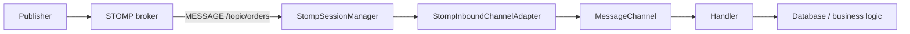
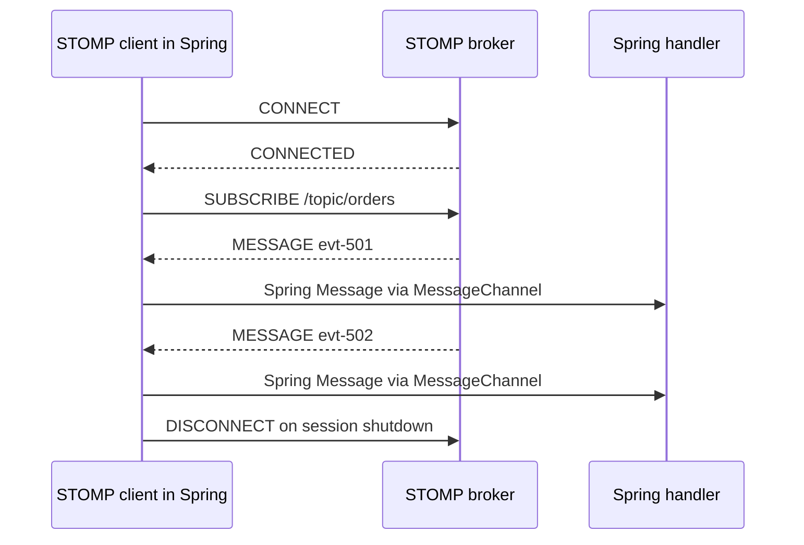

# STOMP Inbound Channel Adapter in Spring Integration

## 1. Problem Statement and Goals

Suppose an order-management system needs to receive order events from a broker that supports **STOMP**. A partner sends events to the `/topic/orders` destination; the Java application must subscribe to listen, receive the payload and headers, and forward the data to a handler for validation, order recording, and duplicate checking. If every service managed TCP/WebSocket connections, frame protocols, STOMP sessions, and connection errors on its own, the codebase would quickly become hard to control.

In the **SPRING_INTEGRATION_ADAPTERS** module, inbound/outbound adapters, gateways, and `MessageChannel` connect external systems with internal message flows. **`StompInboundChannelAdapter`** is an inbound **message producer**: it uses a STOMP session to subscribe to destinations and turns received `MESSAGE` frames into Spring `Message<?>` instances onto a `MessageChannel`. The downstream handler can be a service activator, transformer, filter, router, or a larger integration flow.



After this lesson, you will know how to read STOMP frames, distinguish subscriptions from pollers, configure a STOMP client and session manager, create an inbound adapter and handler, map headers, manage destinations, and safely design connections, ACKs, error flows, and idempotency.

## 2. STOMP and the Subscription Lifecycle

**STOMP** is a frame-based messaging protocol that can be implemented over TCP or WebSocket. The client connects to the broker, sends `CONNECT`, receives `CONNECTED`, and then sends `SUBSCRIBE` to a destination. When data is available, the broker pushes `MESSAGE` frames back to the subscribed session.

Example received frame:

```text
MESSAGE
subscription:sub-0
message-id:evt-501
destination:/topic/orders
content-type:text/plain

orderId=501;status=CREATED
^@
```

`^@` represents the NUL byte that terminates a STOMP frame; it is not two literal characters to type. Specific destination names and headers depend on the broker, client, and protocol version.



| Concept | Role |
| --- | --- |
| `destination` | The subscribe/publish target on the STOMP broker, e.g., `/topic/orders`. |
| `StompClientSupport` | STOMP client at the Spring Framework layer, managing protocol and transport. |
| `StompSessionManager` | Manages the `StompSession` and shares the session across adapters. |
| `StompInboundChannelAdapter` | Receives frames from the session and emits Spring `Message<?>`. |
| `MessageChannel` | A channel internal to the application, not a broker destination. |
| `@ServiceActivator` | The handler receiving messages after the adapter to run business logic. |

### STOMP Is Not a Time-Based Polling Inbound Adapter

The STOMP adapter receives messages via **subscription callbacks**. It does not use a periodic `TaskScheduler` calling `MessageSource.receive()` like file, SFTP, or JDBC adapters. Therefore:

- Do not add `@Poller(fixedDelay = "5000")` to `StompInboundChannelAdapter` to force the broker to send events every 5 seconds.
- `maxMessagesPerPoll` and `receiveTimeout` on a polling consumer do not control how many frames the broker pushes over a subscription.
- A scheduler configured on the STOMP client may serve **heartbeats** and receipt timeouts; it is not a schedule for polling data from the broker.
- If you want to throttle business processing rate, place a queue/executor, rate limiter, or separate consumer downstream of the adapter and design backpressure.

```text
File inbound (pull):  Trigger -> MessageSource.receive() -> MessageChannel
STOMP inbound (push): Broker MESSAGE -> Session callback -> MessageChannel
```

## 3. Choosing a Transport and Managing Sessions

Spring Framework supports STOMP clients such as:

- `ReactorNettyTcpStompClient`: STOMP directly over TCP to the host and port exposed by the broker.
- `WebSocketStompClient`: STOMP running over WebSocket; the application connects to a valid `ws://` or `wss://` endpoint.

The main example below uses **STOMP/TCP**, not STOMP-over-WebSocket. A broker with only WebSocket enabled cannot be used with `ReactorNettyTcpStompClient` simply by passing a WebSocket URL into the host parameter.

`StompSessionManager` manages a shared session and interacts with STOMP callbacks. For the TCP client, the appropriate implementation is `ReactorNettyTcpStompSessionManager`. One session manager can be used for an inbound adapter, an outbound adapter, or both when connecting to the corresponding broker.

**Note:** the session manager manages connections; it is not a durable store for business messages, nor does it provide exactly-once semantics on its own.

## 4. Dependencies and Prerequisites for Running

In a Spring Boot project with a BOM managing compatible versions:

```xml
<dependencies>
    <dependency>
        <groupId>org.springframework.boot</groupId>
        <artifactId>spring-boot-starter-integration</artifactId>
    </dependency>
    <dependency>
        <groupId>org.springframework.integration</groupId>
        <artifactId>spring-integration-stomp</artifactId>
    </dependency>
    <dependency>
        <groupId>io.projectreactor.netty</groupId>
        <artifactId>reactor-netty</artifactId>
    </dependency>
</dependencies>
```

The Reactor Netty dependency matches the TCP client choice in the example. For a WebSocket transport, add the appropriate WebSocket libraries and client. Do not arbitrarily mix Spring Framework and Spring Integration versions from incompatible BOMs.

Before running the application, prepare:

1. A broker that actually **enables STOMP/TCP**, for example a test endpoint on `127.0.0.1:61613`.
2. The `/topic/orders` destination according to the broker's conventions.
3. Valid connection and `SUBSCRIBE` permissions; if the broker requires authentication, configure CONNECT headers.
4. A STOMP publisher/client capable of sending frames to the same destination.

Port `61613` often appears in STOMP/TCP examples, but **not all brokers listen on this port by default**.

## 5. Configuring a STOMP Inbound Adapter in Java

The example below uses Java 17, Spring Boot, and Spring Integration, while separating the roles of client, session manager, adapter, output channel, and handler.

```java
import java.nio.charset.StandardCharsets;

import org.springframework.beans.factory.annotation.Qualifier;
import org.springframework.context.annotation.Bean;
import org.springframework.context.annotation.Configuration;
import org.springframework.integration.annotation.ServiceActivator;
import org.springframework.integration.channel.DirectChannel;
import org.springframework.integration.config.EnableIntegration;
import org.springframework.integration.stomp.ReactorNettyTcpStompSessionManager;
import org.springframework.integration.stomp.StompSessionManager;
import org.springframework.integration.stomp.inbound.StompInboundChannelAdapter;
import org.springframework.integration.support.converter.PassThruMessageConverter;
import org.springframework.messaging.Message;
import org.springframework.messaging.MessageChannel;
import org.springframework.messaging.simp.stomp.ReactorNettyTcpStompClient;
import org.springframework.scheduling.concurrent.ThreadPoolTaskScheduler;

@Configuration
@EnableIntegration
public class StompInboundConfiguration {

    @Bean
    public ThreadPoolTaskScheduler stompScheduler() {
        ThreadPoolTaskScheduler scheduler = new ThreadPoolTaskScheduler();
        scheduler.setPoolSize(1);
        scheduler.setThreadNamePrefix("stomp-heartbeat-");
        return scheduler;
    }

    @Bean
    public ReactorNettyTcpStompClient stompClient(
            ThreadPoolTaskScheduler stompScheduler) {

        ReactorNettyTcpStompClient client =
            new ReactorNettyTcpStompClient("127.0.0.1", 61613);
        client.setMessageConverter(new PassThruMessageConverter());
        client.setTaskScheduler(stompScheduler);
        client.setReceiptTimeLimit(5000);
        return client;
    }

    @Bean
    public StompSessionManager stompSessionManager(
            ReactorNettyTcpStompClient stompClient) {

        ReactorNettyTcpStompSessionManager manager =
            new ReactorNettyTcpStompSessionManager(stompClient);
        manager.setAutoReceipt(true);
        return manager;
    }

    @Bean
    public MessageChannel stompInputChannel() {
        return new DirectChannel();
    }

    @Bean
    public StompInboundChannelAdapter stompInboundChannelAdapter(
            StompSessionManager stompSessionManager,
            @Qualifier("stompInputChannel") MessageChannel channel) {

        StompInboundChannelAdapter adapter =
            new StompInboundChannelAdapter(
                stompSessionManager, "/topic/orders"
            );
        adapter.setOutputChannel(channel);
        adapter.setPayloadType(String.class);
        return adapter;
    }

    @ServiceActivator(inputChannel = "stompInputChannel")
    public void handleOrder(Message<?> message) {
        Object payload = message.getPayload();
        String body = (payload instanceof byte[] bytes)
            ? new String(bytes, StandardCharsets.UTF_8)
            : String.valueOf(payload);

        System.out.printf(
            "Spring id=%s, body=%s%n",
            message.getHeaders().getId(), body
        );

        // TODO: validate schema, idempotency, persist and alert.
    }
}
```

### Configuration Breakdown

| Bean | Purpose |
| --- | --- |
| `stompScheduler` | Provides a scheduler for STOMP client activities such as heartbeat/receipt timeout. |
| `stompClient` | Connects to the broker via STOMP/TCP and configures message conversion. |
| `stompSessionManager` | Manages the session and subscriptions shared across inbound/outbound adapters. |
| `stompInputChannel` | `DirectChannel` receiving Spring messages after the adapter converts frames. |
| `stompInboundChannelAdapter` | Subscribes to `/topic/orders` and sends messages to the channel. |
| `handleOrder` | Synchronous handler demonstrating receiving the payload and Spring message ID. |

The example uses `PassThruMessageConverter` to align with the Spring Messaging processing path. The actual payload type depends on the converter, content-type, and `setPayloadType` configuration; the handler accepts both `String` and `byte[]` for illustration. In a real application, you should lock down the contract (such as UTF-8 JSON), validate types, and not rely on `String.valueOf` to interpret arbitrary payload types.

### Environment Configuration

Replace hardcoded values for production environments with application configuration:

```yaml
app:
  stomp:
    host: "broker.internal.example"
    port: 61613
    destination: "/topic/orders"
```

You can bind these properties via `@ConfigurationProperties` or `@Value` into beans. Usernames, passwords, tokens, and private keys must come from a secret store or managed environment variables; never hardcode them in committed files.

**Do not wrap the `StompInboundChannelAdapter` bean with `@InboundChannelAdapter` or another `@Poller`.** It is already a message-producer endpoint whose lifecycle is managed by Spring.

## 6. Sending and Receiving a Test Frame

When the broker is running, a publisher can send a frame:

```text
SEND
destination:/topic/orders
content-type:text/plain

orderId=501;status=CREATED
^@
```

This is a frame illustration, **not a complete terminal command**. The client must connect first using STOMP and send an actual NUL character at the end. When the subscription succeeds and the message is delivered by the broker, the handler may log:

```text
Spring id=<spring-message-uuid>, body=orderId=501;status=CREATED
```

The ID in the log is the **Spring `MessageHeaders`** ID, which does not automatically match the broker's `message-id` header. For business processing, use a stable `eventId`/business key to prevent duplicate order creation.

Test these scenarios:

1. Broker port is closed: inspect connection logs and session error events, not just handler logs.
2. Subscribing to the wrong destination: the client may connect but not receive expected events.
3. Sending a valid frame: observe the handler, headers, and number of messages received.
4. Sending an invalid payload: verify the error flow and quarantine policy.
5. Stopping and restarting the broker: measure reconnect time and resubscription behavior.

## 7. Payload and STOMP Header Mapping

A STOMP frame has a command, headers, and a body. Spring Integration provides `StompHeaderMapper` and `IntegrationStompHeaders` to bring STOMP metadata into `MessageHeaders`; standard headers typically carry the **`stomp_`** prefix when inside a Spring message.

| STOMP frame | Example | What to do on receipt |
| --- | --- | --- |
| `destination` | `/topic/orders` | Identify the event type and routing policy. |
| `message-id` | `evt-501` | Distinguish from the Spring message ID; check the broker contract. |
| `subscription` | `sub-0` | Helps trace which subscription received the frame. |
| `content-type` | `application/json` | Choose the appropriate JSON parser/validator. |
| Body | `{"orderId":501}` | Validate schema and business ID before writing to the DB. |

Do not trust custom headers supplied by a publisher as authenticated facts. Values such as tenant ID, correlation ID, event type, or business key must be verified against broker access rights and the business contract. If you implement a custom `HeaderMapper`, verify that standard STOMP headers are still mapped as required.

`StompInboundChannelAdapter#setPayloadType(String.class)` specifies the desired target payload type. Final conversion depends on the converter set on the session; when using a custom JSON converter, test the body, charset, content-type, and error reporting if conversion fails.

## 8. Subscribing to Multiple Destinations and Runtime Changes

The inbound adapter constructor can accept multiple destinations:

```java
StompInboundChannelAdapter adapter =
    new StompInboundChannelAdapter(
        stompSessionManager,
        "/topic/orders",
        "/topic/payments"
    );
adapter.setOutputChannel(stompInputChannel);
```

Spring Integration provides managed operations:

```java
adapter.addDestination("/topic/returns");
adapter.removeDestination("/topic/payments");
```

This allows updating subscriptions **without necessarily recreating the entire application context**, though you must verify session state, subscribe permissions, and whether the broker accepted the command. Do not expose a public API that accepts arbitrary destinations without authentication, authorization, and an allowlist.

### Topic, Queue, and Multiple Instances

| Destination type | Typical behavior | Notes |
| --- | --- | --- |
| Topic | Can fan out messages to each independent subscription. | Multiple replicas subscribing together may all process the same event. |
| Queue | Can distribute messages across competing consumers. | Details depend on the broker, ack mode, and naming conventions. |
| Durable subscription | The broker can retain messages while a subscriber is temporarily absent. | Available only if supported by the broker and configured properly. |

Do not assume paths starting with `/queue/` or `/topic/` have identical semantics across all brokers. Always check the documentation for your specific broker.

## 9. Receipt, ACK/NACK, and Business Transactions

STOMP supports different confirmation mechanisms that must not be conflated:

| Mechanism | What does it confirm? | Does NOT guarantee |
| --- | --- | --- |
| `RECEIPT` | The broker acknowledged a frame that requested a receipt. | That the handler committed the DB successfully. |
| `ACK/NACK` | The client acknowledges/rejects a delivery according to subscription and broker mode. | That application JDBC transactions are automatically bound to the broker. |
| Business commit | The business outcome has been persisted successfully. | That the broker will not redeliver when an appropriate ack is missing. |

The example above enables `manager.setAutoReceipt(true)`; this mechanism can generate receipts for STOMP operations such as `SUBSCRIBE`. **A subscription receipt is not an acknowledgement that an order has been processed.**

STOMP has ack modes such as `auto`, `client`, and `client-individual`. If business requirements demand manual acknowledgement, check the broker contract and the adapter or `StompSession` API/configuration in your version. Do not assume an `ackMode` property exists on the inbound adapter identical to JMS or AMQP listeners.

In particular, with automatic acknowledgement, the broker may treat the frame as delivered before the handler commits to the DB. When the handler throws an exception, **the Spring Integration error channel does not automatically guarantee the broker will redeliver** that message.

A reliable processing strategy requires identifying a stable event ID, storing idempotent results, configuring retry/quarantine, and understanding the broker's retention/redelivery behavior. A successful subscription does not create **end-to-end exactly-once**.

## 10. Connection Errors, Dispatch Errors, and STOMP Events

There are at least two categories of errors:

**Connection/session errors:** the broker goes down, CONNECT is rejected, heartbeat is lost, the session disconnects, or the broker returns STOMP `ERROR`. These asynchronous errors are typically tracked via session manager state and **`StompIntegrationEvent`** or specialized events.

**Errors dispatching messages into the flow:** payload conversion fails, the channel cannot send, or a synchronous handler throws an exception. When an error occurs within the adapter's scope, `MessageProducerSupport` can send an `ErrorMessage` to the error channel you configure. If the error happens in a downstream worker after an `ExecutorChannel`, the worker needs its own error flow.

### Example Additional Error Channel

Add the following components to the configuration class in section 5; do not create a second adapter bean:

```java
import org.springframework.messaging.support.ErrorMessage;

@Bean
public MessageChannel stompErrors() {
    return new DirectChannel();
}

// In the method creating the adapter, before the return statement:
adapter.setErrorChannel(stompErrors());

@ServiceActivator(inputChannel = "stompErrors")
public void onStompError(ErrorMessage error) {
    Throwable failure = error.getPayload();
    System.err.println(
        "STOMP inbound error: " + failure.getClass().getSimpleName()
    );
}
```

### Monitoring Asynchronous STOMP Events

```java
import org.springframework.context.event.EventListener;
import org.springframework.integration.stomp.event.StompIntegrationEvent;

@EventListener
public void onStompEvent(StompIntegrationEvent event) {
    System.out.println(
        "STOMP event: " + event.getClass().getSimpleName()
    );
}
```

Protocol events and Spring business messages are **different**. A positive `StompReceiptEvent` is not an order event; connection errors do not necessarily pass through the same `stompErrors` channel as converter/dispatch errors.

### Reconnect and Resubscription

`StompSessionManager` provides connection management/recovery mechanisms depending on the implementation. However, never assume every failure recovers immediately, that no messages are lost, or that the broker always redelivers after reconnect. You should monitor:

- Last successful connection time and reconnect count.
- Active subscriptions, receipts when requested, and frames received.
- Authentication errors, heartbeat timeouts, and broker disconnects.
- Age of unprocessed events, duplicate event count, and data gaps.

If a disconnect occurs, replay capability depends on topic/queue semantics, durability, retention, and ack semantics. For critical data, add reconciliation or backfill reading mechanisms.

## 11. Heartbeat, Lifecycle, and Timeouts

In STOMP, heartbeats help both sides detect connections that are no longer active per the negotiated contract. The client's `ThreadPoolTaskScheduler` can support heartbeats and receipt timeouts, but it is **not a periodic poller fetching messages**.

| Parameter | Role |
| --- | --- |
| Heartbeat interval | Monitors connection liveness as negotiated between client and broker. |
| Receipt time limit | Time to wait for a `RECEIPT` frame when a receipt was requested. |
| Adapter send timeout | Wait limit when sending a Spring message to a potentially blocking channel. |
| Connection recovery interval | Throttles reconnect attempts according to the session manager/transport. |

The adapter has a Spring-managed `start()` and `stop()` lifecycle. Stopping the adapter does not automatically cancel running downstream handlers or roll back committed transactions. On shutdown, you need policies for queue draining, session release, timeouts, and recovering unprocessed messages.

## 12. DirectChannel, ExecutorChannel, and Backpressure

The example uses `DirectChannel` because the processing path is easy to observe. However, a slow handler can block the receiving/dispatching thread, affecting throughput.

When using `ExecutorChannel` or `QueueChannel`:

- A message may have been accepted by the channel while **business processing has not yet completed**.
- Exceptions in async workers typically require their own error flow/downstream retry.
- Queues must be bounded; measure queue depth, worker saturation, and rejections.
- Messages in an in-memory queue can be lost on process crash without persistence.
- Multiple workers can change event processing order.

```text
STOMP broker -> Inbound adapter -> ExecutorChannel -> Worker handler -> DB
                                     |
                                     +-> bounded queue, backpressure
                                     +-> error/retry/quarantine flow
```

Increase concurrency only with evidence that both the source and target DB can handle the load, and while ensuring the handler supports idempotency. If ordering by `orderId` must be preserved, consider sequential processing per key or partitioning by key.

## 13. Security and Data Limits

1. Use a broker account with the minimum necessary **SUBSCRIBE** permissions; load credentials from a secret manager.
2. Enable TLS appropriate to the transport: `wss://` for WebSocket or properly configured TLS for STOMP/TCP; verify broker certificates.
3. Verify publisher and destination permissions. A successful CONNECT does not imply the client is authorized to subscribe.
4. Limit frame/payload size; validate content-type, encoding, and schema.
5. Do not blindly trust custom headers such as tenant ID, event type, or correlation ID.
6. Do not log passwords, tokens, PII, or raw sensitive bodies in production logs.
7. Use stable idempotency keys and an audit trail for committed events.

## 14. Operational Diagnostics

| Symptom | Check |
| --- | --- |
| Cannot connect | Port, STOMP listener, TLS, credentials, and network. |
| CONNECTED but no messages | Subscription, ACL, destination, publisher, and broker routing. |
| Messages received but wrong payload type | Converter, `setPayloadType`, charset, and content-type. |
| Messages lost after restart | Durable subscription, retention, ack mode, and backfill capability. |
| Duplicate processing | Redelivery, multiple replicas/topic subscriptions, idempotency. |
| Slow handler processing | DirectChannel blocking, executor saturation, DB pool. |
| Errors only appear in workers | Error flow downstream of the async boundary. |
| Heartbeat timeout | Scheduler, network/proxy connectivity, broker load. |
| Adding a destination has no effect | Session state, subscribe permissions, and managed operations. |

Essential metrics: frames received per destination, Spring messages sent, business events committed, receive-to-commit latency, conversion/dispatch errors, reconnects, active subscriptions, duplicate events, and downstream backlog.

## 15. Exercises with Answers

**Exercise 1.** Does a STOMP inbound adapter need `@Poller(fixedRate = "5000")` to receive frames?

**Answer:** No. The broker pushes frames over the subscription; the adapter is message-driven.

**Exercise 2.** Are `/topic/orders` and `stompInputChannel` the same thing?

**Answer:** No. One is a broker destination, and the other is an internal Spring MessageChannel.

**Exercise 3.** The client is CONNECTED, yet there are no handler logs. Is the handler definitely broken?

**Answer:** Not yet. Check the subscription, ACL, routing, publisher, and received frames.

**Exercise 4.** Why can the demo handler receive either `String` or `byte[]`?

**Answer:** The payload type depends on the converter, payload type setting, and frame; production must lock down a fixed contract.

**Exercise 5.** Is Spring `MessageHeaders.ID` always equal to the STOMP `message-id` header?

**Answer:** No. Use a stable event ID from the business contract to prevent duplicate processing.

**Exercise 6.** Which API adds `/topic/returns` while the adapter is running?

**Answer:** `adapter.addDestination("/topic/returns")`, after verifying permissions and session state.

**Exercise 7.** Does receiving a `RECEIPT` for a `SUBSCRIBE` prove an order was written to the DB?

**Answer:** No. A protocol receipt is completely different from a business commit.

**Exercise 8.** The handler throws an exception after the broker already auto-acked the frame. Does the error channel automatically request redelivery?

**Answer:** There is no such guarantee. You need an ack/redelivery contract, retry, and separate idempotency.

**Exercise 9.** Can three independent replicas subscribing to a topic all receive the same event?

**Answer:** Possibly, depending on broker semantics. Review fan-out behavior and design distribution/idempotency accordingly.

**Exercise 10.** A downstream handler after an `ExecutorChannel` fails. Can you rely solely on the STOMP adapter's error channel?

**Answer:** No. Worker failures occur past the async boundary and require their own error flow.

**Exercise 11.** Is `ThreadPoolTaskScheduler` in the STOMP client a data polling schedule?

**Answer:** No. It supports activities such as heartbeat/receipt timeout; inbound receives frames via session callbacks.

## 16. Key Takeaways

**`StompInboundChannelAdapter`** uses `StompSessionManager` to maintain a STOMP session, subscribe to destinations, and turn broker-sent frames into `Message<?>` on a `MessageChannel`. It is a **message-driven inbound adapter**, not an adapter polling a source via `@Poller`. For reliable operation, verify connections, subscriptions, header/payload conversion, heartbeats, error events, broker-specific ACK/NACK, and business transactions/idempotency. **Broker delivery, STOMP receipt, and DB commit are three distinct milestones.**

## References

- [Spring Integration Reference — STOMP Support](https://docs.spring.io/spring-integration/reference/stomp.html)
- [Spring Integration API — StompInboundChannelAdapter](https://docs.spring.io/spring-integration/api/org/springframework/integration/stomp/inbound/StompInboundChannelAdapter.html)
- [Spring Integration API — StompSessionManager](https://docs.spring.io/spring-integration/api/org/springframework/integration/stomp/StompSessionManager.html)
