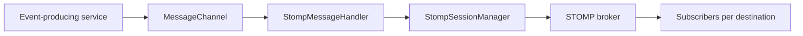
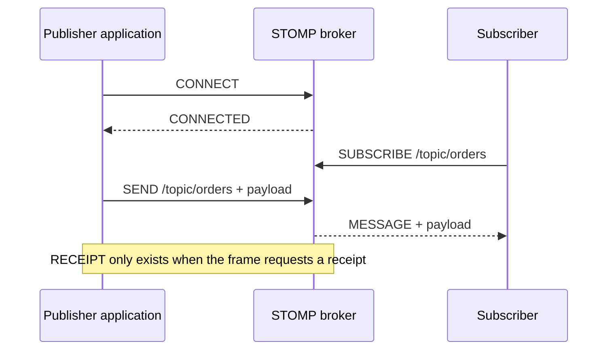
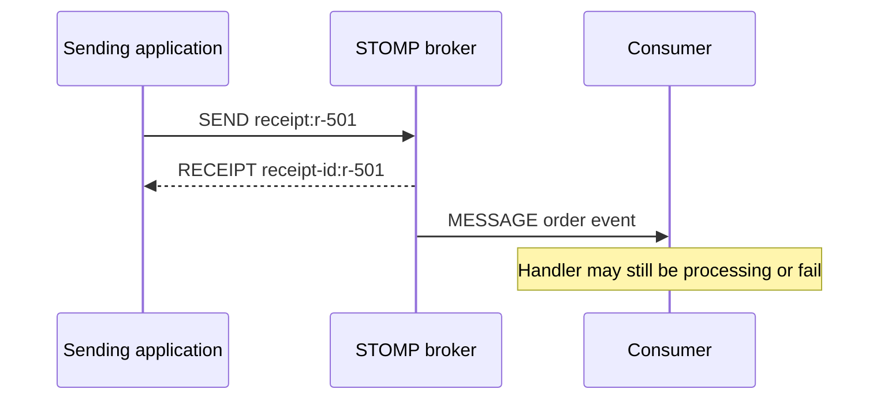
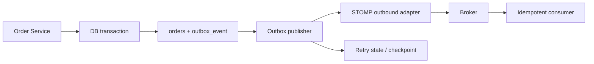

# STOMP Outbound Channel Adapter in Spring Integration

## 1. Problem Statement: Publishing Internal Messages to a STOMP Broker

An e-commerce system saves an order and then needs to notify a shipping-tracking application of its new status. The order-processing logic already created a Spring `Message` inside an integration flow; instead of calling each client directly, the application needs to publish the event to a **STOMP broker** at the `/topic/orders` destination. Clients subscribed to this destination will receive the message according to the broker's rules.

In the **SPRING_INTEGRATION_ADAPTERS** module, inbound/outbound adapters, gateways, pollers, and `MessageChannel` connect data between a Spring application and external systems. The **STOMP outbound channel adapter** is the exit point of an integration flow: it takes a Spring `Message<?>` from an input channel and uses a `StompSession` to send a `SEND` frame to a destination on the broker.

Spring Integration provides the **`StompMessageHandler`** class for this role. The handler can send to a fixed destination or compute the destination per message using a SpEL expression. A `StompSessionManager` is responsible for providing and managing the session used for sending.



**After this lesson, you will be able to:**

1. Distinguish STOMP inbound from outbound, and `SEND` frames from `MESSAGE` frames.
2. Create a STOMP/TCP client, session manager, outbound `StompMessageHandler`, and input `MessageChannel` in Java.
3. Send data to a fixed destination or select a destination via SpEL from message headers.
4. Understand header mapping, converters, `RECEIPT`, synchronous/asynchronous errors, heartbeats, and lifecycle.
5. Design retry handling, idempotency, transactional outbox, security, and observability for real-world sending flows.

## 2. How STOMP Outbound Differs from STOMP Inbound and Pollers

STOMP (*Simple Text Oriented Messaging Protocol*) is a frame-based messaging protocol typically running over TCP or WebSocket. A publisher uses a `SEND` frame with a destination and payload; the broker distributes the message to matching subscribers, typically as a `MESSAGE` frame.



| Component | Data direction | How it works |
| --- | --- | --- |
| `StompInboundChannelAdapter` | Broker → application | Subscribes to a destination, receives `MESSAGE` frames, and emits Spring messages to an output channel. |
| `StompMessageHandler` | Application → broker | Processes Spring messages from an input channel and emits `SEND` frames to a destination. |
| File/SFTP/JDBC polling adapter | External source → application | Typically uses a `TaskScheduler` and scheduled `MessageSource.receive()`. |
| STOMP client heartbeat | Session health signaling | Keeps/monitors the STOMP connection alive; does not poll business data. |

**STOMP outbound is a message handler, not a polling endpoint.** Do not configure a `@Poller` on `StompMessageHandler` just to "send every 5 seconds." If a business requirement is to emit periodic reports, the **event-generating source** can use a scheduler or separate polling flow; the STOMP outbound handler simply receives and sends whenever a message arrives on its input channel.

## 3. SEND Frame Structure and Data Contract

A STOMP frame sent to the broker looks like:

```text
SEND
destination:/topic/orders
content-type:application/json
receipt:send-501

{"eventId":"evt-501","orderId":501,"status":"CREATED"}
^@
```

`^@` represents the NUL byte terminating a frame per the STOMP protocol, not two literal text characters to append to the payload.

| Field | Purpose | Notes |
| --- | --- | --- |
| `SEND` | Command to send a message to the broker. | Does not create a business request-reply. |
| `destination` | Broker target used for routing. | `/topic/`, `/queue/` rules depend on the broker. |
| `content-type` | Describes the body data type. | Must match how the converter and consumer handle it. |
| `receipt` | Requests the broker to send a `RECEIPT` for the frame. | A receipt does not confirm the receiver committed to the DB. |
| Body | Event payload. | Validate schema, encoding, size, and event ID. |

A Spring `Message<?>` has a `payload` and `headers`, not a raw STOMP frame. `StompMessageHandler` works with a converter and `StompHeaderMapper` to convert them into a frame sent over the session. Therefore, do not manually concatenate `SEND\n...` strings in business handlers when using the standard outbound adapter.

### Two Distinct Identifiers

`MessageHeaders.ID` is the internal Spring message ID, typically generated when building the message. An `eventId` like `evt-501` is a business identifier that must stay stable across retries. The broker may also assign its own ID when distributing frames. **Do not use a newly regenerated Spring message ID on each attempt for consumer deduplication**; use a stable event ID from the data contract.

## 4. Spring Integration Components Needed

```text
Event publisher
     |
     |  Spring Message<String>
     v
stompOutboundChannel (DirectChannel)
     |
     v
@ServiceActivator -> StompMessageHandler
     |
     v
StompSessionManager -> STOMP client -> broker
```

**`StompMessageHandler`:** the outbound adapter's `MessageHandler` implementation that receives Spring messages and sends them to the configured destination. Key APIs include `setDestination(String)`, `setDestinationExpression(Expression)`, `setHeaderMapper(...)`, and `setConnectTimeout(long)`.

**`StompSessionManager`:** manages the shared session. When an application needs both inbound and outbound with the same broker, both adapters can use a compatible session manager; it is not a durable queue.

**STOMP client:** connects to the broker. You can use `ReactorNettyTcpStompClient` for STOMP/TCP or `WebSocketStompClient` for STOMP-over-WebSocket. This example chooses TCP to focus on outbound behavior.

**`MessageChannel`:** where the application producer sends messages for the handler. `DirectChannel` dispatches synchronously, while `ExecutorChannel`/`QueueChannel` can add an async boundary or buffering, but require their own error and durability policies.

**`@ServiceActivator`:** connects an input channel to a `MessageHandler` bean. It differs from `@InboundChannelAdapter`, which creates an entry point from a source.

## 5. Complete Java Example: Sending Order Events to /topic/orders

### 5.1. Prerequisites and Dependencies

Prepare a broker with **STOMP/TCP** actually enabled at your configured host/port, and a client subscribed to `/topic/orders` to observe messages. Port `61613` is commonly used for STOMP/TCP in examples, though not every broker enables it by default.

With Maven, the Spring Boot BOM manages compatible versions:

```xml
<dependencies>
    <dependency>
        <groupId>org.springframework.boot</groupId>
        <artifactId>spring-boot-starter-integration</artifactId>
    </dependency>
    <dependency>
        <groupId>org.springframework.integration</groupId>
        <artifactId>spring-integration-stomp</artifactId>
    </dependency>
    <dependency>
        <groupId>io.projectreactor.netty</groupId>
        <artifactId>reactor-netty</artifactId>
    </dependency>
</dependencies>
```

The Reactor Netty dependency supports the STOMP/TCP client. For WebSocket, choose the corresponding dependency/transport. Do not arbitrarily mix Spring Framework and Spring Integration versions from different generations.

### 5.2. Configuring STOMP Client, Session Manager, and Outbound Handler

```java
import org.springframework.context.annotation.Bean;
import org.springframework.context.annotation.Configuration;
import org.springframework.integration.annotation.ServiceActivator;
import org.springframework.integration.channel.DirectChannel;
import org.springframework.integration.config.EnableIntegration;
import org.springframework.integration.stomp.ReactorNettyTcpStompSessionManager;
import org.springframework.integration.stomp.StompSessionManager;
import org.springframework.integration.stomp.outbound.StompMessageHandler;
import org.springframework.integration.support.converter.PassThruMessageConverter;
import org.springframework.messaging.MessageChannel;
import org.springframework.messaging.MessageHandler;
import org.springframework.messaging.simp.stomp.ReactorNettyTcpStompClient;
import org.springframework.scheduling.concurrent.ThreadPoolTaskScheduler;

@Configuration
@EnableIntegration
public class StompOrdersOutboundConfiguration {

    @Bean
    public ThreadPoolTaskScheduler stompScheduler() {
        ThreadPoolTaskScheduler scheduler = new ThreadPoolTaskScheduler();
        scheduler.setPoolSize(1);
        scheduler.setThreadNamePrefix("stomp-heartbeat-");
        return scheduler;
    }

    @Bean
    public ReactorNettyTcpStompClient stompClient(
            ThreadPoolTaskScheduler stompScheduler) {

        ReactorNettyTcpStompClient client =
            new ReactorNettyTcpStompClient("127.0.0.1", 61613);
        client.setMessageConverter(new PassThruMessageConverter());
        client.setTaskScheduler(stompScheduler);
        client.setReceiptTimeLimit(5000);
        return client;
    }

    @Bean
    public StompSessionManager stompSessionManager(
            ReactorNettyTcpStompClient stompClient) {

        ReactorNettyTcpStompSessionManager manager =
            new ReactorNettyTcpStompSessionManager(stompClient);
        manager.setAutoReceipt(true);
        return manager;
    }

    @Bean
    public MessageChannel stompOutboundChannel() {
        return new DirectChannel();
    }

    @Bean
    @ServiceActivator(inputChannel = "stompOutboundChannel")
    public MessageHandler stompMessageHandler(
            StompSessionManager stompSessionManager) {

        StompMessageHandler handler =
            new StompMessageHandler(stompSessionManager);
        handler.setDestination("/topic/orders");
        handler.setConnectTimeout(10000);
        return handler;
    }
}
```

**Explanation:**

1. `stompClient()` creates a STOMP client running over TCP, connecting to `127.0.0.1:61613`. `PassThruMessageConverter` supports message conversion following the official examples.
2. `stompScheduler()` handles tasks such as STOMP client heartbeats/receipt timeouts; **it is not a data polling poller**.
3. `stompSessionManager()` creates a shared session manager; `setAutoReceipt(true)` requests automatic receipt header generation when sending applicable frames.
4. `stompOutboundChannel()` returns a `DirectChannel` to receive messages from the application.
5. The `@Bean @ServiceActivator` method registers a `StompMessageHandler` as a consumer on the channel, bound to the fixed destination `/topic/orders`.
6. `setConnectTimeout(10000)` limits the wait time for **establishing the session** (milliseconds), not the time for a business consumer to finish. The value must be compatible with the session manager's recovery interval; the API requires the connect timeout to be greater than the recovery interval.

This is a **one-way outbound configuration**. You do not need to wrap `StompMessageHandler` with an extra `@OutboundChannelAdapter`, nor do you need a `@Poller` just to send STOMP messages.

### 5.3. Service Sending Spring Messages to the Outbound Channel

Add a service to publish events for a defined business action:

```java
import org.springframework.beans.factory.annotation.Qualifier;
import org.springframework.messaging.MessageChannel;
import org.springframework.messaging.support.MessageBuilder;
import org.springframework.stereotype.Service;

@Service
public class OrderEventPublisher {

    private final MessageChannel stompOutboundChannel;

    public OrderEventPublisher(
            @Qualifier("stompOutboundChannel")
            MessageChannel stompOutboundChannel) {
        this.stompOutboundChannel = stompOutboundChannel;
    }

    public void orderCreated(long orderId, String eventId) {
        String json = """
            {"eventId":"%s","orderId":%d,"status":"CREATED"}
            """.formatted(eventId, orderId);

        boolean accepted = stompOutboundChannel.send(
            MessageBuilder.withPayload(json)
                .setHeader("contentType", "application/json")
                .setHeader("eventId", eventId)
                .build()
        );

        if (!accepted) {
            throw new IllegalStateException(
                "STOMP outbound channel did not accept the event"
            );
        }
    }
}
```

In this example, only call `orderCreated(...)` with an `eventId` generated and validated by the business system; do not take an arbitrary `eventId` from a public request. Java text blocks and `String.formatted` require modern Java, such as Java 17.

This snippet uses the Spring message-level `contentType` header to illustrate metadata; the exact conversion to STOMP `content-type` depends on `StompHeaderMapper` and the converter. In production, **inspect the actual frame on the broker** and configure standard STOMP headers according to the contract instead of guessing solely from custom header names.

**Confirmation boundary:** `send()` returning `true` indicates the channel accepted the message per the channel's contract. With `DirectChannel`, the handler may have already been invoked synchronously; however, this result is **not proof that the broker persisted the message**, and certainly does not prove a subscriber finished processing it.

### 5.4. Expected Data on the Broker Side

Once the handler has a session and the broker accepts the frame, the message is sent to `/topic/orders`. A matching subscriber may receive a frame like:

```text
MESSAGE
destination:/topic/orders
content-type:application/json
message-id:<broker-defined-id>

{"eventId":"evt-501","orderId":501,"status":"CREATED"}
^@
```

The headers and body above are **illustrative**; `message-id` format, subscription metadata, and fan-out behavior depend on the broker. Some brokers may not deliver messages to a topic if there are no subscribers and retention is not enabled.

## 6. Fixed Destinations and Dynamic Destinations via SpEL

### 6.1. Fixed Destination

For all messages of the same kind, `handler.setDestination("/topic/orders")` is the easiest option to control. The broker ACL must allow the user to send to that destination.

### 6.2. Header-Based Dynamic Destination

When multiple event types share the same handler, Spring Integration supports:

```java
import org.springframework.expression.spel.standard.SpelExpressionParser;
import org.springframework.integration.stomp.outbound.StompMessageHandler;

StompMessageHandler handler =
    new StompMessageHandler(stompSessionManager);
handler.setDestinationExpression(
    new SpelExpressionParser().parseExpression(
        "headers['targetStompDestination']"
    )
);
```

This is an **alternative** to `setDestination(...)`—do not declare both on the same handler. The expression is evaluated per Spring message, for example on a message with the header set:

```java
MessageBuilder.withPayload("{\"eventId\":\"evt-600\"}")
    .setHeader("targetStompDestination", "/topic/orders")
    .build();
```

**Security warning:** never let external clients freely set `targetStompDestination` and pass it straight to the STOMP handler. A sender could attempt to redirect events to sensitive topics or leak data. Map a **validated event type** to a destination allowlist:

| Valid event type | Allowed destination |
| --- | --- |
| `ORDER_CREATED` | `/topic/orders` |
| `ORDER_SHIPPED` | `/topic/shipping` |
| `PAYMENT_CONFIRMED` | `/topic/payments` |

The application layer chooses the destination itself after checking permissions, and never executes user-supplied SpEL. If dynamic routing is not needed, configuring a static destination is simpler and safer.

### 6.3. Destinations Do Not Replace Internal Routing

`MessageChannel` and `destination` belong to two different layers:

- `stompOutboundChannel` selects the consumer **inside the Spring application**.
- `/topic/orders` selects where the broker **routes the frame after sending**.

A Spring `HeaderValueRouter` can route internally to multiple outbound handlers with static destinations; conversely, a single handler with a destination expression can send multiple event types through the same channel. Choose the architecture that makes ACLs, metrics, and error flows easier to control.

## 7. STOMP Header Mapping and Message Conversion

A STOMP frame includes headers represented by `StompHeaders` in Spring Framework. Spring Integration provides `StompHeaderMapper` and `IntegrationStompHeaders`; standard STOMP headers are mapped into Spring `MessageHeaders` with the **`stomp_`** prefix when passing through adapters.

| Spring message | STOMP frame | What to verify |
| --- | --- | --- |
| `payload` | Body | Converter, encoding, size, and binary/text content. |
| Destination header or destination expression | `destination` | Correct ACL and broker destination name. |
| Mapped content-type header | `content-type` | JSON/text/binary, charset, and actual schema. |
| Mapped receipt header or autoReceipt | `receipt` | Whether a broker receipt is requested. |
| Allowed custom headers | Corresponding STOMP headers | Privacy, allowlist, header names, and broker compatibility. |

When using `mapped-headers` in the XML namespace, to preserve all standard STOMP headers alongside custom headers, the documentation specifies using the `STOMP_OUTBOUND_HEADERS` token or a custom-configured `HeaderMapper`. In Java, you can provide a mapper via `handler.setHeaderMapper(...)`.

**Do not confuse `contentType` in Spring `MessageHeaders` with an arbitrary custom header name.** Check the converter and mapping behavior for your library version; STOMP requires a valid frame for the broker, while the JSON schema is the subscriber's contract.

### Payload Types

- `String`: convenient for text/JSON messages; ensure UTF-8 and validate data.
- `byte[]`: suitable for binary payloads when supported by the client/converter.
- Java Objects: require an appropriate converter before sending; do not assume Spring automatically JSON-serializes every object.

In the example, the sender builds a JSON string up front so converter setup is minimal; production can use an explicit JSON serializer rather than manual string concatenation to avoid injection or escaping bugs.

## 8. RECEIPT Is Not Business Processing Confirmation

STOMP allows a frame to carry a `receipt` header. If supported by the broker, it may return a matching `RECEIPT` frame; Spring Integration publishes **`StompReceiptEvent`** instances via application events.



Depending on the broker, timing order and delivery handling may differ from the diagram; the key point is that **RECEIPT confirms an operation at the STOMP protocol level, not that the subscriber committed to the DB**.

### Enabling Receipts on the Session

In the example from section 5:

```java
manager.setAutoReceipt(true);
client.setReceiptTimeLimit(5000);
```

- `setAutoReceipt(true)` instructs the session to generate a receipt header automatically for applicable frames.
- `setReceiptTimeLimit(5000)` sets a **5-second** receipt wait limit on the STOMP client.
- `StompMessageHandler` attaches a receipt callback only when the sent frame has a receipt header; the callback can publish a positive receipt event, or a negative one on expiration.

**Do not conflate three milestones:**

1. **Channel accepted**: the Spring channel accepted the message from the application publisher.
2. **Broker receipt**: the broker responded to the frame requesting a receipt.
3. **Business committed**: the subscriber validated and successfully saved the business outcome.

To track the third milestone, you need a separate **business acknowledgement contract** (such as a reply event on another destination) or status polling on the target system. The STOMP outbound channel adapter is **not a default request-reply outbound gateway**.

### Reading Protocol Events

You can listen for STOMP events using a Spring application listener:

```java
import org.springframework.context.event.EventListener;
import org.springframework.integration.stomp.event.StompIntegrationEvent;

@EventListener
public void onStompEvent(StompIntegrationEvent event) {
    System.out.println(
        "STOMP event: " + event.getClass().getSimpleName()
    );
}
```

Spring Integration publishes `StompReceiptEvent` for receipt callbacks and `StompExceptionEvent` for certain connection/protocol errors. Operational handlers should log the event type, correlation/receipt ID if available, destination, and timestamp; do not feed protocol events into the order-creation flow as business events.

## 9. Synchronous and Asynchronous Errors When Sending STOMP

A send call can encounter different errors depending on the stage:

| Stage | Example error | How to handle |
| --- | --- | --- |
| Before send | No subscriber on `DirectChannel`, invalid payload | Internal send error; validate early, check channel/handler and configuration. |
| Session setup | Broker port closed, auth failure, connect timeout exceeded | Monitor session manager, reconnect policy, alerting, and retry limits. |
| Dispatching `SEND` | Converter/header mapping error, session not ready | Exceptions from `StompMessageHandler` may propagate synchronously to the publisher. |
| Broker returns `ERROR` | Rejected destination or invalid frame | Monitor `StompIntegrationEvent`/protocol errors; act based on root cause. |
| Receipt timeout | No `RECEIPT` received within limit | Record receipt failure; send state may be **indeterminate**. |
| Downstream consumer | Consumer fails processing after broker received | Outbound handler does not know automatically; requires business ack/retry per external contract. |

**An asynchronous error does not necessarily propagate back to the original `MessageChannel.send()` call.** `StompMessageHandler` may have already returned control while the broker is still processing or awaiting receipt.

With `DirectChannel`, exceptions thrown while the handler executes synchronously usually propagate to the publisher. Yet a successful send on the call stack does not prove the receiver finished processing. With `ExecutorChannel`, even exceptions from the sending handler may surface on the worker instead of the original caller.

### Distinguishing Timeouts

| Timeout | Purpose |
| --- | --- |
| `StompMessageHandler#setConnectTimeout(...)` | Limit waiting for the session to be established; must match recovery interval. |
| STOMP client `receiptTimeLimit` | Waiting for broker `RECEIPT` when a receipt is requested. |
| TCP/WebSocket connect/read/heartbeat | Detecting network/session issues per transport and client settings. |
| `MessageChannel.send(..., timeout)` | Wait time when sending to a potentially blocking channel; not a broker timeout. |

Do not apply a single "5 seconds" number across every timeout and treat them as having the same meaning.

## 10. Retries Can Cause Duplicates: Idempotency Is Required

Suppose the publisher sends event `evt-501`. The broker receives the frame, but the connection drops before the publisher receives the receipt. The publisher sees a receipt timeout and retries. The broker or subscriber may receive **two frames carrying the same event ID**.

```text
Publisher             Broker               Consumer
   |-- SEND evt-501 -->|                      |
   |                   |--- MESSAGE evt-501 ->|
   X  connection lost  |                      |
   |  receipt timeout  |                      |
   |-- RETRY evt-501 ->|                      |
   |                   |--- MESSAGE evt-501 ->|
```

Therefore:

- Keep a **stable `eventId`** across retries; do not generate a new ID for the same logical event.
- Have the consumer record processed events idempotently, e.g., a unique constraint on `eventId` in the DB transaction.
- Retry only errors classified as transient, with retry limits, exponential backoff, and jitter where appropriate.
- For permission/wrong-destination errors, repeated retries typically do not help.
- On receipt timeout, whether the broker received the frame may be **unknown**; retries must be designed for possible duplicate emission.

The STOMP outbound adapter is a message-transport component; **it does not provide end-to-end exactly-once across the application DB, broker, and consumer**.

## 11. Transactional Outbox: Don't Send an Event and Hope the DB Commits

A business action has two steps:

1. Write the order to the database.
2. Publish `ORDER_CREATED` via the STOMP broker.

If inside a `@Transactional` method you both update the DB and call the outbound STOMP handler, the JDBC transaction **does not automatically span** the broker. Some failure modes:

- The broker receives `SEND`, then the DB rolls back: receivers see an event for an order that does not exist.
- The DB commits successfully, then the broker fails: the order exists with no event.
- Sending succeeds but the receipt is lost: a retry can produce duplicate events.

A common solution when high reliability is needed is the **transactional outbox**:



**Principles:**

1. Within **a single DB transaction**, save the order state and an outbox row with a stable `eventId`.
2. A worker reads unpublished outbox rows, converts them into Spring messages, and sends them to `stompOutboundChannel`.
3. The worker records send status according to the chosen policy (e.g., waiting for receipt if supported by the contract), with retry/backoff.
4. The consumer uses `eventId` for idempotent processing; never treat a broker receipt as a business commit.
5. If the worker crashes after sending but before marking the outbox row, the event may be sent again. **Idempotency at the consumer remains essential.**

The outbox publisher can be a JDBC polling flow in Spring Integration or another background worker; that is where a `Poller` may appear, **not on the outbound `StompMessageHandler`**.

## 12. Topics, Queues, and Multiple Publisher Replicas

STOMP destination paths depend on the broker:

| Destination type | Typical pattern | What to verify |
| --- | --- | --- |
| `/topic/orders` | Fan-out to topic subscribers. | Retention and behavior when no subscriber is present. |
| `/queue/order-events` | Distributes messages across competing consumers. | Ack/redelivery, durable queue, and broker naming. |
| Dynamic destination | Routes by event type or tenant. | Allowlist, ACL, misrouted data, and event identifier. |

Do not assume every broker interprets `/topic/` or `/queue/` prefixes identically. Some brokers require declaring queues/exchanges or follow specific conventions.

Multiple publisher instances can concurrently send events to the same destination. There is no global ordering guarantee across instances unless explicitly defined by the architecture and broker. If ordering by `orderId` is required, consider key-based partitioning/serialization and idempotency keys to handle redeliveries.

## 13. Security and Resource Limits

An outbound adapter is a path for internal data to leave **the application**. Therefore you should:

1. Use credentials with the minimum **SEND** permission on allowed destinations, rather than broker admin rights.
2. Enable TLS appropriate for the transport (STOMP/TCP over TLS or STOMP-over-WebSocket `wss://`), verifying server certificates.
3. Fetch usernames, passwords, tokens, and certificates from a secret manager; never hardcode them in source code or log them.
4. Use a destination allowlist for dynamic routing; never trust destination headers from external requests.
5. Validate schema/size before sending; oversized payloads can exhaust client resources or be rejected by the broker.
6. Mask PII and business secrets when logging messages or STOMP frames.
7. Set timeouts, retry limits, circuit breakers, or rate limiters appropriate for external systems.
8. Monitor connection counts, downstream queue sizes, receipt timeouts, and broker errors.

### Lifecycle and Shutdown

`StompMessageHandler` has a lifecycle with `start()`, `stop()`, and `isRunning()`. The session manager/transport also has its own lifecycle. When stopping or redeploying, do not treat `stop()` as a guarantee that every in-flight message on the network has been processed by the broker and consumer. If zero data loss is required, you need outbox/broker persistence and drain/recovery procedures.

## 14. Observability and Diagnostics

| Symptom | Check |
| --- | --- |
| `send()` fails immediately | Input channel, service activator, converter, session state. |
| Cannot connect | Host/port, broker STOMP listener, auth, TLS, connect timeout. |
| Connected, but broker rejects frame | Destination ACL, frame headers/content type, broker `ERROR` events. |
| No receipt | Whether frame requested a receipt, timeout, broker support, and network. |
| Subscriber does not receive event | Destination routing, subscription, topic/queue semantics, retention. |
| Duplicate events | Retries after receipt timeout, multiple publishers, incomplete idempotency. |
| DB has order but missing event | Transactional outbox/publisher worker not running or failing. |
| Event sent, but target business fails | No business ack; design consumer-side redelivery/recovery. |
| Events arrive out of order | Multiple workers/replicas, broker ordering contract, and routing. |
| Worker queue full | Executor/channel capacity, broker ingestion rate, producer backpressure. |

**Recommended metrics:** messages entering the outbound channel, handler executions, frames sent, positive/negative receipts, connections/reconnects, broker `ERROR` rate, latency from business commit to publish, retry counts, and age of the oldest unconfirmed outbox event.

Measure **channel accepted**, **broker receipt**, and **business processed** separately; a single `"sent=true"` counter is not enough to validate the system's end-to-end messaging contract.

## 15. Practice Exercises with Answers

**Exercise 1 — Message direction.** Is `StompMessageHandler` used to receive `MESSAGE` frames from a broker or send `SEND` frames to a broker?

**Answer:** To send `SEND` frames to the broker from internal Spring messages; the inbound adapter is what subscribes and receives `MESSAGE` frames.

**Exercise 2 — Poller.** Do you need `@Poller(fixedRate = "5000")` on `StompMessageHandler` to send when events occur?

**Answer:** No. The outbound handler runs when a Spring message arrives on the input channel; a scheduler can live at the event source if the business requires periodic generation.

**Exercise 3 — Static configuration.** Which method on `StompMessageHandler` sets a static destination?

**Answer:** `setDestination("/topic/orders")`.

**Exercise 4 — Dynamic destination.** To route based on a validated header per message, which API do you use?

**Answer:** `setDestinationExpression(Expression)` with SpEL accessing the appropriate header; pair it with a destination allowlist.

**Exercise 5 — Three milestones.** Does `MessageChannel.send()` returning `true` prove the subscriber committed to the DB?

**Answer:** No. That is only confirmation at the channel level; broker receipts and business commits must be tracked separately.

**Exercise 6 — Receipt.** Does the broker returning `RECEIPT` for a `SEND` prove a client saved the order successfully?

**Answer:** No. A receipt confirms frame handling at the broker per the STOMP contract, not the business handler outcome.

**Exercise 7 — Timeouts.** Do `setConnectTimeout(10000)` and `setReceiptTimeLimit(5000)` serve the same purpose?

**Answer:** No. One limits waiting for session establishment, while the other limits waiting for a receipt when requested.

**Exercise 8 — Retries creating duplicates.** The broker received an event, but the publisher missed the receipt and retried. How can the consumer avoid duplicate writes?

**Answer:** Keep a stable event ID and enforce idempotency/unique constraints on that ID within the business transaction.

**Exercise 9 — JDBC rollback.** If STOMP sending succeeds and then the JDBC transaction rolls back, does the broker automatically cancel the SEND frame?

**Answer:** No. A local JDBC transaction does not automatically encompass the broker; consider the transactional outbox pattern.

**Exercise 10 — Topic with no subscriber.** Does sending to `/topic/orders` with no subscribers guarantee the event is stored until a subscriber reconnects?

**Answer:** There is no general guarantee. It depends on the broker, durable subscriptions, and configured retention.

**Exercise 11 — Async.** Does placing an `ExecutorChannel` before the outbound handler ensure connection errors propagate back to the original `send()` caller?

**Answer:** No. The handler runs on a different worker; you need async error flows, retries, and observability.

**Exercise 12 — Security.** Should you directly use a destination header sent by an arbitrary HTTP client to pick the target STOMP topic?

**Answer:** No. You must authenticate/authorize and map from validated event types to an allowlisted destination.

## 16. Key Takeaways

The **STOMP outbound channel adapter** uses `StompMessageHandler` to take Spring `Message<?>` instances from an input `MessageChannel` and send `SEND` frames over a `StompSession` managed by `StompSessionManager`. The destination can be fixed with `setDestination(...)` or computed per message with `setDestinationExpression(...)`. The outbound adapter is neither a periodic poller nor an automatic business request-reply mechanism. To publish events safely, verify converters/headers, connections and receipts, limit retries, secure destinations, use stable event IDs, and combine transactional outbox with idempotent consumers when high reliability is required.

## References

- [Spring Integration Reference — STOMP Support](https://docs.spring.io/spring-integration/reference/stomp.html)
- [Spring Integration API — StompMessageHandler](https://docs.spring.io/spring-integration/api/org/springframework/integration/stomp/outbound/StompMessageHandler.html)
- [Spring Integration API — StompSessionManager](https://docs.spring.io/spring-integration/api/org/springframework/integration/stomp/StompSessionManager.html)
