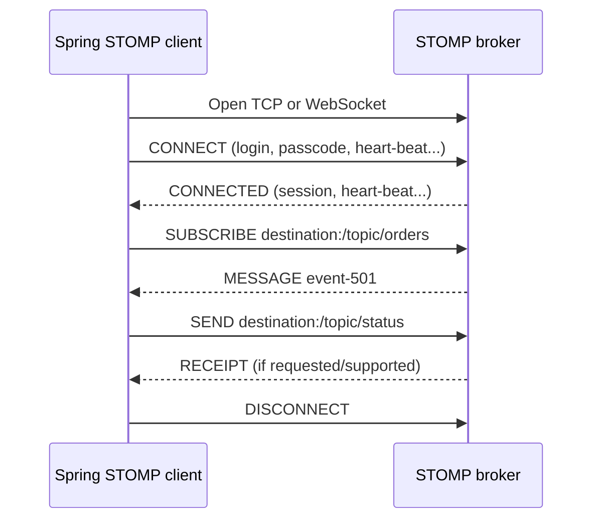
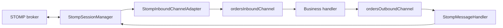

# STOMP Client Session in Spring Integration

## 1. Why Understand Sessions Before Using STOMP Adapters?

A service needs to receive order events from a STOMP broker and simultaneously publish completion events back to the broker. We can create a `StompInboundChannelAdapter` for receiving and a `StompMessageHandler` for sending. However, both require a connection session with the broker: when is the TCP/WebSocket connection established, what credentials are used, how do heartbeats behave, what happens when the connection drops, and who is responsible for closing the session on shutdown?

In the **SPRING_INTEGRATION_ADAPTERS** module, adapters and `MessageChannel` connect external systems to Spring Integration. Specifically for the **STOMP Adapter**, the central component for connection lifecycle is **`StompSessionManager`**, while **`StompSession`** is the connected protocol session used to send `SEND` frames, register `SUBSCRIBE`, receive `MESSAGE` frames, and disconnect.

This lesson dives deep into the **STOMP client session** rather than just adding another inbound or outbound adapter. Understanding sessions helps you avoid mistakes such as opening a connection per message, assuming `isRunning()` means the broker is ready, or thinking reconnects automatically guarantee zero lost events.

**Learning Objectives**

1. Read the STOMP sequence `CONNECT`, `CONNECTED`, `SUBSCRIBE`, `SEND`, `MESSAGE`, and `DISCONNECT` accurately.
2. Distinguish Spring Framework's `StompClientSupport`, `StompSession`, `StompSessionHandler` from Spring Integration's `StompSessionManager`.
3. Configure a shared session manager for both inbound and outbound STOMP adapters.
4. Set STOMP CONNECT headers, heartbeats, receipt timeout, and recovery interval.
5. Understand the two states `isRunning()` and `isConnected()`, how error/receipt events are received, and the impact of stop/restart.
6. Design security, idempotency, retries, monitoring, and message reprocessing controls in production.

## 2. What Is a STOMP Client Session?

STOMP (*Simple Text Oriented Messaging Protocol*) exchanges data via **frames** consisting of a command, headers, and a body. A session is the protocol context between a client and a broker after a successful connection handshake.



Here:

- **Transport connection**: a TCP socket or WebSocket acting as the data transport path.
- **STOMP session**: the protocol state after `CONNECT`/`CONNECTED`, including negotiated heartbeat settings and in-session send/receive operations.
- **Subscription**: a registration to receive messages from a destination **within** a session, not an independent session.
- **Spring `MessageChannel`**: an **internal** application message path; neither a STOMP destination nor a STOMP session.

### Example CONNECT Frame

```text
CONNECT
accept-version:1.2
host:broker.internal.example
login:app-client
passcode:<secret>
heart-beat:10000,10000

^@
```

`^@` illustrates the NUL byte terminating the frame; in a real client, the framework encodes the frame so the application does not concatenate this string manually. The `passcode` value in the example is just a placeholder; **never** put real passwords in logs or documentation.

The broker responds with `CONNECTED` when the protocol accepts session establishment:

```text
CONNECTED
version:1.2
session:broker-session-id
heart-beat:10000,10000

^@
```

Specific headers and supported versions/heartbeats depend on the broker. Opening a TCP connection successfully does not mean the STOMP session has been accepted; distinguish **transport-level** success from **STOMP CONNECT** success.

## 3. Four Easily Confused API Layers

| API | Package | Responsibility |
| --- | --- | --- |
| `StompClientSupport` | Spring Framework `org.springframework.messaging.simp.stomp` | Client factory creating `StompSession` instances and dispatching callbacks to session handlers. |
| `StompSession` | Spring Framework | Represents the active STOMP session; supports `send()`, `subscribe()`, and `disconnect()`. |
| `StompSessionHandler` | Spring Framework | Receives callbacks on connection completion, transport errors, frame handling errors, or `ERROR` frames. |
| `StompSessionManager` | Spring Integration `org.springframework.integration.stomp` | Manages **a shared session** and distributes callbacks to STOMP adapter handlers. |

Spring Integration provides:

- `AbstractStompSessionManager`: base implementation managing lifecycle and aggregating registered `StompSessionHandler` instances.
- `ReactorNettyTcpStompSessionManager`: session manager used with `ReactorNettyTcpStompClient` over TCP.
- `WebSocketStompSessionManager`: session manager used with `WebSocketStompClient` over WebSocket.

**Do not confuse the two `connect` methods:**

- The Spring Framework client creates a session from a transport and a `StompSessionHandler`.
- `StompSessionManager.connect(handler)` registers a handler with the **shared session** management mechanism; it does not mean "create a brand-new TCP connection for this handler."

Similarly, `StompSessionManager.disconnect(handler)` detaches a handler from session management. It should not be called arbitrarily as an operation to "close the physical connection for the whole application" when other adapters still depend on the session.

## 4. Why Does Spring Integration Use a Shared StompSessionManager?

Suppose an application both receives messages from `/topic/orders` and sends results to `/topic/order-status`.



Instead of having the inbound adapter and outbound handler each build their own separate sessions, Spring Integration allows both to use the same `StompSessionManager`. Benefits:

1. Centralized management of CONNECT/disconnect and reconnects.
2. Avoids multiplying session counts just because multiple adapters connect to the same broker.
3. Enables session sharing across handlers registered with the manager.
4. Simplifies credentials, heartbeat, and monitoring configuration.
5. Maintains a relatively consistent lifecycle policy between inbound and outbound.

**Do not infer that session sharing guarantees infinite resources.** One session can hold multiple subscriptions and handle many sends; the broker still enforces quotas, ACLs, frame/connection limits, and backpressure policies. If different isolation levels are needed for tenants, credentials, brokers, or traffic profiles, you may need separate, purpose-built session managers.

### Inside AbstractStompSessionManager

The manager implements `SmartLifecycle`. Per its API, on `start()` it initiates connection establishment, and on `stop()` it manages `StompSession.disconnect()`. Handlers registered via `connect(handler)`/`disconnect(handler)` are aggregated to receive callbacks from the shared session.

Normal applications should let Spring and the adapters manage handler registration and lifecycle instead of calling `start()`, `connect()`, and `disconnect()` from multiple uncoordinated places.

## 5. STOMP/TCP vs. STOMP-over-WebSocket

| Criterion | STOMP/TCP | STOMP-over-WebSocket |
| --- | --- | --- |
| Spring client | `ReactorNettyTcpStompClient` | `WebSocketStompClient` |
| Session manager | `ReactorNettyTcpStompSessionManager` | `WebSocketStompSessionManager` |
| Connection address | Broker-enabled STOMP TCP host/port | `ws://` or `wss://` URL |
| Transport layer | TCP, optionally with TLS per client/broker | WebSocket handshake over HTTP(S), followed by STOMP frame exchange |
| Authentication | STOMP CONNECT headers and TLS/transport config | May require **both** HTTP/WebSocket handshake headers **and** STOMP CONNECT headers |

Do not pass a `wss://` URL directly into the `ReactorNettyTcpStompClient` constructor expecting it to switch to WebSocket automatically. Also do not confuse the WebSocket handshake with the STOMP `CONNECT` frame: they are **two distinct layers**.

In the hands-on exercise, we use STOMP/TCP to minimize moving parts and make the session easy to observe.

## 6. Dependencies and Practice Requirements

With Spring Boot based on a compatible BOM:

```xml
<dependencies>
    <dependency>
        <groupId>org.springframework.boot</groupId>
        <artifactId>spring-boot-starter-integration</artifactId>
    </dependency>
    <dependency>
        <groupId>org.springframework.integration</groupId>
        <artifactId>spring-integration-stomp</artifactId>
    </dependency>
    <dependency>
        <groupId>io.projectreactor.netty</groupId>
        <artifactId>reactor-netty</artifactId>
    </dependency>
</dependencies>
```

This is the choice for a TCP client. If using WebSocket, add the appropriate WebSocket/client dependencies. Do not manually mix incompatible Spring Framework and Spring Integration versions.

Prepare a test broker with STOMP/TCP enabled at `127.0.0.1:61613`, with `/topic/orders` and `/topic/order-status` destinations. Port `61613` is just a common convention in examples; not all brokers enable it by default. If the broker requires login, use a test account with appropriate `SEND`/`SUBSCRIBE` permissions.

## 7. Java Example: One Session Manager for Both Inbound and Outbound

This example configures:

- One `ReactorNettyTcpStompClient` with a scheduler for heartbeats/receipts.
- One `ReactorNettyTcpStompSessionManager` managing the session and automatically requesting receipts where applicable.
- One inbound adapter subscribing to `/topic/orders`.
- One outbound handler sending to `/topic/order-status`.
- Two independent Spring `DirectChannel` beans, so no automatic feedback loop is created.

### 7.1. Configuring Adapters and Session Manager

```java
import org.springframework.beans.factory.annotation.Qualifier;
import org.springframework.context.annotation.Bean;
import org.springframework.context.annotation.Configuration;
import org.springframework.integration.annotation.ServiceActivator;
import org.springframework.integration.channel.DirectChannel;
import org.springframework.integration.config.EnableIntegration;
import org.springframework.integration.stomp.ReactorNettyTcpStompSessionManager;
import org.springframework.integration.stomp.StompSessionManager;
import org.springframework.integration.stomp.inbound.StompInboundChannelAdapter;
import org.springframework.integration.stomp.outbound.StompMessageHandler;
import org.springframework.integration.support.converter.PassThruMessageConverter;
import org.springframework.messaging.Message;
import org.springframework.messaging.MessageChannel;
import org.springframework.messaging.MessageHandler;
import org.springframework.messaging.simp.stomp.ReactorNettyTcpStompClient;
import org.springframework.scheduling.concurrent.ThreadPoolTaskScheduler;

@Configuration
@EnableIntegration
public class SharedStompSessionConfiguration {

    @Bean
    public ThreadPoolTaskScheduler stompTaskScheduler() {
        ThreadPoolTaskScheduler scheduler = new ThreadPoolTaskScheduler();
        scheduler.setPoolSize(2);
        scheduler.setThreadNamePrefix("stomp-heartbeat-");
        return scheduler;
    }

    @Bean
    public ReactorNettyTcpStompClient stompClient(
            ThreadPoolTaskScheduler stompTaskScheduler) {
        ReactorNettyTcpStompClient client =
            new ReactorNettyTcpStompClient("127.0.0.1", 61613);
        client.setMessageConverter(new PassThruMessageConverter());
        client.setTaskScheduler(stompTaskScheduler);
        client.setReceiptTimeLimit(5000);
        return client;
    }

    @Bean
    public ReactorNettyTcpStompSessionManager stompSessionManager(
            ReactorNettyTcpStompClient stompClient) {
        ReactorNettyTcpStompSessionManager manager =
            new ReactorNettyTcpStompSessionManager(stompClient);
        manager.setRecoveryInterval(5000);
        manager.setAutoReceipt(true);
        return manager;
    }

    @Bean
    public MessageChannel ordersInboundChannel() {
        return new DirectChannel();
    }

    @Bean
    public MessageChannel ordersOutboundChannel() {
        return new DirectChannel();
    }

    @Bean
    public StompInboundChannelAdapter ordersInboundAdapter(
            StompSessionManager stompSessionManager,
            @Qualifier("ordersInboundChannel") MessageChannel input) {
        StompInboundChannelAdapter adapter =
            new StompInboundChannelAdapter(
                stompSessionManager, "/topic/orders"
            );
        adapter.setOutputChannel(input);
        adapter.setPayloadType(String.class);
        return adapter;
    }

    @Bean
    @ServiceActivator(inputChannel = "ordersOutboundChannel")
    public MessageHandler ordersOutboundHandler(
            StompSessionManager stompSessionManager) {
        StompMessageHandler handler =
            new StompMessageHandler(stompSessionManager);
        handler.setDestination("/topic/order-status");
        handler.setConnectTimeout(10000);
        return handler;
    }

    @ServiceActivator(inputChannel = "ordersInboundChannel")
    public void handleOrder(Message<?> message) {
        // Production: validate schema, check eventId, persist in DB.
        System.out.println("Incoming order event: " + message.getPayload());
    }
}
```

**Detailed explanation:**

1. `stompClient` connects over STOMP/TCP. `PassThruMessageConverter` follows the message converter path compatible with the example adapters; test actual payload types in your application environment.
2. `stompTaskScheduler` supports heartbeats and receipt timeouts. It **is not a Spring Integration Poller** scanning messages every 5 seconds.
3. `stompSessionManager` manages the shared session, receiving callbacks from both inbound and outbound.
4. `setRecoveryInterval(5000)` sets a reconnect retry interval of roughly 5,000 ms upon disconnect; it does not mean lost messages are automatically re-sent by the broker.
5. `setAutoReceipt(true)` requests automatic receipt headers for eligible frames; a receipt is a protocol-layer confirmation, **not** proof that the handler committed to the DB.
6. The inbound adapter subscribes to `/topic/orders` and sends messages to `ordersInboundChannel`.
7. The outbound handler uses that same manager to send to `/topic/order-status`.
8. The inbound handler only logs; it does not send messages back into the outbound channel, avoiding loops. To respond after successful processing, the application service should emit a **new status message** with an explicit identifier and contract.

**Note:** `setConnectTimeout(10000)` on `StompMessageHandler` bounds how long a send operation waits for the session to become ready; it differs from `setRecoveryInterval(5000)` on the manager. Configuration must ensure the connect timeout exceeds the recovery interval to allow reconnect attempts when needed.

### 7.2. Creating a Service to Publish Status via the Outbound Channel

```java
import org.springframework.beans.factory.annotation.Qualifier;
import org.springframework.messaging.MessageChannel;
import org.springframework.messaging.support.MessageBuilder;
import org.springframework.stereotype.Service;

@Service
public class OrderStatusPublisher {

    private final MessageChannel ordersOutboundChannel;

    public OrderStatusPublisher(
            @Qualifier("ordersOutboundChannel")
            MessageChannel ordersOutboundChannel) {
        this.ordersOutboundChannel = ordersOutboundChannel;
    }

    public void publishStatus(long orderId, String eventId) {
        String body = "orderId=" + orderId
            + ";status=PROCESSED;eventId=" + eventId;

        boolean accepted = ordersOutboundChannel.send(
            MessageBuilder.withPayload(body).build()
        );
        if (!accepted) {
            throw new IllegalStateException(
                "Outbound channel rejected order status"
            );
        }
    }
}
```

In this example, a successful `MessageChannel.send()` does not guarantee the broker received/persisted the frame or that a consumer finished processing it. When high reliability is required, use a durable outbox, bounded retries, and a stable event ID.

## 8. Configuring CONNECT Headers and Security

For the broker to accept a session, the client may need `login`, `passcode`, `host`, and heartbeat policies. `AbstractStompSessionManager` provides `setConnectHeaders(StompHeaders)`.

Example additional configuration snippet:

```java
import org.springframework.messaging.simp.stomp.StompHeaders;

// Inside the method creating StompSessionManager:
StompHeaders headers = new StompHeaders();
headers.setLogin(username);
headers.setPasscode(password);
headers.setHost("broker.internal.example");
headers.setHeartbeat(new long[] {10_000L, 10_000L});

manager.setConnectHeaders(headers);
```

`username` and `password` in the snippet are **values injected from secret configuration**, not built-in Spring defaults; the application must define how they are supplied. For brokers without authentication, these two fields may not be needed. The STOMP CONNECT `host` value must also match the virtual host required by the broker; it does not necessarily match the TCP socket hostname in all brokers.

**Three-layer security:**

1. **Transport**: use TLS when transmitting credentials or real data. With WebSocket that is `wss://`; with TCP, configure a STOMP client/transport with proper TLS support.
2. **STOMP CONNECT**: send credentials/virtual-host per the broker contract, never log `passcode`.
3. **Broker ACL**: the account must only be permitted to `SUBSCRIBE`/`SEND` on required destinations. A successful CONNECT does not mean every destination is accessible.

If using STOMP-over-WebSocket, the WebSocket handshake may require HTTP headers or tokens **separate** from STOMP `CONNECT` headers. Do not mix these two authentication layers.

## 9. Heartbeat: Is the Session Alive?

STOMP supports the `heart-beat` header in `CONNECT` and `CONNECTED`. Both sides exchange their heartbeat send/receive capabilities and negotiate an interval per the protocol. For example:

```text
Client: heart-beat:10000,10000
Broker: heart-beat:10000,10000
```

Per STOMP semantics, these numbers represent the minimum desired intervals between send/receive activity in milliseconds; actual pacing depends on the capabilities advertised by both sides. Do not treat this as a promise that the broker will emit business messages every 10 seconds.

Heartbeats and polling are two different things:

| Property | STOMP Heartbeat | Spring Integration Poller |
| --- | --- | --- |
| Purpose | Monitor session liveness when traffic is low | Pull data from a source via `receive()` |
| Unit | Protocol-layer signal cadence | Fixed-rate/fixed-delay/cron trigger |
| When no business messages exist | Heartbeats may still occur | Poller may receive `null` |
| Data path | STOMP connection | `MessageSource -> MessageChannel` |

Heartbeats help detect broken connections, **not** guarantee every network issue is detected instantaneously. Proxies, load balancers, saturated schedulers, or overloaded brokers can affect heartbeat delivery/receipt; configure timeouts and alerts per environment.

### When Using WebSocketStompClient

Per Spring Framework, `WebSocketStompClient` can be assigned a `TaskScheduler` to support heartbeats and receipt timeouts. A condensed example:

```java
import org.springframework.messaging.simp.stomp.WebSocketStompClient;
import org.springframework.web.socket.client.standard.StandardWebSocketClient;

WebSocketStompClient client =
    new WebSocketStompClient(new StandardWebSocketClient());
client.setTaskScheduler(stompTaskScheduler);
```

If switching completely to WebSocket, the corresponding session manager can be created via the API:

```java
import org.springframework.integration.stomp.WebSocketStompSessionManager;

WebSocketStompSessionManager manager =
    new WebSocketStompSessionManager(
        client, "wss://broker.internal.example/stomp"
    );
```

These two snippets are an **alternative option**, not meant to run concurrently with the TCP client for the same purpose in this lab. WebSocket transport also requires the appropriate `spring-websocket`/HTTP client dependencies, TLS configuration, and potentially separate handshake headers.

## 10. Lifecycle: Running Differs from Connected

`AbstractStompSessionManager` implements `SmartLifecycle` and provides:

- `setAutoStartup(boolean)`: whether the manager starts automatically with the application context.
- `setPhase(int)`: relative order when lifecycle beans are started/stopped by Spring.
- `start()` and `stop()`: start and stop the manager's lifecycle.
- `isRunning()`: lifecycle state of the manager.
- `isConnected()`: whether the session is connected according to the manager.
- `setRecoveryInterval(int)`: time between connection recovery attempts.

**`isRunning()` does not imply `isConnected()`.** The manager may still be running and attempting to connect while the broker is unreachable and no session is available. Conversely, even when `isConnected() == true`, a specific subscription could still be rejected by the broker or have no publisher sending data.

| Running | Connected | Common interpretation |
| --- | --- | --- |
| `false` | `false` | Manager has not started yet or has stopped. |
| `true` | `false` | Manager is active, but the session is not ready or is reconnecting. |
| `true` | `true` | A STOMP session exists, though subscriptions and business processing are not yet verified. |

This is an operational interpretation, not an absolute state-machine contract at every instant; states can change asynchronously.

### Checking the Session Manager in the Application

```java
import org.springframework.integration.stomp.StompSessionManager;
import org.springframework.stereotype.Component;

@Component
public class StompConnectionStatus {

    private final StompSessionManager sessionManager;

    public StompConnectionStatus(StompSessionManager sessionManager) {
        this.sessionManager = sessionManager;
    }

    public boolean isConnected() {
        return sessionManager.isConnected();
    }
}
```

If you also need to check lifecycle state:

```java
import org.springframework.integration.stomp.ReactorNettyTcpStompSessionManager;

boolean running = manager.isRunning();
boolean connected = manager.isConnected();
```

In this snippet, the `manager` variable of type `ReactorNettyTcpStompSessionManager` is injected at a management component; this is not a globally available built-in API. Use these values for controlled metrics/health indicators, and do not expose an administrative REST endpoint allowing arbitrary users to invoke `start()` or `stop()`.

### Stop/Start and Shutdown

When `stop()` is called, the manager handles disconnecting the session; adapters relying on the session will be unable to send/receive until the session is active again. `stop()` does not mean all downstream workers have finished or DB transactions have committed/rolled back. When the application shuts down:

1. Stop producing new messages to send to the broker if needed.
2. Give in-flight workers a bounded window to complete.
3. Persist checkpoints/outbox/retry state in durable storage.
4. Disconnect the session/transport in a controlled manner and track resource release.

Do not use `manager.stop()` as a routine way to "reset the connection" on transient errors when recovery is already configured. Lifecycle commands should go through audited operational procedures.

## 11. Reconnecting: Recovery Interval Is Not Business Retry

`AbstractStompSessionManager#setRecoveryInterval(5000)` configures the delay between session recovery attempts upon disconnection. For example:

```text
T0    : Broker disconnects
T0+5s : Manager may attempt to reconnect
T0+10s: If still failing, continues per recovery interval
T1    : Broker is ready, a CONNECT attempt succeeds
      : Adapters restore subscriptions/sending capability per their lifecycle
```

This is a **conceptual** model and does not guarantee millisecond-exact reconnect scheduling; connection attempts involve timeouts, network jitter, and client policies. More importantly:

- Reconnecting **does not automatically recover** messages discarded by the broker while no subscriber was present.
- A `SEND` before the network drop may have reached the broker without the client receiving a receipt; resending can emit duplicates.
- Resubscription depends on the adapter/session manager and the broker. Verify active subscription counts after reconnect.
- When many instances lose connectivity together, simultaneous reconnect attempts can create load spikes; consider jitter/coordination at the operational layer if needed.
- The recovery interval controls **connectivity**, not DB write retries, invalid-schema handling, or replacing dead-letter/quarantine queues.

For high-value data, proactively verify retention, durable subscriptions, ack modes, idempotency, transactional outbox, and post-outage reconciliation.

## 12. Receipt, ACK/NACK, and Business Commit

These three events play distinct roles:

| Mechanism | Confirmed milestone | What it does NOT prove |
| --- | --- | --- |
| `RECEIPT` | Broker responded to a client frame requesting a receipt, e.g. `SEND` or `SUBSCRIBE` | That the subscriber saved the business outcome successfully. |
| `ACK/NACK` | Client acknowledged or rejected a delivery per ack mode and broker | That a JDBC transaction automatically spans the broker. |
| Business commit | Application wrote to the DB and confirmed business completion | Does not automatically replace broker acknowledgement. |

`StompSession` supports `setAutoReceipt(true)` and `Receiptable` for `send`/`subscribe` operations. In Spring Integration, `StompSessionManager#setAutoReceipt(true)` can enable appropriate receipt requests on the managed session. `StompClientSupport#setReceiptTimeLimit(5000)` limits the receipt wait window, not handler execution time.

### Receipt Mechanism and Callbacks

In an example using Spring Framework's `StompSession` directly:

```java
import org.springframework.messaging.simp.stomp.StompSession;

// session is a connected StompSession.
StompSession.Receiptable receipt =
    session.send("/topic/order-status", "orderId=501;status=DONE");

receipt.addReceiptTask(
    () -> System.out.println("Broker accepted SEND with receipt")
);
receipt.addReceiptLostTask(
    () -> System.err.println("Receipt not observed before timeout")
);
```

This snippet only illustrates the **Spring Framework-layer** API; it does not replace `StompMessageHandler` in a Spring Integration flow. You must request a `receipt` (via auto receipt or header) and configure an appropriate scheduler/receipt timeout for callbacks to reflect meaningful receipt waiting.

**A receipt timeout does not mean the broker definitely never received the frame.** If the broker received `SEND` but the `RECEIPT` was lost, retrying can create duplicate messages. Use stable event IDs and idempotent consumers.

### Subscription ACK/NACK

STOMP has common ack modes such as `auto`, `client`, and `client-individual`. Ack relates to when the broker considers a delivery confirmed, which does not mean a Spring Integration handler definitely committed to the database.

When designing manual acknowledgement, check the actual API and broker/adapter contract; do not assume a single `ackMode` property exists on every STOMP inbound adapter or works identically to JMS/AMQP acknowledgement.

## 13. StompSessionHandler and Callbacks Without a Session Manager

In Spring Framework, a plain STOMP client can register a `StompSessionHandler`. The handler receives callbacks such as:

- `afterConnected(StompSession session, StompHeaders connectedHeaders)`: the STOMP session is established.
- `handleException(...)`: error while handling a frame.
- `handleTransportError(...)`: transport error, e.g., connection loss.
- `handleFrame(...)`: can receive `ERROR` frames on the appropriate handler.

Illustrative example:

```java
import org.springframework.messaging.simp.stomp.StompHeaders;
import org.springframework.messaging.simp.stomp.StompSession;
import org.springframework.messaging.simp.stomp.StompSessionHandlerAdapter;

public class SimpleSessionObserver extends StompSessionHandlerAdapter {

    @Override
    public void afterConnected(
            StompSession session,
            StompHeaders connectedHeaders) {
        System.out.println("STOMP session ready: " + session.getSessionId());
    }

    @Override
    public void handleTransportError(
            StompSession session, Throwable exception) {
        System.err.println(
            "Transport failed: " + exception.getClass().getSimpleName()
        );
    }
}
```

This is the **direct Spring Framework STOMP client path**. When building a Spring Integration flow with `StompSessionManager` and inbound/outbound adapters, do not create an extra standalone client-session-connection just to listen to the same destination. To observe the whole flow, use Spring Integration events and manager status.

## 14. StompIntegrationEvent and Observing Session Issues

Many STOMP operations are asynchronous, so Spring Integration provides **`StompIntegrationEvent`** to publish notifications to Spring application listeners.

Example:

```java
import org.springframework.context.event.EventListener;
import org.springframework.integration.stomp.event.StompIntegrationEvent;
import org.springframework.stereotype.Component;

@Component
public class StompEventsObserver {

    @EventListener
    public void onStompEvent(StompIntegrationEvent event) {
        System.out.printf(
            "STOMP event type=%s%n",
            event.getClass().getSimpleName()
        );
    }
}
```

Typical events:

- **`StompExceptionEvent`**: connection or protocol errors published by Spring Integration STOMP components.
- **`StompReceiptEvent`**: receipt result when a receipt was requested and the callback succeeded or timed out.

**Do not confuse protocol events with business messages** received from `/topic/orders`. A `StompReceiptEvent` is not an order event. Event handlers should not feed operational events straight into business flows.

### Recommended Monitoring Metrics

| Metric | Why it is needed |
| --- | --- |
| Manager `isRunning` and `isConnected` | Distinguish lifecycle state from broker connectivity. |
| Successful CONNECTs, failed reconnects | Track network, credentials, and broker stability. |
| Time from disconnect to connected | Measure actual downtime, not just the configured recovery interval. |
| Active subscription count | A connected session does not guarantee valid subscriptions. |
| Last business event received | Distinguish a quiet broker from a stalled service. |
| Positive/negative receipts, timeouts | Assess outbound activity, without conflating it with business commits. |
| Converter/handler errors, downstream queue depth | Detect processing bottlenecks downstream of the STOMP session. |
| Uncommitted message age and duplicate events | Monitor recovery capability and data correctness. |

The `isConnected()` metric is useful but insufficient on its own. To assess true health, combine session state, subscriptions, frame throughput, and downstream status.

## 15. Multi-Instance Operation and Resource Limits

A `StompSessionManager` manages a session within **a single application context/JVM**; it does not synchronize sessions with managers on other replicas.

```text
Replica A -> StompSessionManager A -> STOMP session A
Replica B -> StompSessionManager B -> STOMP session B
Replica C -> StompSessionManager C -> STOMP session C
                                  |
                                  v
                              STOMP broker
```

If three replicas all subscribe to a topic, the broker may deliver the same event to all three. If subscribing to a queue, the broker may distribute across consumers depending on the broker and ack mode. Do not infer that one session manager per replica automatically forms a shared consumer group.

**Risks to manage:**

1. Brokers impose connection and subscription limits per user/host.
2. Each session may require heartbeat/scheduler resources and network buffers.
3. One adapter receiving many destinations can drive high aggregate traffic; downstream systems need bounded queues/backpressure.
4. Multiple replicas publishing events can cause out-of-order arrivals globally; use idempotency and key-based partitioning if ordering matters.
5. Disconnection on one replica does not automatically cause other replicas to take over every subscription/durable state.

Do not create a new `ReactorNettyTcpStompClient`/session manager for **every outgoing message**. Manage lifecycle-aware beans and share connections appropriately based on broker, credentials, isolation boundaries, and load.

## 16. Common Errors and Diagnostics

| Symptom | Check |
| --- | --- |
| TCP connection opens, but STOMP is not connected | CONNECT headers, login/passcode, virtual host, STOMP version, broker ERROR. |
| Manager `isRunning=true`, `isConnected=false` | Broker unavailable, reconnecting, network/TLS/credentials error. |
| `isConnected=true`, but inbound receives no messages | Destination, ACL, SUBSCRIBE, publisher, topic/queue semantics. |
| Outbound SEND fails because session is not ready | Connect timeout, recovery interval, manager and broker state. |
| Continuous reconnects | Overloaded broker, firewall/proxy, heartbeat mismatch, bad credentials. |
| Receipts never arrive | Not supported/requested on broker, timeout, or network loss. |
| Many duplicate events after reconnect | Broker redelivery, multiple replica subscriptions, publisher retries. |
| Events lost while client offline | Retention, durable subscriptions, ack mode, reconciliation/replay. |
| Business handler fails while session stays connected | Error flow, DB transaction, idempotency, and downstream retry. |
| Prolonged shutdown | Unfinished workers/queues, network timeouts, lifecycle phase, and drain policy. |

### A Troubleshooting Scenario

The application logs `isConnected=true`, yet no orders have been created for 10 minutes. Do not rush to restart the session manager. Check in order:

1. Is the broker actually publishing events to the destination?
2. Did the adapter subscribe to the right destination and have receive permission?
3. Did messages reach the output `MessageChannel`, or are there conversion/filter/dispatch errors?
4. Are downstream handlers experiencing full queues or DB timeouts?
5. Are events being dropped due to idempotency keys or already-processed status?

This avoids mistaking a business failure for a connection failure and prevents extra data loss from unnecessary restarts.

## 17. Exercises with Answers

**Exercise 1 — Roles.** How do `StompClientSupport` and `StompSessionManager` differ?

**Answer:** The client handles establishing a `StompSession` over a transport with callbacks; Spring Integration's manager manages a **shared session** for handlers/adapters along with lifecycle and recovery.

**Exercise 2 — CONNECTED.** A TCP socket opened, but the broker has not returned `CONNECTED`. Can the STOMP session be considered ready?

**Answer:** No. The STOMP protocol handshake must complete first.

**Exercise 3 — Inbound and outbound.** Must two adapters using the same broker always create two separate managers?

**Answer:** No. They can share one `StompSessionManager` when compatible with broker, credentials, and isolation requirements.

**Exercise 4 — Recovery.** Does `setRecoveryInterval(5000)` mean all messages missed while the broker was offline are automatically replayed after 5 seconds?

**Answer:** No. It governs reconnect timing; replay depends on the broker, retention, subscriptions, and acks.

**Exercise 5 — Auto receipt.** Does `setAutoReceipt(true)` mean the consumer's DB commits automatically after each event?

**Answer:** No. A receipt is a protocol confirmation for eligible frames, not a business confirmation.

**Exercise 6 — Running vs connected.** The manager reports `isRunning() == true` and `isConnected() == false`. Is this necessarily a lifecycle code bug?

**Answer:** No. The manager may be active while still establishing the session or recovering the connection.

**Exercise 7 — Heartbeat.** Client and broker exchange heartbeats every 10 seconds. Does this force the broker to send a business `MESSAGE` every 10 seconds?

**Answer:** No. Heartbeats only check connection liveness at the protocol layer.

**Exercise 8 — WebSocket.** Can a STOMP/TCP client connect directly to a `wss://broker/stomp` URL simply by changing the host parameter?

**Answer:** No. You need `WebSocketStompClient` and `WebSocketStompSessionManager` with proper handshake/TLS configuration.

**Exercise 9 — Three replicas.** Can three instances subscribing to `/topic/orders` all receive the same event?

**Answer:** Possibly. It depends on broker semantics; appropriate distribution and idempotency mechanisms are required.

**Exercise 10 — Stopping the manager.** Does `stop()` automatically finish DB transactions for all running downstream handlers?

**Answer:** No. Separate worker draining, timeouts, and recovery/transaction handling are required.

**Exercise 11 — Receipt timeout.** A `SEND` reached the broker, but the `RECEIPT` was lost. If the client resends, can it cause duplicates?

**Answer:** Yes. Use stable event IDs, idempotent consumers, and bounded retry/backoff.

**Exercise 12 — CONNECT headers.** Should username and password be written directly in Java source code or logged in CONNECT frames?

**Answer:** No. Read them from a secret store, use TLS, restrict access permissions, and scrub secrets from logs.

## 18. Key Takeaways

A **STOMP client session** is the protocol session established after `CONNECT/CONNECTED`, where a client can `SUBSCRIBE`, `SEND`, and receive frames from the broker. Spring Framework provides `StompClientSupport`, `StompSession`, and `StompSessionHandler` callbacks; Spring Integration provides **`StompSessionManager`** to manage a shared session for `StompInboundChannelAdapter` and `StompMessageHandler`. `SmartLifecycle` manages start/stop, `isConnected()` reports whether the session is connected, `setRecoveryInterval(...)` throttles reconnects, and heartbeats help detect inactive connections. None of these mechanisms automatically guarantees broker message replay, handler DB commits, or exactly-once processing. Reliable integration requires securing connections, controlling subscriptions/acks, tracking receipts, implementing idempotency, and having strategies for retries, state persistence, and reconciliation.

## References

- [Spring Integration Reference — STOMP Support](https://docs.spring.io/spring-integration/reference/stomp.html)
- [Spring Integration API — StompSessionManager](https://docs.spring.io/spring-integration/api/org/springframework/integration/stomp/StompSessionManager.html)
- [Spring Integration API — AbstractStompSessionManager](https://docs.spring.io/spring-integration/api/org/springframework/integration/stomp/AbstractStompSessionManager.html)
- [Spring Integration API — WebSocketStompSessionManager](https://docs.spring.io/spring-integration/api/org/springframework/integration/stomp/WebSocketStompSessionManager.html)
- [Spring Framework Reference — STOMP Client](https://docs.spring.io/spring-framework/reference/web/websocket/stomp/client.html)
