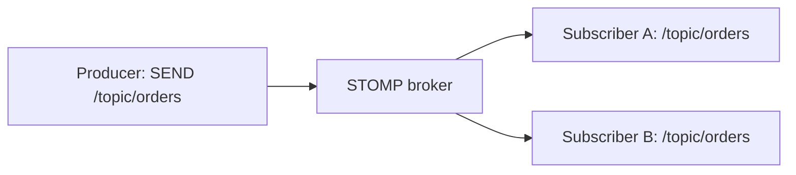
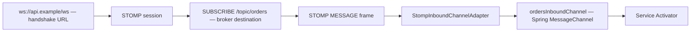
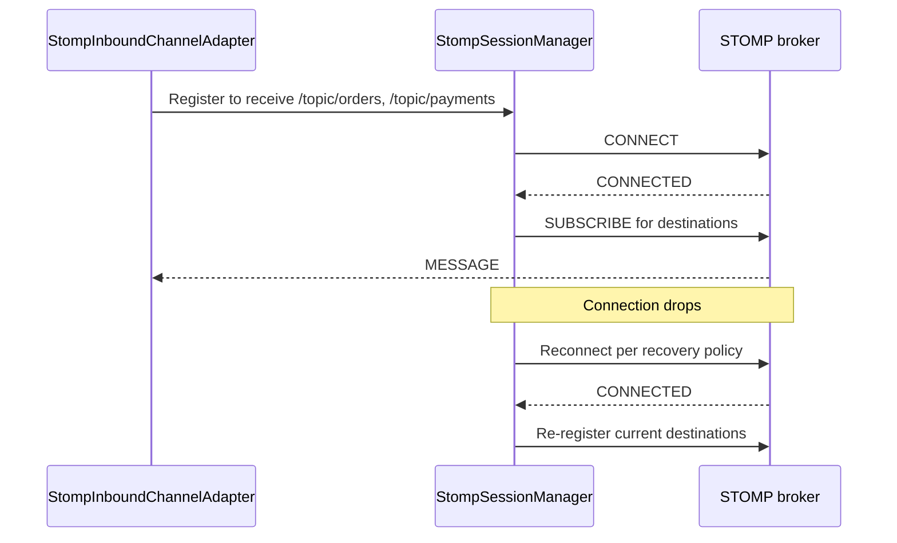

# Destination Prefixes and Subscriptions in Spring Integration STOMP

## 1. Problem Statement: Why Does the Same Destination String Produce Different Results?

An ordering service sends an `ORDER_CREATED` event to the `/topic/orders` destination. A Spring Integration application uses `StompInboundChannelAdapter` to subscribe, then forwards the event to a `MessageChannel` for a handler to update data. Everything works in the test environment, but after switching brokers, the subscriber receives nothing. In another case, the team sends to `/app/orders` and expects the broker to broadcast that event to `/topic/orders` subscribers.

The issue usually is not in the JSON content, but in **how destinations and prefixes are defined**: what belongs to the STOMP protocol, what is decided by the broker, what is Spring WebSocket's application routing mechanism, and where the subscription is actually registered?

In the **SPRING_INTEGRATION_ADAPTERS** module, inbound/outbound adapters connect external systems with `MessageChannel` via message contracts, connections, and error handling. In the **STOMP Adapter** chapter, `StompInboundChannelAdapter` subscribes to a destination to **receive** frames from the broker, while `StompMessageHandler` uses a destination to **send** frames to the broker. If prefixes are misunderstood, both endpoints may run without errors at the Java layer yet fail to exchange data properly.

**Learning Objectives:**

1. Understand what `destination` means in STOMP 1.2 and why `/topic` and `/queue` have no fixed semantics in the protocol itself.
2. Distinguish broker destination prefixes, Spring WebSocket `/app`, `/topic`, `/queue`, `/user`, and WebSocket connection URLs.
3. Write `StompInboundChannelAdapter` configurations subscribing to one or multiple destinations, and manage subscription changes at runtime.
4. Use `StompMessageHandler` to send to the right destination, either static or computed from validated headers.
5. Understand `SUBSCRIBE`, subscription `id`, `UNSUBSCRIBE`, `MESSAGE.subscription`, `ack`, receipts, and reconnects.
6. Design configuration, authorization, idempotency, monitoring, and testing tailored to each broker.

## 2. What Is a Destination According to the STOMP Protocol?

According to STOMP 1.2, `destination` in a `SEND` or `SUBSCRIBE` frame is a **target identifier string** that the broker is responsible for interpreting. The protocol requires this header in both frame types, **but does not mandate** that every string starting with `/topic/` must fan out or every string starting with `/queue/` must have competing consumers.

Examples of two frames:

```text
SEND
destination:/topic/orders
content-type:application/json

{"eventId":"evt-501","orderId":501}
^@
```

```text
SUBSCRIBE
id:orders-sub-1
destination:/topic/orders
ack:auto

^@
```

`^@` represents the **NUL byte** terminating a STOMP frame, not two literal characters to send. When an application uses the Spring Framework STOMP client, the framework builds protocol-compliant frames; you do not concatenate strings manually.

**Key point:** `/topic/orders` is a **value chosen per the broker or application contract**, not a keyword the STOMP protocol forces every implementation to interpret as a topic. Each broker may have its own conventions for destination names, dynamic destination creation, retention, delivery, access control, and subscription durability.

| Example string | Possible meaning | What MUST be verified |
| --- | --- | --- |
| `/topic/orders` | Topic/broadcast by broker convention | Does the broker accept this prefix, and does it support fan-out and retention? |
| `/queue/order-jobs` | Queue with competing consumers | How does the broker distribute across subscribers, and how do ACK/redelivery work? |
| `/app/orders` | In a configured **Spring WebSocket server**, may route to an application controller | Does a direct STOMP broker understand `/app`? Usually cannot be assumed. |
| `/user/queue/updates` | In a Spring WebSocket server, may be a logical user destination | Are `UserDestinationMessageHandler`/user prefix and corresponding user session configured? |
| `orders.events` | Arbitrary name accepted by a broker | Does the broker have valid mapping, security ACLs, and delivery definitions? |

The STOMP specification describes destination as an **opaque** string at the protocol level; prioritize your specific broker's documentation and server configuration in real designs.

## 3. Four Easily Confused Prefix Types

### 3.1. Broker Destination Prefix

Some brokers adopt naming conventions like `/topic/...` or `/queue/...` to distinguish destination types. However, this convention is **not universal**; a broker may require a different name or mapping.

Example when the broker supports `/topic/orders`:



This diagram illustrates **fan-out** when the broker is configured for a topic; it is not guaranteed by the `/topic` name across every implementation. For queues, a broker may deliver a message to one competing consumer, yet consumer selection, TTL, durable subscriptions, and ack rules remain broker-defined.

### 3.2. Spring WebSocket Application Destination Prefix

If the Spring application itself acts as a **STOMP-over-WebSocket server**, you might configure:

```java
@Configuration
@EnableWebSocketMessageBroker
public class WebSocketBrokerConfig
        implements WebSocketMessageBrokerConfigurer {

    @Override
    public void registerStompEndpoints(
            StompEndpointRegistry registry) {
        registry.addEndpoint("/ws");
    }

    @Override
    public void configureMessageBroker(
            MessageBrokerRegistry registry) {
        registry.setApplicationDestinationPrefixes("/app");
        registry.enableSimpleBroker("/topic", "/queue");
    }
}
```

With this **server-side** configuration:

- The WebSocket handshake happens at a URL like `ws://host:port/ws` (or `wss://` over TLS). `/ws` is the **connection path**, not a destination for business subscriptions.
- A STOMP `SEND destination:/app/orders` is handled by Spring via application destination routing, e.g., to a `@MessageMapping("/orders")` method.
- A STOMP `SUBSCRIBE destination:/topic/orders` is handled by the simple broker according to enabled prefixes.
- `/app` is typically a prefix for clients to **send into application handlers**, not somewhere clients subscribe expecting direct broadcasts from the simple broker.

```java
@Controller
public class OrdersWebSocketController {

    @MessageMapping("/orders")
    @SendTo("/topic/orders")
    public OrderEvent handle(OrderCommand command) {
        // Validate and process business logic, then build the response event.
        return new OrderEvent(command.orderId(), "ACCEPTED");
    }
}
```

This is an **illustrative snippet**: `OrderCommand` and `OrderEvent` are application-defined DTOs; annotations must be imported from Spring Messaging/Spring WebSocket and a JSON converter configured. `@SendTo` does not turn every frame sent to `/app/orders` into a success event; outcomes still depend on the controller and business logic.

### 3.3. Spring Broker Prefix

In `enableSimpleBroker("/topic", "/queue")`, Spring configures destination prefixes handled by the **internal simple broker**. An alternative is `enableStompBrokerRelay("/topic", "/queue")` when using a broker relay to forward frames to an external broker. Both broker modes must be configured deliberately—do not carelessly enable the same routing prefix on both expecting both to receive.

**Clear distinction:** `/topic` in a Spring WebSocket server is a prefix chosen by the server to route to the broker layer. `/topic` in an external STOMP broker is that broker's convention/contract. Even if spelled identically, they are **not automatically the same system**.

### 3.4. User Destination Prefix

Spring WebSocket includes `UserDestinationMessageHandler` to process logical destinations of the form `/user/...`. For example:

```text
Client subscribe: /user/queue/notifications
Server send:     /user/{username}/queue/notifications
```

In a Spring WebSocket application configured with user destinations, these destinations can be transformed into user/session-specific addresses. Do **not** assume `/user` is a default capability of every standalone STOMP broker. When using only a Spring Integration TCP client connected directly to a broker, whether the `/user` prefix has any meaning depends on that broker and its configured routing.

## 4. Distinguishing Endpoint URLs, Broker Destinations, and Spring MessageChannels



| Property | Where is it used? | Example |
| --- | --- | --- |
| WebSocket endpoint | Transport connection between client and server | `wss://api.example/ws` |
| STOMP virtual host header | `CONNECT` frame, selects virtual host when supported by broker | `host:broker.internal` |
| STOMP destination | `SEND`, `SUBSCRIBE`, and `MESSAGE` frames | `/topic/orders` |
| STOMP subscription ID | Identifies a subscription **within one session** | `orders-sub-1` |
| Spring `MessageChannel` | Internal path downstream of the adapter | `ordersInboundChannel` |
| Spring application prefix | Routing inside a **Spring WebSocket server** | `/app` |

Do not reuse a single `destination` variable for all of these concepts. For example, do not pass `wss://api.example/ws` into `StompInboundChannelAdapter` expecting it to connect to WebSocket; the adapter takes **STOMP destinations**, while the session manager/client handles the URL/transport.

## 5. SUBSCRIBE, Subscription IDs, and MESSAGE.subscription

### 5.1. One Session Can Have Multiple Subscriptions

`SUBSCRIBE` requires two headers:

- `destination`: the target to listen to.
- `id`: a unique subscription identifier **within the same STOMP connection**.

Example:

```text
SUBSCRIBE
id:orders-0
destination:/topic/orders
ack:auto

^@

SUBSCRIBE
id:payments-0
destination:/topic/payments
ack:auto

^@
```

When the broker delivers an event for the first subscription, the frame looks like:

```text
MESSAGE
subscription:orders-0
message-id:broker-evt-501
destination:/topic/orders
content-type:application/json

{"eventId":"evt-501","orderId":501}
^@
```

The `subscription` header in the `MESSAGE` frame lets the client correlate the message with a prior `SUBSCRIBE id`. `message-id` is a broker-assigned message identifier, **not** the subscription ID or Spring `MessageHeaders.ID`.

In Spring Framework, subscription IDs can be generated and managed by the client/session. With `StompInboundChannelAdapter`, let the adapter/session manage registration and keep the required subscription metadata; **do not manually create a duplicate subscription to the same destination** unless you genuinely need a separate consumption flow.

### 5.2. When Do You Need UNSUBSCRIBE?

Per STOMP 1.2, `UNSUBSCRIBE` uses the **subscription id**:

```text
UNSUBSCRIBE
id:orders-0

^@
```

Once the broker processes the unsubscribe, that session stops receiving messages from that subscription. However:

- It does not mean the broker deletes the destination.
- It does not delete messages already passed into a `MessageChannel` or downstream queues.
- It does not roll back handlers/DB transactions already executed.
- It does not automatically disconnect the entire STOMP session if other subscriptions remain.

When the application wants to change destinations, use the adapter's subscription management API rather than sending raw `UNSUBSCRIBE` frames that conflict with the adapter's internal state.

## 6. Spring Integration Example: Subscribing to Multiple Destinations

### 6.1. Components and Dependencies

The example below uses Spring Integration with a STOMP/TCP broker at `127.0.0.1:61613`; the broker is assumed to support `/topic/orders` and `/topic/payments`.

```xml
<dependencies>
    <dependency>
        <groupId>org.springframework.boot</groupId>
        <artifactId>spring-boot-starter-integration</artifactId>
    </dependency>
    <dependency>
        <groupId>org.springframework.integration</groupId>
        <artifactId>spring-integration-stomp</artifactId>
    </dependency>
    <dependency>
        <groupId>io.projectreactor.netty</groupId>
        <artifactId>reactor-netty</artifactId>
    </dependency>
</dependencies>
```

Use compatible Spring Boot BOM / Spring Integration BOM versions. If using STOMP-over-WebSocket instead of TCP, change the client, session manager, endpoint URL, and transport dependencies accordingly; do not just edit the host string.

### 6.2. Java Configuration

```java
import java.nio.charset.StandardCharsets;

import org.springframework.beans.factory.annotation.Qualifier;
import org.springframework.context.annotation.Bean;
import org.springframework.context.annotation.Configuration;
import org.springframework.integration.annotation.ServiceActivator;
import org.springframework.integration.channel.DirectChannel;
import org.springframework.integration.config.EnableIntegration;
import org.springframework.integration.stomp.ReactorNettyTcpStompSessionManager;
import org.springframework.integration.stomp.StompSessionManager;
import org.springframework.integration.stomp.inbound.StompInboundChannelAdapter;
import org.springframework.integration.support.converter.PassThruMessageConverter;
import org.springframework.messaging.Message;
import org.springframework.messaging.MessageChannel;
import org.springframework.messaging.simp.stomp.ReactorNettyTcpStompClient;
import org.springframework.scheduling.concurrent.ThreadPoolTaskScheduler;

@Configuration
@EnableIntegration
public class MultiDestinationStompInboundConfig {

    @Bean
    public ThreadPoolTaskScheduler stompClientScheduler() {
        ThreadPoolTaskScheduler scheduler = new ThreadPoolTaskScheduler();
        scheduler.setPoolSize(2);
        scheduler.setThreadNamePrefix("stomp-client-");
        return scheduler;
    }

    @Bean
    public ReactorNettyTcpStompClient stompClient(
            ThreadPoolTaskScheduler stompClientScheduler) {
        ReactorNettyTcpStompClient client =
            new ReactorNettyTcpStompClient("127.0.0.1", 61613);
        client.setMessageConverter(new PassThruMessageConverter());
        client.setTaskScheduler(stompClientScheduler);
        client.setReceiptTimeLimit(5000);
        return client;
    }

    @Bean
    public StompSessionManager stompSessionManager(
            ReactorNettyTcpStompClient stompClient) {
        ReactorNettyTcpStompSessionManager manager =
            new ReactorNettyTcpStompSessionManager(stompClient);
        manager.setAutoReceipt(true);
        return manager;
    }

    @Bean
    public MessageChannel incomingBrokerEvents() {
        return new DirectChannel();
    }

    @Bean
    public StompInboundChannelAdapter brokerEventAdapter(
            StompSessionManager stompSessionManager,
            @Qualifier("incomingBrokerEvents") MessageChannel output) {

        StompInboundChannelAdapter adapter =
            new StompInboundChannelAdapter(
                stompSessionManager,
                "/topic/orders",
                "/topic/payments"
            );
        adapter.setOutputChannel(output);
        adapter.setPayloadType(String.class);
        return adapter;
    }

    @ServiceActivator(inputChannel = "incomingBrokerEvents")
    public void handleBrokerEvent(Message<?> message) {
        Object payload = message.getPayload();
        String body = (payload instanceof byte[] bytes)
            ? new String(bytes, StandardCharsets.UTF_8)
            : String.valueOf(payload);

        // TODO: read destination header provided by mapper,
        // validate eventType/schema, and route business logic.
        System.out.printf(
            "Spring message=%s, body=%s%n",
            message.getHeaders().getId(), body
        );
    }
}
```

**Explanation:**

1. `ReactorNettyTcpStompClient` creates a TCP connection to the broker. `ThreadPoolTaskScheduler` supports STOMP heartbeats/receipt timeouts; it is **not** a Poller periodically polling a source.
2. `StompSessionManager` manages the shared session.
3. `StompInboundChannelAdapter` registers two broker destinations on the same adapter.
4. `incomingBrokerEvents` is an **internal** `DirectChannel`, not a broker topic; messages from both destinations enter the same channel.
5. The handler needs to determine the event type from the **mapped destination header** or an `eventType` field in the payload. Never assume every payload is an order.
6. `setPayloadType(String.class)` expresses the desired target type; the actual received payload type depends on the converter and frame. In production, validate schema/charset instead of printing arbitrary bodies.

The example uses Java 17 for `instanceof` pattern matching. Before running, ensure the broker actually accepts both destinations and the client account is permitted to `SUBSCRIBE`.

### 6.3. Two Subscriptions, One Output Channel

```text
Broker:
  /topic/orders ------+
                      +--> StompInboundChannelAdapter
  /topic/payments -----+             |
                                     v
                            incomingBrokerEvents
                                     |
                                     v
                              event handler/router
```

Two different destinations do not necessarily require two `MessageChannel` beans in the application. One inbound adapter can funnel events into one channel and then use a router. Conversely, if the two data types have different SLAs, security, retries, and retention, you can split into separate adapters/flows with dedicated permissions and metrics.

## 7. Adding or Removing Subscriptions at Runtime

Spring Integration provides managed operations directly on `StompInboundChannelAdapter`:

```java
adapter.addDestination("/topic/returns");
adapter.removeDestination("/topic/payments");
```

When the adapter/session is operational, these methods update the destination list and perform the corresponding subscribe/unsubscribe according to the adapter's mechanics.

### Why Use the Adapter's API?

`StompInboundChannelAdapter` owns the state of the destination list. If the application grabs `StompSession` directly and calls `subscribe(...)` or sends `UNSUBSCRIBE` for a subscription created by the adapter without notifying the adapter, subscription management metadata can drift from the broker. After reconnect, the adapter may resubscribe according to the list it holds, diverging from the state you thought you changed.

**Administrative steps to follow:**

1. Authenticate/authorize the subscription change request.
2. Verify the destination is in the **allowlist** and supported by the broker.
3. Call `addDestination(...)` or `removeDestination(...)` on the **exact adapter bean**.
4. Monitor `SUBSCRIBE`/`UNSUBSCRIBE` errors, subscription receipts if configured, and actual frame receipt status.
5. Write audit logs: instance, destination, actor, timestamp, outcome, and reason.

### Example Administrative Service with an Allowlist

```java
import java.util.Set;

import org.springframework.stereotype.Service;
import org.springframework.integration.stomp.inbound.StompInboundChannelAdapter;

@Service
public class StompDestinationAdmin {

    private static final Set<String> ALLOWED = Set.of(
        "/topic/orders",
        "/topic/payments",
        "/topic/returns"
    );

    private final StompInboundChannelAdapter adapter;

    public StompDestinationAdmin(
            StompInboundChannelAdapter brokerEventAdapter) {
        this.adapter = brokerEventAdapter;
    }

    public void subscribe(String destination) {
        checkAllowed(destination);
        adapter.addDestination(destination);
    }

    public void unsubscribe(String destination) {
        checkAllowed(destination);
        adapter.removeDestination(destination);
    }

    private void checkAllowed(String destination) {
        if (!ALLOWED.contains(destination)) {
            throw new IllegalArgumentException(
                "Destination is not allowed"
            );
        }
    }
}
```

This is an **internal service**, not a public HTTP API. In applications with multiple `StompInboundChannelAdapter` beans, inject with `@Qualifier("brokerEventAdapter")` to avoid picking the wrong instance. Besides the allowlist, production must authorize the caller; checking the destination string alone is not enough.

**Important:** `getDestinations()` or an admin call returning without error only reflects configured state or that an operation was requested. It **does not guarantee the broker completed the subscription**, nor does it prove a specific event will be durably stored while the client is offline.

## 8. Subscription Receipt, ACK, and Business Processing Milestones

STOMP 1.2 distinguishes the following mechanisms:

| Mechanism | Where is it used? | Does NOT guarantee |
| --- | --- | --- |
| `SUBSCRIBE id` | Identifies a subscription within a connection | That messages were processed successfully by business logic |
| `RECEIPT` for `SUBSCRIBE` | Broker responds to registration frame when client requests receipt | That the broker will store all events while client is offline |
| `MESSAGE.subscription` | Correlates a frame to a registered subscription | That it is a business event ID or global message ID |
| `ACK/NACK` | Acknowledges/rejects delivery in manual acknowledgment mode | That a JDBC transaction automatically spans the broker |
| Business commit | Handler records changes in the DB | That an ACK was received by the broker if not yet sent per contract |

### STOMP ACK Modes

In a `SUBSCRIBE` frame, `ack` takes the values:

- `auto`: default if the header is omitted; the server treats the message as delivered upon sending, and the client need not send `ACK`.
- `client`: the client sends `ACK`, and acknowledgements can be **cumulative** for prior messages in the same subscription per STOMP 1.2.
- `client-individual`: acknowledges each message individually without accumulating previous messages.

When using manual acknowledgment, the `MESSAGE` frame carries an `ack` header for the client to use when sending `ACK`/`NACK`. When the server receives `NACK`, redelivery, discard, or dead-lettering depends on the broker.

**Do not assume `StompInboundChannelAdapter` has an `ackMode` property identical to JMS/AMQP listeners.** To change ack mode, inspect the client/subscription configuration and API supported by your adapter/version; if you need to control ACK after commit, you must design and verify the entire integration flow.

### A Receipt Is Not an ACK

`StompSessionManager#setAutoReceipt(true)` can request receipts for `SUBSCRIBE` frames as supported by the manager; `StompInboundChannelAdapter` can emit a corresponding `StompReceiptEvent`. This receipt indicates the broker **processed the subscription request at the protocol layer**, not that business handlers processed subsequent events.

Similarly, a receipt for a `SEND` frame does not confirm a subscriber finished writing to its DB. For high-value sources, you need idempotency, durable storage/contractual acks, and reconciliation mechanisms.

## 9. Outbound Destination Routing: Static and Dynamic

`StompMessageHandler` sends Spring messages to the broker. The destination can be configured statically:

```java
StompMessageHandler outboundHandler =
    new StompMessageHandler(stompSessionManager);
outboundHandler.setDestination("/topic/orders");
```

Or computed per message:

```java
import org.springframework.expression.spel.standard.SpelExpressionParser;

outboundHandler.setDestinationExpression(
    new SpelExpressionParser().parseExpression(
        "headers['approvedDestination']"
    )
);
```

These are **two mutually exclusive alternatives**; do not set both assuming the handler will send to both destinations simultaneously. When choosing dynamic destinations, validate the event type and map to an allowlist, for example:

| `eventType` | Target destination |
| --- | --- |
| `ORDER_CREATED` | `/topic/orders` |
| `PAYMENT_CAPTURED` | `/topic/payments` |
| `ORDER_RETURNED` | `/topic/returns` |

If an external HTTP request is allowed to set `approvedDestination` arbitrarily, a client could cause data to be sent to unauthorized destinations. **The business layer must choose the destination**, never trusting headers supplied by untrusted sources directly.

### Outbound Destinations vs. Application Prefixes

Suppose a client sends `SEND /app/orders` to a **Spring WebSocket server** configured with `setApplicationDestinationPrefixes("/app")`. The message is routed to an application controller, which may then publish an event to `/topic/orders`. However, if a `StompMessageHandler` connects **directly to an external TCP broker** and sends to `/app/orders`, that broker will not necessarily know to forward the message to a Spring controller.

Therefore, architecture diagrams must explicitly show **connection points and routing components**:

```text
WebSocket Client -> Spring WebSocket server:
  SEND /app/orders -> @MessageMapping -> broker /topic/orders

Spring Integration TCP client -> External STOMP broker:
  SEND /topic/orders -> broker routing -> subscribers
```

## 10. Reconnects, Lifecycle, and the Subscription List

STOMP subscriptions live **within a session**. When the session disconnects, existing subscriptions can no longer receive frames on the lost connection. After restoring the connection, the adapter must re-register its currently configured destinations per the lifecycle/session manager mechanism.



The diagram shows **required architectural-level behavior**; exact timing and scope of resubscription depend on the Spring Integration version, manager, adapter, broker, and lifecycle config. Always test reconnect behavior with dynamic subscriptions.

**Do not confuse these states:**

- `StompSessionManager.isConnected() == true`: a session exists per the manager; **does not prove** every subscription was accepted by the broker.
- `StompInboundChannelAdapter.isRunning() == true`: the endpoint is active lifecycle-wise; **does not prove** the broker is sending data.
- `getDestinations()`: the destinations the adapter intends to manage, **not** the number of successfully delivered messages.
- Handler just logged a message: data reached at least one processing step; **does not prove** DB transactions completed if the handler is async.

### What Happens When Unsubscribing While Messages Are In Flight?

`removeDestination(...)` requests stopping the subscription, yet frames may still be in flight on the network, callbacks may already be invoked, or messages may already sit in an internal queue. Therefore:

1. Do not delete downstream data merely because of an unsubscribe.
2. Do not treat unsubscribe as a business rollback.
3. When pausing for maintenance, measure in-flight messages and have a drain/timeout policy.
4. If zero lost events during downtime is required, you must use durability/retention supported by the broker.

## 11. Topics, Queues, Durable Subscriptions, and Multiple Replicas

A STOMP destination string by itself **does not guarantee durability**. To receive missed messages after a restart, understand:

- Does the broker store messages while a subscriber is offline?
- Does the topic support durable subscriptions, and what subscription identity/headers are required?
- Does a queue compete across consumers or deliver to every consumer?
- Does the ACK mode allow redelivery, and when is a message removed from the queue?
- Are TTL, dead-letter, max queue length, and replay enabled?

### Example: Three Replicas Subscribing Together

```text
                 /topic/orders
                      |
                    Broker
                 /    |     \
             Pod A   Pod B   Pod C
```

If the broker treats `/topic/orders` as fan-out, all three pods may receive **the exact same event**. You cannot rely on the `/topic` name and shared code to assume "only one pod processes it." If business logic requires only one worker per job, use broker-supported queue/competing-consumer semantics or an appropriate partitioning mechanism.

Each pod has its own `StompSessionManager`; subscription IDs only need to be unique **within each session**, not a cluster-wide ID coordinated by Spring Integration.

**To prevent duplicates:** use a durable `eventId` or business key, store an idempotency record in the same business transaction, and design retries so replayed events do not create duplicate outcomes. Spring `MessageHeaders.ID` can change across redeliveries or message conversions.

## 12. Security: Prefixes Are Conventions, Not Permissions

Some common mistakes:

- "Any topic prefixed `/private` is automatically private": **false** if broker ACLs do not protect it.
- "Just hide the destination name from clients": **insufficient**, since clients can try SUBSCRIBE/SEND on guessable names.
- "`/user` automatically enforces authorization": **false** if the server does not authenticate users and restrict session/destination access.
- "The `/app` prefix can only be called by controllers": Spring WebSocket message handlers must still be authenticated and authorized.

### Minimum Policy

1. Use separate accounts for publishers and subscribers when possible, granting `SEND`/`SUBSCRIBE` permissions per specific destination.
2. Use TLS (`wss://` for STOMP-over-WebSocket or proper TLS for STOMP/TCP), verifying broker certificates.
3. Do not log CONNECT passcodes, bearer tokens, sensitive headers, or bodies containing PII.
4. Do not accept an arbitrary destination name from a user and pass it into `addDestination` or `setDestinationExpression`.
5. Validate valid prefixes, **and also validate the full destination**, tenant, and event type.
6. Rate-limit subscription counts and mutation frequency to prevent resource abuse.
7. Maintain audit logs for dynamic subscribe/unsubscribe operations and ACL-rejected errors.

### Multi-Tenant

If using per-tenant destinations such as `/topic/tenant-42/orders`, you cannot rely solely on the `tenant-42` string in a client-supplied header. Verify tenant identity at the authentication layer, map to allowed destinations, enforce broker ACLs, and isolate flows/credentials when strict isolation is required.

## 13. Observability and Destination Troubleshooting

| Symptom | Hypothesis | How to verify |
| --- | --- | --- |
| STOMP connects, but nothing arrives | Wrong destination or not SUBSCRIBEd | Trace `SUBSCRIBE` frames, broker ACLs, and publisher destination. |
| Sending `/app/orders`, but `/topic/orders` subscribers receive nothing | Confused application prefix with broker destination | Check whether a Spring WebSocket server and `@MessageMapping` exist. |
| Topic works, but queue has no events | Different broker naming/routing conventions | Check documentation and configuration for the specific broker. |
| Dynamic destination added, no events seen | Subscribe did not succeed, missing permission, disconnected session | Inspect session events, receipts if available, try sending a sample message. |
| Destination removed, yet handler still logs a few events | In-flight frames or downstream queue still holds data | Measure removal timestamp, queue depth, and already-invoked callbacks. |
| Duplicate messages after reconnect | Redelivery or new subscription receiving data simultaneously | Check `eventId`, broker semantics, and idempotency. |
| Multiple pods process the same event | Topic fan-out or multiple independent subscriptions | Verify broker behavior and design competing consumers if needed. |
| `MESSAGE.subscription` differs from destination name | Subscription ID is not the destination name | Cross-reference `SUBSCRIBE id` frames and the `destination` header. |
| Broker returns `ERROR` on subscribe | Destination does not exist, missing ACL, or invalid headers | Inspect broker error, account permissions, and STOMP frame contract. |

**Useful metrics:** subscriptions per destination/instance, incoming `MESSAGE` frames, emitted Spring messages, `SUBSCRIBE/UNSUBSCRIBE` errors, reconnect duration, receipt success/timeouts, committed events, latency to DB, age of unfinished records, and duplicate counts.

Tracking `isConnected()` alone is insufficient: the session may be healthy while a destination has no publisher or a subscriber is rejected by the broker.

## 14. End-to-End Testing Scenarios

A hands-on test can use the team's STOMP/TCP broker, a frame-sending publisher, and the Java app from section 6:

1. **Handshake check:** confirm `CONNECTED` is received and the account has `SUBSCRIBE` permission.
2. **Destination A check:** send a test event to `/topic/orders`; the handler receives it and tags type `ORDER_CREATED`.
3. **Destination B check:** send to `/topic/payments`; the handler receives it without interpreting it as an order.
4. **Wrong prefix check:** send to a destination the broker does not route; observe broker responses/frame counts rather than guessing from the name.
5. **Add destination:** call the admin service with `/topic/returns`, send a return event, and observe.
6. **Remove destination:** call `removeDestination("/topic/payments")`, verify new messages after unsubscribe no longer arrive via that subscription. Do not ignore already in-flight messages.
7. **Disconnect test:** restart the broker or drop the connection in a test environment; verify subscriptions after reconnect.
8. **ACK/retention check:** send messages while the client is offline and check whether the broker retains and redelivers per actual config.
9. **Multi-replica check:** run two instances and observe topic/queue distribution per broker semantics.
10. **Security check:** use an account lacking SUBSCRIBE permission and verify the rejection error is logged/alerted.

Perform connection-disruption tests in an isolated environment, never against live data or production brokers.

## 15. Exercises with Answers

**Exercise 1 — Destination semantics.** Does STOMP 1.2 specify that `/topic` must broadcast and `/queue` must use competing consumers?

**Answer:** No. `destination` is a string interpreted by the broker; exact semantics depend on the broker implementation and configuration.

**Exercise 2 — URL vs. destination.** Do `wss://example/ws` and `/topic/orders` serve the same role?

**Answer:** No. The URL is the transport/WebSocket handshake endpoint; `/topic/orders` is the destination inside STOMP frames.

**Exercise 3 — Application prefix.** On a Spring WebSocket server with `setApplicationDestinationPrefixes("/app")`, where is `SEND /app/orders` normally handled?

**Answer:** Through application message routing, e.g., `@MessageMapping("/orders")`; it is not automatically broadcast directly to `/topic/orders` subscribers.

**Exercise 4 — SUBSCRIBE ID.** Can two subscriptions on **the same STOMP session** reuse the same `id`?

**Answer:** No. STOMP 1.2 requires distinct subscription IDs within the same connection.

**Exercise 5 — MESSAGE.subscription.** Is the `subscription:orders-0` header a business event identifier or a subscription identifier?

**Answer:** It is a subscription ID, used to correlate a `MESSAGE` with its corresponding `SUBSCRIBE` frame.

**Exercise 6 — UNSUBSCRIBE.** When removing a subscription, which header does the `UNSUBSCRIBE` frame need?

**Answer:** It needs the `id` matching the registered subscription ID; just providing `destination` is not enough.

**Exercise 7 — Java API.** How do you add `/topic/returns` to an inbound adapter at runtime?

**Answer:** Use `StompInboundChannelAdapter#addDestination("/topic/returns")` and verify permissions/subscription state.

**Exercise 8 — One adapter, two destinations.** Do two destinations feeding into one `DirectChannel` automatically create two separate Spring service activators?

**Answer:** No. You must design a router or handler based on metadata/event type to process each data type appropriately.

**Exercise 9 — ACK.** Does `ack:auto` guarantee the Java handler committed to the DB before the broker considers the message delivered?

**Answer:** No. In auto mode, the broker may consider the message delivered as soon as it is sent; business commits are a separate responsibility.

**Exercise 10 — Receipt.** Does receiving a `SUBSCRIBE` receipt prove messages will not be lost while the application is offline?

**Answer:** No. Durability/retention and redelivery depend on the broker, subscription contract, and ack mode.

**Exercise 11 — `/user` prefix.** Does an external TCP broker automatically understand `/user/queue/notifications` as a user-private destination just because Spring supports `/user`?

**Answer:** No. That is a Spring WebSocket routing feature when configured; an external broker would need a matching contract to understand it.

**Exercise 12 — Multiple replicas.** Can two pods subscribing to a topic at the same time both process the same event?

**Answer:** Possibly, due to topic broker fan-out. Use idempotency or configure queue/competing-consumer semantics when work distribution is desired.

**Exercise 13 — Dynamic destinations.** Should you directly use a `targetDestination` header taken from an unauthenticated HTTP request to route outbound STOMP?

**Answer:** No. You must authenticate/authorize, validate the event type, and map into a destination allowlist.

**Exercise 14 — Unsubscribe and in-flight.** Does calling `removeDestination` automatically delete messages already sitting in a downstream queue?

**Answer:** No. That is subscription management, not a rollback or internal queue purge.

## 16. Key Takeaways

**A STOMP destination is a string interpreted by the broker or server routing, not a topic/queue type guaranteed by default in the protocol.** STOMP `SUBSCRIBE` requires a `destination` and a session-unique `id`; `MESSAGE` frames carry `subscription` to link back to the created subscription, and `UNSUBSCRIBE` uses `id` to cancel it. In Spring Integration, `StompInboundChannelAdapter` can subscribe to multiple destinations and supports `addDestination()/removeDestination()` at runtime; `StompMessageHandler` uses a fixed destination or an expression when sending. Distinguish broker destinations from WebSocket endpoint URLs, Spring `MessageChannel`s, the `/app` application prefix, broker `/topic`/`/queue` prefixes, and `/user` routing. For a reliable system, combine ACLs, subscription checks, retries, retention, ACKs, idempotency, metrics, and testing against the actual broker.

## References

- [STOMP Protocol Specification 1.2](https://stomp.github.io/stomp-specification-1.2.html)
- [Spring Integration Reference — STOMP Support](https://docs.spring.io/spring-integration/reference/stomp.html)
- [Spring Integration API — StompInboundChannelAdapter](https://docs.spring.io/spring-integration/api/org/springframework/integration/stomp/inbound/StompInboundChannelAdapter.html)
- [Spring Framework — Enable STOMP](https://docs.spring.io/spring-framework/reference/web/websocket/stomp/enable.html)
- [Spring Framework — User Destinations](https://docs.spring.io/spring-framework/reference/web/websocket/stomp/user-destination.html)
