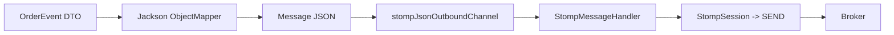
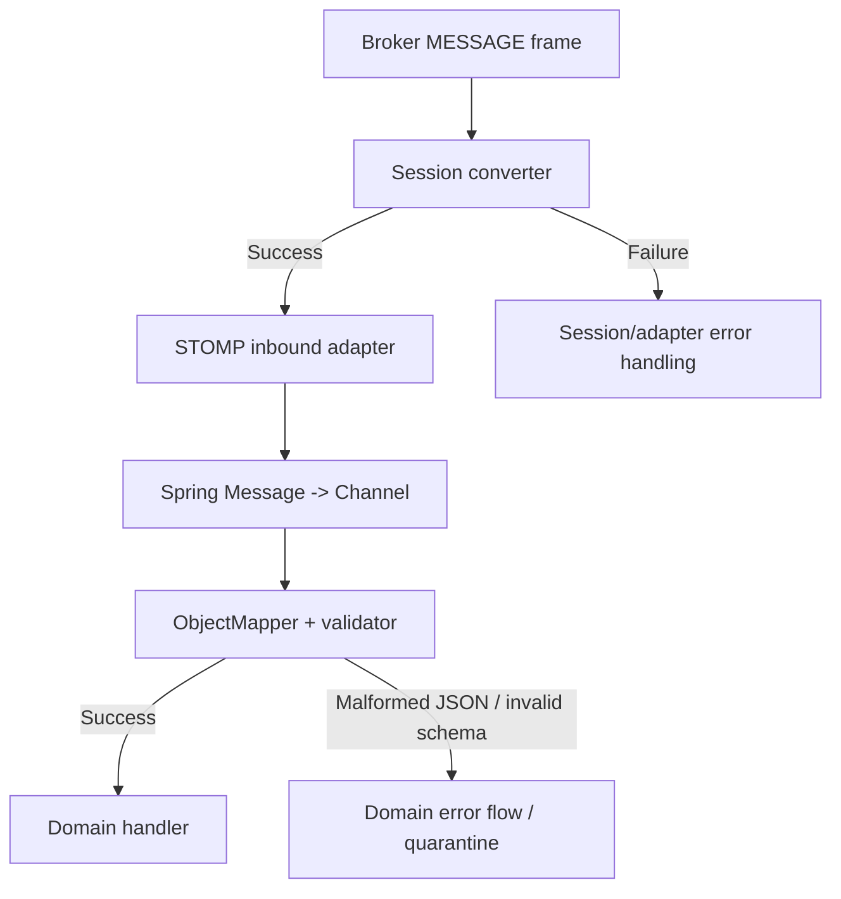

# Message Converters for STOMP in Spring Integration

## 1. Context: Why Does the Received Payload Have Different Types for the Same Frame?

An order-processing application receives a STOMP frame containing JSON from a broker. In one configuration, the handler reads a `String`; in another configuration, the handler receives a `byte[]`; if a different converter is chosen, the data might be restored as a Java object. On outbound, an `OrderEvent` does not automatically turn into contract-compliant JSON either. Worse, a frame with `content-type:application/json` can still contain malformed JSON or a payload that violates the schema.

In the **SPRING_INTEGRATION_ADAPTERS** module, inbound/outbound adapters connect external systems with `MessageChannel`, gateways, and message-processing flows. Specifically for **STOMP**, Spring Framework provides `StompClientSupport`/`StompSession` and the `MessageConverter` mechanism; Spring Integration adds `StompInboundChannelAdapter`, `StompMessageHandler`, `StompHeaderMapper`, and integration flows. Understanding where conversion occurs helps you send and receive data per contract, handle errors at the right layer, and preserve header information.

**Learning Objectives:**

1. Distinguish STOMP frames, Spring `Message<?>`, payload converters, header mappers, and business transformers.
2. Understand the inbound/outbound conversion path of a STOMP client when using `MessageConverter`.
3. Configure `PassThruMessageConverter` for integration adapters; use `setPayloadType(...)` appropriately.
4. Design JSON pipelines `byte[]/String → DTO` and `DTO → String/byte[]` with proper charset, content-type, and validation.
5. Know when `StringMessageConverter` or `MappingJackson2MessageConverter` can be used on a standalone STOMP client, and why not to swap converters arbitrarily inside Spring Integration.
6. Diagnose conversion errors, preserve headers, enforce payload limits, handle retries/idempotency, and run contract compatibility tests.

## 2. STOMP Frames and Spring Messages Are Two Different Models

A STOMP frame has a **command, headers, and a body**. Example:

```text
MESSAGE
subscription:sub-orders-0
message-id:broker-501
destination:/topic/orders
content-type:application/json

{"eventId":"evt-501","orderId":501,"status":"CREATED"}
^@
```

`^@` represents the NUL byte terminating a frame in STOMP; the framework performs encoding/decoding, so do not append this literal notation to the body. Payloads containing accented characters or non-ASCII characters must be handled according to the contract's **encoding**, typically UTF-8.

After conversion into a Spring message, the data takes the form:

```java
Message<?> message = ...;
Object payload = message.getPayload();
MessageHeaders headers = message.getHeaders();
```

| Aspect | STOMP wire protocol | Spring Messaging |
| --- | --- | --- |
| Message | `MESSAGE`/`SEND` frame | `Message<?>` |
| Content | Body bytes | `payload`: may be `String`, `byte[]`, or DTO |
| Metadata | `StompHeaders`: `destination`, `content-type`, `message-id`, etc. | `MessageHeaders` |
| Identifier | Broker `message-id` or `receipt-id` | `MessageHeaders.ID`; does not automatically match broker ID |
| Inbound direction | Broker sends `MESSAGE` frame | STOMP adapter emits into `MessageChannel` |
| Outbound direction | Client sends `SEND` frame | Producer sends Spring message to outbound handler |

**Key point:** converting a frame into a Spring message is **different** from converting JSON into a valid Java object. The `content-type` field can help choose a converter, but does not by itself guarantee the payload is valid, complete, or authorized for processing.

## 3. Two Conversion Layers That Must Not Be Conflated

### 3.1. MessageConverter on the STOMP Client/Session

Spring Framework provides `MessageConverter` (the `org.springframework.messaging.converter.MessageConverter` interface), configured on `StompClientSupport`, for example:

```java
stompClient.setMessageConverter(new PassThruMessageConverter());
```

It participates in converting between client-side messages/payloads and the form `StompSession` uses when sending or receiving frames. With a standalone STOMP client, a converter can turn `String` into a text body or map JSON to a DTO if the converter and target type are configured compatibly.

### 3.2. StompHeaderMapper in Spring Integration Adapters

`StompHeaderMapper` handles **headers**, not the JSON body. It maps `StompHeaders` and Spring `MessageHeaders` on both sides of the adapter. Spring Integration uses the **`stomp_`** prefix for standard STOMP headers brought into Spring messages.

```text
Inbound:
Broker frame → STOMP client MessageConverter → adapter
                → StompHeaderMapper → Spring Message → MessageChannel
                                                 |
                                                 v
                                      JSON parser / transformer / handler

Outbound:
Domain event → JSON serializer → Spring Message → StompMessageHandler
                → StompHeaderMapper + session MessageConverter
                → SEND frame → broker
```

| Tool | Handles | NOT responsible for |
| --- | --- | --- |
| STOMP client `MessageConverter` | Payload/message representation passing through the session | Deciding whether an event is authorized, transactions, or idempotency |
| `StompHeaderMapper` | Mapping STOMP headers ↔ Spring headers | Parsing JSON body into a business DTO |
| `setPayloadType(Class<?>)` on inbound adapter | Specifies the desired target type when receiving frames | Guaranteeing every converter can turn any body into that type |
| `ObjectMapper`/JSON transformer | Serializing/deserializing JSON and enforcing DTO contracts | Managing STOMP sessions or broker ACKs |
| Business validator | Checking IDs, schema, state, and business rules | Fixing malformed frames or guaranteeing broker replay |

If an event deserializes successfully yet is rejected due to an invalid `status` or missing permission, that is a **data/business error**, not necessarily a STOMP protocol error.

## 4. PassThruMessageConverter: The Choice for Spring Integration STOMP Adapters

In Spring Integration's official reference configuration, `ReactorNettyTcpStompClient` is configured with:

```java
import org.springframework.integration.support.converter.PassThruMessageConverter;

stompClient.setMessageConverter(new PassThruMessageConverter());
```

`PassThruMessageConverter` has a contract of **returning the Spring `Message` as-is** in both `toMessage` and `fromMessage`. It is useful when the STOMP adapter and downstream steps all operate on Spring Messaging, avoiding an extra unnecessary message wrapper conversion.

Do not interpret "pass through" as meaning:

- JSON is parsed into `OrderEvent`.
- A Java DTO is automatically serialized into JSON on send.
- Every `Message<?>` has a `String` payload.
- Charset, content-type, custom headers, and schema are automatically validated.

This is only a **session-layer** converter. For JSON data in an integration flow, an easily controllable approach is keeping the payload as text/binary across the STOMP adapter, then **parsing and validating in a handler/transformer**; on outbound, **serializing before passing to `StompMessageHandler`**.

### Why Not Immediately Swap in a JSON Converter?

Spring Framework supports `MappingJackson2MessageConverter` for contexts needing JSON mapping. However, Spring Integration's `StompMessageHandler` sends **Spring `Message<?>`** through the session, and Spring Integration also has its own header mapper. Swapping in a JSON converter just because "the payload is JSON" can unexpectedly alter how wrappers/message headers flow.

If you want the client to use a JSON converter directly, **test both directions** with your exact Spring Framework/Spring Integration version, content-type, target payload class, and headers. Do not infer from standalone `StompSession.send(Object)` examples that every outbound channel adapter converts identically.

## 5. setPayloadType and Choosing the Inbound Type

`StompInboundChannelAdapter` exposes the API:

```java
StompInboundChannelAdapter adapter =
    new StompInboundChannelAdapter(
        stompSessionManager, "/topic/orders"
    );
adapter.setPayloadType(String.class);
adapter.setOutputChannel(stompInboundRawChannel);
```

`setPayloadType(String.class)` requests the **target payload type** when an inbound STOMP frame is converted. According to the namespace documentation, the default `payload-type` is `java.lang.String`. However, **actual conversion depends on the session's `MessageConverter`**: if the converter does not support the target type or passes messages through unchanged, the adapter cannot magically turn every body into a DTO just via payload type configuration.

### Comparing Three Inbound Approaches

| Goal | Configuration/strategy | Notes |
| --- | --- | --- |
| Receive JSON as text | `setPayloadType(String.class)` and compatible session/converter | Must determine charset, verify actual `String`; parse JSON afterward. |
| Keep bytes for binary processing | Converter and target type compatible with `byte[]` | Never use `String.valueOf(byte[])`; only decode when encoding is known. |
| Receive DTO directly | JSON converter + matching target type | Must align converter, `content-type`, and DTO type; test adapter compatibility. |

For flows carrying multiple event types with different schemas on the same destination, keeping the payload as text/binary and **routing by event type/version** before deserializing into specialized DTOs is usually easier to evolve than forcing all frames into one Java class.

## 6. End-to-End Example: STOMP Inbound JSON → OrderEvent

Scenario: the broker sends JSON such as:

```json
{"eventId":"evt-501","orderId":501,"status":"CREATED"}
```

The application uses `StompInboundChannelAdapter` to subscribe to `/topic/orders`, dispatches messages to a `DirectChannel`, deserializes JSON with Jackson, and validates the contract. The example uses Java 17, Spring Boot, and a live STOMP/TCP broker at `127.0.0.1:61613`.

### 6.1. Dependencies

With a compatible Spring Boot BOM:

```xml
<dependencies>
    <dependency>
        <groupId>org.springframework.boot</groupId>
        <artifactId>spring-boot-starter-integration</artifactId>
    </dependency>
    <dependency>
        <groupId>org.springframework.integration</groupId>
        <artifactId>spring-integration-stomp</artifactId>
    </dependency>
    <dependency>
        <groupId>io.projectreactor.netty</groupId>
        <artifactId>reactor-netty</artifactId>
    </dependency>
    <dependency>
        <groupId>com.fasterxml.jackson.core</groupId>
        <artifactId>jackson-databind</artifactId>
    </dependency>
</dependencies>
```

This example uses the Jackson 2 API (`com.fasterxml.jackson.*`). On stacks using Jackson 3 or a different Spring Boot generation, align dependencies, packages, and converter config with the active BOM. Do not pin individual versions against the BOM.

### 6.2. DTO and Java Configuration

Data DTO:

```java
public record OrderEvent(
        String eventId,
        long orderId,
        String status
) {}
```

Create the Spring Integration configuration:

```java
import org.springframework.beans.factory.annotation.Qualifier;
import org.springframework.context.annotation.Bean;
import org.springframework.context.annotation.Configuration;
import org.springframework.integration.annotation.ServiceActivator;
import org.springframework.integration.channel.DirectChannel;
import org.springframework.integration.config.EnableIntegration;
import org.springframework.integration.stomp.ReactorNettyTcpStompSessionManager;
import org.springframework.integration.stomp.StompSessionManager;
import org.springframework.integration.stomp.inbound.StompInboundChannelAdapter;
import org.springframework.integration.support.converter.PassThruMessageConverter;
import org.springframework.messaging.MessageChannel;
import org.springframework.messaging.simp.stomp.ReactorNettyTcpStompClient;
import org.springframework.scheduling.concurrent.ThreadPoolTaskScheduler;

@Configuration
@EnableIntegration
public class StompJsonInboundConfiguration {

    @Bean
    public ThreadPoolTaskScheduler stompTaskScheduler() {
        ThreadPoolTaskScheduler scheduler = new ThreadPoolTaskScheduler();
        scheduler.setPoolSize(2);
        scheduler.setThreadNamePrefix("stomp-heartbeat-");
        return scheduler;
    }

    @Bean
    public ReactorNettyTcpStompClient stompClient(
            ThreadPoolTaskScheduler stompTaskScheduler) {
        ReactorNettyTcpStompClient client =
            new ReactorNettyTcpStompClient("127.0.0.1", 61613);
        client.setMessageConverter(new PassThruMessageConverter());
        client.setTaskScheduler(stompTaskScheduler);
        client.setReceiptTimeLimit(5000);
        return client;
    }

    @Bean
    public StompSessionManager stompSessionManager(
            ReactorNettyTcpStompClient stompClient) {
        ReactorNettyTcpStompSessionManager manager =
            new ReactorNettyTcpStompSessionManager(stompClient);
        manager.setAutoReceipt(true);
        return manager;
    }

    @Bean
    public MessageChannel stompInboundRawChannel() {
        return new DirectChannel();
    }

    @Bean
    public StompInboundChannelAdapter stompInboundAdapter(
            StompSessionManager stompSessionManager,
            @Qualifier("stompInboundRawChannel") MessageChannel channel) {
        StompInboundChannelAdapter adapter =
            new StompInboundChannelAdapter(
                stompSessionManager, "/topic/orders"
            );
        adapter.setOutputChannel(channel);
        adapter.setPayloadType(String.class);
        return adapter;
    }
}
```

**Explanation:**

- `stompClient` configures **session-level** `PassThruMessageConverter`.
- `stompSessionManager` manages a STOMP session for the adapter.
- `stompInboundAdapter` subscribes to the destination and emits Spring messages onto `stompInboundRawChannel`.
- `setPayloadType(String.class)` expresses the desired inbound type; on receipt, check the converter and actual type.
- `stompTaskScheduler` handles heartbeats/receipts; **it is not a Poller calling `receive()`**.

### 6.3. Handler Parsing JSON, Checking Types, and Enforcing Business Rules

```java
import java.nio.charset.StandardCharsets;

import com.fasterxml.jackson.core.JsonProcessingException;
import com.fasterxml.jackson.databind.ObjectMapper;
import org.springframework.integration.annotation.ServiceActivator;
import org.springframework.messaging.Message;
import org.springframework.stereotype.Component;

@Component
public class OrderEventReceiver {

    private final ObjectMapper objectMapper;

    public OrderEventReceiver(ObjectMapper objectMapper) {
        this.objectMapper = objectMapper;
    }

    @ServiceActivator(inputChannel = "stompInboundRawChannel")
    public void receive(Message<?> message) throws JsonProcessingException {
        Object payload = message.getPayload();
        String json;

        if (payload instanceof String text) {
            json = text;
        } else if (payload instanceof byte[] bytes) {
            json = new String(bytes, StandardCharsets.UTF_8);
        } else {
            throw new IllegalArgumentException(
                "Unsupported STOMP payload type: "
                    + payload.getClass().getName()
            );
        }

        if (json.length() > 16_384) {
            throw new IllegalArgumentException("Event body too large");
        }

        OrderEvent event =
            objectMapper.readValue(json, OrderEvent.class);

        if (event.eventId() == null
                || event.eventId().isBlank()
                || event.orderId() <= 0) {
            throw new IllegalArgumentException(
                "Invalid order event identity"
            );
        }
        if (!"CREATED".equals(event.status())
                && !"UPDATED".equals(event.status())) {
            throw new IllegalArgumentException(
                "Unsupported event status"
            );
        }

        // TODO: idempotency(eventId), persist, commit/ack per contract.
        System.out.printf(
            "Accepted eventId=%s, orderId=%d%n",
            event.eventId(), event.orderId()
        );
    }
}
```

`ObjectMapper` here is provided by application dependencies/injection; you can define a bean if Spring Boot does not auto-configure one. Because the handler is invoked from a `DirectChannel`, exceptions during parsing/validation can propagate along the synchronous send path and require an appropriate error flow.

**Why both check conversion and validate?** JSON can be syntactically valid yet lack `eventId`, have an invalid `orderId`, or contain an unsupported `status`. Succeeding at `readValue` is only **deserialization**, not **business acceptance**.

**Length limit:** `json.length()` counts Java UTF-16 code units, not **wire frame bytes**. Production must limit byte counts at the transport/client layer when receiving and enforce payload limits before parsing, especially with Unicode and untrusted input.

## 7. Outbound: OrderEvent → JSON String → StompMessageHandler

The outbound path should have an **explicit business serializer** to control schema and event IDs:



### 7.1. Declaring the Outbound Handler

Add these beans to the same application context as `stompSessionManager` in section 6:

```java
import org.springframework.context.annotation.Bean;
import org.springframework.integration.annotation.ServiceActivator;
import org.springframework.integration.channel.DirectChannel;
import org.springframework.integration.stomp.StompSessionManager;
import org.springframework.integration.stomp.outbound.StompMessageHandler;
import org.springframework.messaging.MessageChannel;
import org.springframework.messaging.MessageHandler;

@Bean
public MessageChannel stompJsonOutboundChannel() {
    return new DirectChannel();
}

@Bean
@ServiceActivator(inputChannel = "stompJsonOutboundChannel")
public MessageHandler stompJsonOutboundHandler(
        StompSessionManager stompSessionManager) {
    StompMessageHandler handler =
        new StompMessageHandler(stompSessionManager);
    handler.setDestination("/topic/order-events");
    handler.setConnectTimeout(10_000);
    return handler;
}
```

This snippet consists of methods inside a `@Configuration` class, not a standalone top-level Java class. The broker must support `/topic/order-events`, and the account must have SEND permission.

### 7.2. Serializing Once at the Business Layer

```java
import com.fasterxml.jackson.core.JsonProcessingException;
import com.fasterxml.jackson.databind.ObjectMapper;
import org.springframework.beans.factory.annotation.Qualifier;
import org.springframework.messaging.MessageChannel;
import org.springframework.messaging.support.MessageBuilder;
import org.springframework.stereotype.Service;

@Service
public class OrderEventPublisher {

    private final ObjectMapper objectMapper;
    private final MessageChannel stompJsonOutboundChannel;

    public OrderEventPublisher(
            ObjectMapper objectMapper,
            @Qualifier("stompJsonOutboundChannel")
            MessageChannel channel) {
        this.objectMapper = objectMapper;
        this.stompJsonOutboundChannel = channel;
    }

    public void publish(OrderEvent event)
            throws JsonProcessingException {
        if (event.eventId() == null || event.eventId().isBlank()) {
            throw new IllegalArgumentException("Missing eventId");
        }

        String json = objectMapper.writeValueAsString(event);
        boolean accepted = stompJsonOutboundChannel.send(
            MessageBuilder.withPayload(json).build()
        );

        if (!accepted) {
            throw new IllegalStateException(
                "Outbound channel did not accept event"
            );
        }
    }
}
```

With `PassThruMessageConverter`, the example **sends pre-serialized JSON** inside a Spring message. Do not pass an unserialized DTO into a flow expecting `Message<String>` assuming it will turn into proper JSON on its own.

A successful `MessageChannel.send()` **does not prove** the broker stored the message or that a consumer committed business logic. If stronger protocol-level certainty is needed, configure STOMP receipts and monitor `StompReceiptEvent`; if business guarantees are needed, use separate ack/status events, transactional outbox, and idempotent consumers.

## 8. Content-Type, Charset, and Content-Length

### 8.1. Content-Type Describes the Body

A frame sending JSON should carry appropriate metadata, such as:

```text
SEND
destination:/topic/order-events
content-type:application/json

{"eventId":"evt-502","orderId":502,"status":"UPDATED"}
^@
```

To configure `content-type` accurately in Spring Integration, use **STOMP header mapping** or the corresponding converter. Do not assume an arbitrary application-set custom `contentType` header will map properly to STOMP `content-type`: inspect `StompHeaderMapper`, `IntegrationStompHeaders`, and actual wire frames.

### 8.2. UTF-8 and Byte Length

A Java string and a STOMP body do not measure length the same way:

```java
String body = "{\"note\":\"Đã giao\"}";
byte[] utf8 = body.getBytes(StandardCharsets.UTF_8);

int javaUnits = body.length();
int wireBytes = utf8.length;
```

STOMP's `content-length` is the **byte count** of the body, not `String.length()`. With Vietnamese characters, emojis, or multi-byte characters, these two numbers can differ. If writing a custom converter/transport, never set `content-length` using the Java character count. Normally, let Spring's STOMP codec compute and encode frames.

For payloads containing NUL bytes or binary data, verify `content-length` handling per the protocol, because body termination rules differ from text frames relying solely on NUL.

### 8.3. Content-Type Is Not Proof of Safe Data

A publisher can set `content-type:application/json` while sending `{broken-json` in the body. The broker is not responsible for verifying JSON matches the business contract. Consumers must perform parsing, schema validation, depth/size limits, required-field checks, and error auditing.

## 9. When to Use StringMessageConverter or MappingJackson2MessageConverter?

A **standalone** Spring Framework STOMP client can be configured as:

```java
import org.springframework.messaging.converter.StringMessageConverter;
import org.springframework.messaging.simp.stomp.WebSocketStompClient;
import org.springframework.web.socket.client.standard.StandardWebSocketClient;

WebSocketStompClient client =
    new WebSocketStompClient(new StandardWebSocketClient());
client.setMessageConverter(new StringMessageConverter());
```

This example belongs to a **direct Spring Framework STOMP client**, not the `StompInboundChannelAdapter` configuration in section 6. `StringMessageConverter` handles text representations when the target type matches. You must provide a session handler, WebSocket endpoint, and scheduler/heartbeat as required.

`MappingJackson2MessageConverter` can be used when the client/session and target payload type are designed to read/write JSON into DTOs. Example in Spring Framework:

```java
import org.springframework.messaging.converter.MappingJackson2MessageConverter;

MappingJackson2MessageConverter jsonConverter =
    new MappingJackson2MessageConverter();

client.setMessageConverter(jsonConverter);
```

**Do not plug this into the shared `stompClient` configured with `PassThruMessageConverter` in the Spring Integration example and assume everything still works.** On a STOMP session, the converter sees payloads/messages and `StompFrameHandler` target types; on integration adapters, the framework also passes Spring messages/headers through the adapter layer. Choose **one** conversion strategy, test the exact payload, and avoid double JSON serialization.

### A Common Bug: Double-Encoded JSON

Suppose you already have:

```text
{"eventId":"evt-503"}
```

If the application feeds an **already-serialized JSON string** into a JSON converter a second time as a string value, the body can become:

```json
"{\"eventId\":\"evt-503\"}"
```

That is a JSON **string** containing JSON text, rather than the JSON **object** expected by the consumer. Make a clear choice:

- **Strategy A:** Serialize the DTO into JSON text with `ObjectMapper`, then use an adapter path designed for text/pass-through.
- **Strategy B:** Pass the DTO to a properly configured JSON converter without calling `writeValueAsString` beforehand.

For Spring Integration STOMP adapters, Strategy A in the example makes each step easy to verify. Strategy B requires round-trip tests for the exact library versions in use.

## 10. HeaderMapper: Preserving STOMP Metadata and Limiting Custom Headers

`StompHeaderMapper` performs:

| Direction | Method | Result |
| --- | --- | --- |
| Inbound | `toHeaders(StompHeaders source)` | Spring `MessageHeaders` containing required STOMP metadata. |
| Outbound | `fromHeaders(MessageHeaders headers, StompHeaders target)` | Permitted headers written onto the outbound frame. |

Spring Integration defines constants in `IntegrationStompHeaders` and uses the `stomp_` prefix for standard headers. Constant names, value types, and converter interactions should be verified against the Javadoc of your version; do not guess Java class types solely from hyphenated wire header names.

### Configuring a Mapper

If you want to customize a mapper:

```java
import org.springframework.integration.stomp.support.StompHeaderMapper;

StompHeaderMapper mapper = new StompHeaderMapper();

// On one of the corresponding beans:
inboundAdapter.setHeaderMapper(mapper);
// or
outboundHandler.setHeaderMapper(mapper);
```

The snippet assumes `inboundAdapter` or `outboundHandler` has already been instantiated in an actual configuration method. **You do not need to do this if the default mapper meets your needs**, because Spring Integration already supplies a default `StompHeaderMapper` for adapters.

When customizing mapped headers, note:

- The XML namespace uses `mapped-headers` or `header-mapper`, **not both simultaneously**.
- If extending `mapped-headers` for custom headers, keep the `STOMP_INBOUND_HEADERS` or `STOMP_OUTBOUND_HEADERS` token so required standard STOMP headers are not accidentally dropped.
- Do not map all application headers indiscriminately. Doing so could leak traces, tenant IDs, or internal tokens to the broker.
- Do not treat the broker's `message-id` header as a durable domain idempotency key; prefer an `eventId` defined by the publisher per contract.

### Destination and Ack Headers Are Not Inside the Payload

`destination`, `subscription`, `message-id`, `receipt`, and `ack` are **protocol metadata**. If a serializer operates only on the JSON payload, these headers do not automatically become JSON fields; conversely, an `eventId` field inside JSON does not automatically become the STOMP `message-id`.

If business logic wants to pass `eventId` as a custom header, you must specify the mapping, allowlist that header, and verify the consumer receives it. You should also keep the event ID in the business envelope or durable store rather than depending on a header that might be dropped.

## 11. Where Do Conversion Errors Happen?



| Stage | Example error | What to observe |
| --- | --- | --- |
| STOMP frame decode | Malformed frame, body too large | Connection/session events, codec errors. |
| Client `MessageConverter` | Unsupported target type or content-type | Exception/conversion error at STOMP callback/session. |
| `StompHeaderMapper` | Invalid header or dropped during mapping | Wire frame vs. Spring `MessageHeaders`, mapper configuration. |
| JSON deserialization | Invalid JSON syntax, wrong field type | `JsonProcessingException` at transformer/handler. |
| Business validation | Blank `eventId`, unsupported status | Domain error flow, dead-letter/quarantine. |
| Outbound serialize | DTO contains unserializable data | Serialization failure **before** calling outbound handler if using Strategy A. |
| Outbound send | Broker unavailable, SEND rejected | Session manager, STOMP `ERROR`, receipt timeout, and retries. |

An exception from a **synchronous** handler wired via `DirectChannel` can propagate back to the adapter or source error handler. If an `ExecutorChannel` sits in between, parse/validation errors occur on the worker and require a **downstream error flow**. Do not assume every error routes to a single shared error channel.

### Receipts and ACKs Do Not Solve Conversion Errors

`RECEIPT` (if requested) indicates the broker processed the corresponding frame per the STOMP contract; it does not confirm JSON deserialized or DB committed. `ACK/NACK` on an inbound subscription is a broker delivery policy; when retrying a JSON-failed event, you must know whether the broker already considered the frame delivered.

With automatic ack, a malformed event may already be marked delivered by the broker **before** the handler detects the error. Never assume "the handler threw an exception" means the broker will redeliver automatically. Design dead-letter/quarantine and reconciliation accordingly.

## 12. Data Safety: Size Limits, Encoding, Schema, and Versioning

### 12.1. Limits Before Deserializing

Untrusted JSON can be oversized or exhaust CPU/memory. Enforce limits on:

1. Body size **in bytes** at the transport/STOMP client/broker where configurable.
2. Internal payload length after conversion.
3. Nesting depth, array element counts, and parser constraints if supported by the JSON library.
4. In-flight message counts alongside downstream queue/executor capacities.
5. Processing time and retry counts to prevent poison messages from clogging the system.

Spring Framework's `WebSocketStompClient` offers settings like `setInboundMessageSizeLimit(...)`; do not assume the STOMP/TCP client has identical APIs or defaults. Check the exact library/transport running.

### 12.2. Event Schema Versioning

Example envelope:

```json
{
  "schemaVersion": 2,
  "eventId": "evt-504",
  "eventType": "ORDER_UPDATED",
  "occurredAt": "2026-11-23T02:00:00Z",
  "payload": {
    "orderId": 504,
    "status": "SHIPPED"
  }
}
```

Versioning should be defined in the **business contract**, because a `MessageConverter` only translates representation and cannot automatically understand differences between `schemaVersion=1` and `schemaVersion=2`. You can route/transform by version before dispatching to the matching handler; quarantine and alert on unsupported events instead of silently dropping them.

### 12.3. Information Security

Do not log raw bodies, credentials, tokens, PII, or full production frame headers. When logging deserialization failures, prefer the event ID, destination, content type, payload size, exception class name, and allowed correlation IDs. If raw failed payloads must be retained, store them in an encrypted quarantine store with strict access control and clear retention policies.

## 13. Retries, Idempotency, and Transaction Boundaries

Consider an outbound event:

```text
OrderEvent → serialize JSON → SEND → broker
                           |
                    disconnect before RECEIPT
                           |
                       retry SEND
```

The broker may have received the frame on the first attempt; resending can create duplicates. Hence **a JSON converter does not solve exactly-once**. You should:

- Assign a stable `eventId` and preserve it across retries.
- Use idempotent consumers, e.g., a unique constraint or inbox table keyed by `eventId`.
- With separate DB and broker, consider a **transactional outbox** rather than sending STOMP directly inside a JDBC transaction assuming both roll back together.
- Retry transient errors (network, broker unavailable) with bounded attempts and backoff.
- Quarantine invalid schemas or business-rule violations; retrying identical malformed JSON forever will not make it valid.
- Track the three milestones explicitly: Spring channel accepted, STOMP broker receipt, business commit.

When receiving messages via an `ExecutorChannel`/in-memory queue, a successful `send()` only means work was handed off to another processing layer—not that JSON was parsed or the DB committed. Track handler completion and durable state if losing messages on application restart is unacceptable.

## 14. Contract Testing Message Converters

### 14.1. Test Matrix

| Case | Input | Expected outcome |
| --- | --- | --- |
| Valid UTF-8 JSON | `{"eventId":"evt-1","orderId":1,"status":"CREATED"}` | Deserializes into valid `OrderEvent`. |
| Malformed JSON | `{"eventId":` | Parse error with metric and recovery, no business commit. |
| Wrong field type | `"orderId":"abc"` | Converter/validator rejects or reports clear error. |
| Missing ID | `"eventId":null` | Rejected by business validation. |
| Content-type mismatch | Claims `application/json` with binary body | Not treated as valid JSON solely from header. |
| Unicode | `{"note":"Đã giao"}` | UTF-8 round-trip without losing diacritics. |
| Binary | Body containing NUL | Not decoded arbitrarily as text; verify `content-length`. |
| JSON-wrapped string | `"{\"eventId\":\"evt-1\"}"` | Not mistaken for a JSON object. |
| Standard headers | `destination`, `message-id` | Mapper preserves required headers. |
| Sensitive headers | `Authorization` or `passcode` | Not leaked to broker/logs when disallowed. |
| Oversized payload | Body exceeds limit | Safely rejected before excessive resource usage. |
| Retry after timeout | Same `eventId` sent twice | Consumer does not create duplicate business side effects. |

### 14.2. JSON Round-Trip Unit Test Without a Broker

```java
import static org.junit.jupiter.api.Assertions.assertEquals;

import com.fasterxml.jackson.databind.ObjectMapper;
import org.junit.jupiter.api.Test;

class OrderEventJsonTest {

    private final ObjectMapper mapper = new ObjectMapper();

    @Test
    void serializeAndDeserializeOrderEvent() throws Exception {
        OrderEvent original =
            new OrderEvent("evt-501", 501L, "CREATED");

        String json = mapper.writeValueAsString(original);
        OrderEvent restored =
            mapper.readValue(json, OrderEvent.class);

        assertEquals(original, restored);
    }
}
```

This test requires JUnit Jupiter in test dependencies. It only tests **JSON serialization**, not STOMP wire framing, `StompHeaderMapper`, or adapters. Production suites should include integration tests against a real STOMP-enabled test broker.

### 14.3. Integration Testing with a Broker

An integration test can:

1. Start a test broker and a STOMP publisher/subscriber using the same destination contract.
2. Send valid JSON via `StompMessageHandler` to the broker, verifying the subscriber receives the right payload and headers.
3. Feed frames into `StompInboundChannelAdapter`, verifying the handler receives the expected payload type and parses the DTO.
4. Send malformed JSON and mismatched content-type; verify the error flow triggers and no business data is written.
5. Send accented UTF-8 content, large payloads near limits, and bodies with special bytes.
6. Verify `destination`, content-type, and correlation/event ID headers across a round-trip.
7. Drop the connection during sending; observe receipt/error events and verify retries can produce duplicates while idempotency stays intact.

## 15. Common Errors and Diagnostic Guide

| Symptom | Common cause | Resolution |
| --- | --- | --- |
| Handler receives `byte[]` instead of `String` | Session converter/target type differs from expectation | Log payload class, check `setPayloadType` and converter config. |
| Handler receives JSON text when DTO is needed | Missing business deserialization step | Use `ObjectMapper`/transformer, validate version/schema. |
| Body has extra quotes and escapes | JSON serialized twice | Pick **one** serialization step; inspect raw frame. |
| Vietnamese accents corrupted | Producer/consumer charset mismatch | Standardize on UTF-8, inspect raw bytes and content-type. |
| Missing `stomp_*` headers | Header mapper misconfigured or dropped standard headers | Check default mapper, mapped header names, and mapping direction. |
| Incorrect `content-length` | Counting Java chars instead of byte length | Let the STOMP codec handle it or calculate bytes per contract. |
| Continuous JSON parse failures | Publisher sends wrong schema, non-JSON payload, or poison event | Quarantine, alert on contract breach, do not retry infinitely. |
| Errors only show up on workers | `ExecutorChannel` or async boundary present | Design a separate downstream error flow. |
| `RECEIPT` succeeds, yet DB has no event | Receipt is at broker level, not business commit | Add business confirmation, inbox/outbox, and metrics. |
| Swapping JSON converter loses metadata | Converter wrapper/header mismatch with integration adapter | Test full flow; consider PassThru + explicit transform. |

## 16. Exercises with Answers

**Exercise 1 — Converter role.** Does `PassThruMessageConverter` automatically deserialize a JSON string into `OrderEvent`?

**Answer:** No. It largely returns the Spring `Message` as-is; you need a JSON parser/transformer at the business layer or a different properly configured converter.

**Exercise 2 — Two layers.** Do `StompHeaderMapper` and `ObjectMapper` share the same job?

**Answer:** No. The header mapper maps STOMP/Spring metadata; `ObjectMapper` handles JSON payloads.

**Exercise 3 — Payload type.** Does setting `adapter.setPayloadType(String.class)` guarantee every converter turns any body into a `String`?

**Answer:** No. It specifies the target type; actual results depend on the session/converter and the frame.

**Exercise 4 — String vs. `byte[]`.** Why is `String.valueOf(byte[])` unsuitable for reading a UTF-8 payload?

**Answer:** It does not decode bytes into text; use `new String(bytes, StandardCharsets.UTF_8)` when the contract specifies UTF-8.

**Exercise 5 — Content-type.** A frame states `content-type:application/json`, but the body is malformed JSON. Should the handler treat the message as valid?

**Answer:** No. Content-type is metadata; you must parse and validate the schema.

**Exercise 6 — Double encoding.** A DTO was serialized into a JSON string, and then a JSON converter serialized that string again. What can the payload turn into?

**Answer:** An escaped JSON string instead of the original JSON object; choose a single consistent serialization strategy.

**Exercise 7 — Counting content-length.** Is Java `"Đã giao".length()` always equal to the number of UTF-8 bytes sent over STOMP?

**Answer:** No. STOMP `content-length` counts bytes, and Unicode characters can occupy multiple bytes.

**Exercise 8 — Header mapper.** If you configure `mapped-headers` to map only a single custom header, what can happen to standard STOMP headers?

**Answer:** They can be dropped; retain `STOMP_INBOUND_HEADERS`/`STOMP_OUTBOUND_HEADERS` tokens or configure an appropriate mapper.

**Exercise 9 — Downstream parse error.** `ExecutorChannel` accepted a message, then the worker failed to parse JSON. Is the error guaranteed to propagate back to the inbound adapter?

**Answer:** No. The async boundary causes the error to appear on the worker; you need a dedicated error flow and retry/quarantine.

**Exercise 10 — Exactly-once.** Does serializing JSON properly and receiving a STOMP `RECEIPT` guarantee the consumer committed to the DB exactly once?

**Answer:** No. You need transactions/idempotency, business acks, and retry handling.

**Exercise 11 — Schema.** The payload is valid JSON, yet `eventId` is blank. Is this a syntax error or business validation error?

**Answer:** Business validation; deserialization may succeed while the event is rejected.

**Exercise 12 — Identifier header.** Should you use a freshly generated Spring `MessageHeaders.ID` to deduplicate events across retries?

**Answer:** No. Prefer a stable event ID defined by the business contract and preserved across redeliveries.

**Exercise 13 — Testing.** Does a passing `ObjectMapper` round-trip test suffice to prove `StompInboundChannelAdapter` receives STOMP frames with the right headers?

**Answer:** No. You need integration tests with a broker, session converter, and actual header mapper.

**Exercise 14 — JSON converter.** Should you replace `PassThruMessageConverter` with `MappingJackson2MessageConverter` in a Spring Integration app without testing?

**Answer:** No. Verify `Message<?>` wrappers, target types, headers, and both directions on your exact library versions.

## 17. Key Takeaways

**Message converters for STOMP** determine how data traverses `StompSession`, while Spring Integration also includes `StompHeaderMapper` to map STOMP headers and `MessageChannel` for internal message processing. Spring Integration's reference configuration uses `PassThruMessageConverter`, suited for adapters operating on Spring `Message<?>` objects; for reliable JSON handling, serialize/deserialize in an explicit transformer or handler step, validate after parsing, and test exact payload types. `setPayloadType(...)` only states the target type and does not guarantee the converter supports every frame. In real traffic, enforce content-type, UTF-8, byte length, mapped headers, payload size, error flows, retries/idempotency, and end-to-end broker testing.

## References

- [Spring Integration Reference — STOMP Support](https://docs.spring.io/spring-integration/reference/stomp.html)
- [Spring Integration API — PassThruMessageConverter](https://docs.spring.io/spring-integration/api/org/springframework/integration/support/converter/PassThruMessageConverter.html)
- [Spring Integration API — StompInboundChannelAdapter](https://docs.spring.io/spring-integration/api/org/springframework/integration/stomp/inbound/StompInboundChannelAdapter.html)
- [Spring Integration API — StompHeaderMapper](https://docs.spring.io/spring-integration/api/org/springframework/integration/stomp/support/StompHeaderMapper.html)
- [Spring Framework Reference — STOMP Client](https://docs.spring.io/spring-framework/reference/web/websocket/stomp/client.html)
