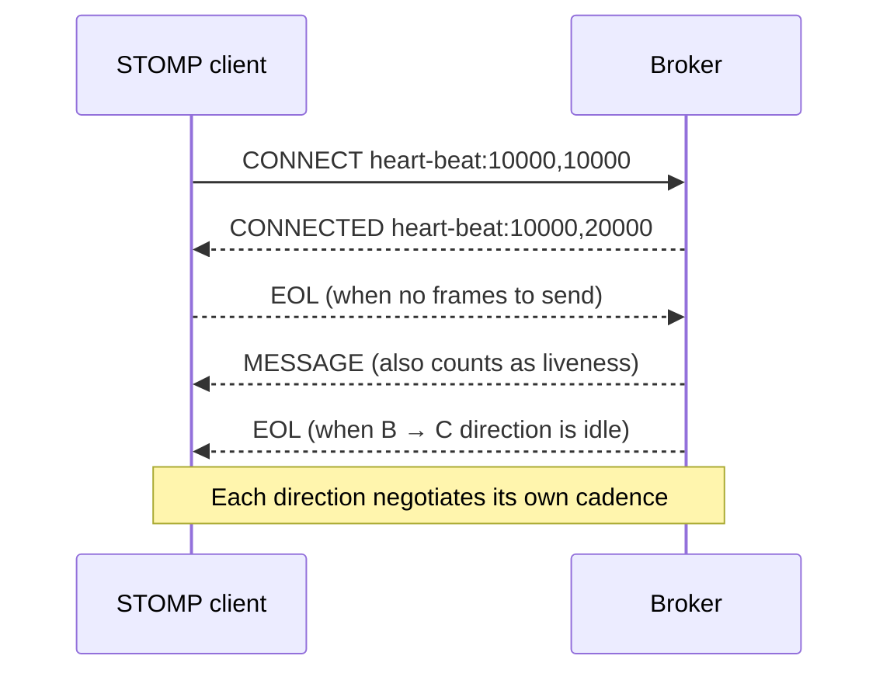
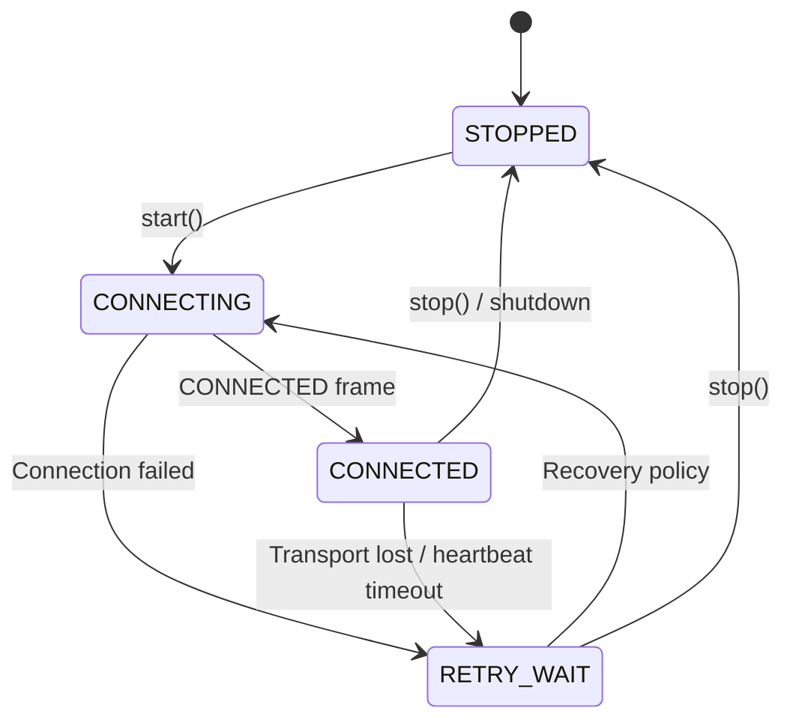
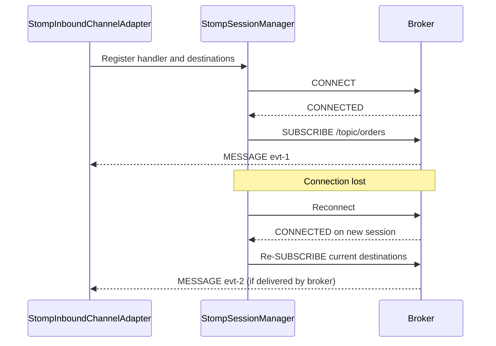

# Heartbeat and Reconnect in Spring Integration STOMP

## 1. Problem Statement: The Connection Still Looks "Open," Yet the Application Receives No Events

A Java application subscribes to `/topic/orders` via STOMP to receive order events. The system runs smoothly until one day the network connection between the application and the broker drops mid-stream. The application never sees a clean `DISCONNECT` frame, the handler stops receiving messages, while the dashboard still shows the Java process running.

At least four distinct issues must be addressed:

1. **Detecting an unhealthy session:** after how long does the client realize the link has gone abnormally silent?
2. **Session recovery:** when connectivity is lost, how does the client/manager attempt to re-establish `CONNECT/CONNECTED`?
3. **Restoring subscriptions and sending capability:** does the new session still subscribe to the right destinations; how are in-flight messages on the old session handled?
4. **Business recovery:** if the broker received `SEND` but the client lost `RECEIPT`, can a retry create duplicates; if the client was offline, are messages retained?

In the **SPRING_INTEGRATION_ADAPTERS** module, adapters and `MessageChannel` connect external systems to the application via inbound/outbound adapters, gateways, pollers, and message contracts. Specifically for the **STOMP Adapter**, Spring Framework provides `StompClientSupport` with TCP/WebSocket clients; Spring Integration provides `StompSessionManager` to manage sessions for `StompInboundChannelAdapter` and `StompMessageHandler`. **Heartbeat** helps monitor connection liveness; **reconnect** restores the session after a loss. The two mechanisms work together, **not as a single mechanism**.

### Learning Objectives

- Explain the `heart-beat:cx,cy` / `heart-beat:sx,sy` headers per STOMP 1.2, the per-direction interval formula, and cases using `0`.
- Distinguish heartbeats, business `MESSAGE`s, `RECEIPT`s, TCP keepalive, WebSocket ping/pong, and Spring Integration Pollers.
- Configure the client scheduler, `setDefaultHeartbeat(...)`, and `AbstractStompSessionManager#setRecoveryInterval(...)`.
- Monitor `isRunning()`, `isConnected()`, `StompIntegrationEvent` instances, and subscription status.
- Design retries, backpressure, idempotency, outbox/inbox, security, alerting, and disconnect testing.

## 2. What Is a Heartbeat in STOMP?

STOMP is a frame-based messaging protocol. When opening a session, the client sends `CONNECT` (or `STOMP` with supporting servers), and the broker replies `CONNECTED` if accepted. Since STOMP 1.1, both sides can negotiate heartbeats during the handshake.

Example:

```text
CONNECT
accept-version:1.2
host:broker.example
heart-beat:10000,10000

^@
```

```text
CONNECTED
version:1.2
heart-beat:10000,20000

^@
```

`^@` represents the NUL byte terminating a STOMP frame; it is not two literal characters to send manually. The `heart-beat` header consists of **two non-negative integers** in **milliseconds**. If the header is absent, per STOMP 1.2, it is treated as `heart-beat:0,0`.

| Position | Interpretation |
| --- | --- |
| First number sent by **client**: `cx` | How often the client can send data/heartbeats onto the wire. |
| Second number sent by **client**: `cy` | Minimum cadence at which the client wants to receive data from the server. |
| First number sent by **server**: `sx` | How often the server can send data/heartbeats. |
| Second number sent by **server**: `sy` | Minimum cadence at which the server wants to receive data from the client. |

"Heartbeat every 10 seconds" **does not mean** an order message must occur every 10 seconds. When there are no business frames to send, the sender can transmit a **newline character (EOL)** to indicate the connection is still alive. When normal data already flows over the connection, that traffic itself acts as a liveness signal; no extra heartbeat is needed during periods with traffic.



## 3. Computing Per-Direction Heartbeats per STOMP 1.2

Let:

- `cx`: outgoing heartbeat the client can provide.
- `cy`: incoming heartbeat the client wants to receive.
- `sx`: outgoing heartbeat the server can provide.
- `sy`: incoming heartbeat the server wants to receive.

### 3.1. Client → Server Direction

If `cx == 0` **or** `sy == 0`, **no heartbeat is negotiated in the client → server direction**. If both are non-zero, the expected period is:

```text
clientToServerPeriodMs = max(cx, sy)
```

### 3.2. Server → Client Direction

If `sx == 0` **or** `cy == 0`, **no heartbeat is negotiated in the server → client direction**. If both are non-zero, the expected period is:

```text
serverToClientPeriodMs = max(sx, cy)
```

### 3.3. Numerical Examples

Suppose:

```text
Client CONNECTED request: cx=10000, cy=20000
Broker CONNECTED reply:   sx=5000,  sy=15000
```

Then:

- Client → server: `max(10000,15000) = 15000 ms`.
- Server → client: `max(5000,20000) = 20000 ms`.

| Proposed pair | Client → server | Server → client |
| --- | --- | --- |
| Client `10000,10000`; server `10000,10000` | 10 seconds | 10 seconds |
| Client `10000,20000`; server `5000,15000` | 15 seconds | 20 seconds |
| Client `0,10000`; server `10000,10000` | **Disabled** | 10 seconds |
| Client `10000,0`; server `10000,10000` | 10 seconds | **Disabled** |
| Client `10000,10000`; server `0,0` | **Disabled** | **Disabled** |

**Do not add the two numbers, average them, or take `min(...)`.** Pick `max(...)` to satisfy both the sender's minimum capability and the receiver's desired interval.

### 3.4. Timeouts Should Not Trigger Exactly at the Threshold

STOMP 1.2 specifies that when a direction negotiates period `n`, the sender must ensure data flows within `n`; the receiver *may* treat the link as broken if no data arrives within a suitable window, but **should allow a tolerance margin** for thread scheduling, network jitter, GC pauses, CPU scheduling, and delays.

For instance, if data is expected roughly every 10 seconds, do **not** configure the system to mark the link dead for being a few milliseconds late at the 10,000 ms mark. Real liveness and alert thresholds must account for latency and broker behavior; no single tolerance factor fits every application.

## 4. Distinguishing Heartbeats from Other "Pings" and Polling

| Mechanism | Which layer? | What does it measure/check? |
| --- | --- | --- |
| **STOMP heartbeat** | STOMP protocol/session | Is data flowing on the connection at the negotiated cadence? |
| **TCP keepalive** | TCP/OS | Detects dead sockets per OS policy; unaware of subscriptions. |
| **WebSocket ping/pong** | WebSocket transport | Liveness of the WebSocket connection; independent of STOMP frame content. |
| **STOMP `RECEIPT`** | STOMP protocol | Broker acknowledges a frame on which the client requested a receipt. |
| **Spring Integration Poller** | Integration endpoint | Actively calls `MessageSource.receive()` on a fixed-delay/cron trigger, etc. |
| **Business heartbeat** | Application contract | Custom "I am still alive" events between services/consumers if designed. |

A STOMP inbound adapter is **message-driven**: once the broker accepts `SUBSCRIBE`, `MESSAGE` frames are pushed over the session. The `TaskScheduler` set on the STOMP client supports heartbeats and receipt tracking—it is **not** a poller scanning the broker every few seconds.

**A healthy connection does not guarantee a healthy business flow**:

- Heartbeats still arrive, yet the subscriber was denied `SUBSCRIBE` permission.
- The session is connected, yet the publisher is sending to a different destination.
- A downstream handler is blocked on DB or full queues while the connection stays alive.
- The broker accepts frames, yet the business consumer fails.

Therefore, liveness must be monitored separately from business readiness and success rates.

## 5. Spring Framework STOMP Client and Scheduler

Spring Framework provides `StompClientSupport`, with common implementations:

- `ReactorNettyTcpStompClient`: STOMP directly over TCP to the broker host/port.
- `WebSocketStompClient`: STOMP over WebSocket, using a `WebSocketClient` and a `ws://` or `wss://` URL.

Key settings:

```java
client.setDefaultHeartbeat(new long[] {10_000L, 10_000L});
client.setTaskScheduler(stompTaskScheduler);
client.setReceiptTimeLimit(5_000);
```

Meaning:

1. `setDefaultHeartbeat(...)` sets the expected default heartbeat header for `CONNECT`: the first element is client-send, the second is client-receive, both in ms.
2. `setTaskScheduler(...)` supplies a scheduler for the client to handle heartbeats/receipt tracking when the transport needs it. Some transports have built-in heartbeat support; do not assume all clients operate identically.
3. `setReceiptTimeLimit(...)` sets the STOMP `RECEIPT` wait timeout **when a receipt is requested**; it does **not** replace heartbeats or business timeouts.

### Notable Difference with WebSocketStompClient

Per Spring Framework's API, `WebSocketStompClient` initializes `defaultHeartbeat` to `0,0` when no scheduler is set; once a `TaskScheduler` is configured, the client can switch its default to the preferred `10000,10000` cadence. Hence a working WebSocket STOMP client without heartbeats may simply be due to a **missing scheduler configuration**, not necessarily the broker.

Example:

```java
import org.springframework.messaging.simp.stomp.WebSocketStompClient;
import org.springframework.web.socket.client.standard.StandardWebSocketClient;

WebSocketStompClient client =
    new WebSocketStompClient(new StandardWebSocketClient());
client.setTaskScheduler(stompTaskScheduler);
client.setDefaultHeartbeat(new long[] {10_000L, 10_000L});
```

This is the **WebSocket variant**; do not run it concurrently with the TCP bean below for the same test flow. WebSocket requires the proper handshake endpoint, WebSocket dependencies, and dedicated TLS/credentials configuration where needed; switching from STOMP/TCP to WebSocket is not just changing a URL.

## 6. Complete Configuration: Heartbeat and Reconnect for STOMP/TCP

### 6.1. Scenario and Dependencies

The application connects to a STOMP/TCP broker at `127.0.0.1:61613`, subscribes to `/topic/orders`, and has an outbound handler sending to `/topic/order-status`. We create **one shared `StompSessionManager`** to manage the session for both adapters.

In a Spring Boot project with an appropriate BOM:

```xml
<dependencies>
    <dependency>
        <groupId>org.springframework.boot</groupId>
        <artifactId>spring-boot-starter-integration</artifactId>
    </dependency>
    <dependency>
        <groupId>org.springframework.integration</groupId>
        <artifactId>spring-integration-stomp</artifactId>
    </dependency>
    <dependency>
        <groupId>io.projectreactor.netty</groupId>
        <artifactId>reactor-netty</artifactId>
    </dependency>
</dependencies>
```

Prepare a broker with STOMP/TCP actually enabled, granting `SUBSCRIBE` and `SEND` permissions to both destinations. `61613` is a common example port, **not** guaranteed to be enabled by default on every broker. Host, credentials, heartbeat, and recovery interval values must be replaced with real environment configuration.

### 6.2. Java Configuration

```java
import org.springframework.beans.factory.annotation.Qualifier;
import org.springframework.context.annotation.Bean;
import org.springframework.context.annotation.Configuration;
import org.springframework.integration.annotation.ServiceActivator;
import org.springframework.integration.channel.DirectChannel;
import org.springframework.integration.config.EnableIntegration;
import org.springframework.integration.stomp.ReactorNettyTcpStompSessionManager;
import org.springframework.integration.stomp.StompSessionManager;
import org.springframework.integration.stomp.inbound.StompInboundChannelAdapter;
import org.springframework.integration.stomp.outbound.StompMessageHandler;
import org.springframework.integration.support.converter.PassThruMessageConverter;
import org.springframework.messaging.Message;
import org.springframework.messaging.MessageChannel;
import org.springframework.messaging.MessageHandler;
import org.springframework.messaging.simp.stomp.ReactorNettyTcpStompClient;
import org.springframework.scheduling.concurrent.ThreadPoolTaskScheduler;

@Configuration
@EnableIntegration
public class ResilientStompConfiguration {

    @Bean
    public ThreadPoolTaskScheduler stompTaskScheduler() {
        ThreadPoolTaskScheduler scheduler = new ThreadPoolTaskScheduler();
        scheduler.setPoolSize(2);
        scheduler.setThreadNamePrefix("stomp-session-");
        scheduler.setRemoveOnCancelPolicy(true);
        return scheduler;
    }

    @Bean
    public ReactorNettyTcpStompClient stompClient(
            ThreadPoolTaskScheduler stompTaskScheduler) {

        ReactorNettyTcpStompClient client =
            new ReactorNettyTcpStompClient("127.0.0.1", 61613);

        client.setTaskScheduler(stompTaskScheduler);
        client.setDefaultHeartbeat(
            new long[] {10_000L, 10_000L}
        );
        client.setReceiptTimeLimit(5_000);
        client.setMessageConverter(new PassThruMessageConverter());
        return client;
    }

    @Bean
    public ReactorNettyTcpStompSessionManager stompSessionManager(
            ReactorNettyTcpStompClient stompClient) {

        ReactorNettyTcpStompSessionManager manager =
            new ReactorNettyTcpStompSessionManager(stompClient);
        manager.setRecoveryInterval(5_000);
        manager.setAutoReceipt(true);
        return manager;
    }

    @Bean
    public MessageChannel stompOrdersInbound() {
        return new DirectChannel();
    }

    @Bean
    public MessageChannel stompStatusOutbound() {
        return new DirectChannel();
    }

    @Bean
    public StompInboundChannelAdapter stompOrdersAdapter(
            StompSessionManager stompSessionManager,
            @Qualifier("stompOrdersInbound") MessageChannel output) {

        StompInboundChannelAdapter adapter =
            new StompInboundChannelAdapter(
                stompSessionManager, "/topic/orders"
            );
        adapter.setOutputChannel(output);
        adapter.setPayloadType(String.class);
        return adapter;
    }

    @Bean
    @ServiceActivator(inputChannel = "stompStatusOutbound")
    public MessageHandler stompStatusHandler(
            StompSessionManager stompSessionManager) {

        StompMessageHandler handler =
            new StompMessageHandler(stompSessionManager);
        handler.setDestination("/topic/order-status");
        handler.setConnectTimeout(10_000);
        return handler;
    }

    @ServiceActivator(inputChannel = "stompOrdersInbound")
    public void receiveOrder(Message<?> message) {
        // Demo: log metadata only, never print raw sensitive payloads.
        System.out.printf(
            "Received STOMP message id=%s%n",
            message.getHeaders().getId()
        );
        // TODO: validate, idempotency, DB commit, retry/quarantine.
    }
}
```

This is a **structurally complete Java configuration example**, though it requires a live broker and matching dependencies to run end-to-end. It does not publish data automatically: a service can send Spring messages to `stompStatusOutbound`, while the inbound adapter receives events from the broker over its subscription.

### 6.3. Explaining Each Parameter

| Setting | Demo value | Effect |
| --- | --- | --- |
| `setDefaultHeartbeat` | `10000,10000` | Proposes 10-second send and receive heartbeats in each direction prior to negotiation. |
| `stompTaskScheduler.setPoolSize` | `2` | Supplies threads for STOMP client scheduler tasks; not two business consumers. |
| `setRecoveryInterval` | `5000 ms` | Sets the session manager's reconnect retry interval upon connection loss. |
| `setReceiptTimeLimit` | `5000 ms` | Waits for a `RECEIPT` of frames **that requested one**; does not replace business acknowledgment. |
| `manager.setAutoReceipt` | `true` | Requests automatic receipt header generation for eligible session operations. |
| `handler.setConnectTimeout` | `10000 ms` | Limits how long the outbound handler waits for the session to connect/become ready. |

**Do not conflate `recoveryInterval` and `heartbeat`.** Heartbeats help detect a broken connection; once the manager/client realizes the connection is lost, `recoveryInterval` governs retry pacing per the implementation. `receiptTimeLimit` tracks an already-sent frame; `connectTimeout` tracks acquiring a session to send on.

`setConnectTimeout(10_000)` in the demo is chosen **greater than** `recoveryInterval(5_000)` to leave room for waiting while the session reconnects. It does not guarantee the broker will be available within 10 seconds, nor does it automatically trigger business retries.

### 6.4. Credentials and STOMP CONNECT Headers

If the broker requires a virtual host or credentials, configure `StompHeaders` for **CONNECT** per the broker's policy:

```java
import org.springframework.messaging.simp.stomp.StompHeaders;

// Add inside the stompSessionManager bean method before returning:
StompHeaders connectHeaders = new StompHeaders();
connectHeaders.setHost("broker.internal.example");
connectHeaders.setLogin(username);
connectHeaders.setPasscode(password);
connectHeaders.setHeartbeat(new long[] {10_000L, 10_000L});
manager.setConnectHeaders(connectHeaders);
```

`username` and `password` are variables that must be supplied by application-controlled secret configuration; the snippet **does not pre-declare** these variables inside the method above. In production, bind them from a secret store or environment variables—never hardcode or log them.

If supplying `heart-beat` in `connectHeaders`, ensure it aligns with `setDefaultHeartbeat(...)` to avoid conflicting configurations in two places. Depending on version/implementation, explicit CONNECT header values may take precedence over client defaults; inspect the **actual CONNECT frame** when needed.

## 7. STOMP Session Manager and the Reconnect Process

Spring Integration provides `AbstractStompSessionManager` along with implementations such as `ReactorNettyTcpStompSessionManager` and `WebSocketStompSessionManager`. The manager uses `StompClientSupport` to create **one shared `StompSession`** for the `StompSessionHandler` instances registered by inbound/outbound adapters.

`AbstractStompSessionManager` implements `SmartLifecycle`:

- `start()`: brings the manager into active lifecycle, initiating connection setup.
- `stop()`: manages closing the active `StompSession`.
- `isRunning()`: lifecycle status, **not** equivalent to a healthy connection.
- `isConnected()`: whether the session is considered connected by the manager.
- `setRecoveryInterval(int)`: delay between connection recovery attempts in milliseconds.
- `setAutoStartup(boolean)` and `setPhase(int)`: control auto-startup and lifecycle ordering among beans when needed.



This diagram is a **conceptual model**, not public state enum names or an SLA guaranteed by Spring Integration. Actual transitions depend on transport, client version, error events, and application lifecycle.

### 7.1. Heartbeat Detects Failure; Recovery Interval Retries Connection

Hypothetical timeline:

```text
T+00s  Client and broker are CONNECTED, two-way heartbeats active
T+05s  Network drops, though socket has not yet reported an OS error
T+15s  Receiver passes expected period + tolerance, detects silence
T+15s  Session is marked disconnected
T+20s  Session manager may attempt a new CONNECT per recoveryInterval=5s
T+...  Broker returns: CONNECT/CONNECTED succeeds
T+...  Adapters restore subscriptions per their lifecycle
```

**This is not a guaranteed timeline**: failure detection timing depends on negotiated heartbeats, scheduler jitter, transport, proxies, sockets, and network behavior. If the broker returns an explicit error immediately, detection can be faster; without heartbeats, a "half-open" connection can linger much longer.

### 7.2. Reconnect Interval Is Not Exponential Backoff

`setRecoveryInterval(5_000)` only sets a manager-level reconnect interval; **do not treat it as a complete exponential backoff, jitter, retry budget, or circuit breaker policy**. If many instances lose the broker together, reconnect attempts may align simultaneously and create a load spike when the broker returns.

When more sophisticated throttling is needed, place mechanisms at the operational layer, proxy, controller, or transport-supported reconnect settings; do not assume the manager automatically adds random jitter or caps total attempts.

### 7.3. `isRunning` Does Not Equal `isConnected`

| `isRunning()` | `isConnected()` | Operational interpretation |
| --- | --- | --- |
| `false` | `false` | Manager is stopped or not started yet. |
| `true` | `false` | Manager is active, but no session is available; may be connecting/retrying. |
| `true` | `true` | Session is connected; does not prove subscriptions and business handlers are healthy. |

States can change asynchronously. In logs/metrics, record timestamps and instance IDs to avoid reading stale state and concluding the system is healthy right now.

## 8. After Reconnect, Where Do Subscriptions and In-Flight Messages Go?

A STOMP `SUBSCRIBE` is tied to **a session**. When the old session drops, subscriptions in that session do not automatically persist onto a new socket. The inbound adapter must be managed to re-register its configured destinations after the manager establishes a new session.



In Spring Integration, the session manager and adapter coordinate subscription/handler management. **Test resubscription on your exact version**, especially when using dynamic `addDestination()/removeDestination()`. `isConnected()==true` does not prove the broker accepted **every** `SUBSCRIBE`.

### Topics and Queues While the Client Is Offline

STOMP itself **does not mandate** that `/topic` retain messages for offline subscribers or `/queue` redeliver. Destination semantics, durable subscriptions, retention, ACK/NACK, and dead-lettering depend on the broker.

| Case | What can happen | How to protect |
| --- | --- | --- |
| Client disconnects, publisher keeps sending to non-durable topic | Events while unsubscribed may never reach the client after reconnect | Use durable subscriptions/streams/replay if broker supports them, or data reconciliation. |
| Consumer receives frame then crashes before commit | Broker may or may not redeliver depending on ack mode | Choose appropriate ACK, idempotent handlers, and checkpoints. |
| Client is mid-processing when session drops | Handler may continue or fail independently | Decouple lifecycle and transactions; never assume disconnect rolls back DB automatically. |
| Multiple replicas subscribe to topic | All may receive the same event via fan-out | Design routing/competing-consumers when needed and deduplicate. |

**Reconnect only restores communication capability**; it is not a guarantee against losing data during the outage window.

## 9. Outbound and RECEIPT When the Network Drops Mid-Flight

Suppose a service sends event `evt-501` via `StompMessageHandler`:

```text
Publisher              Broker                  Consumer
    |-- SEND evt-501 ---->|                        |
    |                     |--- MESSAGE evt-501 --->|
    X  Connection lost    |                        |
    |  No RECEIPT seen    |                        |
    |-- Retry evt-501 --->|                        |
    |                     |--- MESSAGE evt-501 --->|
```

The broker **may have received the first attempt** even though the client missed the receipt. If the publisher retries verbatim, the consumer may receive **two deliveries** carrying the same event ID. Conversely, if the publisher does not retry, an event the broker never received may be lost. This is an **indeterminate outcome** across a network boundary.

### Three Milestones to Track Separately

| Milestone | Meaning |
| --- | --- |
| Spring `MessageChannel.send()` succeeds | Channel/handler accepted the message per Spring's contract; does not prove broker persistence. |
| STOMP `RECEIPT` (if requested) | Broker responded to the frame per protocol; does not prove the consumer committed to the DB. |
| Business acknowledgment/commit | Target system processed successfully per a separate contract; does not automatically stop broker redelivery if ACK is incomplete. |

`client.setReceiptTimeLimit(5_000)` only applies when a frame requests a receipt. `manager.setAutoReceipt(true)` can automatically attach receipt headers on supported session operations. In Spring Integration, outbound handler receipt outcomes can be published via `StompReceiptEvent`.

**Do not retry infinitely right upon receipt timeout:** the broker may be overloaded or the network flapping. Use bounded retries and backoff aligned with SLAs, keep a **stable `eventId`** across retries, and implement idempotent consumers.

## 10. ACK/NACK, Heartbeats, and Business Timeouts Are Three Separate Domains

STOMP defines ack modes `auto`, `client`, and `client-individual` for subscriptions; `ACK/NACK` are used per the broker's delivery contract. They are **not** heartbeats:

- **Heartbeat:** "is the link exchanging data at the agreed cadence?"
- **ACK/NACK:** "has the consumer acknowledged or rejected a delivery per the subscription mode?"
- **Business timeout:** "has business logic processed and committed within the SLA?"

A client can exchange heartbeats normally while a handler hangs for 2 minutes on the database. The broker sees a live connection while business processing has breached its SLA. Conversely, a handler may commit successfully before the network drops, and then the broker redelivers the frame: without idempotency, duplicates occur.

### Transaction Boundary

The handler's JDBC transaction **does not automatically span** the STOMP broker. `StompSessionManager` manages connections; it does not create an end-to-end distributed transaction. For high reliability:

1. Persist data and an outbox event in the same DB transaction.
2. A worker publishes outbox rows via STOMP, tracking send/receipt outcomes per contract.
3. On crash or timeout, resend using the same `eventId`.
4. The consumer records processed `eventId` values inside an idempotent transaction.
5. Use quarantine/reconciliation for cases that cannot auto-recover.

## 11. Observing Status, Application Events, and Health

Spring Integration provides `StompIntegrationEvent` for asynchronous STOMP events. For example, `StompExceptionEvent` can be published when the manager fails to connect or a handler processes an `ERROR` frame; `StompReceiptEvent` reflects receipt callback outcomes. These events are **not** Spring business messages received from topics.

### 11.1. Reading Manager Status

```java
import org.springframework.integration.stomp.ReactorNettyTcpStompSessionManager;
import org.springframework.stereotype.Component;

@Component
public class StompConnectionSnapshot {

    private final ReactorNettyTcpStompSessionManager manager;

    public StompConnectionSnapshot(
            ReactorNettyTcpStompSessionManager manager) {
        this.manager = manager;
    }

    public boolean managerRunning() {
        return manager.isRunning();
    }

    public boolean transportConnected() {
        return manager.isConnected();
    }
}
```

The name `transportConnected()` in the example is just a management method name; `isConnected()` reflects the **STOMP session** state tracked by the manager, not an independent TCP probe. Never infer `true` means subscriptions/DB consumers are healthy.

### 11.2. Listening for Error and Receipt Events

```java
import org.springframework.context.event.EventListener;
import org.springframework.integration.stomp.event.StompIntegrationEvent;
import org.springframework.stereotype.Component;

@Component
public class StompProtocolEventLogger {

    @EventListener
    public void onStompEvent(StompIntegrationEvent event) {
        System.out.printf(
            "STOMP protocol event: %s%n",
            event.getClass().getSimpleName()
        );
        // TODO: classify exception/receipt, update metrics.
    }
}
```

If production needs granular metrics, classify events by subtype and inspect safe event metadata instead of counting everything together. Never log passwords/CONNECT frames or payloads containing sensitive data.

### 11.3. Liveness and Readiness Need Different Signals

| Signal | Question to answer |
| --- | --- |
| `manager.isRunning()` | Is the bean lifecycle running? |
| `manager.isConnected()` | Is a STOMP session available according to the manager? |
| Last CONNECTED timestamp | When was a session last established successfully? |
| Disconnect time and reconnect attempts | How unstable is the network/broker? |
| `SUBSCRIBE` outcome and `MESSAGE` frames | Are events arriving on the right destinations? |
| `RECEIPT` success/timeout/negative | Is the broker acknowledging send operations that request receipts? |
| Age of unfinished events | Is business processing slow or building backlog? |
| Queue depth / worker saturation | Is downstream causing backpressure? |
| Retry / duplicate / quarantine rates | Is recovery introducing data errors? |

A readiness check may **fail** when a required broker is disconnected. However, do not apply a policy that kills/restarts the process merely because `isConnected()==false` for a few seconds: that can trigger a tight restart loop that overloads the broker and disrupts unrelated flows.

## 12. Common Failure Scenarios and Handling Approaches

### 12.1. Broker Stopped Before Application Startup

The application can start Spring beans while the STOMP session is not yet ready. `isRunning()` does not necessarily mean `isConnected()`. Monitor exception events, recovery attempts, auth/TLS config, and broker status.

**Do not dump bursts of outbound events into a non-durable channel hoping the session recovers in time.** If data must not be lost, push into a durable outbox/queue before handing off to the STOMP handler.

### 12.2. Broker Drops the Link Without Sending DISCONNECT

STOMP heartbeats can help detect an abnormally silent connection. Detection timing also depends on negotiated intervals, tolerance, scheduler, transport, and proxies. If both sides agree on `0,0` or the library lacks proper scheduler/heartbeat config, the system may have to rely on slower network/transport errors.

### 12.3. Heartbeat Timeout Even Though the Broker Is Still Running

Possible causes:

- Long JVM pauses/GC or a saturated scheduler thread pool.
- Network jitter, load balancer/proxy closing idle connections.
- Overloaded server failing to emit heartbeats on schedule.
- Expected period set too small relative to execution time/network variance.
- Client and broker configured incompatible `heart-beat` values or disabled one direction.

Do not merely raise the period indefinitely to "silence alerts." Measure scheduler health, RTT/jitter, broker load, and inspect CONNECT/CONNECTED traces.

### 12.4. Reconnect Succeeds, Yet No Messages Arrive

The new session may be CONNECTED, yet:

- Subscriptions were not re-registered or were rejected by broker ACLs.
- Destination name changed, no publisher exists, or the publisher sends elsewhere.
- The subscription is non-durable, so events while offline were lost.
- Messages entered the channel, yet downstream handlers are blocked by filters/queues/DB.

**Separate the investigation:** connection → subscription → frame received → Spring message → business commit.

### 12.5. Reconnect Succeeds, Yet Outbound Emits Duplicates

A common scenario is `SEND` succeeding at the broker while the client missed the receipt. Retrying after reconnect can produce duplicate deliveries. Use a stable `eventId`, unique constraints/idempotent consumers, retry budgets, and an outbox. Never use a newly generated Spring `MessageHeaders.ID` per retry as a deduplication key.

### 12.6. Many Replicas Reconnect Simultaneously

If a broker just restarted, dozens of instances may reconnect in lockstep every 5 seconds. A fixed recovery interval can create a **thundering herd**. Depending on infrastructure, use connection limits, stagger/jitter at the orchestration layer or supported transport; do not claim the manager provides randomized backoff out of the box.

## 13. TCP, WebSocket, Proxies, and TLS

Transports take different paths:

```text
STOMP/TCP:
ReactorNettyTcpStompClient -> TCP (or TLS) -> Broker STOMP port

STOMP/WebSocket:
WebSocketStompClient -> HTTP(S) handshake -> WebSocket -> STOMP frames
```

With WebSocket, **the HTTP/WebSocket handshake and STOMP CONNECT are two stages**. A proxy/load balancer may close an idle connection at the TCP/WebSocket layer before STOMP heartbeats help; idle timeout settings should be aligned with heartbeat cadence and actual transport behavior.

For connections carrying credentials or sensitive data:

- Prefer TLS, verifying broker certificates and hostnames.
- For WebSocket use `wss://` where appropriate; for STOMP/TCP use a TCP transport with properly configured TLS.
- Never log `login`, `passcode`, tokens, or secret headers in frame debug logs.
- Broker ACLs must restrict `SEND`/`SUBSCRIBE` by destination, not merely authenticate at `CONNECT`.

**Never assume TLS makes heartbeats unnecessary**: TLS encrypts the wire, but does not ensure the broker or client is responding on application cadence.

## 14. Adapter Lifecycle, Shutdown, and Backpressure

`StompSessionManager` has its own lifecycle; `StompInboundChannelAdapter` and `StompMessageHandler` are also managed by Spring. On application shutdown:

1. Stop accepting/publishing new business events per the shutdown plan.
2. Give in-flight workers a bounded window to complete.
3. Persist retry/outbox/inbox state for recovery after restart.
4. Close sessions/transports and release schedulers.

`stop()` **does not automatically commit or roll back** every handler transaction. An inbound message already handed to an `ExecutorChannel` may still sit in a queue. If the queue lives in RAM, a crash can lose unfinished work.

| Topology | When broker loses connection | What to watch out for |
| --- | --- | --- |
| Inbound → `DirectChannel` | No new frames; handler only finishes already-received work | Handler timeout is independent of heartbeat. |
| Inbound → `ExecutorChannel` | Workers that already accepted work may keep running | Downstream error handling and queue/rejections. |
| Outbound `DirectChannel` → STOMP handler | Sends may throw or wait for session | Catch/retry per contract; avoid losing critical events. |
| DB outbox → publisher → STOMP | Outbox persists during broker outage | Bounded retries, stable event ID, backpressure. |

Do not grow thread pools unboundedly to absorb reconnect errors. Huge pools pile up requests waiting on the session and unleash a send storm when the broker returns; cap workers and throttle catch-up rates.

## 15. Hands-On Heartbeat and Reconnect Testing

Perform this exercise **against a test broker**—never disrupt production networks.

### 15.1. Preparation

1. Run a broker supporting STOMP/TCP at the demo host/port or adjust configuration accordingly.
2. Grant permissions to subscribe to `/topic/orders` and send to `/topic/order-status`.
3. Start the application using `ResilientStompConfiguration`.
4. Enable logging/metrics for CONNECT, CONNECTED, session events, and business frame counts, **without logging credentials or sensitive payloads**.
5. Have a test publisher/subscriber ready to emit and observe events.

### 15.2. Test Matrix

| Experiment | Action | Expected behavior to verify |
| --- | --- | --- |
| Normal | Broker running, send a few events | Session connected, valid subscription, handler receives. |
| Idle | No business frames for an extended period | Connection stays alive via negotiated heartbeats if enabled. |
| Broker down | Stop broker in test environment | Client detects loss per transport/heartbeat; manager enters recovery. |
| Broker restart | Start broker again | CONNECT/CONNECTED succeeds, adapter resubscribes; new frames arrive. |
| One-way heartbeat off | Test `0` configuration per contract test | No heartbeats expected on disabled direction; failure detection method may change. |
| Receipt timeout | Request receipt and introduce suitable network disruption | Receipt is not observed; do not conclude frame definitely never reached broker. |
| Event resend | Replay same `eventId` | Consumer does not create duplicate data if idempotency is implemented properly. |
| While offline | Send events while subscriber is off | Verify whether replay occurs per broker retention/durable subscription. |
| Load | Build backlog before broker returns | Measure catch-up rate and downstream queue/DB limits. |
| Multi-instance | Start multiple clients, then restart broker | Measure reconnect concurrency, connection quotas, and duplicate deliveries. |

### 15.3. Checking Actual Heartbeat Timing

Suppose the `CONNECT` trace shows `10000,20000` and `CONNECTED` shows `5000,15000`. By the formula, expected intervals are 15 seconds client → server and 20 seconds server → client. Do **not** expect an EOL at the exact millisecond boundary if business frames intervene or scheduler threads jitter.

Testing goals are to confirm:

- Both sides actually negotiate compatible heartbeats.
- STOMP/EOL traffic occurs when needed so the connection does not sit idle beyond thresholds.
- Silent failures are detected and the session manager attempts reconnect.
- Subscriptions are re-established and the handler receives new frames.
- Partially received/sent data has clear idempotency and recovery mechanisms.

## 16. Production Readiness Checklist

| Item | Verification question |
| --- | --- |
| Negotiation | Do `CONNECT`/`CONNECTED` have the right `heart-beat` headers and per-direction calculated values? |
| Scheduler | Does the STOMP client have an appropriate scheduler/transport heartbeat; is the thread pool saturated? |
| Timeouts | Are heartbeat, receipt, connect, proxy idle timeout, and business SLA clearly separated? |
| Reconnect | What is the recovery interval; is there a thundering-herd risk across replicas? |
| Subscription | After reconnect, are destinations re-registered with valid `SUBSCRIBE` permissions? |
| Delivery | What does the broker guarantee while clients are offline; are durable/retention/replay enabled? |
| Retry | Is the event ID preserved on resend; are retry budgets and backoff configured? |
| Idempotency | Does the consumer prevent duplicate writes across retries/redeliveries? |
| Backpressure | Are queues/workers bounded with rejection and overload handling? |
| Security | Are TLS/credentials/ACL, log redaction, and rate limits properly enforced? |
| Visibility | Do you track last CONNECTED time, disconnect counts, receipt failures, and backlog event age? |
| Shutdown | Are flows drained and outbox/inbox states persisted before exiting? |

## 17. Practice Exercises with Answers

**Exercise 1 — Two directions.** Client sends `heart-beat:10000,20000`; broker replies `heart-beat:5000,15000`. What is the cadence in each direction?

**Answer:** Client → server is `max(10000,15000)=15000 ms`; server → client is `max(5000,20000)=20000 ms`.

**Exercise 2 — Zero value.** Client sends `heart-beat:0,10000` and broker replies `10000,10000`. Which direction has no negotiated heartbeat?

**Answer:** The **client → server** direction is disabled because `cx=0`; server → client expects 10 seconds.

**Exercise 3 — Missing header.** The broker omits the `heart-beat` header in `CONNECTED`. How should this be interpreted per STOMP 1.2?

**Answer:** As `0,0`, meaning the broker negotiated no send/receive heartbeats in either direction.

**Exercise 4 — Steady message flow.** Broker sends business frames every 3 seconds, with server → client heartbeat negotiated at 10 seconds. Must it still send an extra EOL every 10 seconds?

**Answer:** No. Regular data flowing over the connection already signals liveness; EOLs are needed when no frames are sent.

**Exercise 5 — Timing drift.** The broker is a few milliseconds late past the 10-second mark. Should the client immediately declare the connection dead?

**Answer:** No. Tolerance is needed for jitter and scheduling; STOMP recommends appropriate grace margins.

**Exercise 6 — Scheduler.** Is the `ThreadPoolTaskScheduler` attached to the STOMP client a Spring Integration Poller calling `MessageSource.receive()`?

**Answer:** No. It supports STOMP client heartbeats and receipt tracking; inbound receives frames via subscriptions.

**Exercise 7 — WebSocket default.** Why might `WebSocketStompClient` not send heartbeats as expected without a `TaskScheduler`?

**Answer:** Per Spring Framework, the WebSocket client's default can be `0,0` until a scheduler is configured; configure the scheduler and default heartbeat properly.

**Exercise 8 — Recovery interval.** Is `setRecoveryInterval(5000)` a command telling the broker to replay all messages sent during a 5-second disconnect?

**Answer:** No. It controls reconnect attempt pacing; replay depends on the broker, durability, subscriptions, and ACKs.

**Exercise 9 — `isRunning` vs. `isConnected`.** The manager reports `isRunning()==true` while `isConnected()==false`. Is there necessarily a lifecycle bug in the application?

**Answer:** No. The manager can be active and attempting to reconnect while the session is not yet ready.

**Exercise 10 — New session.** After reconnect `isConnected()==true`, yet inbound receives no messages. What should be investigated?

**Answer:** Check `SUBSCRIBE`, ACLs, destination, publisher, received frames, mapping, and downstream handlers—not just session status.

**Exercise 11 — Receipt timeout.** The broker received a `SEND`, yet `RECEIPT` was lost. Can resending cause duplicates?

**Answer:** Yes. Use a stable event ID, idempotent consumers, and bounded retries.

**Exercise 12 — Slow business logic.** Heartbeats are fine, yet a handler takes 120 seconds to commit to the DB; does that mean the processing SLA is satisfied?

**Answer:** No. Connection liveness and business processing time are two separate metrics.

**Exercise 13 — Multi-replica.** What is the risk when many pods reconnect every 5 seconds as a broker restarts?

**Answer:** It can cause a connection storm (*thundering herd*); inspect quotas, stagger/jitter in supporting mechanisms, and monitor broker load.

**Exercise 14 — Security.** With heartbeat and reconnect in place, can you skip TLS or broker ACLs?

**Answer:** No. Heartbeat/reconnect protect connectivity, not data from eavesdropping, spoofing, or unauthorized send/subscribe.

**Exercise 15 — Timeouts.** Does `setReceiptTimeLimit(5000)` replace `setRecoveryInterval(5000)`?

**Answer:** No. Receipt limit bounds waiting for a `RECEIPT`, while recovery interval paces reconnect attempts after losing a session.

## 18. Key Takeaways

**Heartbeats** in STOMP are negotiated independently per direction via `heart-beat:cx,cy` and `heart-beat:sx,sy` headers; if either relevant party declares `0`, no heartbeat runs in that direction, and if both are non-zero, `max(...)` applies per STOMP 1.2. Normal frame traffic also indicates an active connection; heartbeats should not be mistaken for pollers or business confirmations. **Reconnect** in Spring Integration is managed through `StompSessionManager` and `setRecoveryInterval(...)`, re-opening the session after failures. Yet a connected session **does not guarantee** valid subscriptions, broker replay while offline, or handler DB commits. Safe operation requires pairing proper schedulers/heartbeats, tolerances/timeouts, error monitoring, resubscription, bounded retries, outbox/inbox, idempotency, ACLs, and disconnect testing against a real broker.

## References

- [STOMP Protocol Specification 1.2 — Heart-beating](https://stomp.github.io/stomp-specification-1.2.html#Heart-beating)
- [Spring Integration Reference — STOMP Support](https://docs.spring.io/spring-integration/reference/stomp.html)
- [Spring Integration API — AbstractStompSessionManager](https://docs.spring.io/spring-integration/api/org/springframework/integration/stomp/AbstractStompSessionManager.html)
- [Spring Integration API — ReactorNettyTcpStompSessionManager](https://docs.spring.io/spring-integration/api/org/springframework/integration/stomp/ReactorNettyTcpStompSessionManager.html)
- [Spring Framework API — StompClientSupport](https://docs.spring.io/spring-framework/docs/current/javadoc-api/org/springframework/messaging/simp/stomp/StompClientSupport.html)
- [Spring Framework API — WebSocketStompClient](https://docs.spring.io/spring-framework/docs/current/javadoc-api/org/springframework/web/socket/messaging/WebSocketStompClient.html)
