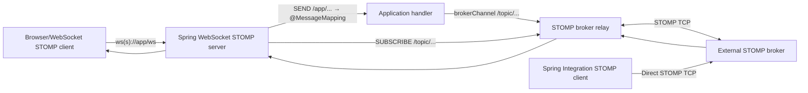
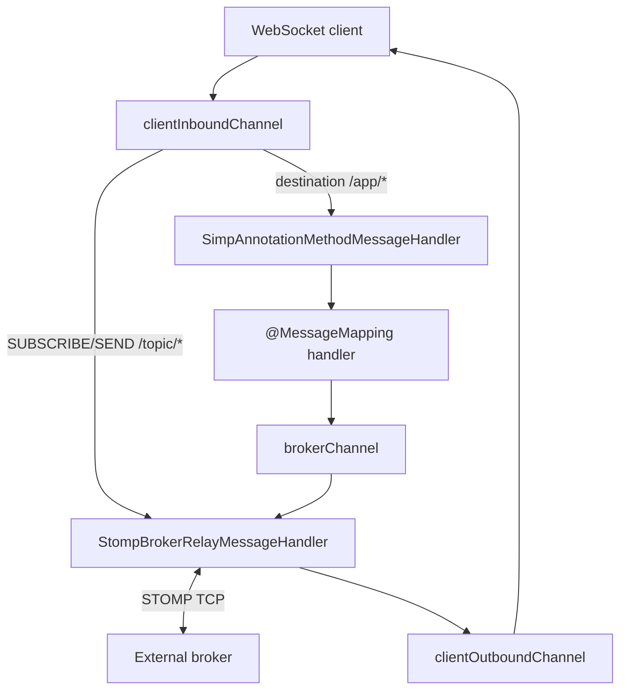
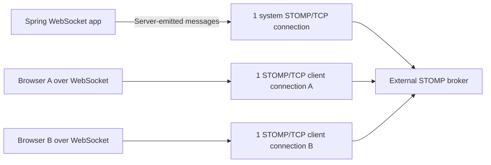
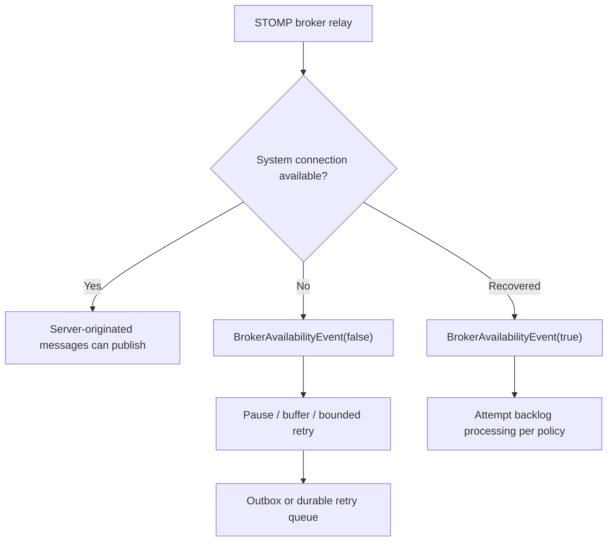

# Broker Relay and Application Destinations in Spring Integration STOMP

## 1. Problem Statement: Where Does `/app/orders` Go, and Where Does `/topic/orders` Go?

An e-commerce platform has a web UI that needs to send order-creation commands and receive real-time updates. The browser connects to a Spring application over WebSocket, sends a STOMP frame to `/app/orders.create`, and subscribes to `/topic/order-events` to view notifications. Behind the application sits a standalone STOMP broker, such as RabbitMQ with the STOMP plugin or ActiveMQ/Artemis with STOMP enabled.

The development team may hold two misconceptions:

- Having enabled the **broker relay**, they assume **every** frame, including `SEND /app/orders.create`, is forwarded straight to the broker.
- Having configured **Spring Integration's** `StompMessageHandler` to send to a STOMP broker over TCP, they assume it also automatically routes through `@MessageMapping("/orders.create")` in the Spring WebSocket application.

Both assumptions are architecturally wrong. **Application destinations** (typically `/app`) are used by the **Spring WebSocket STOMP server** to route messages to application code. **Broker destinations** (typically `/topic` and `/queue`) are forwarded to either the **simple broker or broker relay**, depending on configuration. A **Spring Integration STOMP client** connecting directly to an external broker bypasses the Spring server's `/app` routing.

In the **SPRING_INTEGRATION_ADAPTERS** module, inbound/outbound adapters, gateways, pollers, and `MessageChannel` are the components connecting Java applications to external systems. This lesson places **Spring Integration's STOMP adapters** in the exact context of the **Spring WebSocket broker relay**, helping you design command/event flows without misrouted destinations, duplicate messages, or data leaks.

**Learning Objectives:**

1. Distinguish the Spring WebSocket STOMP server, STOMP broker relay, external broker, and Spring Integration STOMP client.
2. Understand `setApplicationDestinationPrefixes("/app")`, `enableStompBrokerRelay("/topic", "/queue")`, `@MessageMapping`, `@SendTo`, and `SimpMessagingTemplate`.
3. Configure a broker relay over TCP with proper system/client credentials and handle `BrokerAvailabilityEvent`.
4. Explain why a Spring Integration `StompMessageHandler` sending **directly to the broker** does not trigger `/app` controllers; practice configuring a client connecting to the **application's WebSocket endpoint** to use `/app`.
5. Understand `/user` destinations, authentication/authorization, ACKs/receipts, relay limits, multiple replicas, and testing approaches.

## 2. Four Components to Keep Distinct



| Component | Primary API | Responsibility |
| --- | --- | --- |
| **Spring WebSocket STOMP server** | `@EnableWebSocketMessageBroker`, `WebSocketMessageBrokerConfigurer` | Receives STOMP frames over WebSocket, classifies destinations, and routes to application handlers/broker layer. |
| **Application destination** | `setApplicationDestinationPrefixes("/app")`, `@MessageMapping` | Invokes business Java code inside the Spring WebSocket server itself. |
| **STOMP broker relay** | `enableStompBrokerRelay(...)` | Forwards broker-bound frames from WebSocket/app to an external broker over TCP and relays responses back to WebSocket clients. |
| **External STOMP broker** | STOMP/TCP listener + destinations/ACLs | Manages subscriptions, message distribution, durability, and ACK/redelivery per broker capabilities. |
| **Spring Integration STOMP adapter** | `StompInboundChannelAdapter` / `StompMessageHandler` + `StompSessionManager` | Sends/receives Spring `Message<?>` as a **STOMP client**, connecting either directly to a broker or to a WebSocket STOMP endpoint depending on the client. |

The **server layer** in this example belongs to Spring Framework WebSocket; it is **not** `StompInboundChannelAdapter`. Nor is the broker relay a Spring Integration inbound/outbound adapter, even though both use messages and STOMP.

### Three Different Types of "Paths"

| Path | Example | Interpreted by |
| --- | --- | --- |
| WebSocket connection URL | `wss://api.example.com/ws` | HTTP/WebSocket handshake at the server/proxy. |
| Application destination | `/app/orders.create` | Spring WebSocket application routing, e.g., `@MessageMapping("/orders.create")`. |
| Broker destination | `/topic/order-events` or `/queue/jobs` | Broker handler/relay and external broker. |

Destination strings are simply **application and broker contracts**, not STOMP 1.2 keywords forced to have identical semantics on every broker. Consult the broker documentation to know exactly how destinations are created, routed, and stored.

## 3. Message Flow Inside Spring WebSocket

When Spring WebSocket receives a STOMP frame from a client, it turns the frame into a Spring `Message<?>` and routes it into server-side channels:

- `clientInboundChannel`: messages arriving from WebSocket clients.
- `brokerChannel`: messages sent by the application into the broker layer, e.g., from `SimpMessagingTemplate` or a `@SendTo` return value.
- `clientOutboundChannel`: messages sent from the broker/controllers back to WebSocket clients.



### First Example: Business Command

1. Browser sends `SEND destination:/app/orders.create` with a JSON command.
2. Spring WebSocket reads the message from `clientInboundChannel`.
3. The `/app` prefix is recognized and stripped to map `/orders.create` onto `@MessageMapping("/orders.create")`.
4. The handler validates and processes (e.g., saves to DB), then emits an event or returns a result with `@SendTo("/topic/order-events")`.
5. The event enters `brokerChannel`, passes through the broker relay to the external broker; the broker delivers the message to matching subscriptions.

### Second Example: Subscription

1. Browser sends `SUBSCRIBE destination:/topic/order-events`.
2. The server sees the destination matches a broker prefix; the relay forwards the subscription to the external broker.
3. When the broker sends a matching `MESSAGE`, the relay forwards it to `clientOutboundChannel` and over WebSocket to the browser.

**There is no `@MessageMapping` step on a subscription merely because the message has a JSON payload.** Routing depends on the destination/command and server configuration, not DTO names or `content-type`.

## 4. `/app`, `@MessageMapping`, and `@SendTo`

`setApplicationDestinationPrefixes("/app")` declares the prefix for messages **sent to application handlers on the Spring WebSocket server**. Example:

```java
@Controller
public class OrderCommandController {

    @MessageMapping("/orders.create")
    @SendTo("/topic/order-events")
    public OrderEvent create(OrderCommand command) {
        if (command.commandId() == null
                || command.commandId().isBlank()
                || command.orderId() <= 0) {
            throw new IllegalArgumentException("Invalid order command");
        }

        // Demo routing: no DB persistence or idempotency control yet.
        return new OrderEvent(
            command.commandId(),
            command.orderId(),
            "ACCEPTED"
        );
    }
}

record OrderCommand(String commandId, long orderId) {}
record OrderEvent(String eventId, long orderId, String status) {}
```

Place this code inside the same Spring WebSocket server application. Imports:

```java
import org.springframework.stereotype.Controller;
import org.springframework.messaging.handler.annotation.MessageMapping;
import org.springframework.messaging.handler.annotation.SendTo;
```

The client's `SEND /app/orders.create` frame maps to `create(...)`. **Clients do not send `/orders.create` directly to the handler once the `/app` prefix is configured.**

`@SendTo("/topic/order-events")` specifies the target destination emitted to the broker layer. Do not assume the return value of a `@MessageMapping` will automatically reach your desired destination, especially when route names change; declaring `@SendTo` explicitly keeps the contract testable.

The snippet above only demonstrates routing: **it lacks DB transactions, authorization, command deduplication, and event delivery guarantees**. In a real application, commands must have authentication/authorization and a consistent workflow that commits data before publishing events.

### Application Handlers Are Not External Broker Consumers

If a STOMP client sends `SEND /app/orders.create` **directly** to an external broker over a TCP port, the broker has no idea what Spring's `@MessageMapping` is. The `/app` prefix is only recognized by the Spring WebSocket server when frames actually **pass through Spring's WebSocket endpoint** (or an equivalent designed entry point).

This remains true even when the Spring server runs a broker relay to that same broker: **the relay does not loop external broker TCP frames back into application destination handlers**.

## 5. Simple Broker vs. Broker Relay: Pick the Right Job

Spring WebSocket provides two common ways to handle broker destinations:

| Criterion | `enableSimpleBroker(...)` | `enableStompBrokerRelay(...)` |
| --- | --- | --- |
| Where subscriptions are handled | Simple broker built into the Spring app, in-memory. | External broker supporting STOMP, over a TCP relay. |
| Deployment scope | Suitable for demos/simple apps. | Serves larger architectures with a dedicated broker. |
| Persistence/retention | No durable messaging by default. | Depends on external broker features and config. |
| Full ACKs, receipts, and features | Partial STOMP support only; not a full ACK/receipt solution. | Depends on the external broker and relayed protocol. |
| Clustering | Simple broker is not a durable clustered broker. | Can leverage the external broker's cluster per product support. |
| External connectivity | No external STOMP/TCP listener needed. | Needs STOMP/TCP endpoint, network, credentials, and resource capacity. |
| When broker is down | No external TCP broker relay. | Relay can lose connectivity; monitor availability and recovery. |

**Do not enable both as two competing brokers handling the same `/topic`/`/queue` in one setup** expecting Spring to coordinate subscriptions. Pick one model suited to your requirements.

**A broker relay does not make everything exactly-once.** Even if an external broker supports persistence, durable subscriptions, ACK/NACK, or dead-letter queues, you must still choose proper destinations, broker policies, subscription modes, and business idempotency/transactions.

## 6. Broker Relay Connections: System and Client Connections Differ

Spring Framework's broker relay uses two groups of connections to the external broker:



### 6.1. System Connection

The relay maintains a **system TCP** connection to the broker for **messages originating from server-side components** (such as `SimpMessagingTemplate.convertAndSend` or `@SendTo` outputs via `brokerChannel`). Spring Framework documentation emphasizes this system connection is for application-emitted messages, **not** for receiving every client's subscription messages.

Configure the system connection's STOMP `login`/`passcode` via `setSystemLogin` and `setSystemPasscode`. Never leave the `guest/guest` default in production.

### 6.2. Client Connections

The relay establishes a dedicated STOMP/TCP connection to the broker for **each relayed WebSocket client connection**. Those connections use `setClientLogin`/`setClientPasscode` configured on the server relay.

**Important:** the broker relay writes the relay's `login`/`passcode` onto the CONNECT sent to the broker instead of the WebSocket client's STOMP CONNECT credentials. Spring WebSocket applications typically authenticate **end users at the HTTP/WebSocket handshake** and authorize at the application/message layer; do not treat client STOMP `login` headers as proof of end-user identity.

### 6.3. Connection Estimates

If one instance has 500 direct WebSocket clients and the relay is active, the STOMP/TCP connections opened by the relay to the broker are roughly:

```text
1 system connection + 500 client connections = 501 connections
```

This is a **topology estimate**, not a measured metric. Reconnects, unready clients, proxies, instance counts, and broker resources also affect actual counts. With 4 instances each holding ~500 WebSocket clients, total connections grow rapidly; check broker `max connections`, TLS/CPU, file descriptors, and subscription limits.

### 6.4. BrokerAvailabilityEvent

Spring Framework publishes `BrokerAvailabilityEvent` when the **system** connection to the broker drops or recovers. This event is very useful for pausing **server-originated publishes** when the broker is unavailable, but it is **not** proof that all client connections/subscriptions are healthy.

The relay has a mechanism to retry the system connection, roughly every 5 seconds per Spring Framework documentation; that cadence does not replace business retry/backoff and does not guarantee the broker replays lost messages.

## 7. Complete Server Example: `@EnableWebSocketMessageBroker` + Relay

### 7.1. Prerequisites

The Spring Boot app acts as the **WebSocket STOMP server**. An external broker enables STOMP/TCP on `127.0.0.1:61613` and supports `/topic/order-events`. To run in practice, you need a broker listener, username/password, ACLs, and matching routes; adding `spring-boot-starter-websocket` does not install an external broker automatically.

Illustrative Maven dependencies using a compatible Spring Boot BOM:

```xml
<dependencies>
    <dependency>
        <groupId>org.springframework.boot</groupId>
        <artifactId>spring-boot-starter-websocket</artifactId>
    </dependency>
    <dependency>
        <groupId>io.projectreactor.netty</groupId>
        <artifactId>reactor-netty</artifactId>
    </dependency>
    <dependency>
        <groupId>io.netty</groupId>
        <artifactId>netty-all</artifactId>
    </dependency>
</dependencies>
```

The Spring Framework reference lists Reactor Netty and Netty for TCP broker relay connections; check your Boot version's dependency graph/BOM before adding components already pulled in transitively. If this app also runs Spring Integration flows, add `spring-boot-starter-integration` and the corresponding STOMP adapter **when actually needed**.

### 7.2. Configuring via `@ConfigurationProperties`

To avoid hardcoding passwords in Java:

```java
import org.springframework.boot.context.properties.ConfigurationProperties;

@ConfigurationProperties(prefix = "app.stomp.relay")
public record RelaySettings(
    String host,
    int port,
    String clientLogin,
    String clientPasscode,
    String systemLogin,
    String systemPasscode
) {}
```

Java `record` here requires Java 17 support; production configuration should read passwords from a secret store or environment variables.

### 7.3. WebSocketBrokerConfig

```java
import org.springframework.boot.context.properties.EnableConfigurationProperties;
import org.springframework.context.annotation.Configuration;
import org.springframework.messaging.simp.config.MessageBrokerRegistry;
import org.springframework.web.socket.config.annotation.EnableWebSocketMessageBroker;
import org.springframework.web.socket.config.annotation.StompEndpointRegistry;
import org.springframework.web.socket.config.annotation.WebSocketMessageBrokerConfigurer;

@Configuration
@EnableWebSocketMessageBroker
@EnableConfigurationProperties(RelaySettings.class)
public class WebSocketBrokerConfig
        implements WebSocketMessageBrokerConfigurer {

    private final RelaySettings relay;

    public WebSocketBrokerConfig(RelaySettings relay) {
        this.relay = relay;
    }

    @Override
    public void registerStompEndpoints(StompEndpointRegistry registry) {
        registry.addEndpoint("/ws")
            .setAllowedOrigins("http://localhost:3000");
    }

    @Override
    public void configureMessageBroker(MessageBrokerRegistry registry) {
        registry.setApplicationDestinationPrefixes("/app");
        registry.setUserDestinationPrefix("/user");

        registry.enableStompBrokerRelay("/topic", "/queue")
            .setRelayHost(relay.host())
            .setRelayPort(relay.port())
            .setClientLogin(relay.clientLogin())
            .setClientPasscode(relay.clientPasscode())
            .setSystemLogin(relay.systemLogin())
            .setSystemPasscode(relay.systemPasscode())
            .setSystemHeartbeatSendInterval(10_000)
            .setSystemHeartbeatReceiveInterval(10_000);
    }
}
```

**Reading the configuration:**

1. `@EnableWebSocketMessageBroker` enables Spring WebSocket STOMP server infrastructure and required channels.
2. `registry.addEndpoint("/ws")` declares the application's WebSocket handshake URL; this is not a broker destination.
3. `setAllowedOrigins("http://localhost:3000")` is strictly an origin for a local frontend demo. Production must use an approved origin list and enforce handshake authentication/CSRF; never open `"*"` everywhere.
4. `setApplicationDestinationPrefixes("/app")` routes `/app/...` messages to `@MessageMapping`.
5. `enableStompBrokerRelay("/topic", "/queue")` forwards matching broker destinations to the external broker.
6. `setRelayHost/Port` targets the external STOMP/TCP listener, not the HTTP/WebSocket port `8080`.
7. `clientLogin/clientPasscode` and `systemLogin/systemPasscode` serve **two different relay connection groups**.
8. System heartbeat intervals monitor system connection liveness—**not a periodic poller scanning messages**.

### 7.4. application.yml

```yaml
app:
  stomp:
    relay:
      host: 127.0.0.1
      port: 61613
      client-login: relay-client
      client-passcode: "${STOMP_RELAY_CLIENT_PASSWORD}"
      system-login: relay-system
      system-passcode: "${STOMP_RELAY_SYSTEM_PASSWORD}"
```

These environment variables must be supplied by a secret manager or proper secret-configuration mechanism. This is a **template**, not advice to commit real passwords into a repository. Verify the broker grants each account `SEND/SUBSCRIBE` permissions and virtual host access if applicable.

If the broker requires a STOMP `host` header (virtual host) differing from the TCP hostname, the broker relay provides `setVirtualHost(...)`. Enable it only when required by the broker contract; a wrong virtual host can cause CONNECT rejection even when reaching the right host/port.

### 7.5. Controller and DTOs

Declare `OrderCommandController` and its two DTOs from section 4 in the **same Spring WebSocket server application**. With this setup:

```text
Browser SEND /app/orders.create
   -> OrderCommandController#create
   -> @SendTo /topic/order-events
   -> brokerChannel
   -> broker relay (system connection)
   -> external broker
   -> browser SUBSCRIBEd to /topic/order-events
```

**The example controller does not write to a DB yet** and does not prove durable delivery. In a real application, when both DB commit and reliable broker publishing are needed, design transactional outbox/inbox or equivalent recovery; never assume `@SendTo` creates a transaction spanning DB and broker.

## 8. Sending from the Server via SimpMessagingTemplate and Spring Integration

Not every event originates from `@MessageMapping`. A file inbound adapter, HTTP adapter, SFTP flow, or JDBC polling flow inside the **same server application** can receive messages from external systems, run business logic, and then broadcast updates to WebSocket subscribers via `SimpMessagingTemplate`.

### 8.1. Publishing Directly from a Service

```java
import org.springframework.messaging.simp.SimpMessagingTemplate;
import org.springframework.stereotype.Service;

@Service
public class OrderNotificationService {

    private final SimpMessagingTemplate template;

    public OrderNotificationService(SimpMessagingTemplate template) {
        this.template = template;
    }

    public void notifyAccepted(OrderEvent event) {
        template.convertAndSend("/topic/order-events", event);
    }
}
```

`convertAndSend` injects the message into Spring's broker messaging infrastructure. With a broker relay, **server-emitted** messages travel over the system connection to the broker. Method success **does not prove** subscribers received or committed processing.

### 8.2. Connecting a Spring Integration Flow to the Broker Channel

In an application **with `spring-boot-starter-integration`**, you can create a service activator bridging an integration message channel to the WebSocket STOMP broker infrastructure:

```java
import org.springframework.context.annotation.Bean;
import org.springframework.context.annotation.Configuration;
import org.springframework.integration.annotation.ServiceActivator;
import org.springframework.integration.channel.DirectChannel;
import org.springframework.messaging.MessageChannel;
import org.springframework.messaging.simp.SimpMessagingTemplate;

@Configuration
public class IntegrationToWebSocketConfig {

    @Bean
    public MessageChannel approvedOrderEvents() {
        return new DirectChannel();
    }

    @Bean
    @ServiceActivator(inputChannel = "approvedOrderEvents")
    public org.springframework.messaging.MessageHandler broadcastHandler(
            SimpMessagingTemplate template) {
        return message -> template.convertAndSend(
            "/topic/order-events", message.getPayload()
        );
    }
}
```

In this flow, a source adapter (file, SFTP, JDBC, HTTP, AMQP, Kafka, etc.) **configured in its respective module** can send a validated `OrderEvent` to `approvedOrderEvents`. `DirectChannel` invokes the handler synchronously to hand off the message to `SimpMessagingTemplate`; it is **not** synchronized with final consumer completion.

**Distinction needed:** `approvedOrderEvents` is an application-declared Spring Integration `MessageChannel`; `brokerChannel` belongs to the **Spring WebSocket broker** infrastructure. They connect via the handler/`SimpMessagingTemplate`, not as the same bean.

If the message must be published **only after a DB transaction commits**, arrange transaction/outbox or publish-after-commit accordingly. Never call `convertAndSend` mid-JDBC-transaction assuming broker sends roll back with the database.

## 9. Where Must a Spring Integration Client Connect to Call `/app`?

There are **two completely different connection paths**.

### 9.1. Going Directly to the STOMP/TCP Broker

```text
Spring Integration application
    -> ReactorNettyTcpStompClient(host=broker,port=61613)
    -> StompSessionManager
    -> StompMessageHandler(destination="/topic/order-events")
    -> External STOMP broker
```

This path **bypasses the Spring WebSocket server**, so `SEND /app/orders.create` **does not** automatically invoke `@MessageMapping("/orders.create")`. Send only to destinations directly supported by the broker, e.g., `/topic/order-events` if defined/permitted on the broker.

Pros: direct server-to-broker communication without an extra WebSocket hop. Cons: bypasses command/controller handling, authentication, and policies on the Spring WebSocket server. Choose this when the business intent is truly **publishing directly to the broker**.

### 9.2. Connecting to the Application's WebSocket STOMP Endpoint

```text
Spring Integration application
    -> WebSocketStompClient("ws://app-host:8080/ws")
    -> WebSocketStompSessionManager
    -> StompMessageHandler(destination="/app/orders.create")
    -> Spring WebSocket server
    -> @MessageMapping("/orders.create")
```

This path can route commands to `@MessageMapping` because frames actually traverse the **Spring WebSocket STOMP server**. It requires valid handshake/authentication; production needs `wss://`, token/session controls, and `/app/orders.create` authorization.

### 9.3. Configuring a Spring Integration Client Over WebSocket

The example below is a **separate Java client application** from the server in section 7; do not declare beans with colliding names in the same application context when combining examples. Client dependencies need `spring-integration-stomp`, Spring WebSocket client, and an appropriate transport.

```java
import org.springframework.beans.factory.annotation.Qualifier;
import org.springframework.context.annotation.Bean;
import org.springframework.context.annotation.Configuration;
import org.springframework.integration.annotation.ServiceActivator;
import org.springframework.integration.channel.DirectChannel;
import org.springframework.integration.config.EnableIntegration;
import org.springframework.integration.stomp.StompSessionManager;
import org.springframework.integration.stomp.WebSocketStompSessionManager;
import org.springframework.integration.stomp.outbound.StompMessageHandler;
import org.springframework.integration.support.converter.PassThruMessageConverter;
import org.springframework.messaging.MessageChannel;
import org.springframework.messaging.MessageHandler;
import org.springframework.messaging.simp.stomp.WebSocketStompClient;
import org.springframework.scheduling.concurrent.ThreadPoolTaskScheduler;
import org.springframework.web.socket.client.standard.StandardWebSocketClient;

@Configuration
@EnableIntegration
public class SpringIntegrationAppDestinationClientConfig {

    @Bean
    public ThreadPoolTaskScheduler stompClientScheduler() {
        ThreadPoolTaskScheduler scheduler = new ThreadPoolTaskScheduler();
        scheduler.setPoolSize(1);
        scheduler.setThreadNamePrefix("stomp-app-client-");
        return scheduler;
    }

    @Bean
    public StompSessionManager applicationStompSessionManager(
            ThreadPoolTaskScheduler stompClientScheduler) {
        WebSocketStompClient client =
            new WebSocketStompClient(new StandardWebSocketClient());
        client.setTaskScheduler(stompClientScheduler);
        client.setMessageConverter(new PassThruMessageConverter());

        return new WebSocketStompSessionManager(
            client, "ws://localhost:8080/ws"
        );
    }

    @Bean
    public MessageChannel appCommandOutbound() {
        return new DirectChannel();
    }

    @Bean
    @ServiceActivator(inputChannel = "appCommandOutbound")
    public MessageHandler appCommandStompHandler(
            @Qualifier("applicationStompSessionManager")
            StompSessionManager manager) {
        StompMessageHandler handler = new StompMessageHandler(manager);
        handler.setDestination("/app/orders.create");
        handler.setConnectTimeout(10_000);
        return handler;
    }
}
```

The client application sends a Spring message containing an appropriate JSON command to `appCommandOutbound`. The STOMP handler sends `SEND` over WebSocket to the server. The server routes `/app/orders.create` to `@MessageMapping`. The example does not auto-emit commands on startup to avoid triggering business endpoints inadvertently on every boot.

**For authenticated servers**, `WebSocketStompSessionManager` supports configuring `WebSocketHttpHeaders` for the handshake; cookie/token/session choices must align with the active security scheme. Do not assume `login`/`passcode` in a STOMP frame sent over WebSocket are used by the relay to authenticate the end user: the relay sends server-configured credentials to the broker.

## 10. Sample WebSocket Client to Test `/app` → `/topic`

For a web project with `@stomp/stompjs` installed, JavaScript example:

```javascript
import { Client } from "@stomp/stompjs";

const client = new Client({
  brokerURL: "ws://localhost:8080/ws",
  reconnectDelay: 5000,
  onConnect: () => {
    client.subscribe("/topic/order-events", frame => {
      console.log("Order event:", JSON.parse(frame.body));
    });

    client.publish({
      destination: "/app/orders.create",
      body: JSON.stringify({
        commandId: "cmd-501",
        orderId: 501
      })
    });
  }
});

client.activate();
```

This is a **demo**, not a production client:

- `ws://` URLs are only suitable for test environments; production uses `wss://`.
- `commandId` must be managed by the business system as an idempotency key across retries. Do not simply generate a fresh ID on each reconnect assuming the old command is safe.
- `onConnect` may re-run after reconnect, so the illustrative code **could re-publish the command**, causing duplicate business actions. Production must separate subscribe-on-reconnect from user-initiated command publishing, backed by retry/idempotency state.
- Both broker and server must actually permit the subscription and command; handshake authentication/authorization is mandatory for real data.

## 11. `/user` Destinations Are a Spring Server Routing Feature

A Spring WebSocket STOMP server can use `/user` for **logical user destinations**.

```text
Client subscribe: /user/queue/notifications
Server send:      /user/{username}/queue/notifications
```

`UserDestinationMessageHandler` translates the logical destination into a session/user-specific destination before the message reaches the broker, preventing clients subscribed to the same logical name from receiving each other's data.

Sending from the server:

```java
import org.springframework.messaging.simp.SimpMessagingTemplate;

// Runs inside a server service that authenticated and identified username:
template.convertAndSendToUser(
    username,
    "/queue/notifications",
    new OrderEvent("evt-503", 503L, "SHIPPED")
);
```

Here `username` must come from a trusted authenticated source—never blindly from a client-controlled header. `/user` is **not** a prefix every external TCP broker natively understands; clients connecting directly to the broker do not automatically receive the Spring server's `UserDestinationMessageHandler` logic.

If multiple Spring WebSocket server instances run in parallel, a user may be connected to a different instance. Spring Framework provides `userDestinationBroadcast` and user registry broadcast options by design to resolve user destinations across servers; **without configuring them, do not assume every server knows every user session**.

External brokers also need cleanup policies for temporary user/session queues once clients disconnect to avoid orphaned queues.

## 12. Authentication, Authorization, and Broker Credentials

### 12.1. HTTP Handshake and STOMP CONNECT

On a Spring WebSocket server, clients start with an HTTP/WebSocket handshake. Spring Security can bind a `Principal` to the WebSocket session from HTTP authentication. The broker relay uses the server-configured **clientLogin/clientPasscode** when opening TCP connections on behalf of WebSocket clients; STOMP `login`/`passcode` sent by browsers are not the basis for end-user authorization.

If you protect only the STOMP/TCP broker without protecting the WebSocket handshake or message destinations, an untrusted client could send commands to application handlers with improper privileges. **Protect both layers**:

1. Authenticate and enforce origin/CSRF checks on the WebSocket handshake.
2. Authorize `SEND /app/...`, `SUBSCRIBE /topic/...`, and `SUBSCRIBE /user/...` by `Principal`, tenant, and Spring Security policies.
3. Grant dedicated STOMP broker permissions to system/client relay accounts, restricting destinations at the broker.
4. Protect the STOMP/TCP relay with TLS and network controls, storing credentials in a secret store.

### 12.2. Do Not Rely on Prefixes for Authorization

Naming `/topic/private-orders` "private" does not make it confidential. Even if Spring WebSocket code exposes only one `@MessageMapping`, a browser could still attempt to `SUBSCRIBE` to a broker destination unless message security/broker ACLs block it. When tenant data is involved, verify the user–tenant relationship before publishing or subscribing.

Suggested policy:

| Action | Verification |
| --- | --- |
| `SEND /app/orders.create` | User authenticated, permitted to create orders, valid `commandId`/tenant. |
| `SUBSCRIBE /topic/order-events` | Matches public info scope or approved subscription scope. |
| `SUBSCRIBE /user/queue/notifications` | User authenticated, cannot specify another username via destination. |
| Server `convertAndSend` | Event validated, no PII leaked outside intended destinations. |
| Relay → broker | Dedicated credentials, TLS, broker ACLs, quotas. |

### 12.3. SSL/TLS and Network Boundaries

- `wss://app/ws` secures the **browser ↔ Spring server** leg.
- The **Spring broker relay ↔ external STOMP broker** link is a **separate TCP connection** requiring TLS suited to the broker/transport when carrying sensitive data; enabling WSS at the edge does not encrypt the relay hop.
- Browsers should not connect directly to the internal STOMP/TCP broker port if architecture requires all commands to pass through application policies.

## 13. Errors, Broker Availability, and Recovery



### 13.1. BrokerAvailabilityEvent

Per Spring Framework, when the **system** connection to the broker is lost or reconnected, the framework publishes `BrokerAvailabilityEvent`. You can observe it:

```java
import org.springframework.context.event.EventListener;
import org.springframework.messaging.simp.broker.BrokerAvailabilityEvent;
import org.springframework.stereotype.Component;

@Component
public class BrokerRelayAvailabilityObserver {

    private volatile boolean brokerAvailable;

    @EventListener
    public void onBrokerAvailability(BrokerAvailabilityEvent event) {
        brokerAvailable = event.isBrokerAvailable();
        System.out.println(
            "Broker relay system available=" + brokerAvailable
        );
    }

    public boolean isBrokerAvailable() {
        return brokerAvailable;
    }
}
```

This is a useful signal for updating metrics/readiness or deciding whether to submit messages into a non-durable pipeline. Do **not** treat `true` as proof that every WebSocket client connection, subscription, ACK, and consumer DB is healthy. Never rely solely on this boolean to guarantee exactly-once or replay.

### 13.2. When the Broker Disconnects

A production system should define:

- Which messages may be dropped vs. durably persisted.
- Which publishers should pause/buffer when the system connection is unavailable.
- Retry budgets, backoff, and stable idempotency keys.
- Whether client subscriptions restore cleanly per broker contract when the relay reconnects.
- How committed DB state and broker-emitted state can diverge.

The broker relay can reconnect; it **does not replay** messages held only in application memory that were lost during a process crash. When the DB and broker are separate resources, a JDBC transaction does not automatically roll back a `SEND` that already succeeded at the broker.

### 13.3. ACK/NACK, RECEIPT, and Business Commit

| Milestone | What it tells you | What it does NOT tell you |
| --- | --- | --- |
| `MessageChannel.send()` or `SimpMessagingTemplate.convertAndSend()` | The message entered Spring infrastructure via the corresponding mechanism. | Whether the broker persisted it or a subscriber committed. |
| Broker `RECEIPT` | The broker acknowledged a frame requesting receipt per STOMP. | Whether the receiver processed business logic successfully. |
| `ACK/NACK` | Consumer acknowledged/rejected a delivery per subscription mode and broker. | Whether DB transactions in another service are covered automatically. |
| Business commit | Business logic saved the outcome successfully. | Whether the broker stopped redelivery if the proper ACK has not been sent. |

In environments with critical data, use stable event IDs, idempotent consumers, and recovery/outbox/inbox designs. Do not assume an external broker relay automatically provides "browser-to-DB exactly-once."

## 14. Multiple Instances, User Sessions, and Message Ordering

```text
Browser A ---> Spring WebSocket pod 1 ---\
                                          \
                                           External STOMP broker
                                          /
Browser B ---> Spring WebSocket pod 2 ---/
```

Each Spring instance maintains its relay system connection and corresponding client connections. The external broker may support clustering/durable destinations per configuration, yet:

1. WebSocket sessions remain bound to specific server instances.
2. Logical user destinations require cross-server user-session resolution where appropriate.
3. Message processing order can be affected by `clientInboundChannel` and `clientOutboundChannel` running on multi-threaded executors.
4. Broker fan-out/queue semantics vary by destination and subscription.
5. If two publishers emit duplicate events, the relay does not deduplicate automatically.

Spring Framework supports `setPreservePublishOrder(true)` on `MessageBrokerRegistry` when publish order must be preserved within **a single client session**; this adds overhead and **does not establish global ordering across multiple pods or multiple publishers**.

If per-client receive ordering is needed, Spring Framework also offers `setPreserveReceiveOrder(true)` on `StompEndpointRegistry`. Weigh the cost and business need before enabling; these options do not replace idempotency or ordering at the broker/DB.

## 15. End-to-End Testing Practice

### 15.1. Preparation

1. Start an external broker with STOMP/TCP enabled, confirming `host/port` and user ACLs for `/topic/order-events`.
2. Provide relay secret config via environment variables; start the Spring WebSocket server from section 7.
3. Verify the `/ws` WebSocket endpoint works with valid clients and origins.
4. Connect the STOMPJS client from section 10 or the Spring Integration WebSocket STOMP client from section 9.3.
5. Collect logs/metrics **without passcodes** for handshakes, broker availability, subscriptions, and business events.

### 15.2. Test Matrix

| Step | Action | Outcome to verify |
| --- | --- | --- |
| 1 | Browser `SUBSCRIBE /topic/order-events` | Broker relay forwards subscription to broker and receives matching messages. |
| 2 | Browser `SEND /app/orders.create` | `@MessageMapping("/orders.create")` is invoked. |
| 3 | Controller returns event with `@SendTo` | Event flows through broker layer to `/topic/order-events`. |
| 4 | Spring Integration WebSocket client sends `/app/orders.create` | Server application handler runs when handshake/auth are valid. |
| 5 | Spring Integration TCP client sends `/app/orders.create` directly to broker | Do **not** expect Spring `@MessageMapping` to be invoked. |
| 6 | Server code calls `SimpMessagingTemplate.convertAndSend` | Event leaves server via relay system connection. |
| 7 | Stop external broker in test environment | `BrokerAvailabilityEvent(false)` fires; observe retry/behavior. |
| 8 | Restart broker | Relay reconnects, broker availability and subscriptions are re-verified. |
| 9 | No subscribers or offline subscriber | Evaluate retention/durability per broker; do not assume broker always stores events. |
| 10 | Multiple server instances | Verify user destinations, routing, ordering, and connection capacity. |
| 11 | Client lacks `SEND/SUBSCRIBE` permissions | Server message authorization / broker ACLs reject properly. |
| 12 | Same event sent twice with identical ID | Idempotent consumer produces no duplicate business effects. |

**Never shut down a production broker to verify logic.** Use a test broker with synthetic data that can be restarted freely, measuring source, broker, client, and DB if present.

### 15.3. Diagnosing Destination Errors

If the browser sends `SEND /app/orders.create` and the controller does not run, check: handshake, authentication, message authorization, application prefix, `@MessageMapping`, and payload conversion.

If the controller runs yet the browser receives no event, check: `@SendTo`, `brokerChannel`, relay availability, broker destination/ACL, and browser `SUBSCRIBE`.

If a Spring Integration TCP client sends `/app/orders.create` and never hits the controller, **that is the expected behavior of a direct-to-broker topology**, not necessarily a framework bug. Switch the connection target to the Spring WebSocket endpoint or design an appropriate application gateway/API.

## 16. Operational Observability and Diagnostics

| Symptom | Hypothesis | Resolution |
| --- | --- | --- |
| WebSocket CONNECTED, yet no events received | Wrong `/topic`, missing subscribe, or broker unavailable | Inspect `SUBSCRIBE` frames, broker ACLs, relay system/client status. |
| `@MessageMapping` never executes | Client sent to `/topic` or connected directly to broker | Verify `/app` prefix and the WebSocket server endpoint. |
| Controller executes, yet no `MESSAGE` arrives | Relay unavailable, wrong `@SendTo`, different broker routing | Check `brokerChannel`, availability, and destination. |
| Browser sends `login`, yet broker sees another credential | Relay overwrote with configured client credentials | Review server-side authentication and relay config. |
| Server-originated events fail | System connection lost or missing `SEND` permission | Listen to `BrokerAvailabilityEvent`, verify system user/ACL. |
| Some clients miss messages while others receive them | Individual client connection/subscription failed | Check WebSocket sessions and per-client broker TCP connections. |
| Duplicate events after reconnect | Client re-publishes inside `onConnect`, or broker redelivery | Keep stable command/event IDs and process idempotently. |
| Notifications leak across users | Shared topic or missing auth/user routing | Inspect `/user`, `Principal`, ACLs, and message authorization. |
| Broker rejects TCP CONNECT | Wrong relay host/port, virtual host, or credentials | Check STOMP listener, network/TLS, and secret-scrubbed logs. |
| Multiple pods, yet user notifications go missing | User session lives on a different pod | Review user registry/broadcast and cross-server user routing. |
| Status updates arrive out of order | Executors on inbound/outbound channels or multiple publishers | Enable ordering where needed, partition by key, and version events. |

### Metrics to Measure

Monitor WebSocket session counts, TCP connections to the broker (system/client), `BrokerAvailabilityEvent`, reconnect counts and recovery time, subscription counts, `SEND/MESSAGE` frame rates, auth/ACL errors, queue/executor depth, age of unpublished events, receipt timeouts, consumer-committed counts, and duplicate counts.

An `isConnected` metric on **Spring Integration's `StompSessionManager`** does not substitute for the **Spring WebSocket server's** broker relay availability: those are **two distinct connections and two distinct infrastructure layers**.

## 17. Exercises with Answers

**Exercise 1 — `/app` routing.** A browser sends `SEND /app/orders.create` to a Spring WebSocket server configured with `setApplicationDestinationPrefixes("/app")`. Which component handles it?

**Answer:** Spring application message handling, e.g., a `@MessageMapping("/orders.create")` method; `/app` frames are not forwarded straight to the external broker by default.

**Exercise 2 — `/topic` routing.** A browser sends `SUBSCRIBE /topic/order-events` when the server enables `enableStompBrokerRelay("/topic", "/queue")`. Where is the subscription handled?

**Answer:** The broker relay forwards the request to the external STOMP broker; matching events are relayed back to the browser.

**Exercise 3 — Two ports.** Do `ws://app:8080/ws` and `broker:61613` serve the same role?

**Answer:** No. One is the Spring server's WebSocket handshake endpoint; the other is the external broker's STOMP/TCP listener.

**Exercise 4 — System connection.** Is the relay's system TCP connection used to receive all events for WebSocket clients?

**Answer:** No. It handles messages **emitted by the server-side application**; the relay opens separate TCP connections representing individual WebSocket clients.

**Exercise 5 — Client credentials.** A browser sends `login:alice` in STOMP CONNECT through the relay. Does the broker automatically use this credential to authenticate Alice?

**Answer:** Not by default. The relay uses the server's `clientLogin/clientPasscode` when connecting to the broker; end users are typically authenticated via the HTTP/WebSocket session.

**Exercise 6 — Spring Integration TCP.** `StompMessageHandler` in a service uses a TCP client connected directly to the broker and sends to `/app/orders.create`. Is the controller guaranteed to be invoked?

**Answer:** No. That path bypasses the Spring WebSocket server; the broker knows nothing about `@MessageMapping` unless custom routing exists.

**Exercise 7 — Spring Integration WebSocket.** To use a Spring Integration client to invoke `@MessageMapping`, where must it connect?

**Answer:** Use `WebSocketStompClient` and `WebSocketStompSessionManager` connected to the **Spring application's WebSocket endpoint**, then send to `/app/orders.create`.

**Exercise 8 — BrokerAvailabilityEvent.** Does an event reporting broker availability prove all subscribers committed messages successfully?

**Answer:** No. It reflects availability of the system connection to the broker, not final business outcomes.

**Exercise 9 — Simple vs. relay.** Why do projects needing durable messaging/clustering usually choose an external broker over the simple broker?

**Answer:** The simple broker keeps subscriptions in memory and supports only a subset of STOMP; an external broker can offer durability, ACKs, clustering, and richer policies when configured properly.

**Exercise 10 — Spring Integration flow.** A `Message<File>` was parsed into an `OrderEvent` in Spring Integration. What component can publish it into the broker layer of a Spring WebSocket server in the same JVM?

**Answer:** A handler calling `SimpMessagingTemplate.convertAndSend("/topic/order-events", event)` or an equivalent server-side broker messaging mechanism.

**Exercise 11 — User destinations.** A client subscribes to `/user/queue/notifications`. Does an external TCP broker natively understand the `/user` prefix?

**Answer:** No. Spring's `UserDestinationMessageHandler` resolves the logical prefix on the server before forwarding to concrete broker destinations.

**Exercise 12 — Security boundary.** Does enabling WSS on the browser side automatically encrypt the TCP hop between the relay and the external broker?

**Answer:** No. Those are two separate hops; TLS/ACLs for the external broker must be configured separately.

**Exercise 13 — Duplicate commands on reconnect.** Client code publishes `/app/orders.create` right inside `onConnect`. If the network drops and reconnects, what can happen?

**Answer:** The command may be sent again; without idempotency, the system could execute duplicate business actions. Separate the subscribe lifecycle from user-initiated publishes.

**Exercise 14 — Ordering.** Does `setPreservePublishOrder(true)` guarantee strict global ordering across publishers on multiple pods?

**Answer:** No. That option focuses on publish ordering within a single client session; system-wide ordering requires separate design.

**Exercise 15 — Where are broker messages received?** Is a `StompInboundChannelAdapter` connected directly to an external broker receiving `/topic/orders` a server-side `@MessageMapping`?

**Answer:** No. It is a client-side Spring Integration STOMP message producer that receives broker frames and emits Spring `Message<?>` instances onto an output `MessageChannel`.

## 18. Key Takeaways

A **broker relay** is **Spring WebSocket STOMP server** infrastructure that forwards broker destinations like `/topic` and `/queue` to an **external STOMP broker**; **application destinations** like `/app` are routed by the Spring server to `@MessageMapping`. The relay uses one TCP **system connection** for server-originated messages and one TCP **client connection** per WebSocket client; relay credentials differ from `Principal` authentication at the HTTP/WebSocket handshake. **Spring Integration's `StompMessageHandler`/`StompInboundChannelAdapter` are STOMP clients**: connecting directly to the broker bypasses `/app`, whereas connecting via `WebSocketStompClient` to Spring's `/ws` can leverage application routing. Safe operation requires distinguishing destinations and transports, enforcing multi-layer auth/authz, monitoring `BrokerAvailabilityEvent`, protecting user destinations, controlling retries, and using idempotency/outbox when end-to-end reliability is required.

## References

- [Spring Framework — Flow of Messages](https://docs.spring.io/spring-framework/reference/web/websocket/stomp/message-flow.html)
- [Spring Framework — External Broker](https://docs.spring.io/spring-framework/reference/web/websocket/stomp/handle-broker-relay.html)
- [Spring Framework — Connecting to a Broker](https://docs.spring.io/spring-framework/reference/web/websocket/stomp/handle-broker-relay-configure.html)
- [Spring Framework — Authentication](https://docs.spring.io/spring-framework/reference/web/websocket/stomp/authentication.html)
- [Spring Framework — User Destinations](https://docs.spring.io/spring-framework/reference/web/websocket/stomp/user-destination.html)
- [Spring Integration — STOMP Support](https://docs.spring.io/spring-integration/reference/stomp.html)
- [Spring Integration API — WebSocketStompSessionManager](https://docs.spring.io/spring-integration/api/org/springframework/integration/stomp/WebSocketStompSessionManager.html)
