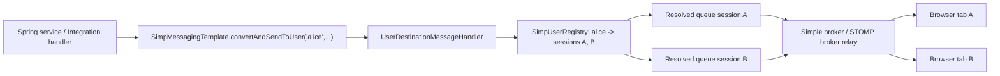
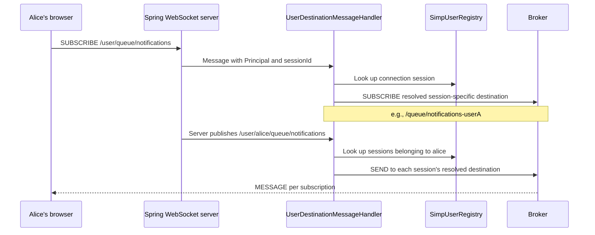

# User Destinations and Session Mapping in Spring Integration STOMP

## 1. Problem Statement: Notifying the Right User, the Right Session, Without Data Leaks

An ordering application receives events from multiple sources (HTTP, file, Kafka, JMS, etc.) via Spring Integration and, once processed, must notify the customer viewing the web UI. Two customers both subscribe to the notification channel: if the application publishes to `/topic/order-updates`, both could receive an event containing data meant for only one person. If the application manually constructs `/queue/user-alice` by concatenating usernames, risks of name collisions, broken permissions, and broker coupling increase. When one person opens **two tabs**, does sending to the user mean both tabs receive it or only one? When one tab disconnects and reconnects, is the old session still valid?

Spring Framework WebSocket STOMP solves **user/session-based routing** using **user destinations**. A client can subscribe to a logical address like `/user/queue/notifications`, while the server translates that address into a **concrete destination unique to each WebSocket/STOMP session**. The coordinating component is `UserDestinationMessageHandler` along with `SimpUserRegistry` and `UserDestinationResolver`.

In the **SPRING_INTEGRATION_ADAPTERS** module, inbound/outbound adapters, gateways, pollers, and `MessageChannel` connect external sources to internal processing flows. This lesson explains **how to bridge Spring Integration results into Spring WebSocket user destinations**, while distinguishing this server-side feature from `StompInboundChannelAdapter`/`StompMessageHandler`, which act as **STOMP clients**.

**Learning Objectives**

1. Distinguish `/user` logical destinations, concrete broker destinations, WebSocket session IDs, subscription IDs, and `Principal`.
2. Understand client `SUBSCRIBE /user/queue/...`, server `convertAndSendToUser(...)`, and `@SendToUser` rules.
3. Distinguish **sending to all sessions** of a user from **only the session that sent the command**, including anonymous users.
4. Configure a Spring WebSocket STOMP server, observe `SimpUserRegistry`, and track lifecycle events.
5. Connect a Spring Integration flow to `SimpMessagingTemplate` without letting untrusted headers decide the recipient.
6. Design multi-instance routing, broker relay, authorization, reconnect, offline delivery, idempotency, and testing.

## 2. Four Identifiers That Must Not Be Conflated

Suppose a logged-in user named `alice` opens two browser tabs. Each tab opens a WebSocket connection and creates a separate STOMP session.

```text
Principal: alice
   |
   +-- WebSocket/STOMP session A: s-a123
   |      +-- SUBSCRIBE id:sub-0
   |          destination:/user/queue/notifications
   |
   +-- WebSocket/STOMP session B: s-b456
          +-- SUBSCRIBE id:sub-0
              destination:/user/queue/notifications
```

Both subscriptions can share the ID `sub-0` because subscription IDs only need to be unique **within a single STOMP session**, not system-wide. However, they correspond to **two separate subscriptions** tied to two different connections/sessions.

| Identifier | Example | Which layer? | Meaning |
| --- | --- | --- | --- |
| User identity / `Principal.getName()` | `alice` | Server authentication | Logged-in user, who may have multiple sessions. |
| WebSocket/STOMP session ID | `s-a123` | Spring WebSocket server | One connection/protocol session; changes on reconnect. |
| Subscription ID | `sub-0` | STOMP `SUBSCRIBE` | Identifies one subscription within the corresponding **session**. |
| Logical user destination | `/user/queue/notifications` | Spring user destination routing | Stable name for clients to subscribe to, without session ID. |
| Resolved broker destination | e.g., `/queue/notifications-user<s-a123>` | Broker layer, created by Spring | Destination tied to a specific session. |
| Domain event ID | `evt-501` | Business contract | Stable ID for tracing/idempotency across retries. |

The name `/queue/notifications-user<s-a123>` is only **illustrative**; the actual suffix format depends on the Spring resolver and broker configuration. Never hardcode resolved destination names or infer session IDs from suffixes.

**Key point:** `username` is not `sessionId`; `sessionId` is not `subscriptionId`; and none of the three is `MessageHeaders.ID` or a STOMP broker `message-id`.

## 3. Where Does `/user/` Have Meaning?

Inside a **Spring WebSocket STOMP server** configured with user destinations:

- The client **subscribes** to `/user/queue/notifications`.
- The server can **publish** to a user with `SimpMessagingTemplate.convertAndSendToUser("alice", "/queue/notifications", payload)`.
- Spring creates a message with a logical route equivalent to `/user/alice/queue/notifications`, and `UserDestinationMessageHandler` resolves target sessions.
- A concrete broker destination is created for each subscribed session, e.g., private destinations bound to sessions A/B.



User destination mapping is a **Spring WebSocket server-side** feature, not a built-in rule of the STOMP 1.2 protocol. If **Spring Integration's** `StompMessageHandler` connects directly to an external TCP broker and sends `SEND /user/alice/queue/notifications`, the external broker **does not automatically** invoke another Spring application's `UserDestinationMessageHandler`.

### Comparing Four Common Paths

| Path | Who uses it? | Role |
| --- | --- | --- |
| `wss://api.example/ws` | STOMP-over-WebSocket client | HTTP/WebSocket handshake URL. |
| `/app/orders.confirm` | Client sending commands to Spring WebSocket server | Application destination, mapped to `@MessageMapping`. |
| `/user/queue/notifications` | Client subscribing via Spring WebSocket server | Logical user destination; server resolves to client's sessions. |
| `/topic/events` or `/queue/jobs` | Broker layer | Broker destination per convention/configuration. |

Prefixes like `/topic` and `/queue` **have no fixed semantics mandated by STOMP**; the broker decides fan-out, competing consumers, retention, and ACKs. `/user` must be recognized and resolved by the Spring server before reaching the broker.

## 4. Flow When a Client SUBSCRIBEs to a User Destination

Suppose `alice` logs in and her browser sends:

```text
SUBSCRIBE
id:notifications-0
destination:/user/queue/notifications
ack:auto

^@
```

`^@` represents the NUL byte terminating a STOMP frame, not two characters for the app to send. Spring processes the request in this conceptual sequence:



A few notes:

1. **Do not require the browser to put the username in the subscribe destination.** Browsers typically just use `/user/queue/notifications`.
2. User identity and session ID are **established by the server**, never taken from an arbitrary custom header sent by the browser.
3. `UserDestinationMessageHandler` must be configured to handle `/user`, rather than letting the broker receive this logical prefix directly.
4. A valid subscription does not prove a message was processed in the database; ACK, transactions, and idempotency are separate responsibilities.

## 5. `@SendToUser`: How Does a User with Multiple Tabs Receive Messages?

Spring allows a `@MessageMapping` method to return a private result to the sender via `@SendToUser`.

### 5.1. Default: Sessions of the Same User Can Receive

```java
@Controller
public class OrderViewController {

    @MessageMapping("/orders.view")
    @SendToUser("/queue/order-view")
    public OrderViewResult view(
            OrderViewRequest request,
            java.security.Principal principal) {
        if (principal == null) {
            throw new SecurityException("Authentication required");
        }

        // DEMO: must verify principal is authorized to view orderId.
        return new OrderViewResult(
            request.orderId(), "RECEIVED", principal.getName()
        );
    }
}

record OrderViewRequest(long orderId) {}
record OrderViewResult(long orderId, String state, String owner) {}
```

Key annotations/imports:

```java
import org.springframework.stereotype.Controller;
import org.springframework.messaging.handler.annotation.MessageMapping;
import org.springframework.messaging.simp.annotation.SendToUser;
```

If `alice` has two sessions and **both are subscribed** to `/user/queue/order-view`, `@SendToUser` with its default `broadcast=true` can send the result to **both of Alice's sessions**. This suits events like "my order status changed" when all devices/tabs should know.

**Important on authorization:** the example only shows routing, not complete authorization. Never query or reveal order status to `principal` just because `request.orderId` looks valid; verify ownership against server-side data.

### 5.2. Only the Session That Sent the Command: `broadcast=false`

When the result is a response for **only the tab that sent the command**, and other tabs should not receive it:

```java
@MessageMapping("/orders.preview")
@SendToUser(value = "/queue/previews", broadcast = false)
public OrderViewResult preview(OrderViewRequest request) {
    // DEMO: in production verify user, tenant, and preview permission.
    return new OrderViewResult(
        request.orderId(), "PREVIEW", "current-session"
    );
}
```

`broadcast=false` directs the response only to the **session that sent the message** rather than all sessions for the user.

| Need | Usually appropriate choice |
| --- | --- |
| New order status needed on phone and two browser tabs | Default `@SendToUser` or user-wide `convertAndSendToUser`. |
| Form validation result meant only for the submitting tab | `@SendToUser(broadcast=false)`. |
| Error caused by a specific command | `@MessageExceptionHandler` combined with `@SendToUser(broadcast=false)`. |
| Event DB-committed by a background worker | `SimpMessagingTemplate.convertAndSendToUser(...)`. |

### 5.3. Can Unauthenticated Users Use `/user`?

Per Spring Framework, an **anonymous WebSocket session** can still subscribe to a user destination. When there is no authenticated user, `@SendToUser` targets only the **sending session**, equivalent to `broadcast=false`.

That **does not turn user destinations into an authentication mechanism**. For private data, require authentication/authorization before processing business commands or subscribing to sensitive data. Never assume "having the `/user` prefix means only logged-in users can enter."

## 6. `SimpMessagingTemplate`: Sending Notifications from Any Service

Not every notification is the return value of a `@MessageMapping`. A file-processing worker, Kafka event, HTTP order, or Spring Integration `ServiceActivator` can produce notifications after business logic succeeds.

Spring provides `SimpMessagingTemplate` with the method:

```java
template.convertAndSendToUser(
    "alice",
    "/queue/notifications",
    new UserNotification("evt-501", "Order confirmed")
);
```

**Note:** pass the **username** (authoritatively determined `Principal.getName()`) and the **destination without the `/user` prefix** into `convertAndSendToUser`. Do not manually concatenate `"/user/alice/queue/notifications"` and pass that as the destination argument.

### 6.1. Publishing Service

```java
import org.springframework.messaging.simp.SimpMessagingTemplate;
import org.springframework.stereotype.Service;

@Service
public class PrivateNotificationService {

    private final SimpMessagingTemplate messagingTemplate;

    public PrivateNotificationService(
            SimpMessagingTemplate messagingTemplate) {
        this.messagingTemplate = messagingTemplate;
    }

    public void publishToUser(
            String verifiedRecipient,
            String eventId,
            String messageText) {
        if (verifiedRecipient == null || verifiedRecipient.isBlank()) {
            throw new IllegalArgumentException(
                "Missing authenticated recipient"
            );
        }
        if (eventId == null || eventId.isBlank()) {
            throw new IllegalArgumentException("Missing eventId");
        }

        messagingTemplate.convertAndSendToUser(
            verifiedRecipient,
            "/queue/notifications",
            new UserNotification(eventId, messageText)
        );
    }
}

record UserNotification(String eventId, String text) {}
```

The parameter name `verifiedRecipient` reminds developers of the **security precondition**: the calling service itself must verify the recipient from authoritative server-side data (e.g., an order owner table). A `String` parameter alone does not prove an authenticated identity.

### 6.2. Sending to an Offline User

`convertAndSendToUser(...)` is **not a durable mailbox**. If the user has no active matching session, the message may go nowhere; do not assume it waits until the user logs back in.

When notifications are important data:

1. Persist the event/notification in a database or durable outbox.
2. Use STOMP as the **push path while the user is online**.
3. Have the client call an API to fetch unread notifications after login/reconnect.
4. Deduplicate by `eventId` and maintain read/unread state independently of session IDs.

## 7. Complete Example: Spring WebSocket STOMP Server Supporting `/user`

### 7.1. Dependencies

With a Spring Boot BOM managing compatible versions:

```xml
<dependencies>
    <dependency>
        <groupId>org.springframework.boot</groupId>
        <artifactId>spring-boot-starter-websocket</artifactId>
    </dependency>
    <dependency>
        <groupId>org.springframework.boot</groupId>
        <artifactId>spring-boot-starter-integration</artifactId>
    </dependency>
</dependencies>
```

`spring-boot-starter-websocket` provides the Spring WebSocket STOMP server infrastructure. `spring-boot-starter-integration` is only needed if the application also uses Integration flows/`@ServiceActivator`. For production, add Spring Security and DB persistence as needed. **No external STOMP broker is required to run the simple-broker demo**, though the simple broker does not replace a durable broker for high scale.

### 7.2. Java Configuration

```java
import org.springframework.context.annotation.Configuration;
import org.springframework.messaging.simp.config.MessageBrokerRegistry;
import org.springframework.web.socket.config.annotation.EnableWebSocketMessageBroker;
import org.springframework.web.socket.config.annotation.StompEndpointRegistry;
import org.springframework.web.socket.config.annotation.WebSocketMessageBrokerConfigurer;

@Configuration
@EnableWebSocketMessageBroker
public class UserDestinationWebSocketConfig
        implements WebSocketMessageBrokerConfigurer {

    @Override
    public void registerStompEndpoints(StompEndpointRegistry registry) {
        registry.addEndpoint("/ws")
            .setAllowedOrigins("http://localhost:3000");
    }

    @Override
    public void configureMessageBroker(MessageBrokerRegistry registry) {
        registry.setApplicationDestinationPrefixes("/app");
        registry.setUserDestinationPrefix("/user");
        registry.enableSimpleBroker("/topic", "/queue");
    }
}
```

Explanation:

1. `/ws` is the application's WebSocket handshake URL, e.g., `ws://localhost:8080/ws`; it is **not** a STOMP destination.
2. `/app` routes commands to `@MessageMapping` (mapping methods do not repeat the `/app` prefix).
3. `/user` is recognized by `UserDestinationMessageHandler` before forwarding messages to the broker.
4. `/queue` is the broker prefix for session-specific resolved destinations. `/topic` is for public broadcasts—never use it in place of user destinations for private data.
5. `setAllowedOrigins("http://localhost:3000")` is strictly an origin for local demos. Production needs an exact origin list, authentication, and message-level authorization.

**Do not configure a broker to handle `/user` directly** when you want Spring to perform user destination mapping. If prefixes overlap improperly, the broker could receive an unresolved logical `/user/...` path instead of a session-specific destination.

### 7.3. Controller Replying to the Exact Session

Place the controller below in the **same server application**:

```java
import java.security.Principal;

import org.springframework.messaging.handler.annotation.MessageMapping;
import org.springframework.messaging.simp.annotation.SendToUser;
import org.springframework.stereotype.Controller;

@Controller
public class UserNotificationController {

    @MessageMapping("/notifications.ping")
    @SendToUser(
        value = "/queue/notifications",
        broadcast = false
    )
    public UserNotification ping(
            PingCommand command,
            Principal principal) {

        if (principal == null) {
            throw new SecurityException("Login required");
        }
        if (command.requestId() == null
                || command.requestId().isBlank()) {
            throw new IllegalArgumentException("Missing requestId");
        }

        return new UserNotification(
            command.requestId(),
            "Ping accepted"
        );
    }
}

record PingCommand(String requestId) {}
```

This is an **illustrative request/reply example** with no database. If a client sends `SEND /app/notifications.ping` and is subscribed to `/user/queue/notifications`, the response goes only to the **calling client's session** due to `broadcast=false`. Real security configuration is still required: checking `Principal` inside a handler does not replace blocking unauthorized `CONNECT/SUBSCRIBE/SEND` frames on Spring Security message channels.

### 7.4. Service Sending User-Wide Notifications

Use `PrivateNotificationService` from section 6 in the same application context. When an event has verified recipient `alice`, call:

```java
privateNotificationService.publishToUser(
    "alice",
    "evt-502",
    "Order 502 delivered"
);
```

This method is for **trusted backend services**, not a REST endpoint taking arbitrary usernames from users. When both of Alice's tabs A and B are subscribed, both can receive the same user-wide notification.

## 8. JavaScript Client: One Logical Subscription per Tab

With a frontend using `@stomp/stompjs`, two tabs can run identical code:

```javascript
import { Client } from "@stomp/stompjs";

const client = new Client({
  brokerURL: "ws://localhost:8080/ws",
  reconnectDelay: 5000,
  onConnect: () => {
    client.subscribe("/user/queue/notifications", frame => {
      const event = JSON.parse(frame.body);
      console.log("Notification:", event.eventId);
    });
  }
});

client.activate();

function ping() {
  client.publish({
    destination: "/app/notifications.ping",
    body: JSON.stringify({ requestId: "req-701" })
  });
}
```

**Two key design points:**

- Send `SUBSCRIBE` inside `onConnect` so a new session re-subscribes after reconnect. **Do not** automatically re-send business commands inside `onConnect`; this callback can fire multiple times and create duplicate commands.
- Each tab has its own session, even though both tabs share the same browser/account. `@SendToUser(broadcast=false)` replies to the exact tab that issued the command; `convertAndSendToUser("alice", ...)` can reach both tabs.

The demo code uses `ws://`; production uses `wss://`, with cookies/tokens/authorization per your security design, avoiding logging private data to the console and avoiding hardcoded message IDs if retries must be tracked.

### Message Delivery Matrix

| Target | Subscription | Server publish | Expected behavior |
| --- | --- | --- | --- |
| Alice's tab A | `/user/queue/notifications` | `@SendToUser(broadcast=false)` from tab A command | Tab A receives; tab B does not receive that reply. |
| Alice's tab B | `/user/queue/notifications` | `convertAndSendToUser("alice",...)` | Both tab A and tab B can receive if still subscribed. |
| Bob's tab C | `/user/queue/notifications` | `convertAndSendToUser("alice",...)` | Tab C does **not** belong to user `alice`, so it is not a valid target. |
| Alice's tab A after reconnect | Old subscription died with old session | Client re-subscribes after `CONNECTED` | Receives **new** events per broker/retention; old replay is not guaranteed. |

## 9. `SimpUserRegistry`: user → session → subscription

`SimpUserRegistry` lets the server inspect connected users and their associated sessions/subscriptions. Key APIs:

```java
SimpUser user = simpUserRegistry.getUser("alice");
int userCount = simpUserRegistry.getUserCount();
Set<SimpUser> users = simpUserRegistry.getUsers();
```

If the user exists, you can call `user.getSessions()` and then each `SimpSession.getSubscriptions()` to inspect subscription status.

### 9.1. Safe Snapshot Example

```java
import java.util.Set;

import org.springframework.messaging.simp.user.SimpSession;
import org.springframework.messaging.simp.user.SimpUser;
import org.springframework.messaging.simp.user.SimpUserRegistry;
import org.springframework.stereotype.Component;

@Component
public class ActiveStompSessions {

    private final SimpUserRegistry registry;

    public ActiveStompSessions(SimpUserRegistry registry) {
        this.registry = registry;
    }

    public int activeUserCount() {
        return registry.getUserCount();
    }

    public int sessionCountFor(String trustedUsername) {
        SimpUser user = registry.getUser(trustedUsername);
        if (user == null) {
            return 0;
        }
        return user.getSessions().size();
    }

    public long subscriptionCountFor(String trustedUsername) {
        SimpUser user = registry.getUser(trustedUsername);
        if (user == null) {
            return 0L;
        }
        return user.getSessions().stream()
            .mapToLong(session -> session.getSubscriptions().size())
            .sum();
    }
}
```

In production, **never expose a public endpoint letting clients query the list of users/sessions**. The registry can leak presence, connection habits, and internal details of other users. For dashboards, expose aggregated metrics or enforce strict administrative authorization.

### 9.2. The Registry Is Near-Real-Time State, Not a Source of Truth

`SimpUserRegistry` is **runtime/ephemeral**:

- A WebSocket session may have just disconnected right before a snapshot is read.
- A user may not have subscribed yet even when `getUser(...)` is non-null.
- A session may reconnect and receive a new ID, changing the mapping.
- In multi-server deployments, a local registry may not know about users on another node without broadcast/coordination.
- Never use the registry as the sole authority to decide whether a user may read an order or has received an event.

One user opening two tabs is normally counted as **one user** with **two sessions**. Subscription count can exceed session count because a single session can subscribe to multiple destinations.

## 10. Lifecycle Events and Session Mapping

The Spring WebSocket STOMP server publishes events in the application context:

| Event | When | Diagnostic value |
| --- | --- | --- |
| `SessionConnectEvent` | STOMP `CONNECT` received | Handshake begins; carries session/user metadata if available. |
| `SessionConnectedEvent` | `CONNECTED` received from broker/server | Session established successfully at the STOMP layer. |
| `SessionSubscribeEvent` | `SUBSCRIBE` received | Shows which subscription a session requested. |
| `SessionUnsubscribeEvent` | `UNSUBSCRIBE` received | Subscription removal requested. |
| `SessionDisconnectEvent` | STOMP/WebSocket session ends | Clean up session-related state, emit metrics. |
| `BrokerAvailabilityEvent` | Broker layer (especially broker relay) changes state | Detects loss/recovery of the broker system connection. |

**`SessionDisconnectEvent` may be published multiple times for the same session.** Cleanup callbacks must be idempotent—never decrement counters multiple times or permanently delete user data just because a session closed.

### 10.1. Observing Subscribe/Disconnect Events

```java
import org.springframework.context.event.EventListener;
import org.springframework.messaging.simp.stomp.StompHeaderAccessor;
import org.springframework.stereotype.Component;
import org.springframework.web.socket.messaging.SessionConnectedEvent;
import org.springframework.web.socket.messaging.SessionDisconnectEvent;
import org.springframework.web.socket.messaging.SessionSubscribeEvent;

@Component
public class UserSessionLifecycleLogger {

    @EventListener
    public void onConnected(SessionConnectedEvent event) {
        String user = event.getUser() == null
            ? "<anonymous>" : event.getUser().getName();
        System.out.println("STOMP connected, user=" + user);
    }

    @EventListener
    public void onSubscribe(SessionSubscribeEvent event) {
        StompHeaderAccessor headers =
            StompHeaderAccessor.wrap(event.getMessage());
        System.out.println(
            "STOMP SUBSCRIBE destination=" + headers.getDestination()
        );
    }

    @EventListener
    public void onDisconnect(SessionDisconnectEvent event) {
        // One session may emit multiple disconnect events.
        System.out.println("STOMP session disconnected");
    }
}
```

The example intentionally logs minimal info. Production should not print full session IDs, tokens, or personal data into unprotected logs. If maintaining an application-level online presence table, use TTL-based sets/leases or idempotent updates rather than blindly incrementing/decrementing counters on events.

### 10.2. Typical Lifecycle Mapping

```text
T0: alice logs in, opens tab A
    session A created, SUBSCRIBE /user/queue/notifications

T1: alice opens tab B
    session B created, SUBSCRIBE same logical destination

T2: server sends convertAndSendToUser("alice", ...)
    both A and B can receive

T3: tab A disconnects
    session A invalidated; session B remains alive

T4: tab A reconnects
    a new session A' is created; must SUBSCRIBE again
```

**Never use session IDs as long-lived business identifiers.** Event IDs, user IDs, and notification states must be independent of session IDs that change across reconnects.

## 11. Broker Relay and Resolved Destinations

In demo apps, `registry.enableSimpleBroker("/topic", "/queue")` works well for learning routing, but it is basic and lacks the durability of a dedicated broker.

When using an external broker:

```java
@Override
public void configureMessageBroker(MessageBrokerRegistry registry) {
    registry.setApplicationDestinationPrefixes("/app");
    registry.setUserDestinationPrefix("/user");

    registry.enableStompBrokerRelay("/topic", "/queue")
        .setRelayHost("broker.internal.example")
        .setRelayPort(61613)
        .setClientLogin("relay-client")
        .setClientPasscode(clientSecret)
        .setSystemLogin("relay-system")
        .setSystemPasscode(systemSecret);
}
```

This is an **alternative configuration** to the simple broker; `clientSecret` and `systemSecret` must come from the application's secret manager/config injection, not pre-defined defaults. Never enable both the simple broker and broker relay for the same prefix assuming they coordinate automatically.

When a client subscribes to `/user/queue/notifications`, the Spring server translates it into a **session-specific broker destination**, and the relay sends the subscription to the external broker per its supported convention. Because each session gets its own destination, the external broker may create short-lived queue/consumer resources.

### 11.1. Cleaning Up Resources After Session Disconnect

With an external broker, verify that resolved destination resources are **deleted or expired** when a session disconnects:

- RabbitMQ has auto-delete destination/queue models when using appropriate conventions, e.g., `/exchange/amq.direct/...`.
- Other brokers offer policies to purge inactive queues/destinations.
- Do not impose RabbitMQ naming and auto-delete conventions onto ActiveMQ, Artemis, or other brokers.

Without cleanup, continuous session churn can leave behind clientless queues that consume resources and skew metrics.

### 11.2. STOMP Sessions vs. Business Delivery

A resolved queue may receive a `MESSAGE` frame while the client loses network connectivity before finishing processing. Redelivery depends on the broker, ack mode (`auto`, `client`, `client-individual`), and durability. Spring user destinations **do not automatically add business ACKs** or consumer JDBC transactions.

## 12. Multiple Server Instances: The User May Be on Another Node

Suppose the Spring WebSocket app runs across two pods:

```text
Alice's browser → WebSocket server B
                    |
                    +-- local SimpUserRegistry B: alice/session-b

Backend notification → WebSocket server A
                          |
                          +-- local registry A: alice not present
```

If A only knows its local registry, a user-targeted message may **fail to resolve** on A even though Alice is online on B.

### 12.1. Two Distinct Broadcast Mechanisms

When using a broker relay, Spring Framework supports configurations on **`StompBrokerRelayRegistration`**:

```java
registry.enableStompBrokerRelay("/topic", "/queue")
    .setRelayHost("broker.internal.example")
    .setRelayPort(61613)
    .setUserDestinationBroadcast(
        "/topic/unresolved-user-destination"
    )
    .setUserRegistryBroadcast(
        "/topic/simp-user-registry"
    );
```

Each method has a distinct role:

| Setting | Effect |
| --- | --- |
| `setUserDestinationBroadcast(...)` | Broadcasts **unresolved user messages** from the current node so other nodes can resolve and deliver them. |
| `setUserRegistryBroadcast(...)` | Broadcasts **user/session registry** state from each server so instances learn about users connected to other nodes. |

The snippet above is an **add-on/variant** to broker relay configuration, not a standalone app runnable without credentials and surrounding beans. Both internal destinations must be permitted by the external broker and kept separate from public notification topics for browsers.

**Security:** never allow untrusted clients to subscribe to internal topics carrying registry state or unresolved messages if private info is present. Enforce strict broker ACLs and Spring message authorization.

### 12.2. Broadcasting Does Not Create Exactly-Once

User registry broadcasts and unresolved destination broadcasts assist multi-server routing, but do not automatically provide:

- Distributed transactions across pods.
- Durable storage of notifications for offline users.
- Exactly-once delivery across retries/reconnects.
- User authorization checks for data access.
- Instantaneous strict consistency: the registry is distributed state with propagation lag.

Critical systems need a notification/inbox table or transactional outbox alongside a backfill API for clients.

## 13. Connecting a Spring Integration Flow to User Destinations

A Spring Integration `MessageChannel` can receive processed outputs from inbound adapters (file, SFTP, HTTP, Kafka, JMS, AMQP, etc.). After validation/authorization, a handler can call `SimpMessagingTemplate` to push notifications to users connected to the **Spring WebSocket server in the same application context**.

```mermaid
flowchart LR
    EXT["External source"] --> AD["Spring Integration inbound adapter"]
    AD --> C["MessageChannel"]
    C --> V["Validate + business logic/DB commit"]
    V --> N["Verified notification message"]
    N --> SA["@ServiceActivator"]
    SA --> T["SimpMessagingTemplate"]
    T --> U["UserDestinationMessageHandler"]
    U --> BR["Broker"]
    BR --> W["Target WebSocket sessions"]
```



### 13.1. Bridge Handler Example

```java
import org.springframework.context.annotation.Bean;
import org.springframework.context.annotation.Configuration;
import org.springframework.integration.annotation.ServiceActivator;
import org.springframework.integration.channel.DirectChannel;
import org.springframework.messaging.MessageChannel;
import org.springframework.messaging.simp.SimpMessagingTemplate;

@Configuration
public class IntegrationUserNotificationBridge {

    @Bean
    public MessageChannel verifiedNotifications() {
        return new DirectChannel();
    }

    @Bean
    @ServiceActivator(inputChannel = "verifiedNotifications")
    public org.springframework.messaging.MessageHandler userNotifier(
            SimpMessagingTemplate messagingTemplate) {

        return message -> {
            VerifiedNotification event =
                (VerifiedNotification) message.getPayload();

            if (event.recipientUser() == null
                    || event.recipientUser().isBlank()) {
                throw new IllegalArgumentException(
                    "Recipient must be verified by backend"
                );
            }

            messagingTemplate.convertAndSendToUser(
                event.recipientUser(),
                "/queue/notifications",
                new UserNotification(event.eventId(), event.text())
            );
        };
    }
}

record VerifiedNotification(
    String recipientUser,
    String eventId,
    String text
) {}
```

**Note on responsibility:** the record name `VerifiedNotification` is merely a Java type name; **it is not enough to trust the data**. A service authorized to access user/order records must verify the recipient and construct this message. Taking `recipientUser` straight from a client HTTP header or STOMP frame risks sending Customer A's data to Customer B.

### 13.2. Do Not Connect User Destinations Straight to a STOMP TCP Outbound Adapter

Compare:

```text
Correct when using Spring WebSocket user routing:
  Integration handler → SimpMessagingTemplate
    → /user/alice/queue/notifications
    → UserDestinationMessageHandler → broker resolved destination

Not equivalent:
  Integration StompMessageHandler(TCP broker, "/user/alice/...")
    → external STOMP broker
    → does not automatically run Spring's UserDestinationMessageHandler on another server
```

If a **Spring Integration client** in another JVM must use a Spring WebSocket server's application/user destination routing, it must connect via the configured **WebSocket STOMP endpoint** (e.g., `WebSocketStompClient` + `WebSocketStompSessionManager`) with valid authentication. Connecting directly to the broker over TCP can only target resolved destinations per the broker contract, and cannot natively resolve users/sessions from the Spring server.

### 13.3. Publishing After a DB Transaction

`convertAndSendToUser` does not participate in JDBC transactions. If a push is sent **before DB commit** and the DB then rolls back, the client may see a notification for a failed transaction.

Solutions by guarantee level:

- Simple demos: publish after valid business completion.
- With DB transactions: consider publish-after-commit, while still handling crashes after commit and before publish.
- High reliability: **transactional outbox** saving the notification alongside DB changes, published asynchronously by a worker, with client idempotency on `eventId`.
- Offline users: notifications live in the DB for clients to fetch on reconnect.

## 14. Authentication and Authorization: `/user` Is Not a Security Lock

### 14.1. When Is the Principal Attached?

With a Spring WebSocket STOMP server, the handshake begins over HTTP. Once Spring Security authenticates the HTTP request/session, a `Principal` can be attached to the WebSocket/STOMP session and propagated to messages handled in the application. By default, Spring WebSocket **does not treat STOMP `login`/`passcode` sent by browsers as end-user authentication** the way direct STOMP/TCP broker clients do.

This means:

- `Principal.getName()` should come from server authentication, not an arbitrary `username` header.
- One user's WebSocket presence may span multiple tab/device connections.
- When a session logs out or is revoked, enforce policies to close/restrict sessions and stop sending sensitive data to invalid sessions.
- When using tokens in STOMP CONNECT, configure a proper `ChannelInterceptor` and security context; never assume Spring automatically authenticates every token.

### 14.2. Minimum Permissions to Enforce

| Action | Control |
| --- | --- |
| WebSocket handshake `/ws` | Authentication, origin, CSRF, and proper cookie/token config. |
| `SEND /app/orders.view` | User has permission to view the requested `orderId`/tenant. |
| `SUBSCRIBE /user/queue/notifications` | Authorized sessions only; disallow subscribing arbitrarily to others' private targets. |
| `SUBSCRIBE /queue/notifications-user...` | Prevent browsers from guessing/subscribing directly to resolved broker destinations. |
| `convertAndSendToUser` | Recipient verified by backend, never taken directly from sender's request. |
| Multi-pod internal broadcast destinations | Only application/broker relay permitted to send/receive. |

**Crucially:** a resolved destination is just a **broker destination string**, not a security mechanism. If browsers are allowed to subscribe arbitrarily to `/queue/...` and guess another session's resolved queue name, data can leak. Enforce Spring message authorization and broker ACLs tailored to the topology.

### 14.3. Handling Usernames with Special Characters

Usernames may contain delimiters or characters that affect destinations. `SimpMessagingTemplate` and `UserDestinationResolver` perform the necessary steps to represent usernames inside logical destinations per Spring's API; do not manually concatenate raw usernames into STOMP paths or invent ad-hoc encoding in business services. With identity providers, normalize principal names into a stable identifier rather than a user's display name.

## 15. Durability, ACK, Retries, and Idempotency

User destinations provide **session routing**, not an exactly-once event delivery contract.

| Scenario | Risk | Mitigation |
| --- | --- | --- |
| User offline when notification is sent | No receiving session; push may be lost | Store notification in DB; client backfills via API. |
| Browser disconnects right after server publish | Frame may not arrive or finish processing | Broker ACK/retention; read status tracked in backend. |
| Server resends after timeout | Two events with identical ID appear | Deduplicate by `eventId` in client/DB. |
| Two sessions for the same user | Same notification arrives on both tabs | Often intentional; UI should be idempotent. |
| `@SendToUser(broadcast=false)` from tab A | Tab B does not receive | Use for session-local replies, not cross-device state updates. |
| Broker relay reconnects | Subscriptions/client connections must re-establish | Monitor disconnect/reconnect, re-subscribe, and backfill. |

**STOMP `ACK/NACK`** and `RECEIPT` differ from **business acknowledgment**:

- `RECEIPT` (when requested by client) only confirms the broker processed the frame, not that the notification was displayed.
- Subscription `ACK/NACK` depends on ack mode/broker and does not automatically cover DB transactions.
- `readAt` or `deliveredAt` in a notification system must be business states updated and verified independently.

Never use `SessionConnectedEvent` or `SimpUserRegistry.getUser(...) != null` to assume a user saw or read a notification.

## 16. Observability, Diagnostics, and Testing

### 16.1. Metrics to Collect

| Metric | Question |
| --- | --- |
| Connected authenticated users | How many `Principal`s are online? |
| Sessions per user (distribution) | Are excessive tabs/devices creating unusual load? |
| Subscriptions per logical destination | Are clients properly subscribed to `/user/queue/notifications`? |
| User-targeted sends | How many notifications is the backend publishing? |
| Unresolved user destinations | Are users on other pods or offline? |
| Broker relay availability/reconnects | Are the system connection and client sessions healthy? |
| Broker queue/destination resource count | Are resolved private destinations leaking after disconnect? |
| DB commit → push latency | Are notifications delayed by queues or the broker? |
| Duplicate / backfilled event counts | Are retries/reconnects causing duplicate UI entries? |

### 16.2. Symptom-Based Troubleshooting

| Symptom | Common cause | Investigation |
| --- | --- | --- |
| Both alice and bob receive alice's notification | Public `/topic` used or route lacks recipient check | Switch to user destination; verify `Principal` and policies. |
| Only tab A receives, tab B does not | `@SendToUser(broadcast=false)` used or B not subscribed | Clarify whether event is session-specific or user-wide. |
| `convertAndSendToUser("alice",...)` reaches no one | Username doesn't match `Principal.getName()` or user offline | Check registry, auth, subscriptions, and read-back API. |
| Client subscribes to `/user/alice/queue/...` | Confused subscribe URL with server-side publish URL | Client must subscribe to `/user/queue/...`. |
| Server logs CONNECTED, yet notifications don't arrive | SUBSCRIBE failed, broker relay down, or blocked handler | Check subscription events, queues, and broker availability. |
| Duplicate notifications after reconnect | Client re-publishes/subscribes, server retries | Keep stable `eventId`, idempotency, and read state. |
| Two pods; user-targeted sends work only on same pod | Local registry lacks sessions on the other pod | Configure appropriate broker relay broadcasts. |
| Broker accumulates countless private queues | Missing auto-delete/purge for inactive destinations | Check broker-specific user destination conventions and cleanup. |
| `SessionDisconnectEvent` drives online count negative | Duplicate disconnect events or naive counter math | Make cleanup idempotent; prefer snapshots/leases. |
| Data leak from a resolved destination | Loose broker ACL / message authorization | Block unauthorized subscriptions; never treat prefixes as permissions. |

### 16.3. End-to-End Test Matrix

In a test environment with two users `alice` and `bob`:

1. Alice opens two tabs, each sending `SUBSCRIBE /user/queue/notifications`.
2. Bob opens one tab and subscribes to **the same logical destination**.
3. Backend calls `convertAndSendToUser("alice", ...)`: both of Alice's tabs receive it; Bob's tab must not.
4. Alice's tab A sends `SEND /app/notifications.ping`: with `@SendToUser(broadcast=false)`, only tab A receives the reply.
5. Close tab A; backend sends again to Alice: tab B still receives, and closed tab A must not remain online.
6. Reconnect tab A: client re-subscribes; compare the new session ID with the old one.
7. Stop one replica in a test cluster: verify unresolved user destinations broadcast/resolve properly on another node.
8. Attempt to subscribe directly to another user's resolved broker queue with an unprivileged client: must be rejected.
9. Send the same `eventId` twice: notification store/UI must not create two distinct business entries.
10. Send while Alice is offline: verify the read-back API returns the data if durable storage is required.

Never perform disconnect tests, ACL changes, or broker manipulations in a live production environment serving real users.

## 17. Practice Exercises with Answers

**Exercise 1 — Subscribe URL.** Alice wants to receive private notifications from a Spring WebSocket server. Should the browser subscribe to `/user/queue/notifications` or `/user/alice/queue/notifications`?

**Answer:** `/user/queue/notifications`. Spring identifies the user/session from the connection and `Principal`, so the client does not put its username in the logical subscription.

**Exercise 2 — Recipient name.** To send from the server to Alice, which destination arguments do you pass to `convertAndSendToUser`?

**Answer:** `convertAndSendToUser("alice", "/queue/notifications", payload)`; do not pass `/user/alice/...` as the second destination argument.

**Exercise 3 — Two tabs.** Alice has tabs A and B both subscribed. Can default `@SendToUser` send to both?

**Answer:** Yes. By default it broadcasts to the user's subscribed sessions; use `broadcast=false` when only the command-sending session should receive.

**Exercise 4 — Session-specific reply.** A validation error is meant only for the tab that sent the request. Which annotation configuration fits?

**Answer:** `@SendToUser(value="/queue/errors", broadcast=false)`, which can be paired with `@MessageExceptionHandler`.

**Exercise 5 — Anonymous.** Can a session without an authenticated `Principal` subscribe to `/user/queue/...`?

**Answer:** Yes. `@SendToUser` then behaves like `broadcast=false`; it is not a built-in authentication or authorization mechanism.

**Exercise 6 — Registry.** `getUserCount()` returns 1 while one user has two tabs—is this a contradiction?

**Answer:** No. One user can have multiple sessions; use `SimpUser.getSessions()` to inspect the sessions.

**Exercise 7 — STOMP subscription ID.** Two tabs both use `id:sub-0` in `SUBSCRIBE`. Does this automatically violate the protocol?

**Answer:** No, because subscription IDs must be unique **within each STOMP session**, not across all sessions.

**Exercise 8 — Reconnect.** After tab A reconnects, can you reuse the old session ID to route notifications?

**Answer:** You should not. The new session gets its own ID; use authenticated user mapping and the new subscription rather than treating session IDs as business identity.

**Exercise 9 — Direct broker.** A Spring Integration `StompMessageHandler` connected directly to a TCP broker sends to `/user/alice/queue/notifications`. Is a Spring server guaranteed to resolve the user destination?

**Answer:** No. It bypasses the Spring WebSocket server's `UserDestinationMessageHandler` unless separate custom routing is explicitly built.

**Exercise 10 — Multi-node.** A user is connected to pod B while the publisher runs on pod A. Which two broker relay settings help route messages?

**Answer:** `setUserDestinationBroadcast(...)` for unresolved user messages and `setUserRegistryBroadcast(...)` to share registry info; enforce ACLs on internal destinations.

**Exercise 11 — Durable notification.** Does `convertAndSendToUser(...)` while Alice is offline guarantee the notification will still be waiting when she logs in?

**Answer:** No. Persist in a DB/outbox and provide a backfill API if required by the contract.

**Exercise 12 — Authorization.** Do user destinations automatically stop a client from guessing and subscribing directly to someone else's resolved broker queue?

**Answer:** No. Protect broker ACLs, STOMP message authorization, authentication, and user/tenant permissions.

**Exercise 13 — Cleanup.** `SessionDisconnectEvent` fires twice and the cleanup handler decrements a counter twice. How do you fix it?

**Answer:** Make cleanup idempotent using a session key/lease or registry snapshot; never assume disconnect events fire exactly once.

**Exercise 14 — Broker relay.** Do all external brokers automatically delete every private queue upon disconnect?

**Answer:** No. Check auto-delete/purge policies and conventions for your specific broker.

**Exercise 15 — Transaction.** A Spring Integration handler sends a notification and then the JDBC transaction rolls back. Could the user see an event for a non-existent transaction?

**Answer:** Yes. STOMP publishing does not roll back with the DB; use publish-after-commit or a transactional outbox as needed.

## 18. Key Takeaways

A **user destination** in Spring WebSocket STOMP is a **logical route** such as `/user/queue/notifications`; `UserDestinationMessageHandler` uses `Principal`, session, and `SimpUserRegistry` to resolve it into **session-specific destinations** before reaching the broker. Clients subscribe using the logical path without a username; the server sends to users via `SimpMessagingTemplate.convertAndSendToUser(...)` or `@SendToUser`. `broadcast=false` replies only to the command-sending session, whereas user-wide notifications can reach multiple tabs of the same user. **Never confuse this mapping with a standalone TCP STOMP broker or a Spring Integration `StompMessageHandler` connected directly to a broker.** Safe deployment requires user/tenant authorization, session lifecycle management, multi-server registry/broadcasts, broker queue cleanup, retries/idempotency, and durable notification storage for offline users.

## References

- [Spring Framework — User Destinations](https://docs.spring.io/spring-framework/reference/web/websocket/stomp/user-destination.html)
- [Spring Framework — Enable STOMP](https://docs.spring.io/spring-framework/reference/web/websocket/stomp/enable.html)
- [Spring Framework — Authentication](https://docs.spring.io/spring-framework/reference/web/websocket/stomp/authentication.html)
- [Spring Framework — ApplicationContext Events](https://docs.spring.io/spring-framework/reference/web/websocket/stomp/application-context-events.html)
- [Spring Framework API — SimpUserRegistry](https://docs.spring.io/spring-framework/docs/current/javadoc-api/org/springframework/messaging/simp/user/SimpUserRegistry.html)
- [Spring Framework API — StompBrokerRelayRegistration](https://docs.spring.io/spring-framework/docs/current/javadoc-api/org/springframework/messaging/simp/config/StompBrokerRelayRegistration.html)
- [Spring Integration Reference — STOMP Support](https://docs.spring.io/spring-integration/reference/stomp.html)
