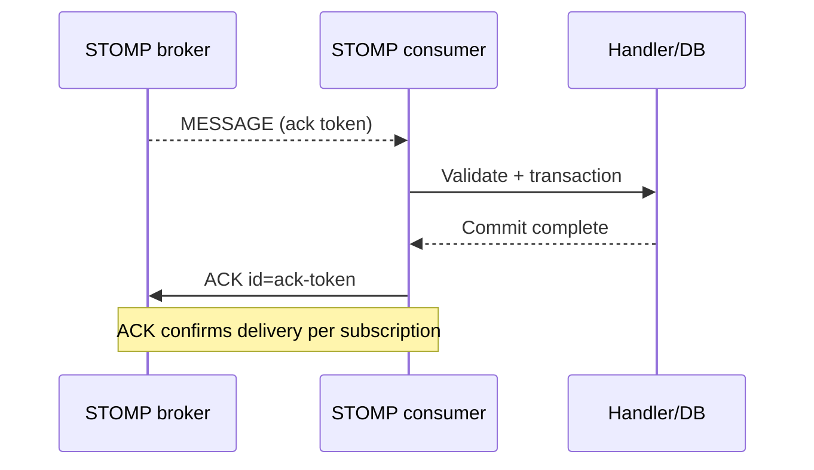
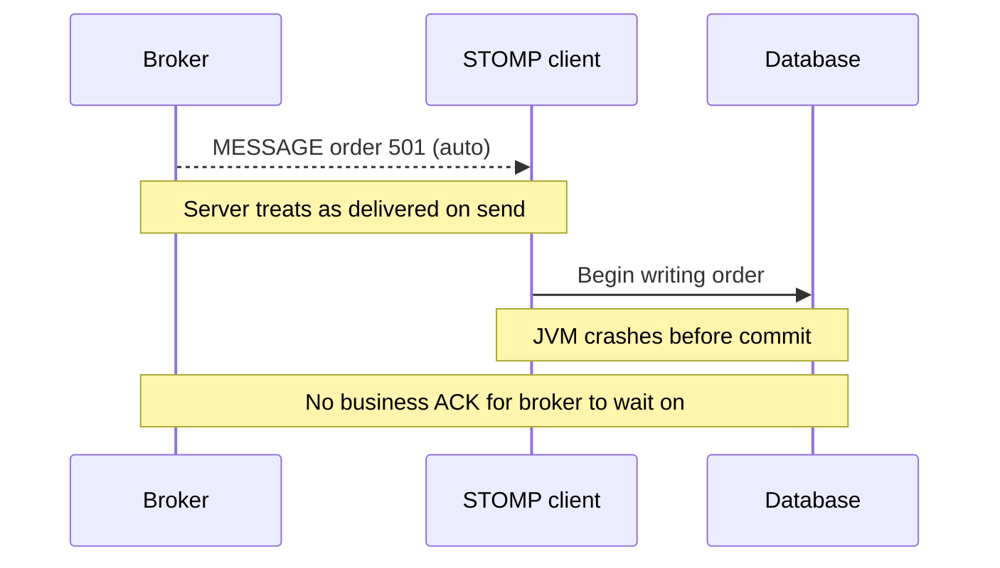
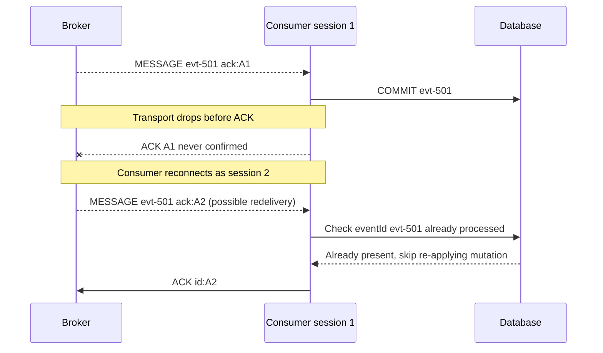

# ACK, NACK, and Subscription Modes in Spring Integration STOMP

## 1. Problem Statement: Receiving a MESSAGE Does Not Mean Processing Succeeded

A Java application receives an `ORDER_CREATED` event from a STOMP broker, validates the data, and writes it to a database. The broker sends a `MESSAGE` frame, yet just as the handler is updating the database, the application throws an error or stops. Will the broker resend the message? If the handler committed to the DB yet `ACK` never reached the broker, what happens? If three messages arrive in sequence, does sending `ACK` for the third message accidentally acknowledge the first two?

These are questions about **acknowledgement**, not just connectivity. In the **SPRING_INTEGRATION_ADAPTERS** module, inbound adapters, outbound adapters, gateways, pollers, and `MessageChannel` connect external systems with internal data flows. Specifically for STOMP, adapters receive frames via subscriptions; **the subscription's ACK mode** determines when the broker considers a delivery confirmed by the consumer.

STOMP 1.2 defines three subscription modes: **`auto`**, **`client`**, and **`client-individual`**. When manual acknowledgement is enabled, the consumer sends `ACK` or `NACK`. However, a STOMP ACK does not create a shared transaction with JDBC, does not solve exactly-once, and does not replace payload validation, retry handling, or storing idempotency keys.

**Learning Objectives**

1. Explain the differences between `auto`, `client` (cumulative), and `client-individual` (per-message).
2. Write valid `SUBSCRIBE`, `MESSAGE`, `ACK`, and `NACK` frames per **STOMP 1.2**, especially the `MESSAGE.ack` and `ACK.id` relationship.
3. Understand `NACK`, disconnects, redelivery, dead-lettering, and what the **broker** decides.
4. Distinguish Spring Integration's `StompInboundChannelAdapter` from Spring Framework `StompSession` manual ACK operations.
5. Feed frames from a STOMP client into a `MessageChannel`, sending ACK only after **synchronous** downstream processing succeeds.
6. Design transaction boundaries, async handoffs, idempotency, observability, and failure testing.

## 2. The Big Picture: Three Distinct Confirmation Milestones



| Milestone | Who knows? | Meaning | Does NOT guarantee |
| --- | --- | --- | --- |
| Broker sends `MESSAGE` | Broker / STOMP client | Frame was dispatched to the session over transport | That the handler read, validated, or committed DB |
| Handler commits business logic | Application and DB | Business changes were persisted in the DB transaction | That the broker received `ACK` |
| Broker receives/processes `ACK` | Broker | Delivery is confirmed per subscription mode | That an atomic transaction spanned broker + DB |
| Broker returns `RECEIPT` for a requesting frame | Broker / client | Broker processed the frame requesting a receipt | That all subscribers completed business processing |

A message can be processed **at least once** and redelivered when an ACK is lost; conversely, in `auto` mode, the broker can mark a message delivered before the application finishes processing it. Therefore, you can never use a single "handler was called" or "STOMP session connected" flag as proof that data was durably processed.

## 3. ACK Mode Lives on SUBSCRIBE, Not on Each SEND

In STOMP 1.2, a client sends a `SUBSCRIBE` frame with two required headers: `id` and `destination`. The `ack` header is optional; if omitted, it defaults to **`auto`**.

```text
SUBSCRIBE
id:orders-sub-1
destination:/queue/orders
ack:client-individual

^@
```

`^@` represents the NUL byte terminating a frame, not two literal characters to send. The name `/queue/orders` is merely a convention in some brokers; STOMP **does not standardize** that every `/queue`-prefixed destination shares identical semantics.

| Mode on SUBSCRIBE | When does the broker consider it processed? | Send `ACK/NACK`? | Risks / use cases |
| --- | --- | --- | --- |
| `auto` (default) | Broker assumes the message is received upon sending | Not needed; do not send manual ACK for auto deliveries | Simple, but disconnect/crash after delivery can lose processing opportunities |
| `client` | When client sends ACK for an appropriate delivery | Yes | **Cumulative**: ACKing one message also confirms earlier unacked messages on the subscription |
| `client-individual` | When client sends ACK for that specific delivery | Yes | **Individual**: fits async/out-of-order processing, though broker rules and idempotency are still needed |

ACK mode is a **property of the subscription**. One STOMP session can hold multiple subscriptions with different modes, and subscription `id`s must be unique **within the same session**. Adding a second subscription on another session with the same subscription ID does not automatically violate the protocol.

### There Is No Mode Named `NONE` in STOMP 1.2

Do not copy settings from JMS or Spring Integration AMQP to STOMP:

- AMQP has container modes `AUTO`, `MANUAL`, `NONE` in its own API.
- JMS has session acknowledgement modes and transacted sessions per the JMS contract.
- **STOMP 1.2 only specifies `auto`, `client`, `client-individual`** in the `SUBSCRIBE` `ack` header.

If you see examples using `AcknowledgmentCallback.Status.REQUEUE` or `basicAck(deliveryTag)`, those are APIs from other adapters/protocols—**not built-in APIs** on the STOMP inbound channel adapter.

## 4. `auto` Mode: Fast and Simple, Yet Easy to Misunderstand for Reliability

```text
SUBSCRIBE
id:orders-auto
destination:/queue/orders
ack:auto

^@
```

When the broker sends a `MESSAGE` to this subscription, it **assumes the message has been received by the client** per `auto` semantics. If the JVM crashes before writing to the DB, you cannot assume the broker will redeliver merely because the Spring handler never finished.



`auto` mode may suit expendable notifications (e.g., UI updates that can be re-synced from an API). However, when **no orders may be missed**, you must re-evaluate delivery semantics, durability, ack mode, and reconciliation.

**Important:** "No ACK needed" does not mean "Spring Integration finished processing." If a handler throws an exception on `DirectChannel` or a worker downstream of `ExecutorChannel` fails, the broker may have already marked the delivery complete under `auto` mode.

## 5. `client` Mode: Cumulative ACK

In `client` mode, `ACK` for a message confirms **that message plus all prior unacknowledged messages sent to the same subscription**.

Suppose the broker delivers M1, M2, M3 in order:

```text
SUBSCRIBE ack:client

Broker ----> M1 (ack-token A1) ----> Consumer
Broker ----> M2 (ack-token A2) ----> Consumer
Broker ----> M3 (ack-token A3) ----> Consumer

Consumer ----> ACK id:A3 ----> Broker

Cumulative effect: M1 + M2 + M3 are all acknowledged
```

| Order | Business result | If ACK is sent for M3 |
| --- | --- | --- |
| M1 | Committed to DB | Acknowledged |
| M2 | **Still processing or failed** | **May also be acknowledged** |
| M3 | Committed to DB | Acknowledged |

If M3 finishes faster than M2 and ACKs M3 first, you can **mark M2 consumed even though M2 has not succeeded**. Hence `client` mode is typically suited to **sequential processing and ACKing in order of successful completion**, not independent ACKs from parallel workers.

The cumulative scope covers prior messages on **the same subscription**, not every subscription or every session on the broker.

### NACK in `client` Mode Can Also Be Cumulative

STOMP 1.2 specifies that under `ack:client`, `NACK` can apply to the specified message **and all prior un-ACKed/un-NACKed messages on the subscription**. Do not assume `NACK` for M3 rejects only M3. Whether it triggers redelivery or dead-lettering depends on the broker.

## 6. `client-individual` Mode: Per-Delivery ACK/NACK

```text
SUBSCRIBE
id:orders-individual
destination:/queue/orders
ack:client-individual

^@
```

Suppose:

```text
M1 (A1): committed quickly -> ACK id:A1
M2 (A2): transient DB error -> unacked / or NACK id:A2
M3 (A3): committed quickly -> ACK id:A3
```

ACKing M3 **does not** acknowledge M2. This is a major advantage when processing times vary, work runs in parallel, or poison messages must be isolated. However:

- The broker may still cap unacknowledged deliveries (broker-specific prefetch/credit).
- Failed unacked messages may remain in-flight until broker policy, session termination, or timeout/recovery kicks in.
- Redelivery and retention depend on the broker/queue/subscription; STOMP does not guarantee every `NACK` acts like `requeue=true`.
- Idempotency is still required because an ACK can be lost after a DB commit.

### When to Choose Which Mode?

| Scenario | Consideration |
| --- | --- |
| Real-time UI where missed pushes can be fetched via HTTP | `auto` may be simpler if push loss is tolerable |
| Strictly sequential processing, ACKing after a contiguous batch | `client` can work, but ordering and cumulative ACK must be managed |
| Each order processed independently with varying DB times | `client-individual` usually makes per-delivery failure control easier |
| Atomic transaction across DB + broker required | No mode provides this alone; use outbox/inbox/idempotency |
| Permanently broken messages needing dead-letter | Combine ACK mode with broker-specific DLQ/retry policies; mode alone isn't enough |

## 7. STOMP 1.2: `MESSAGE.ack` Differs from `MESSAGE.message-id`

This is a very common bug. For a subscription requiring manual acknowledgement, STOMP 1.2 mandates that the broker include an **`ack` header** in the `MESSAGE` frame.

```text
MESSAGE
subscription:orders-individual
message-id:broker-msg-501
ack:ack-delivery-abc123
destination:/queue/orders
content-type:application/json

{"eventId":"evt-501","orderId":501}
^@
```

On success:

```text
ACK
id:ack-delivery-abc123

^@
```

On failure to reject the delivery:

```text
NACK
id:ack-delivery-abc123

^@
```

| Header | Example value | Function |
| --- | --- | --- |
| `SUBSCRIBE.id` | `orders-individual` | Identifies the subscription within the session |
| `MESSAGE.subscription` | `orders-individual` | Indicates which subscription this frame came from |
| `MESSAGE.message-id` | `broker-msg-501` | Broker-assigned message identifier |
| **`MESSAGE.ack`** | **`ack-delivery-abc123`** | **Delivery token used for ACK/NACK in STOMP 1.2** |
| **`ACK.id` / `NACK.id`** | **`ack-delivery-abc123`** | **Must match `MESSAGE.ack`** |
| Business `eventId` | `evt-501` | Stable application key used for idempotency |

**Do not use `message-id`, `subscription`, or Spring `MessageHeaders.ID` instead of `MESSAGE.ack` when constructing `ACK.id` in STOMP 1.2.** Tokens might look similar on a particular broker, yet you must never rely on that coincidence.

### Differences from STOMP 1.1

STOMP 1.2 changed ACK/NACK syntax compared to STOMP 1.1. In 1.1, message and subscription identifiers in acknowledgement frames were represented differently; in 1.2, **`ACK/NACK.id` links directly to `MESSAGE.ack`**.

When building multi-version clients, inspect `CONNECTED.version` and the behavior of your Spring Framework/broker versions. A unit test comparing `message-id` with `ACK.id` might **hide bugs against a lenient test broker** and fail against a strict STOMP 1.2 broker.

## 8. NACK Means Rejecting a Delivery—It Does Not Dictate Next Steps

STOMP `NACK` states that the client **did not consume the message successfully**. Afterwards, the server may:

- Redeliver the same message to another subscriber or the same consumer after a delay.
- Route the message to a dead-letter destination/queue if a policy is configured.
- Discard the message if broker policy dictates.
- Retain the message and enforce retry/max-attempts limits.

**There is no standard `requeue:true` header that STOMP 1.2 requires every broker to understand.** Settings like prefetch, max delivery count, dead-letter exchanges, retry delays, or poison-message handling are broker extensions and must be checked in the product docs.

### Choosing Strategies for Transient vs. Permanent Errors

| Error type | Example | Approach |
| --- | --- | --- |
| Transient | DB connection timeout, downstream HTTP 503 | Bounded retry/backoff; hold unacked, NACK, or disconnect per broker contract |
| Permanent/poison | Invalid JSON schema, missing `eventId`, invalid status | Quarantine/DLQ with failure reason; avoid infinite NACK loops |
| Already processed | `eventId` already committed | Treat as idempotent success and ACK the current delivery |
| Commit status unknown | JVM crash between DB commit and ACK | Consumer needs idempotency so redelivery does not duplicate side effects |
| Permission or subscription error | Broker ERROR/ACL | Fix config/permissions; do not infinitely retry business messages |

If a broker handles `NACK` by **immediately redelivering**, a poison message can spin in a tight loop, spiking CPU and starving healthy messages. Configure broker DLQs/retry budgets or quarantine safely in the application and ACK once safely persisted.

## 9. Spring Integration STOMP Adapter: What to Check About ACK Mode

Spring Integration provides `StompInboundChannelAdapter`, a `MessageProducerSupport` subscribing to destinations and emitting `Message<?>` to an output `MessageChannel`. Default example:

```java
@Bean
public StompInboundChannelAdapter stompInboundAdapter(
        StompSessionManager stompSessionManager,
        @Qualifier("ordersInboundChannel") MessageChannel channel) {

    StompInboundChannelAdapter adapter =
        new StompInboundChannelAdapter(
            stompSessionManager, "/queue/orders"
        );
    adapter.setOutputChannel(channel);
    adapter.setPayloadType(String.class);
    return adapter;
}
```

The public API of `StompInboundChannelAdapter` includes constructors accepting destinations, `setPayloadType`, `setHeaderMapper`, `addDestination`/`removeDestination`, and `MessageProducerSupport` error/lifecycle APIs. **There is no `setAckMode(...)` setter publicly exposed** on the adapter in the current Javadoc.

Therefore, do not write fictional config like:

```java
// WRONG: not public APIs on StompInboundChannelAdapter.
// adapter.setAckMode("client-individual");
// adapter.setManualAcks(true);
```

**Two different levels of operation:**

1. **Standard STOMP inbound adapter:** uses the high-level API to subscribe/convert/forward; verify the default subscription semantics of your version and broker. Do not assume manual ACK tokens are automatically attached to business messages.
2. **Spring Framework `StompSession` client:** provides `subscribe(StompHeaders, StompFrameHandler)` to set the subscription `ack` header and `acknowledge(StompHeaders, boolean)` to emit ACK/NACK. This is the reference path when a problem explicitly requires controlled manual ACK.

If a project wants to use **Spring Integration flows and manual ACK together**, you need a custom integration bridge/adapter or a controlled extension component to carry the ACK token and issue ACK after commit. Do not simply copy RabbitMQ/JMS `MANUAL` config onto the STOMP adapter.

## 10. Example A — Standard STOMP Inbound Adapter

This example uses the Spring Integration STOMP adapter and a `DirectChannel`. It demonstrates **message flow**, not a manual ACK implementation.

### 10.1. Dependencies

With a Spring Boot project using a compatible BOM:

```xml
<dependencies>
    <dependency>
        <groupId>org.springframework.boot</groupId>
        <artifactId>spring-boot-starter-integration</artifactId>
    </dependency>
    <dependency>
        <groupId>org.springframework.integration</groupId>
        <artifactId>spring-integration-stomp</artifactId>
    </dependency>
    <dependency>
        <groupId>io.projectreactor.netty</groupId>
        <artifactId>reactor-netty</artifactId>
    </dependency>
</dependencies>
```

Prepare a real broker with STOMP/TCP at `127.0.0.1:61613` and `SUBSCRIBE` permission on `/queue/orders`. The port is only a common example—**not every broker enables this port automatically**. To test manual ACK, the broker must support ACKs; do not treat Spring WebSocket's simple broker as supporting full STOMP functionality.

### 10.2. Java Configuration

```java
import org.springframework.beans.factory.annotation.Qualifier;
import org.springframework.context.annotation.Bean;
import org.springframework.context.annotation.Configuration;
import org.springframework.integration.annotation.ServiceActivator;
import org.springframework.integration.channel.DirectChannel;
import org.springframework.integration.config.EnableIntegration;
import org.springframework.integration.stomp.ReactorNettyTcpStompSessionManager;
import org.springframework.integration.stomp.StompSessionManager;
import org.springframework.integration.stomp.inbound.StompInboundChannelAdapter;
import org.springframework.integration.support.converter.PassThruMessageConverter;
import org.springframework.messaging.Message;
import org.springframework.messaging.MessageChannel;
import org.springframework.messaging.simp.stomp.ReactorNettyTcpStompClient;
import org.springframework.scheduling.concurrent.ThreadPoolTaskScheduler;

@Configuration
@EnableIntegration
public class StompDefaultInboundConfiguration {

    @Bean
    public ThreadPoolTaskScheduler stompTaskScheduler() {
        ThreadPoolTaskScheduler scheduler = new ThreadPoolTaskScheduler();
        scheduler.setPoolSize(2);
        scheduler.setThreadNamePrefix("stomp-");
        return scheduler;
    }

    @Bean
    public ReactorNettyTcpStompClient stompClient(
            ThreadPoolTaskScheduler stompTaskScheduler) {
        ReactorNettyTcpStompClient client =
            new ReactorNettyTcpStompClient("127.0.0.1", 61613);
        client.setTaskScheduler(stompTaskScheduler);
        client.setMessageConverter(new PassThruMessageConverter());
        return client;
    }

    @Bean
    public StompSessionManager stompSessionManager(
            ReactorNettyTcpStompClient stompClient) {
        ReactorNettyTcpStompSessionManager manager =
            new ReactorNettyTcpStompSessionManager(stompClient);
        manager.setRecoveryInterval(5_000);
        return manager;
    }

    @Bean
    public MessageChannel ordersInboundChannel() {
        return new DirectChannel();
    }

    @Bean
    public StompInboundChannelAdapter ordersAdapter(
            StompSessionManager stompSessionManager,
            @Qualifier("ordersInboundChannel") MessageChannel channel) {
        StompInboundChannelAdapter adapter =
            new StompInboundChannelAdapter(
                stompSessionManager, "/queue/orders"
            );
        adapter.setOutputChannel(channel);
        adapter.setPayloadType(String.class);
        return adapter;
    }

    @ServiceActivator(inputChannel = "ordersInboundChannel")
    public void handleOrder(Message<?> message) {
        // Demo: no DB, manual ACK, or idempotency yet.
        System.out.println("Received: " + message.getHeaders().getId());
    }
}
```

**Notes:**

- `StompSessionManager` manages sessions and reconnects; it is not a STOMP transaction manager or durable queue.
- `setPayloadType(String.class)` is the target payload type; actual type depends on the session converter.
- `DirectChannel` invokes the handler synchronously, yet **does not automatically perform manual ACK**.
- Spring message `MessageHeaders.ID` is not STOMP `MESSAGE.ack`; it cannot be used as a broker confirmation token.
- `setRecoveryInterval(5_000)` governs reconnect retry cadence—it **does not** automatically replay messages lost while the subscriber was offline.

To separate frame receipt errors, header mapping errors, and handler errors, configure an error channel on the endpoint; however, **an error channel does not automatically change the STOMP broker's ACK mode**.

## 11. Example B — Manual ACK with `StompSession`, After a Synchronous `DirectChannel`

When exact `client-individual` mode is needed, this example uses the **Spring Framework STOMP client** to create a `SUBSCRIBE` with an `ack` header. Upon receiving a frame, the client sends the payload onto a **Spring Integration `DirectChannel`**, waits for the synchronous handler to return, and then ACKs. If the handler throws an error, the example sends NACK; redelivery/DLQ behavior remains up to the broker.

```text
External STOMP broker
   -> MESSAGE (ack token)
   -> StompFrameHandler.handleFrame
   -> ordersForProcessing (DirectChannel)
   -> Service Activator (synchronous)
   -> handler returns normally -> ACK
   -> handler throws error     -> NACK
```

**This is an alternative flow**—do not run it concurrently with Example A's `StompInboundChannelAdapter` on the same queue when trying to observe a single consumer. Running both could cause two subscribers to compete for messages depending on the broker.

### 11.1. Configuring the Client and Integration Channel

Use the dependencies from section 10, plus `StringMessageConverter` included in Spring Messaging:

```java
import org.springframework.boot.ApplicationRunner;
import org.springframework.context.annotation.Bean;
import org.springframework.context.annotation.Configuration;
import org.springframework.integration.annotation.ServiceActivator;
import org.springframework.integration.channel.DirectChannel;
import org.springframework.messaging.MessageChannel;
import org.springframework.messaging.MessageHandler;
import org.springframework.messaging.converter.StringMessageConverter;
import org.springframework.messaging.simp.stomp.ReactorNettyTcpStompClient;
import org.springframework.scheduling.concurrent.ThreadPoolTaskScheduler;

@Configuration
public class ManualAckStompConfiguration {

    @Bean
    public ThreadPoolTaskScheduler manualAckScheduler() {
        ThreadPoolTaskScheduler scheduler = new ThreadPoolTaskScheduler();
        scheduler.setPoolSize(2);
        scheduler.setThreadNamePrefix("manual-stomp-");
        return scheduler;
    }

    @Bean(destroyMethod = "shutdown")
    public ReactorNettyTcpStompClient manualAckStompClient(
            ThreadPoolTaskScheduler manualAckScheduler) {
        ReactorNettyTcpStompClient client =
            new ReactorNettyTcpStompClient("127.0.0.1", 61613);
        client.setTaskScheduler(manualAckScheduler);
        client.setMessageConverter(new StringMessageConverter());
        return client;
    }

    @Bean
    public MessageChannel ordersForProcessing() {
        return new DirectChannel();
    }

    @Bean
    @ServiceActivator(inputChannel = "ordersForProcessing")
    public MessageHandler synchronousOrderHandler() {
        return message -> {
            String body = (String) message.getPayload();
            if (!body.contains("eventId=")) {
                throw new IllegalArgumentException("Missing eventId");
            }
            // Demo: simulate successful processing, no persistence yet.
            System.out.println("Processed order: " + body);
        };
    }

    @Bean
    public ApplicationRunner manualAckConnection(
            ReactorNettyTcpStompClient manualAckStompClient,
            ManualAckSessionHandler sessionHandler) {
        return args -> manualAckStompClient.connectAsync(sessionHandler)
            .whenComplete((session, error) -> {
                if (error != null) {
                    System.err.println(
                        "STOMP connect failed: " + error.getMessage()
                    );
                }
            });
    }
}
```

`ApplicationRunner` connects **once in the demo**. `connectAsync(...)` does not set up a full production reconnect/resubscribe loop. Add recovery/lifecycle management for real usage. Use a separate application context or Spring profiles so competing clients from sections 10 and 11 do not start together.

### 11.2. Session Handler Setting Subscription Mode Manually

```java
import java.lang.reflect.Type;
import java.util.UUID;

import org.springframework.beans.factory.annotation.Qualifier;
import org.springframework.messaging.MessageChannel;
import org.springframework.messaging.support.MessageBuilder;
import org.springframework.messaging.simp.stomp.StompFrameHandler;
import org.springframework.messaging.simp.stomp.StompHeaders;
import org.springframework.messaging.simp.stomp.StompSession;
import org.springframework.messaging.simp.stomp.StompSessionHandlerAdapter;
import org.springframework.stereotype.Component;

@Component
public class ManualAckSessionHandler extends StompSessionHandlerAdapter {

    private final MessageChannel ordersForProcessing;

    public ManualAckSessionHandler(
            @Qualifier("ordersForProcessing")
            MessageChannel ordersForProcessing) {
        this.ordersForProcessing = ordersForProcessing;
    }

    @Override
    public void afterConnected(
            StompSession session, StompHeaders connectedHeaders) {

        StompHeaders subscribe = new StompHeaders();
        subscribe.setDestination("/queue/orders");
        subscribe.setId("orders-" + UUID.randomUUID());
        subscribe.setAck("client-individual");

        session.subscribe(subscribe, new StompFrameHandler() {

            @Override
            public Type getPayloadType(StompHeaders headers) {
                return String.class;
            }

            @Override
            public void handleFrame(
                    StompHeaders headers, Object payload) {
                String token = headers.getAck();

                if (token == null || token.isBlank()) {
                    // STOMP 1.2 manual mode requires MESSAGE.ack.
                    System.err.println("Missing STOMP ACK token");
                    session.disconnect();
                    return;
                }

                StompHeaders ackHeaders = new StompHeaders();
                ackHeaders.setId(token); // ACK.id == MESSAGE.ack

                try {
                    if (!(payload instanceof String body)) {
                        throw new IllegalArgumentException(
                            "Expected text STOMP payload"
                        );
                    }

                    boolean accepted = ordersForProcessing.send(
                        MessageBuilder.withPayload(body).build()
                    );
                    if (!accepted) {
                        throw new IllegalStateException(
                            "Message channel rejected payload"
                        );
                    }

                    // Only after the DirectChannel handler returns.
                    session.acknowledge(ackHeaders, true);  // ACK
                } catch (RuntimeException failure) {
                    // Demo: NACK all errors; see poison-loop warning below.
                    System.err.println(
                        "Processing failed: "
                            + failure.getClass().getSimpleName()
                    );
                    session.acknowledge(ackHeaders, false); // NACK
                }
            }
        });
    }

    @Override
    public void handleTransportError(
            StompSession session, Throwable exception) {
        System.err.println(
            "STOMP transport error: " + exception.getMessage()
        );
        // TODO: production reconnect/backoff, resubscribe, and alert.
    }
}
```

**Key points explaining this example:**

1. `subscribe.setAck("client-individual")` attaches the ACK mode **to the subscription**, not globally to all sessions.
2. `StompFrameHandler#getPayloadType` declares `String`; the client's `StringMessageConverter` performs the corresponding conversion.
3. `headers.getAck()` retrieves the **STOMP 1.2 delivery token**. `ackHeaders.setId(token)` sets `ACK.id`/`NACK.id` properly.
4. `session.acknowledge(ackHeaders, true)` sends ACK; `false` sends NACK. This is a **Spring Framework `StompSession`** API, not a setter on `StompInboundChannelAdapter`.
5. `ordersForProcessing` is a `DirectChannel`, so the synchronous handler runs before `send()` returns. **Do not** switch it to an `ExecutorChannel` and still assume ACK is sent only after DB commit.
6. The demo handler just prints to the console, so ACKing here only confirms **demo processing finished**, not a durable business commit. In production, substitute a real transactional service and ensure the commit finishes before returning.
7. Catching and NACKing every exception only illustrates the API. If the broker redelivers immediately, a permanently invalid payload can be NACKed endlessly. Classify errors, bound retries, and use broker-specific DLQ/quarantine.

### 11.3. What If Using STOMP 1.1?

The code above intentionally follows STOMP **1.2**. If broker/client negotiate STOMP 1.1, `ACK` uses the older version's identifiers. Inspect `CONNECTED.version` and library behavior before reusing this code on systems that do not enforce 1.2.

### 11.4. Warning About Callbacks and Error Management

`StompFrameHandler.handleFrame` may run on the STOMP client's callback thread. If DB writes take a long time:

- The callback thread may be blocked for long durations, impacting frame/heartbeat handling depending on transport.
- DB write errors should be translated into classifiable business outcomes rather than blindly NACKing every error.
- Do not hold onto `StompSession` or ACK tokens past their valid lifecycle if the session disconnected; ACK tokens belong to the active delivery/session.
- When connectivity drops between DB commit and sending ACK, the broker may redeliver the message: the handler **must be idempotent**.

To avoid blocking callback threads, you can hand off to an async worker, **but you must carry the token, session binding, and ACK only upon actual completion**; this design is more complex and must handle session changes while workers are still running.

## 12. ACK After DB Transaction: Necessary, Yet Not Sufficient

Suppose a JDBC/ORM handler:

```java
@Service
public class OrderPersistenceService {

    private final ProcessedEventRepository processedEvents;
    private final OrdersRepository orders;

    public OrderPersistenceService(
            ProcessedEventRepository processedEvents,
            OrdersRepository orders) {
        this.processedEvents = processedEvents;
        this.orders = orders;
    }

    @Transactional
    public void apply(OrderEvent event) {
        if (processedEvents.existsByEventId(event.eventId())) {
            return; // Reprocessing the same eventId is an idempotent success.
        }

        orders.applyEvent(event);
        processedEvents.save(event.eventId());
    }
}
```

This is **persistence-layer pseudocode**, where `OrderEvent`, `OrdersRepository`, and `ProcessedEventRepository` are application-defined types—not built-in Spring Integration entities/repositories. Production requires a **unique constraint** on `eventId` (plus handling races when concurrent consumers both see it absent), because checking `existsByEventId` alone cannot prevent two parallel transactions from racing.

A synchronous handler should call `OrderPersistenceService.apply(...)` via the Spring proxy and **wait for the transaction to commit successfully** before returning to the STOMP client to send ACK. Sequence:

```text
STOMP MESSAGE evt-501
   |
   v
Validate JSON -> business event ID
   |
   v
BEGIN JDBC transaction
   |
   +-> Update order
   +-> Insert processed_event(eventId UNIQUE)
   |
   v
COMMIT JDBC transaction succeeds
   |
   v
ACK id=<MESSAGE.ack>
```

### The Gap Between COMMIT and ACK

```text
DB COMMIT ---------- crash ----------> ACK never reaches broker
```

After recovery, the broker **may** redeliver the message depending on ack/retention policy. If the handler is not idempotent, an order can be written/modified twice. **Solution:** preserve a stable event ID and process idempotently inside the DB transaction. When receiving an already-recorded event again, return success so the new delivery is ACKed.

To avoid missing events entirely, manual ACK must be paired with broker durability and redelivery; if the source is a topic that drops messages for offline clients, picking `client-individual` alone is not enough.

## 13. Async Boundary: ACKing Too Early Is a Common Design Flaw

An inbound handler uses:

```text
STOMP frame -> ExecutorChannel -> Worker -> DB
```

If the callback sends to `ExecutorChannel` and immediately calls `ACK` because `send()` returned `true`, that only means **the task was queued onto the executor**, not that the worker committed to the DB. The worker might fail later while the broker already received ACK.

| Channel/Topology | When does `send()` return? | Does ACKing after `send()` prove DB commit? |
| --- | --- | --- |
| `DirectChannel` + synchronous DB handler | Handler returned (with transaction committed before return) | Can ensure synchronous completion if topology is sound and errors aren't swallowed |
| `ExecutorChannel` | Work was handed off to the executor | **No** |
| `QueueChannel` | Message was placed in the queue (if successful) | **No** |
| `PublishSubscribeChannel` with async executor | Work may be handed off to multiple async subscribers | **No** |
| Channel backed by another durable broker/queue | Accepted per the intermediate layer's contract | Only per the intermediate contract, not the final consumer |

### What If Parallel Processing Is Truly Needed?

A more advanced design requires:

1. Wrapping the **delivery token** in an internal envelope alongside `sessionId`/connection generation and business `eventId`.
2. Worker processes and commits to DB, emitting an explicit completion event.
3. A coordinator issues ACK on **the exact active STOMP session**, never reusing an old session's token after reconnect.
4. Enforcing timeouts, limits on in-flight messages, queue capacity, retry policies, and DLQs.
5. Using `client-individual` if completions can happen out of order; avoiding cumulative `client` ACK.
6. When ACK cannot be sent because the session dropped, letting broker policy handle redelivery and relying on idempotency.

Example B uses synchronous execution to make the ACK boundary crystal clear; it is not a production-scaled worker pool.

## 14. STOMP Transactions Differ from JDBC Transactions

STOMP 1.2 also includes frames:

```text
BEGIN
transaction:tx-501

^@
```

Then an ACK or NACK can carry:

```text
ACK
id:ack-delivery-abc123
transaction:tx-501

^@
```

Followed by:

```text
COMMIT
transaction:tx-501

^@
```

Or:

```text
ABORT
transaction:tx-501

^@
```

**These are STOMP session transactions on the broker**, grouping SEND/ACK/NACK operations per broker semantics. They **do not automatically include** a Spring JDBC transaction, an HTTP call, or a Kafka consumer offset. When atomicity across DB + broker is needed, design consistency patterns (inbox/outbox, replay, saga, etc.) rather than relying solely on `BEGIN/COMMIT` frames.

In the `StompSession` examples in section 11, the application sends ACK/NACK directly; transaction frames are not automatically generated when a Spring `@Transactional` method runs.

## 15. `RECEIPT` Differs from `ACK/NACK`

A STOMP client frame can request the broker to confirm processing using the `receipt` header, for example:

```text
ACK
id:ack-delivery-abc123
receipt:r-ack-501

^@
```

The broker may reply:

```text
RECEIPT
receipt-id:r-ack-501

^@
```

**Distinguish:**

- `ACK`/`NACK` is the consumer's **decision to confirm or reject a delivery**.
- `RECEIPT` is the **broker's response to a frame requesting a receipt**, applicable to `SUBSCRIBE`, `SEND`, `ACK`, or other frames per spec.
- Spring Framework's `StompSession.Receiptable` tracks receipt callbacks.
- `receiptTimeLimit` is only the receipt wait limit; a receipt timeout does not prove the broker definitely failed to receive the ACK.

Hence, if the DB committed and the client sent ACK but disconnected before receiving `RECEIPT`, never emit **a new business mutation with a new `eventId`**. Let recovery/redelivery rely on **the same `eventId`** and idempotency.

### Why Receipts Do Not Solve Exactly-Once

Receipts can be lost on the network. Even when an ACK receipt is received, it only confirms the broker processed the ACK; it does not prove another service's business result or database committed atomically across systems.

## 16. Subscription Lifecycle, Reconnects, and Unacked Messages

A STOMP subscription belongs to **one session**. When a session disconnects:

- The old subscription can no longer receive messages on the broken connection.
- The client must reconnect and `SUBSCRIBE` (with the right mode and destination) on the new session.
- `MESSAGE.ack` tokens from the old session must not be reused on the new session.
- The broker may redeliver unacked messages if queue/durability and policies support it.
- Messages already inside downstream workers may continue executing even after the session disconnects, racing with broker redelivery on the new session.



Notice **ack tokens A1 and A2 can differ** even for the same business event `evt-501`. Hence broker delivery identity must be separated from idempotency identity.

### Do Not Assume Spring Integration STOMP Automatically Reconnects + Replays Safely

`StompSessionManager` has a connection recovery interval; the adapter subscribes to destinations per its lifecycle. However, reconnect **does not define** business retry state or broker durability. Across multiple replicas, each replica holds its own session, and subscriptions may share a queue or receive fan-out depending on the broker.

## 17. Security and Load Limits for Manual Acknowledgement

Manual ACK keeps deliveries "in-progress" until the broker receives ACK/NACK. If a worker accepts unlimited messages, in-flight counts can grow rapidly and exhaust broker or application memory.

**Operational rules:**

1. Cap prefetch/credit/pending deliveries according to **what the broker supports**; STOMP 1.2 does not standardize a universal prefetch header.
2. Use bounded queues/executors and design backpressure if decoupling callbacks from handlers.
3. Do not log sensitive payloads or ACK tokens alongside credentials in public logs.
4. Ensure CONNECT uses TLS, credentials from a secret store, and broker ACLs scoped to the right destinations.
5. Set limits on poison messages and retry counts; avoid infinite NACK loops.
6. Separate metrics for "delivery received," "business commit," "ACK sent," "broker receipt," and "redelivery."
7. Protect event IDs and tenant IDs; never trust unauthenticated headers/payloads just because they arrive from a STOMP client.

For multi-tenant systems, both broker ACLs and database-level business authorization are required. `client-individual` only governs how ACKs work—it **does not** stop unauthorized subscribers from reading data.

## 18. Monitoring and Diagnostics

| Signal | What to check? |
| --- | --- |
| `CONNECTED` / session manager `isConnected` | Is the STOMP session ready or reconnecting? |
| `SUBSCRIBE.id` and `ack` mode | Are destination and mode per contract? |
| Presence of `MESSAGE.ack` | Is the broker issuing manual-ACK tokens on STOMP 1.2? |
| `ACK/NACK` counts | How often does the app send confirm/reject decisions? |
| ACK/NACK receipts (if requested) | Did the broker respond at the protocol layer? |
| In-flight / unacked deliveries | Is an unacknowledged backlog building up? |
| Redelivery / DLQ counts | Are there excessive errors, poison messages, or post-commit crashes? |
| DB commit / idempotency hits | Are business events applied exactly once? |
| Queue depth / worker saturation | Are callbacks/workers congested or ACKing too early? |
| Oldest unacked age | Is a delivery stuck beyond SLA? |

### Common Mistakes

**Mistake 1 — ACK has no effect:** inspect `SUBSCRIBE.ack`, `MESSAGE.ack`, and ensure `ACK.id` equals the STOMP 1.2 token, not `MESSAGE.message-id`.

**Mistake 2 — Messages lost on DB error:** `auto` mode may be active, or ACK is sent prematurely right after enqueueing to `ExecutorChannel`.

**Mistake 3 — ACKing M3 drops M2:** cumulative `client` mode is used with parallel out-of-order completion; consider `client-individual`.

**Mistake 4 — NACK causes an infinite loop:** the broker immediately retries poison messages; configure DLQs/max attempts/quarantine.

**Mistake 5 — Duplicates after reconnect:** message already committed before ACK was lost; handle idempotently with a stable `eventId`.

**Mistake 6 — Reading AMQP docs and calling `setAcknowledgeMode(MANUAL)` on STOMP:** wrong protocol API. Check the current Javadoc for `StompInboundChannelAdapter` and `StompSession`.

**Mistake 7 — `SUBSCRIBE` receipt exists, yet handler receives no events:** the subscription may be valid while no source is publishing, destination is wrong, or converter/handler failed. A receipt does not prove business success.

## 19. End-to-End Test Scenarios

Run these only on a **test broker fully supporting STOMP 1.2 ACK/NACK**—never deliberately drop connections or inject poison messages in production.

1. **`auto` baseline:** subscribe to a queue, crash the handler before commit; observe whether the broker redelivers per actual contract.
2. **`client-individual` ACK:** receive a valid event, process synchronously, send `ACK.id` with the right token; verify unacked count drops.
3. **`client` cumulative:** send M1, M2, M3, ACK M3; verify M1/M2 are confirmed per spec.
4. **Individual out-of-order:** M1 succeeds, M2 fails, M3 succeeds; ACK M3, verify M2 remains unacknowledged.
5. **Wrong ACK token:** deliberately send `ACK.id` using `message-id` instead of `MESSAGE.ack`; strict STOMP 1.2 brokers may reject/ERROR.
6. **NACK poison:** send an invalid-schema payload; verify DLQ/retry limit kicks in without infinite loops.
7. **Crash after DB commit:** simulate commit succeeding while ACK fails to reach the broker; after reconnect, verify idempotency.
8. **`ExecutorChannel`:** test ACKing after enqueue and failing the worker; observe why that pattern is unsafe.
9. **Receipt timeout:** request an ACK receipt and induce a network fault; verify indeterminate outcomes and recovery procedures.
10. **Two consumers on the same queue:** observe broker message distribution per queue semantics and ack policy.
11. **Two consumers on a topic:** observe fan-out and durability per broker.
12. **Security:** an account without SUBSCRIBE/SEND permissions must be rejected; never treat ACK mode as an authorization layer.
13. **Load:** track pending ACKs, queue depth, DB latency, timeouts, and recovery rate.

### Expected Crash Matrix

| Crash timing | `auto` | Manual ACK + durable broker |
| --- | --- | --- |
| Before frame is received | Depends on broker retention/destination | Depends on broker retention/destination |
| After `MESSAGE` but before processing | Delivery may be lost | May be redelivered if broker retains unacked |
| After DB commit but before ACK | No business ack to reconcile | May redeliver; requires idempotency |
| After broker receives ACK | Broker considers delivery confirmed | No redelivery expected under normal policy |

This is a **general consequence model**, not a substitute for broker docs. The STOMP spec states the broker **MAY redeliver** when a connection drops before ACK, so test your exact broker and durability, prefetch, timeout, and redelivery settings.

## 20. Exercises with Answers

**Exercise 1 — Default value.** If `SUBSCRIBE` omits the `ack` header, which mode does STOMP 1.2 use?

**Answer:** `auto`. The client does not need to send ACK for messages on that subscription.

**Exercise 2 — Independent mode.** A system processes multiple messages in parallel with out-of-order completion. Which mode usually makes ACK control easiest?

**Answer:** `client-individual`, because each ACK/NACK applies to a single delivery rather than accumulating prior messages.

**Exercise 3 — Cumulative ACK.** M1, M2, and M3 are unacked on the same `client` subscription. Sending ACK for M3 affects which messages?

**Answer:** M1, M2, and M3 cumulatively. If M2 has not committed yet, ACKing M3 is dangerous.

**Exercise 4 — Cumulative NACK.** In `client` mode, does NACKing M3 automatically reject only M3?

**Answer:** No. NACK is cumulative across prior un-ACKed/un-NACKed messages on the subscription per STOMP 1.2.

**Exercise 5 — STOMP 1.2 token.** A `MESSAGE` frame has `message-id:broker-7` and `ack:token-42`. What must `ACK.id` be?

**Answer:** `token-42`, not `broker-7`.

**Exercise 6 — Distinguishing `subscription`.** Is `MESSAGE.subscription` an ACK token?

**Answer:** No. It links the frame to `SUBSCRIBE.id`. Manual ACK uses `MESSAGE.ack` in STOMP 1.2.

**Exercise 7 — NACK.** Does sending `NACK` guarantee the broker immediately requeues the message?

**Answer:** No. Retry, requeue, discard, and DLQ behavior are broker-specific.

**Exercise 8 — Spring API.** Is `setAckMode("client-individual")` exposed on `StompInboundChannelAdapter` in the current Javadoc?

**Answer:** No. To control subscription ACK modes, you can use Spring Framework's `StompSession.subscribe(StompHeaders, StompFrameHandler)` or design a verified extension.

**Exercise 9 — Java calls.** Which frames do `session.acknowledge(headers, true)` and `session.acknowledge(headers, false)` produce?

**Answer:** `true` sends `ACK`; `false` sends `NACK`.

**Exercise 10 — `DirectChannel`.** A synchronous handler on `DirectChannel` commits to the DB and returns. Is ACKing right after `send()` safer than ACKing before the handler?

**Answer:** Yes, provided the topology ensures the method returns only after commit and does not swallow exceptions. Still, idempotency is required because of the commit–ACK gap.

**Exercise 11 — `ExecutorChannel`.** Does `ExecutorChannel.send()` returning `true` mean the DB committed?

**Answer:** No. It usually only means the work was accepted for asynchronous processing.

**Exercise 12 — Crash after commit.** The DB saved the event, the broker missed ACK, and after reconnect the broker redelivers. How do you prevent duplicate writes?

**Answer:** Use a stable `eventId`, a unique constraint/inbox record, and idempotent handling inside the DB transaction.

**Exercise 13 — Transactions.** Does JDBC `@Transactional` automatically emit STOMP `BEGIN/COMMIT` and enlist the broker into the transaction?

**Answer:** No. STOMP transactions and JDBC transactions are two separate scopes.

**Exercise 14 — Receipt.** Does receiving a `RECEIPT` for an ACK mean every downstream consumer committed to the DB?

**Answer:** No. A receipt only confirms the broker processed the receipt-requesting ACK frame.

**Exercise 15 — Poison message.** Continuously NACKing an invalid-schema payload causes endless broker redelivery. What should you do?

**Answer:** Identify permanent errors, configure max delivery attempts/DLQs or durable quarantine and then ACK per policy, and alert operations.

**Exercise 16 — Reconnect.** Should you keep an ACK token from an old session to confirm a frame on a new session?

**Answer:** No. Tokens belong to a delivery/session; ACK only with the valid token from the delivery on the current session.

**Exercise 17 — Exactly-once.** Is enabling `client-individual` alone enough to guarantee every event is persisted exactly once?

**Answer:** No. You also need broker durability/redelivery, idempotency, proper transaction boundaries, and recovery.

## 21. Key Takeaways

In **STOMP 1.2**, the `SUBSCRIBE` `ack` header selects one of three modes: **`auto`** (broker considers delivered on send), **`client`** (**cumulative** ACK/NACK), or **`client-individual`** (**per-delivery** ACK/NACK). For both manual modes, `MESSAGE` must carry an **`ack` token**, and `ACK/NACK.id` must match that token—**never** substitute `message-id`, `subscription`, or Spring `MessageHeaders.ID`. Spring Integration's `StompInboundChannelAdapter` focuses on receiving frames and forwarding `Message<?>`, without an `ackMode` setter in its current public API; when precise manual ACK is required, you can use Spring Framework's `StompSession`/`StompFrameHandler` and build a controlled bridge into `MessageChannel`. **ACKing after commit still does not guarantee exactly-once** because crashes can happen between DB commit and ACK; combine idempotency, broker-specific redelivery/DLQs, retry/backoff, in-flight limits, and monitoring.

## References

- [STOMP Protocol Specification 1.2 — SUBSCRIBE, ACK, NACK, MESSAGE](https://stomp.github.io/stomp-specification-1.2.html)
- [Spring Integration Reference — STOMP Support](https://docs.spring.io/spring-integration/reference/stomp.html)
- [Spring Integration API — StompInboundChannelAdapter](https://docs.spring.io/spring-integration/api/org/springframework/integration/stomp/inbound/StompInboundChannelAdapter.html)
- [Spring Framework API — StompSession](https://docs.spring.io/spring-framework/docs/current/javadoc-api/org/springframework/messaging/simp/stomp/StompSession.html)
- [Spring Framework API — StompHeaders](https://docs.spring.io/spring-framework/docs/current/javadoc-api/org/springframework/messaging/simp/stomp/StompHeaders.html)
- [Spring Framework API — StompFrameHandler](https://docs.spring.io/spring-framework/docs/current/javadoc-api/org/springframework/messaging/simp/stomp/StompFrameHandler.html)
