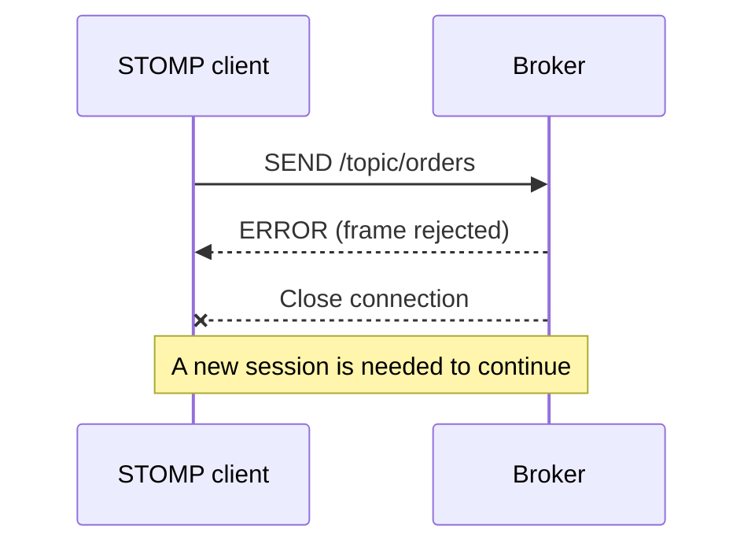
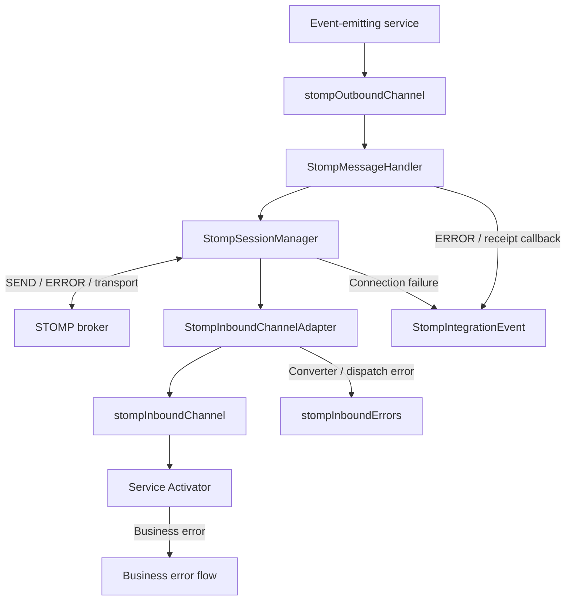
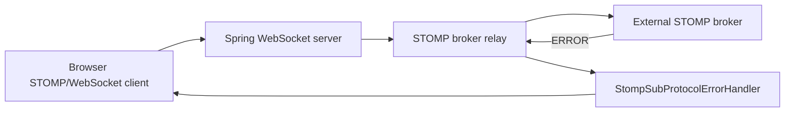
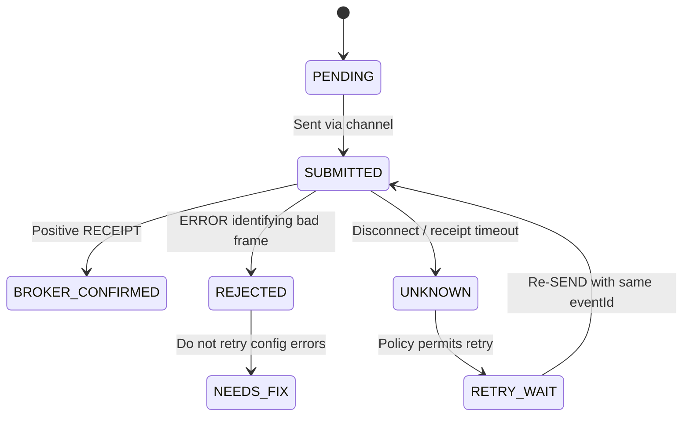

# Handling Broker Error Frames in Spring Integration STOMP

## 1. Problem Statement: Broker Returns ERROR After the Application Called `send()`

An order-management application uses `StompMessageHandler` to send an `ORDER_CREATED` event to a STOMP broker. The `MessageChannel.send()` call can return while the broker is still validating the destination, send permissions, or frame validity. Shortly afterward, the broker returns an `ERROR` frame: for example, the account lacks permission to send to `/topic/orders`, a required header is missing, or the proposed STOMP version is unsupported. The connection closes, and subsequent send attempts begin failing with session errors.

In the **SPRING_INTEGRATION_ADAPTERS** module, inbound/outbound adapters, gateways, pollers, and `MessageChannel` connect external systems with Spring processing flows. The **STOMP outbound adapter** sends Spring messages out to the broker, while the **STOMP inbound adapter** receives `MESSAGE` frames from subscriptions. **An `ERROR` frame is not a normal business message**: it is a protocol-level error signal that can arrive asynchronously and, per STOMP 1.2, must be followed by the server closing the connection.

This lesson focuses on **handling broker error frames** and the exact boundaries between protocol errors, transport errors, conversion errors, and business errors. Proper handling avoids two serious mistakes: infinitely resending an invalid frame automatically, and treating an ambiguous delivery failure as proof the message never reached the broker.

**Objectives**

1. Read `ERROR` frames per STOMP 1.2: `message`, `receipt-id`, `content-type`, body, and connection closure.
2. Distinguish `ERROR` from `RECEIPT` timeouts, TCP/WebSocket errors, `MessageConverter` errors, and `ServiceActivator` errors.
3. Use `StompExceptionEvent`, `StompIntegrationEvent`, `StompSessionHandlerAdapter`, and error channels within their proper scopes.
4. Build Spring Integration STOMP inbound/outbound configurations and event listeners to monitor asynchronous errors.
5. Classify permanent, transient, and indeterminate failures, applying reconnects, bounded retries, idempotency, and outboxes.
6. Design safe logging, correlation IDs, metrics, broker error tests, and operational runbooks.

## 2. What Does a STOMP ERROR Frame Look Like?

STOMP is a frame-based protocol with a command, headers, blank line, and body. A broker may send:

```text
ERROR
message:destination is not permitted
receipt-id:send-501
content-type:text/plain

Permission denied for requested destination
^@
```

`^@` represents the NUL byte terminating the frame. The body and headers above are **illustrative examples**; error text, error codes, destination names, details, and whether `receipt-id` is returned depend on the broker.

### Fields and Meaning

| Component | Example | What to understand |
| --- | --- | --- |
| `ERROR` command | `ERROR` | Server reports a protocol/request-handling error; not a subscription `MESSAGE` frame. |
| `message` header | `destination is not permitted` | Short description; **SHOULD** be present per STOMP 1.2, though it can be missing. |
| `receipt-id` header | `send-501` | May correlate to the offending client frame's `receipt` header; not always present. |
| `content-type` header | `text/plain` | Indicates body format if present; does not guarantee the body is safe text to log. |
| `content-length` header | Byte count | If the body contains NUL, length headers must be used per framing rules. |
| Body | Detailed message | May be empty or contain excerpts of the offending frame, credentials, or sensitive data. |

**There is no single standard STOMP error code equivalent to HTTP 400/401/403/503.** Brokers may include vendor-specific headers or different `message` text. Retry logic should not rely solely on matching English substrings like "not permitted" or "temporarily unavailable."

### Example of an ERROR Related to a Rejected Outbound Frame

The client sent:

```text
SEND
destination:/topic/orders
receipt:send-501
content-type:application/json

{"eventId":"evt-501","orderId":501}
^@
```

The broker may return `ERROR receipt-id:send-501` to indicate an error tied to that frame. However, **never assume every ERROR carries a `receipt-id`**, or that only frames requesting receipts can trigger ERROR. `receipt` helps correlation, but does not turn STOMP into a business request-reply mechanism.

## 3. Most Important Rule: ERROR Normally Terminates the Session

According to the **STOMP Protocol Specification 1.2**, if a server sends an `ERROR` frame, it **MUST close the connection immediately after sending the frame**.



Practical consequences:

1. Do not keep using the old `StompSession` to send more frames after receiving ERROR and transport closure.
2. All subscriptions belonging to the old session must be re-established on the new session per lifecycle/reconnect.
3. `StompSessionManager` may attempt to reconnect, but **cannot** turn an invalid frame into a valid one.
4. `SEND` operations already in flight on the wire may be in an indeterminate state regarding broker acceptance.
5. Clients must observe both **ERROR frames** and **transport disconnects**, never treating one alone as covering all cases.

### Connection Lingering: You Might Not See the ERROR

STOMP 1.2 also notes the issue of servers closing the socket too quickly after emitting a frame. A client may **miss the final ERROR or RECEIPT** even though the broker tried to send it, due to TCP reset, network failure, or the frame not being read before closure.

```text
Client ---- SEND ----> Broker
Broker ---- ERROR ---> network / socket reset
Client only sees ConnectionLostException
```

**Seeing no ERROR in logs does not prove the broker accepted the request.** Combine secret-scrubbed traces, broker logs, correlation IDs, receipt events, and session state.

## 4. Reasons a Broker Can Send ERROR

| Stage | Example | Proper fix |
| --- | --- | --- |
| `CONNECT` | Wrong `login/passcode`, invalid virtual host | Check secrets, broker vhost, ACLs; do not tight-loop retry with wrong credentials. |
| `CONNECT` | No common STOMP protocol version | Configure compatible `accept-version`/client-broker versions. |
| `SEND` | Missing `destination` or malformed frame | Fix producer, codec, or header mapping. |
| `SEND` | No permission to send to destination | Fix broker ACL/routing; never broaden destination arbitrarily "just to make it work." |
| `SUBSCRIBE` | Non-existent/unauthorized destination, missing `id` | Check broker naming, subscription/ACL, and frame. |
| `ACK/NACK` | Wrong ACK token per STOMP 1.2 or wrong session | Use `MESSAGE.ack` as `ACK/NACK.id`; check subscription mode and session. |
| `BEGIN/COMMIT` | Invalid/non-existent transaction ID | Fix STOMP transaction flow independently from JDBC. |
| Any frame | Frame exceeds header/body count or size limits | Enforce payload limits before sending and match broker policies. |
| Broker quota | Exceeded connection/subscription/pending message limits | Apply load throttling, backpressure, quotas; inspect vendor-specific headers/codes. |
| Internal broker error | Plugin failure, failed queue/route creation | Check broker health, policies, and recover infrastructure. |

**Not every case above always produces an `ERROR` frame.** A broker may reject connections at the transport layer, drop the socket immediately, or exhibit vendor behavior outside the STOMP spec. Classification rules should rely on observed signals and your broker's contract.

### Why Can't You Classify Solely by the Message String?

One broker returns `message:Access denied`; another returns `message:Not authorized`; or a reverse proxy may close the socket with no STOMP frame at all. Text messages can change across versions or configs. Prioritize:

- **Operation type** attempted (`CONNECT`, `SUBSCRIBE`, `SEND`, `ACK`).
- **Signal source** (broker ERROR, transport exception, receipt timeout, application error).
- **Correlation ID / receipt ID**, allowlisted destination, event ID.
- **Vendor-specific codes** when the broker defines a clear contract.
- Infrastructure-owned broker logs/metrics.

## 5. How ERROR Differs from Other Errors

| Scenario | What does it signify? | How to observe in Spring |
| --- | --- | --- |
| Broker `ERROR` | Broker rejects frame/action and prepares to close connection | `StompSessionHandler.handleFrame` on direct clients; ERROR handling in Spring Integration `StompMessageHandler`/events. |
| STOMP `RECEIPT` timeout | No receipt frame arrived within limit | `StompReceiptEvent` or `StompSession.Receiptable` callbacks, if receipt was requested. |
| TCP/WebSocket disconnect | Transport connection failed or closed | `handleTransportError` on direct clients; manager reconnect/error events. |
| Session `CONNECT` failure | No STOMP session available | Session manager `StompExceptionEvent`, connection/transport error. |
| Conversion/codec exception | Parser failed to decode frame, converter failed to build valid payload | `handleException` or client/adapter callback/error flow. |
| Business handler error | Invalid JSON/schema, DB timeout, service activator throws | Spring Integration error channel, downstream retry/quarantine. |
| Valid business rejection | Order rejected by business rules | Dedicated domain event/response; **no need** to emit STOMP ERROR for every case. |

### ERROR and NACK Are Completely Different

`NACK` is a **client-sent frame** rejecting a delivery on an `ack:client` or `ack:client-individual` subscription. `ERROR` is a **server-sent frame** reporting an error, usually followed by connection closure. Sending NACK is not sending ERROR; the broker is not required to reply with ERROR whenever a consumer NACKs.

### ERROR and Negative RECEIPT Are Not Identical

When a `RECEIPT` times out, the frame may have reached the broker while the reply was lost. When the broker returns `ERROR` with a matching `receipt-id`, the client has proof the broker reported an error for that operation. **Both still require idempotency and handling indeterminate states** for other frames in flight on the same session.

## 6. Spring Integration STOMP Architecture and Error Paths



Distinguish three observation channels:

1. **STOMP protocol/application events:** `StompExceptionEvent` and `StompReceiptEvent` deliver asynchronous signals from the session manager and outbound handler.
2. **Spring Integration error channel:** receives `ErrorMessage` when an endpoint routes message dispatch/conversion errors into a configured error flow. **Do not assume** every broker ERROR goes here.
3. **Broker and transport logs/metrics:** valuable when sockets close before the client reads ERROR.

`StompSessionManager` manages **one shared STOMP session** for inbound/outbound adapters in the same application context. Do not create a new session manager per event; a manager is neither a durable queue nor a transaction manager.

## 7. Catching ERROR Frames in a Plain Spring Framework STOMP Client

For direct clients (`ReactorNettyTcpStompClient` or `WebSocketStompClient`), Spring Framework uses `StompSessionHandler`. `StompSessionHandlerAdapter` provides:

- `handleFrame(StompHeaders headers, Object payload)`: handles **STOMP ERROR frames** on the session handler.
- `handleException(StompSession, StompCommand, StompHeaders, byte[], Throwable)`: exceptions while handling/decoding/converting frames or callbacks.
- `handleTransportError(StompSession, Throwable)`: connection/network/transport codec errors.
- `afterConnected(StompSession, StompHeaders)`: session received `CONNECTED` and is ready for operations.

### 7.1. A Safe Observer

```java
import org.springframework.messaging.simp.stomp.StompCommand;
import org.springframework.messaging.simp.stomp.StompHeaders;
import org.springframework.messaging.simp.stomp.StompSession;
import org.springframework.messaging.simp.stomp.StompSessionHandlerAdapter;

public final class BrokerErrorSessionObserver
        extends StompSessionHandlerAdapter {

    @Override
    public void afterConnected(
            StompSession session, StompHeaders connectedHeaders) {
        System.out.println("STOMP session CONNECTED");
    }

    @Override
    public void handleFrame(StompHeaders headers, Object payload) {
        // StompSessionHandlerAdapter handles ERROR frames via this method.
        String reason = headers.getFirst("message");
        String receiptId = headers.getReceiptId();

        // Log only short, sanitized metadata.
        System.err.printf(
            "Broker ERROR: hasMessage=%s, hasReceiptId=%s%n",
            reason != null, receiptId != null
        );
        // TODO: classify by operation context, correlation,
        // update metrics, and stop sending on the old session.
    }

    @Override
    public void handleException(
            StompSession session,
            StompCommand command,
            StompHeaders headers,
            byte[] payload,
            Throwable exception) {

        System.err.println(
            "STOMP frame processing failure: "
                + exception.getClass().getSimpleName()
        );
        // Never print raw payloads/headers unchecked.
    }

    @Override
    public void handleTransportError(
            StompSession session, Throwable exception) {

        System.err.println(
            "STOMP transport failure: "
                + exception.getClass().getSimpleName()
        );
        // TODO: reconnect/recover per policy; avoid tight infinite reconnects.
    }
}
```

`StompSessionHandlerAdapter#getPayloadType(...)` defaults to `String` for STOMP ERROR bodies. If the converter/session does not support that type, configure conversion and test accordingly. `payload` can still be `null` if the server sends no body.

**Security warning:** servers can echo the entire offending frame inside the `ERROR` body, including tokens or customer data. Never write `System.err.println(payload)` or `log.error("headers={}", headers)` in production applications.

### 7.2. Example Creating a Dedicated Client to Observe ERROR

The snippet below is for a **test application using the Spring Framework STOMP client**—do not run it concurrently with the adapters' session manager on the same client connection:

```java
import org.springframework.messaging.converter.StringMessageConverter;
import org.springframework.messaging.simp.stomp.ReactorNettyTcpStompClient;
import org.springframework.scheduling.concurrent.ThreadPoolTaskScheduler;

ThreadPoolTaskScheduler scheduler = new ThreadPoolTaskScheduler();
scheduler.setPoolSize(1);
scheduler.initialize();

ReactorNettyTcpStompClient client =
    new ReactorNettyTcpStompClient("127.0.0.1", 61613);
client.setMessageConverter(new StringMessageConverter());
client.setTaskScheduler(scheduler);

client.connectAsync(new BrokerErrorSessionObserver())
    .whenComplete((session, error) -> {
        if (error != null) {
            System.err.println(
                "CONNECT failed: " + error.getClass().getSimpleName()
            );
        }
    });
```

This snippet is meant to sit inside a lifecycle-managed component, not as a standalone top-level Java class. Production must manage `scheduler`/`client.shutdown()` and reconnects, avoiding creating a new scheduler on every frame. If the broker only enables WebSocket, use `WebSocketStompClient` with the matching `ws(s)://` handshake URL.

### Errors Before CONNECTED

Not every connect failure provides a `StompSession` for `handleFrame` to receive ERROR. If the broker rejects TCP/TLS, returns an unread frame, or fails to complete connection, `connectAsync(...)` may complete exceptionally and/or `handleTransportError` is invoked. Therefore monitor **both the connection future** and callbacks; never set a breakpoint only on `handleFrame`.

## 8. Spring Integration: `StompExceptionEvent` and `StompReceiptEvent`

Spring Integration publishes **`StompIntegrationEvent`** through Spring's application event mechanism to report asynchronous activity.

Per the reference guide:

- `AbstractStompSessionManager` publishes **`StompExceptionEvent`** when connecting to the broker fails.
- `StompMessageHandler` handles returned **`ERROR`** frames for outbound messages rejected by the broker.
- `StompMessageHandler` publishes **`StompReceiptEvent`** for `StompSession.Receiptable` callbacks when a receipt is requested, indicating receipt received or lost.

Design note: **not every ERROR event is attached to the business Spring `Message<?>` just sent**. Errors can arrive after the caller has left the call stack.

### 8.1. Listener Receiving STOMP Events

```java
import org.springframework.context.event.EventListener;
import org.springframework.integration.stomp.event.StompExceptionEvent;
import org.springframework.integration.stomp.event.StompReceiptEvent;
import org.springframework.stereotype.Component;

@Component
public class StompProtocolEvents {

    @EventListener
    public void onException(StompExceptionEvent event) {
        Throwable cause = event.getCause();
        String causeType =
            cause == null ? "unknown" : cause.getClass().getSimpleName();

        System.err.printf(
            "STOMP exception event; causeType=%s%n", causeType
        );
        // TODO: metric + correlation from trusted context.
    }

    @EventListener
    public void onReceipt(StompReceiptEvent event) {
        System.out.println("STOMP receipt callback event observed");
        // TODO: classify positive/lost receipt
        // per your version's API and persist send state.
    }
}
```

`StompExceptionEvent#getCause()` is inherited from `IntegrationEvent`. For `StompReceiptEvent`, the example intentionally avoids guessing getter names across versions; real applications must check Javadoc to read the receipt ID/positive-negative status and correlate with a pending-send registry.

### 8.2. Why `@EventListener` Does Not Replace Transactions

Spring application events are **in-process** signals, not durable transaction logs. If the process crashes, pending or unhandled events are lost. When STOMP sending is critical, store **outbox/pending-send state** in the DB and use event listeners for alerts/metrics; never use listeners as the sole authority deciding whether an event was sent.

## 9. Java Configuration: One STOMP Session Manager for Inbound and Outbound

This example uses Spring Boot + Spring Integration, a test STOMP/TCP broker at `127.0.0.1:61613`, an outbound handler sending to `/topic/orders`, and an inbound adapter subscribing to `/topic/order-status`.

### 9.1. Dependencies

```xml
<dependencies>
    <dependency>
        <groupId>org.springframework.boot</groupId>
        <artifactId>spring-boot-starter-integration</artifactId>
    </dependency>
    <dependency>
        <groupId>org.springframework.integration</groupId>
        <artifactId>spring-integration-stomp</artifactId>
    </dependency>
    <dependency>
        <groupId>io.projectreactor.netty</groupId>
        <artifactId>reactor-netty</artifactId>
    </dependency>
</dependencies>
```

Use a BOM to manage compatible versions. Port `61613` is just a common STOMP/TCP example value; the broker must enable the listener and matching ACLs.

### 9.2. Beans and Channels

```java
import org.springframework.beans.factory.annotation.Qualifier;
import org.springframework.context.annotation.Bean;
import org.springframework.context.annotation.Configuration;
import org.springframework.integration.annotation.ServiceActivator;
import org.springframework.integration.channel.DirectChannel;
import org.springframework.integration.config.EnableIntegration;
import org.springframework.integration.stomp.ReactorNettyTcpStompSessionManager;
import org.springframework.integration.stomp.StompSessionManager;
import org.springframework.integration.stomp.inbound.StompInboundChannelAdapter;
import org.springframework.integration.stomp.outbound.StompMessageHandler;
import org.springframework.integration.support.converter.PassThruMessageConverter;
import org.springframework.messaging.Message;
import org.springframework.messaging.MessageChannel;
import org.springframework.messaging.MessageHandler;
import org.springframework.messaging.support.ErrorMessage;
import org.springframework.messaging.simp.stomp.ReactorNettyTcpStompClient;
import org.springframework.scheduling.concurrent.ThreadPoolTaskScheduler;

@Configuration
@EnableIntegration
public class StompBrokerErrorConfiguration {

    @Bean
    public ThreadPoolTaskScheduler stompScheduler() {
        ThreadPoolTaskScheduler scheduler = new ThreadPoolTaskScheduler();
        scheduler.setPoolSize(2);
        scheduler.setThreadNamePrefix("stomp-session-");
        return scheduler;
    }

    @Bean
    public ReactorNettyTcpStompClient stompClient(
            ThreadPoolTaskScheduler stompScheduler) {

        ReactorNettyTcpStompClient client =
            new ReactorNettyTcpStompClient("127.0.0.1", 61613);
        client.setTaskScheduler(stompScheduler);
        client.setMessageConverter(new PassThruMessageConverter());
        client.setReceiptTimeLimit(5_000);
        return client;
    }

    @Bean
    public ReactorNettyTcpStompSessionManager stompSessionManager(
            ReactorNettyTcpStompClient stompClient) {

        ReactorNettyTcpStompSessionManager manager =
            new ReactorNettyTcpStompSessionManager(stompClient);
        manager.setRecoveryInterval(5_000);
        manager.setAutoReceipt(true);
        return manager;
    }

    @Bean
    public MessageChannel stompOutboundChannel() {
        return new DirectChannel();
    }

    @Bean
    public MessageChannel stompInboundChannel() {
        return new DirectChannel();
    }

    @Bean
    public MessageChannel stompInboundErrors() {
        return new DirectChannel();
    }

    @Bean
    @ServiceActivator(inputChannel = "stompOutboundChannel")
    public MessageHandler stompOutboundHandler(
            StompSessionManager stompSessionManager) {

        StompMessageHandler handler =
            new StompMessageHandler(stompSessionManager);
        handler.setDestination("/topic/orders");
        handler.setConnectTimeout(10_000);
        return handler;
    }

    @Bean
    public StompInboundChannelAdapter stompInboundAdapter(
            StompSessionManager stompSessionManager,
            @Qualifier("stompInboundChannel") MessageChannel output,
            @Qualifier("stompInboundErrors") MessageChannel errors) {

        StompInboundChannelAdapter adapter =
            new StompInboundChannelAdapter(
                stompSessionManager, "/topic/order-status"
            );
        adapter.setOutputChannel(output);
        adapter.setErrorChannel(errors);
        adapter.setPayloadType(String.class);
        return adapter;
    }

    @ServiceActivator(inputChannel = "stompInboundChannel")
    public void onStatus(Message<?> message) {
        System.out.printf(
            "Received status; springMessageId=%s%n",
            message.getHeaders().getId()
        );
        // TODO: validate payload/schema, idempotency, and DB transaction.
    }

    @ServiceActivator(inputChannel = "stompInboundErrors")
    public void onInboundProcessingError(ErrorMessage error) {
        System.err.println(
            "Inbound dispatch error: "
                + error.getPayload().getClass().getSimpleName()
        );
        // TODO: metrics/quarantine by error category.
    }
}
```

**Important notes:**

- The `stompInboundErrors` bean is configured for errors on the **inbound producer/dispatch path**. It **does not replace `StompExceptionEvent` or outbound handler broker `ERROR` callbacks**.
- `StompMessageHandler` is an **outbound** endpoint, not a Spring Integration request-reply gateway; a broker ERROR can arrive asynchronously after the handler sends.
- `setAutoReceipt(true)` requests receipts on supported operations; `setReceiptTimeLimit(5_000)` bounds waiting **when a receipt is requested**.
- `setRecoveryInterval(5_000)` is for retrying **session establishment**, not retrying a payload rejected by the broker for a bad destination.
- `setConnectTimeout(10_000)` limits the outbound handler waiting for a session; per the API contract, it must exceed the recovery interval.
- `PassThruMessageConverter` operates at the STOMP client layer; it does not automatically deserialize JSON into a valid DTO.

### 9.3. Sending Events via the Outbound Channel

```java
import org.springframework.beans.factory.annotation.Qualifier;
import org.springframework.messaging.MessageChannel;
import org.springframework.messaging.support.MessageBuilder;
import org.springframework.stereotype.Service;

@Service
public class OrderEventPublisher {

    private final MessageChannel channel;

    public OrderEventPublisher(
            @Qualifier("stompOutboundChannel") MessageChannel channel) {
        this.channel = channel;
    }

    public void publishJson(String validatedJson, String eventId) {
        if (eventId == null || eventId.isBlank()) {
            throw new IllegalArgumentException("Missing eventId");
        }

        boolean accepted = channel.send(
            MessageBuilder.withPayload(validatedJson).build()
        );

        if (!accepted) {
            throw new IllegalStateException(
                "Outbound channel rejected event"
            );
        }

        // Only means the Spring channel accepted per topology.
        // Broker receipt and business commit must be tracked separately.
    }
}
```

`validatedJson` and `eventId` must be generated/validated by the application against a trusted contract—never take unvalidated raw text and send it blindly to the broker. In the demo code, `eventId` is not yet embedded into the message body/headers; production must ensure it lives inside a durable **envelope** for retries and idempotency, not merely passed as a method parameter.

### Do Not Treat a Successful `send()` as Permission to Delete the Outbox

In a `DirectChannel` topology, `send()` may invoke the handler synchronously; yet after the method returns, the broker can still reject `SEND` and emit `ERROR`. With an `ExecutorChannel`, `send()` is even more clearly just task-enqueue confirmation. Delete outbox rows only after reaching the **confirmation milestone defined by your system contract**, such as a broker receipt if supported and persisted appropriately—while still accounting for retries creating duplicates.

## 10. Error Channels Do Not Hold Every ERROR Frame

Spring Integration provides `errorChannel` to route `ErrorMessage` objects when a message producer/endpoint fails and error handling is configured. For example, inbound may fail converting a payload or dispatching a Spring message into `DirectChannel`, causing the error channel to receive an `ErrorMessage`.

**However, broker `ERROR` is a protocol frame**, typically arriving via a STOMP session callback independent of the Java call that issued the request. There is no universal rule that "every ERROR frame automatically appears on `stompInboundErrors`."

```text
Broker -> STOMP ERROR -> Session callback / integration event

Broker -> STOMP MESSAGE -> Inbound adapter -> MessageChannel
                                  |
                                  +-- Processing failure -> ErrorMessage
```

| Question | Check |
| --- | --- |
| Did the broker reject SEND? | STOMP ERROR event, broker logs, receipt/correlation. |
| Did the inbound adapter receive MESSAGE? | Frame counters, subscriptions, output channel metrics. |
| Was payload converted to Spring Message? | Converter/mapper errors. |
| Did the handler throw an exception? | ErrorMessage/error channel and downstream logs. |
| Did the DB commit? | Transaction outcome, idempotency store, business metrics. |

### `DirectChannel` and `ExecutorChannel` Differ

`DirectChannel` invokes subscribers **synchronously** on the sending thread. If a downstream handler throws an exception, it can propagate back to the adapter/producer and be routed to the corresponding error flow.

`ExecutorChannel` creates an **asynchronous boundary**: the channel may have accepted the message while the worker has not yet committed to the DB. Worker failures require an error flow **on the worker side**—do not expect `StompMessageHandler` or the inbound adapter to know the outcome automatically.

Do not use broker ERROR frames to report every business validation failure to clients: if the app acts as a **Spring WebSocket STOMP server**, business errors can be returned over an appropriate application response/error destination instead of forcing the entire connection closed via an ERROR frame.

## 11. Error Handling in a Spring WebSocket Broker Relay Is a Different Topology

In an `@EnableWebSocketMessageBroker` application with `enableStompBrokerRelay(...)`, WebSocket clients connect to the **Spring server**, while the broker relay connects via TCP to an external broker. Spring Framework provides `StompSubProtocolErrorHandler` to customize ERROR frames **sent from the server/relay back to WebSocket clients**.



Two primary methods:

- `handleClientMessageProcessingError(Message<byte[]> clientMessage, Throwable ex)`: builds or suppresses ERROR when the server cannot process an incoming client message.
- `handleErrorMessageToClient(Message<byte[]> errorMessage)`: modifies or suppresses an ERROR message that the server/relay is about to send to a client, including errors from the external broker.

Per STOMP, once an **ERROR frame is sent**, the connection must be closed. To avoid dropping the session on a recoverable business error, an error handler may choose **not to send ERROR** (returning `null`) and instead notify over an application destination using an appropriate reliable mechanism.

### Warning When Using the Server's Error Handler

Do not suppress every ERROR frame just to "keep WebSocket online" without managing actual broker connection state. Once the broker closes a session due to a protocol violation, an error handler returning `null` for browser-bound frames **does not revive the broken broker session**.

An application error payload should follow a controlled structure, for example:

```json
{
  "errorCode": "ORDER_VALIDATION_FAILED",
  "requestId": "req-501",
  "retryable": false
}
```

This is a **business schema**, not a standard STOMP `ERROR` body. Avoid exposing internal exception stack traces, SQL, broker credentials, or sensitive order contents to clients.

## 12. Correlation: Linking SEND, Receipts, and Errors

A request must be traceable from emission to outcome:

```text
businessEventId = evt-501
outboxRecordId  = outbox-991
stompDestination = /topic/orders
stompReceiptId  = send-501
sessionGeneration = 17

SEND receipt:send-501
       |
       +-> RECEIPT receipt-id:send-501
       |
       +-> ERROR receipt-id:send-501
       |
       +-> Disconnect / timeout, indeterminate state
```

| Identifier | Used for | Do NOT substitute for |
| --- | --- | --- |
| `eventId` | Stable business key across retries/redeliveries | Per-attempt STOMP receipt ID |
| `receipt` / `receipt-id` | Correlation for one receipt-requesting STOMP operation | Business transaction ID or post-DB-commit ACK |
| `StompSession` / connection generation | Identifying which session performed an operation | Durable event ID |
| `MessageHeaders.ID` | Tracing a Spring message inside the process | Broker `message-id` or event ID |
| Broker `message-id` | Identifying a broker-delivered MESSAGE frame | STOMP 1.2 `ACK.id` when the frame carries a distinct `ack` token |

**There is no guarantee ERROR always carries a `receipt-id`**; if the broker closed the connection before the response reached the client, there is no event to match either. A pending-send registry must include an **UNKNOWN** state and deadlines rather than marking every timeout as `NOT_SENT`.

### Illustrative Event Publishing State Machine



This is an **application-designed state machine**, not a built-in Spring Integration API. Some brokers may acknowledge receipts without guaranteeing subscriber retention; `BROKER_CONFIRMED` still **differs** from `BUSINESS_COMMITTED`.

## 13. Error Classification and Safe Retry Policies

| Error category | Examples | Immediate retry? | Handling approach |
| --- | --- | --- | --- |
| **Permanent configuration** | Wrong username/password, vhost, destination, STOMP version | **No** | Pause/throttle publishing, alert, fix config/ACLs, redeploy. |
| **Permanent payload** | Invalid JSON schema, missing header, frame exceeds limit | **No** | Validate before sending, quarantine/DLQ, fix publisher. |
| **Transient infrastructure** | Broker unavailable, network timeout, restart | **No tight-loop retry** | Reconnect per manager, bounded retry/backoff, monitor quotas. |
| **Indeterminate send** | Disconnect before receipt, lost response | Retry carefully | Same event ID, idempotent consumer, status check/reconciliation. |
| **Business rejection** | Order canceled or forbidden | Do not use ERROR as a default retry signal | Business response/quarantine per business workflow. |
| **Downstream worker failure** | DB deadlock, async handler error | Per business retry policy | Worker error flow, idempotency, and commit checkpoints. |

### Do Not Create a Reconnect + Replay Bad-Payload Loop

```text
SEND to wrong destination
   -> Broker ERROR
   -> Broker closes connection
   -> Session manager reconnects
   -> Application auto-resends identical bad frame
   -> Broker ERROR
   -> ...
```

Without error classification, the system can trigger a self-inflicted **reconnect storm**, overloading the broker, flooding logs, and locking accounts. For bad credentials or ACLs, fix the configuration or permissions; faster reconnects do not fix the root cause.

### Is a Circuit Breaker Needed?

During prolonged broker outages, enforce publish rate limits, bounded queues, retry budgets, and backoff/circuit breakers at the **business sending layer**. `StompSessionManager`'s `setRecoveryInterval(...)` only governs reconnect intervals—it is not a per-event circuit breaker and does not automatically add jitter or exponential backoff.

## 14. Transactions, ACKs, and Committed Messages

Suppose a service updates the DB and sends a STOMP `SEND` inside the same method:

```text
BEGIN JDBC
  -> UPDATE orders
  -> SEND STOMP event
COMMIT JDBC
```

A JDBC transaction does not automatically span the broker. If the broker returns `ERROR` due to missing permissions after the DB commits, the order is modified while the event is never published. Conversely, the broker receiving an event before the DB rolls back causes divergence too.

**Transactional outbox** is one way to reduce risk:

1. Persist the order update and an outbox event with a durable `eventId` in **one DB transaction**.
2. A worker reads unpublished events and sends them via `StompMessageHandler`.
3. Track send results using receipts/correlation (if supported) and error events.
4. For indeterminate outcomes, retry with the same `eventId` per limits/reconciliation.
5. Consumers must be idempotent because the broker may have received the initial send before the client lost the receipt.

**STOMP ERROR is not an ACK/NACK for an inbound delivery.** In STOMP 1.2, manual ACK uses `MESSAGE.ack` as `ACK/NACK.id` on an `ack:client` or `ack:client-individual` subscription. A business/DB error after receiving a message does not automatically emit a broker ERROR; decide ACK/NACK or error flows per the delivery contract.

### A `SEND` Receipt Does Not Confirm the Consumer DB

A `RECEIPT` returned by the broker after `SEND` means the broker processed the frame per STOMP, **not** that subscribers committed to their DBs. If business acknowledgment is required, use a separate reply message, DB status, or reconciliation API.

## 15. Payload/Header Errors and Resource Limits

A broker may reject:

- Frames with missing or malformed headers.
- Headers that are too long or too numerous.
- Bodies exceeding allowed size limits.
- `content-length` not matching the payload **byte** count.
- Binary bodies containing NUL with invalid framing.
- Content-type/encoding incompatible with converters or broker policies.
- Destinations outside allowlists or lacking user permissions.

### Validate Before Sending

```java
import java.nio.charset.StandardCharsets;

public final class StompPayloadGuard {

    private static final int MAX_BYTES = 64 * 1024;

    public static void validate(String json) {
        if (json == null || json.isBlank()) {
            throw new IllegalArgumentException("Empty event payload");
        }

        int bodyBytes = json.getBytes(StandardCharsets.UTF_8).length;
        if (bodyBytes > MAX_BYTES) {
            throw new IllegalArgumentException("Event body too large");
        }
    }
}
```

This is only an **application-level size check**. It does not guarantee valid JSON schema, valid headers, or matching broker limits. True frame limits must be configured at the transport/client/broker layers and may differ between STOMP/TCP and STOMP-over-WebSocket.

Never use `String.length()` for `content-length`: STOMP counts **byte length**. Framework STOMP codecs normally handle framing; do not assemble raw frames manually unless implementing a custom protocol client.

## 16. Logging and Data Protection When the Broker Reports ERROR

An ERROR body can contain a **copy of the offending frame**, such as payloads with PII, tokens, SQL, or account details. Exception headers or stack traces may contain `login`/`passcode` or operational credentials. Therefore:

1. Never log raw `ERROR` bodies/headers by default.
2. Never print `StompHeaders.toString()` or entire Spring `Message<?>` objects to production logs without verifying masking.
3. Log the **error category**, protocol command, allowlisted destination, instance ID, correlation ID, and session status—never secrets.
4. Store raw failed frames only in an encrypted quarantine store with restricted access, explicit retention, and auditing when truly necessary.
5. Sanitize/escape CR/LF control characters in broker `message` strings to prevent log injection.
6. Rate-limit error logging; if the broker fails continuously, avoid log storms.
7. Never forward raw broker exceptions to browsers when a Spring WebSocket server acts as broker relay.

### Untrusted Event Content

Even when a notice comes from an internal broker, error contents may include **payload/headers injected by external publishers**. Treat them as untrusted data requiring sanitization, never as executable instructions. Never feed error message strings into scripts, SQL, or automated commands.

### Example Controlled Log

```text
2026-11-23T02:00:00Z level=ERROR component=stomp-outbound
category=ACL_DENIED destination=/topic/orders
receiptCorrelation=send-501 sessionState=DISCONNECTED
eventId=evt-501 action=NEEDS_OPERATOR_FIX
```

This is an illustrative log with fields **constructed by the application** after classification; STOMP brokers do not emit `category=ACL_DENIED` out of the box.

## 17. Monitoring, Alerting, and Runbooks

### 17.1. Metrics to Collect

| Metric | Meaning |
| --- | --- |
| STOMP `ERROR` counts by category/cause | Detects broker frame rejections; capture associated session/command when available. |
| `StompExceptionEvent` count | Tracks connection/session failures. |
| Manager `isRunning()`, `isConnected()` | Distinguishes lifecycle state from session connectivity. |
| CONNECT failures / reconnect attempts | Detects auth, network, or broker outages. |
| Receipt positive/negative/timeout | Tracks STOMP operation confirmations. |
| Outbox pending/unknown/failed age | Exposes events not yet confirmed per contract. |
| Business commit vs. broker receipt | Separates protocol reliability from business outcomes. |
| Active subscriptions / last `MESSAGE` | Verifies inbound health after reconnect. |
| Error-channel messages / DLQ count | Measures converter and downstream handler failures. |
| Queue depth / executor saturation | Detects backpressure and prevents flooding the broker on recovery. |

### 17.2. Diagnostic Runbook Order

1. **Locate where the failure occurred:** CONNECT, SUBSCRIBE, SEND, ACK/NACK, or post-adapter handler.
2. **Check session state:** running/connected, disconnect timestamp, reconnect attempts.
3. **Check present/absent signals:** broker ERROR, negative receipt, transport error, business error channel.
4. **Match correlation:** `receipt-id` if present, event ID / outbox ID, allowlisted destination, and session.
5. **Inspect broker logs** within administrative access, masking sensitive info.
6. **Classify root cause:** permanent config, schema, ACL, transient network, or indeterminate send state.
7. **Pick action:** fix config/permissions, quarantine, controlled reconnect, bounded retry, or reconcile.
8. **Verify recovery:** post-reconnect subscriptions, backlog, duplicate events, and consumer business commits.
9. **Record incident timeline** across Spring app + broker + DB, never concluding from a single log line.

### 17.3. Alerts to Prioritize

- Spikes in broker `ERROR` frames, especially on `CONNECT`/`SUBSCRIBE`.
- Reconnect storms or connected session count near zero.
- Aging outbox events and growing backfill queues.
- Sustained receipt timeouts with no broker confirmations.
- Broker ACL/config drift blocking event delivery.
- Errors risking cross-tenant/destination data leaks or credentials appearing in logs.

Never restart the entire application just for an `ERROR` caused by a malformed payload; classify errors first to prevent restart loops and further loss of in-flight work.

## 18. Broker Integration Test Scenarios

Use **test brokers only** with dedicated accounts/destinations. STOMP `ERROR` typically triggers connection closure, so reset/reconnect between cases.

| Case | Action | Expected behavior to verify |
| --- | --- | --- |
| 1. Baseline | Connect with valid credentials, valid SEND | CONNECTED received; no ERROR; receiver gets event. |
| 2. Wrong login | CONNECT with wrong password | Connect fails; may receive ERROR or transport close; no infinite hot retry. |
| 3. Wrong vhost | CONNECT with invalid host | Broker rejects; metrics classify config error. |
| 4. Wrong version | Propose unsupported protocol version | Spec-compliant broker replies ERROR; session never CONNECTED. |
| 5. Missing destination | Send malformed SEND frame from controlled test client | ERROR then close per STOMP 1.2; do not keep retrying on old session. |
| 6. Bad SEND ACL | Account lacks destination permission | Broker rejects; proper correlation/alert, no infinite auto-retry. |
| 7. Bad SUBSCRIBE ACL | Not permitted to subscribe to topic | ERROR or close; no false successful subscription after reconnect. |
| 8. Wrong ACK token | Manual ACK not matching `MESSAGE.ack` | Broker handles error per contract; never treat business commit as broker ACK. |
| 9. Receipt timeout | Drop reply between broker and client | Pending event moves to UNKNOWN; idempotent retry, never assumed NOT_SENT. |
| 10. Lost ERROR due to reset | Broker closes socket too fast after ERROR | Client still detects transport failure without relying solely on `handleFrame`. |
| 11. Conversion failure | Broker sends malformed JSON to inbound | Downstream error flow/quarantine; not mistaken for broker ERROR. |
| 12. Async handler fails | Use `ExecutorChannel` and fail worker | Downstream error flow receives error; not treated as outbound ERR event. |
| 13. Reconnect | Restart broker after ERROR | Manager reconnects, destinations resubscribe properly, bad payload not auto-replayed. |
| 14. Poison payload | Send out-of-contract message | Validate/quarantine, bounded retries, no raw PII logged. |
| 15. Multiple replicas | All rejected by broker due to ACL/config | Limit reconnect storms; per-instance and broker metrics. |

For malformed-frame tests, use a **raw STOMP test client or custom frame tool** rather than breaking production encoders just to inject errors. Avoid using real data or shutting down production brokers to "verify" behavior.

### Recovery Verification Checklist

```text
[ ] Identified whether error came from ERROR, transport, receipt, or business handler
[ ] Classified as permanent, transient, or indeterminate
[ ] No raw broker frames or secrets logged
[ ] On ERROR, old session treated as unusable
[ ] Reconnect is bounded and observable
[ ] Subscriptions re-registered and accepted by broker
[ ] Pending SEND has eventId and durable state
[ ] Retries produce no duplicate business effects thanks to idempotency
[ ] Backlog, receipt timeouts, and business commits measured
[ ] Alerts and runbooks exist for auth/ACL/config drift
```

## 19. Exercises with Answers

**Exercise 1 — Semantics.** According to STOMP 1.2, what must a broker do after sending an `ERROR` frame?

**Answer:** Close the connection immediately after sending ERROR. The client should not continue sending on the old session.

**Exercise 2 — Headers.** Must an ERROR frame always include `message` or `receipt-id`?

**Answer:** No. `message` is SHOULD, and `receipt-id` is conditional—typically aiding correlation when the offending frame carried `receipt`.

**Exercise 3 — Missing ERROR.** The client only receives `ConnectionLostException`. Can you conclude the broker never returned ERROR?

**Answer:** No. The broker may have closed the socket before the client read ERROR, or a transport error occurred before the broker built a frame.

**Exercise 4 — Locating the fault.** A Java handler fails to parse JSON after receiving `MESSAGE`. Is that necessarily a broker ERROR?

**Answer:** No. That is a conversion/business error; handle it via the downstream error flow rather than assuming the broker emitted ERROR.

**Exercise 5 — NACK.** Are both `NACK` and `ERROR` sent by the broker to report errors?

**Answer:** No. `NACK` is sent by the consumer to reject a delivery in manual-ack mode; `ERROR` is sent by the server and requires closing the connection.

**Exercise 6 — Receipt timeout.** No `RECEIPT` arrived after a `SEND`. Is it certain the broker never received the payload?

**Answer:** No. The receipt could have been lost even though the broker accepted `SEND`; the state can be UNKNOWN.

**Exercise 7 — Correlation.** What should `ERROR.receipt-id=send-501` be matched against?

**Answer:** Against the `receipt` header of the corresponding client `SEND`/`SUBSCRIBE` frame if present—not a default business `eventId`.

**Exercise 8 — Callback API.** Which Spring Framework callback on `StompSessionHandlerAdapter` receives ERROR frames?

**Answer:** `handleFrame(StompHeaders, Object)`; distinguish it from `handleException` for frame-handling errors and `handleTransportError` for transport failures.

**Exercise 9 — Integration event.** Which event can `AbstractStompSessionManager` publish when connecting to the broker fails?

**Answer:** `StompExceptionEvent`.

**Exercise 10 — Error channel.** Does configuring `adapter.setErrorChannel(errors)` ensure every outbound STOMP ERROR goes to that channel?

**Answer:** No. That channel is for endpoint/message-producer errors on that adapter; outbound protocol ERRORs and receipts are observed via session callbacks/events.

**Exercise 11 — Recovery.** Seeing an ERROR caused by a wrong password, should you lower `recoveryInterval` from 5 seconds to 100 ms to recover faster?

**Answer:** No. Fix the credentials/configuration and cap reconnects; rapid retries cause error storms.

**Exercise 12 — Indeterminate failures.** The broker closes the connection amid several `SEND`s without receipts. Can all of them be marked `NOT_SENT`?

**Answer:** No. Some frames may have reached the broker; keep UNKNOWN state and use idempotent retries/reconciliation.

**Exercise 13 — Browsers.** What is the consequence of returning STOMP ERROR for every validation error in `@MessageMapping`?

**Answer:** Per protocol, ERROR triggers connection closure; for recoverable business errors, consider a dedicated application error message instead.

**Exercise 14 — WebSocket relay.** Does `StompSubProtocolErrorHandler` help customize errors sent to WebSocket clients?

**Answer:** Yes. It provides hooks for client-processing errors and broker relay error messages; however, returning `null` does not fix an already-broken broker session.

**Exercise 15 — Idempotency.** Can a transport error after the broker received `SEND` but before the client received the receipt cause duplicates on retry?

**Answer:** Yes. Use a stable `eventId`, idempotent consumers, and an outbox.

**Exercise 16 — Security.** Should you log the full ERROR body to diagnose ACL failures?

**Answer:** Not by default. The body may contain a copy of the request frame, credentials, and PII; use masking/redaction, rate limits, and proper log stores.

**Exercise 17 — Content length.** A Vietnamese payload has `String.length()` characters; does that always equal the STOMP frame's `content-length`?

**Answer:** No. Content length is **byte count**, typically depending on UTF-8 encoding; let the STOMP codec handle it.

**Exercise 18 — Async.** Does `ExecutorChannel.send()` returning `true` prove the worker wrote to the DB successfully?

**Answer:** No. It may only confirm the task was handed to the executor; worker errors must be observed in the downstream error flow.

**Exercise 19 — Transaction boundary.** Does wrapping `MessageChannel.send()` in Spring `@Transactional` cause a broker SEND to roll back automatically with the JDBC transaction?

**Answer:** No. You need consistency patterns such as outbox/inbox and idempotent retries.

**Exercise 20 — Summary.** Which three signal sources should be combined to diagnose a broker rejecting a message?

**Answer:** STOMP `ERROR`/`StompExceptionEvent` if available, receipts/timeouts, and transport/broker logs—plus `eventId`/outbox/DB to confirm business outcomes.

## 20. Key Takeaways

**STOMP `ERROR` is a frame sent by the broker/server to report an error; per STOMP 1.2, the server must close the connection immediately after sending ERROR.** The frame may include `message`, `receipt-id`, and a body, yet **the client may not receive ERROR before the connection closes**. Spring Framework lets STOMP clients observe errors via `StompSessionHandlerAdapter.handleFrame`, `handleException`, and `handleTransportError`. Spring Integration provides **`StompExceptionEvent`**, **`StompReceiptEvent`**, session managers, and error channels, though each mechanism reflects **a different kind of error**; never equate broker ERROR with business handler exceptions or receipt timeouts. When the broker rejects a frame, classify configuration, payload, infrastructure, and indeterminate send failures; avoid hot-retrying bad frames, track correlation/receipts, reconnect cleanly, and use outbox + idempotency to prevent lost or duplicate events. Always mask sensitive data in logs because ERROR bodies can echo the entire offending request frame.

## References

- [STOMP Protocol Specification 1.2 — ERROR Frames](https://stomp.github.io/stomp-specification-1.2.html#ERROR)
- [Spring Integration Reference — STOMP Support and Integration Events](https://docs.spring.io/spring-integration/reference/stomp.html)
- [Spring Integration API — StompMessageHandler](https://docs.spring.io/spring-integration/api/org/springframework/integration/stomp/outbound/StompMessageHandler.html)
- [Spring Integration API — StompExceptionEvent](https://docs.spring.io/spring-integration/api/org/springframework/integration/stomp/event/StompExceptionEvent.html)
- [Spring Framework Reference — STOMP Client Error Handling](https://docs.spring.io/spring-framework/reference/web/websocket/stomp/client.html)
- [Spring Framework API — StompSessionHandlerAdapter](https://docs.spring.io/spring-framework/docs/current/javadoc-api/org/springframework/messaging/simp/stomp/StompSessionHandlerAdapter.html)
- [Spring Framework API — StompSubProtocolErrorHandler](https://docs.spring.io/spring-framework/docs/current/javadoc-api/org/springframework/web/socket/messaging/StompSubProtocolErrorHandler.html)
