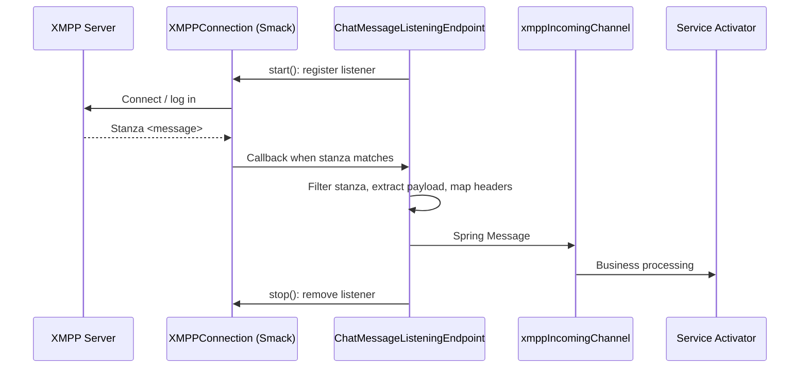
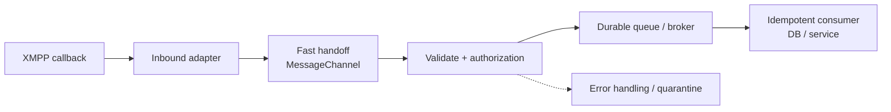

# XMPP message inbound adapter

## 1. Context and objectives

The **SPRING_INTEGRATION_ADAPTERS** module covers connecting external systems into Spring Integration using inbound/outbound adapters, gateways, pollers, and `MessageChannel`, while managing message contracts, errors, and connection lifecycles. In the **XMPP Adapter** chapter, this lesson explains how to **receive XMPP messages** from a logged-in account and bring them into a Java processing flow.

Suppose a monitoring system sends alerts to a bot:

```text
monitor@example.org --- XMPP chat ---> integration-bot@example.org
                                          |
                                          v
                                  XMPP inbound adapter
                                          |
                                          v
                                   MessageChannel
                                          |
                                          v
                             Validate / DB / JMS / Kafka
```

The application logs in to XMPP using `integration-bot@example.org`. When a matching message stanza arrives, the adapter converts it into a **Spring Integration Message** and sends it to a channel for the system to process. This is an **event-driven** model, not polling the server every few seconds.

After this lesson, you will be able to:

- Distinguish between the XMPP **message inbound adapter**, outbound adapter, presence adapter, and inbound gateway.
- Configure `XmppConnectionFactoryBean`, `ChatMessageListeningEndpoint`, and `MessageChannel`.
- Use `StanzaFilter` to select stanzas and `payload-expression` to extract content.
- Read headers such as `XmppHeaders.FROM`, `TO`, `SUBJECT`, `THREAD`, and `TYPE`.
- Manage connections, login, TLS/SASL, lifecycle, reconnection, and downstream errors.
- Design asynchronous processing, consumer protection, deduplication, and recovery strategies when a connection drops.

## 2. XMPP, stanzas, and JID addresses

**XMPP (Extensible Messaging and Presence Protocol)** is an XML-based protocol used for message exchange, presence tracking, and many extensions defined by XEPs. An application connects to an XMPP server (such as Openfire or ejabberd), authenticates, and receives stanzas over a connection session.

| Stanza type | Purpose | In Spring Integration |
| --- | --- | --- |
| `<message>` | Transports chat content, notifications, alerts | XMPP **message inbound channel adapter** |
| `<presence>` | Online/away status, subscriptions, roster events | XMPP **presence inbound channel adapter** |
| `<iq>` | Request/result exchange at the XMPP protocol layer | Not automatically converted into regular chat messages |

A sample stanza:

```xml
<message
    from="monitor@example.org/worker-1"
    to="integration-bot@example.org/spring-integration"
    type="chat"
    id="alert-1001">
    <body>ALERT disk usage high</body>
</message>
```

`from` and `to` contain a **JID (Jabber ID)**. The part before the `/` is the **bare JID** (for example `monitor@example.org`), while the part after `/` is the **resource** identifying a specific client/session. An account can log in from multiple resources, and message routing rules may depend on the server.

Message types can also be `normal`, `groupchat`, `headline`, or `error`. You should not assume by default that the inbound message adapter must turn all types into the same business command.

## 3. Event-driven architecture and endpoint lifecycle

The inbound message implementation class in Spring Integration is `org.springframework.integration.xmpp.inbound.ChatMessageListeningEndpoint`. The endpoint uses an `org.jivesoftware.smack.XMPPConnection`, registers a stanza listener on startup, forwards matching messages to a channel, and unregisters the listener on stop.



**XMPP message inbound is event-driven**, so it does not need a `@Poller` to call `receive()`. By contrast, a File inbound adapter uses a poller to scan a directory. If downstream uses a `QueueChannel`, a **downstream** consumer may need its own poller, but that is not the mechanism for receiving stanzas from XMPP.

Key components:

| Component | Responsibility | Things to note |
| --- | --- | --- |
| `XmppConnectionFactoryBean` | Creates and manages a Smack-based XMPP connection | Login, lifecycle, reconnect, TLS |
| `ChatMessageListeningEndpoint` | Registers listener, receives stanzas, builds Spring Message | Not a request–reply transaction by itself |
| `StanzaFilter` | Decides whether a stanza is accepted by the listener | Must avoid accepting unsupported types |
| `payload-expression` | Extracts data from a Smack `Message` using SpEL | May evaluate to null if body/extension is absent |
| `DefaultXmppHeaderMapper` | Maps XMPP attributes to headers | Custom application headers are not all mapped automatically |
| `MessageChannel` | Delivers messages to processing endpoints | DirectChannel may run synchronously inside the callback |

Distinguish this from **presence**: to receive user status changes, use `PresenceListeningEndpoint` or `<int-xmpp:presence-inbound-channel-adapter>`; do not treat the chat flow as if every stanza were a presence event.

## 4. Dependencies and test environment

The examples use Java 17+ and Spring Boot with Spring Integration-compatible dependency management. Maven:

```xml
<dependencies>
    <dependency>
        <groupId>org.springframework.boot</groupId>
        <artifactId>spring-boot-starter-integration</artifactId>
    </dependency>
    <dependency>
        <groupId>org.springframework.integration</groupId>
        <artifactId>spring-integration-xmpp</artifactId>
    </dependency>
</dependencies>
```

The `spring-integration-xmpp` module integrates the **Smack** library. If you are not using the Spring Boot BOM, you must explicitly choose compatible versions; do not copy Smack 3.x API code verbatim into a project running Spring Integration 6.x/7.x.

Prepare an XMPP server for testing (for example Openfire/ejabberd) and two accounts:

- Receiver: `integration-bot@example.org`.
- Sender: `monitor@example.org`.

Example `application.yml`:

```yaml
app:
  xmpp:
    host: ${XMPP_HOST:xmpp.internal.example.org}
    port: ${XMPP_PORT:5222}
    domain: ${XMPP_DOMAIN:example.org}
    user: ${XMPP_USER:integration-bot}
    password: ${XMPP_PASSWORD}
```

`host` is the server hostname, while `domain` is the **XMPP service domain** of the account; they do not necessarily have to be identical. In the examples, `example.org` is only an illustrative address and must be replaced with an actually configured server.

**Do not commit passwords to the repository or write them to logs.** Provide `XMPP_PASSWORD` via a secret manager or environment variable. In production, configure TLS with certificate/hostname verification, a server-supported SASL mechanism, and appropriate network policies; never disable TLS validation just to get a connection working.

## 5. Complete Java configuration for inbound messages

This example creates a connection factory, a channel, an inbound endpoint, and a consumer to observe received data. `StanzaFilter` only accepts chat/normal messages with a non-blank body. `payload-expression="body"` converts the body from the Smack message into a `String` payload.

```java
import org.jivesoftware.smack.XMPPConnection;
import org.jivesoftware.smack.packet.Message;

import org.springframework.beans.factory.annotation.Qualifier;
import org.springframework.beans.factory.annotation.Value;
import org.springframework.context.annotation.Bean;
import org.springframework.context.annotation.Configuration;
import org.springframework.expression.spel.standard.SpelExpressionParser;
import org.springframework.integration.annotation.ServiceActivator;
import org.springframework.integration.channel.DirectChannel;
import org.springframework.integration.config.EnableIntegration;
import org.springframework.integration.xmpp.XmppHeaders;
import org.springframework.integration.xmpp.config.XmppConnectionFactoryBean;
import org.springframework.integration.xmpp.inbound.ChatMessageListeningEndpoint;
import org.springframework.messaging.MessageChannel;

@Configuration
@EnableIntegration
public class XmppInboundConfig {

    @Bean(name = "xmppConnection")
    public XmppConnectionFactoryBean xmppConnection(
            @Value("${app.xmpp.host}") String host,
            @Value("${app.xmpp.domain}") String domain,
            @Value("${app.xmpp.port:5222}") int port,
            @Value("${app.xmpp.user}") String user,
            @Value("${app.xmpp.password}") String password) {

        XmppConnectionFactoryBean factory =
                new XmppConnectionFactoryBean();
        factory.setHost(host);
        factory.setServiceName(domain);
        factory.setPort(port);
        factory.setUser(user);
        factory.setPassword(password);
        factory.setResource("spring-integration-inbound");
        return factory;
    }

    @Bean
    public MessageChannel xmppIncomingChannel() {
        return new DirectChannel();
    }

    @Bean
    public ChatMessageListeningEndpoint xmppInboundAdapter(
            XMPPConnection xmppConnection,
            @Qualifier("xmppIncomingChannel") MessageChannel channel) {

        ChatMessageListeningEndpoint endpoint =
                new ChatMessageListeningEndpoint(xmppConnection);
        endpoint.setOutputChannel(channel);

        // Select chat or normal messages with a body.
        endpoint.setStanzaFilter(stanza ->
                stanza instanceof Message msg
                && (msg.getType() == Message.Type.chat
                    || msg.getType() == Message.Type.normal)
                && msg.getBody() != null
                && !msg.getBody().isBlank());

        endpoint.setPayloadExpression(
                new SpelExpressionParser().parseExpression("body")
        );
        endpoint.setAutoStartup(true);
        return endpoint;
    }

    @ServiceActivator(inputChannel = "xmppIncomingChannel")
    public void receiveChat(
            org.springframework.messaging.Message<String> incoming) {

        String body = incoming.getPayload();
        Object from = incoming.getHeaders().get(XmppHeaders.FROM);
        Object thread = incoming.getHeaders().get(XmppHeaders.THREAD);
        Object type = incoming.getHeaders().get(XmppHeaders.TYPE);

        System.out.printf(
                "XMPP from=%s thread=%s type=%s body=%s%n",
                from, thread, type, body
        );

        // Production: validate sender/body, record event ID, and
        // forward to an appropriate consumer / data store.
    }
}
```

The class must be within the component scan scope of `@SpringBootApplication` or imported into the Spring context. The example **will not run on its own without a real XMPP server and accounts**. The `xmppConnection` bean method returns a Spring `FactoryBean<XMPPConnection>`; Spring uses the connection object created by the factory to inject into the endpoint.

### Explaining the key settings

1. `setHost` selects the server; `setServiceName` sets the XMPP service domain; `setUser`, `setPassword`, and `setResource` specify the client credentials and resource.
2. `new ChatMessageListeningEndpoint(xmppConnection)` attaches the listener to the managed connection.
3. `setOutputChannel` connects the XMPP source to `xmppIncomingChannel`; if there is no subscriber or the channel is misconfigured, messages may not reach the consumer.
4. `setStanzaFilter` excludes `presence`, `iq`, messages without a body, and other message types. You can expand it to handle other stanza types according to your contract.
5. `setPayloadExpression("body")` reads `getBody()` from the Smack `Message`, avoiding pushing the raw Smack object to a text consumer.
6. `setAutoStartup(true)` lets the endpoint start automatically with the Spring lifecycle; **a running bean state does not prove that the connection is authenticated**.
7. `@ServiceActivator` receives `Message<String>` and XMPP headers; the example only logs and does not write to a DB or send an external ACK.

**Do not place heavy processing logic directly inside the callback**: `DirectChannel` typically executes the call on the message-dispatching thread. If a parser or DB call is slow, the Smack listener can be affected. Consider a fast handoff to a queue/broker with appropriate load limits and durability.

## 6. XML namespace: equivalent configuration

Spring Integration supports declaring the XMPP inbound adapter via XML. The example below uses the same connection settings and channel as the Java config:

```xml
<beans xmlns="http://www.springframework.org/schema/beans"
       xmlns:xsi="http://www.w3.org/2001/XMLSchema-instance"
       xmlns:int="http://www.springframework.org/schema/integration"
       xmlns:int-xmpp="http://www.springframework.org/schema/integration/xmpp"
       xsi:schemaLocation="
           http://www.springframework.org/schema/beans
           https://www.springframework.org/schema/beans/spring-beans.xsd
           http://www.springframework.org/schema/integration
           https://www.springframework.org/schema/integration/spring-integration.xsd
           http://www.springframework.org/schema/integration/xmpp
           https://www.springframework.org/schema/integration/xmpp/spring-integration-xmpp.xsd">

    <int:channel id="xmppIncoming"/>

    <int-xmpp:xmpp-connection id="xmppConnection"
                              user="${app.xmpp.user}"
                              password="${app.xmpp.password}"
                              host="${app.xmpp.host}"
                              port="${app.xmpp.port}"
                              resource="spring-integration-inbound"/>

    <int-xmpp:inbound-channel-adapter
        id="xmppInboundAdapter"
        channel="xmppIncoming"
        xmpp-connection="xmppConnection"
        payload-expression="body"
        auto-startup="true"/>
</beans>
```

This is an **alternative** to Java configuration, not a requirement to run both adapters at the same time. In the XML configuration above, add a `service-activator` or an `IntegrationFlow` to process messages from `xmppIncoming`. The `${...}` placeholders are resolved by Spring property resolution when running in a configured context.

For advanced TLS/SASL authentication, custom truststores, or roster policies, build an `XMPPTCPConnectionConfiguration` and pass it to `XmppConnectionFactoryBean` via `setConnectionConfiguration(...)`. Avoid copying very old `org.jivesoftware.smack.ConnectionConfiguration` examples without checking the Smack version in use.

## 7. How does StanzaFilter differ from payload-expression?

These are two separate steps:

- **`StanzaFilter`**: decides which XMPP stanzas are considered by the listener; executed before the message is sent to the channel.
- **`payload-expression`**: from a selected stanza, a SpEL expression determines the payload of the Spring Integration message.

Example accepting only chat messages:

```java
endpoint.setStanzaFilter(stanza ->
        stanza instanceof org.jivesoftware.smack.packet.Message msg
        && msg.getType()
                == org.jivesoftware.smack.packet.Message.Type.chat
        && msg.getBody() != null);
```

If producers may send `normal` messages, expand the filter accordingly. If the system uses chat rooms (MUC), do not assume the endpoint handles all room/groupchat stanzas with a direct chat configuration; you must check Smack/XMPP server support and the application's room-joining mechanism.

### What happens when the filter rejects a stanza?

Rejected stanzas **do not enter the channel**. The sender does not automatically receive a "business rejection" notification, because this is a **one-way inbound channel adapter**, not a request–reply gateway. If you need to send errors back to the sender, design an outbound XMPP adapter and an explicit response contract.

### What does SpEL read from the stanza?

The expression `body` evaluates against `org.jivesoftware.smack.packet.Message`, not Spring `Message<String>`. Variants:

| Expression | Data to extract | Condition |
| --- | --- | --- |
| `body` | Chat body content | Stanza has a body |
| `subject` | Subject if present | May be null |
| `getExtension('custom:notification:v1')` | An XMPP message extension | Requires compatible provider/namespace |
| `#extension` | The sole extension in the evaluation context | Exists only in supported cases when there is exactly one extension |

Example extracting an extension in XML:

```xml
<int-xmpp:inbound-channel-adapter
    id="extensionInbound"
    channel="xmppIncoming"
    xmpp-connection="xmppConnection"
    payload-expression="getExtension('custom:notification:v1')"/>
```

This is an **illustrative snippet**: the application must configure the corresponding Smack `ProviderManager`/`ExtensionElementProvider` when parsing a custom extension. Do not assume every extension has a `json` field or identically mapped attributes.

**Protecting against null payloads:** a `<message>` stanza may have no body. The filter in the Java config proactively drops such messages to avoid creating null payloads. If extracting an extension, check that the extension exists before passing it downstream.

## 8. XMPP MessageHeaders and business value

`DefaultXmppHeaderMapper` maps standard attributes between Smack messages and Spring headers by default. Constants in the modern API belong to `org.springframework.integration.xmpp.XmppHeaders`:

| Constant | Header name | Meaning |
| --- | --- | --- |
| `XmppHeaders.FROM` | `xmpp_from` | Sender's JID |
| `XmppHeaders.TO` | `xmpp_to` | Recipient's JID |
| `XmppHeaders.SUBJECT` | `xmpp_subject` | Subject if present on the stanza |
| `XmppHeaders.THREAD` | `xmpp_thread` | Conversation thread |
| `XmppHeaders.TYPE` | `xmpp_type` | Message type, e.g., chat/normal |
| `XmppHeaders.CHAT` | `xmpp_chat` | Chat context header, depending on endpoint |

A message in Spring Integration can be represented conceptually as:

```text
payload = "ALERT disk usage high"
headers:
  xmpp_from   = "monitor@example.org/worker-1"
  xmpp_to     = "integration-bot@example.org/spring-integration"
  xmpp_type   = chat
  xmpp_thread = <may be absent>
  id          = <Spring Message ID>
  timestamp   = <Spring Message timestamp>
```

Do not assume every header is always present or always of type `String`: JIDs may be represented as objects from the Smack library. At the database persistence boundary, normalize JIDs, validate data types, and avoid logging sensitive information.

**Custom headers are not all automatically mapped** to XMPP messages. `DefaultXmppHeaderMapper` provides `requestHeaderNames` and `replyHeaderNames` settings to control which header names are mapped. Do not enable a wildcard for all headers if there is a risk of leaking internal data or secrets over the network.

**`MessageHeaders.ID` is not the XMPP stanza ID**. To prevent duplicate processing, build a business-contract event ID (or use a verified stanza ID in the appropriate context), rather than relying solely on the ID Spring generates when receiving the message.

## 9. End-to-end practice with two accounts

Prepare an XMPP server and two **test-only** accounts:

- `integration-bot@example.org` logged in within the Java application.
- `monitor@example.org` logged in via another XMPP client.

Steps:

1. Provide host, port, domain, user, and password configuration via a secrets mechanism.
2. Start Spring Boot; verify the connection has logged in and the listener is active.
3. From the `monitor@example.org` client, send a `chat` message with body `ALERT disk usage high` to `integration-bot@example.org`.
4. Observe the logs of `receiveChat` to see the body and headers.
5. Send a `headline` message or a message without a body; the filter in the example will not forward them into the channel.
6. Stop the application, send a message while the bot is offline, then start it again. Check whether the server stores/delivers offline messages instead of assuming replay.
7. Try temporarily disconnecting the test network and letting it reconnect; compare the counts of sent, received, duplicated, or lost messages.

Illustrative output:

```text
XMPP from=monitor@example.org/worker-1
     thread=null
     type=chat
     body=ALERT disk usage high
```

This is an **expected result**, not a log from an actual run executed in this lesson. JID types, resources, and the `thread` header may vary in practice.

## 10. Reconnect, offline messages, and reliability

An XMPP connection has its own lifecycle. Spring Integration provides support for reconnecting/re-logging in when a connection becomes stale according to its previously authenticated state, but **you must not infer that every message missed during a network outage will be automatically replayed**.

| Situation | Consequence | How to check |
| --- | --- | --- |
| Wrong host/domain or password | Unable to log in | Check config logs, DNS, SASL, account |
| Invalid TLS/certificate | Handshake fails | Truststore, CA, hostname validation |
| Server closes connection | Inbound stops receiving during outage | Reconnect and health check |
| App restart | Session and resource change | Offline message/session semantics |
| Server delivers to another resource | Bot does not see expected messages | JID resource rules, priority |
| Sender resends message | Possible duplicate reception | Event ID/idempotent consumer |
| Consumer bottleneck | Callback slows down, message backlog | Bounded queue, broker, metrics |

Stanza recovery after reconnection depends on the server and enabled features, such as **offline message** storage or XMPP Stream Management (XEP-0198) if both sides support and configure it. Do not assume those mechanisms guarantee end-to-end exactly-once delivery.

### Do not confuse reconnect with replay

Reconnect returns the client to a state where it can receive new messages. Replay requires the server or a durable source to actually **retain** data while the connection was down. When processing critical alerts/orders, attach a durable event ID, persist processing state, and design an intentional replay/ACK source.

## 11. Error handling, backpressure, and slow consumers

The example uses `DirectChannel`, which usually runs the consumer on the message-dispatching thread. Because the adapter receives stanzas via a callback, a handler performing slow operations (DB writes, HTTP calls) can prolong the callback execution time.

An architecture suited for high volume:



`ExecutorChannel`/`QueueChannel` can decouple threads, but **in-memory queues are not durable by default** and still require capacity bounds, backpressure policies, shutdown control, and handling for queue-full errors. If messages must survive a crash, use an appropriate durable queue/broker before long-running business work.

`ChatMessageListeningEndpoint` extends `MessageProducerSupport`, so it supports an error channel. However, an exception in a consumer **does not automatically turn into an XMPP negative acknowledgement** that guarantees the server will redeliver the stanza. You must verify actual adapter/Smack semantics and design error handling that records the event.

Group errors into categories:

1. **Connection/auth**: DNS, TLS, SASL, disconnected session.
2. **Payload/schema**: missing body, invalid JSON, size limit exceeded.
3. **Authorization**: JID is not allowed to request the action.
4. **Downstream**: database/broker unavailable, HTTP callback error.
5. **Duplicate**: event ID already exists in the state store.

For permanent data errors, route to a quarantine or audit path instead of retrying infinitely. For transient errors, use bounded retries with backoff and durable state rather than relying on whether the XMPP server redelivers on its own.

## 12. Security: senders, TLS, and untrusted content

Do not treat every incoming chat stanza as a valid application command. Minimum controls:

- Enable TLS with **certificate/hostname verification**, and use strong SASL mechanisms supported by the server.
- Give the bot account least privilege; store passwords/tokens in a secret manager.
- Enforce sender checks by bare/full JID **according to the contract**, and verify business permissions separately. Resources can change.
- Validate schema and content length; never execute shell commands or SQL taken directly from the body.
- Use an event ID, unique constraint, or state machine to prevent duplicate ingestion.
- Limit logging of bodies, stanzas, and user info; never log passwords.
- Monitor sessions, reconnects, received stanza counts, filtered counts, error counts, and processing latency.

Example JSON contract **carried inside an XMPP body**:

```json
{
  "eventId": "evt-20261123-1001",
  "type": "ALERT",
  "source": "monitoring",
  "severity": "WARN",
  "message": "Disk usage high"
}
```

This is a format **agreed upon between the two applications**, not JSON automatically generated by the XMPP inbound adapter. The consumer should parse and validate it, verify that the sending account is authorized to emit that event type, and store the event ID for retries/reconciliation.

## 13. Comparison with other adapters in the module

| Inbound source | Reception mechanism | Reliability focus |
| --- | --- | --- |
| **XMPP message inbound** | Listener on XMPPConnection | Stanza/JID, session/reconnect, no default replay |
| XMPP presence inbound | Roster/presence events | Presence status |
| File inbound | Filesystem poll or scanner | File readiness, accept-once |
| SFTP inbound | Remote poll/download | Remote/local filters, connection |
| HTTP inbound gateway | Request/response | Timeout, reply, HTTP status |
| JMS/AMQP inbound | Broker consumer | ACK, redelivery, transaction |
| Kafka inbound | Consumer/partition | Offset, ordering, commit |

**Do not apply File inbound poller configurations to XMPP inbound**, and do not assume broker ACK/offset semantics apply to an XMPP stanza callback. When bridging to other endpoints, maintain clear payload/header/error contracts.

## 14. Troubleshooting

| Symptom | Possible cause | Resolution |
| --- | --- | --- |
| Adapter does not start | Missing `spring-integration-xmpp`, XMPP bean not created | Check dependencies, context, and startup logs |
| Connection open but not authenticated | Wrong user/domain/password/SASL | Check account and server configuration |
| TLS fails to connect | Wrong truststore, CA, or hostname | Verify certificates; do not disable TLS validation |
| Not receiving messages | Wrong JID/resource or filter drops stanzas | Check recipient, stanza type, and body |
| Stanza received but consumer does not run | Channel has no subscriber or endpoint stopped | Check `outputChannel` and `@ServiceActivator` |
| Null payload/SpEL error | Body/extension missing | Filter upfront or adjust the expression |
| Empty `xmpp_from` header | Stanza missing field or custom mapper | Inspect mapping and incoming payload |
| Messages lost while offline | Server does not store or replay | Establish an event ID convention and durable mechanism |
| Duplicate messages after reconnect | Sender/server redelivers or resends | Dedup/idempotent consumer |
| Slow consumer | Using DirectChannel with long I/O | Fast handoff and bounded queue/broker |

## 15. Hands-on exercises

1. **Receive chat:** run the Java config with two test accounts, send a `chat` message, and log the body + sender.
2. **Change filter:** accept only `Message.Type.chat`, test `normal` and `headline`; explain the difference.
3. **Payload-expression:** replace `body` with `subject` for stanzas with a subject; handle the null case.
4. **XMPP headers:** inspect `FROM`, `TO`, `THREAD`, and `TYPE`; distinguish bare vs. full JIDs.
5. **Custom extension:** configure a provider and SpEL expression to extract an extension with an internal namespace.
6. **Authorization:** restrict which senders are allowed to submit `ALERT` events; reject unauthorized commands.
7. **Network disconnect:** disconnect and reconnect during a test, and observe which messages the server replays or drops.
8. **Downstream failure:** simulate a database timeout and design a durable queue before the DB write step.
9. **Deduplication:** send the same `eventId` twice and use a unique constraint/state store to prevent duplicate ingestion.
10. **Adapter comparison:** explain why XMPP inbound does not need a poller whereas File inbound needs a polling scanner.

### Self-check questions

**Q1. Does XMPP message inbound receive via a poller or a listener?**  
A listener registered on `XMPPConnection`; the endpoint has a lifecycle and operates in an event-driven manner.

**Q2. What is the Java class of the inbound endpoint?**  
`ChatMessageListeningEndpoint`.

**Q3. What is the difference between `StanzaFilter` and `payload-expression`?**  
The filter selects which stanzas are accepted, while the expression extracts content to become the Spring message payload.

**Q4. Which header typically holds the sender's address?**  
`XmppHeaders.FROM` (`xmpp_from`), though sender permissions must still be checked separately.

**Q5. Does a successful reconnect guarantee all missed messages are replayed?**  
No. That depends on the server, session, and configured features.

**Q6. Should you use the message adapter to receive presence instead of the presence adapter?**  
No. Use the dedicated presence endpoint for presence events.

**Q7. Does a database error automatically cause the XMPP server to resend the stanza?**  
There is no guarantee; you need separate error handling, persistence, and retry/idempotency.

## 16. Key takeaways

The **XMPP message inbound adapter** brings chat stanzas from an XMPP account into Spring Integration using `XMPPConnection` and `ChatMessageListeningEndpoint`. It is **event-driven**: when started, it registers a stanza listener; when stopped, it removes the listener. `StanzaFilter` selects stanzas, `payload-expression` creates the payload, and `DefaultXmppHeaderMapper` converts standard XMPP fields into headers for downstream processing via `MessageChannel`.

To operate reliably, you must manage TLS/SASL, accounts and connections, reconnection, sender authorization, payload structure, slow consumers, errors, and idempotency. **Receiving a stanza does not mean downstream has committed; reconnecting is not automatically replay or exactly-once.**

### References

- [Spring Integration Reference — XMPP Support](https://docs.spring.io/spring-integration/reference/xmpp.html)
- [Spring Integration API — ChatMessageListeningEndpoint](https://docs.spring.io/spring-integration/docs/6.5.x/api/org/springframework/integration/xmpp/inbound/ChatMessageListeningEndpoint.html)
- [Spring Integration API — XmppConnectionFactoryBean](https://docs.spring.io/spring-integration/docs/6.5.x/api/org/springframework/integration/xmpp/config/XmppConnectionFactoryBean.html)
- [Spring Integration API — XmppHeaders](https://docs.spring.io/spring-integration/docs/6.5.x/api/org/springframework/integration/xmpp/XmppHeaders.html)
- [Spring Integration API — DefaultXmppHeaderMapper](https://docs.spring.io/spring-integration/docs/6.5.x/api/org/springframework/integration/xmpp/support/DefaultXmppHeaderMapper.html)
- [XMPP Standards Foundation — XMPP Core](https://xmpp.org/rfcs/rfc6120.html)
